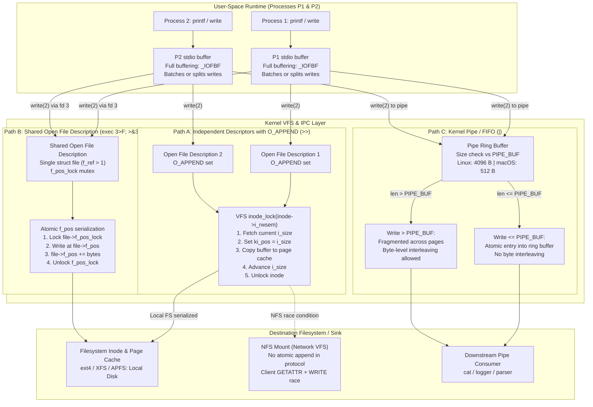

# Output Interleaving and Append Atomicity

> [!summary] Claim
> Output integrity across concurrent shell processes depends on whether operations share an open file description, open independent descriptors with `O_APPEND`, or write to pipes bounded by `PIPE_BUF`, while user-space stdio buffering frequently shatters kernel-level write atomicity.

Part of [Concurrency and Scheduling](README.md) in [Shell and Unix Engineering](../README.md).

## TL;DR

- Mechanism: `>>` opens files with `O_APPEND` to reposition file offset to current inode size under filesystem locks prior to each `write(2)`, shared file descriptors serialize writes via kernel `f_pos_lock`, and pipes guarantee atomic non-interleaved writes up to `PIPE_BUF` bytes.
- Rule: Merge stdout and stderr using descriptor duplication `>file 2>&1` or append redirection `>>file 2>>file`, never independent truncation `>file 2>file`, and force line buffering via `stdbuf -oL -eL` when redirecting stdio streams.
- Trap: `O_APPEND` is not atomic on network filesystems like NFS because the protocol lacks an atomic append operation, causing multi-client appends to corrupt and overwrite records.
- Portability fact: `PIPE_BUF` guarantees atomicity only up to 512 bytes on macOS and BSD systems compared to 4096 bytes on Linux, and Linux `pwrite(2)` non-compliantly forces appends to the end of file on `O_APPEND` descriptors while macOS honors the offset.
- When not to use it: High-throughput multithreaded logging and distributed workloads require structured logging daemons, Unix domain datagram sockets (`SOCK_DGRAM`), or explicit file locking via `flock` rather than bare shell appends.

## Mental model



When concurrent processes write to output streams, execution flows through user-space runtime buffers before entering the kernel Virtual File System (VFS) or Inter-Process Communication (IPC) pipelines.
In Path A, processes open independent descriptors with the `O_APPEND` flag (`>>`), causing the kernel filesystem driver to acquire an exclusive inode lock (`i_rwsem`), query the current file size, assign the write offset to that size, and copy bytes into the page cache as an unbroken unit.
In Path B, child processes inherit a single Open File Description created by the parent (`exec 3>file; >&3`), where the kernel serializes file offset updates through an internal `f_pos_lock` mutex so that separate `write(2)` invocations advance the shared file position without mutual clobbering.
In Path C, concurrent writers emit bytes into a shared pipe or FIFO, where the kernel enforces strict atomicity without interleaving if and only if each write request is less than or equal to `PIPE_BUF` bytes.
If user-space programs rely on standard I/O streams without flushing, user-space buffering (`_IOFBF`) batches or fragments writes before they ever reach these kernel primitives, subverting append atomicity and scrambling interleaved records.

## How it works

### 1. Descriptor Tables, Open File Descriptions, and Inodes

To understand concurrency races and atomicity guarantees in the shell, one must distinguish the three structural layers the Unix kernel maintains for I/O operations.
The process-level File Descriptor Table maps small integer indices (`0`, `1`, `2`, `3`) to kernel memory structures.
These integer descriptors point to system-wide Open File Descriptions (`struct file` in Linux, `struct fileglob` in Apple XNU).
The Open File Description stores the file status flags (such as `O_APPEND`, `O_NONBLOCK`, `O_RDWR`), the reference count (`f_ref`), and the current byte offset (`f_pos`).
The Open File Description in turn holds a reference to the filesystem inode (`struct inode` in Linux, `struct vnode` in BSD and XNU), which maintains file metadata, ownership, block maps, and the true byte size (`i_size`).

```
Process A                        Open File Description (OFD)             VFS Inode
+-------------------+            +---------------------------+          +-------------------+
| fd 1 (stdout) ----|---+------->| f_pos: 1024               |--------->| i_size: 1024      |
+-------------------+   |        | f_flags: O_WRONLY         |          | i_rwsem: [mutex]  |
                        |        | f_ref: 2                  |          | page cache / data |
Process B               |        | f_pos_lock: [mutex]       |          +-------------------+
+-------------------+   |        +---------------------------+                    ^
| fd 1 (stdout) ----|---+                                                         |
+-------------------+                                                             |
                                                                                  |
Process C (Independent open)     Separate OFD                                     |
+-------------------+            +---------------------------+                    |
| fd 1 (stdout) ----|----------->| f_pos: 0                  |--------------------+
+-------------------+            | f_flags: O_WRONLY|O_APPEND|
                                 | f_ref: 1                  |
                                 +---------------------------+
```

When a parent shell runs `(worker1 & worker2 & wait) > output.log`, the shell opens `output.log` once.
Both child processes inherit descriptor `1` pointing to the exact same Open File Description.
When two commands independently execute `worker1 >> output.log & worker2 >> output.log &`, each process invokes `open(2)` independently.
They receive separate Open File Descriptions, each possessing independent `f_flags` and `f_pos` values, yet pointing to the same underlying filesystem inode.

### 2. The Mechanism of `O_APPEND` Atomicity

POSIX specifies the exact behavior of `O_APPEND` in the System Interfaces volume `(POSIX.1-2024 write)`:
"If the `O_APPEND` flag of the file status flags is set, the file offset shall be set to the end of the file prior to each write and no intervening file modification operation shall occur between changing the file offset and the write operation."
In the Shell Command Language specification `(POSIX.1-2024 XCU 2.7.3)`, the operator `>>word` requires opening the file with the `O_APPEND` flag set.

In the Linux kernel source (`fs/read_write.c, generic_write_checks_count`):
```c
if (iocb->ki_flags & IOCB_APPEND)
    iocb->ki_pos = i_size_read(inode);
```
In local filesystems such as ext4 (`fs/ext4/file.c, ext4_buffered_write_iter`, simplified excerpt of the 2026-11 mainline source; the `IOCB_NOWAIT` and `IOCB_ATOMIC` rejections are omitted):
```c
inode_lock(inode);
inode_dio_wait(inode);
ret = ext4_write_checks(iocb, from);
if (ret <= 0)
    goto out;
if (ext4_inode_buffered_iomap(inode))
    ret = ext4_iomap_buffered_write(iocb, from);
else
    ret = generic_perform_write(iocb, from);
out:
    inode_unlock(inode);
```
The kernel acquires an exclusive write lock on the inode lock (`inode_lock(inode)`, locking `&inode->i_rwsem`) before evaluating file size or writing data.
While holding `inode_lock`, `ext4_write_checks` calls `generic_write_checks`, reading `i_size_read(inode)` directly into `iocb->ki_pos`.
The kernel immediately performs the buffered write (`generic_perform_write()` or the iomap path), dirtying pages in the page cache and updating `inode->i_size` before releasing `inode_lock`.
Because `inode_lock` is held continuously across both the offset resolution and the data transfer, no other thread or process can modify the file size or write to the inode concurrently.
Consequently, on local Linux filesystems that hold the inode lock across a buffered write (ext4 and XFS among them), every single `write(2)` syscall on an `O_APPEND` descriptor appends at the true end of the file without interleaving, regardless of whether the write is 100 bytes or 256 KiB; the open(2) man page states the same guarantee: "The modification of the file offset and the write operation are performed as a single atomic step."
The bound is one `write(2)` call, which Linux caps at `MAX_RW_COUNT` (`INT_MAX & PAGE_MASK`, `include/linux/fs.h`), and a write can still return short (disk full, `RLIMIT_FSIZE`, signal), leaving the rest of the record for a later, separately placed call.

In Apple XNU (`bsd/vfs/vfs_vnops.c, vn_write`, simplified excerpt):
```c
if (vp->v_type == VREG && (fp->fp_glob->fg_flag & O_APPEND)) {
    ioflag |= IO_APPEND;
}
...
error = VNOP_WRITE(vp, uio, ioflag, ctx);
...
if ((flags & FOF_OFFSET) == 0) {
    if (ioflag & IO_APPEND) {
        fp->fp_glob->fg_offset = uio_offset(uio);
    } else {
        fp->fp_glob->fg_offset += (write_len - uio_resid(uio));
    }
}
```
XNU translates `O_APPEND` into the internal flag `IO_APPEND` for regular files, and for a plain `write(2)` (no `FOF_OFFSET`) it holds the open file description's offset lock (`vn_offset_lock(fp->fp_glob)`) across the whole call.
The filesystem's `VNOP_WRITE` then assigns the write offset to the current file size, writes the payload, and `fg_offset` is updated to reflect the new file offset upon completion; APFS is closed source, so on macOS that step is shown by measurement (lab test 7 passes on APFS, macOS 27.3, 2026-11) rather than by source.
XNU rejects a single write larger than `INT_MAX` bytes with `EINVAL` in the same function.

### 3. Shared Open File Descriptions and `f_pos_lock`

When concurrent subshells share a single Open File Description without `O_APPEND`, such as when redirecting a compound block `{ cmd1 & cmd2 & wait; } > file` or opening a descriptor via `exec 3>file`, data is protected by a different kernel lock: the file position mutex.
In Linux (`fs/file.c, fdget_pos`):
```c
static inline bool file_needs_f_pos_lock(struct file *file)
{
    if (!(file->f_mode & FMODE_ATOMIC_POS))
        return false;
    if (__file_ref_read_raw(&file->f_ref) != FILE_REF_ONEREF)
        return true;
    if (file->f_op->iterate_shared)
        return true;
    return false;
}

struct fd fdget_pos(unsigned int fd)
{
    struct fd f = fdget(fd);
    struct file *file = fd_file(f);

    if (likely(file) && file_needs_f_pos_lock(file)) {
        f.word |= FDPUT_POS_UNLOCK;
        mutex_lock(&file->f_pos_lock);
    }
    return f;
}
```
When a file is shared across multiple processes or threads, `file->f_ref` exceeds `FILE_REF_ONEREF`, causing `file_needs_f_pos_lock()` to evaluate to true; `FMODE_ATOMIC_POS` is set only for regular files and directories, so pipes never take this lock.
Every `write(2)` invocation through `ksys_write` takes `CLASS(fd_pos, f)(fd)`, which calls `fdget_pos()` and so acquires `mutex_lock(&file->f_pos_lock)` (`fs/read_write.c`).
This serialization exists only since Linux 3.14; the write(2) man page BUGS section records that before 3.14 two processes sharing an open file description could write overlapping blocks.
XNU gives the same guarantee through `vn_offset_lock()` on the shared `fileglob` (section 2).
The syscall writes data starting at `file->f_pos`, increments `file->f_pos` by the number of bytes transferred, and unlocks `f_pos_lock` via `__f_unlock_pos()`.
Because `f_pos` is serialized across all child processes sharing the descriptor, concurrent processes will not overwrite each other's bytes.
However, because this lock protects only a single `write(2)` syscall, if an application splits a logical line across multiple `write(2)` calls, lines from different processes will interleave.

### 4. Independent Open File Descriptions Without `O_APPEND` (The Clobber Hazard)

When multiple processes open the same file independently without `O_APPEND`, each process obtains a distinct Open File Description with its own `f_pos` initialized to zero.
In the shell script pattern:
```sh
# Anti-pattern: independent opens without O_APPEND
# (a bare <> opens on fd 0, so name fd 1 to catch stdout)
worker1 1<> file &
worker2 1<> file &
```
Both `worker1` and `worker2` issue `write(2)` against independent descriptors whose file offsets start at 0.
`worker1` writes 5,000 bytes, moving its private `f_pos` from 0 to 5,000.
Concurrently, `worker2` writes 5,000 bytes, moving its private `f_pos` from 0 to 5,000.
`worker2` silently overwrites the bytes written by `worker1`.
When both finish, the file size is 5,000 bytes rather than 10,000 bytes, and the earlier data is completely lost.

The same destruction occurs when redirecting stdout and stderr using separate redirection operators:
```sh
# Fatal trap: two separate truncating opens
cmd > output.log 2> output.log
```
According to `(POSIX.1-2024 XCU 2.7.2)`, each `>word` operator opens the file for output, creating it as an empty file if it does not exist and otherwise opening it "as if the open() function was called with the O_TRUNC flag set" (in practice `O_WRONLY | O_CREAT | O_TRUNC`).
The shell opens `output.log` on descriptor 1, initializing its `f_pos` to 0.
The shell then independently opens `output.log` on descriptor 2, which truncates the file again and initializes descriptor 2's `f_pos` to 0.
When the command emits a line to descriptor 1 followed by a line to descriptor 2, descriptor 2 writes its bytes at offset 0, directly overwriting the beginning of the stdout line.
The correct POSIX idiom is `cmd > output.log 2>&1` (`(POSIX.1-2024 XCU 2.7.6)`), which duplicates descriptor 1 to descriptor 2 via `dup2(1, 2)`, forcing both descriptors to share a single Open File Description and a single advancing `f_pos`.
Alternatively, `cmd >> output.log 2>> output.log` opens two independent descriptors but marks both with `O_APPEND`, ensuring the kernel repositions each write to the end of file before emitting bytes.

### 5. Pipe and FIFO Interleaving: The `PIPE_BUF` Limit

Pipes and FIFOs have no file offset (`f_pos`).
Writing to a pipe appends bytes directly into a kernel circular ring buffer.
Concurrency guarantees for pipes are defined strictly by `PIPE_BUF` in `(POSIX.1-2024 write)`:
"Write requests of `{PIPE_BUF}` bytes or less shall not be interleaved with data from other threads performing write operations on the same pipe or FIFO.
Writes of greater than `{PIPE_BUF}` bytes may have data interleaved, on arbitrary boundaries, with write operations by other threads..."

Under Linux, the pipe buffer capacity defaults to 16 pages since Linux 2.6.11 (65,536 bytes with 4096-byte pages, per pipe(7)), but the atomicity limit `PIPE_BUF` defined in `<linux/limits.h>` is exactly 4,096 bytes.
Under macOS and FreeBSD, `PIPE_BUF` defined in `<sys/syslimits.h>` is 512 bytes (`getconf PIPE_BUF /` prints 512 on macOS and 4096 on Linux in the shell matrix), matching the minimum requirement `_POSIX_PIPE_BUF` (512) in POSIX.1-2024 `<limits.h>`.
One shell breaks the premise: ksh93u+m 1.0.10 connects pipeline stages with sockets, not pipes (measured in the shell matrix: `readlink /proc/self/fd/1` in a stage shows `socket:[...]`), so `PIPE_BUF` facts do not carry over unchanged to its `|`.
If two processes concurrently write 400-byte log lines to a shared pipe:
- On Linux (400 <= 4096): each 400-byte line enters the pipe atomically without fragmentation.
- On macOS (400 <= 512): each 400-byte line enters the pipe atomically without fragmentation.

If two processes concurrently write 1,200-byte JSON log records to a shared pipe:
- On Linux (1200 <= 4096): writes remain strictly atomic.
- On macOS (1200 > 512): atomicity is void.
The kernel may split the 1,200-byte buffer into 512-byte chunks and interleave chunks from Process A with chunks from Process B, creating corrupted, invalid JSON in the reader.

```
macOS Pipe Interleaving (PIPE_BUF = 512 bytes, Write Size = 1200 bytes):

Writer A (1200 B): [ A1: 512 B ][ A2: 512 B ][ A3: 176 B ]
Writer B (1200 B): [ B1: 512 B ][ B2: 512 B ][ B3: 176 B ]

Resulting Pipe Stream (Corrupted):
+-------------+-------------+-------------+-------------+-------------+-------------+
|   A1 (512)  |   B1 (512)  |   A2 (512)  |   B2 (512)  |   A3 (176)  |   B3 (176)  |
+-------------+-------------+-------------+-------------+-------------+-------------+
```

### 6. The User-Space Stdio Buffering Inversion Hazard

All kernel atomicity guarantees assume the application invokes `write(2)` directly with complete logical records.
However, standard C runtime libraries (glibc, musl, macOS libSystem) wrap file descriptors in buffered `FILE *` streams.
In glibc (`libio/filedoalloc.c, _IO_file_doallocate`):
```c
size = BUFSIZ;
if (fp->_fileno >= 0 && __builtin_expect (_IO_SYSSTAT (fp, &st), 0) >= 0) {
    if (S_ISCHR (st.st_mode)) {
        if (__isatty_nostatus (fp->_fileno))
            fp->_flags |= _IO_LINE_BUF;
    }
    if (st.st_blksize > 0 && st.st_blksize < BUFSIZ)
        size = st.st_blksize;
}
p = malloc (size);
_IO_setb (fp, p, p + size, 1);
```
Standard I/O uses three buffering modes defined in `(POSIX.1-2024 setvbuf)`:
- Unbuffered (`_IONBF`): bytes are passed immediately to `write(2)`.
Standard error (`stderr`) defaults to `_IONBF`.
- Line-buffered (`_IOLBF`): bytes accumulate in user-space memory until a newline character (`\n`) is encountered or the buffer fills.
Standard output (`stdout`) defaults to `_IOLBF` only when `isatty(fileno(stdout))` is true.
- Fully-buffered (`_IOFBF`): bytes accumulate until the buffer is full, or until `fflush()` or `exit()` is called.
The buffer is not simply `BUFSIZ`: glibc uses `min(BUFSIZ, st_blksize)` (the excerpt above), and macOS libc sizes it from `st_blksize` (its `BUFSIZ` is 1,024, yet the first flush came at 4,096), so a stdout redirected to a 4 KiB-block file first reaches the kernel after 4,096 bytes on both Debian glibc 2.41 and macOS 27.3 (measured 2026-11 by checking `st_size` after each 100-byte `fputs`).
Standard output defaults to `_IOFBF` whenever stdout is redirected to a regular file, a pipe, or a block device.
musl is the exception at the first write: `stdout` starts line-buffered (`.lbf = '\n'` in `src/stdio/stdout.c`), and `__stdout_write()` switches it to full buffering only after its `TIOCGWINSZ` probe fails, so the first line reaches the file immediately (measured on Alpine: first flush after 100 bytes).
Whether a large `fwrite` is split also varies, and lab test 10 asserts each platform's value for `oiprobe stdio-writes 1500 512`: macOS libc wrote the 1,500 bytes as two `write(2)` calls of 1,024 and 476 bytes (it did not honor the 512-byte buffer request), while glibc 2.41 and musl 1.2.5 issued one 1,500-byte `write(2)`.

This buffering disparity triggers the classic log inversion bug:
```c
/* order.c */
fputs("A\n", stdout);
write(STDERR_FILENO, "B\n", 2);
fputs("C\n", stdout);
```
If executed in a terminal, stdout is line-buffered, printing `A\n`, then `B\n`, then `C\n`.
If executed with redirection `./order > output.log 2>&1`:
1. `stdout` refers to a regular file; glibc allocates a fully buffered (`_IOFBF`) buffer of `min(BUFSIZ, st_blksize)` bytes (4,096 on a 4 KiB-block filesystem).
2. `fputs("A\n", stdout)` copies two bytes into the user-space buffer; no syscall occurs.
3. `write(STDERR_FILENO, "B\n", 2)` executes `write(2)` immediately, placing `B\n` at file offset 0.
4. `fputs("C\n", stdout)` copies two bytes into the user-space buffer.
5. The process terminates; the C runtime exit handler flushes the stdout buffer, issuing `write(1, "A\nC\n", 4)`.
6. Descriptor 1 and descriptor 2 share the same Open File Description; descriptor 1 writes at offset 2.
7. The resulting file content is `B\nA\nC\n` (lab test 13, `oiprobe order`, on Debian glibc 2.41 and on macOS 27.3).
The error message `B` appears before the informational message `A` that triggered it.
Under musl the same program writes `A\nB\nC\n` (lab test 13 on Alpine musl 1.2.5): the first `fputs` is flushed at its newline while `stdout` is still line-buffered, and only `C` is held back, so the inversion shows up from the second line onward.

### 7. Shell Builtin Output Granularity and Batching

Shells execute builtins such as `echo` and `printf` without forking external binaries.
Whether consecutive builtins produce discrete `write(2)` system calls depends on internal shell buffering implementations.
In `dash` (`src/eval.c, evalbltin`):
```c
status = (*cmd->builtin)(argc, argv);
flushall();
```
`dash` invokes `flushall()` immediately following every builtin command execution, ensuring that each `echo` or `printf` flushes to the kernel as a separate `write(2)`.
In `bash` (`builtins/echo.def`) and `zsh`, standard builtins flush their output buffers at the end of each builtin call, resulting in exactly one `write(2)` per invocation (measured 2026-11 with the lab's `oiprobe count-writes`: `echo a; echo b; echo c` made three 2-byte writes in bash 3.2, bash 5.2.37, and zsh 5.9).
In contrast, historical `ksh93u+` (2012) buffered standard output across consecutive builtins using its internal `sfio` stream library.
In `ksh93u+`, running `echo a; echo b; echo c` merged the output into a single batched `write(2)` of 6 bytes (`a\nb\nc\n`; measured on macOS `/bin/ksh`, `Version AJM 93u+ 2012-08-01`).
In `ksh93u+m` 1.0.10 the same script made three 2-byte writes (measured on Debian), as did mksh R59, posh 0.14.1, yash 2.58.1, and BusyBox ash 1.37.0; the lab still accepts 1 to 3 writes for those shells rather than pinning the count.
External utilities like `/bin/echo` invoke `write(2)` during process execution and flush stdout upon standard library teardown during `exit(3)`.

## Numbers and limits

| Parameter / Limit | Platform / Scope | Measured / Standard Value | Specification / Source Code |
| :--- | :--- | :--- | :--- |
| `PIPE_BUF` (Atomicity limit) | Linux (x86_64, arm64, as of 2026-11) | 4,096 bytes | `<linux/limits.h>`, pipe(7), `getconf PIPE_BUF /` in the shell matrix |
| `PIPE_BUF` (Atomicity limit) | macOS (27.3, Darwin 27, as of 2026-11) | 512 bytes | `<sys/syslimits.h>`, `getconf PIPE_BUF /` measured |
| `PIPE_BUF` (Atomicity limit) | FreeBSD (main, as of 2026-11) | 512 bytes | `sys/sys/syslimits.h` |
| `_POSIX_PIPE_BUF` (Minimum) | POSIX.1-2024 Base | 512 bytes | `(POSIX.1-2024 XBD <limits.h>)` |
| Pipe ring buffer capacity | Linux (default since 2.6.11, as of 2026-11) | 65,536 bytes (16 pages of 4 KiB) | pipe(7), `fcntl(F_SETPIPE_SZ)` |
| Pipe ring buffer capacity | macOS (27.3, as of 2026-11) | 16,384 bytes growing to 65,536 bytes | measured in the shell matrix; `xnu/bsd/kern/sys_pipe.c` |
| stdio full buffer, stdout to a file | Linux (glibc 2.41, as of 2026-11) | `BUFSIZ` 8,192, but `min(BUFSIZ, st_blksize)`: 4,096 bytes measured on 4 KiB blocks | `glibc/libio/filedoalloc.c`, measured |
| stdio full buffer, stdout to a file | Linux (musl 1.2.5, as of 2026-11) | `BUFSIZ` 1,024 bytes; first line written immediately | `musl/src/stdio/stdout.c`, `__stdout_write.c`, measured |
| stdio full buffer, stdout to a file | macOS (27.3 libSystem, as of 2026-11) | `BUFSIZ` 1,024, but first flush at 4,096 bytes (`st_blksize`) | `<stdio.h>`, measured |
| Local append atomicity limit | Linux ext4 / XFS buffered writes | One `write(2)`, capped at `MAX_RW_COUNT` (`INT_MAX & PAGE_MASK`, 2,147,479,552 bytes with 4 KiB pages) | `inode_lock(&inode->i_rwsem)`, `include/linux/fs.h` |
| Local append atomicity limit | macOS XNU | One `write(2)` of at most `INT_MAX` bytes | `vn_write` returns `EINVAL` above `INT_MAX` |
| Single write verified atomicity | macOS APFS / Linux overlayfs (matrix containers) | 262,144 bytes (256 KiB) | Lab test 7 (`interleave.sh big`), measured 2026-11 |
| NFS `O_APPEND` atomicity | NFSv2, NFSv3, NFSv4 | None: every `WRITE` carries an explicit offset | RFC 1813 Section 3.3.7, RFC 7530 Section 16.36, open(2) `O_APPEND` description |
| Unix datagram send buffer (caps datagram size) | Linux (default `wmem_default`) | 229,376 bytes measured on the Linux 7.2 arm64 matrix kernel; kernel-dependent | `/proc/sys/net/core/wmem_default` |
| Unix datagram max size | macOS (`maxdgram`) | 2,048 bytes | `sysctl net.local.dgram.maxdgram`, measured on macOS 27.3 |

## Portability

| Shell / Environment | `>>` sets `O_APPEND` | Shared OFD (`>&3`) Serialized | `>F 2>F` Clobbers Stdout | Builtin `echo` Flushes per Call | `pwrite()` on `O_APPEND` Honors Offset | `stdbuf` Utility Availability | Truncated Active File Behavior |
| :--- | :--- | :--- | :--- | :--- | :--- | :--- | :--- |
| **POSIX.1-2024 sh** | Yes `(XCU 2.7.3)` | Yes (offset updates atomic: XSH 2.9.7, as quoted in Linux write(2) BUGS) | Yes (two open file descriptions, two offsets: `XCU 2.7.2`) | Unspecified | Yes `(XSH pwrite)` | Not specified (`stdbuf` is not a POSIX utility) | `>>` appends to EOF; `>` leaves a NUL gap |
| **macOS bash 3.2** | Yes | Yes (XNU `vn_offset_lock`, lab test 2) | Yes (12 bytes survive of 14) | Yes (1 write per echo, measured) | Yes (macOS honors offset, lab test 9) | `/usr/bin/stdbuf` present on macOS 27.3 (`shell_cmds-336.40.1`; Apple's public `shell_cmds` source has it from tag `shell_cmds-319.0.1`, not in `shell_cmds-309.120.3`) | `>>` appends to EOF; `>` leaves a NUL gap |
| **GNU bash 5.2** | Yes | Yes (Linux `f_pos_lock`, XNU `vn_offset_lock`) | Yes (12 bytes survive of 14) | Yes (1 write per echo, measured) | No on Linux; Yes on macOS | Coreutils (`stdbuf`) on Debian; not in the Alpine image | `>>` appends to EOF; `>` leaves a NUL gap |
| **zsh 5.9 (native)** | Yes | Yes (Linux `f_pos_lock`, XNU `vn_offset_lock`) | Yes (12 bytes survive of 14) | Yes (1 write per echo, measured) | No on Linux; Yes on macOS | Coreutils (`stdbuf`) | `>>` appends to EOF; `>` leaves a NUL gap |
| **zsh (emulate sh)** | Yes | Yes (Linux `f_pos_lock`, XNU `vn_offset_lock`) | Yes (12 bytes survive of 14) | Yes (1 write per echo, lab assertion) | No on Linux; Yes on macOS | Coreutils (`stdbuf`) | `>>` appends to EOF; `>` leaves a NUL gap |
| **dash 0.5.12** | Yes | Yes (Linux `f_pos_lock`, XNU `vn_offset_lock`) | Yes (12 bytes survive of 14) | Yes (`flushall()` in `evalbltin`, measured) | No on Linux; Yes on macOS | Coreutils (`stdbuf`) | `>>` appends to EOF; `>` leaves a NUL gap |
| **ksh93u+ 2012** | Yes | Yes (XNU `vn_offset_lock`) | Yes (12 bytes survive of 14) | No (one 6-byte write for three echoes, measured) | Yes (macOS only build in the matrix) | `/usr/bin/stdbuf` on macOS 27.3 | `>>` appends to EOF; `>` leaves a NUL gap |
| **ksh93u+m 1.0.10** | Yes | Yes (Linux `f_pos_lock`) | Yes (12 bytes survive of 14) | Yes (3 writes measured; lab accepts 1 to 3) | No on Linux | Coreutils (`stdbuf`) | `>>` appends to EOF; `>` leaves a NUL gap |
| **mksh R59** | Yes | Yes (Linux `f_pos_lock`) | Yes (12 bytes survive of 14) | Yes (3 writes measured; lab accepts 1 to 3) | No on Linux | Coreutils (`stdbuf`) on Debian; not in the Alpine image | `>>` appends to EOF; `>` leaves a NUL gap |
| **yash 2.58** | Yes | Yes (Linux `f_pos_lock`) | Yes (12 bytes survive of 14) | Yes (3 writes measured on Alpine; lab accepts 1 to 3) | No on Linux | Not in the Alpine image (install coreutils) | `>>` appends to EOF; `>` leaves a NUL gap |
| **posh 0.14** | Yes | Yes (Linux `f_pos_lock`) | Yes (12 bytes survive of 14) | Yes (3 writes measured; lab accepts 1 to 3) | No on Linux | Coreutils (`stdbuf`) | `>>` appends to EOF; `>` leaves a NUL gap |
| **BusyBox ash 1.37** | Yes | Yes (Linux `f_pos_lock`) | Yes (12 bytes survive of 14) | Yes (3 writes measured; lab accepts 1 to 3) | No on Linux | None: BusyBox 1.37 has no `stdbuf` applet in the Alpine image; install coreutils | `>>` appends to EOF; `>` leaves a NUL gap |

The `>>`, `>F 2>F`, and truncation columns follow from the shell's open flags and are asserted by lab tests 1, 5, and 6; the 14-test suite passed on the macOS 27.3 host under bash 3.2 (2026-11); the full shell matrix was not rerun for this revision, and the Linux expectations in tests 10 and 13 are the values `oiprobe` printed directly on the Debian glibc 2.41 and Alpine musl 1.2.5 images.
The `pwrite()` column is a kernel property, not a shell one: the lab's `oiprobe pwrite-append` printed `content=0123456789XY` on both Linux images and `content=XY23456789` on macOS.

## Worked example

The companion test suite for this note lives in [lab](../labs/15-output-interleaving-and-append-atomicity/).
The lab provides two core components: `interleave.sh`, which drives concurrent writers from the shell under test across append, shared descriptor, private descriptor, and pipe modes; and `oiprobe.c`, a C harness that measures low-level kernel write counts, stdio buffer splits, `pwrite` semantics, and TOCTOU seek races.

Below is an excerpt from `labs/15-output-interleaving-and-append-atomicity/interleave.sh` demonstrating concurrent writer orchestration:

```sh
# start_writers KIND N M FILE: run N background writers of KIND, then wait for all of them.
# Subshells inherit the group's stdout (pipe mode) and fd 3 (shared mode).
start_writers() {
  kind=$1
  n=$2
  m=$3
  file=$4
  w=1
  while [ "$w" -le "$n" ]; do
    letter=$(letter_of "$w")
    body=$(letter_line "$letter")
    (
      case $kind in
        append)
          i=0
          while [ "$i" -lt "$m" ]; do
            printf '%s\n' "$body" >>"$file"
            i=$((i + 1))
          done
          ;;
        shared)
          i=0
          while [ "$i" -lt "$m" ]; do
            printf '%s\n' "$body" >&3
            i=$((i + 1))
          done
          ;;
        separate)
          exec 4<>"$file"
          i=0
          while [ "$i" -lt "$m" ]; do
            printf '%s\n' "$body" >&4
            i=$((i + 1))
          done
          ;;
        pipe)
          i=0
          while [ "$i" -lt "$m" ]; do
            printf '%s\n' "$body"
            i=$((i + 1))
          done
          ;;
        *) exit 2 ;;
      esac
    ) &
    w=$((w + 1))
  done
  wait
}
```

Running the bats verification suite against the probe and driver yields captured outputs demonstrating kernel behaviors (these are the suite's exact assertions, which passed on the macOS 27.3 host under bash 3.2 in 2026-11; `big` and `shared` also printed the same lines on the Debian and Alpine images):

```sh
# 1. Four concurrent processes appending 50 lines of 100 bytes via >>
$ ./interleave.sh append 4 50 ./out.log
bytes=20000 lines=200 intact=200

# 2. Four concurrent processes sharing a single open file description (fd 3)
$ ./interleave.sh shared 4 50 ./out.log
bytes=20000 lines=200 intact=200

# 3. Four concurrent processes with private <> descriptors (no O_APPEND)
$ ./interleave.sh separate 4 50 ./out.log
bytes=5000 lines=50 intact=50

# 4. Merging stdout and stderr via duplicated descriptor (>F 2>&1)
$ ./interleave.sh merge dup ./out.log
bytes=14 content=stdout-line|e|

# 5. Merging stdout and stderr via dual independent opens (>F 2>F)
$ ./interleave.sh merge twoopen ./out.log
bytes=12 content=e|dout-line|

# 6. Four processes appending 16 massive 256 KiB blocks under O_APPEND
$ ./interleave.sh big ./oiprobe ./out.log
blocks=64 uniform=64 mixed=0 partial=0 A=16 B=16 C=16 D=16

# 7. Pre-seeking with lseek(SEEK_END) vs true O_APPEND atomicity
$ ./oiprobe race plain ./out.log
size=4 content=AAAA
$ ./oiprobe race append ./out.log
size=8 content=BBBBAAAA

# 8. pwrite on an O_APPEND descriptor (macOS output)
$ ./oiprobe pwrite-append ./out.log
content=XY23456789
```

In command 3: when four writers write 50 lines through independent `<>` descriptors without `O_APPEND`, 15,000 bytes are overwritten and destroyed.
In command 5, the dual-open redirection `>F 2>F` allows stderr (`e\n`) to overwrite the first two bytes of stdout (`st`), leaving `e\ndout-line\n`.
In command 6, every single 256 KiB write landed as an unbroken, contiguous block under `O_APPEND` without interleaving.
In command 7, seeking before writing (`plain`) completely loses the concurrent append `BBBB`, whereas `O_APPEND` preserves all 8 bytes.

## Pitfalls

> [!warning] The Dual-Open Redirection Collision (`>file 2>file`)
> Trigger: Redirecting both stdout and stderr to the same file using independent truncation operators, such as `cron_job.sh > /var/log/cron.log 2> /var/log/cron.log`.
> Symptom: Initial stdout log entries disappear or display corrupted byte fragments because stderr opens a separate Open File Description, truncates the file, and writes from offset 0.
> Fix: Always duplicate the descriptor using `>file 2>&1` so both streams share a single Open File Description and offset, or use append redirection `>>file 2>>file` where `O_APPEND` serializes all writes at EOF.

> [!warning] Distributed Filesystem `O_APPEND` Silent Overwrite (NFS Data Corruption)
> Trigger: Multiple hosts or cluster nodes writing concurrently to a shared log file mounted over NFS (NFSv3 or NFSv4) using `>> /mnt/nfs/app.log`.
> Symptom: Interleaved writes overwrite existing lines, producing mangled log records and corrupted trailing blocks.
> Fix: The NFS protocol specification (RFC 1813 Section 3.3.7, RFC 7530 Section 16.36) mandates that `WRITE` RPCs provide an explicit numeric `offset`.
> NFS lacks an atomic append operation; as open(2) puts it, "the client kernel has to simulate it, which can't be done without a race condition": the client takes the file size it last learned (from `GETATTR` or cached attributes) and sends `WRITE` at that offset, creating an unavoidable network race.
> Never use `>>` across NFS; write logs to local disk or stream over a network syslog socket.

> [!warning] Stdio Full-Buffering Inversion and Line Reversal
> Trigger: Running a command whose stdout and stderr are merged into a file or pipe (`command > log 2>&1`), where the binary uses C `printf` or Python without unbuffering.
> Symptom: Error messages written to `stderr` appear dozens of lines *before* the informational stdout messages that preceded them in execution time, confusing on-call triage.
> Fix: Wrap commands with `stdbuf -oL -eL command > log 2>&1` (GNU coreutils on Linux; `/usr/bin/stdbuf` on the macOS 27.3 host) to force line buffering on stdout, pass `-u` to Python scripts (`python -u script.py`), or set the environment variable `PYTHONUNBUFFERED=1`.
> `stdbuf` only changes the defaults of programs that use C stdio and do not call `setvbuf` themselves; it does nothing for Python, Go, or Java runtimes with their own buffering.

> [!warning] Pipe Record Interleaving Beyond `PIPE_BUF` on macOS
> Trigger: Emitting JSON log records larger than 512 bytes from multiple concurrent worker processes into a shared FIFO or pipeline on macOS or FreeBSD.
> Symptom: Scripts that ran cleanly on Linux (where `PIPE_BUF` is 4096 bytes) produce parse errors on macOS because records exceeding 512 bytes are sliced and interleaved across arbitrary byte boundaries.
> Fix: When piping to a common collector across platforms, keep individual line lengths strictly below 512 bytes, or route messages through temporary files, Unix domain datagram sockets, or dedicated line-buffering collectors.

> [!warning] TOCTOU Offset Races from Pre-Seeking (`lseek` Anti-Pattern)
> Trigger: Attempting to implement append semantics in application code by calling `lseek(fd, 0, SEEK_END)` followed by `write(fd, buf, len)` instead of opening with `O_APPEND`.
> Symptom: High-concurrency writers clobber each other's data whenever a context switch or preemption lands between the seek syscall and the write syscall.
> Fix: Open files with `O_APPEND` or use `fcntl(fd, F_SETFL, flags | O_APPEND)`.
> The kernel guarantees that updating the offset and committing data occur as an indivisible atomic step under the inode lock.

> [!warning] Compiler Diagnostic Splicing Under Parallel Build Systems
> Trigger: Running parallel compiler invocations (such as `make -j16` or `ninja`) where child processes emit multi-line compiler errors and warnings directly to a shared terminal stdout.
> Symptom: Diagnostic messages from different compilation units splice together mid-line, rendering compilation errors unreadable and breaking automated build log parsers.
> Fix: Use GNU make's `--output-sync=line` or `--output-sync=target` option (introduced in GNU make 4.0, 2013-10-09, per the make NEWS file), which directs each parallel job to buffer its output in a private temporary file and dump the complete block to stdout all at once upon target completion.

## Security and robustness

### 1. Log Injection and Record Tearing

When concurrent services log to shared descriptors, partial writes that exceed atomicity boundaries cause record tearing.
If an attacker triggers a voluminous error message that forces an application to split a log entry across two `write(2)` syscalls, an interleaved log write from another process can insert arbitrary fields between the header and payload of the first record.
In systems where downstream SIEM pipelines parse structured JSON logs, record tearing causes JSON syntax errors, dropping security alerts and creating blind spots during active exploitation.
To ensure robustness, applications must format log entries into contiguous user-space memory buffers and emit each entry with a single `write(2)` system call.

### 2. File Truncation and Sparse Hole Exploitation

If an active log file is truncated while another process holds an open file descriptor without `O_APPEND`, security vulnerabilities arise.
When a log rotation script executes `: > /var/log/app.log` or `truncate -s 0 /var/log/app.log`, the inode size drops to 0.
A running process holding an open descriptor created with plain `>` or `<>` still retains its original file offset (for example, 4,194,304 bytes).
The next `write(2)` executed by that process lands at that old offset, leaving a 4 MiB gap that reads as null bytes (`\0`); on filesystems that support sparse files the gap is an unallocated hole (the lab's `holes plain` case shows the same effect in miniature: 7 bytes instead of 2).
Log parsers, compression tools, and intrusion detection systems scanning the log file may crash, hang, or misinterpret null bytes as binary corruption.
Opening log files with `O_APPEND` avoids this vulnerability: every subsequent write dynamically checks the truncated file size (`i_size = 0`) and resumes cleanly from byte offset 0.

### 3. Crash Consistency and the Durability Fallacy

Engineers frequently conflate append atomicity with append durability.
`O_APPEND` guarantees that concurrent writes do not overwrite each other in the Linux page cache.
However, `O_APPEND` does not issue disk flushes or enforce filesystem barrier synchronization.
If power fails or the kernel panics, dirty pages stored in volatile RAM are lost.
Furthermore, what survives depends on the filesystem's journaling mode: ext4's default `data=ordered` forces data blocks out "prior to its metadata being committed to the journal", so recent appends are typically missing rather than garbled, while `data=writeback` does not preserve that ordering and "can potentially leave stale data exposed in recently written files in case of an unclean shutdown" (ext4 admin guide).
During sudden power loss, a file appended under `O_APPEND` can therefore recover shorter than the application believed, or, under weaker ordering modes, with an expanded size whose tail holds stale or zero blocks where data pages failed to flush to non-volatile storage.
Applications requiring transactional durability must pair `O_APPEND` with `fdatasync(2)`, `fsync(2)`, or open files with `O_SYNC` or `O_DSYNC`.

## The principal's view

Staff-plus engineers view shell output redirection not as an application architecture, but as a primitive Unix plumbing mechanism designed for sequential command chaining.
The POSIX standard intentionally defines regular file I/O as a byte-stream interface rather than a record-oriented interface.
While `O_APPEND` provides atomic serialization on local POSIX filesystems, relying on raw file appends for high-concurrency multi-process logging introduces severe architectural fragility.

The staff-plus decision matrix dictates:
1. **Single Node, Modest Throughput**: Shell redirection `>> file` and `>file 2>&1` is entirely acceptable for cron jobs, local build scripts, and CLI tooling running on ext4, XFS, or APFS, provided write payloads are formatted into atomic single-line bursts.
2. **Containerized and Microservice Workloads**: Services running in containers (Docker, Kubernetes) must never manage log files or append locks directly.
Microservices must emit clean, line-buffered JSON records strictly to stdout and stderr, delegating multiplexing, time-stamping, and non-blocking delivery to the container runtime logging engine (moby `daemon/logger/copier.go`, containerd CRI).
3. **Multi-Host and Clustered Systems**: Never attempt distributed file appends over NFS, SMB, or shared network volumes.
Applications must log to local Unix domain datagram sockets (`SOCK_DGRAM`) connected to a local forwarder daemon (such as systemd-journald, Fluent Bit, or Vector), which batches, compresses, and ships records over persistent TCP connections to centralized log stores.

## Interview questions

> [!question] L5: Predict the output of `>file 2>file` versus `>file 2>&1`
> Given a script that prints a 10-byte line to stdout followed immediately by a 2-byte error to stderr, predict the resulting file contents for `cmd >file 2>file` versus `cmd >file 2>&1`, and explain the kernel mechanism.
>
> > [!success]- Answer
> > In `cmd >file 2>&1`, descriptor 2 is duplicated from descriptor 1 via `dup2(1, 2)`, sharing a single Open File Description and a single file offset (`f_pos`).
> > Stdout writes 10 bytes advancing `f_pos` to 10, after which stderr writes 2 bytes advancing `f_pos` to 12, yielding a complete 12-byte file containing the stdout line followed by the stderr line.
> > In `cmd >file 2>file`, the shell executes two independent `open(2)` calls with `O_TRUNC`, creating two distinct Open File Descriptions whose `f_pos` counters each start at 0.
> > Stdout writes 10 bytes to its descriptor, but stderr writes 2 bytes to its own descriptor starting at offset 0, silently overwriting the first 2 bytes of the stdout output and leaving a corrupted 10-byte file.
> >
> > Follow-up: Why does changing the command to `cmd >>file 2>>file` prevent data destruction even though two separate `open(2)` calls occur?

> [!question] L5: Explain why stdout messages appear after stderr messages when redirected to a file
> A developer notices that running `./worker` in a terminal displays `[INFO] Initializing...` followed by `[WARN] Key missing`, but running `./worker > worker.log 2>&1` places the warning before the initialization message in `worker.log`.
> Why does this occur?
>
> > [!success]- Answer
> > Standard I/O libraries inspect the file descriptor to determine default buffering policies (glibc and Apple libc with a terminal check when the buffer is first allocated; musl with a `TIOCGWINSZ` ioctl at the first write, after which it switches away from line buffering).
> > When attached to an interactive terminal, stdout is line-buffered (`_IOLBF`), flushing user-space memory to the kernel immediately upon receiving a newline character.
> > When stdout is redirected to a regular file, the C runtime switches stdout to full block buffering (`_IOFBF`), accumulating a buffer's worth (4,096 bytes on a 4 KiB-block file under glibc 2.41 and macOS 27.3, measured) before invoking `write(2)`.
> > Because stderr is always unbuffered (`_IONBF`) by default, the warning message triggers an immediate `write(2)` at file offset 0, while the initialization message remains in user-space RAM until process termination or buffer saturation.
> >
> > Follow-up: How can an operations engineer resolve this issue from the shell without modifying or recompiling the application source code?

> [!question] L6: Debug this script: Intermittent JSON corruption in parallel batch pipelines
> A batch data processing script uses `xargs -P 16 -I {} sh -c 'generate_json "$@" >> /mnt/shared/output.jsonl' _ {}` to process thousands of records in parallel on a cluster.
> The script runs cleanly in local staging, but in production, downstream consumers report broken, partially overwritten JSON records.
> Identify the root cause and provide the production fix.
>
> > [!success]- Answer
> > Production mounts `/mnt/shared` over NFS, whereas local staging uses a local ext4 or APFS filesystem.
> > The Network File System protocol (NFSv3 and NFSv4) does not support atomic append operations; every NFS `WRITE` RPC requires an explicit numerical byte offset.
> > When multiple cluster nodes or processes open files with `O_APPEND` on NFS, client kernels simulate append by issuing a `GETATTR` RPC to read file size followed by a `WRITE` RPC at that offset, creating an unavoidable time-of-check to time-of-use (TOCTOU) race condition where concurrent nodes overwrite each other's byte ranges.
> > The production fix requires writing worker output to node-local scratch storage (such as `/tmp` or `$TMPDIR`), and then aggregating or copying the completed files sequentially to shared storage after workers complete, or having workers stream JSON lines over a Unix domain socket or network aggregator.
> >
> > Follow-up: What Linux kernel lock guarantees that this race cannot happen when appending to local ext4 filesystems?

> [!question] L6: Explain the difference between shared Open File Descriptions and independent `O_APPEND` descriptors
> Compare the concurrency and synchronization behavior of `(cmd1 & cmd2 & wait) > log.txt` versus `cmd1 >> log.txt & cmd2 >> log.txt & wait`.
>
> > [!success]- Answer
> > In `(cmd1 & cmd2 & wait) > log.txt`, the parent shell opens the file once without `O_APPEND`, and both child subshells inherit descriptors pointing to the exact same Open File Description.
> > The Linux kernel serializes concurrent writes through that shared Open File Description using `mutex_lock(&file->f_pos_lock)`, ensuring that each `write(2)` atomically reads and increments the shared `f_pos`.
> > In `cmd1 >> log.txt & cmd2 >> log.txt & wait`, each child process independently invokes `open(2)` with `O_APPEND`, creating two distinct Open File Descriptions with independent `f_pos` counters.
> > Synchronization moves from the Open File Description to the VFS inode lock (`&inode->i_rwsem`), where the filesystem driver locks the inode, samples the latest `i_size`, writes the data, and updates `i_size` before releasing the lock.
> >
> > Follow-up: If `cmd1` emits a single logical message using two consecutive 50-byte `write(2)` syscalls, which configuration prevents `cmd2` from interleaving between those two writes?

> [!question] L6: Why does POSIX mandate `PIPE_BUF` atomicity for pipes but no corresponding constant for regular files?
> POSIX.1-2024 guarantees non-interleaved writes to pipes and FIFOs up to `PIPE_BUF` bytes, but specifies no numeric atomicity boundary for regular files opened with `O_APPEND`.
> Why?
>
> > [!success]- Answer
> > Pipes and FIFOs are unidirectional memory buffers that lack file offset positioning and seeking capabilities; all data must flow through a finite kernel ring buffer.
> > If a pipe write exceeds available buffer space, the kernel must either block the writer or split the write across available pages, making atomicity guarantees dependent on a bounded maximum payload (`PIPE_BUF`).
> > Regular files are addressable, seekable block-backed storage managed by underlying filesystem drivers (ext4, XFS, APFS, ZFS) that serialize writes through inode metadata locks.
> > Because the filesystem driver can allocate new blocks and expand the file size arbitrarily under exclusive inode locks, regular file appends do not require an arbitrary architectural byte threshold like `PIPE_BUF`, but depend entirely on the underlying filesystem implementation.
> >
> > Follow-up: Can two threads concurrently writing 1 MiB buffers via `write(2)` to a pipe interleave their output even if the pipe buffer has been enlarged to 2 MiB using `fcntl(F_SETPIPE_SZ)`?

> [!question] L7+: How does Linux implement `pwrite(2)` on `O_APPEND` descriptors, and how does it diverge from POSIX and macOS?
> Detail the kernel execution path of `pwrite(2)` on an `O_APPEND` descriptor in Linux versus macOS, citing the POSIX specification and explaining recent Linux kernel changes.
>
> > [!success]- Answer
> > POSIX.1-2024 explicitly specifies in `pwrite()` that "The pwrite() function shall be equivalent to write(), except that it writes into a given position and does not change the file offset (regardless of whether O_APPEND is set)."
> > In Apple XNU (`bsd/vfs/vfs_vnops.c, vn_write`), the kernel checks if `flags & FOF_OFFSET` is set (which is true for `pwrite`), and explicitly clears `IO_APPEND`: `ioflag &= ~IO_APPEND`, correctly writing data at the specified offset without appending.
> > In Linux (`fs/read_write.c, generic_write_checks_count`), the kernel checks `if (iocb->ki_flags & IOCB_APPEND) iocb->ki_pos = i_size_read(inode);`, because `iocb_flags()` sets `IOCB_APPEND` whenever `file->f_flags & O_APPEND` is set, ignoring the explicit offset argument and forcing all `pwrite(2)` calls to append at EOF.
> > Linux man pages document this under `pwrite(2)` BUGS as a POSIX violation.
> > Linux 6.9 introduced the `RWF_NOAPPEND` flag for `pwritev2(2)` to allow applications to explicitly override `O_APPEND` and write to a fixed offset (readv(2): "RWF_NOAPPEND (since Linux 6.9)"; `kiocb_set_rw_flags()` in `include/linux/fs.h` clears `IOCB_APPEND` for it, as of 2026-11).
> > The lab's `oiprobe pwrite-append` shows both behaviors: `content=0123456789XY` on Linux and `content=XY23456789` on macOS 27.3.
> >
> > Follow-up: If an application needs to write to an explicit offset on an `O_APPEND` descriptor portably across Linux and macOS, what syscall sequence must it execute?

> [!question] L7+: Architectural design: Diagnosing cross-platform pipe truncation in high-throughput log collectors
> An infrastructure team builds a high-throughput CLI telemetry agent that pipes structured JSON event lines from dozens of concurrent worker processes into a central parsing daemon over a named FIFO.
> The system functions without error on Linux production servers, but developers running tests on macOS encounter frequent JSON parse errors indicating truncated and spliced lines.
> Diagnose the root cause and propose a hardened architecture.
>
> > [!success]- Answer
> > On Linux, `PIPE_BUF` is 4096 bytes, so any single `write(2)` call emitting a JSON line up to 4096 bytes is guaranteed by the kernel to enter the FIFO atomically without interleaving.
> > On macOS, `PIPE_BUF` is 512 bytes (`_POSIX_PIPE_BUF`); any JSON line whose byte length exceeds 512 bytes loses atomic protection, allowing the XNU kernel to fragment the buffer and interleave bytes from concurrent workers on arbitrary boundaries.
> > To harden the architecture portably, the team should replace the named FIFO with a Unix domain datagram socket (`AF_UNIX, SOCK_DGRAM`).
> > Unlike stream pipes, datagram sockets preserve explicit message boundaries and deliver packets atomically up to the socket buffer maximum (`net.local.dgram.maxdgram` on macOS, default 2048 bytes; configurable on Linux up to hundreds of kilobytes) without stream interleaving.
> >
> > Follow-up: Why is a Unix domain stream socket (`SOCK_STREAM`) insufficient to solve this problem without an application-layer framing protocol?

> [!question] L7+: Predict the output of file truncation during concurrent appends
> Process A opens `log.txt` with `exec 3>>log.txt`, writes 10 bytes, and pauses.
> Process B opens `log.txt` with `exec 4>log.txt`, writes 10 bytes, and pauses.
> An administrator executes `truncate -s 0 log.txt` or `: > log.txt` from a separate shell.
> Process A writes 5 bytes to descriptor 3 (`printf "AAAAA" >&3`).
> Process B writes 5 bytes to descriptor 4 (`printf "BBBBB" >&4`).
> Describe the exact byte layout, file size, and sparse characteristics of `log.txt` after both processes finish.
>
> > [!success]- Answer
> > When the administrator truncates `log.txt`, the VFS resets the inode size `i_size` to 0.
> > Process A holds descriptor 3 opened with `O_APPEND`; when it writes `AAAAA`, the kernel acquires `inode_lock`, reads the current file size (`i_size = 0`), sets `ki_pos = 0`, writes 5 bytes, and increments `i_size` to 5.
> > Process B holds descriptor 4 opened with plain `O_WRONLY` without `O_APPEND`; its Open File Description retains its private file position `f_pos = 10` from its initial write, completely unaware that another process modified the inode size.
> > When Process B writes `BBBBB` to descriptor 4, the kernel writes 5 bytes starting at offset 10, extending the file to 15 bytes.
> > The resulting file is 15 bytes in size: bytes 0-4 contain `AAAAA`, bytes 5-9 are a 5-byte gap that reads as null bytes (`\0\0\0\0\0`), and bytes 10-14 contain `BBBBB`.
> > The gap is not an unallocated hole: holes are tracked in whole filesystem blocks, and all 15 bytes sit inside the first 4 KiB block, so the filesystem stores the zeros in that one allocated block.
> >
> > Follow-up: How does `stat` or `ls -ls` reveal whether a NUL gap is an unallocated sparse hole rather than written null characters, and how large must the gap be before one appears?

## Related

Prerequisites: [[Descriptor-Semaphores]]

Next: [[Signal-Propagation-to-Children]]

See also: [[Background-Jobs-and-wait]], [[Bounded-Job-Pools]], [[xargs-P]], [[GNU-parallel]], [[Named-Pipes-for-IPC]], [[Atomic-Writes]]

## Further reading

- [POSIX.1-2024 System Interfaces: write()](https://pubs.opengroup.org/onlinepubs/9799919799/functions/write.html) - Formal specification defining `O_APPEND` offset modification atomicity and `{PIPE_BUF}` non-interleaving guarantees for pipes and FIFOs.
- [POSIX.1-2024 Shell Command Language: Section 2.7 Redirection](https://pubs.opengroup.org/onlinepubs/9799919799/utilities/V3_chap02.html) - Standards specification governing output redirection (`>`), append redirection (`>>`), descriptor duplication (`>&`), and open for reading and writing (`<>`).
- [Linux Kernel VFS Implementation: fs/read_write.c and fs/ext4/file.c](https://raw.githubusercontent.com/torvalds/linux/master/fs/read_write.c) - Primary kernel implementation code demonstrating `generic_write_checks_count`, `f_pos_lock` mutex serialization, and ext4 `inode_lock(&inode->i_rwsem)` exclusion.
- [Linux man-pages: open(2), write(2), pwrite(2), and pipe(7)](https://man7.org/linux/man-pages/man2/open.2.html) - Authoritative kernel documentation detailing the NFS `O_APPEND` race condition, `pwrite` offset handling bugs, and pipe buffer sizing.
- [Apple XNU Kernel: bsd/vfs/vfs_vnops.c](https://raw.githubusercontent.com/apple-oss-distributions/xnu/main/bsd/vfs/vfs_vnops.c) - Darwin VFS implementation demonstrating `IO_APPEND` translation, `FOF_OFFSET` flag clearance in `pwrite`, and vnode offset handling.
- [RFC 1813: NFS Version 3 Protocol Specification](https://www.rfc-editor.org/rfc/rfc1813.html) - Section 3.3.7 defining the network `WRITE` procedure, proving why network filesystems cannot support POSIX append atomicity without locking protocols.
- [GNU Make Manual: Output Synchronization (--output-sync)](https://www.gnu.org/software/make/manual/html_node/Parallel-Output.html) - Practical case study detailing how high-concurrency build systems solve compiler diagnostic interleaving through temporary file target buffering.
