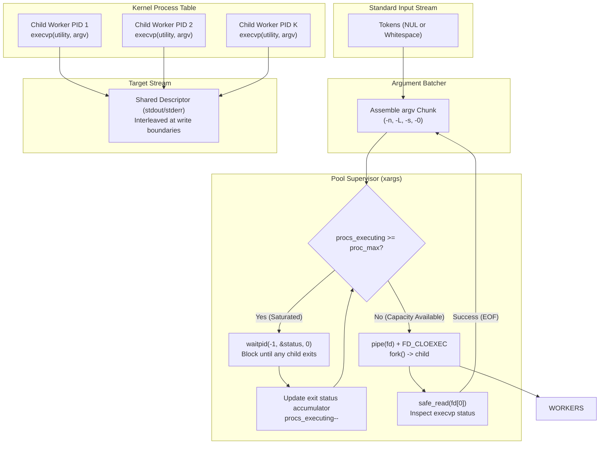

# xargs -P

> [!summary] Claim
> The `-P` option turns `xargs` from a sequential argument aggregator into a kernel-scheduled worker pool that regulates process concurrency through non-blocking and blocking `waitpid(2)` sweeps without shell job-control overhead.

Part of [Concurrency and Scheduling](README.md) in [Shell and Unix Engineering](../README.md).

## TL;DR

- Mechanism: `xargs` maintains an active child process counter, checks it against a maximum ceiling, blocks inside `waitpid(2)` upon saturation, and immediately forks replacements as slots clear.
- Rule: Always pair `-P` with explicit argument chunking such as `-n 1`, `-L 1`, or `-0 -I{}` so that arguments divide across multiple child process invocations.
- Trap: Sibling workers inherit the same standard output and error descriptors, interleaving byte streams unpredictably and tearing lines that exceed `PIPE_BUF`.
- Portability fact: POSIX.1-2024 omits `-P` (its RATIONALE only encourages implementations to add a parallel option); GNU, BSD, and BusyBox support it, but FreeBSD and macOS `-P 0` clamps to `RLIMIT_NPROC`, BusyBox `-P 0` clamps to 100, OpenBSD rejects `-P 0`, and only GNU supports runtime signal resizing.
- When not to use it: Avoid `xargs -P` when tasks require serialized output grouping, granular per-item retries, job-level timeouts, or remote cluster execution; use [[GNU-parallel]] instead.

## Mental model



Standard input feeds tokens into the argument batcher, which slices items into chunks according to `-n`, `-L`, `-s`, or replacement placeholders.
Before launching a batch, the supervisor compares `procs_executing` against the configured concurrency limit `proc_max`.
If the active process table is saturated, the supervisor enters a blocking `waitpid(2)` call to wait for at least one child to terminate.
When a worker terminates, the supervisor reads its exit status, records failures into the exit accumulator, decrements the active count, and reaps any additional dead children without blocking.
Once capacity is verified, the supervisor creates an internal diagnostic pipe with `FD_CLOEXEC`, forks the child, and attempts `execvp(2)`.
Children execute concurrently directly against the operating system kernel, writing to shared file descriptors while bypassing shell interpreters completely.

## How it works

At its core, `xargs` converts streaming text tokens into command-line arguments for external utilities.
Standard POSIX `xargs` `(POSIX.1-2024 XCU 3 Utilities, xargs)` mandates sequential execution: it must construct a command line, invoke the utility, and wait for its completion before reading further input.
The `-P` option overrides this sequential constraint, transforming `xargs` into a concurrent process pool manager.

### 1. Option Parsing and Ceiling Initialization

During option parsing in GNU findutils `(findutils xargs.c, main)`, `-P` (`--max-procs`) sets the global variable `proc_max`.
By default, `proc_max` (a `volatile sig_atomic_t`) is initialized to 1.
Supplying `-P N` sets `proc_max = N` through `parse_num (optarg, 'P', 0L, MAX_PROC_MAX, 1)`, where `MAX_PROC_MAX` is `SIG_ATOMIC_MAX` (findutils 4.10.0 `xargs/xargs.c`).
Setting `-P 0` is treated as unlimited concurrency: the condition `if (proc_max)` evaluates to false, completely skipping the saturation barrier before forks.
On FreeBSD and macOS Darwin `(FreeBSD usr.bin/xargs/xargs.c, main)`, `-P 0` does not mean unlimited.
Instead, BSD `xargs` invokes `getrlimit(RLIMIT_NPROC, &rl)` and, under `if (maxprocs == 0 || maxprocs > rl.rlim_cur)`, clamps `maxprocs` to `rl.rlim_cur`, so a value above the soft limit is clamped too.
In BusyBox `(BusyBox findutils/xargs.c, xargs_main)`, `-P` exists only when the build enables `FEATURE_XARGS_SUPPORT_PARALLEL` (Alpine's BusyBox 1.37.0 does), and `-P 0` is caught by `if (G.max_procs <= 0)` and clamped to a hard-coded ceiling of 100.
OpenBSD parses `-P` with `strtonum(optarg, 1, INT_MAX, &errstr)`, so `-P 0` is an error (`errx(1, ...)`).

### 2. Pre-Fork Reaping and Saturation Gating

When input tokens fill a command-line buffer, `xargs` prepares to spawn a worker in `xargs_do_exec()` `(findutils xargs.c)`.
First, if `proc_max` is non-zero, `xargs` tests whether `procs_executing >= proc_max`.
While that holds, it calls `wait_for_proc(false, 1u)`, which executes `waitpid(-1, &status, 0)` without `WNOHANG`.
The parent suspends inside `waitpid(2)` until the kernel reports that at least one child has changed state; no `SIGCHLD` handler is involved.
Upon wake-up, the terminated child PID is cleared from `pids[]`, `procs_executing` is decremented, and the saturation loop rechecks the condition.
Next, just before creating its pipe and forking, GNU `xargs` executes an opportunistic, non-blocking reap:
`wait_for_proc(false, 0u)` calls `waitpid(-1, &status, WNOHANG)`.
This sweeps any child processes that exited while `xargs` was reading standard input or assembling strings, preventing zombie exhaustion (order as in findutils 4.10.0 `xargs_do_exec`).

### 3. The Synchronization Pipe Pattern

A recurring challenge in Unix process supervision is distinguishing between a target binary that fails during `execvp(2)` versus a binary that executes successfully but exits with an error status.
GNU `xargs` solves this without race conditions by opening an internal anonymous pipe `pipe(fd)` immediately before calling `fork()` `(findutils xargs.c, xargs_do_exec)`.
The parent marks the write descriptor close-on-exec:
`fcntl(fd[1], F_SETFD, FD_CLOEXEC);`
In the child process after `fork()`:
1. The child closes the read descriptor `fd[0]`.
2. The child redirects standard input to `/dev/null` unless `-o` or `--open-tty` was specified.
3. The child calls `execvp(argv[0], argv)`.
4. If `execvp(2)` succeeds, the kernel executes the new binary image; as part of `execve(2)`, all descriptors marked `FD_CLOEXEC` are closed automatically.
5. If `execvp(2)` fails (for example, with `ENOENT` or `EACCES`), execution drops through to the error handler.
The child saves `errno`, writes the integer value to `fd[1]`, closes `fd[1]`, prints a diagnostic to standard error, and terminates with `_exit(127)` or `_exit(126)`.

In the parent process:
1. The parent closes the write descriptor `fd[1]`.
2. The parent calls `safe_read(fd[0], &buf, sizeof(int))`.
3. If `execvp(2)` succeeded in the child, `fd[1]` was closed on exec, so `safe_read()` returns 0 (`EOF`).
The parent knows the child is running its payload and tracks its PID.
4. If `execvp(2)` failed, `safe_read()` reads the 4-byte `errno` integer.
The parent knows the child failed execution, reaps it with `waitpid(child, &childstatus, 0)`, and then exits itself with 127 for `ENOENT` or 126 for any other error; only `E2BIG` is retried, with fewer arguments (findutils 4.10.0 `xargs_do_exec`).

### 4. Process Slot Tracking

When GNU `xargs` is invoked with `--process-slot-var=VAR`, it exposes a zero-indexed worker identifier to each spawned child.
The parent manages an internal dynamic array of PIDs `pids[]` allocated via `x2nrealloc()` `(findutils xargs.c, add_proc)`.
After `fork()`, the child's `prep_child_for_exec()` calls `add_proc(0)` on its own copy of `pids[]`, which finds the first index `i` where `pids[i] == 0`: the same slot the parent will fill with `add_proc(child)` once the exec succeeds.
The child's `set_slot_var()` then invokes `setenv(VAR, slot_string, 1)` prior to calling `execvp(2)`.
When the child exits, `wait_for_proc()` finds the PID in `pids[]` and resets `pids[i] = 0`.
This guarantees that at any given moment, no two concurrently running child processes share the same value of `VAR`.
With a fixed `-P N`, the slot values range from `0` to `N - 1`; under `-P 0` the array grows with the number of concurrent children.
Neither BSD `xargs` nor BusyBox `xargs` implements `--process-slot-var` (no such option in either source tree).

### 5. Exit Status Aggregation and Signal Semantics

The parent supervisor must map the termination states of hundreds or thousands of child processes into a single process exit code.
The implementations diverge significantly here:

```
Child State                  GNU findutils       BusyBox             FreeBSD / macOS
---------------------------------------------------------------------------------------
All children exit 0          Exit 0              Exit 0              Exit 0
Any child exits 1..254       Exit 123            Exit 123            Exit 1
Any child exits 255          Exit 124 (abort)    Exit 124 (abort)    Exit 1 (abort)
Any child killed by signal   Exit 125 (abort)    Exit 125 (abort)    Exit 1 (abort)
Command not executable       Exit 126            Exit 126            Exit 126
Command not found            Exit 127            Exit 127            Exit 127
```

In GNU `xargs` `(findutils xargs.c, wait_for_proc)`:
- If a child exits with status 1 through 254, `xargs` records `child_error = 123`.
It does NOT stop reading input; it continues dispatching subsequent batches.
- If a child exits with status 255, it indicates `CHILD_EXIT_PLEASE_STOP_IMMEDIATELY`.
`xargs` immediately stops reading standard input, sets deferred status 124, breaks the submission loop, waits for all currently running siblings to complete, and exits 124.
Waiting for the siblings is new in findutils 4.10.0 (2024-06-01, Savannah bug #64451); earlier releases could exit while siblings still ran.
- If a child terminates due to an unhandled signal (`WIFSIGNALED`) or is stopped (`WIFSTOPPED`), `xargs` prints a warning, stops reading input, waits for active siblings, and exits 125.
In FreeBSD and macOS `(FreeBSD usr.bin/xargs/xargs.c, waitchildren)`:
- Any child error (status 1..254) sets `rval = 1`.
- A child exit of 255 or termination by signal sets `cause_exit = 1`, halts further input reads, drains remaining active workers, and exits 1.
FreeBSD and macOS do not use exit codes 123, 124, or 125 (macOS `/usr/bin/xargs` measured 1, 1, 1 for the three cases, as of 2026-11).
OpenBSD does: its `waitchildren` sets `rval = 123` for a non-zero exit and calls `exit(124)` on 255 and `exit(125)` on a signal, with a source comment that it uses "the same values used by GNU xargs"; unlike GNU 4.10.0 it exits at once without draining siblings.

### 6. Dynamic Concurrency Resizing via POSIX Signals

GNU `xargs` allows operators to adjust worker pool concurrency on the fly without killing the orchestrator `(findutils xargs.c, increment_proc_max)`.
When started with `-P`, GNU `xargs` uses `sigaction(2)` to attach handlers:
- `SIGUSR1`: Invokes `increment_proc_max()`.
If `proc_max < MAX_PROC_MAX` (`SIG_ATOMIC_MAX`, which is `INT_MAX` on glibc), it increments `proc_max++` and sets `stop_waiting = 1`.
- `SIGUSR2`: Invokes `decrement_proc_max()`.
If `proc_max > 1`, it decrements `proc_max--`.
Because signal handlers are registered with `sa_flags = SA_RESTART` (findutils 4.10.0 `main`), a blocking `waitpid(2)` call is automatically restarted by the kernel on Linux and BSD unless a child state change occurred.
Consequently, sending `SIGUSR1` to a fully occupied pool does not immediately spawn a new worker at the instant of signal delivery; rather, the increased ceiling takes effect when the next running child completes and returns control to the scheduling loop.
Reducing the pool with `SIGUSR2` never terminates running workers; `xargs` simply delays spawning new jobs until natural completions reduce `procs_executing` below the new lower limit.
In GNU findutils versions from 4.5.9 (2010-04-29, the release whose NEWS introduced the resize signals) through 4.9.0, these handlers were installed unconditionally even without `-P`, preventing `SIGUSR1` from terminating serial `xargs`.
Findutils 4.10.0 (released 2024-06-01) corrected this bug by setting `catch_usr_signals = true` only when `-P` is explicitly passed; its NEWS calls the change an improvement in POSIX compliance.
On BSD, macOS, and BusyBox, `SIGUSR1` and `SIGUSR2` are not caught (neither source tree mentions them); sending either signal immediately terminates `xargs` via default signal disposition (macOS `xargs -P 2` measured exit status 158, which is 128 + `SIGUSR1` 30, as of 2026-11).

## Numbers and limits

The operational behavior of `xargs -P` is governed by strict kernel constants and implementation choices.

| Dimension / Metric | Value | Constraint Source | Operational Consequence |
|---|---|---|---|
| Default Concurrency | `1` (sequential) | POSIX.1-2024 XCU 3 xargs | Requires `-P` to enable any parallelism. |
| Maximum GNU Parallelism | `2147483647` (`SIG_ATOMIC_MAX`) | GNU findutils `xargs.c` (`MAX_PROC_MAX`) | Reported by `gxargs --show-limits` (findutils 4.10.0 on macOS, as of 2026-11). |
| `-P 0` GNU Concurrency | Unlimited (no `xargs` cap) | GNU findutils `xargs.c` (`if (proc_max)` gate is skipped) | `xargs` adds no limit; the kernel does: `pid_max` (up to 2^22 on 64-bit Linux, proc_sys_kernel(5)), `RLIMIT_NPROC`, cgroup limits, and RAM; it forks until `EAGAIN`. |
| `-P 0` BSD Concurrency | `RLIMIT_NPROC` soft limit | FreeBSD `xargs.c` (`rl.rlim_cur`) | Clamped to user process ceiling via `getrlimit(2)`; larger `-P N` values are clamped too. |
| `-P 0` BusyBox Concurrency | `100` | BusyBox `xargs.c` (`G.max_procs = 100`) | Hard-coded internal cap; ignores system capacity. |
| `-P 0` OpenBSD Concurrency | Rejected (Error) | OpenBSD `xargs.c` (`strtonum(optarg, 1, INT_MAX, ...)`) | Exits with error status 1; requires positive integer. |
| Atomic Pipe Write (`PIPE_BUF`) | `512` bytes | POSIX.1-2024 `_POSIX_PIPE_BUF` | Writes `<= 512` B to a shared pipe never interleave across workers on macOS (`getconf PIPE_BUF /` is 512, measured in the shell matrix). |
| Linux Pipe Buffer (`PIPE_BUF`) | `4096` bytes | Linux kernel `limits.h` | Atomic write ceiling for shared pipes on Linux (`getconf PIPE_BUF /` is 4096, measured in the shell matrix). |
| POSIX Exec Headroom | `2048` bytes | POSIX.1-2024 XCU 3 xargs DESCRIPTION and RATIONALE | Argument plus environment lists must not exceed `{ARG_MAX}-2048`, leaving room for the utility to grow its environment. |
| GNU Headroom Reserve | `2048` bytes | GNU `xargs.c` (`XARGS_POSIX_HEADROOM`) | Subtracted from `ARG_MAX` when calculating batch sizes. |
| GNU Default Command Buffer | `131072` bytes | GNU `xargs --show-limits` ("Size of command buffer we are actually using") | Caps a batch well below `ARG_MAX` unless `-s` raises it (findutils 4.10.0 on macOS, as of 2026-11). |
| BSD Headroom Reserve | `4096` bytes | FreeBSD `xargs.c` (`nline = arg_max - 4 * 1024`) | Extra padding subtracted from `ARG_MAX` before exec. |
| Exit Status: Child Error | `123` (GNU/BB/OpenBSD), `1` (FreeBSD/macOS) | GNU findutils / OpenBSD / FreeBSD `xargs.c` | Aggregates all non-zero exits (1-254) into one status. |
| Exit Status: Child Exit 255 | `124` (GNU/BB/OpenBSD), `1` (FreeBSD/macOS) | GNU findutils / OpenBSD / FreeBSD `xargs.c` | Immediate stop signal; aborts pending input queue. |
| Exit Status: Child Signal | `125` (GNU/BB/OpenBSD), `1` (FreeBSD/macOS) | GNU findutils / OpenBSD / FreeBSD `xargs.c` | Aborts pending queue when a worker dies from a signal. |
| Exit Status: Command Unrunnable | `126` | POSIX.1-2024 XCU 3 xargs | Command found but permission denied or format invalid. |
| Exit Status: Command Not Found | `127` | POSIX.1-2024 XCU 3 xargs | Command binary does not exist in target path. |

## Portability

Because `-P` is not standardized by POSIX, options, limits, and runtime behaviors vary across Unix variants and shell environments.

| Environment / Utility | `-P N` Support | `-P 0` Behavior | Signal Resize (`SIGUSR1/2`) | `--process-slot-var` | Failure Exit Codes | Shell Function Exec |
|---|---|---|---|---|---|---|
| POSIX.1-2024 `xargs` | Not supported | Not supported | Not supported | Not supported | 1-125, 126, 127 | N/A (Standard binary) |
| GNU findutils `xargs` | Supported | Unlimited (no `xargs` cap) | Supported (`SA_RESTART`) | Supported | 123, 124, 125, 126, 127 | Requires `bash` `export -f` |
| macOS Darwin `xargs` | Supported | Clamped to `RLIMIT_NPROC` | Fatal (Kills xargs) | Not supported | 1, 126, 127 | Requires `bash` `export -f` |
| FreeBSD `xargs` | Supported | Clamped to `RLIMIT_NPROC` | Fatal (Kills xargs) | Not supported | 1, 126, 127 | Requires `bash` `export -f` |
| OpenBSD `xargs` | Supported | Rejects as error | Fatal (Kills xargs) | Not supported | 123, 124, 125, 126, 127 | Requires `bash` `export -f` |
| BusyBox `xargs` | Supported (build option) | Clamped to 100 | Fatal (Kills xargs) | Not supported | 123, 124, 125, 126, 127 | Requires `bash` `export -f` |
| uutils `xargs` (Rust) | Flag parsed only ("NOT IMPLEMENTED", as of 2026-11) | Not implemented | Fatal (Kills xargs) | Not supported | 123, 124, 125, 126, 127 | Requires `bash` `export -f` |
| `bash` 3.2 / 5.2+ | External tool | External tool | External tool | External tool | Inherits tool status | `export -f` visible |
| `dash` 0.5.12 | External tool | External tool | External tool | External tool | Inherits tool status | No function export |
| `zsh` 5.9 (native) | External tool | External tool | External tool | External tool | Inherits tool status | No function export |
| `zsh` (`--emulate sh`) | External tool | External tool | External tool | External tool | Inherits tool status | No function export |
| `ksh93u+m` 1.0.10 | External tool | External tool | External tool | External tool | Inherits tool status | No function export |
| `mksh` R59 | External tool | External tool | External tool | External tool | Inherits tool status | No function export |
| `yash` 2.58.1 | External tool | External tool | External tool | External tool | Inherits tool status | No function export |
| `posh` 0.14.1 | External tool | External tool | External tool | External tool | Inherits tool status | No function export |

The "No function export" cells for `dash` and `zsh` were measured on the macOS host (`export -f` is an illegal option, and a function defined in the parent is `not found` in a child `bash`; as of 2026-11).
For `ksh93`, host `/bin/ksh` (ksh93u+ 2012-08-01) accepts `typeset -fx f` but a child `bash` still reports `f: not found`; the `ksh93u+m` 1.0.10 row was not run (as of 2026-11).
For `posh`, its Debian manual page documents no way to export a function; this rests on the manual, not on a run.

## Worked example

The accompanying test lab demonstrates concurrency bounding, argument chunking, and worker tracking under real execution: [lab](../labs/15-xargs-p/).

The lab harnesses two shell scripts: `run_pool.sh`, which configures and drives the pool, and `peak_worker.sh`, which records concurrent execution peaks via filesystem markers.

Here is the exact code for `run_pool.sh`:

```sh
#!/bin/sh
# run_pool: push N one-item jobs through "xargs -P JOBS -n 1" and report the observed peak.
# Usage: run_pool.sh JOBS N SECONDS DIR      (JOBS "default" omits -P)
# Prints: peak=<max concurrent jobs> invocations=<jobs run> status=<xargs exit status>
# The worker is peak_worker.sh; XARGS overrides the xargs command (default xargs).
jobs=$1
n=$2
secs=$3
dir=$4
here=$(cd "$(dirname "$0")" && pwd)
x=${XARGS:-xargs}
rm -f "$dir/peak.log" "$dir"/run.*
if [ "$jobs" = default ]; then
  set -- -n 1
else
  set -- -P "$jobs" -n 1
fi
seq 1 "$n" | "$x" "$@" "$here/peak_worker.sh" "$dir" "$secs"
status=$?
peak=$(sort -n "$dir/peak.log" | tail -n 1)
count=$(wc -l <"$dir/peak.log")
printf 'peak=%s invocations=%s status=%s\n' "$peak" "$((count))" "$status"
```

Here is the exact code for `peak_worker.sh`:

```sh
#!/bin/sh
# peak_worker: a job that records how many peers are alive at the same time.
# Usage: peak_worker.sh DIR SECONDS [ITEM...]
# It creates DIR/run.PID, appends the number of DIR/run.* files it can see to DIR/peak.log,
# sleeps SECONDS in a real /bin/sleep, then removes its marker.
# A line in peak.log can only be too small, never too big, so the maximum is a lower bound on the
# real concurrency and is exact when every job outlives the start-up of all the others.
dir=$1
secs=$2
: >"$dir/run.$$"
set -- "$dir"/run.*
printf '%d\n' "$#" >>"$dir/peak.log"
/bin/sleep "$secs"
rm -f "$dir/run.$$"
```

When executing `run_pool.sh 3 9 1 <scratch-dir>` under `xargs -P 3 -n 1`, 9 items are fed into the pool with each job sleeping 1 second.
The observed peak matches the concurrency ceiling:

```text
peak=3 invocations=9 status=0
```

By contrast, running without `-P` (`run_pool.sh default 3 1 <scratch-dir>`) runs sequentially:

```text
peak=1 invocations=3 status=0
```

Running with `-P 0` (`run_pool.sh 0 6 1 <scratch-dir>`) lifts the cap, spawning all 6 jobs simultaneously:

```text
peak=6 invocations=6 status=0
```

If `-n 1` is omitted (the lab runs `seq 1 8 | xargs -P 4 peak_worker.sh DIR 1` directly, not through `run_pool.sh`), `xargs` bundles all 8 tokens into a single execution, so `DIR/peak.log` holds exactly one line:

```text
1
```

All four outputs above were captured once on the macOS host with its BSD-derived `/usr/bin/xargs` (as of 2026-11); the lab asserts the same strings for GNU and BusyBox, where `-P 0` means unlimited and 100 respectively.

## Pitfalls

> [!warning] Omitting -n Collapses Parallelism into a Single Invocation
> Trigger: Running `find . -name '*.gz' | xargs -P 8 gzip -d` without passing `-n` or `-L`.
> Symptom: All discovered paths fit within one command line: the system `ARG_MAX` (typically 1 MiB to 2 MiB on modern Unix), or GNU's smaller default command buffer of 131072 bytes (`xargs --show-limits`).
> The `xargs` utility constructs a single argv array containing all filenames and calls `execvp(2)` once.
> Concurrency remains strictly 1, leaving 7 worker slots completely idle and taking 8x longer than planned.
> A longer list is split at the buffer limit, so it does run a few invocations in parallel, but in a handful of uneven batches rather than eight balanced ones.
> Fix: Always pair `-P` with an explicit batch size such as `-n 1` (one file per process) or `-n 16` (coarse batches).

> [!warning] Output Interleaving and Line Tearing Across Concurrent Workers
> Trigger: Multiple concurrent workers writing unbuffered or multi-line diagnostics to the shared standard output or standard error descriptor.
> Symptom: When individual writes exceed `PIPE_BUF` (512 bytes on macOS, 4096 bytes on Linux), the operating system no longer guarantees atomic write boundaries.
> Lines from different worker PIDs interleave mid-sentence, corrupting CSV files, JSON lines, and log outputs.
> Fix: Ensure worker print statements execute within single `write(2)` system calls below `PIPE_BUF`, direct each worker to a unique scratch file using `--process-slot-var` or PID naming, or switch to [[GNU-parallel]] which serializes per-job output buffers.

> [!warning] Remote Code Injection Through In-Band Token Expansion in sh -c
> Trigger: Wrapping commands in subshells via `xargs -P 4 -I{} sh -c 'convert {} {}.png'` where input filenames contain whitespace, quotes, or metacharacters.
> Symptom: Filenames containing semicolons, backticks, or `$(...)` execute arbitrary shell commands inside the child context with full user privileges.
> Fix: Never interpolate `{}` into the shell script string; pass `{}` as a positional parameter: `xargs -0 -P 4 -I{} sh -c 'convert "$1" "$1.png"' _ {}`.

> [!warning] Orphaned Background Children on Parent SIGTERM Termination
> Trigger: A CI runner, a custom supervisor, or an operator's `kill PID` sends `SIGTERM` to the `xargs` process alone while workers are running (systemd's default `KillMode=control-group` signals every process in the unit's cgroup, so it does not hit this case).
> Symptom: `xargs` does not forward termination signals to its active children; it exits immediately, leaving worker processes reparented to `init` (PID 1) or a subreaper.
> The orphaned workers continue consuming CPU, memory, and database connections long after the parent task was aborted.
> Fix: Wrap `xargs` in a dedicated process group and trap `SIGTERM` in the invoking shell script to issue `kill -- -$$` prior to exiting, as detailed in [[Signal-Propagation-to-Children]] and [[Graceful-Shutdown]].

> [!warning] Fork Exhaustion and System Freezes Under Unbounded -P 0
> Trigger: Invoking `find / -type f | xargs -P 0 process_file` on a massive directory tree.
> Symptom: On GNU systems, `xargs -P 0` sets no upper bound on concurrency.
> It loops continuously, calling `fork(2)` for every input batch until the kernel refuses a fork (the `pid_max` PID space, `RLIMIT_NPROC`, or a cgroup limit) or physical memory runs out.
> The kernel begins thrashing, triggering the Out-Of-Memory (OOM) killer or throwing `fork: Resource temporarily unavailable` (`EAGAIN`).
> Fix: Always bound concurrency to a multiple of physical CPU cores, such as `-P $(nproc)` on Linux or `-P $(sysctl -n hw.ncpu)` on macOS.

> [!warning] Invisibility of Shell Functions in Executed Worker Processes
> Trigger: Defining a shell function `worker() { ...; }` and invoking `xargs -P 4 worker`.
> Symptom: `xargs` fails immediately with `xargs: worker: No such file or directory` (exit code 127).
> Because `xargs` bypasses the shell and calls `execvp(2)` directly, it can only execute external binaries located in `PATH`.
> Fix: Place the worker logic in a standalone executable script, or in `bash` export the function into the environment using `export -f worker` and invoke `xargs -P 4 bash -c 'worker "$@"' _`.

> [!warning] Premature Pipeline Abort Triggered by Accidental Exit Status 255
> Trigger: A worker process exits with return code 255 (for example, `ssh` encountering an error or `curl` returning an internal failure).
> Symptom: POSIX.1-2024 designates status 255 as an immediate abort directive for `xargs`.
> Upon seeing 255, `xargs` halts further input reads, drains active workers (GNU 4.10.0 and later, FreeBSD, macOS; OpenBSD exits at once), and terminates with exit code 124 (GNU, BusyBox, OpenBSD) or 1 (FreeBSD, macOS), dropping the remainder of the input queue after a single "exited with status 255; aborting" diagnostic.
> Fix: Wrap commands that may produce status 255 in a translator script that masks or shifts the exit status: `sh -c 'cmd "$@" || { status=$?; [ "$status" -eq 255 ] && exit 254 || exit "$status"; }' _`.

## Security and robustness

### Input Delimitation and Option Hijacking

The default delimiter behavior of `xargs` treats spaces, tabs, and newlines as argument separators, while also interpreting single quotes, double quotes, and backslashes as escape characters.
If input filenames contain spaces (such as `My Document.pdf`), unquoted `xargs` splits them into two distinct arguments (`My` and `Document.pdf`).
Worse, if an adversary can create files in the scanned directory, they can create filenames starting with leading dashes (e.g., `-rf` or `--checkpoint-action=exec=sh`).
When passed to utilities, these filenames are parsed as command-line options rather than target operands.
To build robust, production-grade pipelines:
1. Always generate NUL-delimited input streams (e.g., `find -print0` or `git ls-files -z`).
2. Always instruct `xargs` to process NUL bytes using `-0` (`--null`).
3. Terminate command options with `--` before passing input items: `find . -type f -print0 | xargs -0 -P 4 rm -f --`.

### Time-of-Check to Time-of-Use (TOCTOU) Exploits

As noted in the GNU findutils documentation `(xargs(1) BUGS section, findutils 4.10.0)`, `xargs` is fundamentally vulnerable to filesystem race conditions: "there will always be a time gap between the production of the list of input files and their use in the commands that xargs issues".
There is an unavoidable time gap between when `find` or `ls` enumerates a directory entry and when `xargs` executes its target utility against that path.
In shared directories such as `/tmp` or multi-tenant scratch volumes, an unprivileged local attacker can replace a validated filename with a symlink pointing to `/etc/shadow` or another sensitive target.
When `xargs` runs as a privileged user (e.g., root), the worker follows the symlink and corrupts system files.
To mitigate TOCTOU risks:
- For local directory traversals, prefer `find ... -execdir ... +` over `xargs`, as `-execdir` runs commands from within the file's own directory using relative paths, and GNU `find` refuses to run it when `PATH` contains an empty or relative element; the findutils manual's security chapter calls `-execdir ... +` the most secure alternative when the job is not a plain delete (`-delete`).
- If `xargs -P` must be used, restrict operations to directories owned by the invoking user where directory write permissions are denied to all other users (`chmod 700`).

### Resource Partitioning via Process Slots

When multiple processes execute concurrently against shared infrastructure, resource collisions inevitably occur.
Common failure modes include:
- Multiple workers overwriting the same temporary scratch file `/tmp/temp.out`.
- Multiple workers attempting to bind to the same local TCP port.
- Database connection pools exhausting connection limits.

GNU `xargs` provides `--process-slot-var=VAR` to eliminate these races cleanly.
Because `xargs` guarantees that each currently running child has a unique integer in `VAR` between `0` and `proc_max - 1`, scripts can safely isolate resources:

```bash
find . -name '*.sql' -print0 | xargs -0 -P 4 --process-slot-var=SLOT sh -c '
  scratch="/tmp/worker_${SLOT}.tmp"
  psql -d "app_db_${SLOT}" -f "$1" > "$scratch" 2>&1
' _
```

### Exit Code Ambiguity

A significant operational limitation of `xargs -P` in production monitoring is the loss of granular error reporting.
When running 1,000 tasks across a cluster:
- If 999 tasks succeed and 1 task fails with exit status 2, GNU `xargs` exits with status 123.
- If all 1,000 tasks fail with exit status 137 (OOM killed), GNU `xargs` still exits with status 123.
The invoking shell cannot discern how many jobs failed, which specific items failed, or what their underlying exit codes were.
If granular telemetry is required, each worker must handle its own error reporting, writing structured logs or failure manifests to disk before exiting.

## The principal's view

From a staff-plus engineering perspective, `xargs -P` represents the quintessential Unix compromise: maximum ubiquity and zero deployment dependencies at the expense of observability and output isolation.

### The Trade-Off Matrix

When deciding how to parallelize compute or I/O workloads, evaluate four tiers of tooling:

1. `xargs -P`:
- Best for: Ephemeral shell scripts, CI/CD runners, local build steps, and administrative one-liners where third-party packages cannot be installed.
- Overhead: Microscopic memory footprint, zero interpreter startup latency, direct kernel `execvp(2)`.
- Fatal flaw: No output serialization, no task-level timeout, crude binary exit code aggregation.
2. Shell Background Loops with Wait (`wait -n`):
- Best for: Workflows that must execute internal shell functions, inspect shell variables, or manage custom descriptor semaphores without disk intermediaries.
- Overhead: Requires a shell with `wait -n` (`bash` 4.3+; `zsh` 5.9 rejects it with "job not found: -n", measured on the macOS host as of 2026-11); higher process management overhead.
- See: [[Bounded-Job-Pools]] and [[Descriptor-Semaphores]].
3. GNU Parallel:
- Best for: Complex single-host data pipelines, scientific computing, tasks requiring strict per-job output grouping, progress bars, or automatic retries on failure.
- Overhead: Heavy Perl dependency; notable startup latency per batch.
- See: [[GNU-parallel]].
4. Dedicated Compiled Orchestrator (Go / Rust):
- Best for: Production microservices, distributed pipelines, resilient daemon processors, and high-throughput ingestion pipelines.
- Overhead: Requires dedicated compilation, maintenance, and deployment artifacts.

### The Decision Rule

Adopt `xargs -P` when:
- The workload is embarrassingly parallel and CPU-bound or disk-bound.
- Workers write output to distinct destination files rather than sharing standard output.
- The pipeline runs on minimal base images (such as Alpine Linux or scratch containers) where Perl, Python, or Go runtimes are unavailable.

Migrate away from `xargs -P` when:
- Downstream stages consume stdout and require clean line serialization without corruption.
- Individual tasks require guaranteed execution timeouts (e.g. aborting after 30 seconds).
- Failed tasks must be dynamically retried with exponential backoff.
- The failure of a single item requires capturing its specific exit status and input token for dead-letter queuing.

## Interview questions

> [!question] L5: Why does `find . -type f | xargs -P 4 gzip` fail to compress files in parallel on modern Linux systems?
>
> > [!success]- Answer
> > The `xargs` utility defaults to accumulating as many arguments as possible until reaching the system `ARG_MAX` buffer size.
> > Because a typical file list fits entirely within one command line (GNU uses a 131072-byte buffer by default, well under the 1 MiB to 2 MiB `ARG_MAX`), `xargs` packs all arguments into a single invocation and executes `gzip` once; a longer list splits only at that buffer limit, into a few large uneven batches.
> > To achieve parallelism, the developer must explicitly pass `-n 1` or `-L 1` to force `xargs` to segment the input into distinct process invocations.
> >
> > Follow-up: What option should be added to guarantee safety against filenames containing whitespace or newlines?

> [!question] L6: Predict the output and explain the exact exit status of this pipeline on GNU findutils: `printf "1\n2\n3\n" | xargs -P 2 -n 1 sh -c 'exit "$1"' _`
>
> > [!success]- Answer
> > The pipeline produces no standard output and exits with status 123.
> > The `xargs` supervisor spawns three worker processes corresponding to items 1, 2, and 3, which exit with codes 1, 2, and 3 respectively.
> > Under GNU findutils, if any child process exits with a status between 1 and 254, `xargs` aggregates the error into constant 123 (`XARGS_EXIT_CLIENT_EXIT_NONZERO`).
> > Unlike status 255, codes 1 through 254 do not abort the queue, allowing all three jobs to execute to completion.
> >
> > Follow-up: How does the exit status differ if this exact pipeline is executed on macOS Darwin or FreeBSD?

> [!question] L6: Debug this script: `find /data -name '*.csv' | xargs -P 8 -I{} sh -c 'process_file {} >> /var/log/combined.log'`
>
> > [!success]- Answer
> > The script suffers from three major flaws: argument injection, output interleaving, and missing NUL delimitation.
> > First, filenames containing spaces or shell metacharacters (such as `;` or `$()`) result in arbitrary code injection because `{}` is interpolated directly into the `sh -c` string.
> > Second, concurrent append writes to `/var/log/combined.log` exceeding `PIPE_BUF` will interleave non-atomically, tearing lines and corrupting log records.
> > Third, default whitespace splitting will break on paths containing spaces.
> > The corrected pattern is: `find /data -name '*.csv' -print0 | xargs -0 -P 8 -I{} sh -c 'process_file "$1" > "/var/log/worker_$$.log"' _ {}`.
> >
> > Follow-up: Why must the dummy argument `_` be provided between the script string and `{}`?

> [!question] L6: How does GNU `xargs` distinguish between a command that does not exist in `PATH` versus a command that exists but exits with code 127?
>
> > [!success]- Answer
> > Before forking a child worker, GNU `xargs` creates an internal pipe with `pipe(2)` and marks the write descriptor with `FD_CLOEXEC`.
> > If `execvp(2)` succeeds, the write descriptor closes automatically as part of image replacement, delivering an instantaneous EOF (0 bytes) to the parent via `safe_read()`.
> > If `execvp(2)` fails with `ENOENT`, the child writes the integer `errno` to the pipe before calling `_exit(127)`.
> > When the parent reads the 4-byte `errno`, it recognizes that the binary failed to execute rather than executing and returning 127, allowing POSIX-compliant diagnostic reporting.
> >
> > Follow-up: What happens if `fork(2)` itself fails with `EAGAIN` due to system process limits?

> [!question] L7: Explain how GNU `xargs` implements dynamic worker pool resizing via `SIGUSR1` and `SIGUSR2`, including why `SA_RESTART` delays expansion.
>
> > [!success]- Answer
> > When configured with `-P`, GNU `xargs` registers signal handlers using `sigaction(2)` for `SIGUSR1` (increment ceiling) and `SIGUSR2` (decrement ceiling).
> > The handlers modify the volatile sig_atomic_t counter `proc_max` and set a flag `stop_waiting = 1`.
> > Because `sigaction` specifies the `SA_RESTART` flag, blocking system calls like `waitpid(2)` are automatically restarted by the kernel upon signal return rather than failing with `EINTR`.
> > Consequently, when the supervisor is blocked waiting on a saturated pool, delivering `SIGUSR1` increments `proc_max` in memory, but the supervisor remains asleep inside `waitpid(2)` until an existing child exits.
> >
> > Follow-up: Why does decreasing the pool with `SIGUSR2` never kill existing processes?

> [!question] L7: Under what conditions are concurrent writes to standard output guaranteed to remain atomic when multiple workers run under `xargs -P`?
>
> > [!success]- Answer
> > Writes are guaranteed to be atomic if and only if each worker issues writes through a single `write(2)` system call whose payload size does not exceed `PIPE_BUF`.
> > POSIX.1-2024 mandates that `PIPE_BUF` is at least 512 bytes, which is the exact limit on macOS Darwin, while Linux provides 4096 bytes.
> > If a worker uses standard I/O library buffering (such as `printf` or `std::cout`) that flushes across multiple system calls, or writes lines larger than `PIPE_BUF`, the kernel may interleave write chunks across PIDs.
> > Furthermore, atomic append to regular files requires opening the target with `O_APPEND`, but even with `O_APPEND`, NFS and certain distributed filesystems do not support atomic multi-process appends.
> >
> > Follow-up: How does [[GNU-parallel]] solve this problem architecturally?

> [!question] L7: When an external watchdog sends `SIGTERM` to `xargs -P 16`, what happens to running worker processes and how do you design a robust supervisor?
>
> > [!success]- Answer
> > When `xargs` receives `SIGTERM`, it terminates immediately according to default signal disposition without executing signal propagation logic to its child processes.
> > The 16 active worker processes are not killed; they are orphaned, reparented to `init` (PID 1) or a systemd user manager, and continue running detached.
> > To build a robust supervisor, the calling script must establish a dedicated process group using `setpgid` or run inside a separate session, trap `SIGTERM`, and broadcast `kill -- -$$` to the entire process group upon exit.
> > Alternatively, the supervisor can leverage Linux `prctl(PR_SET_PDEATHSIG, SIGTERM)` in wrapped workers so children terminate automatically when their parent dies.
> >
> > Follow-up: What is the difference between reparenting to PID 1 versus reparenting to a subreaper registered with `PR_SET_CHILD_SUBREAPER`?

> [!question] L7: Why can a shell function not be executed directly by `xargs -P`, and what are the exact performance and security trade-offs of using `bash -c 'export -f'`?
>
> > [!success]- Answer
> > Shell functions exist solely in the internal memory structures of an active shell interpreter process and have no representation in the filesystem `PATH`.
> > Because `xargs` issues direct `execvp(2)` system calls, the kernel searches directories for an executable file and fails with `ENOENT`.
> > In `bash`, exporting a function with `export -f my_func` serializes the function's definition text into an environment variable named `BASH_FUNC_my_func%%`.
> > Invoking `xargs -P 4 bash -c 'my_func "$@"' _` forces `xargs` to fork a fresh `bash` binary for every single batch, incurring massive process startup and parser overhead.
> > Furthermore, exporting functions via environment variables pollutes worker environments, and function import from the environment was the attack surface of Shellshock: CVE-2014-6271 (NVD, published 2014-09-24) is bash through 4.3 executing trailing strings after a function definition in an environment variable, which the later `BASH_FUNC_name%%` naming and import checks narrowed.
> >
> > Follow-up: How do native shell bounded pools compare in latency when dispatching millions of lightweight function calls?

## Related

Prerequisites: [[Bounded-Job-Pools]]

Next: [[GNU-parallel]]

See also: [[File-Discovery-and-Batch-Execution-Find-Fd-Xargs-Parallel]], [[Output-Interleaving-and-Append-Atomicity]], [[Signal-Propagation-to-Children]], [[Graceful-Shutdown]], [[Descriptor-Semaphores]]

## Further reading

- IEEE Std 1003.1-2024 (POSIX.1-2024) XCU `xargs`: The authoritative Open Group base specification defining standard `xargs` behavior, argument limits, exit statuses, and the sequential execution rationale.
- GNU findutils `xargs.c` source code: The primary implementation reference demonstrating process table management, pre-fork non-blocking reaping, the `FD_CLOEXEC` synchronization pipe, and dynamic signal resizing.
- FreeBSD `usr.bin/xargs/xargs.c` source code: Primary BSD reference detailing `RLIMIT_NPROC` soft clamping under `-P 0`, fixed-size array allocation, and BSD exit code collapsing.
- Linux Programmer's Manual `waitpid(2)`: Specification of non-blocking `WNOHANG` polling, status macros (`WIFSIGNALED`, `WEXITSTATUS`), and signal restart semantics.
- Linux Programmer's Manual `pipe(7)`: Core documentation on `PIPE_BUF` limits and atomic write guarantees across competing file descriptor writers.
