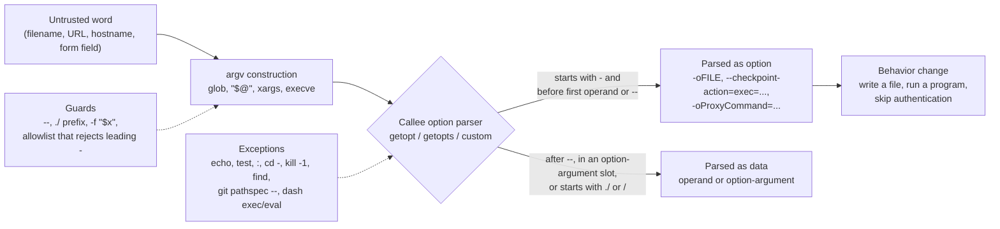

# Argument Injection and Double Dash

> [!summary] Claim
> Argument injection needs no shell metacharacter at all: a value that starts with `-` and reaches a callee's option parser before the end of options becomes an option, so the fix is to control where untrusted words land in `argv` (after `--`, in an option-argument slot, or behind `./`) and to know which callees ignore that convention.

Part of [Shell Security](README.md) in [Shell and Unix Engineering](../README.md).

## TL;DR

- Mechanism: the callee, not the shell, decides what an argument means; `getopt(3)`, `getopts`, and every hand-written parser treat a word beginning with `-` as an option until they reach the first operand or the first `--` that is not an option-argument (POSIX.1-2024 XBD 12.2 Guideline 10).
- Rule: put every untrusted word after `--`, or in the option-argument position of an option that requires one (`-f "$x"`), or prefix relative paths with `./` (`./*`, `"./$f"` only when `$f` is not absolute); validate identifiers such as hostnames and refs to reject a leading `-` at the trust boundary.
- Trap: `--` is a convention that many callees ignore or override: `echo` prints it, `test` and `:` do not recognize it, `cd -- -` still means `OLDPWD`, `kill -- -1` still signals every process, `find -- -name` is unspecified, git uses `--` for pathspecs, dash runs `exec --` and `eval --` as a command named `--`, and posh and BusyBox ash do the same for `exec --` and `eval --` respectively.
- Portability fact: GNU `getopt` and every measured `getopt_long` (glibc, musl, Apple libc) permute `argv`, so an option placed after an operand is still parsed (`sort file -o out` works on GNU); BSD and musl `getopt` stop at the first operand, and only glibc and BSD honor `POSIXLY_CORRECT` (lab on Apple libc; glibc and musl measured in the shell matrix's Debian and Alpine images and read in source).
- When not to use it: do not rely on `--` alone when the callee re-parses a value (ssh `ProxyCommand`, tar `--checkpoint-action=exec=`, `sendmail -X`); call a library API instead of a CLI, or validate the value against an allowlist before it reaches `argv`.

## Mental model



An untrusted word enters `argv` through a glob, a quoted expansion, `xargs`, or a direct `execve`, and quoting has already done its job: the word is one argument, with no splitting and no metacharacters left to interpret.
The decisive step happens inside the callee, whose option parser scans `argv` left to right and classifies each word by its first byte and its position.
A word that starts with `-` and appears before the first operand (or anywhere, for a permuting parser) and before the first `--` becomes an option, and options are where programs keep their most dangerous behavior: output paths, helper commands, authentication bypasses.
The guards act on construction (where the word lands), while the exceptions are callees whose parsers do not follow Guideline 10, so the guard has to change for them.

## How it works

### Argument injection is not command injection

Command injection ([[Command-Injection]]) needs a second parser, such as `sh -c` or `eval` ([[eval-and-sh-c]]), that re-tokenizes data into code.
Argument injection survives perfect quoting: `rm "$f"` passes exactly one argument, and if `f` is `-rf` that one argument is an option.
CWE-88 names it "Improper Neutralization of Argument Delimiters in a Command": the product "does not properly delimit the intended arguments, options, or switches within that command string" (CWE-88, MITRE).
The shell is innocent; the boundary that failed is the one between operand space and option space inside the callee's `argv` parser.

### The contract: XBD 12.1 and 12.2

POSIX defines the vocabulary: options (historically flags), option-arguments, and operands, in that order (POSIX.1-2024 XBD 12.1).
The Utility Syntax Guidelines then fix the parse (POSIX.1-2024 XBD 12.2):

- Guideline 4: options are preceded by `-`.
- Guideline 5: options without arguments may be grouped behind one `-`, followed by at most one option that takes an argument, so `-abVAL` is `-a -b VAL`.
- Guideline 6 and 7: each option-argument is a separate argument and is not optional; XBD 12.1 still requires an implementation to accept the attached form `-bVAL`, and an optional option-argument (`-f[arg]`) must be attached, so `-f next` never consumes `next`.
- Guideline 9: options should precede operands.
- Guideline 10: "The first `--` argument that is not an option-argument should be accepted as a delimiter indicating the end of options."
  It continues: "Any following arguments should be treated as operands, even if they begin with the '-' character."
- Guideline 13: a file operand `-` means standard input or output (or a file named `-`).
- Guideline 14: anything that parses as an option or option group "should be treated as such".

The guidelines say "should", but XBD 12.2 upgrades them: utilities that claim conformance "shall conform completely to these guidelines as if these guidelines contained the term 'shall'".
XCU 1.4 closes the gap for utilities with no options: "Standard utilities that do not accept options, but that do accept operands, shall recognize `--` as a first argument to be discarded", with the rationale that an application must be able to shield operands "from any arbitrary options that the implementation may provide as an extension", as in `foo -- -myfile` (POSIX.1-2024 XCU 1.4).
That rationale is the whole security argument in one sentence: you cannot enumerate a callee's extension options, so you cannot sanitize against them; you can only end option parsing.

### The parser: getopt(3) step by step

`getopt()` keeps `optind` (next `argv` index, starting at 1) and a hidden position inside a grouped word (POSIX.1-2024 XSH getopt).
On each call, it returns -1 without changing `optind` when `argv[optind]` is a null pointer, does not start with `-`, or is exactly `-`; it returns -1 after incrementing `optind` when `argv[optind]` is exactly `--`.
Otherwise it returns the next option character; if that option takes an argument, the rest of the word (`-bVAL`) or the whole next element (`-b VAL`) becomes `optarg`, whatever its first byte.
Three consequences follow directly from that code path, and the lab asserts each one through the shell's `getopts`, which XCU specifies with the same end-of-options rules (POSIX.1-2024 XCU getopts):

1. An option-argument slot absorbs a leading dash safely: `-b -- -a` makes `--` the argument of `-b`, so `-a` is parsed as an option afterwards; the delimiter only counts when it is not an option-argument.
2. Only the first `--` is consumed; `-a -- -- -a` leaves the operands `--` and `-a`.
3. The first operand stops a POSIX parser: `x -a` yields two operands, and `- -a` yields `-` and `-a`.

POSIX.1-2024 also standardized a leading `+` in the option string (Austin Group Defect 191): in a conforming environment it has no effect, and "in some non-conforming environments, the use of a leading `+` ... forces getopt() to behave in a conforming way" (POSIX.1-2024 XSH getopt, RATIONALE).
The non-conforming environment it means is GNU permutation.

### Permutation: GNU moves the boundary

glibc's `posix/getopt.c` (shared with gnulib, so GNU coreutils and tar use the same code) has three orderings: `REQUIRE_ORDER`, `PERMUTE`, and `RETURN_IN_ORDER`.
`_getopt_initialize()` picks `RETURN_IN_ORDER` for a leading `-` in the option string, `REQUIRE_ORDER` for a leading `+` or when `POSIXLY_CORRECT` is set in the environment, and `PERMUTE` otherwise (glibc `posix/getopt.c`, `_getopt_initialize`).
Under `PERMUTE`, `_getopt_internal_r()` skips non-options (`NONOPTION_P` is "does not start with `-`, or is exactly `-`"), keeps parsing the options that follow them, and calls `exchange()` to rotate the skipped operands behind the options, so `optind` finally points at the operands.
glibc exports this permuting function as `getopt` itself (`GETOPT_ENTRY(getopt, 0)`), and only a program compiled strictly for POSIX without `<getopt.h>` gets `__posix_getopt` through `bits/getopt_posix.h`.
The `--` handling runs before the non-option check: "The special ARGV-element `--` means premature end of options", after which every remaining element is a non-option.

The security consequence is that on GNU systems the position of an untrusted operand gives no protection: in `sort "$a" "$b"`, a hostile `$b` of `-o/etc/cron.d/x` is parsed as an option even though `$a` is an operand before it.
Only a `--` placed before the first untrusted word ends parsing on every implementation.

The other C libraries, from their sources:

- musl `getopt()` stops at the first non-option (`if (argv[optind][0] != '-') ... return -1`) and does not permute (musl `src/misc/getopt.c`).
- musl `getopt_long()` permutes unless the option string starts with `+` or `-`, and its source never reads `POSIXLY_CORRECT` (musl `src/misc/getopt_long.c`, `__getopt_long`).
- FreeBSD `getopt()` stops at the first non-option, and its `getopt_long.c` comment says "the BSD getopt(3) (unlike GNU) has never done" permutation; `getopt_long()` passes `FLAG_PERMUTE`, which `getopt_internal()` clears when `POSIXLY_CORRECT` is set or the option string starts with `+` (FreeBSD `lib/libc/stdlib/getopt_long.c`).
  The lab measures Apple's libc behaving the same way on macOS 27.3.

### Abbreviation: GNU long options accept unique prefixes

`process_long_option()` in glibc first looks for an exact match, then for abbreviations; one unique prefix match is accepted, several non-identical matches are "ambiguous" (glibc `posix/getopt.c`).
musl counts prefix matches and accepts exactly one (`cnt==1`), with an exact name breaking the loop early; FreeBSD tracks `exact_match` and `second_partial_match` the same way.
GNU tar documents the feature directly: "long option names can be given unique abbreviations" (GNU tar 1.35 manual).
Two attack-relevant facts follow.
A deny-list that searches input for `--checkpoint-action` misses `--checkpoint-a`, and the lab shows Apple libc accepting it; the shortest unique prefix against an option table holding `checkpoint`, `checkpoint-action`, and `output` is `--checkpoint-` (13 characters; the lab's probe given `--checkpoint-=x` reports `checkpoint-action=x` on Apple libc, glibc, and musl, measured by hand on the host and in the shell matrix images, as of 2026-11).
And a new long option added to a tool in a later release can turn a previously ambiguous prefix into a unique one, or the reverse, so a filter keyed to today's option table rots silently.

### What the shell does and does not do

The shell builds `argv` and then gets out of the way: after field splitting and pathname expansion (POSIX.1-2024 XCU 2.6.5 and 2.6.6), each word is an opaque string, and `execve(2)` copies the strings with no notion of options.
Pathname expansion sorts its results "according to the collating sequence in effect in the current locale" (POSIX.1-2024 XCU 2.14.3), and in the C locale `-` (0x2D) sorts before digits and letters, so a file named `-x` lands first in `*` and is guaranteed to reach the option parser ahead of every real operand.
That is the "wildcards gone wild" attack: Leon Juranic showed `tar cf archive.tar *` in a directory containing files named `--checkpoint=1` and `--checkpoint-action=exec=sh shell.sh`, `chown -R nobody:nobody *.php` with a file named `--reference=.drf.php`, and `rsync -t *.c foo:src/` with a file named `-e sh shell.c` (DefenseCode, "Back To The Future: Unix Wildcards Gone Wild", released 2014-06-25).
GNU tar 1.35 runs the `exec=` action through `xexec()`, which calls `execv("/bin/sh", {"/bin/sh", "-c", cmd})` (tar 1.35 `src/system.c`), so one injected argument becomes full command injection.
The tar manual adds that `--checkpoint-action` without `--checkpoint` "assumes default checkpoint frequency of one checkpoint per 10 records", so the second file is not strictly needed (GNU tar 1.35 manual).

### Shell built-ins: their own parsers

Built-ins parse options in shell source, not in libc, and each shell's code decides whether `--` is honored.

- bash: most built-ins call `internal_getopt()` (`builtins/bashgetopt.c`), which treats an exact `--` as the end of options and treats `--help` as `GETOPT_HELP` (bash 5.3 `bashgetopt.c`, `internal_getopt`); `exit` and `return` skip a leading `--` through `ISOPTION (list->word->word, '-')` in `get_exitstat()` (bash 5.3 `builtins/common.c`).
- bash `echo` has its own loop: it consumes leading words made only of `n`, `e`, and `E`, and its comment says `echo -` and `echo -<nonopt>` "both mean to just echo the arguments", so `--` is printed (bash 5.3 `builtins/echo.def`, `echo_builtin`).
- dash: `nextopt()` returns end of options for `--` (dash `src/options.c`), but `execcmd()` calls `shellexec(argv + 1, ...)` directly and `evalcmd()` concatenates `argv[1]` onward, so neither skips `--` (dash `src/eval.c`).
- BusyBox ash: `execcmd()` calls `nextopt("a:")`, which skips `--`, but `evalcmd()` starts at `argv[1]` like dash (BusyBox `shell/ash.c`).
- zsh: `execbuiltin()` drives a generic loop; `echo` is declared with `BINF_SKIPINVALID` and option letters `neE`, so an argument with any other letter ends options, and a lone `-` sets `ops.ind['-']` and is consumed, which is why `echo - x` prints `x` in zsh only (zsh `Src/builtin.c`, `execbuiltin`).
- mksh: `c_eval()` and the `exec` path in `comexec()` both call `ksh_getopt()` (mksh `funcs.c`, `exec.c`).
- yash: `eval_builtin()` parses with `xgetopt(..., XGETOPT_POSIX)` (yash `exec.c`); yash `echo` reads `ECHO_STYLE` and defaults to `SYSV` style, which accepts no options (yash `builtins/printf.c`, `echo_builtin`).
- ksh93u+m: `B_echo()` handles `-n` in both the `ucb` and default universes (ksh93u+m 1.0.10 `bltins/print.c`).

POSIX.1-2024 states which special built-ins must honor `--`: `.` (dot) and `exec` (both new in Issue 8 through Austin Group Defect 252, per their CHANGE HISTORY), `export`, `readonly`, `set`, `trap`, and `unset` support XBD 12.2, `:` "shall not recognize the `--` argument", `eval` may or may not, and for the rest (`break`, `continue`, `exit`, `return`, `shift`, `times`) "a conforming application shall not use that argument" (POSIX.1-2024 XCU 2.15 and each utility page).
For `eval`, the standard's own advice is to guard with a leading space: `eval " $commands"` (POSIX.1-2024 XCU 2.15 eval, APPLICATION USAGE).

### sh -c, system(3), and the Defect 1440 fix

`sh -c` treats its first operand as the command string, so a command string beginning with `-` or `+` is parsed as shell options.
Earlier editions specified `execl(shell, "sh", "-c", command, NULL)` for `system()`, which "meant that portable applications needed to take care not to pass a command string beginning with `-` or `+`"; POSIX.1-2024 applies Austin Group Defect 1440 and requires `execl(<shell path>, "sh", "-c", "--", command, (char *)0)` (POSIX.1-2024 XSH system, RATIONALE).
The `sh` page carries the same warning for operands: "A conforming application must protect its first operand, if it starts with a `+`, by preceding it with the `--` argument" (POSIX.1-2024 XCU sh, APPLICATION USAGE).
Measured on the host and asserted by the lab, `sh -c -x` fails in bash, dash, and ksh93u+ with a missing `-c` operand error (status 2) and in zsh with "string expected after -c" (status 1), while `sh -c -- -x` runs a command named `-x` and gets 127; in the shell matrix images the same command gives 2 in yash, BusyBox ash, and ksh93u+m and 1 in mksh and posh, and `sh -c -- -x` gives 127 in all of them (measured by hand, as of 2026-11).

## Numbers and limits

| Quantity | Value | Source |
|---|---|---|
| `--` delimiters honored per parse | 1 (the first that is not an option-argument) | POSIX.1-2024 XBD 12.2 Guideline 10; lab getopts tests |
| `optind` change when `getopt()` meets `--` | +1, then returns -1 | POSIX.1-2024 XSH getopt |
| `optind` change at `-` or a non-option | 0, returns -1 | POSIX.1-2024 XSH getopt |
| Special built-ins in POSIX.1-2024 | 15, of which 7 must support XBD 12.2 | POSIX.1-2024 XCU 2.15 (counted from the utility pages) |
| `{_POSIX_ARG_MAX}`, the minimum `ARG_MAX` | 4096 bytes | POSIX.1-2024 XBD `<limits.h>` |
| `getconf ARG_MAX` on macOS 27.3 | 1048576 bytes | measured on the host (as of 2026-11) |
| Shortest unique prefix of `--checkpoint-action` against `{checkpoint, checkpoint-action, output}` | 13 characters (`--checkpoint-`) | glibc, musl, and FreeBSD matching rules; measured with the lab's probe on Apple libc, glibc, and musl (2026-11); the lab asserts 14 (`--checkpoint-a`) |
| GNU tar default checkpoint interval when only `--checkpoint-action` is given | one checkpoint per 10 records | GNU tar 1.35 manual |
| `sh -c -x` exit status | 2 in bash, dash, ksh93u+, ksh93u+m, yash, BusyBox ash; 1 in zsh, mksh, posh | lab (host, 2026-11); shell matrix images, measured by hand (2026-11) |
| `sh -c -- -x` exit status | 127 | lab (host, 2026-11) |
| `exec -- printf ok` in dash and posh | exit 127 (`exec: --: not found` in dash, `--: not found` in posh 0.14.1) | lab (Homebrew dash on the host, 2026-11); dash `src/eval.c` `execcmd`; posh measured by hand in the shell matrix Debian image (2026-11) |
| `kill` operand `-1` | signals every process the caller may signal, except an unspecified set of system processes | POSIX.1-2024 XSH kill |
| git releases that reject dash-leading ssh hostnames | v2.7.6, v2.14.1 and the other maintenance releases of CVE-2017-1000117 (NVD published 2017-10-05) | git `RelNotes/2.7.6`, NVD |
| git releases that reject dash-leading submodule URLs | 2.14.5, 2.15.3, 2.16.5, 2.17.2, 2.18.1, 2.19.1 | NVD CVE-2018-17456 |
| git `--end-of-options` | first in Git 2.24 (tagged 2019-11-04, as of 2026-11) | git `RelNotes/2.24.0`, GitHub tag `v2.24.0` |

## Portability

Shell rows: "lab" means the lab asserts the cell and it was run on the host (bash 3.2 as macOS `/bin/sh` and `/bin/bash`, bash 5.3, dash, zsh 5.9, ksh93u+ 2012); "lab, matrix" means the lab asserts it, only the matrix runs that shell, and the cell was measured by hand with the same command in the matrix's Debian 13 and Alpine 3.22 images (as of 2026-11), with the cited source as further basis.

| Shell | `echo "$v"` with `v=-n` | `echo -- x` | `exec -- cmd` | `eval -- cmd` | `cd -- -` |
|---|---|---|---|---|---|
| POSIX sh | implementation-defined; XSI requires printing `-n` | prints `-- x` | must work (Defect 252) | either (XCU 2.15 eval) | goes to `OLDPWD` (XCU cd) |
| macOS bash 3.2 as `/bin/sh` | prints `-n` (lab) | `-- x` (lab) | works (lab) | works (lab) | `OLDPWD` (lab) |
| macOS `/bin/bash` 3.2, bash 5.3 | swallowed (lab) | `-- x` (lab) | works (lab) | works (lab) | `OLDPWD` (lab) |
| zsh 5.9 native and `--emulate sh` | swallowed (lab) | `-- x` (lab) | works (lab) | works (lab) | `OLDPWD` (lab) |
| dash | swallowed (lab) | `-- x` (lab) | runs `--`, 127 (lab) | runs `--`, 127 (lab) | `OLDPWD` (lab) |
| ksh93u+ 2012 | swallowed (lab) | `-- x` (lab) | works (lab) | works (lab) | `OLDPWD` (lab) |
| ksh93u+m 1.0.10 | swallowed (lab, matrix; `bltins/print.c`) | `-- x` (lab, matrix) | works (lab, matrix) | works (lab, matrix) | `OLDPWD` (lab, matrix) |
| mksh | swallowed (lab, matrix; `funcs.c` `c_print`) | `-- x` (lab, matrix) | works (lab, matrix; `exec.c` `ksh_getopt`) | works (lab, matrix; `funcs.c` `c_eval`) | `OLDPWD` (lab, matrix) |
| yash | prints `-n`, `ECHO_STYLE` unset (lab, matrix; `builtins/printf.c`) | `-- x` (lab, matrix) | works (lab, matrix) | works (lab, matrix; `exec.c` `eval_builtin`) | `OLDPWD` (lab, matrix) |
| posh 0.14.1 | swallowed (lab, matrix) | `-- x` (lab, matrix) | runs `--`, 127 (lab, matrix) | works (lab, matrix) | `OLDPWD` (lab, matrix) |
| BusyBox ash | swallowed (lab, matrix) | `-- x` (lab, matrix) | works (lab, matrix; `ash.c` `execcmd`) | runs `--`, 127 (lab, matrix; `ash.c` `evalcmd`) | `OLDPWD` (lab, matrix) |

The getopts rows of the lab (`--` ends options, an option-argument absorbs `--`, the first operand stops parsing, `-` is an operand, only the first `--` counts) are required by POSIX.1-2024 XCU getopts, and the host shells all agree; `echo - x` prints `x` in zsh (both modes) and `- x` in the other host shells (measured on the host, not in the lab).

Option parsers behind external utilities:

| Parser | Plain `getopt` permutes | `getopt_long` permutes | Honors `POSIXLY_CORRECT` | Leading `+` stops at first operand | Unique long prefixes |
|---|---|---|---|---|---|
| glibc and gnulib (GNU coreutils, tar) | yes (lab, matrix; `getopt.c`) | yes (lab, matrix) | yes (lab, matrix; `_getopt_initialize`) | yes (lab, matrix) | yes (lab, matrix; `process_long_option`) |
| musl (Alpine) | no (lab, matrix; `getopt.c`) | yes (lab, matrix; `getopt_long.c`) | no for `getopt_long` (lab, matrix; never read) | yes (lab, matrix) | yes (lab, matrix) |
| Apple libc (macOS utilities) | no (lab) | yes (lab) | yes (lab) | yes (lab) | yes (lab) |
| FreeBSD libc | no (`getopt.c`) | yes (`getopt_long.c`) | yes | yes | yes |

BusyBox applets parse through BusyBox's `getopt32` wrapper, which calls the C library's `getopt_long` (or `getopt`) in `libbb/getopt32.c`, so a BusyBox build inherits the row of the libc it links (musl on Alpine).
Parsers outside C libraries, such as Rust argument parsers, were not examined here, so check them by running the tool rather than assuming a row above.

## Worked example

The [lab](../labs/17-argument-injection-and-double-dash/) has four pieces: `optparse.sh` (the shell's `getopts` on any argument vector), `sweep.sh` (the attack and both fixes), `optprobe.c` (the libc parser), and `argument-injection.bats`.
`sweep.sh` builds a sort-like function with an ordinary `-o FILE` option, then runs it over a directory that holds `report.txt` and an empty file named `-oowned`:

```sh
#!/bin/sh
# sweep: run a sort-like tool over every file in DIR with an unguarded glob,
# with "--", or with a "./" prefix, and report whether a file named like an
# option hijacked the tool's -o (output file) option.
# Usage: sweep.sh glob|dashdash|dotslash DIR
set -u
mode=${1:-}
dir=${2:-}

# merge [-o FILE] FILE...: concatenate FILEs to stdout, or to FILE with -o.
# A stand-in for sort -o: the option is ordinary, the operands are untrusted.
merge() {
  out=''
  OPTIND=1
  while getopts o: opt; do
    case $opt in
      o) out=$OPTARG ;;
      *) return 2 ;;
    esac
  done
  shift $((OPTIND - 1))
  [ "$#" -gt 0 ] || return 2
  if [ -n "$out" ]; then
    cat -- "$@" >"$out"
  else
    cat -- "$@"
  fi
}

case $dir in
  /*) ;;
  *)
    printf 'sweep: DIR must be absolute\n' >&2
    exit 64
    ;;
esac
cd "$dir" || exit 1
# Pathname expansion sorts in the collating order of LC_COLLATE (XCU 2.14.3);
# pin it so "-o..." sorts before "report.txt" in every locale.
LC_ALL=C
export LC_ALL

case $mode in
  glob)
    # shellcheck disable=SC2035 # the unguarded glob is the vulnerability under test
    merge *
    ;;
  dashdash) merge -- * ;;
  dotslash) merge ./* ;;
  *)
    printf 'usage: sweep.sh glob|dashdash|dotslash DIR\n' >&2
    exit 64
    ;;
esac
rc=$?
if [ -e owned ]; then
  stolen=$(cat owned) || exit 1
  printf 'clobbered: owned now holds %s\n' "$stolen"
fi
exit "$rc"
```

Captured on macOS `/bin/sh`, with `dir` holding `report.txt` and `-oowned`:

```console
$ ./sweep.sh glob "$dir"
clobbered: owned now holds quarterly numbers
$ ./sweep.sh dashdash "$dir"
quarterly numbers
$ ./sweep.sh dotslash "$dir"
quarterly numbers
```

The glob expands to `-oowned report.txt`; `getopts` reads `-o` with the attached argument `owned`, so the report is written to a file the attacker named and nothing reaches stdout.
With `--` the empty `-oowned` is concatenated as data; with `./*` no word starts with `-` at all.
A real utility shows the same thing in the lab: in a directory holding `-f` and `keep`, `rm *` runs `rm -f keep`, deletes `keep`, and leaves `-f`, while `rm -- *` deletes both.

The libc probe, compiled with `"${CC:-cc}"` and run on macOS (Apple libc):

```console
$ optprobe long --checkpoint-a=exec=sh
libc: apple
opt: checkpoint-action=exec=sh
$ optprobe long --check
libc: apple
error
$ optprobe long report.txt -o out
libc: apple
opt: o=out
operand: <report.txt>
$ optprobe short report.txt -o out
libc: apple
operand: <report.txt>
operand: <-o>
operand: <out>
$ optprobe long-plus report.txt -o out
libc: apple
operand: <report.txt>
operand: <-o>
operand: <out>
```

The lab asserts the glibc and musl arms from their sources, and the same probe run by hand in the shell matrix's Debian (glibc) and Alpine (musl) images confirms them (as of 2026-11): glibc's plain `getopt` gives `opt: o=out` for the `short` line, and musl's `getopt_long` still permutes with `POSIXLY_CORRECT=1`.

## Pitfalls

> [!warning] Glob first, options second
> Trigger: `tar cf a.tar *`, `chown -R u:g *.php`, `rm *`, `rsync -t *.c host:` in a directory an attacker can write.
> Symptom: files named `--checkpoint-action=exec=sh shell.sh`, `--reference=.drf.php`, or `-e sh shell.c` become options (DefenseCode, 2014).
> Fix: `tar cf a.tar -- *` or `./*`; ShellCheck flags the unguarded form as SC2035 ("Use ./*glob* or -- *glob* so names with dashes won't become options", ShellCheck 0.11.0 on the host).

> [!warning] Permutation makes operand position meaningless
> Trigger: `sort "$known" "$untrusted"` or `grep pattern "$file" "$untrusted"` on a GNU system, reasoning that the first operand ended option parsing.
> Symptom: glibc's `PERMUTE` ordering keeps parsing after operands, so `-o/path` in the second slot is still an option.
> Fix: put `--` before the first untrusted word; do not count on `POSIXLY_CORRECT`, which musl's `getopt_long` never reads.

> [!warning] Dash-leading hostnames and URLs (git, Mercurial, Subversion)
> Trigger: a URL such as `ssh://-o...` whose host part is handed to `ssh` as an argument.
> Symptom: git: "A `ssh://...` URL can result in a `ssh` command line with a hostname that begins with a dash ... which would cause the `ssh` command to instead (mis)treat it as an option" (git v2.7.6 release notes), CVE-2017-1000117; Mercurial before 4.3 (CVE-2017-1000116, which NVD describes as hostnames passed to ssh without adequate sanitizing) and Subversion clients before 1.8.19 and 1.9.7 (CVE-2017-9800, a crafted `svn+ssh://` URL) had the same class of flaw.
> Fix: git now forbids such hostnames, ports, and repository names; in your own code reject a leading `-` for every identifier field and also pass `--` where the callee supports it.

> [!warning] Submodule URLs and other config-sourced values
> Trigger: a `.gitmodules` URL beginning with `-` passed to `git clone` during `git clone --recurse-submodules`.
> Symptom: remote code execution in Git before 2.14.5, 2.15.3, 2.16.5, 2.17.2, 2.18.1, and 2.19.1 (CVE-2018-17456, CWE-88).
> Fix: treat files from a repository as untrusted input; validate before building `argv`.

> [!warning] Escaping is not delimiting (PHPMailer)
> Trigger: an email Sender passed to sendmail as `-f` plus the address, as PHPMailer did with `sprintf('-f%s', $this->Sender)`.
> Symptom: the PoC Sender `"attacker\" -oQ/tmp/ -X/var/www/cache/phpcode.php  some"@email.com` produced the extra sendmail arguments `-oQ/tmp/` and `-X/var/www/cache/phpcode.php`, and `-X` wrote the transfer log into the web root (Golunski advisory, 2016-12-25; CVE-2016-10033); the first fix used `escapeshellarg()`, which interacted with the escaping inside PHP's `mail()` and was bypassed (CVE-2016-10045).
> Fix: build `argv` without a shell, attach the value to its option in one argument, and validate the address syntax strictly before use.

> [!warning] Authentication flags in a username
> Trigger: a network daemon that passes a client-supplied user name to `login` or `rlogin` style helpers.
> Symptom: some rlogin implementations granted root for a `-froot` parameter (CVE-1999-0113), and Solaris 10 and 11 `in.telnetd` let `-f` sequences make `login` skip authentication (CVE-2007-0882).
> Fix: put `--` before the user name and reject names beginning with `-`.

> [!warning] Array APIs still inject arguments (Poetry)
> Trigger: `subprocess.run(["git", "clone", url])` with an attacker-chosen `url`.
> Symptom: Poetry "correctly avoids Command Injection vulnerabilities by passing an array of arguments" yet a dash-leading input "is therefore treated as an optional argument instead of a positional one" (CVE-2022-36069).
> Fix: an argument vector stops command injection, not argument injection; add `--` and validate.

> [!warning] `--` does not cover operands with their own meaning
> Trigger: `cd -- "$d"` with `d=-`, `kill -- "$pid"` with `pid=-1`, `find -- "$root" ...` with `root=-delete`.
> Symptom: `cd` still goes to `OLDPWD` (XCU cd, lab); `kill` signals every process the caller may signal (XSH kill); `find` treats the first operand that starts with `-` as the start of the expression and leaves a leading `-` operand unspecified (XCU find).
> Fix: `cd "./$d"` when `d` is relative; validate `pid` as digits; pass `find` a path that starts with `/` or `./`.

> [!warning] `echo` and `test` have no end of options
> Trigger: `echo "$msg"` or `[ "$a" -a "$b" ]` with untrusted values.
> Symptom: `echo` swallows `-n`, `-e`, or `-E` in most shells (lab), and POSIX forbids it to recognize `--`; `[ '!' -a '' ]` returned 0 in ksh93u+ 2012, 1 in bash and zsh, and a syntax error in dash (measured on the host), the exact case POSIX.1-2024 cites ("`$1` set to `'!'` and `$2` set to the null string") after removing `-a`, `-o`, `(`, and `)` (XCU test APPLICATION USAGE; Austin Group Defect 1330 in its CHANGE HISTORY).
> Fix: `printf '%s\n' "$msg"`, and `[ "$a" ] && [ "$b" ]`; see [[printf-versus-echo]].

> [!warning] Shell built-ins with surprising options
> Trigger: `set "$x"`, `cd "$x"`, `eval "$code"` with a dash-leading value.
> Symptom: `set "$x"` with `x=-f` turns on `noglob` instead of setting `$1` (lab); `cd "$x"` with `x=--help` printed help in bash 5.3 and ksh93u+ and failed with `--: invalid option` in bash 3.2 (measured on the host); `eval -x` is an "invalid option" in bash and an "unknown option" in ksh93u+ but a command named `-x` in dash and zsh (measured on the host), and BusyBox ash also runs it as a command named `-x` (measured in the shell matrix images).
> Fix: `set -- "$x"`, `cd "./$x"` for a relative path, `eval " $code"`.

> [!warning] `exec --` and `eval --` in dash
> Trigger: copying the guideline-conforming `exec -- "$@"` into a script that dash runs.
> Symptom: dash runs a command named `--` and exits 127 (lab); posh 0.14.1 does the same for `exec --` and BusyBox ash for `eval --` (lab, matrix).
> Fix: write `exec "$@"` and make sure `$1` is a command path you chose, not data.

> [!warning] `--` in git is a pathspec separator
> Trigger: `git log -- "$rev"` or `git checkout -- "$x"` used as a generic end-of-options guard.
> Symptom: the value becomes a path, not a revision; git added `--end-of-options` because `--` "would not work for commands that use `--` as a delimiter between revs and pathspec" (git 2.24.0 release notes).
> Fix: `git rev-parse --end-of-options "$rev"` (Git 2.24 or later), or validate refs first.

## Security and robustness

- Build `argv`, never a string: an array or `"$@"` removes command injection, and argument injection is what remains, so the rest of this list still applies.
- Place every untrusted operand after a single `--`, and place it last: `cmd -o "$out" -- "$f1" "$f2"`.
- Prefer an option-argument slot when the callee offers one: `grep -e "$pattern" -- "$file"` is safe even when `pattern` starts with `-`, because `-e` consumes the next element whatever its first byte; avoid optional option-arguments, which only bind in attached form.
- Prefix relative paths with `./`, but only relative ones: `case $p in /*) ;; *) p=./$p ;; esac`; for whole directories use `./*` or `find . ... -exec cmd {} +`, whose pathnames are the path operand, a slash, and the relative name, so with `.` they all begin with `./` (POSIX.1-2024 XCU find).
- Stream untrusted names with NUL delimiters: `find . -print0 | xargs -0 cmd --` (both `-print0` and `xargs -0` are in POSIX.1-2024); see [[find-print0-and-exec-Plus]] and [[xargs-and-Argument-Batching]].
- Validate identifiers at the boundary with an allowlist: hostnames, user names, refs, branch names, URLs, and PIDs must not begin with `-`, which is exactly the rule git adopted.
- Use `printf '%s\n'` instead of `echo` for data, `set -- "$@"` instead of `set "$@"`, and `[ A ] && [ B ]` instead of `-a` and `-o`.
- For `system(3)`, `popen(3)`, and your own `sh -c` wrappers, pass `--` before the command string, as POSIX.1-2024 now requires of `system()`.
- Run ShellCheck: SC2035 catches the unguarded glob; see [[ShellCheck-Warning-Index]].
- GNU coreutils `rm` tries to help after the fact: when an option is unknown and a file by that name exists, `diagnose_leading_hyphen()` prints "Try 'rm ./-foo' to remove the file" (coreutils `src/rm.c`); that only helps an operator at a terminal, not a script.
- Hostile filenames go well beyond a leading dash (newlines, invalid UTF-8, control characters); see [[Hostile-Filenames]].

## The principal's view

The decision is where to put the trust boundary for every program a system launches: in the caller's `argv` construction, or in the callee's option parser that the caller does not own.
A staff-plus engineer puts it in the caller, because the callee's option table is an open set: XCU 1.4 says plainly that conforming applications need `--` to shield operands from extension options they cannot know about, and GNU long-option abbreviation means even the spelling of those options is open-ended.
The standard therefore makes three rules policy: every launch site separates options from data with `--` or an option-argument slot, every identifier crossing a trust boundary is validated against an allowlist that rejects a leading `-`, and every exception callee (`echo`, `test`, `cd -`, `kill`, `find`, git pathspecs, dash `exec`) has a documented alternative.
The trade-off is friction and some false positives: legitimate files named `-x` exist, some old tools do not accept `--`, and allowlists reject unusual but valid hostnames.
Where a CLI re-parses a value internally (ssh options, sendmail flags, tar checkpoint actions, git transport helpers), no amount of `argv` hygiene is enough, and the right tool is a library API (libgit2 instead of `git`, an SMTP client instead of `sendmail`, an archive library instead of `tar`) or a sandbox with no network and a read-only filesystem ([[Sandboxing-Scripts]]).
When a service builds command lines from user input at all, that is the signal to move the logic out of shell into a language whose process API takes a vector and whose code review can see every element.

## Interview questions

> [!question] L5: Why is `rm "$f"` unsafe even though `$f` is quoted, and what are two fixes?
>
> > [!success]- Answer
> > Quoting prevents splitting and globbing, so `rm` receives exactly one argument, but `rm`'s option parser still reads a leading `-` as an option.
> > With `f=-rf`, `rm` gets options and no operands; with a hostile directory, a glob makes it worse.
> > Fix one: `rm -- "$f"`, which ends option parsing (XBD 12.2 Guideline 10).
> > Fix two: `rm "./$f"` when `f` is a relative path, so the argument cannot start with `-`.
> >
> > Follow-up: Why must the `./` fix not be applied when `$f` is absolute?

> [!question] L5: Predict the output: in a directory containing only the empty file `-n` and a file `b` holding `hi`, what does `cat *` print in a GNU or BSD userland, and what does `cat -- *` print?
>
> > [!success]- Answer
> > The glob expands to `-n b` in the C locale, because `-` sorts before letters (XCU 2.14.3).
> > GNU, BSD, and macOS `cat` treat `-n` as "number lines", so `cat *` prints `hi` prefixed by a right-aligned line number and a tab (BSD `cat` and GNU `cat` both, measured on the host).
> > `cat -- *` reads the empty file `-n` and then `b`, so it prints `hi` with no number.
> > `-n` is not a POSIX `cat` option, which is exactly the XCU 1.4 case: extensions you did not plan for.
> >
> > Follow-up: What changes on a system whose locale ignores punctuation when collating?

> [!question] L5: Why does `printf '%s\n' "$v"` print `-n` reliably while `echo "$v"` does not?
>
> > [!success]- Answer
> > The format operand comes first in `printf`, so data never sits in an option position, and POSIX lets `printf` discard a leading `--` (XCU 1.4 default for utilities with no options).
> > POSIX forbids `echo` from recognizing `--` and makes a first operand made of `-` and `n`, `e`, `E` implementation-defined.
> > In the lab, bash, dash, zsh, and ksh93 swallow `-n`, while macOS `/bin/sh` and yash with no `ECHO_STYLE` print it.
> >
> > Follow-up: Which shell treats `echo - x` as `echo x`, and why?

> [!question] L6: On a glibc system a script runs `sort "$a" "$b"` with only `$b` attacker-controlled, and its author argues that option parsing stopped at the operand `$a`; what is wrong?
>
> > [!success]- Answer
> > GNU `getopt` and `getopt_long` default to `PERMUTE` ordering, set in `_getopt_initialize()` unless the option string starts with `+` or `POSIXLY_CORRECT` is set.
> > They skip `$a`, keep scanning, parse `$b` as an option such as `-o/path`, and then rotate the operands behind the options.
> > The author's reasoning holds for musl or BSD `getopt`, which stop at the first operand, so the bug is platform dependent.
> > The fix is `sort -- "$a" "$b"`, which works under every ordering.
> >
> > Follow-up: Why is exporting `POSIXLY_CORRECT` not an adequate fix on Alpine?

> [!question] L6: Debug this script, meant to archive every upload and then clean up.
>
> ```sh
> #!/bin/sh
> cd /srv/uploads || exit 1
> tar czf /backup/uploads.tgz *
> rm -f *
> ```
>
> > [!success]- Answer
> > Both globs put attacker-chosen names into option position, and `-` sorts first in the C locale.
> > A file named `--checkpoint-action=exec=sh x.sh` makes GNU tar run `/bin/sh -c 'sh x.sh'` through `xexec()`, and the manual says the action fires at the default checkpoint interval even without `--checkpoint`.
> > A file named `-r` or `--no-preserve-root` changes what `rm` does, and a file named `-i` would make it interactive.
> > Rewrite as `tar czf /backup/uploads.tgz -- ./*` or `tar czf /backup/uploads.tgz -C /srv/uploads .`, and `rm -f -- ./*` (or `find . -mindepth 1 -delete` with GNU or BSD `find`).
> > Also note that `*` skips dotfiles, so the archive is incomplete.
> >
> > Follow-up: Which ShellCheck code flags both lines?

> [!question] L6: Your service calls `subprocess.run(["git", "clone", repo_url, dest])` and a reviewer calls it safe because no shell is involved; is it?
>
> > [!success]- Answer
> > It is free of command injection but not of argument injection: a `repo_url` such as `--upload-pack=...` is parsed by git as an option, not as a URL.
> > Poetry shipped this exact class of bug (CVE-2022-36069), and git's own submodule code had it (CVE-2018-17456).
> > Fix with `["git", "clone", "--", repo_url, dest]`, validate the URL scheme and reject a leading `-`, and consider a library such as libgit2 for untrusted input.
> >
> > Follow-up: Why can `--` not protect a revision argument in `git log`, and what does Git 2.24 add?

> [!question] L6: Name four commands where `--` does not give the protection people expect, and what to use instead.
>
> > [!success]- Answer
> > `cd -- -` still changes to `OLDPWD` because the `-` operand is defined by `cd` itself; use `cd "./-"`.
> > `kill -- -1` signals every process the caller may signal; validate PIDs as positive digits.
> > `echo` prints `--` and `test` does not recognize it; use `printf '%s\n'` and simple `test` expressions.
> > `find -- -x` leaves a dash-leading path unspecified; pass `./-x`.
> > In dash, `exec --` and `eval --` run a command named `--` (posh does it for `exec --`, BusyBox ash for `eval --`); in git, `--` separates pathspecs.
> >
> > Follow-up: Which special built-ins must honor `--` in POSIX.1-2024?

> [!question] L7: Why did POSIX.1-2024 change `system()` to pass `--`, and what class of bug did the old specification create?
>
> > [!success]- Answer
> > The old text specified `execl(shell, "sh", "-c", command, 0)`, so a command string beginning with `-` or `+` was parsed as shell options.
> > Austin Group Defect 1440 added `--`, and the rationale says applications "no longer need to" avoid such strings.
> > The lab shows the failure: `sh -c -x` exits 2 (or 1 in zsh) with "option requires an argument", while `sh -c -- -x` runs the command and exits 127.
> > The general lesson is that every wrapper that forwards a string into another program's operand position needs the same delimiter, including your own `sh -c` helpers.
> >
> > Follow-up: What does `sh -` mean, and why does POSIX keep it?

> [!question] L7: For a platform where hundreds of services launch CLIs with user-influenced arguments, what do you enforce with tooling and what do you leave to human review?
>
> > [!success]- Answer
> > Tooling enforces vector-only process APIs, a wrapper that inserts `--` before caller-marked untrusted operands, ShellCheck SC2035 in CI, and allowlist validators for identifiers that reject a leading `-`.
> > Review covers the callee: does it honor `--`, does it re-parse values (ssh `-o`, tar `--checkpoint-action`, sendmail `-X`), and does it accept abbreviated long options that defeat deny-lists.
> > The wrapper must know the exceptions (`echo`, `test`, `cd`, `kill`, `find`, git pathspecs, dash `exec`), so it is a per-tool adapter, not a generic string filter.
> > High-risk callees get replaced by libraries or run in a sandbox.
> >
> > Follow-up: How would you test the wrapper so that a future tool upgrade with a new long option cannot silently reopen the hole?

> [!question] L7: GNU `getopt_long` accepts `--checkpoint-a` for `--checkpoint-action`. Explain the matching algorithm and why it matters for input filtering.
>
> > [!success]- Answer
> > glibc's `process_long_option()` looks for an exact match first, then collects prefix matches; one prefix match is accepted, several non-identical ones are reported as ambiguous.
> > musl and FreeBSD implement the same rule, and the lab shows Apple libc accepting `--checkpoint-a` and rejecting `--check` as ambiguous.
> > A filter that searches for the full option name misses every unique prefix, and the set of unique prefixes changes when a release adds or removes options.
> > The only stable defense is structural: end option parsing with `--` or keep untrusted text out of option position.
> >
> > Follow-up: Which option string prefix makes `getopt_long` stop at the first operand on all three libraries?

## Related

Prerequisites: [[eval-and-sh-c]]

Next: [[Hostile-Filenames]]

See also: [[Command-Injection]], [[Shell-Threat-Model]], [[The-getopts-Builtin]], [[Argument-Parsing-and-CLI-Design]], [[Pathname-Expansion]], [[printf-versus-echo]], [[Special-Built-ins-versus-Utilities]], [[find-print0-and-exec-Plus]], [[xargs-and-Argument-Batching]], [[SSH-Remote-Command-Quoting]], [[ShellCheck-Warning-Index]], [[Sandboxing-Scripts]]

## Further reading

- POSIX.1-2024 XBD 12, Utility Conventions (https://pubs.opengroup.org/onlinepubs/9799919799/basedefs/V1_chap12.html): the option, option-argument, and operand grammar and Guideline 10.
- POSIX.1-2024 XCU 1.4, Utility Description Defaults (https://pubs.opengroup.org/onlinepubs/9799919799/utilities/V3_chap01.html): why every utility must accept `--`, in one paragraph.
- POSIX.1-2024 XCU 2.15, Special Built-In Utilities (https://pubs.opengroup.org/onlinepubs/9799919799/utilities/V3_chap02.html): which built-ins honor `--` and the `eval " $commands"` idiom.
- POSIX.1-2024 XSH getopt and system (https://pubs.opengroup.org/onlinepubs/9799919799/functions/getopt.html, https://pubs.opengroup.org/onlinepubs/9799919799/functions/system.html): the parser's exact return rules and the Defect 1440 change.
- glibc `posix/getopt.c` (https://sourceware.org/git/?p=glibc.git;a=blob_plain;f=posix/getopt.c;hb=HEAD): permutation, `POSIXLY_CORRECT`, and abbreviation in the code GNU tools run.
- musl `src/misc/getopt_long.c` (https://git.musl-libc.org/cgit/musl/plain/src/misc/getopt_long.c): a 148-line implementation that permutes but ignores `POSIXLY_CORRECT`.
- FreeBSD `lib/libc/stdlib/getopt_long.c` (https://raw.githubusercontent.com/freebsd/freebsd-src/main/lib/libc/stdlib/getopt_long.c): the BSD view, including why `getopt` never permutes.
- CWE-88 (https://cwe.mitre.org/data/definitions/88.html): the weakness definition and a list of observed CVEs.
- Leon Juranic, "Back To The Future: Unix Wildcards Gone Wild" (https://www.exploit-db.com/papers/33930): the tar, chown, chmod, and rsync glob attacks.
- Git 2.7.6, 2.14.5, and 2.24.0 release notes (https://raw.githubusercontent.com/git/git/master/Documentation/RelNotes/2.24.0.adoc): how a large project fixed dash-leading inputs and why it needed `--end-of-options`.
- Dawid Golunski, PHPMailer CVE-2016-10033 advisory (https://legalhackers.com/advisories/PHPMailer-Exploit-Remote-Code-Exec-CVE-2016-10033-Vuln.html): argument injection through an email address.
