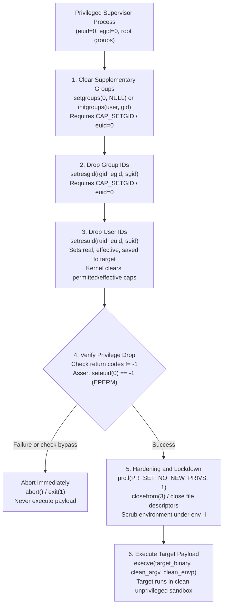

# Dropping Privileges

> [!summary] Claim
> Permanently shedding Unix privileges requires an exact, non-negotiable sequence of system calls (`setgroups` or `initgroups` first, `setresgid` second, `setresuid` third, followed by explicit assertion that privileges cannot be regained) executed at a clean process boundary before untrusted code runs, because in-process privilege dropping inside a shell script is impossible and leaving supplementary groups, open file descriptors, or retained saved IDs creates immediate local privilege escalation vectors.

Part of [Shell Security](README.md) in [Shell and Unix Engineering](../README.md).

## TL;DR

- Mechanism: Permanent privilege dropping clears supplementary groups via `setgroups(0, NULL)` or `initgroups()`, sets real, effective, and saved group IDs via `setresgid()`, sets all three user IDs via `setresuid()`, sets `PR_SET_NO_NEW_PRIVS`, and verifies with `getresuid()` and a failing `seteuid(0)` check (POSIX.1-2024 `tag_17_530`, Linux `kernel/sys.c`).
- Rule: Always drop supplementary groups and primary group ID before dropping user ID; calling `setuid()` first strips `CAP_SETGID` and causes subsequent `setgroups()` calls to fail with `EPERM`, leaving the process permanently in root supplementary groups (`kernel/groups.c`, `may_setgroups`).
- Trap: Assuming `setuid()` by root cannot fail; before Linux 3.1 a target user at its `RLIMIT_NPROC` limit made `setuid()` fail with `EAGAIN` (*RageAgainstTheCage*), Linux before 2.2.16 let a caller strip `CAP_SETUID` so a setuid-root Sendmail could not drop privileges (CVE-2000-0506), and current kernels still return `EAGAIN` when `alloc_uid()` fails (`setuid(2)`, `kernel/sys.c` `set_user()`); ignoring the return value leaves the process running as root while executing code designed for unprivileged users.
- Portability fact: Standard POSIX shells provide no builtins to manipulate credentials or drop user IDs; GNU bash automatically drops effective privileges to real IDs at startup unless `-p` is passed, but through Bash 5.0 patch 11 bash called `setuid()` instead of `setresuid()`, leaving saved set-user-IDs intact (CVE-2019-18276); the fix first shipped in Bash 5.1.
- When not to use it: Never attempt in-process privilege dropping inside an active shell script; spawn the script from a hardened external supervisor (`setpriv`, `runuser`, systemd `User=`, `su-exec`, or a tiny C wrapper) that drops credentials, scrubs the environment, and closes file descriptors before calling `execve()`.

## Mental model



The diagram illustrates the mandatory six-phase pipeline required to safely transition execution from a privileged context to an unprivileged one.
A privileged supervisor begins with root effective user ID, root group ID, and root supplementary groups.
In phase 1, the supervisor must clear or initialize supplementary groups using `setgroups()` or `initgroups()` because setting group lists requires `CAP_SETGID` or root effective privilege.
In phase 2, the supervisor sets the real, effective, and saved group IDs using `setresgid()`.
In phase 3, the supervisor sets the real, effective, and saved user IDs using `setresuid()`, which causes the kernel to clear effective and permitted capability sets.
Phase 4 acts as a mandatory verification gate: every return code must be zero, and the program must explicitly test that regaining privilege via `seteuid(0)` fails with `EPERM`; any error triggers an immediate `abort()` to prevent unprivileged code paths from executing as root.
In phase 5, the supervisor locks down process inheritance by enabling `PR_SET_NO_NEW_PRIVS`, closing inherited file descriptors above standard error, and scrubbing all untrusted environment variables.
In phase 6, the supervisor invokes `execve()` to replace its address space with the unprivileged payload.

## How it works

### The Unix credential model: real, effective, saved, and filesystem IDs

Every Unix process execution context maintains a set of security credentials used by the kernel to determine permission for file access, inter-process signal delivery, capability allocation, and system administration calls.
The user credential set consists of three standard IDs and one Linux-specific ID:
- Real User ID (`ruid`): Identifies the user who invoked or spawned the process; together with the sender's `euid` it governs signal delivery permissions between unprivileged processes under `kill(2)` (the sender's real or effective UID must match the receiver's real or saved set-user-ID).
- Effective User ID (`euid`): The primary credential checked by the kernel for filesystem permission checks and privileged operations (POSIX.1-2024 `setuid()`, `tag_17_534`).
- Saved Set-User-ID (`suid`): Copied from the new effective UID at every `execve(2)`, which is the binary's owner UID when the set-user-ID bit (`S_ISUID`) is set (POSIX.1-2024 `exec`), or populated by explicit calls to `setresuid(2)`.
  It serves as an architectural anchor that allows privileged processes to temporarily drop privileges to `ruid` and later regain them.
- Filesystem User ID (`fsuid`): Linux-specific credential introduced for NFS servers (`setfsuid(2)`); in modern Linux kernels, `fsuid` automatically tracks changes to `euid` unless explicitly overridden.

An identical hierarchy governs group credentials:
- Real Group ID (`rgid`), Effective Group ID (`egid`), Saved Set-Group-ID (`sgid`), and Filesystem Group ID (`fsgid`).
- Supplementary Group List: An array of auxiliary group IDs (`gid_t`) assigned to a user account in `/etc/group`.
  The kernel evaluates access permissions against the union of `egid` and all supplementary group IDs.

```
+-------------------------------------------------------------------------+
|                        Process Credential State                         |
+-----------------------------------+-------------------------------------+
| User Identity                     | Group Identity                      |
+-----------------------------------+-------------------------------------+
| ruid: Invoking user ID            | rgid: Invoking group ID             |
| euid: Active permission check ID  | egid: Active permission check ID    |
| suid: Stashed ID from exec/setid  | sgid: Stashed ID from exec/setgid   |
| fsuid: Linux VFS (tracks euid)    | fsgid: Linux VFS (tracks egid)      |
+-----------------------------------+-------------------------------------+
| Supplementary Groups: gid_0, gid_1, ..., gid_N (bounded by NGROUPS_MAX) |
| Capabilities (Linux): Permitted, Effective, Inheritable, Bounding,      |
|                       Ambient                                           |
| Security Bits: PR_SET_NO_NEW_PRIVS, PR_SET_DUMPABLE                     |
+-------------------------------------------------------------------------+
```

### The system call matrix: temporary versus permanent privilege drops

Historically, Unix systems diverged wildly in how credential-modifying system calls interacted with saved set-user-IDs, creating a class of vulnerabilities thoroughly analyzed by Hao Chen, David Wagner, and Drew Dean in their landmark 2002 USENIX paper "Setuid Demystified".
The core distinction lies between temporary drops and permanent drops:
- Temporary Privilege Drop: The process changes `euid` to an unprivileged ID while retaining `suid = 0`.
  The process can restore root privilege at any point by calling `seteuid(0)` or `setuid(0)` (POSIX.1-2024 `tag_17_522`).
- Permanent Privilege Drop: The process sets `ruid`, `euid`, and `suid` all to the unprivileged target ID.
  Once all three IDs are non-zero, the kernel permanently revokes root privilege and clears the permitted, effective, and ambient capabilities (`cap_emulate_setxuid()` in `security/commoncap.c`); the process cannot regain privilege through any `set*id` call.
  Two exceptions remain: `PR_SET_KEEPCAPS` or `SECURE_KEEP_CAPS` keeps the permitted set across the transition, and the process can still gain privilege by executing a set-user-ID binary or one with file capabilities unless `PR_SET_NO_NEW_PRIVS` is set.

```
+----------------+-------------------------------+-----------------------------------+
| System Call    | Semantics when euid == 0      | Semantics when euid != 0          |
+----------------+-------------------------------+-----------------------------------+
| seteuid(uid)   | Sets euid = uid               | Sets euid = uid if uid == ruid    |
|                | ruid and suid unchanged       | or uid == suid; else EPERM        |
+----------------+-------------------------------+-----------------------------------+
| setuid(uid)    | Sets ruid = euid = suid = uid | Sets euid = uid if uid == ruid    |
|                | Permanent privilege drop      | or uid == suid; ruid/suid kept!   |
+----------------+-------------------------------+-----------------------------------+
| setreuid(r, e) | Sets ruid = r, euid = e       | Sets ruid/euid if matching r/e/s; |
|                | suid = new euid if r != -1 or | complex cross-platform divergence |
|                | e != old ruid (POSIX.1-2024)  |                                   |
+----------------+-------------------------------+-----------------------------------+
| setresuid(     | Sets ruid=r, euid=e, suid=s   | Each argument must match current  |
|   r, e, s)     | Fully explicit and orthogonal | ruid, euid, or suid; else EPERM   |
+----------------+-------------------------------+-----------------------------------+
```

POSIX.1-2024 explicitly standardized `setresuid()` and `setresgid()` (POSIX.1-2024 `tag_17_530` and `tag_17_529`), together with `getresuid()` and `getresgid()` (`tag_17_231` and `tag_17_230`); it still specifies no `setgroups()` or `initgroups()`, which remain BSD and Linux extensions.
Unlike `setuid()` - which exhibits dual personality semantics depending on whether the caller is root or unprivileged - `setresuid()` provides atomic, explicit, and unambiguous control over each credential register independently.
Passing `-1` to any argument instructs the kernel to leave that specific register unchanged.

### The mandatory ordering invariant

When shedding privileges from a root process to an unprivileged user, system calls must follow an invariant order:
1. Supplementary groups must be cleared or initialized first.
2. Group IDs must be dropped second.
3. User IDs must be dropped third.

The underlying kernel mechanism enforces this ordering strictly.
In the Linux kernel, `sys_setgroups()` calls `may_setgroups()` in `kernel/groups.c`:
```c
bool may_setgroups(void)
{
	struct user_namespace *user_ns = current_user_ns();

	return ns_capable_setid(user_ns, CAP_SETGID) &&
		userns_may_setgroups(user_ns);
}
```
Modifying supplementary groups requires the caller to hold `CAP_SETGID` in its user namespace.
Likewise, calling `setresgid()` requires `CAP_SETGID`.
When a process executes `setresuid(target_uid, target_uid, target_uid)` where `target_uid != 0`, the Linux kernel executes `cap_emulate_setxuid()` in `security/commoncap.c`:
```c
if ((uid_eq(old->uid, root_uid) ||
     uid_eq(old->euid, root_uid) ||
     uid_eq(old->suid, root_uid)) &&
    (!uid_eq(new->uid, root_uid) &&
     !uid_eq(new->euid, root_uid) &&
     !uid_eq(new->suid, root_uid))) {
	if (!issecure(SECURE_KEEP_CAPS)) {
		cap_clear(new->cap_permitted);
		cap_clear(new->cap_effective);
	}
	cap_clear(new->cap_ambient);
}
```
Because the transition away from UID 0 wipes all permitted, effective, and ambient capabilities, calling `setresuid()` first immediately revokes `CAP_SETGID`.
If an application drops user ID first and then calls `setgroups(0, NULL)` or `initgroups()`, the supplementary group call fails with `EPERM`.
If the application fails to catch that error, the process continues executing with an unprivileged UID but retains all administrative supplementary groups (such as `wheel`, `sudo`, or `docker`), permitting instant privilege escalation.

### Syscall error handling and the verification protocol

A recurring failure mode in Unix systems is the assumption that privilege-dropping system calls cannot fail when executed by root.
In Linux, `setuid()` and `setresuid()` can fail with `EAGAIN` even when invoked with UID 0 (`kernel/sys.c`):
```c
	if (!uid_eq(kruid, old->uid)) {
		retval = set_user(new);
		if (retval < 0)
			goto error;
	}
```
In current kernels `set_user()` returns `-EAGAIN` when `alloc_uid()` cannot allocate the new user's accounting structure, and `prepare_creds()` failure returns `ENOMEM`.
Before Linux 3.1, `set_user()` also failed when the target user had reached its maximum process limit (`RLIMIT_NPROC`).
If an attacker spawned processes under the target unprivileged UID until `RLIMIT_NPROC` was saturated, a subsequent call to `setuid(target_uid)` by a root daemon failed and returned `-1` with `errno = EAGAIN`.
If the daemon ignored the return value, it proceeded into unprivileged request handling while still possessing full root credentials.
This mechanism enabled the *RageAgainstTheCage* Android exploit against `adbd`: its source is headed "android 1.x/2.x adb setuid() root exploit" and fork-bombs the shell UID until `RLIMIT_NPROC` is full so that adb's `setuid()` fails, while the Eclair-era `adb.c` called `setgid(AID_SHELL)` and `setuid(AID_SHELL)` without checking the result and the Froyo-era `adb.c` exits when either call fails (Sebastian Krahmer's `rageagainstthecage.c`; AOSP `system/core/adb/adb.c`, eclair and froyo branches).
Since Linux 3.1 the kernel no longer fails the `set*id` call on `RLIMIT_NPROC`: `flag_nproc_exceeded()` in `kernel/sys.c` sets `PF_NPROC_EXCEEDED`, and the next `execve()` fails with `EAGAIN` instead, precisely "because too many poorly written programs don't check `set*uid()` return code" (kernel comment; `setuid(2)`; LWN, "RLIMIT_NPROC and setuid()", 2011-07-20).
The Sendmail bug (CVE-2000-0506) is the same unchecked-return class with a different trigger: in Linux before 2.2.16 a local user could remove `CAP_SETUID` from the capabilities a setuid-root program inherited, so the program's privilege drop failed and it kept running as root.

A distinguished-engineer privilege-dropping protocol requires five mandatory checks:
1. Verify `setgroups(0, NULL)` or `initgroups(user, gid) == 0`.
2. Verify `setresgid(gid, gid, gid) == 0`.
3. Verify `setresuid(uid, uid, uid) == 0`.
4. Inspect current state via `getresuid(&r, &e, &s)` and `getresgid(&rg, &eg, &sg)` to confirm all registers match the target IDs.
5. Execute a deliberate escalation probe: call `seteuid(0)`.
   If `seteuid(0)` succeeds (returns `0`), privileges were not permanently dropped; the program must call `abort()` immediately.

```c
/* Reference Privilege Dropping Implementation in C */
void drop_privileges_permanently(const char *username, uid_t target_uid, gid_t target_gid)
{
  /* 1. Supplementary groups */
  if (initgroups(username, target_gid) != 0) {
    perror("initgroups failed");
    abort();
  }

  /* 2. Group identity */
  if (setresgid(target_gid, target_gid, target_gid) != 0) {
    perror("setresgid failed");
    abort();
  }

  /* 3. User identity */
  if (setresuid(target_uid, target_uid, target_uid) != 0) {
    perror("setresuid failed");
    abort();
  }

  /* 4. State verification */
  uid_t r, e, s;
  gid_t rg, eg, sg;
  if (getresuid(&r, &e, &s) != 0 || r != target_uid || e != target_uid || s != target_uid) {
    fprintf(stderr, "Fatal: UID verification failed\n");
    abort();
  }
  if (getresgid(&rg, &eg, &sg) != 0 || rg != target_gid || eg != target_gid || sg != target_gid) {
    fprintf(stderr, "Fatal: GID verification failed\n");
    abort();
  }

  /* 5. Escalation assertion probe */
  if (seteuid(0) == 0 || setuid(0) == 0) {
    fprintf(stderr, "Fatal: Process was able to regain root privileges!\n");
    abort();
  }
}
```

### Kernel capability containment: PR_SET_NO_NEW_PRIVS and dumpable state

Dropping UIDs alone does not fully isolate an unprivileged child process if the filesystem contains setuid binaries or file capabilities.
Linux 3.5 introduced `PR_SET_NO_NEW_PRIVS` via `prctl(2)`:
```c
prctl(PR_SET_NO_NEW_PRIVS, 1, 0, 0, 0);
```
Once `PR_SET_NO_NEW_PRIVS` is set:
- Neither the process nor any of its descendants can ever acquire privileges through `execve()`.
- The set-user-ID and set-group-ID bits on executed binaries are completely ignored (`fs/exec.c`, `bprm_fill_uid()`).
- File capabilities (`security.capability` extended attributes) are ignored.
- The bit cannot be cleared or disabled by any process under any circumstance, and it is inherited across `fork(2)`, `clone(2)`, and `execve(2)`.
- It is a mandatory prerequisite for unprivileged seccomp BPF filter installation.

Additionally, memory disclosure must be prevented.
When a process executes with elevated privileges, it may read private keys, cryptographic material, or `/etc/shadow` into its virtual address space.
If it subsequently drops privileges, an unprivileged user could attach `ptrace(2)` or trigger a core dump to read those residual secrets.
To prevent this, the Linux kernel automatically marks processes that change credentials as non-dumpable: `commit_creds()` in `kernel/cred.c` calls `task_exec_state_set_dumpable(suid_dumpable)` when any ID or the capability set changes, and `fs/exec.c` does the same for an `execve()` whose real and effective IDs differ.
A security-critical supervisor can explicitly enforce this by calling `prctl(PR_SET_DUMPABLE, 0)`.

### File descriptor hygiene and environment sanitization

File descriptors remain open across `execve()` unless explicitly created with the `O_CLOEXEC` flag or configured with `fcntl(fd, F_SETFD, FD_CLOEXEC)`.
If a privileged daemon opens a sensitive file (such as a database master key, a UNIX domain control socket, or `/etc/shadow`) and drops privileges before exec'ing an unprivileged worker without closing descriptors, the unprivileged worker inherits full read and write access to those descriptors.
Closing descriptors across a boundary historically required looping from descriptor 3 up to `sysconf(_SC_OPEN_MAX)`.
Modern operating systems provide native descriptor closure primitives:
- Linux 5.9+ provides `close_range(3, ~0U, 0)` (glibc 2.34 wrapper; FreeBSD has it too, `close_range(2)`).
- FreeBSD, OpenBSD, NetBSD, and glibc 2.34+ provide `closefrom(3)`.
- macOS declares neither in its SDK headers (as of 2026-11), so a macOS supervisor loops over descriptors or spawns the worker with `posix_spawn()` and the `POSIX_SPAWN_CLOEXEC_DEFAULT` flag (`<sys/spawn.h>`).

Environment variables pose an equivalent vulnerability surface.
Dynamic linkers (`ld.so`, `dyld`) evaluate variables like `LD_PRELOAD`, `LD_LIBRARY_PATH`, and `DYLD_INSERT_LIBRARIES`.
Shell interpreters evaluate variables like `BASH_ENV`, `ENV`, `IFS`, `PATH`, and `CDPATH`.
When a privileged process prepares to execute unprivileged code, it must discard the caller's environment block and construct a sanitized environment from scratch using `env -i`, populating only verified variables such as `PATH=/usr/bin:/bin`, `USER`, `LOGNAME`, and `HOME`.

### Multi-threading and NPTL credential synchronization

Under the POSIX standard, user IDs and group IDs belong to the entire process; any credential change must take effect across all threads simultaneously.
In the Linux kernel, however, every thread is an independent `struct task_struct` with its own `struct cred` pointer.
To maintain POSIX compliance, the GNU C Library (glibc) Native POSIX Thread Library (NPTL) intercepts `setuid`, `setgid`, `setreuid`, `setresuid`, and the rest of the `set*id` family.
When an application thread calls `setuid()`, glibc executes an internal synchronization routine (`__nptl_setxid` in `nptl/nptl_setxid.c`):
1. glibc populates an internal command structure (`struct xid_command`) containing the syscall number and arguments.
2. The calling thread sends an internal real-time signal, `SIGSETXID` (`__SIGRTMIN + 1`, signal 33 on glibc, `sysdeps/unix/sysv/linux/internal-signals.h`), to every other thread in the process using `tgkill(2)`.
3. Each thread's internal signal handler executes the raw system call contextually on its own kernel task, and the calling thread runs it last.
4. If the threads' results disagree, `setxid_error()` calls `abort()`, because a half-changed process is unsafe; a uniform failure is returned to the caller as `-1` with `errno` set.
musl does the same through `__synccall()` and its own `SIGSYNCCALL` (signal 34), and kills the whole process with `SIGKILL` if one thread fails after another succeeded (`src/unistd/setxid.c`).

This architectural reality creates catastrophic traps in runtimes that bypass glibc:
- Direct system calls (`syscall(SYS_setresuid, ...)`): Only the calling OS thread changes identity; all sibling threads remain root.
- The Go runtime: Go multiplexes goroutines across a pool of operating system threads (`M`s).
  Prior to Go 1.16, `syscall.Setuid()` and related calls on Linux returned `EOPNOTSUPP`, so programs that issued the raw system call instead changed credentials on only one OS thread, causing subsequent goroutines to unpredictably execute as root or as unprivileged depending on thread scheduling.
  Go 1.16 implemented `syscall.Setuid()` and its relatives on every thread and introduced `syscall.AllThreadsSyscall()`, which always returns `ENOTSUP` in programs that use cgo (Go 1.16 release notes); even so, dropping privileges inside a running Go process keeps every in-process hazard described here, so a boundary wrapper remains the safer design.
- Python and multithreaded daemons: Calling `os.setuid()` after spawning background worker threads causes thread desynchronization if the underlying C library or platform fails to broadcast signals reliably.

### Shell startup privilege handling: bash disable_priv_mode and -p

Because shell scripts have no builtins to alter kernel process credentials, privilege dropping interactions with shells center on how shell binaries behave when invoked in set-user-ID contexts or with mismatched credentials (`getuid() != geteuid()` or `getgid() != getegid()`).

In GNU bash, `main()` in `shell.c` inspects credentials at startup:
```c
/* bash-5.3 shell.c */
if (running_setuid && privileged_mode == 0)
  disable_priv_mode ();
```
If bash detects that `euid != ruid` or `egid != rgid` and the `-p` (`privileged`) option was not supplied on the command line, it calls `disable_priv_mode()`:
```c
void
disable_priv_mode (void)
{
  int e, r;

  r = 0;
#if HAVE_SETRESUID
  if (current_user.euid != current_user.uid || current_user.saveuid != current_user.uid)
    r = setresuid (current_user.uid, current_user.uid, current_user.uid);
#else
  if (current_user.euid != current_user.uid)
    r = setuid (current_user.uid);
#endif
  /* ... error handling ... */
  r = 0;
#if HAVE_SETRESGID
  if (current_user.egid != current_user.gid || current_user.savegid != current_user.gid)
    r = setresgid (current_user.gid, current_user.gid, current_user.gid);
#else
  if (current_user.egid != current_user.gid)
    r = setgid (current_user.gid);
#endif
  /* ... */
}
```
If `-p` is supplied, bash retains elevated privileges, but it arms the same defensive restrictions it applies when it drops (bash.1):
- It ignores `$ENV` and `$BASH_ENV` files.
- It disables function inheritance from the environment (`BASH_FUNC_*`).
- It ignores `SHELLOPTS`, `BASHOPTS`, `CDPATH`, and `GLOBIGNORE` from the environment.
- It reads no startup files at all; `/etc/suid_profile` is a ksh, mksh, and zsh-as-`sh` convention that bash does not use.
- Running `set +p` within bash calls `disable_priv_mode()`, permanently dropping effective privileges to real IDs (`flags.c`).

`disable_priv_mode()` also drops the user IDs before the group IDs, the reverse of the ordering invariant above; that is safe only because bash's target is its own real UID and GID, which `setresgid()` always permits.

In GNU Bash through 5.0 patch 11, `disable_priv_mode()` called `setuid(current_user.uid)` rather than `setresuid()`.
Under POSIX rules, when `setuid()` is called by a process whose effective UID is not 0, it changes only `euid`, leaving `suid` intact.
Consequently, if bash was executed with an unprivileged setuid bit (for example, UID 1000 executing a binary setuid to UID 1001), bash dropped `euid` to 1000 but preserved `suid = 1001`.
An attacker could load a shared library via the `enable -f` builtin to call `seteuid(1001)` and regain the dropped privilege (CVE-2019-18276).
Chet Ramey's fix (commit `951bdaad`, cited by the CVE record) switched to `setresuid()` and `setresgid()`; it first shipped in Bash 5.1, and none of the bash 5.0 patches 12 to 18 contains `setresuid` (checked in the release tarballs and patch files).

The divergences across other shell families below were measured in the shell matrix (2026-11-27) by running a set-user-ID copy of each shell owned by `nobody` (UID 65534) as UID 1000 and reading the `Uid:` line of `/proc/self/status` (real, effective, saved):
- Upstream dash (Alpine's 0.5.12): Contains no privileged mode flag (`-p` is rejected with `Illegal option -p`) and never calls `setuid()` or `setresuid()` at startup; it preserves elevated credentials without dropping (measured `r=1000 e=65534 s=65534`; `src/options.c` has no privileged option).
- Debian dash (0.5.12-12): Carries a vendor patch that adds `-p`; without `-p` it sets `euid` to `ruid` but leaves the saved set-user-ID at 65534 (measured `r=1000 e=1000 s=65534`), the same saved-ID gap as CVE-2019-18276, and `set +p` does the same; the patch is `debian/patches/9001-Add-privmode.diff` (Tavis Ormandy and Harald van Dijk, 2013, Debian bug 734869), whose `setprivileged()` calls `setuid(uid)` and `setgid(gid)` when the flag is cleared and the IDs differ, which explains the kept saved ID (Debian source package `dash` 0.5.12-12).
- zsh: Retains elevated credentials by default and sets the internal `PRIVILEGED` option, with or without `-p`; running `unsetopt privileged` drops all three IDs, but when the elevated `euid` is not root its `setgroups()` call fails, so it prints "supplementary group list not changed due to lack of permissions" and returns 1 even though the IDs were dropped (measured), which makes the manual's `unsetopt privileged || exit` idiom exit in that case.
- ksh93 and mksh: Retain credentials when `-p` is supplied and read `/etc/suid_profile`; without `-p`, mksh R59 drops all three IDs and ksh93u+m 1.0.10 drops only `euid`, leaving the saved set-user-ID (measured), while the macOS ksh93u+ 2012 manual says privileged mode is on whenever the IDs differ.
- BusyBox ash, posh, and yash: Reject `-p`; posh 0.14.1 and yash 2.58.1 keep the elevated `euid` (measured), while a set-user-ID BusyBox binary is dropped to `euid = ruid` before ash starts by `check_suid()` in `libbb/appletlib.c`, which calls `setgid(rgid)` and `setuid(ruid)` and so leaves the saved set-user-ID in place (measured `r=1000 e=1000 s=65534`).

### Boundary dropping utilities: setpriv, runuser, sudo, and su-exec

Because shell scripts cannot drop their own process credentials, systems rely on external compiled binaries to execute privilege transitions at the execution boundary.

```
+----------------+---------------------+-------------------+---------------------+--------------------+
| Utility        | PAM Overhead        | TTY Allocation    | Capability Control  | Recommended Use    |
+----------------+---------------------+-------------------+---------------------+--------------------+
| su             | Full PAM stack      | Modifies termios  | None                | Legacy logins      |
| runuser        | Daemon PAM stack    | No termios alloc  | Resets rlimits      | SysV/init scripts  |
| sudo           | Policy + PAM stack  | Optional pty      | Configurable bounds | Admin delegation   |
| setpriv        | Zero (Direct calls) | Clean passthrough | Granular bitmasks   | Systemd / modern OS|
| su-exec / gosu | Zero (Direct calls) | Clean passthrough | Dropped to UID/GID  | Docker entrypoints |
+----------------+---------------------+-------------------+---------------------+--------------------+
```

1. `setpriv(1)` (from util-linux):
The gold standard for low-level Linux privilege dropping.
It performs no PAM authentication, allocates no pseudoterminals, and directly invokes `setresuid`, `setresgid`, `setgroups`, and `prctl`.
It sets `PR_SET_KEEPCAPS` before `setresuid(ruid, euid, euid)` (`setpriv.c`), so, as `setpriv(1)` warns, "setting a uid or gid does not change capabilities"; a root caller should also clear the inheritable set with `--inh-caps=-all`.
It does not close inherited descriptors, so descriptor hygiene stays the caller's job.
A canonical `setpriv` invocation sheds all IDs and groups, clears inheritable capabilities, and prevents re-escalation:
```sh
exec setpriv --reuid=1001 --regid=1001 --clear-groups --inh-caps=-all --no-new-privs -- /usr/local/bin/worker
```

2. `runuser(1)` (from util-linux):
Designed specifically for daemon service wrappers.
Unlike `su`, `runuser` skips session authentication prompts (it only runs as root) and uses a stripped-down PAM configuration (`/etc/pam.d/runuser`).
Since util-linux 2.38, `runuser` automatically resets `RLIMIT_NICE`, `RLIMIT_RTPRIO`, `RLIMIT_FSIZE`, `RLIMIT_AS`, and `RLIMIT_NOFILE` (`runuser(1)`; `sanitize_prlimits()` in `login-utils/su-common.c`).

3. `su-exec` and `gosu`:
Minimal C and Go wrappers created for container entrypoint scripts.
Using `su` or `sudo` inside a container entrypoint introduces an intermediate parent process: util-linux `su` stays behind as a supervising parent that blocks and catches signals (`parent_setup_signals()` in `su-common.c`) so it can close the PAM session, so the worker daemon is not PID 1 and a clean shutdown depends on that parent relaying `SIGTERM` and `SIGINT`; when the relay or the worker's handling fails, container engines wait out the stop timeout and kill the container via `SIGKILL`.
`su-exec` resolves user IDs, calls `setgroups`, `setgid`, and `setuid`, and calls `execvp` directly (`su-exec.c`), replacing PID 1 with the target worker daemon without leaving residual supervisor processes.

## Numbers and limits

The following bounds, constants, and limits govern credential management, group allocations, and privilege containment across Unix systems (as of 2026-11).

| Constant / Bound | Value / Limit | Architecture / System | Specification / Source |
|---|---|---|---|
| `_POSIX_NGROUPS_MAX` | 8 | POSIX standard minimum | (POSIX.1-2024 `<limits.h>`) |
| `NGROUPS_MAX` (Linux) | 65536 (32 before 2.6.4) | Linux kernel 2.6.4+ | Linux `include/uapi/linux/limits.h`, `getgroups(2)` |
| `NGROUPS_MAX` (macOS) | 16 | macOS 27.3 (Darwin, default) | `sysctl kern.ngroups`, `getconf NGROUPS_MAX`, SDK `<sys/syslimits.h>` (measured, as of 2026-11) |
| `NGROUPS_MAX` (FreeBSD) | 1023 | FreeBSD (main branch, as of 2026-11) | FreeBSD `sys/sys/syslimits.h` |
| Glibc `SIGSETXID` | 33 (`__SIGRTMIN + 1`) | Linux glibc NPTL | glibc `sysdeps/unix/sysv/linux/internal-signals.h` |
| Musl `SIGSETXID` | None; `__synccall()` uses `SIGSYNCCALL` (34) | Linux musl libc | musl `src/unistd/setxid.c`, `src/internal/pthread_impl.h` |
| `PR_SET_NO_NEW_PRIVS` | 38 (operation number) | Linux kernel 3.5+ | Linux `include/uapi/linux/prctl.h` |
| `PR_GET_NO_NEW_PRIVS` | 39 (operation number) | Linux kernel 3.5+ | Linux `include/uapi/linux/prctl.h` |
| `PR_SET_KEEPCAPS` | 8 (operation number) | Linux kernel 2.2.18+ | Linux `include/uapi/linux/prctl.h`, `PR_SET_KEEPCAPS(2const)` |
| `PR_SET_DUMPABLE` | 4 (operation number) | Linux kernel 2.3.20+ | Linux `include/uapi/linux/prctl.h` |
| `setresuid` introduction | Linux 2.1.44 (16-bit), 2.4 (32-bit) | Linux kernel / HP-UX | `setresuid(2)`, POSIX.1-2024 `tag_17_530` |
| `close_range` introduction | Linux 5.9 (glibc 2.34) | Linux kernel / glibc | `close_range(2)` |
| Bash CVE-2019-18276 fix | Bash 5.1 (5.0 through patch 11 vulnerable) | GNU bash | commit `951bdaad7a18cc0dc1036bba86b18b90874d39ff` |
| Default `suid_dumpable` mode | 0 (`TASK_DUMPABLE_OFF`) | Linux kernel default | `/proc/sys/fs/suid_dumpable`, `fs/exec.c`, `include/linux/sched/coredump.h` |

## Portability

The table below contrasts credential transitions, shell startup privileged mode handling, and boundary dropping utilities across standard shells and operating systems.
Cells marked "measured" come from running a set-user-ID copy of each shell, owned by `nobody` (UID 65534), as UID 1000 in the Debian 13 and Alpine 3.22 shell matrix images (2026-11-27).
Cells marked "lab" are asserted by the lab suite, which proves the `BASH_ENV` suppression under `-p`, that BusyBox ash, posh, and yash reject `-p` without running the payload, that dash rejects `-p` with status 2 unless it carries Debian's patch, and that `set +p` is accepted exactly where `-p` is; every other cell cites its source (as of 2026-11).

| Shell / Environment | Privileged Mode Flag (`-p`) | Startup Drop on `ruid != euid` | `set +p` Drops Privileges | Startup File Suppression under `-p` | Boundary Tooling Support |
|---|---|---|---|---|---|
| POSIX.1-2024 `sh` | Not standardized | Unspecified | Not standardized | Not standardized | `setresuid`, `setresgid`, `getresuid` (XSH); no `setgroups` or `initgroups` |
| macOS bash 3.2 (`/bin/sh`) | Supported (`-p`) | Drops `euid` to `ruid` unless `-p` via `setuid()`, as before the 5.1 fix (bash.1) | Drops privileges (bash.1) | Ignores `ENV`, `BASH_ENV` (bash.1) | `sudo`, `su` (macOS native) |
| GNU bash 5.x | Supported (`-p`) | Drops `ruid`/`euid`/`suid` via `setresuid` (measured, `shell.c`) | Calls `disable_priv_mode()`; drops all 3 IDs (measured, `flags.c`) | Ignores `BASH_ENV` (lab); `SHELLOPTS`, `BASHOPTS` (bash.1) | `setpriv`, `runuser`, `sudo`, `su-exec` |
| zsh (native) | Supported (`-p`) | Retains IDs; sets `PRIVILEGED` (measured) | `unsetopt privileged` drops all 3 IDs; returns 1 if `euid` is not root (measured) | Ignores user rc files (zshoptions) | `sudo`, `setpriv` |
| zsh (`--emulate sh`) | Supported (`-p`) | Retains IDs; sets `PRIVILEGED` (measured) | Drops via `unsetopt privileged` (zshoptions) | Sources `/etc/suid_profile` when invoked as `sh` or `ksh` (zshoptions) | `sudo`, `setpriv` |
| dash (upstream) | Rejected (`Illegal option -p`, measured) | Never drops credentials (measured; `options.c`) | Unsupported | None (`ENV` uid check compiled only `#ifndef linux`, `main.c`) | Requires external supervisor |
| dash (Debian 0.5.12-12) | Supported (vendor patch) | Drops `euid` to `ruid`, keeps saved UID (measured) | Accepted; drops `euid` only (measured) | Does not suppress `ENV` under `-p`: patch 9001 leaves the Linux `ENV` read in `main.c` untouched, and only interactive shells read it (`main.c`) | Debian `runuser`, `setpriv` |
| ksh93 (u+ 2012 / u+m) | Supported (`-p`) | u+m 1.0.10: drops `euid`, keeps saved UID (measured); u+ 2012: privileged mode on (ksh.1) | Drops `euid` only (measured, u+m) | Sources `/etc/suid_profile` (ksh.1) | `setpriv`, `sudo` |
| mksh R59 | Supported (`-p`) | Drops all 3 IDs unless `-p` (measured) | Drops all 3 IDs (measured) | Privileged login shells process only `/etc/suid_profile` (mksh.1, "Startup files") | `setpriv`, `sudo` |
| yash 2.58.1 | Rejected (`'p' is not a valid option`, measured) | Never drops; keeps `euid` (measured) | Unsupported | Undocumented | `setpriv`, `sudo` |
| posh 0.14.1 | Rejected (`-p: unknown option`, measured) | Never drops; keeps `euid` (measured) | Unsupported | `ENV` unsupported | Requires external supervisor |
| BusyBox ash 1.37 | Rejected (`illegal option -p`, measured) | Multi-call `check_suid()` drops `euid`, keeps saved UID (measured, `appletlib.c`) | Unsupported | None: interactive ash reads `$ENV` on Linux whatever the IDs (`ash.c`, `#ifndef linux` guard) | `su-exec`, BusyBox `su` |
| util-linux `setpriv` | N/A (Utility) | Sets all 3 IDs via `setresuid(ruid, euid, euid)` (`setpriv.c`) | N/A | Clears environment via `--reset-env` | Sets capabilities, `no-new-privs` |
| Alpine `su-exec` | N/A (Utility) | Sets all 3 IDs via `setgid()` then `setuid()` as root (`su-exec.c`) | N/A | Minimal wrapper for containers | Sets supplementary groups, then `execvp()` |

## Worked example

The test suite in [lab](../labs/17-dropping-privileges/) verifies credential invariants, the `EPERM` from `setgroups()` that makes the drop order mandatory, descriptor leakage, environment scrubbing, and shell privileged mode suppression without requiring root permissions.
Because it runs unprivileged, it cannot perform a real root-to-user drop; the startup-drop behavior in the Portability table was measured separately.
The lab demonstrates these security controls through two core components: `dropprobe.c`, a C diagnostic probe that directly exercises credential system calls, and `dropper.sh`, a boundary wrapper script.

### Diagnostic probe implementation

The C probe validates that unprivileged callers cannot regain root IDs, tests that calling `setgroups()` requires `CAP_SETGID`, inspects open file descriptors across `execve()`, and queries `PR_SET_NO_NEW_PRIVS`.
The listing is a simplified excerpt of the lab's `dropprobe.c`: it omits the mode list in the header comment, the `do_ids()` mode, and `main()`.

```c
/* dropprobe.c - inspect Unix process credentials, privilege transitions,
 * descriptor leakage, and kernel security bits across exec boundaries.
 * Usage: dropprobe MODE [ARG...]
 */

#define _GNU_SOURCE
#include <errno.h>
#include <fcntl.h>
#include <grp.h>
#include <stdio.h>
#include <stdlib.h>
#include <string.h>
#include <unistd.h>

#if defined(__linux__)
#include <sys/prctl.h>
#ifndef PR_SET_NO_NEW_PRIVS
#define PR_SET_NO_NEW_PRIVS 38
#endif
#ifndef PR_GET_NO_NEW_PRIVS
#define PR_GET_NO_NEW_PRIVS 39
#endif
#endif

static const char *errno_to_name(int err)
{
  switch (err) {
  case 0: return "SUCCESS";
  case EPERM: return "EPERM";
  case EACCES: return "EACCES";
  case EINVAL: return "EINVAL";
  case EAGAIN: return "EAGAIN";
  case EBADF: return "EBADF";
  default: return "OTHER_ERROR";
  }
}

static int do_try_root(void)
{
  int r_uid, err_uid, r_euid, err_euid, r_gid, err_gid;

  errno = 0;
  r_uid = setuid(0);
  err_uid = errno;

  errno = 0;
  r_euid = seteuid(0);
  err_euid = errno;

  errno = 0;
  r_gid = setgid(0);
  err_gid = errno;

  printf("setuid(0): ret=%d errno=%s\n", r_uid, errno_to_name(err_uid));
  printf("seteuid(0): ret=%d errno=%s\n", r_euid, errno_to_name(err_euid));
  printf("setgid(0): ret=%d errno=%s\n", r_gid, errno_to_name(err_gid));
  return (r_uid == 0 || r_euid == 0 || r_gid == 0) ? 1 : 0;
}

static int do_order_check(void)
{
  int ret, err;
  errno = 0;
#if defined(__APPLE__)
  gid_t dummy = 0;
  ret = setgroups(0, &dummy);
#else
  ret = setgroups(0, NULL);
#endif
  err = errno;

  printf("setgroups(0): ret=%d errno=%s\n", ret, errno_to_name(err));
  return (ret == 0) ? 1 : 0;
}

static int do_fdcheck(int fd)
{
  int flags = fcntl(fd, F_GETFD);
  if (flags >= 0) {
    printf("fd %d: open flags=%d\n", fd, flags);
    return 0;
  }
  printf("fd %d: closed errno=%s\n", fd, errno_to_name(errno));
  return 1;
}

static int do_nonewprivs(void)
{
#if defined(__linux__)
  int r_set = prctl(PR_SET_NO_NEW_PRIVS, 1, 0, 0, 0);
  if (r_set != 0) {
    printf("nonewprivs: set_failed errno=%s\n", errno_to_name(errno));
    return 1;
  }
  int r_get = prctl(PR_GET_NO_NEW_PRIVS, 0, 0, 0, 0);
  printf("nonewprivs: active=%d\n", r_get);
  return (r_get == 1) ? 0 : 1;
#else
  printf("nonewprivs: unsupported\n");
  return 0;
#endif
}
```

### Boundary isolation wrapper

`dropper.sh` demonstrates defense-in-depth sanitization: stripping hostile environment variables before execution and preventing file descriptor inheritance.
The listing is a simplified excerpt of the lab's `dropper.sh`: it omits the `privcheck` mode, the per-mode usage checks, and the comments.

```sh
#!/bin/sh
# dropper.sh - reference wrapper simulating privilege-dropping boundary hygiene.
set -eu

mode="${1:-}"
shift || true

case "${mode}" in
  scrub)
    safe_path="/usr/bin:/bin"
    safe_user="$(id -u -n 2>/dev/null || echo "nobody")"
    exec env -i \
      PATH="${safe_path}" \
      USER="${safe_user}" \
      HOME="/tmp" \
      "$@"
    ;;

  fdleak)
    probe="$1"
    exec 3</dev/null
    exec "${probe}" fdcheck 3
    ;;

  fdclose)
    probe="$1"
    exec 3</dev/null
    exec 3<&-
    exec "${probe}" fdcheck 3
    ;;

  *)
    printf 'dropper: unknown mode %s\n' "${mode}" >&2
    exit 2
    ;;
esac
```

### Captured lab test execution

Running the Bats test suite on the macOS host with `LAB_SHELL=bash` (2026-11-27) passes all nine tests:

```console
$ bats labs/17-dropping-privileges/dropping_privileges.bats
1..9
ok 1 dropprobe compiles and reports real and effective user IDs
ok 2 unprivileged process cannot regain root privileges via setuid or seteuid
ok 3 setgroups fails with EPERM for unprivileged caller proving drop order requirement
ok 4 unclosed file descriptors leak across exec without O_CLOEXEC
ok 5 explicit descriptor closure prevents leakage across privilege boundary
ok 6 environment scrubbing strips hostile variables before unprivileged exec
ok 7 shell privileged mode suppresses BASH_ENV in bash and preserves family invariants
ok 8 turning off privileged mode with set +p succeeds in supporting shells
ok 9 kernel PR_SET_NO_NEW_PRIVS status reports active on Linux or unsupported on macOS
```

When `dropprobe try-root` executes as an ordinary user (output captured on the macOS host), it confirms that an unprivileged process attempting to elevate to root fails:
```console
$ ./dropprobe try-root
setuid(0): ret=-1 errno=EPERM
seteuid(0): ret=-1 errno=EPERM
setgid(0): ret=-1 errno=EPERM
```

When `dropprobe order-check` runs, it confirms that modifying supplementary groups requires root credentials:
```console
$ ./dropprobe order-check
setgroups(0): ret=-1 errno=EPERM
```

## Pitfalls

> [!warning] Dropping UID before supplementary groups
> Trigger: Calling `setuid(target_uid)` or `setresuid(target_uid, target_uid, target_uid)` before calling `setgroups(0, NULL)` or `initgroups()`.
> Symptom: The subsequent call to `setgroups()` fails with `EPERM` because the kernel cleared `CAP_SETGID` when the process dropped root UID.
> If the code ignores the return value or logs a warning without aborting, the unprivileged user executes with administrative supplementary groups (such as `sudo` or `wheel`), allowing immediate file tampering and root escalation.
> Fix: Always call `setgroups(0, NULL)` or `initgroups(user, gid)` first, call `setresgid()` second, and call `setresuid()` last.
> Abort immediately if any call returns non-zero.

> [!warning] Ignoring return values of privilege-dropping syscalls
> Trigger: Invoking `setuid(target_uid)` without verifying that the return value equals 0.
> Symptom: The call fails and the daemon does not notice.
> Before Linux 3.1, an attacker who exhausted the target user's process limit (`RLIMIT_NPROC`) made the kernel abort the credential commit and return `-1` with `errno = EAGAIN` (`setuid(2)`); in Linux before 2.2.16 an attacker could strip `CAP_SETUID` so a setuid-root Sendmail's drop failed (CVE-2000-0506); current kernels still return `EAGAIN` when `alloc_uid()` fails (`kernel/sys.c`).
> The daemon continues executing as root, processing untrusted user input with full system authority.
> Fix: Treat every return value as a security invariant.
> If `setresuid()`, `setresgid()`, or `setgroups()` returns non-zero, immediately terminate the process with `abort()` or `exit(1)`.

> [!warning] Confusion between temporary and permanent privilege drops
> Trigger: Using `setuid(uid)` or `seteuid(uid)` in unprivileged or partially privileged setuid binaries, expecting all credentials to be permanently shed.
> Symptom: In non-root processes, POSIX defines `setuid()` as modifying only `euid`, leaving `suid` intact.
> In GNU Bash through 5.0 patch 11 (CVE-2019-18276), `disable_priv_mode()` called `setuid()` instead of `setresuid()`; an attacker with local shell access loaded a shared object via `enable -f` that called `seteuid(suid)` to regain the original elevated credentials.
> Fix: Never use `setuid()` or `seteuid()` when permanent privilege revocation is required.
> Always use `setresuid(uid, uid, uid)` and verify that `seteuid(0)` returns `-1` with `errno = EPERM`.

> [!warning] File descriptor leakage across the privilege boundary
> Trigger: Opening files, sockets, or pipes while running as root without the `O_CLOEXEC` flag, then dropping credentials and calling `execve()` to run untrusted code.
> Symptom: The unprivileged child process inherits open file descriptors to root log files, sensitive configuration tables, or raw block devices.
> The child reads or writes to those descriptors even though filesystem permissions on the file paths would normally deny access.
> Fix: Open all descriptors with `O_CLOEXEC` or set `FD_CLOEXEC` via `fcntl(fd, F_SETFD, FD_CLOEXEC)`.
> Before dropping privileges and exec'ing unprivileged programs, close all file descriptors above standard error using `close_range(3, ~0U, 0)` or `closefrom(3)`.

> [!warning] Environment pollution and dynamic linker hijacking
> Trigger: Executing unprivileged worker scripts without discarding the supervisor's environment block.
> Symptom: The unprivileged child inherits `LD_PRELOAD`, `LD_LIBRARY_PATH`, `BASH_ENV`, `ENV`, `IFS`, or `PYTHONPATH`.
> When the child executes subcommands or scripts, the dynamic linker or interpreter executes malicious code supplied by the caller.
> Fix: Discard the caller's environment.
> Use `env -i` or clean the environment array, re-exporting only verified, sanitized variables (`PATH=/usr/bin:/bin`, `HOME`, `USER`).

> [!warning] Multithreading credential desynchronization
> Trigger: Calling `setuid()` or raw system calls (`syscall(SYS_setresuid, ...)`) in a multithreaded application (such as Go, Python with threads, or C++ with `std::thread`).
> Symptom: In Linux, credentials are per-thread kernel data structures (`task_struct->cred`).
> Raw syscalls or runtimes that do not implement signal-based thread synchronization leave some threads running as root while others run unprivileged.
> In Go prior to 1.16, `syscall.Setuid()` returned `EOPNOTSUPP` on Linux, so code that issued the raw system call changed one OS thread only, and goroutines migrating between threads unpredictably inherited root or unprivileged credentials.
> Fix: Never drop credentials after spawning application threads.
> Drop privileges and sanitize the process during single-threaded startup before initializing threading runtimes, or delegate privilege dropping to an external supervisor binary before the multithreaded process starts.

> [!warning] Container PID 1 signal trapping with su or sudo
> Trigger: Using `su - user -c "command"` or `sudo -u user command` as the `ENTRYPOINT` in a container image to drop root privileges.
> Symptom: `su` and `sudo` do not replace the calling process; they spawn a child and linger as PID 1 inside the container.
> The worker is no longer PID 1, so `docker stop` (`SIGTERM`) reaches it only if the lingering parent relays the signal; and because the kernel drops signals with a default action sent to a PID 1 that has no handler, any gap in that relay leaves the engine waiting out its stop timeout (ten seconds by default) before it forcefully terminates the container with `SIGKILL`, corrupting state.
> Fix: Use `su-exec` or `gosu` in container entrypoints, or configure the container runtime to start directly as the target user via the `USER` directive in Dockerfile.

## Security and robustness

A robust, production-grade privilege dropping design adheres to five engineering principles:

1. Privilege Dropping at the Process Boundary:
Do not attempt in-process privilege switching inside complex applications or shell scripts.
Perform credential transitions once, at the boundary between the supervisor and the payload, immediately prior to `execve()`.

2. Atomic Triple-ID Assignment:
Avoid legacy, ambiguous system calls like `setuid()` and `setreuid()`.
Use `setresuid()` and `setresgid()` to explicitly set real, effective, and saved IDs to the target unprivileged value in a single atomic kernel operation.

3. Mandatory Escalation Probing:
Always assume a system call can fail silently or encounter hostile kernel state manipulation.
After executing the drop sequence, query the kernel via `getresuid()` to verify all three registers match the expected target.
Follow verification with a deliberate, assertive re-escalation attempt (`seteuid(0)`).
If `seteuid(0)` does not return `-1` with `errno = EPERM`, trigger an immediate `abort()`.

4. Hardware and Capability Lockdown:
After dropping user IDs, invoke `prctl(PR_SET_NO_NEW_PRIVS, 1, 0, 0, 0)`.
This guarantees that even if an attacker tricks the unprivileged child into executing a vulnerable setuid binary, the kernel will refuse to elevate privileges.
If running under Linux with capabilities, clear the capability bounding set and ambient capability set to prevent capability inheritance across exec.

5. Complete Resource and Descriptor Cleansing:
Close all file descriptors from 3 upwards via `close_range()` or `closefrom()`.
Scrub the environment down to an empty table (`env -i`) and reconstruct a minimal set of verified paths (`PATH=/usr/bin:/bin`).
Mark the process memory space as non-dumpable (`prctl(PR_SET_DUMPABLE, 0)`) to protect residual secret keys from unprivileged core dumps.

## The principal's view

At the staff-plus level, dropping privileges is fundamentally an architectural boundary problem rather than an implementation detail.
The central principle is: *Never execute untrusted logic within a process that previously held elevated credentials.*

The historical pattern of writing a monolithic binary that starts as root, opens network sockets, reads configuration files, and then attempts in-process privilege dropping before handling requests is inherently fragile.
Decades of security history - from Sendmail's unchecked privilege drop (CVE-2000-0506) and the `RLIMIT_NPROC` exploits against unchecked `setuid()` to Bash's CVE-2019-18276 - demonstrate that in-process privilege transitions leave residual attack surfaces:
- Threading libraries can fail to synchronize credentials across all OS threads.
- Heaps, stacks, and CPU registers retain fragments of sensitive data opened while running as root.
- Memory allocators, signal handlers, and dynamic linker caches retain state established under privileged execution.
- File descriptors and kernel locks remain inadvertently attached to the process table.

Modern systems architecture separates privilege into distinct isolation domains:

```
+-------------------------------------------------------------------------------+
|                       Modern Privilege Separation Architecture                |
+---------------------------------------+---------------------------------------+
| In-Process Dropping (Antipattern)     | Domain Isolation (Staff-Plus Standard)|
+---------------------------------------+---------------------------------------+
| Monolithic root binary starts         | Privileged supervisor (systemd/init)  |
| Opens sockets, reads /etc/shadow      | Opens port 443, binds socket          |
| In-process setresuid() call           | Passes descriptor over socketpair/SCM |
| Executes worker logic in same address | Spawns separate worker process        |
| space with contaminated memory/fds    | Worker starts unprivileged from t=0   |
| Memory dumps, threads, fds vulnerable | Zero shared address space, zero leaks |
+---------------------------------------+---------------------------------------+
```

When designing systems, apply the following tiering:
1. Orchestration Layer (Kubernetes / Containers):
Define security context declaratively (`runAsNonRoot: true`, `runAsUser: 10001`, `readOnlyRootFilesystem: true`, `allowPrivilegeEscalation: false`).
The container starts unprivileged at `t = 0`; no process ever runs as root.

2. Service Manager Layer (systemd):
Avoid custom init scripts with `su` or `runuser`.
Use native systemd directives in the unit file: `User=daemon`, `Group=daemon`, `NoNewPrivileges=true`, `ProtectSystem=strict`, `ProtectHome=true`, `PrivateTmp=true`, `AmbientCapabilities=CAP_NET_BIND_SERVICE`.
The service manager configures credentials, namespaces, and capabilities before invoking `execve()` on the daemon.

3. Process Isolation Layer (OpenSSH Privilege Separation Model):
If an application requires root to perform privileged initialization (such as binding port 22 or authenticating against PAM), split the application into two independent processes communicating over a restricted UNIX domain socket:
- Privileged Monitor: Runs as root, performs zero parsing of untrusted network data, and executes only verified operations requested by the worker over a strict IPC protocol.
- Unprivileged Sandbox: Spawns as unprivileged user, chroots to an empty read-only directory (`/var/empty`), sets `PR_SET_NO_NEW_PRIVS`, installs a seccomp BPF filter, and processes all network input.

If a script must drop privileges, never attempt it within shell code.
Delegate the transition entirely to `setpriv` or a dedicated compiled C entry point.

## Interview questions

> [!question] L5: Why must a privileged process drop supplementary groups before dropping its user ID?
>
> > [!success]- Answer
> > Setting supplementary groups via `setgroups()` or `initgroups()` requires `CAP_SETGID` or root effective privilege.
> > When a process sets its user ID to a non-root user via `setuid()` or `setresuid()`, the kernel clears all permitted and effective capabilities.
> > If user ID is dropped first, subsequent calls to `setgroups()` fail with `EPERM`.
> > If the error is unhandled, the process continues running under an unprivileged user ID while retaining root supplementary groups.
> >
> > Follow-up: What system call sequence permanently sheds all group and user credentials?

> [!question] L5: Predict the output: What does the following program print when executed by an unprivileged user (UID 1000)?
>
> ```c
> #include <stdio.h>
> #include <unistd.h>
> int main(void) {
>   printf("a:%d ", setuid(0));
>   printf("b:%d ", (int)getuid());
>   printf("c:%d\n", (int)geteuid());
>   return 0;
> }
> ```
>
> > [!success]- Answer
> > The program prints `a:-1 b:1000 c:1000`.
> > An unprivileged process lacks `CAP_SETUID` and its saved set-user-ID is not 0.
> > Therefore, `setuid(0)` fails, returns `-1`, and sets `errno` to `EPERM`.
> > Both real UID and effective UID remain 1000.
> >
> > Follow-up: How would the output differ if the binary had its set-user-ID bit set and was owned by root?

> [!question] L6: Debug this script: Identify the critical security defect and operational flaw in this container entrypoint script.
>
> ```sh
> #!/bin/sh
> set -e
> chown -R appuser:appgroup /data
> exec su - appuser -c "node /app/server.js"
> ```
>
> > [!success]- Answer
> > The operational defect is using `su - appuser -c`, which forks the worker under an intermediate `su` process that stays as PID 1, so graceful container shutdown depends on `su` relaying signals like `SIGTERM` rather than on the worker receiving them directly.
> > The security defect is `su -` passing through a PAM session that can introduce terminal and environment leakage, while recursive `chown` on `/data` is vulnerable to symlink race conditions.
> > Furthermore, `su` does not set `PR_SET_NO_NEW_PRIVS`, allowing child processes to exploit setuid binaries.
> > The fix is replacing `su` with `exec gosu appuser node /app/server.js` or `exec su-exec appuser node /app/server.js`.
> >
> > Follow-up: Why does `gosu` solve the PID 1 signal handling problem where `su` fails?

> [!question] L6: How did CVE-2019-18276 exploit `disable_priv_mode()` in GNU Bash through version 5.0 patch 11?
>
> > [!success]- Answer
> > In Bash 5.0 patch 11 and earlier, `disable_priv_mode()` called `setuid(current_user.uid)` to drop privileges when started setuid.
> > Under POSIX rules, if `euid` is not 0, `setuid()` sets only `euid`, leaving the saved set-user-ID unchanged.
> > If an unprivileged user executed bash with an unprivileged setuid bit, bash dropped `euid` to `ruid` but retained the privileged `suid`.
> > An attacker with command execution inside the shell loaded a shared object via `enable -f` that called `seteuid(suid)` to regain privileges.
> > The fix, first released in Bash 5.1, replaced `setuid()` with `setresuid()` to set real, effective, and saved IDs simultaneously.
> >
> > Follow-up: Why were binaries running setuid root unaffected by CVE-2019-18276?

> [!question] L6: What is `PR_SET_NO_NEW_PRIVS` and why is it essential to set it after dropping privileges?
>
> > [!success]- Answer
> > `PR_SET_NO_NEW_PRIVS` is a kernel process control flag set via `prctl(2)` that permanently prevents a process and its descendants from gaining privileges via `execve()`.
> > Once enabled, the kernel ignores setuid and setgid bits and file capabilities on all executed binaries.
> > The flag is irreversible and inherited across `fork()`, `clone()`, and `execve()`.
> > It is essential because dropping UIDs does not prevent an unprivileged process from executing a vulnerable setuid root binary on the host to regain root privilege.
> >
> > Follow-up: Why does the Linux kernel require `PR_SET_NO_NEW_PRIVS` before installing unprivileged seccomp BPF filters?

> [!question] L7: Explain the mechanism by which `RLIMIT_NPROC` exhaustion leads to root escalation in daemons that do not check `setuid()` return values.
>
> > [!success]- Answer
> > In the Linux kernel, `sys_setuid()` invokes `set_user()` to allocate credential accounting structures for the new UID.
> > Before Linux 3.1, if the target user's current process count equaled or exceeded their `RLIMIT_NPROC` limit, `set_user()` failed and `sys_setuid()` aborted, returning `-1` with `errno = EAGAIN`.
> > A local attacker filled the process quota of the target unprivileged user (such as `nobody` or `postfix`) by spawning background processes until the limit was reached.
> > When a root daemon received a request and called `setuid(target_uid)` to drop privileges, the system call failed.
> > If the daemon did not check the return value, it proceeded to parse untrusted user input with full root privilege.
> > Since Linux 3.1 the kernel only sets `PF_NPROC_EXCEEDED` in `flag_nproc_exceeded()` and fails the next `execve()` with `EAGAIN`, precisely because so many programs ignore the `set*id` return code (`kernel/sys.c`, `setuid(2)`); `set_user()` can still return `EAGAIN` when `alloc_uid()` fails, so the check remains mandatory.
> >
> > Follow-up: How did the *RageAgainstTheCage* exploit leverage this exact vulnerability against Android's `adb` daemon?

> [!question] L7: How does glibc Native POSIX Thread Library (NPTL) ensure POSIX credential compliance across threads, and what are the security hazards for other runtimes?
>
> > [!success]- Answer
> > POSIX mandates that credentials are process-wide, but the Linux kernel maintains credentials per-thread in `task_struct->cred`.
> > To maintain compliance, glibc intercepts `setuid()`, stores arguments in a shared structure, and sends `SIGSETXID` (signal 33) to every other thread with `tgkill(2)`.
> > Each thread's internal signal handler executes the system call on itself, and glibc calls `abort()` if the threads' results disagree (`nptl/nptl_setxid.c`).
> > Code that bypasses the libc wrapper, such as raw C system calls (`syscall(SYS_setresuid)`) or pre-1.16 Go programs that issued the raw call, changes credentials on only the calling thread, creating desynchronization.
> > In Go prior to 1.16, `syscall.Setuid()` returned `EOPNOTSUPP` on Linux, so such raw calls were the common workaround, and goroutines migrated between threads and unpredictably inherited root or unprivileged credentials.
> >
> > Follow-up: How does Go 1.16+ resolve this issue with `syscall.AllThreadsSyscall()`?

> [!question] L7: Contrast OpenSSH's privilege separation architecture with traditional monolithic privilege dropping.
>
> > [!success]- Answer
> > Traditional daemons start as root, perform privileged setup, drop privileges in-process, and execute worker code in the same address space.
> > This exposes sensitive memory, residual file descriptors, and threading bugs to local exploitation.
> > OpenSSH privilege separation splits execution into two distinct processes communicating over a `socketpair`: a privileged monitor and an unprivileged worker.
> > The worker chroots to `/var/empty`, drops all credentials, sets `PR_SET_NO_NEW_PRIVS`, installs seccomp filters, and parses untrusted network traffic.
> > The monitor remains root, parses no network data, and performs only verified operations (such as authentication) requested by the worker via a strict IPC protocol.
> > Even a full remote code execution exploit in the pre-auth worker leaves the attacker trapped inside an unprivileged, chrooted sandbox.
> >
> > Follow-up: What IPC security controls prevent a compromised worker from exploiting the monitor process?

## Related

Prerequisites: [[sudo-and-sudoers]]

Next: [[Secrets-in-argv-env-and-History]]

See also: [[setuid-and-Interpreted-Scripts]], [[Shell-Threat-Model]], [[Temporary-File-Attacks]], [[Sandboxing-Scripts]], [[BASH_ENV-and-ENV]]

## Further reading

- [POSIX.1-2024: setresuid](https://pubs.opengroup.org/onlinepubs/9799919799/functions/setresuid.html) - Formal IEEE/Open Group specification for atomic real, effective, and saved user ID manipulation.
- [POSIX.1-2024: setresgid](https://pubs.opengroup.org/onlinepubs/9799919799/functions/setresgid.html) - Formal IEEE/Open Group specification for atomic real, effective, and saved group ID manipulation.
- [POSIX.1-2024: setuid](https://pubs.opengroup.org/onlinepubs/9799919799/functions/setuid.html) - Specification of historical user ID manipulation and dual-personality privilege semantics.
- [Setuid Demystified (USENIX Security 2002)](https://www.usenix.org/legacy/event/sec02/full_papers/chen/chen.pdf) - The definitive research paper modeling Unix privilege state transitions and kernel divergences.
- [Preventing Privilege Escalation (USENIX Security 2003)](https://www.usenix.org/legacy/event/sec03/tech/provos.html) - Niels Provos, Markus Friedl, and Peter Honeyman on OpenSSH privilege separation architecture.
- [Linux Kernel: kernel/sys.c](https://git.kernel.org/pub/scm/linux/kernel/git/torvalds/linux.git/plain/kernel/sys.c) - Upstream Linux kernel implementation of `__sys_setuid`, `__sys_setresuid`, and resource limit enforcement.
- [Linux Kernel: security/commoncap.c](https://git.kernel.org/pub/scm/linux/kernel/git/torvalds/linux.git/plain/security/commoncap.c) - Linux capability transition rules and `cap_emulate_setxuid` credential drop logic.
- [LWN: RLIMIT_NPROC and setuid()](https://lwn.net/Articles/451985/) - Detailed analysis of the Linux kernel resource limit interaction and privilege escalation failure modes.
- [CVE-2019-18276](https://cveawg.mitre.org/api/cve/CVE-2019-18276) - Vulnerability record for GNU bash `disable_priv_mode()` saved user ID retention.
- [CVE-2000-0506](https://cveawg.mitre.org/api/cve/CVE-2000-0506) - Vulnerability record for the Linux before 2.2.16 capability bug that let a local user stop setuid programs (Sendmail was the published target) from dropping privileges.
