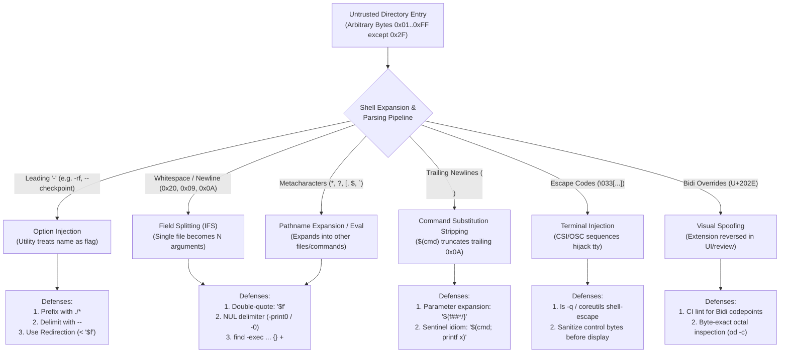

# Hostile Filenames

> [!summary] Claim
> In Unix filesystems, a filename is an unconstrained byte sequence containing any non-NUL byte except slash, transforming unquoted or improperly delimited shell expansions into command-line options, arbitrary word splits, recursive directory traversals, or terminal control sequences.

Part of [Shell Security](README.md) in [Shell and Unix Engineering](../README.md).

## TL;DR

- Mechanism: Unix kernels treat directory entry names as opaque byte arrays bounded only by `NAME_MAX` and prohibiting only `\0` (string termination) and `/` (path component separator).
- Rule: Always double-quote variable expansions (`"$f"`), always prefix relative path globs with `./` (`./*`), and always terminate command options with `--` before passing filename operands (`cmd -- "$f"`).
- Trap: Command substitution (`$(...)`) silently truncates all trailing newlines from filenames, and line-oriented pipelines (`while read`) split filenames containing embedded newlines into multiple spurious records.
- Portability fact: POSIX.1-2024 added NUL-delimited `read -d ''` (Austin Group Defect 243), but dash 0.5.12, posh 0.14.1, and yash 2.58.1 still reject it, and `printf %q` is not standard at all; safe cross-shell stream processing therefore still relies on `find ... -exec cmd {} +` or `find -print0 | xargs -0`.
- When not to use it: When processing untrusted binary bytes, unescaped Unicode bidirectional override characters, or filenames longer than `NAME_MAX`, move file processing logic into Python, Rust, or C using descriptor-based system calls (`openat(2)`, `unlinkat(2)`).

## Mental model



The diagram maps how arbitrary bytes inside a Unix directory entry attack the sequential parsing stages of the shell.
Because the filesystem layer treats all bytes except `\0` and `/` as opaque payload, any downstream consumer that assumes text conventions misinterprets the filename as structural syntax.
A leading hyphen fools the utility option parser (`getopt(3)`), whitespace triggers word splitting during field splitting (POSIX.1-2024 XCU 2.6.5), wildcards trigger globbing during pathname expansion (POSIX.1-2024 XCU 2.6.6), trailing newlines vanish inside command substitution (POSIX.1-2024 XCU 2.6.3), control characters compromise the terminal emulator, and bidirectional Unicode characters deceive human operators in code reviews.
Defenses must operate at the exact parser boundary where the divergence occurs: prefixing relative paths with `./` neutralizes option parsing, double-quoting eliminates field splitting and globbing, NUL streams eliminate line boundaries, and sentinel characters preserve trailing whitespace.

## How it works

At the system call interface, Unix kernel VFS layers (`fs/namei.c` in Linux) enforce exactly two byte restrictions on a pathname component:
The byte `0x00` (`\0`) cannot appear because C strings are NUL-terminated.
The byte `0x2F` (`/`) cannot appear because it is the reserved path component separator.
On Linux native filesystems such as ext4 and XFS, every other byte from `0x01` through `0xFF` is accepted by `open(2)`, `openat(2)`, `creat(2)`, `mkdir(2)`, `rename(2)`, and `unlink(2)` as a valid, opaque byte sequence.
Individual filesystems may reject more: macOS APFS refuses names that are not valid UTF-8 (`touch "$(printf 'bad\377name')"` fails with `Illegal byte sequence`, `EILSEQ`, measured on the macOS host 2026-11), so a hostile-filename test suite must not assume every byte is creatable on every host.
POSIX.1-2024 Base Definitions Section 3.146 ([XBD 3.146](https://pubs.opengroup.org/onlinepubs/9799919799/basedefs/V1_chap03.html)) defines a filename as:
"A sequence of bytes consisting of 1 to {NAME_MAX} bytes used to name a file.
The bytes composing the name shall not contain the <NUL> or <slash> characters."
POSIX Base Definitions Section 3.265 explicitly defines the "Portable Filename Character Set" as only uppercase letters, lowercase letters, digits, period (`.`), underscore (`_`), and hyphen-minus (`-`).
The note in POSIX Base Definitions Section 3.264 warns:
"Applications should avoid using filenames that have the <hyphen-minus> character as the first character since this may cause problems when filenames are passed as command line arguments."

The vulnerability of shell scripts to hostile filenames stems from the shell execution pipeline.
POSIX.1-2024 XCU Section 2.6 specifies the exact expansion order:
1. Tilde expansion, parameter expansion, command substitution, and arithmetic expansion are performed.
2. Field splitting (XCU 2.6.5) scans the unquoted results of expansions against the delimiters in `IFS` (defaulting to `<space>`, `<tab>`, and `<newline>`).
3. Pathname expansion (XCU 2.6.6) scans the resulting words for unquoted pattern characters (`*`, `?`, `[`).
4. Quote removal (XCU 2.6.7) discards quote characters.

When a script expands an unquoted variable containing a filename, such as `cat $f`:
If `$f` contains spaces, tabs, or newlines, step 2 splits the filename into separate arguments.
If `$f` contains `*` or `?`, step 3 matches those characters against existing files in the current working directory, replacing the filename with matching entries.
If `$f` begins with `-`, the expanded word arrives in `argv` of `cat` with a leading hyphen; `cat` parses it as an option flag rather than a filename operand.

The failure mode of command substitution (`$(...)`) is governed by POSIX.1-2024 XCU Section 2.6.3:
"if the output ends with one or more bytes that have the encoded value of a <newline> character, they shall not be included in the replacement."
In GNU bash 5.3 (`subst.c`), `command_substitute` hands the subshell pipe to `read_comsub`, which reads until EOF and then, under the comment "Strip trailing newlines from the output of the command", decrements `istring_index` while `istring[istring_index - 1]` is `\n`.
If a filename contains trailing newlines (e.g. `foo\n\n`), command substitution strips every trailing newline byte.
The resulting variable refers to `foo`, a completely different or non-existent file.
To capture a filename without trailing newline loss, POSIX scripts must append a non-newline sentinel character inside the substitution:
`captured=$(cmd "$f"; printf x); captured=${captured%x}`.
The trailing `x` shields all preceding newlines from the stripping loop; the parameter expansion `${captured%x}` then strips only the final `x`.

The failure mode of line-oriented loops (`while read -r line`) arises because Unix line tools define records by newline (`0x0A`).
Because a newline is a legally permitted byte inside a filename, a file named `report\ndata.csv` outputs as two physical lines.
The loop processes `report` in the first iteration and `data.csv` in the second iteration.
If `read` is invoked without clearing `IFS` (`read -r line` instead of `IFS= read -r line`), `read` strips leading and trailing whitespace from the line according to field splitting rules.
The only byte that cannot exist in any Unix filename is the NUL byte (`0x00`).
Consequently, POSIX.1-2024 Issue 8 standardized Austin Group Defect 243, adding `-print0` to `find` (XCU find), `-0` and `-r` to `xargs` (XCU xargs), and `-d delim` to `read`, where `-d ''` makes the NUL byte the record delimiter (XCU read).
A NUL-delimited stream guarantees that every record boundary aligns with the filesystem kernel boundary.
Without `-0`, `xargs` is not merely newline-delimited: POSIX XCU xargs splits its input on blanks and newlines and also interprets double quotes, apostrophes, and backslashes, so a name containing a space, a quote, or a backslash is split or rewritten before the command sees it (`find . -type f | xargs cmd` is unsafe for the same reason `for f in $(ls)` is).
Furthermore, `find -exec cmd -- {} +` executes argument aggregation in-process via `fork`/`execve` without passing data across pipes, preventing both line corruption and argument injection.

## Numbers and limits

| Metric / Boundary | Limit Value | Source / Standard | Failure Mode if Violated |
| :--- | :--- | :--- | :--- |
| Component name limit (`NAME_MAX`) | 255 bytes | POSIX.1-2024 `<limits.h>`, Linux ext4/XFS, macOS APFS (`getconf NAME_MAX /` measured on the macOS host and the Debian matrix image, 2026-11) | `open(2)` fails with `ENAMETOOLONG` |
| Maximum pathname length (`PATH_MAX`) | 4096 bytes (Linux), 1024 bytes (macOS) | POSIX.1-2024 `<limits.h>`, Linux `<linux/limits.h>`, macOS syslimits.h (`getconf PATH_MAX /` measured on the macOS host and the Debian matrix image, 2026-11) | Path resolution fails with `ENAMETOOLONG` |
| Minimum `_POSIX_NAME_MAX` | 14 bytes | POSIX.1-2024 [`<limits.h>`](https://pubs.opengroup.org/onlinepubs/9799919799/basedefs/limits.h.html) (XBD Chapter 14, Headers) | Legacy filesystem portability failure |
| Minimum `_POSIX_PATH_MAX` | 256 bytes | POSIX.1-2024 [`<limits.h>`](https://pubs.opengroup.org/onlinepubs/9799919799/basedefs/limits.h.html) (XBD Chapter 14, Headers) | Cross-platform buffer overflow |
| Maximum `execve` arguments (`ARG_MAX`) | 2,097,152 bytes (Linux with the default 8 MiB stack limit, which sets it to a quarter of `RLIMIT_STACK`), 1,048,576 bytes (macOS) | POSIX.1-2024 `<limits.h>`, Linux [execve(2)](https://man7.org/linux/man-pages/man2/execve.2.html), `getconf ARG_MAX` measured on the Debian matrix image and the macOS host (2026-11) | Shell expansion yields `E2BIG` ("Argument list too long") |
| Valid bytes in filename component | 254 distinct bytes (all except `0x00` and `0x2F`) | POSIX.1-2024 Base Definitions Section 3.146 | Filesystem rejects string containing `0x00` or parses `0x2F` as directory separator |
| Portable filename character set | 65 characters (`[A-Za-z0-9._-]`) | POSIX.1-2024 Base Definitions Section 3.265 | Filename contains characters triggering shell expansion or option parsing |
| Trailing newlines stripped by `$(...)` | Unlimited (all trailing `0x0A` bytes) | POSIX.1-2024 XCU Section 2.6.3 | Variable contains truncated filename missing trailing newlines |
| GNU coreutils `ls` quoting default | Changed to `shell-escape` on a terminal in version 8.25 (2016-01-20) | GNU coreutils [NEWS](https://raw.githubusercontent.com/coreutils/coreutils/master/NEWS) for 8.25, `src/ls.c` (`stdout_isatty () ? shell_escape_quoting_style`) | Ambiguous names on coreutils `< 8.25`; raw control bytes reach the terminal whenever `ls` output is piped into another command that then prints it, or a tool such as `cat` or `find -print` writes names unescaped (BSD and macOS `ls` default to `-q` on a terminal, per `man ls`) |
| Trojan Source Bidi override codepoints | 9 codepoints (`U+202A`..`U+202E`, `U+2066`..`U+2069`) | Unicode Standard Annex #9, CVE-2021-42574 (source-code reordering) | Visual extension spoofing in text editors and UIs |

## Portability

The table below documents shell behavior across engines when handling hostile filenames.
Data reflects specifications and matrix measurements across Linux (glibc, musl) and macOS hosts (as of 2026-11).
Every implementation cell was measured by hand in the shell matrix images (Debian 13, Alpine 3.22) and on the macOS host, 2026-11; the GNU bash row combines Homebrew bash 5.3.20 on the host with bash 5.2.37 in both images, which agree on every column.

| Shell / Tool | Unquoted Variable Field Splitting (`$f`) | Unquoted Wildcard Globbing (`f='*'; cmd $f`) | Command Sub. Strips Trailing `\n` | Native `read -d ''` (NUL record) | Builtin `printf %q` (Shell quoting) | Default `.*` Globs `.` and `..` | `$'...'` Quoting Support |
| :--- | :--- | :--- | :--- | :--- | :--- | :--- | :--- |
| POSIX.1-2024 sh | Yes (POSIX XCU 2.6.5) | Yes (POSIX XCU 2.6.6) | Yes (POSIX XCU 2.6.3) | Yes (`-d delim`, `-d ''` is NUL; XCU read, Issue 8 Defect 243) | No (not standard) | Unspecified (dot and dot-dot "may be ignored", XCU 2.14.3) | Yes (standardized in Issue 8) |
| macOS bash 3.2.57 | Yes (split on `IFS`) | Yes (expands to files) | Yes (strips all trailing `\n`) | Yes (`-d delim`) | Yes (outputs escaped string) | Yes (matches `.` and `..`) | Yes |
| GNU bash 5.3 | Yes (split on `IFS`) | Yes (expands to files) | Yes (strips all trailing `\n`) | Yes (`-d delim`) | Yes (outputs reusable quote) | No (`globskipdots` is on by default since 5.2) | Yes |
| zsh 5.9 (native) | No (does not split `$f`) | No (`GLOB_SUBST` is off; passes a literal `*`) | Yes (strips all trailing `\n`) | Yes (`-d delim`) | Yes (outputs reusable quote) | No (ignores `.` and `..` by default) | Yes |
| zsh 5.9 (`--emulate sh`) | Yes (POSIX splitting) | Yes (expands to files) | Yes (strips all trailing `\n`) | Yes (`-d delim`) | Yes (outputs reusable quote) | No (still never generates `.` and `..`) | Yes |
| dash 0.5.12 | Yes (split on `IFS`) | Yes (expands to files) | Yes (strips all trailing `\n`) | No (rejects `-d`) | No (rejects `%q`) | Yes (matches `.` and `..`) | No (prints literal `$`) |
| ksh93u+m 1.0.10 | Yes (split on `IFS`) | Yes (expands to files) | Yes (strips all trailing `\n`) | Yes (`-d delim`) | Yes (outputs reusable quote) | No (ignores `.` and `..`) | Yes |
| mksh R59 | Yes (split on `IFS`) | Yes (expands to files) | Yes (strips all trailing `\n`) | Yes (`-d delim`) | No builtin (external `printf`: Debian's GNU coreutils accepts `%q`, Alpine's BusyBox rejects it) | No (ignores `.` and `..`) | Yes |
| yash 2.58.1 | Yes (split on `IFS`) | Yes (expands to files) | Yes (strips all trailing `\n`) | No (rejects `-d`) | No (rejects `%q`) | Yes (matches `.` and `..`) | Yes |
| posh 0.14.1 | Yes (split on `IFS`) | Yes (expands to files) | Yes (strips all trailing `\n`) | No (rejects `-d`) | No builtin (external `printf`: Debian's GNU coreutils accepts `%q`) | No (ignores `.` and `..`) | No (prints literal `$`) |
| BusyBox 1.37.0 ash | Yes (split on `IFS`) | Yes (expands to files) | Yes (strips all trailing `\n`) | Yes (`-d delim`) | No (rejects `%q`) | Yes (matches `.` and `..`) | Yes |

## Worked example

The worked example script comes from [lab](../labs/17-hostile-filenames/) (`inventory.sh`).
It demonstrates four defensive invariants:
1. Normalizing the input directory path with a leading `./` prefix if relative, guaranteeing that `"$dir"/*` never expands into an argument starting with a hyphen.
2. Skipping non-matching globs with `[ -e "$entry" ] || [ -L "$entry" ] || continue` to handle empty directories safely.
3. Classifying hostile vectors (hyphens, embedded newlines, whitespace, glob wildcards, and control characters) using POSIX `case` pattern matching.
4. Reading file attributes safely using input redirection (`< "$entry"`), which bypasses command-line argument parsing in `wc` entirely.

```sh
#!/bin/sh
# inventory.sh: Safely scan a directory for hostile filenames and report findings.
# Demonstrates robust path normalization, option immunity via ./ prefix,
# redirection-based inspection, and classification of filename attack vectors.
set -eu

dir="${1:-.}"

# Ensure directory path begins with safe prefix so "$dir"/* never yields a leading hyphen.
case "$dir" in
  /* | ./* | ../*) ;;
  *) dir="./$dir" ;;
esac

if [ ! -d "$dir" ]; then
  printf 'error: directory %s does not exist\n' "$dir" >&2
  exit 1
fi

nl=$(printf '\nx')
nl=${nl%x}

total=0
hostile=0

# Loop safely over files using globbing with guaranteed safe prefix.
for entry in "$dir"/*; do
  # Handle empty directory where glob expands to literal pattern.
  if [ ! -e "$entry" ] && [ ! -L "$entry" ]; then
    continue
  fi

  total=$((total + 1))
  base="${entry##*/}"
  flags=""

  # Vector 1: Leading hyphen (argument injection risk).
  case "$base" in
    -*) flags="${flags:+$flags,}HYPHEN" ;;
  esac

  # Vector 2: Embedded newline (line-oriented stream injection).
  case "$base" in
    *"$nl"*) flags="${flags:+$flags,}NEWLINE" ;;
  esac

  # Vector 3: Whitespace (field-splitting risk).
  case "$base" in
    *[[:space:]]*) flags="${flags:+$flags,}SPACE" ;;
  esac

  # Vector 4: Glob metacharacters (unquoted pathname expansion risk).
  case "$base" in
    *['*?[']*) flags="${flags:+$flags,}GLOB" ;;
  esac

  # Vector 5: Control characters (terminal injection risk).
  case "$base" in
    *[[:cntrl:]]*) flags="${flags:+$flags,}CONTROL" ;;
  esac

  if [ -n "$flags" ]; then
    hostile=$((hostile + 1))
    # Safely obtain size via redirection; never pass entry as argument to utilities that lack --.
    size=$(wc -c <"$entry" | tr -d ' ')
    printf 'HOSTILE: %s | flags: [%s] | bytes: %s\n' "$base" "$flags" "$size"
  fi
done

printf 'SUMMARY: total=%d hostile=%d clean=%d\n' "$total" "$hostile" "$((total - hostile))"
```

When executed in a test directory containing `-rf`, `glob*file[1].txt`, `space file.txt`, and `clean.txt` (with `LC_ALL=C`), the script prints the following, which the lab test "inventory script output matches the worked example exactly" asserts byte for byte (run once under macOS `/bin/sh`, 2026-11):

```text
HOSTILE: -rf | flags: [HYPHEN] | bytes: 0
HOSTILE: glob*file[1].txt | flags: [GLOB] | bytes: 0
HOSTILE: space file.txt | flags: [SPACE] | bytes: 0
SUMMARY: total=4 hostile=3 clean=1
```

## Pitfalls

> [!warning] Tar argument injection via wildcard globbing (GTFOBins / GNU tar checkpoint exploit)
> Trigger: Running `tar cf backup.tar *` or `tar czf backup.tar.gz *` in a directory containing files named `--checkpoint=1` and `--checkpoint-action=exec=sh payload.sh`.
> Symptom: Pathname expansion expands the wildcards in collation order, placing `--checkpoint=1` before regular files on the command line; GNU tar parses these filenames as option flags and executes `sh payload.sh` with the caller's privileges (a classic privilege escalation vector documented by Leon Juranic in the DefenseCode advisory "Back To The Future: Unix Wildcards Gone Wild", released 2014-06-25, and referenced in GTFOBins).
> Fix: Always pass `--` before operands or prefix wildcards with `./`: `tar cf backup.tar -- ./*`.

> [!warning] Terminal escape sequence injection (CVE-2003-0063 / xterm window title pushback)
> Trigger: Listing a directory or viewing a file list containing ANSI / VT100 control sequences (such as `\033]2;command\007\033[21t`) using raw `ls`, `find -print`, or `cat`.
> Symptom: The terminal emulator processes the escape sequences and modifies window titles.
> In xterm from XFree86 4.2.0 and earlier, an attacker could set the window title through an escape sequence and then insert it back into the command line, so that viewing a file containing the sequence could run arbitrary commands (CVE-2003-0063, NVD description, checked 2026-11).
> Fix: Ensure utilities use quoting or non-printable character replacement when outputting to a TTY; use POSIX `ls -q` (replaces control characters with `?`), `ls -b` (displays octal escapes), or GNU coreutils `ls` with default `shell-escape` quoting (introduced in coreutils 8.25).

> [!warning] Line-oriented pipeline corruption via embedded newlines
> Trigger: Piping filenames from `find .` or `ls` into line-oriented utilities: `find . -type f | while read -r file; do rm "$file"; done` or `find . | grep -v pattern`.
> Symptom: A filename containing a newline byte (`0x0A`) splits into two distinct lines; the loop executes on two non-existent or attacker-controlled partial paths, causing unintended deletions, failed operations, or secondary argument injection.
> Fix: Process pathnames using NUL-delimited streams (`find . -type f -print0 | xargs -0 rm --` per POSIX.1-2024 Issue 8 Defect 243) or in-process execution (`find . -type f -exec rm -- {} +`).

> [!warning] Silent truncation of trailing newlines in command substitution
> Trigger: Capturing a filename or basename via command substitution: `name=$(basename -- "$path")` or `name=$(printf '%s' "$path")`.
> Symptom: Per POSIX.1-2024 XCU Section 2.6.3, command substitution strips every trailing newline character; if a filename ends with `\n`, the captured string drops the trailing byte, causing subsequent operations (`test -f "$name"`, `rm -- "$name"`) to target the wrong path or fail with `ENOENT`.
> Fix: Use native parameter expansion without subshell command substitution (`name="${path##*/}"`), or apply the sentinel character idiom: `name=$(basename -- "$path"; printf x); name="${name%x}"`.

> [!warning] Unicode Bidirectional override extension spoofing (the mechanism behind CVE-2021-42574 "Trojan Source")
> Trigger: A filename containing Unicode Bidirectional Algorithm (Bidi) formatting control characters, such as Right-to-Left Override (`U+202E`, RLO) or Left-to-Right Override (`U+202D`, LRO).
> Scope: CVE-2021-42574 itself describes this reordering as a weakness in the Unicode Bidirectional Algorithm that lets source code render differently from the order in which compilers and interpreters read it (NVD, CWE-94, checked 2026-11); it does not mention filenames.
> Spoofing a file extension with the same control characters is an application of the same mechanism, not a claim the CVE makes.
> The companion CVE-2021-42694 covers homoglyphs in identifiers: names that render identically but differ in bytes, so a filename can also look like another one without any control character.
> Symptom: Human review tools, graphical file explorers, and terminal renderers display characters in reverse visual order; an executable file named `report\u202Efdp.sh` visually renders to operators as `reporths.pdf` (the override reverses the trailing `fdp.sh`), masking malicious script execution behind an apparent PDF document.
> Fix: Add CI and repository pre-commit checks that detect and reject Unicode directional control characters (`U+202A` through `U+202E` and `U+2066` through `U+2069`), and audit untrusted directory contents using byte-level tools (`od -c`, `hexdump -C`).

> [!warning] Parent directory recursion via unconstrained dot-globbing
> Trigger: Attempting to match hidden files using the glob pattern `.*` in recursive commands: `chmod -R 755 .*` or `chown -R user:group .*` (POSIX `rm` must refuse a `.` or `..` operand with a diagnostic, so `rm -rf .*` skips them, per [XCU rm](https://pubs.opengroup.org/onlinepubs/9799919799/utilities/rm.html)).
> Symptom: POSIX.1-2024 XCU 2.14.3 leaves it unspecified whether `.*` produces `.` and `..` (they "may be ignored"); dash, BusyBox ash, yash, and bash before 5.2 (including macOS `/bin/bash` 3.2) do match both `.` (current working directory) and `..` (parent directory), as measured in the shell matrix; the command recurses upwards into the parent directory tree, modifying system-wide files outside the target directory.
> Fix: Do not use bare `.*`; use explicit patterns that exclude `.` and `..` (`.[!.]* .??*`) or filter entries explicitly in loops: `case "$f" in */.|*/..) continue ;; esac`.

## Security and robustness

The shell threat model treats untrusted filenames as data that can inadvertently become control instructions.
When untrusted users can write files to shared directories (e.g. `/tmp`, world-writable dropboxes, extracted tarballs, or git repositories), every unquoted or unprefixed shell expansion becomes an exploitation primitive.
Attackers weaponize four core properties of shell syntax:
1. Option parsing confusion: A filename beginning with `-` alters utility control flow unless shielded by `--` or `./`.
2. Delimiter parsing confusion: Spaces, tabs, and newlines fracture path strings during `IFS` field splitting.
3. Syntactic re-evaluation: Passing a filename to `eval`, `sh -c`, or an arithmetic expansion `$((...))` interprets shell metacharacters (`;`, `&`, `|`, `$()`, `` ` ``) as code.
4. Terminal emulator control: ANSI escape sequences inject keystrokes into the host terminal buffer.

To build production-grade shell pipelines resilient against hostile filenames, follow the Invariant Trinity of Defensive File Handling:
First, strict expansion quoting:
Every variable expansion representing a path MUST be double-quoted (`"$f"`, `"$path"`, `"$dir"`).
Double quotes inhibit field splitting (POSIX.1-2024 XCU 2.6.5) and pathname expansion (POSIX.1-2024 XCU 2.6.6), guaranteeing that the filename remains exactly one argument.
Second, prefix immunization:
Every wildcard expansion targeting relative paths MUST begin with `./` (`./*` instead of `*`).
Because every matched pathname starts with the literal characters `.` and `/`, the expanded string cannot begin with `-`, rendering the path immune to option injection across every downstream command, including utilities that do not support `--` (such as `echo`, `test`, or legacy BSD tools).
Third, explicit option termination:
Every command invocation accepting operands MUST include the `--` delimiter before positional filename arguments:
`rm -- "$f"`, `cat -- "$f"`, `grep pattern -- "$f"`.
Per POSIX.1-2024 Base Definitions Section 12.2 Guideline 10, the first `--` argument forces the utility option parser to treat all subsequent tokens as operands, even if they begin with `-`.

Beyond the Trinity, prefer file redirection over argument passing wherever supported.
When invoking utilities to inspect file content, pass the file as a redirection operand rather than an `argv` parameter:
`wc -c < "$f"` instead of `wc -c "$f"`.
`cat < "$f"` instead of `cat "$f"`.
In file redirection (`< "$f"`), the shell performs variable expansion and calls `open(2)` directly on the resulting string.
The utility is invoked with no filename in `argv`, making option injection physically impossible regardless of leading hyphens or unsupported flags.

For bulk traversal, use `find` with in-process execution:
`find "$dir" -type f -exec sh -c 'for f do ... done' sh {} +`.
This construct solves three security problems simultaneously and leaves a fourth open:
It eliminates text delimiter injection because filenames pass directly through `argv` arrays via `execve(2)`.
It avoids subshell pipeline issues because the loop does not execute downstream of a pipe.
It batches thousands of files within the operating system `ARG_MAX` limit without invoking `xargs`.
It does not remove TOCTOU (Time-of-Check to Time-of-Use) races: each pathname is a string that the command resolves again when it opens it, so a directory swapped for a symlink between traversal and use still redirects the operation; only descriptor-relative calls (`openat(2)` with `O_NOFOLLOW`) close that gap.

## The principal's view

At the staff-plus engineering level, the presence of shell scripts processing untrusted filenames is an architectural liability.
The Unix filesystem model is fundamentally binary: a filename is an unvalidated byte slice.
The shell, conversely, is an untyped macro processor designed around text streams and whitespace delimiters.
Bridging a binary-safe filesystem with a whitespace-delimited macro engine requires constant defensive discipline.
A single forgotten quote (`$f` instead of `"$f"`), a single bare wildcard (`*` instead of `./*`), or a single missing `--` creates an exploitable security flaw or data-loss vulnerability.

Staff engineers enforce a strict boundary:
1. Shell is permitted only for orchestration of trusted internal paths, fixed build targets, or administrative tasks where filenames conform strictly to the Portable Filename Character Set (`[A-Za-z0-9._-]`).
2. Any pipeline processing untrusted files - such as archive unpackers, upload processors, container volume indexers, or multi-tenant ingestion services - MUST NOT be written in shell.
3. High-integrity file handling must be authored in compiled or structured languages (Python, Go, Rust, or C) that interact directly with the operating system kernel via descriptor-relative system calls:
   - Python: use `os.scandir()` which returns `DirEntry` objects, avoiding string concatenation and stat storms, and use `subprocess.run(["cmd", "--", path])` with explicit argument lists.
   - Go: use `os.ReadDir()` and `exec.Command(cmd, path)` which invoke `execve` directly without invoking a shell.
   - Rust: use `std::fs::read_dir()` with `std::ffi::OsStr` / `PathBuf`, preserving exact platform bytes without forcing UTF-8 validation, and use `std::process::Command::new(cmd).arg(path)`.
   - C / POSIX: use descriptor-relative system calls (`openat(2)`, `unlinkat(2)`, `fstatat(2)`) with `O_NOFOLLOW` to eliminate race conditions (TOCTOU) and avoid path parsing entirely.

When shell scripting is unavoidable for legacy or operational reasons, enforce static verification in CI:
Enable ShellCheck rules `SC2035` (use `./*` to prevent filename argument injection), `SC2046` (quote command substitution to prevent word splitting), `SC2086` (double-quote variable expansions), and `SC2248` (the optional `quote-safe-variables` check, added in ShellCheck 0.7.1, which asks for quotes even on variables with no special characters; enable it with `enable=quote-safe-variables`, per the [ShellCheck wiki](https://www.shellcheck.net/wiki/SC2248)).
Any shell script that touches the filesystem and cannot pass ShellCheck without warnings must be rejected at the gate.

## Interview questions

> [!question] L5: Why does `rm *` behave unexpectedly or destructively if a file named `-rf` exists in the current directory, and how does `rm ./*` prevent the issue?
>
> > [!success]- Answer
> > During pathname expansion (POSIX.1-2024 XCU 2.6.6), the shell expands `*` to all non-hidden directory entries in collation order.
> > If an entry is named `-rf`, the expanded command line becomes `rm -rf file1 file2 ...`.
> > The `rm` utility parses `argv` sequentially; encountering `-rf`, it interprets the token as options (recursive and force) rather than a file operand.
> > Prefixing the pattern with `./` (`rm ./*`) ensures that every expanded filename begins with the literal characters `./` (e.g. `./-rf`, `./file1`).
> > Because the first character is `.`, utility option parsers never recognize the argument as a flag, treating it strictly as a file operand.
> >
> > Follow-up: Does passing `rm -- *` provide the exact same protection as `rm ./*` across all standard Unix utilities?

> [!question] L5 (Predict the output): Given a file named `hello world.txt` and a script `showargs.sh` that prints its arguments between angle brackets, what does the following code output in GNU bash versus native zsh?
> ```sh
> f="hello world.txt"
> ./showargs.sh $f
> ./showargs.sh "$f"
> ```
>
> > [!success]- Answer
> > In GNU bash, unquoted `$f` undergoes field splitting (POSIX.1-2024 XCU 2.6.5) against the default `IFS` space delimiter, producing two arguments: `2 args: <hello> <world.txt>`.
> > In native zsh, unquoted parameter expansions do not undergo field splitting by default (unless the option `SH_WORD_SPLIT` is enabled), producing one argument: `1 args: <hello world.txt>`.
> > For the double-quoted expansion `"$f"`, double quotes inhibit field splitting across both shells, producing identical output: `1 args: <hello world.txt>`.
> >
> > Follow-up: How does zsh behave when invoked with `zsh --emulate sh`?

> [!question] L6 (Debug this script): Identify three distinct security and robustness bugs in the following log cleanup snippet, and write the minimal POSIX-compliant fix:
> ```sh
> for f in $(ls /var/log/app); do
>   rm -f "/var/log/app/$f"
> done
> ```
>
> > [!success]- Answer
> > First, `$(ls ...)` command substitution undergoes word splitting on `IFS` (spaces, tabs, newlines), so any log file containing whitespace or newlines is split into multiple incomplete filename fragments.
> > Second, command substitution (`$(...)`) silently strips all trailing newlines per POSIX.1-2024 XCU 2.6.3, corrupting any filename ending in a newline byte.
> > Third, unquoted `$(ls ...)` undergoes pathname expansion (globbing) in step 3 of shell expansions; if a filename contains `*` or `?`, the shell attempts to expand it against files in the current working directory.
> > The minimal POSIX-compliant fix avoids `ls` and subshells entirely, using direct in-process globbing with an existence check:
> > ```sh
> > for f in /var/log/app/*; do
> >   [ -e "$f" ] || [ -L "$f" ] || continue
> >   rm -f -- "$f"
> > done
> > ```
> >
> > Follow-up: Why must `rm` still be passed `--` if the glob expansion `/var/log/app/*` already starts with `/`?

> [!question] L6: Explain why `result=$(cat file)` or `result=$(printf '%s' "$filename")` silently corrupts filenames that end in newline characters, and demonstrate the sentinel idiom used to solve it.
>
> > [!success]- Answer
> > POSIX.1-2024 XCU Section 2.6.3 explicitly mandates that command substitution must discard any trailing newline bytes from the standard output of the enclosed command before substitution.
> > If a filename ends with one or more newline characters (e.g. `archive\n\n`), the shell strips both `\n` bytes, leaving `archive`.
> > Downstream commands referencing `$result` target a non-existent or wrong file, causing `ENOENT` errors or race conditions.
> > The sentinel idiom appends a non-newline character (typically `x`) immediately after the command output inside the substitution:
> > `result=$(cmd; printf x); result=${result%x}`.
> > The trailing `x` prevents the shell from identifying any preceding `\n` bytes as trailing, leaving them intact; parameter expansion `${result%x}` then strips the trailing `x`.
> >
> > Follow-up: Why does `printf '%s\n' "$var"` inside a command substitution not guarantee that trailing newlines are preserved?

> [!question] L6: Trace the exact sequence of POSIX expansion stages that occur when a variable `f="*"` is expanded unquoted as `ls $f` versus double-quoted as `ls "$f"`.
>
> > [!success]- Answer
> > For `ls $f`: in step 1 (parameter expansion), `$f` expands to the literal string `*`.
> > In step 2 (field splitting, XCU 2.6.5), the string `*` contains no `IFS` whitespace, so it remains a single field.
> > In step 3 (pathname expansion, XCU 2.6.6), because the field contains an unquoted pattern character `*`, the shell scans the current directory and replaces `*` with all non-hidden filenames in collation order.
> > In step 4 (quote removal), no quotes exist, and `ls` receives every matched filename as an argument.
> > For `ls "$f"`: in step 1, `"$f"` expands to `*`.
> > In step 2, double quoting inhibits field splitting.
> > In step 3, double quoting quotes the pattern character `*`, inhibiting pathname expansion.
> > In step 4, the double quotes are removed, and `ls` receives exactly one argument: the literal character `*`.
> >
> > Follow-up: How does `set -f` alter the behavior of `ls $f`?

> [!question] L7: In a large-scale filesystem crawler, why is `find . -type f -exec cmd -- {} +` architecturally superior and safer than `find . -type f -print0 | xargs -0 cmd --`?
>
> > [!success]- Answer
> > First, `find ... -exec ... {} +` executes argument aggregation entirely in-process within the `find` binary, invoking `execve(2)` directly with batches of pathnames sized to fit within operating system `ARG_MAX` limits.
> > Second, piping through `find -print0 | xargs -0` introduces an inter-process pipe, a separate utility process (`xargs`), and potential partial-record processing.
> > As noted in the EXAMPLES section of POSIX.1-2024 XCU find, if `find -print0` is killed or terminates abnormally while writing a pathname, the trailing partial bytes in the pipe buffer can be processed by `xargs -0` as a complete filename.
> > Third, `find -exec ... {} +` avoids pipeline exit code masking, propagating failure statuses directly to the caller without requiring `pipefail`.
> >
> > Follow-up: What happens if `find -exec cmd -- {} +` finds zero matching files versus `xargs -0` without `-r`?

> [!question] L7: Explain how an attacker can leverage Unicode Bidirectional (Bidi) overrides (the mechanism of CVE-2021-42574, which the CVE describes for source code) in a filename to deceive developers during code review, and describe how build tools should mitigate this.
>
> > [!success]- Answer
> > The Unicode Bidirectional Algorithm (UAX #9) defines control characters such as Right-to-Left Override (`U+202E`, RLO) and Left-to-Right Override (`U+202D`, LRO) to display bidirectional scripts.
> > An attacker crafts a filename containing raw bytes for `U+202E`: for example, `payload\u202Efdp.sh`.
> > Graphical file managers, IDE tabs, git diff viewers, and terminal emulators evaluate the Bidi override, displaying the remaining characters in reverse order: `payloadhs.pdf`.
> > The developer visually inspects the file as an innocent PDF document, while the kernel, git, and shell execute the file as a `.sh` shell script.
> > Build systems and CI gates must scan filenames at the byte level, rejecting any path containing codepoints in the ranges `U+202A`..`U+202E` and `U+2066`..`U+2069`, and audit file lists with `od -c` or `LC_ALL=C`.
> >
> > Follow-up: How do macOS APFS Unicode normalization (NFD) rules interact with Linux ext4 (NFC/raw byte) filenames during repository checkout?

> [!question] L7+: Design an end-to-end ingestion pipeline for an enterprise service that extracts and processes tar archives submitted by untrusted users, detailing the filesystem attack vectors and your defensive architecture.
>
> > [!success]- Answer
> > An untrusted archive presents five major filename attack vectors: path traversal (`../../etc/shadow`), leading hyphen option injection (`--checkpoint=1`), embedded newlines disrupting audit logs, terminal escape sequence injection in admin tooling, and symlink TOCTOU races.
> > The defensive architecture must completely bypass shell interpreters and execute inside an unprivileged sandbox (Linux user namespace, seccomp-bpf, chroot/pivot_root).
> > The extractor must be implemented in Rust or Go, validating each header's raw path bytes before extraction.
> > Path validation must reject absolute paths, paths containing `..` components, paths with leading hyphens, paths with ASCII control characters (`0x01`..`0x1F`, `0x7F`), and paths with Unicode directional formatting characters.
> > Files must be written using descriptor-relative system calls (`openat(2)`, `mkdirat(2)`) with `O_NOFOLLOW` and `O_EXCL` flags to prevent symbolic link traversal and file overwrites.
> > Permissions must be sanitized with a strict `umask` (e.g. `0077`), stripping setuid/setgid bits and preventing execution until files are vetted.
> >
> > Follow-up: Why is calling `tar -xf archive.tar -C /sandbox` insufficient even with the `-C` flag?

## Related

Prerequisites: [[Argument-Injection-and-Double-Dash]]

Next: [[PATH-Hijacking]]

See also: [[Command-Injection]], [[eval-and-sh-c]], [[Field-Splitting-and-IFS]], [[Temporary-File-Attacks]], [[Shell-Threat-Model]].

## Further reading

- IEEE Std 1003.1-2024 (POSIX.1-2024) Base Definitions Section 3.146 and 3.265: defines Filename and the Portable Filename Character Set.
- IEEE Std 1003.1-2024 (POSIX.1-2024) Shell and Utilities (XCU) Section 2.6: specifies shell expansion order, field splitting, and command substitution newline stripping.
- IEEE Std 1003.1-2024 (POSIX.1-2024) Base Definitions Section 12.2: specifies Utility Syntax Guidelines and Guideline 10 (`--`).
- GNU coreutils source (`src/ls.c`): details implementation of `shell-escape` quoting and terminal TTY detection.
- Linux kernel VFS source (`fs/namei.c`): demonstrates why Unix kernels treat filenames as opaque byte streams without character validation.
- Nicholas Boucher and Ross Anderson, "Trojan Source: Invisible Vulnerabilities" (CVE-2021-42574 and CVE-2021-42694): primary paper on Unicode bidirectional override and homoglyph attacks on source code; filename spoofing reuses the same control characters.
- Leon Juranic, "Back To The Future: Unix Wildcards Gone Wild" (DefenseCode, released 2014-06-25, [Exploit-DB 33930](https://www.exploit-db.com/raw/33930)): foundational paper detailing wildcard exploitation of `chown`, `tar`, and `rsync`, including `--checkpoint-action` execution.
- David A. Wheeler, "[Fixing Unix/Linux/POSIX Filenames: Control Characters (such as Newline), Leading Dashes, and Other Problems](https://dwheeler.com/essays/fixing-unix-linux-filenames.html)" (originally 2009-03-24, revised 2024-07-19): comprehensive analysis of hostile filename characters and proposed system-level reforms.
