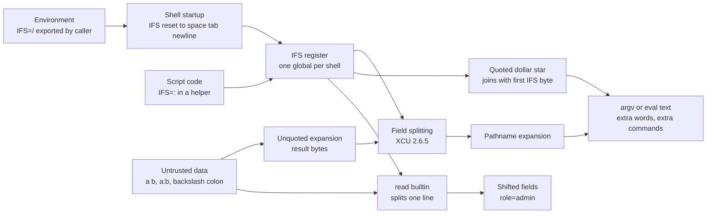

# IFS Attacks

> [!summary] Claim
> `IFS` is a global, mutable register that decides where the shell cuts the results of every unquoted expansion into words, so an attacker who controls its value, its leftovers, or the characters a payload is built from (no space needed: `${IFS}` is one) turns data into extra arguments or extra commands without ever typing a quote.

Part of [Shell Security](README.md) in [Shell and Unix Engineering](../README.md).

## TL;DR

- Mechanism: field splitting cuts only the results of unquoted parameter expansion, command substitution, and arithmetic expansion at the bytes in `IFS`, after expansion and before pathname expansion (POSIX.1-2024 XCU 2.6.5), so whoever sets `IFS` or supplies the expanded bytes steers the argument vector.
- Rule: a script must own its `IFS` - POSIX requires the shell to set `IFS` to `<space><tab><newline>` at invocation (POSIX.1-2024 XCU 2.5.3), so never import it, never assign it globally, scope every change to `IFS=... read` or a subshell, and quote every expansion you do not mean to split.
- Trap: the classic attack (an exported `IFS=/` against a setuid program that calls `system()`) is dead in conforming shells, but the other three survive: a leaked `IFS`, a "no whitespace" input filter that `${IFS}` walks around (CVE-2023-31128), and delimiter bytes inside data that shift fields in `read` and `set -- $x`.
- Portability fact: native `zsh` never splits unquoted parameter expansions and has a four-byte default `IFS` that includes NUL, `zsh --emulate sh` splits but adds a trailing empty field after a final non-whitespace delimiter, and posh 0.14.1 keeps an inherited `IFS` (measured in the shell matrix).
- When not to use it: never parse structured data (CSV, `/etc/passwd`-like records with free-text fields, JSON, paths with newlines) or hold argument lists in a delimited scalar by setting `IFS`; use positional parameters, `IFS= read -r`, `find -exec` or `-print0`, or a language with real data types.

## Mental model



Two writers feed the register: the environment of whoever started the shell, and the script's own assignments (data never writes `IFS`, it only supplies the bytes that `IFS` is compared against).
Startup is the checkpoint that makes the environment arrow safe, and it is a rule of the shell implementation, not of your script.
The script arrow is the one you control and the one that leaks: the register is global, so an assignment inside a helper function is visible in every later expansion in the caller.
Untrusted data meets the register at three consumers: unquoted expansion (extra words), `"$*"` (a join byte chosen by whoever set `IFS`), and `read` (a line cut into variables), and each can turn one logical value into several.

## How it works

### The specification surface

`IFS` is defined in three places in POSIX.1-2024.
XCU 2.5.3 (Shell Variables) says that `IFS` is the list of characters used for field splitting, for the expansion of the `*` special parameter, and for line splitting in `read`.
It also says that an unset `IFS` behaves as an unset variable except that splitting and `read` act as if it held `<space><tab><newline>`, and that "The shell shall set IFS to <space><tab><newline> when it is invoked."
XCU 2.6.5 (Field Splitting) scans "each field containing results of expansions and substitutions that did not occur in double-quotes", and states that "Fields which contain no results from expansions shall not be affected by field splitting".
The `sh` rationale gives the reason for the invocation rule: "One justification for ignoring the contents of IFS upon entry to the script, beyond security considerations, is to assist possible future shell compilers" (POSIX.1-2024 XCU sh, RATIONALE).

One sentence of the XRAT is the historical attack in one line.
In XRAT C.2.6 the committee notes that `IFS` "is not used for splitting all fields.
Earlier versions of the shell used it for splitting all fields during field splitting, but this has severe problems because the shell can no longer parse its own script.
There are also important security implications caused by this behavior."
Before that fix, `IFS=/` in the environment of a setuid program that ran `system("/bin/mail")` made the shell cut the literal text `/bin/mail` into `bin` and `mail` and run an attacker's file named `bin` from the current directory.
The registry still carries the pattern: CVE-1999-1501 records that `ipxchk` and `ipxlink` on SGI IRIX 6.3 "does not properly clear the IFS environmental variable before executing system calls", with a public date of 1998-04-08 (`cveawg.mitre.org/api/cve/CVE-1999-1501`).
The CVE text names the missing step and not the exploit; the `bin` mechanism above is my reading of the XRAT sentence, not something the record spells out.

### Three layers of defense in the shell, and the one that is yours

1. The invocation reset.
   `initialize_shell_variables` in bash 5.3 imports every environment variable and then runs `temp_var = bind_variable ("IFS", " \t\n", 0); setifs (temp_var);` under the comment "Don't allow IFS to be imported from the environment." (bash-5.3 variables.c, initialize_shell_variables, lines 586-588).
   dash and BusyBox ash do the same with a different mechanism: both loop over `environ` with `setvareq(*envp, VEXPORT|VTEXTFIXED)` and then call `setvareq(defifsvar, VTEXTFIXED)` with `defifsvar[] = "IFS= \t\n"` (dash src/var.c, INIT block, lines 143-150; busybox shell/ash.c, init(), lines 14520-14537).
   Because the variable was imported with `VEXPORT` and the default is then written over it, the imported variable keeps its export flag and now carries the default value.
   zsh does not overwrite: `IFS` is declared `STRPM("IFS", NULL, ifs_gsu, PM_DONTIMPORT)` (zsh Src/params.c on master, line 354), the internal value comes from `ifs = EMULATION(EMULATE_KSH|EMULATE_SH) ? ztrdup(DEFAULT_IFS_SH) : ztrdup(DEFAULT_IFS)` (zsh Src/init.c, lines 1215-1216), and the environment entry is left alone.
   `DEFAULT_IFS` is `" \t\n\203 "` in Src/zsh.h (line 150), the metafied form of space, tab, newline, NUL, which is where the fourth byte of the native default comes from.
2. The scope rule: field splitting cuts only expansion results, never literal text.
   This is XCU 2.6.5, and it is why `IFS=/; /bin/echo hi` runs `/bin/echo`, while `p=/bin/echo; $p hi` becomes the three fields `<>`, `<bin>`, `<echo>` plus `hi`.
   The lab's `literal` mode proves both halves in one shell invocation.
3. The consumer rules: `"$*"` and `read`.
   For `"$*"` POSIX joins with "the first character of the IFS variable if IFS contains at least one character, or separated by a <space> if IFS is unset, or with no separation if IFS is set to a null string" (POSIX.1-2024 XCU 2.5.2).
   In bash this is `string_list_dollar_star`, which takes its separator from `ifs_firstc` (bash-5.3 subst.c, ifs_firstchar and string_list_dollar_star).
   `read` applies the field-splitting algorithm to a line "with any escaped byte and the preceding <backslash> escape character treated as if they were the result of a quoted expansion" unless `-r` is given (POSIX.1-2024 XCU read).

The layer that is yours is everything after startup.
The shell guarantees a clean `IFS` at the first command; it cannot protect you from your own assignment on line 40.

### How bash tracks the register

`setifs` in subst.c (line 12301) caches four things whenever `IFS` changes: `ifs_var`, `ifs_value` (falling back to `" \t\n"` when the variable is unset), `ifs_is_set` and `ifs_is_null`, and a 256-entry membership table `ifs_cmap[UCHAR_MAX + 1]`, plus the first (possibly multibyte) character in `ifs_firstc`.
`sv_ifs` is the hook that runs it after an assignment (variables.c, line 5909), and it is also called when a function's temporary environment is popped (`pop_scope`, line 5481), so the cached state is refreshed when a temporary environment is dropped.
The cache explains two behaviors that look like magic: `IFS=` (null) makes `ifs_is_null` true, so `${IFS}` expands to nothing and a payload built from it fails, and `unset IFS` makes `ifs_is_set` false, so splitting still uses the default but `${IFS}` also expands to nothing.

### The four attack surfaces

#### 1. Inherited `IFS` (environment)

The attacker controls the environment of the shell: a setuid or privileged caller that did not clean it, a `system()` or `popen()` call inside a program, a `sudo` rule that keeps variables, a CI step that forwards `env`.
In a conforming shell the reset in layer 1 removes the whole class for the shell's own splitting, which the lab proves: `spawn ':'` and `spawn '/'` start the shell under test with `IFS` set in its environment, and every family except posh reports the default.
The residue is smaller but real.
The leftover exported value reaches grandchildren in zsh, native and `--emulate sh` (measured on zsh 5.9.2 and, in the shell matrix, zsh 5.9: `env IFS=: zsh -c 'printenv IFS'` prints `:`; bash 5.3.15, bash 5.2.37, bash 3.2.57, dash, ksh93u+ 2012, ksh93u+m 1.0.10, mksh R59, yash 2.58.1, and BusyBox ash 1.37.0 print the default).
And a shell that does not reset - posh 0.14.1 is the only one in the shell matrix that does not, and it also passes `:` on to its children (measured in the shell matrix) - reintroduces the 1990s bug for any script that runs under it.
`sudo` and setuid are separate subjects: [[sudo-and-sudoers]] covers `env_reset`, and [[Dropping-Privileges]] covers why interpreted scripts are the wrong thing to make setuid.
Wheeler's Secure Programming HOWTO states the script-side rule: "Set PATH and IFS to known values very early in your script; indeed, the environment should be cleaned before the script is called."

#### 2. Leaked `IFS` (state corruption inside the script)

The register is global.
A helper that does `IFS=: ; set -- $1` and returns leaves `IFS=:` for the rest of the program, so the next unquoted `$var` splits on `:` and not on spaces.
Lab output (bash 5.3.15, identical in the other six shells run here): `before: 2:<a><b:c>` becomes `after_leak: 2:<a b><c>` for the same variable `a b:c`.
The consequence is not only wrong data.
A wrapper such as `run() { eval "$*"; }` joins its arguments with the first byte of `IFS`, so after a leaked `IFS=';'` the call `run echo marker` is evaluated as `echo;marker`, which runs `marker` as a command: the lab prints `default: marker` and then `leaked: |MARKER`.
Scoped forms do not leak: a subshell `( IFS=:; ... )` and the one-command prefix `IFS=: read -r a b` both leave the caller's value intact (`after_subshell` and `after_read` in the lab).
The prefix on a function call is the unspecified middle: POSIX.1-2024 XCU 2.9.1.2 lets the assignment "persist after the completion of the function" or not, and the shells disagree (see Portability).

#### 3. `IFS` as a payload: the whitespace-free command

Anything that filters input by rejecting spaces, tabs, and newlines is bypassed by `${IFS}`, because the shell supplies the whitespace itself.
The payload `echo${IFS}a${IFS}b` has no whitespace in its source text, and its unquoted expansions produce `echo`, `a`, `b` as three fields (lab `bypass`: `braced: <a b> status=0`).
`echo$IFS$9a` works the same way, using the empty positional parameter `$9` as a terminator so that the shell does not read `$IFSa` as a variable name (`dollar9: <a> status=0`).
The trick needs a splitting context and a non-empty `IFS`: with `IFS=` (null) or `unset IFS` the variable expands to nothing and the command word becomes `echoab`, status 127 (`null_ifs` and `unset_ifs`).
The real-world instance is CVE-2023-31128: the NextCloud Cookbook workflow `pull-checks.yml` used the attacker-controlled `github.head_ref` in a command, and the CVE text gives the value `zzz";echo${IFS}"hello";#` as the injection (`cveawg.mitre.org/api/cve/CVE-2023-31128`, published 2023-05-26).
It is a 24-byte string with no space, and it is a valid branch name: `git check-ref-format --branch` accepts it (measured with git 2.55.0), while `a b` is rejected, because ref names "cannot have ... space" (git-check-ref-format).
So the author of the payload was not evading a filter; the data channel itself forbids spaces, and `${IFS}` is the standard way to write one.
The defect is the sink (an attacker-controlled value that the shell evaluates as code), and the fix is to pass the value through an environment variable and quote it, not to widen the filter; see [[Command-Injection]] and [[eval-and-sh-c]].

#### 4. Delimiter confusion in data

`read` and `set -- $var` assume the delimiter does not occur inside a field.
Three lab results show what an attacker gets when it does.
Without `-r`, a backslash escapes the delimiter, so `a\:b:c` under `IFS=:` reads as `<a:b><c>` and not as `<a\><b:c>` (lab `readesc`): data can hide a separator from a validator that counted fields on the raw line, or add one.
With a free-text field before the last one, `bob,admin,guest` read into `name role` gives `role=<admin,guest>`, and read into `name role extra` gives `role=<admin>` (lab `record`): an attacker who controls the name field and supplies `bob,admin` shifts every later field one position left.
The terminator rule makes counts ambiguous: under `IFS=:`, `a:b:c` and `a:b:c:` are both three fields in POSIX shells, and `a:b:c::` is four (lab `fields`), so `[ $# -eq 3 ]` does not distinguish a valid record from one with a trailing delimiter.
The XRAT gives the algebra: the pseudo-ERE `(s*ns*|s+)` delimits a field, and the `s+` form does not delimit fields at the beginning or the end of the line (POSIX.1-2024 XRAT C.2.6.5), so whitespace delimiters collapse and non-whitespace ones do not.

### Down to the system call

Splitting executes entirely in user space, so the only system call that carries the damage is the next `execve(2)`: the shell builds `argv[]` from the fields and the kernel copies them without interpretation.
A bad `IFS` therefore never "reaches" the kernel as such; it changes which strings do.
The environment is the one kernel-level channel: `execve` passes `envp[]` verbatim, which is how an exported `IFS` crosses a `system()` or `sudo` boundary, and why the shell, not the kernel, must decide to ignore it.

## Numbers and limits

| Quantity | Value | Source |
|---|---|---|
| Default `IFS` length and bytes | 3 bytes: `20 09 0a` | POSIX.1-2024 XCU 2.5.3; lab `state` (bash 5.3.15, bash 3.2.57, dash, zsh `--emulate sh`, ksh93u+ 2012), as of 2026-11 |
| Native zsh default `IFS` | 4 bytes: `20 09 0a 00` | lab `state` on zsh 5.9.2; selected in zsh Src/init.c lines 1215-1216, `DEFAULT_IFS` in Src/zsh.h line 150 |
| posh 0.14.1 `IFS` after an inherited `IFS=:` | 1 byte: `3a` (not reset) | measured in the shell matrix (Debian 13), as of 2026-11 |
| Fields from `/bin/echo` under `IFS=/` | 3: empty, `bin`, `echo` | lab `literal` |
| Fields from literal `/bin/echo` under `IFS=/` | 1 | lab `literal` |
| Fields from `a:b:c:` under `IFS=:` | 3 in bash, dash, ksh93u+; 4 in zsh and `zsh --emulate sh` | lab `fields`; 3 also in ksh93u+m 1.0.10, mksh R59, yash 2.58.1, posh 0.14.1, and BusyBox ash 1.37.0 (measured in the shell matrix, as of 2026-11) |
| Fields from `a:b:c::` under `IFS=:` | 4 in bash, dash, ksh93u+; 5 in zsh and `zsh --emulate sh` | lab `fields` |
| CVE-2023-31128 payload length | 24 bytes, 0 whitespace bytes | `zzz";echo${IFS}"hello";#`, counted with `wc -c` |
| Membership table in bash | `unsigned char ifs_cmap[UCHAR_MAX + 1]`, 256 entries | bash-5.3 subst.c, line 162 and `setifs` |
| Lab size | 17 tests over 14 probe modes; all 17 passed on 7 shell invocations here | `bats ifs.bats` on this host, 2026-11-21 |

## Portability

Shells I ran here: bash 5.3.15, macOS `/bin/bash` 3.2.57 (also as `/bin/sh`, which is bash in POSIX mode), Homebrew dash, zsh 5.9.2 native and `--emulate sh`, and macOS `/bin/ksh` (ksh93u+ 2012-08-01).
mksh, yash, posh, ksh93u+m, and BusyBox ash were not available on this host: their cells were measured in the shell matrix containers (Debian 13: dash 0.5.12, bash 5.2.37, mksh R59 2025/04/26, posh 0.14.1, ksh93u+m 1.0.10, BusyBox ash 1.37.0, zsh 5.9; Alpine 3.22: mksh R59 2020/10/31, yash 2.58.1, BusyBox ash 1.37.0) with the same one-line probes, as of 2026-11.

| Shell | Env `IFS` reset at startup | Child env after `env IFS=: SH -c printenv IFS` | Unquoted `$var` splits | `a:b:c:` fields | `IFS=: f` persists after function `f` |
|---|---|---|---|---|---|
| POSIX sh | required (XCU 2.5.3) | not specified | yes (XCU 2.6.5) | 3 (terminator rule) | unspecified (XCU 2.9.1.2) |
| macOS bash 3.2.57 | yes (lab) | default value (measured here) | yes (lab) | 3 (lab) | no; yes in `--posix` / as `sh` (measured here) |
| bash 5.3.15 | yes (lab; variables.c line 587) | default value (measured here) | yes (lab) | 3 (lab) | no, also in `--posix` (measured here; variables.c comment cites interpretation 654) |
| zsh 5.9.2 native | yes internally, 4-byte default (lab) | keeps `:` (measured here; `PM_DONTIMPORT`) | no (lab `native_split`) | 4 after `emulate sh` inside a script (lab); native without it does not split | no (measured here) |
| zsh `--emulate sh` | yes, 3-byte default (lab) | keeps `:` (measured here) | yes (lab) | 4 (lab) | yes (measured here) |
| dash (Homebrew) | yes (lab; var.c line 150) | default value (measured here) | yes (lab) | 3 (lab) | no (measured here) |
| ksh93u+ 2012-08-01 | yes (lab) | default value (measured here) | yes (lab) | 3 (lab) | yes (measured here) |
| ksh93u+m 1.0.10 | yes (shell matrix) | default value (shell matrix) | yes (shell matrix) | 3 (shell matrix) | yes (shell matrix) |
| mksh R59 | yes (shell matrix, 2020 and 2025 builds) | default value (shell matrix) | yes (shell matrix) | 3 (shell matrix) | no (shell matrix) |
| yash 2.58.1 | yes (shell matrix) | default value (shell matrix) | yes (shell matrix) | 3 (shell matrix) | no (shell matrix) |
| posh 0.14.1 | no: inherits `IFS` (shell matrix) | keeps `:` (shell matrix) | yes (shell matrix) | 3 (shell matrix) | no (shell matrix) |
| BusyBox ash 1.37.0 | yes (ash.c line 14537; shell matrix) | default value (ash.c line 2449 keeps the export flag; shell matrix) | yes (shell matrix) | 3 (shell matrix) | no (shell matrix) |

Further measured facts that bear on attacks:

| Behavior | Result | Where |
|---|---|---|
| `unset IFS` then `${IFS+y}` | `y` in ksh93u+ 2012 (the variable reads as set and empty, yet splitting stays default); empty in bash, dash, zsh, and ksh93u+m 1.0.10 | measured here and, for ksh93u+m, in the shell matrix; the lab asserts the exact `exact_restore` output per family, `2:<a><b>` for ksh93u+m and `1:<a b>` for ksh93u+ 2012 |
| `"$*"` with `IFS=;`, null, unset on `a 'b c' d` | `a;b c;d`, `ab cd`, `a b c d` | lab `join`, all seven invocations |
| `read` without `-r` on `a\:b:c` | `<a:b><c>` | lab `readesc`, all seven invocations |
| `${IFS}` as a space in `echo${IFS}hi` | works in every shell except native zsh, which does not split it (status 127) | lab `native_split` |
| Utilities (GNU, BSD and macOS, BusyBox, uutils) | not applicable: no utility in this lab reads `IFS`; only the shell and its `read` builtin do | POSIX.1-2024 XCU 2.5.3 |

## Worked example

The [lab](../labs/17-ifs-attacks/) is `ifs_probe.sh` (14 modes) and `ifs.bats` (17 tests).
Simplified excerpt of the `filter` and `filter_safe` modes, which model an input check in front of an `eval` sink:

```sh
# filter: reject any payload with whitespace, then evaluate it (the unsafe sink).
case $payload in
  *[[:space:]]*) printf 'rejected\n'; exit 2 ;;
  *) ;;
esac
eval "echo $payload" 2>/dev/null

# filter_safe: the same check, but the sink treats the payload as data.
printf '%s\n' "$payload"
```

Simplified excerpt of the `leak` mode:

```sh
parse() { IFS=:; set -- $1; }   # no local scope: the assignment outlives the call
v='a b:c'
(parse "$v")                    # subshell: nothing leaks
parse "$v"                      # current shell: IFS is now ":" for everyone
set -- $v                       # splits at ":" and not at the space
```

Output captured from the lab on bash 5.3.15 (the other six shell invocations differ only where Portability says so):

```text
$ ifs_probe.sh filter 'hello; echo injected'
rejected                                   (exit status 2)
$ ifs_probe.sh filter 'hello;echo${IFS}injected'
hello
injected
$ ifs_probe.sh filter_safe 'hello;echo${IFS}injected'
hello;echo${IFS}injected
$ ifs_probe.sh bypass
braced: <a b> status=0
dollar9: <a> status=0
null_ifs: <> status=127
unset_ifs: <> status=127
$ ifs_probe.sh leak
before: 2:<a><b:c>
after_subshell: 2:<a><b:c>
read: <x><y>
after_read: 2:<a><b:c>
after_leak: 2:<a b><c>
$ ifs_probe.sh wrapper
default: marker
leaked: |MARKER
$ ifs_probe.sh record
two_vars: name=<bob> role=<admin,guest>
three_vars: name=<bob> role=<admin> extra=<guest>
$ ifs_probe.sh restore
naive_restore: 1:<a b>
exact_restore: 2:<a><b>
$ ifs_probe.sh import : bash
ifs_hex: 20090a
path_fields: 1
```

Run it with `LAB_SHELL=dash bats labs/17-ifs-attacks/ifs.bats` (or any of the families the lab names).

## Pitfalls

> [!warning] Trusting an `IFS` that came from the environment
> - Trigger: a script, or a program that runs `system()` or `popen()`, runs in a shell that does not reset `IFS` at startup, with an environment the attacker controls (CVE-1999-1501 on IRIX 6.3; posh 0.14.1 today).
> - Symptom: an unquoted `$cmd` or `$path` splits where the attacker chose, for example `p=/bin/echo; $p` becomes `<>`, `<bin>`, `<echo>` (lab `literal` shows the split; lab `import` shows which shells reset).
> - Fix: use a conforming shell for anything that runs with other people's environments, put `unset IFS` first in the script (POSIX makes an unset `IFS` split as the default), and do not make shell scripts setuid; see [[Dropping-Privileges]] and [[sudo-and-sudoers]].

> [!warning] A global `IFS=` in a helper
> - Trigger: `IFS=:; set -- $1` in a function, `IFS=$'\n'` at the top of a script, or `old=$IFS; IFS=:; ...; IFS=$old` that skips the restore on an early `return`.
> - Symptom: later unquoted expansions split at the wrong byte, and any `eval "$*"` or `"$*"` join uses the leaked first byte as a separator (lab `leak`, `wrapper`).
> - Fix: scope with a subshell or the one-command prefix `IFS=: read -r a b`, or write `local IFS` in shells that have it; never rely on `IFS=x func` restoring itself, because POSIX leaves it unspecified (XCU 2.9.1.2) and bash 3.2 in POSIX mode, ksh93u+ 2012, ksh93u+m 1.0.10, and `zsh --emulate sh` persist it (measured here and in the shell matrix).

> [!warning] A whitespace filter as an injection defense (CVE-2023-31128)
> - Trigger: input is rejected or sanitized by removing spaces, tabs, and newlines, then expanded into code, for example a branch name placed in a workflow command; the CVE value is `zzz";echo${IFS}"hello";#`.
> - Symptom: the payload contains no whitespace and still becomes `echo hello` plus a second command, because `${IFS}` expands to the whitespace the filter removed (lab `filter`).
> - Fix: never put untrusted text in shell source; pass it as an environment variable and expand it quoted (`"$BRANCH"`), or avoid the shell for that step.
> - Note: forbidden-character filters fail in both directions; git forbids space in refs and the attacker simply writes `${IFS}` (git-check-ref-format).

> [!warning] `read` without `-r` and delimiters hidden in data
> - Trigger: `IFS=: read user rest` (no `-r`) on input that can contain a backslash, or a record format whose last-but-one field is free text.
> - Symptom: `a\:b:c` reads as `<a:b><c>`, hiding a separator from a validator that looked at the raw line; `bob,admin,guest` shifts `role=admin` into place when the reader has one more variable than the validator assumed (lab `readesc`, `record`).
> - Fix: always `IFS= read -r`, validate the field count and each field's character class before use, and put the free-text field last.
> - ShellCheck reports the missing flag as SC2162 (checked with ShellCheck on this host).

> [!warning] Restoring an unset `IFS` through a scalar
> - Trigger: `old=$IFS; IFS=:; ...; IFS=$old` when `IFS` was unset, which is the usual state of a script that ran `unset IFS` for safety.
> - Symptom: the restore assigns the empty string, which is a null `IFS`, so every later unquoted expansion stops splitting (lab `restore`: `naive_restore: 1:<a b>`), which fails open in one direction and breaks `for x in $list` loops in the other.
> - Fix: save the state, not just the value: `saved_set=${IFS+y}; saved=${IFS-}` and restore with `unset IFS` when `saved_set` is empty, which is the pattern in the POSIX `sh` APPLICATION USAGE (`Sifs_set=${IFS+y}` around `set -- $(getconf PATH)`). ksh93u+ 2012 reports an unset `IFS` as set, so the pattern restores a null there (measured here; ksh93u+m 1.0.10 reports it unset, measured in the shell matrix); use a subshell instead.

> [!warning] Counting fields to validate a record
> - Trigger: `set -- $line; [ $# -eq 3 ] || reject` under `IFS=:` or `IFS=,`.
> - Symptom: `a:b:c` and `a:b:c:` both pass in POSIX shells (3 fields), `a:b:c::` makes 4, and `zsh --emulate sh` reports 4 and 5 for the last two (lab `fields`), so the same validator disagrees between shells.
> - Fix: validate with `case` patterns on the raw string (`*:*:*:*) reject`), or parse with `IFS= read -r` into exactly the variables you expect and check the extra variable is empty.

> [!warning] Running an `sh` script under native zsh
> - Trigger: a script written for POSIX sh runs under `zsh` (a wrong shebang, `zsh script`, or sourcing into a zsh session).
> - Symptom: unquoted `$var` does not split at all, so a `${IFS}`-style payload fails, and code that depended on splitting silently passes whole strings (lab `native_split`); the four-byte default `IFS` also contains NUL.
> - Fix: pin the interpreter; use `emulate sh` at the top, or `zsh --emulate sh`, and test under it; see [[Field-Splitting-and-IFS]].

## Security and robustness

- Treat `IFS` as global mutable state with a trust boundary at startup: the shell enforces the boundary (layer 1), the script must not weaken it.
- Prefer to avoid splitting: use `"$@"` for lists, arrays where the shell has them, `find ... -exec` and `-print0` pipelines for file names, and `IFS= read -r line` for lines; keep `IFS` default and quote everything.
- When you must split on a custom byte, do it in a subshell or with `IFS=x read -r a b rest`, and add `set -f` so that pathname expansion cannot add its own surprises ([[Hostile-Filenames]]).
- Do not use `eval` on anything that is not a literal you wrote; a word-splitting hole plus `eval` is a command-injection hole ([[eval-and-sh-c]], [[Command-Injection]]), and `"$*"` inside `eval` hands the first byte of `IFS` to an attacker who can leak it.
- Do not reject input by character class alone and then expand it unquoted; allow-list the exact shape, then use it as data ([[Argument-Injection-and-Double-Dash]] covers the `--` side).
- For privileged entry points, start from a clean environment (`env -i` with an explicit list) so that even a non-conforming shell sees only what you set ([[PATH-Hijacking]] is the same rule for `PATH`; [[BASH_ENV-and-ENV]] is the same rule for startup files).
- Failure mode to design for: a script that works and is wrong is worse than one that fails.
  A leaked `IFS` produces plausible output, so test helpers with `IFS` set to a hostile value and assert it is unchanged on return.

## The principal's view

The decision is whether `IFS` is allowed to be written at all in code that handles untrusted text.
The cheap, durable policy is no global writes: allow `IFS= read -r`, allow `IFS=x read -r a b`, allow a subshell, and flag any other assignment in review.
A static check cannot see a leak, so the policy has to be a rule people can follow without understanding the mechanism.
The trade-off is expressiveness: some one-liners get longer (a `while read` loop in place of `set -- $x`), and a few scripts need a subshell where they had a flat sequence.
That cost is small next to a field-shift bug that passes a human review because the output looks right.

The second decision is where the shell stops being the right tool.
If a value is both attacker-influenced and structured (a record with free-text fields, a path, a branch name, a JSON blob), parse it in a language with a type for a list, and hand the shell finished arguments.
If a program must run with privileges, make it a compiled program that calls `execve` with an explicit `argv` and `envp`, not a script that relies on a shell's startup hygiene, and not a program that calls `system()`.
Use the shell for what it is good at (gluing processes) and stop at the first place where bytes become words that you did not choose.
The reverse is also true: if the whole job is a pipeline of fixed commands with quoted variables, rewriting it in Python only moves the quoting problem into `subprocess` arguments; keep the shell and enforce the quoting.

## Interview questions

> [!question] L5: Why does `IFS=/; /bin/echo hi` run the command, but `p=/bin/echo; $p hi` fail?
>
> > [!success]- Answer
> > Field splitting only touches the results of unquoted expansions (POSIX.1-2024 XCU 2.6.5).
> > The literal word `/bin/echo` is never split.
> > The expansion of `$p` is split at each `/`, giving an empty first field, `bin`, and `echo`.
> > The command word is then the empty string, which is not found.
> >
> > Follow-up: What did earlier shells do differently, and where is that recorded?

> [!question] L5: What is the difference between `unset IFS` and `IFS=`?
>
> > [!success]- Answer
> > An unset `IFS` splits as if it were `<space><tab><newline>` (XCU 2.5.3 and 2.6.5).
> > A null `IFS` disables splitting, though an unquoted expansion that is entirely empty is still removed.
> > `"$*"` joins with a space when `IFS` is unset and with nothing when it is null.
> > `${IFS}` expands to nothing in both cases, so a `${IFS}` payload fails in both.
> >
> > Follow-up: Which of the two does a sanitizing script want before it expands user data, and why?

> [!question] L6: Predict the output. `IFS=:; set -- a b:c; echo "$*"; echo $*` is run in bash.
>
> > [!success]- Answer
> > The command sets `$1` to `a` and `$2` to `b:c`, and `"$*"` joins them with the first byte of `IFS`, so the first line is `a:b:c`.
> > The unquoted `$*` first yields the fields `a` and `b:c`, then splits `b:c` at the colon, giving three fields that `echo` prints as `a b c`.
> > So the two lines are `a:b:c` and `a b c`.
> >
> > Follow-up: What would the second line be with `IFS=` (null) instead?

> [!question] L6: A web hook rejects any input containing a space, tab, or newline, then runs `eval "deploy $branch"`. Is it safe?
>
> > [!success]- Answer
> > No.
> > `${IFS}` expands to whitespace inside the eval, so `x;echo${IFS}pwned` is a command list with no whitespace in its text.
> > CVE-2023-31128 is exactly this with a branch name, which cannot legally contain a space in git (git-check-ref-format).
> > The fix is to remove the sink: pass the value in an environment variable and expand it quoted, or call the program without a shell.
> >
> > Follow-up: Would setting `IFS=` at the top of the script help, and what else would it change?

> [!question] L6: Debug this script. `parse() { IFS=,; set -- $1; first=$1; }; parse "$line"; for f in $list; do process "$f"; done` stops processing a space-separated list correctly after the first call.
>
> > [!success]- Answer
> > `parse` assigns `IFS` in the current shell, so after the first call `IFS` is a comma and `$list` splits at commas, not at spaces.
> > The fix is a subshell or a scoped read: `first=$(IFS=,; set -- $1; printf '%s' "$1")`, or `IFS=, read -r first rest <<EOF` with a here-document.
> > Add a regression test that records `IFS` before and after the helper.
> >
> > Follow-up: What does `IFS=, parse "$line"` do in bash 5.3, and why can you not rely on it?

> [!question] L6: Why did the classic `IFS=/` attack against setuid programs stop working, and who enforces the fix?
>
> > [!success]- Answer
> > Two changes, both in the shell.
> > First, splitting was restricted to the results of expansions, not literal text (XRAT C.2.6 describes the old behavior and its "important security implications").
> > Second, the shell sets `IFS` at invocation and ignores the environment's value (XCU 2.5.3; bash variables.c lines 586-588; dash and BusyBox `setvareq(defifsvar, ...)`).
> > The program author does nothing; the shell enforces it, except in shells that do not conform (posh 0.14.1).
> >
> > Follow-up: Why does exporting `IFS` still matter for a zsh process that spawns other programs?

> [!question] L7+: Design the policy for `IFS` in a 500-script monorepo.
>
> > [!success]- Answer
> > Allow `IFS= read -r`, `IFS=x read -r vars`, and subshell-scoped assignments; ban every other assignment in lint.
> > Require `unset IFS` or a clean `env -i` at privileged entry points, and pin the interpreter (`#!/bin/sh` for POSIX, never native zsh).
> > Add a test helper that runs each library function with a hostile `IFS` and asserts it returns with `IFS` unchanged.
> > Move structured parsing out of the shell by rule: anything with free-text fields goes to a program with real types.
> > Measure the cost in review time; the policy should add lines, not concepts.
> >
> > Follow-up: What would make you allow a global assignment anyway?

> [!question] L7+: A reader runs `IFS=, read -r name role comment` and authorizes on `role`; an attacker controls `name`. How do they become admin?
>
> > [!success]- Answer
> > They register the name `bob,admin`; the writer emits `bob,admin,guest,hi`.
> > The reader gets `name=bob`, `role=admin`, and `comment=guest,hi`, because the last variable absorbs the remainder, so nothing fails.
> > A producer that does not escape the delimiter and a reader with a fixed variable count are the whole bug.
> > Defense: forbid or escape the delimiter in free text, put the free-text field last, reject any line whose delimiter count is wrong with a `case` pattern, and prefer a format with real quoting.
> >
> > Follow-up: Does `-r` change this? What about a trailing delimiter?

> [!question] L7+: Why can `IFS` leak differently between bash 3.2 as `sh`, bash 5.3, and dash, and what do you do about it?
>
> > [!success]- Answer
> > POSIX.1-2024 XCU 2.9.1.2 says an assignment before a non-standard function affects the current environment during the function and leaves persistence unspecified.
> > Measured here and in the shell matrix, bash 3.2 in POSIX mode, ksh93u+ 2012, ksh93u+m 1.0.10, and `zsh --emulate sh` keep `IFS=:` after `IFS=: f`; bash 5.3 (even with `--posix`), dash, native zsh, mksh, yash, posh, and BusyBox ash restore it.
> > The bash 5.3 source comment in `push_posix_tempvar_internal` says that, as of IEEE 1003.1-2017, such assignments no longer persist (Austin Group interpretation 654) and that "nobody implements it yet".
> > So never use the prefix form on a function; use a subshell, which behaves the same in every shell, or `local IFS` where the shell has it (ksh93u+ and ksh93u+m have no `local` builtin: `local: not found`, measured here and in the shell matrix).
> >
> > Follow-up: What would you test to catch a regression, and in which shells?

## Related

Prerequisites: [[PATH-Hijacking]]

Next: [[BASH_ENV-and-ENV]]

See also: [[Field-Splitting-and-IFS]], [[Command-Injection]], [[eval-and-sh-c]], [[Argument-Injection-and-Double-Dash]], [[Hostile-Filenames]], [[Shell-Threat-Model]], [[sudo-and-sudoers]], [[Dropping-Privileges]], [[The-read-Builtin]], [[Null-versus-Unset]]

## Further reading

- POSIX.1-2024 XCU 2.5.3 Shell Variables (https://pubs.opengroup.org/onlinepubs/9799919799/utilities/V3_chap02.html): the invocation rule for `IFS` and the unset-versus-null definitions.
- POSIX.1-2024 XCU 2.6.5 Field Splitting (same page): the byte-level algorithm, including the terminator rule and the expansion-only scope.
- POSIX.1-2024 XRAT C.2.6 and C.2.6.5 (https://pubs.opengroup.org/onlinepubs/9799919799/xrat/V4_xcu_chap01.html): the history of splitting all fields, the security note, and the `(s*ns*|s+)` summary.
- POSIX.1-2024 XCU sh, RATIONALE (https://pubs.opengroup.org/onlinepubs/9799919799/utilities/sh.html): why `IFS` is not imported, and the `unset IFS` restore pattern in APPLICATION USAGE.
- POSIX.1-2024 XCU read (https://pubs.opengroup.org/onlinepubs/9799919799/utilities/read.html): `read` splitting, backslash handling, and the unsplit remainder.
- GNU bash 5.3 `variables.c` and `subst.c` (https://ftp.gnu.org/gnu/bash/bash-5.3.tar.gz): `initialize_shell_variables`, `setifs`, `string_list_dollar_star`, and the `push_posix_tempvar_internal` comment on interpretation 654.
- dash `src/var.c` (https://git.kernel.org/pub/scm/utils/dash/dash.git/plain/src/var.c): the INIT block that imports the environment and then installs `defifsvar`.
- zsh `Src/params.c`, `Src/init.c`, and `Src/zsh.h` (https://github.com/zsh-users/zsh): `PM_DONTIMPORT` on `IFS`, the sh-emulation default, and the NUL in `DEFAULT_IFS`.
- CVE-1999-1501 (https://cveawg.mitre.org/api/cve/CVE-1999-1501): the registry record for an unreset `IFS` in a privileged program.
- CVE-2023-31128 (https://cveawg.mitre.org/api/cve/CVE-2023-31128): a published `${IFS}` injection through a branch name.
- git-check-ref-format (https://git-scm.com/docs/git-check-ref-format): which bytes a ref name cannot contain, and therefore why `${IFS}` is the payload.
- David A. Wheeler, Secure Programming HOWTO, shell scripting section (https://www.dwheeler.com/secure-programs/Secure-Programs-HOWTO/shell.html): the "set PATH and IFS to known values" guidance.
