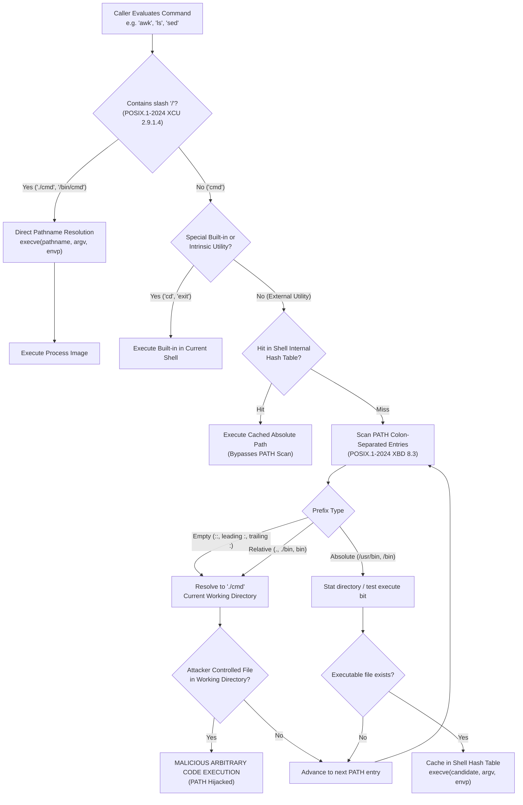

# PATH Hijacking

> [!summary] Claim
> PATH hijacking occurs when an untrusted actor manipulates the colon-separated directory list or the file contents of directories scanned prior to standard system paths, causing elevated or automated processes to execute malicious binaries in place of intended utilities.

Part of [Shell Security](README.md) in [Shell and Unix Engineering](../README.md).

## TL;DR

- Mechanism: When executing a simple command without slashes, the shell sequentially searches the colon-separated directory prefixes in `PATH`, resolving zero-length elements (`::`, leading `:`, or trailing `:`) and `.` to the current working directory (`(POSIX.1-2024 XBD 8.3)`).
- Rule: Always reset `PATH` to a trusted system literal (`PATH="$(command -p getconf PATH 2>/dev/null || printf '/usr/bin:/bin')"; readonly PATH; export PATH`) at the entrypoint of any automated, daemon, or privileged script.
- Trap: Unguarded variable appends such as `PATH="$PATH:$CUSTOM_BIN"` create an exploitable leading or trailing empty component when one variable is empty, silently binding the current working directory ahead of system binaries.
- Portability fact: Setting `PATH=""` searches the current working directory across POSIX shells including bash, dash, zsh, yash, mksh, posh, and BusyBox ash, but aborts command resolution with exit status 127 in ksh93 (lab test 8, and measured in the shell matrix as of 2026-11).
- When not to use it: Never rely on bare command resolution or ambient inherited `PATH` across privilege boundaries such as `sudo`, `su`, setuid wrappers, or cron jobs; specify absolute pathnames or execute standard utilities through `command -p`.

## Mental model



The diagram traces the execution lifecycle of a simple command from initial word evaluation to process launch.
If the command word contains any slash `/`, all built-ins, shell functions, and `PATH` prefix searches are bypassed, transferring control directly to `execve(2)` for pathname resolution.
If the word is a bare utility name without slashes, the shell first tests for special built-ins and intrinsic utilities, which execute internally without filesystem interaction.
If the word refers to an external utility, the shell inspects its internal memory cache (the hash table); a cache hit bypasses filesystem scans unless invalidated by a subsequent assignment to `PATH`.
On a cache miss, the shell iterates through the colon-separated directory list in `PATH`.
Any empty entry (`::`, leading `:`, or trailing `:`) or relative path (`.`, `./bin`) converts the target into a relative file path in the current working directory.
If an attacker has written an executable with the target name into that directory, the shell executes the attacker's binary with the caller's privileges.
Only when earlier entries fail does the search reach system directories such as `/usr/bin`, where standard binaries are found and cached for future calls.

## How it works

Command search in POSIX environments is governed by POSIX.1-2024 XCU 2.9.1.4 and POSIX.1-2024 XBD 8.3.
When a simple command lacks a slash `/`, POSIX mandates an ordered sequence of five steps (1a to 1e in XCU 2.9.1.4) in which the first successful step wins, and four of them run before any `PATH` search:
1. Special built-in utilities (`exec`, `set`, `exit`, `trap`, `eval` as defined in `(POSIX.1-2024 XCU 2.15)`).
2. Unspecified implementation extensions (such as `declare` or `typeset`, from the table in XCU 2.9.1.4 step 1b).
3. Shell functions defined in the current execution environment (`(POSIX.1-2024 XCU 2.9.5)`).
4. Intrinsic utilities (`alias`, `cd`, `command`, `getopts`, `hash`, `jobs`, `kill`, `read`, `type` and the rest of the table in `(POSIX.1-2024 XCU 1.7)`); `echo`, `pwd`, and `test` are not intrinsic, so POSIX sends them through the `PATH` search, and a built-in version runs only when it is associated with the directory that search reached (XCU 2.9.1.4 step 1e).
5. The `PATH` environment variable directory sequence.

The standard Unix pipeline tools (`awk`, `sed`, `grep`, `cut`, `sort`, `find`, `xargs`, `tar`, `curl`, `chmod`, `cat`, `rm`) are external utilities under POSIX.
They do not belong to the intrinsic or special built-in tiers in standard shells such as GNU bash, dash, and zsh.
Consequently, every bare invocation of `grep` or `awk` requires a `PATH` search.

POSIX.1-2024 XBD 8.3 defines `PATH` as a sequence of path prefixes separated by colons `:`.
Crucially, the specification preserves a historical behavior from early Unix:
"A zero-length prefix is a legacy feature that indicates the current working directory.
It appears as two adjacent <colon> characters ("::"), as an initial <colon> preceding the rest of the list, or as a trailing <colon> following the rest of the list."
POSIX adds that a strictly conforming application shall use an actual pathname (such as `.`) to represent the current working directory in `PATH`.
The definition itself still stands, so conforming shells and libc `execvp` treat a zero-length prefix as the current working directory.
If `PATH` is unset or set to null, or a prefix contains a `%`, the path search is implementation-defined (XBD 8.3).

The operating system kernel does not perform `PATH` searches.
The Linux `execve(2)` system call (`fs/exec.c`) resolves its pathname argument like any other path, so a bare name without slashes is looked up relative to the current working directory: a C program calling `execve("lp", ...)` ran `./lp` from `/tmp` and failed with `ENOENT` only when started from `/` (measured on Debian 13, Linux 7.2, as of 2026-11).
All `PATH` resolution is executed in user space by the shell or by libc functions (`execvp`, `execlp`, `execvpe`).

In GNU C Library (`posix/execvpe.c` at HEAD as of 2026-11, `__execvpe_common`), the resolution loop scans `PATH` (simplified excerpt; when `PATH` is unset glibc uses `CS_PATH`, `/bin:/usr/bin` from `sysdeps/unix/confstr.h`):
```c
char buffer[path_len + file_len + 1];
for (const char *p = path; ; p = subp)
  {
    subp = __strchrnul (p, ':');
    /* elided: skip an entry longer than path_len, retry ENOEXEC as a script */
    char *pend = mempcpy (buffer, p, subp - p);
    *pend = '/';
    memcpy (pend + (p < subp), file, file_len);
    __execve (buffer, argv, envp);
  }
```
When an empty component is encountered (`::` or a boundary colon), `p == subp`.
The expression `p < subp` evaluates to 0, which causes `memcpy` to overwrite `*pend` (the `/` character) with the start of `file`.
The resulting buffer contains the relative filename `file` without any directory prefix, invoking `__execve("file", ...)` directly against the process current working directory.

In dash (`dash-0.5.12 src/exec.c`, `padvance_magic`), the path advance iterator constructs the candidate (excerpt; the elided lines handle `%` path options):
```c
len = strcspn(start, term);
p = start + len;
if (likely(len)) {
    q = mempcpy(q, start, len);
    *q++ = '/';
}
strcpy(q, name);
```
When `len == 0` (a zero-length prefix), dash skips appending `start` and `/`, executing `strcpy(q, name)`.
The candidate name becomes the bare, relative utility name, resolving directly to `./name`.

In GNU bash (`bash-5.3 findcmd.c`, `get_next_path_element`), bash explicitly transforms empty elements:
```c
path = extract_colon_unit (path_list, path_index_pointer);
if (path == 0)
  return (path);
if (*path == '\0')
  {
    free (path);
    path = savestring (".");
  }
return (path);
```
Bash detects the zero-length string and actively substitutes `"."`, appending the utility name to form `./name` (the function body is identical in bash 3.2 and bash 5.3).

In musl libc (`src/process/execvp.c` at master as of 2026-11, `__execvpe`), candidate construction uses (excerpt; when `PATH` is unset musl falls back to `/usr/local/bin:/bin:/usr/bin`):
```c
z = __strchrnul(p, ':');
memcpy(b, p, z-p);
b[z-p] = '/';
memcpy(b+(z-p)+(z>p), file, k+1);
execve(b, argv, envp);
```
When `z == p`, `z - p` is 0 and `z > p` is 0.
The destination offset is 0, overwriting `b[0]` with `file` and attempting `execve` on the relative path in the working directory.

### The Shell Hash Table and Caching Lifecycle

POSIX.1-2024 XCU 2.9.1.4 specifies command caching rules:
"Once a utility has been searched for and found (either as a result of this specific search or as part of an unspecified shell start-up activity), an implementation may remember its location and need not search for the utility again unless the PATH variable has been the subject of an assignment.
If the remembered location fails for a subsequent invocation, the shell shall repeat the search to find the new location for the utility, if any."

This rule introduces a critical temporal dimension to PATH hijacking:
1. If a privileged shell executes `victim_cmd` while `PATH="/usr/bin"`, the shell caches `/usr/bin/victim_cmd` in its internal hash table (`hashed_filenames` in bash `hashcmd.c`, `cmdnamtab` in zsh `Src/hashtable.c`, `cmdtable` in dash `src/exec.c`).
2. If an attacker subsequently places a trojan binary in a newly created directory earlier in `PATH` (or drops `./victim_cmd` when `.` is in `PATH`), subsequent invocations of `victim_cmd` in that running shell continue to execute `/usr/bin/victim_cmd`.
3. The cache hit shields the shell from the trojan binary until the hash table is invalidated.
4. An explicit assignment to `PATH` (such as `PATH="$PATH"`) or invoking `hash -r` clears the table.
5. On the next invocation, the shell re-scans `PATH`, encounters the attacker directory first, and executes the trojan binary.
6. In `ksh93u+m 1.0.10`, the shell re-evaluates the path dynamically on subsequent calls without requiring a `PATH` assignment (lab test 9); macOS ksh93u+ 2012 and posh 0.14.1 behave the same way (measured in the shell matrix as of 2026-11).
7. A subshell (`$(victim_cmd)` or `( victim_cmd )`) starts with a copy of the parent's table, so in the caching shells it also runs the stale cached path (measured in the shell matrix as of 2026-11).

### Privilege Transitions and Sudo

When crossing privilege boundaries (`setuid`, `sudo`, `cron`), ambient environment inheritance becomes the attack vector.
Sudo preserves the caller's `PATH` variable unless told otherwise: even `env_reset` builds a minimal environment that keeps `TERM`, `PATH`, `HOME`, `MAIL`, `SHELL`, `LOGNAME`, `USER`, and `SUDO_*` (sudoers(5), as of 2026-11).
An unprivileged user could configure `PATH="/tmp:$PATH"`, place a malicious `grep` or `id` script in `/tmp`, and execute an administrative script via `sudo`.
When the administrative script invoked `grep`, the trojan ran with root privileges (the class is CWE-426 and CWE-427; CVE-2013-1052, a `PATH` mishandling in Ubuntu 12.10's pam-xdg-support that let local users gain privileges via sudo, is one recorded instance).

To eliminate this vulnerability class, distributions ship a `secure_path` line in `/etc/sudoers` (upstream sudo leaves it unset unless built with `--with-secure-path`, whose default value is the string below, per sudo `INSTALL.md`):
```text
Defaults secure_path="/usr/local/sbin:/usr/local/bin:/usr/sbin:/usr/bin:/sbin:/bin"
```
When `secure_path` is set, sudo uses this value in place of the user's `PATH` before executing the target binary; users in the `exempt_group` group are not affected (sudoers(5)).
However, if sudoers includes `Defaults env_keep += "PATH"` or omits `secure_path`, caller environment inheritance remains active.
Furthermore, CVE-2010-1646 showed that an environment containing multiple `PATH` variables defeated the secure path feature in sudo 1.3.1 through 1.6.9p22 and 1.7.0 through 1.7.2p6.
The secure path code in sudo's `env.c` did not handle the duplicates, so a crafted later duplicate (the CVE names "the last PATH variable") survived into the command's environment for any consumer that read it.

## Numbers and limits

The table below documents the architectural bounds, default search paths, and error codes governing `PATH` resolution across Unix implementations.

| Property / Limit | Value / Bound | Source / Context |
| :--- | :--- | :--- |
| Default `_CS_PATH` (macOS) | `/usr/bin:/bin:/usr/sbin:/sbin` | `getconf PATH` on macOS 27.3 (Darwin 27.3.0, measured 2026-11) |
| Default `_CS_PATH` (Linux glibc) | `/bin:/usr/bin` | glibc `sysdeps/unix/confstr.h` (`CS_PATH`), also `execvp`'s fallback when `PATH` is unset; `getconf PATH` on Debian 13 (measured 2026-11) |
| Default `_CS_PATH` (Linux musl) | `/bin:/usr/bin` | musl `src/conf/confstr.c`; `getconf PATH` on Alpine 3.22 (measured 2026-11) |
| musl `execvp` fallback when `PATH` is unset | `/usr/local/bin:/bin:/usr/bin` | musl `src/process/execvp.c` (`__execvpe`, as of 2026-11) |
| Sudo `secure_path` default | `/usr/local/sbin:/usr/local/bin:/usr/sbin:/usr/bin:/sbin:/bin` | sudo `INSTALL.md`: value used by `--with-secure-path` without an argument; unset unless configured or set in sudoers |
| Systemd system unit default `PATH` | `/usr/local/sbin:/usr/local/bin:/usr/sbin:/usr/bin` (split `/usr/sbin`), `/usr/local/bin:/usr/bin` (merged) | `systemd-256 src/basic/path-util.c` (`default_PATH()`) |
| cronie default `PATH` | `/usr/bin:/bin:/usr/sbin:/sbin` | cronie `src/pathnames.h` (`_PATH_STDPATH`), applied in `src/entry.c` when the crontab sets no `PATH` (as of 2026-11) |
| Linux `MAX_ARG_STRLEN` | 131,072 bytes (128 KiB) on 4 KiB pages | `<linux/binfmts.h>` (`PAGE_SIZE * 32`), maximum length of a single argument or environment string |
| Linux total `envp` + `argv` limit | 25% of the stack limit (`RLIMIT_STACK`), capped at three quarters of `_STK_LIM` | Linux kernel `fs/exec.c` (`bprm_stack_limits`, as of 2026-11) |
| `PATH_MAX` (Linux) | 4096 bytes | `<linux/limits.h>` |
| `PATH_MAX` (macOS / BSD) | 1024 bytes | `<sys/syslimits.h>` |
| `NAME_MAX` | 255 bytes | `<limits.h>`, maximum length of individual executable filename |
| Command resolution tiers | 4 steps prior to the PATH scan (step 1e) | `(POSIX.1-2024 XCU 2.9.1.4)` (special built-in, unspec, func, intrinsic) |
| Exit status: command not found | 127 | `(POSIX.1-2024 XCU 2.8.2 and 2.9.1.4)` |
| Exit status: found but not executable | 126 | `(POSIX.1-2024 XCU 2.8.2)` |

## Portability

The table below contrasts command resolution behavior across standard shells and operating systems.
Every shell cell was measured in the shell matrix (Debian 13 and Alpine 3.22 images plus the macOS host) as of 2026-11; the `PATH=""` and hash rows are also asserted by lab tests 8 and 9.
yash 2.58.1 matches the bash column in every measured row except unset `PATH`, where it matches zsh.

| Feature / Behavior | POSIX.1-2024 | macOS bash 3.2 | bash 5.2.37 | dash 0.5.12 | zsh 5.9 (native & sh) | ksh93u+m 1.0.10 | mksh R59 | BusyBox 1.37.0 ash |
| :--- | :--- | :--- | :--- | :--- | :--- | :--- | :--- | :--- |
| `PATH=""` executes local `./cmd` | Implementation-defined (XBD 8.3) | Yes (proved by lab) | Yes (proved by lab) | Yes (proved by lab) | Yes (proved by lab) | No (status 127) | Yes (proved by lab) | Yes (proved by lab) |
| Leading colon `:/bin` searches `.` | Yes (legacy feature) | Yes (resolves `.`) | Yes (resolves `.`) | Yes (resolves `.`) | Yes (resolves `.`) | Yes (resolves `.`) | Yes (resolves `.`) | Yes (resolves `.`) |
| Trailing colon `/bin:` searches `.` | Yes (legacy feature) | Yes (resolves `.`) | Yes (resolves `.`) | Yes (resolves `.`) | Yes (resolves `.`) | Yes (resolves `.`) | Yes (resolves `.`) | Yes (resolves `.`) |
| Double colon `::` searches `.` | Yes (legacy feature) | Yes (resolves `.`) | Yes (resolves `.`) | Yes (resolves `.`) | Yes (resolves `.`) | Yes (resolves `.`) | Yes (resolves `.`) | Yes (resolves `.`) |
| Unset `PATH` execution fallback | Implementation-defined (XBD 8.3) | Searches only cwd (runs `./cmd`, `ls` gives 127) | Searches only cwd (runs `./cmd`, `ls` gives 127) | Searches only cwd (runs `./cmd`, `ls` gives 127) | No search at all (127, even for `./cmd`) | Falls back to system path (cwd not searched) | Falls back to system path (cwd not searched) | Searches only cwd (runs `./cmd`, `ls` gives 127) |
| Hash table caches across commands | Permitted (XCU 2.9.1.4) | Yes (caches until reset) | Yes (caches until reset) | Yes (caches until reset) | Yes (caches until reset) | No (dynamic lookup in script; also ksh93u+ 2012 and posh) | Yes (caches until reset) | Yes (caches until reset) |
| `PATH="$PATH"` flushes hash | Yes (XCU 2.9.1.4) | Yes (clears hash table) | Yes (clears hash table) | Yes (clears hash table) | Yes (clears hash table) | N/A (re-checks dynamically) | Yes (clears hash table) | Yes (clears hash table) |
| Subshell `$()` retains parent hash | Not listed in XCU 2.13 | Yes (inherits a copy, runs stale entry) | Yes (inherits a copy, runs stale entry) | Yes (inherits a copy, runs stale entry) | Yes (inherits a copy, runs stale entry) | N/A (no stale entry) | Yes (inherits a copy, runs stale entry) | Yes (inherits a copy, runs stale entry) |
| Intercepts applets before PATH | No | No (external binary) | No (external binary) | No (external binary) | No (external binary) | No (external binary) | Varies (Alpine's R59 2020 build has a `cat` builtin; Debian's runs `/usr/bin/cat`) | No in Alpine's build (a `PATH` `ls` ran first, measured); a build with `FEATURE_SH_STANDALONE` (default n) prefers applets over `PATH` (BusyBox `shell/Config.src`, `ash.c` `find_command`) |

## Worked example

The companion test suite is located in [lab](../labs/17-path-hijacking/).
The script `path_probe.sh` provides three operational inspection modes:
1. `audit`: Evaluates a `PATH` string and flags zero-length entries, explicit dots, relative prefixes, and world-writable directories.
2. `resolve`: Simulates POSIX command search for a target utility name and reports whether execution is hijacked by a local file or resolved to an absolute system path.
3. `sanitize`: Strips relative paths, empty elements, and insecure directories, falling back to `getconf PATH` if the result is empty.

Here is `path_probe.sh`:

```sh
#!/bin/sh
# path_probe.sh - PATH audit, resolution, and sanitization probe
# Usage:
#   path_probe.sh audit [PATH_STRING]
#   path_probe.sh resolve COMMAND [PATH_STRING]
#   path_probe.sh sanitize [PATH_STRING]

set -eu

mode="${1:-}"
shift || {
  printf 'usage: path_probe.sh <audit|resolve|sanitize> [args...]\n' >&2
  exit 2
}

do_audit() {
  target_path="${PATH:-}"
  if [ "$#" -gt 0 ]; then
    target_path="$1"
  fi

  if [ -z "$target_path" ]; then
    printf 'DANGER: PATH is empty (resolves to current working directory)\n'
    return 0
  fi

  rest="$target_path"
  while :; do
    entry=""
    had_colon=0
    case "$rest" in
      *:*)
        entry="${rest%%:*}"
        rest="${rest#*:}"
        had_colon=1
        ;;
      *)
        entry="$rest"
        rest=""
        ;;
    esac

    if [ -z "$entry" ]; then
      printf 'DANGER: empty element in PATH (resolves to cwd)\n'
    elif [ "$entry" = "." ]; then
      printf 'DANGER: explicit dot "." in PATH\n'
    elif case "$entry" in /*) false ;; *) true ;; esac then
      printf 'DANGER: relative directory "%s" in PATH\n' "$entry"
    elif [ ! -d "$entry" ]; then
      printf 'WARN: directory "%s" does not exist\n' "$entry"
    else
      # shellcheck disable=SC2012 # ls -ld used for portable directory mode bits
      perms=$(ls -ld "$entry" 2>/dev/null | cut -c 1-10)
      case "$perms" in
        ????????w[tT])
          printf 'OK: "%s" (sticky bit set)\n' "$entry"
          ;;
        ????????w?)
          printf 'DANGER: directory "%s" is world-writable without sticky bit\n' "$entry"
          ;;
        *)
          printf 'OK: "%s"\n' "$entry"
          ;;
      esac
    fi

    if [ "$had_colon" -eq 0 ] && [ -z "$rest" ]; then
      break
    fi
  done
}

do_resolve() {
  cmd="$1"
  target_path="${PATH:-}"
  if [ "$#" -gt 1 ]; then
    target_path="$2"
  fi

  if [ -z "$cmd" ]; then
    printf 'error: empty command name\n' >&2
    exit 2
  fi

  case "$cmd" in
    */*)
      if [ -f "$cmd" ] && [ -x "$cmd" ]; then
        printf 'DIRECT: %s\n' "$cmd"
        return 0
      fi
      printf 'NOT_FOUND: %s\n' "$cmd"
      return 1
      ;;
  esac

  if [ -z "$target_path" ]; then
    if [ -f "./$cmd" ] && [ -x "./$cmd" ]; then
      printf 'HIJACKED: ./%s (via empty PATH)\n' "$cmd"
      return 0
    fi
    printf 'NOT_FOUND: %s\n' "$cmd"
    return 1
  fi

  rest="$target_path"
  while :; do
    dir=""
    had_colon=0
    case "$rest" in
      *:*)
        dir="${rest%%:*}"
        rest="${rest#*:}"
        had_colon=1
        ;;
      *)
        dir="$rest"
        rest=""
        ;;
    esac

    candidate=""
    if [ -z "$dir" ] || [ "$dir" = "." ]; then
      candidate="./$cmd"
    else
      candidate="$dir/$cmd"
    fi

    if [ -f "$candidate" ] && [ -x "$candidate" ]; then
      case "$candidate" in
        ./*)
          printf 'HIJACKED: %s\n' "$candidate"
          return 0
          ;;
        /*)
          printf 'RESOLVED: %s\n' "$candidate"
          return 0
          ;;
        *)
          printf 'HIJACKED: %s\n' "$candidate"
          return 0
          ;;
      esac
    fi

    if [ "$had_colon" -eq 0 ] && [ -z "$rest" ]; then
      break
    fi
  done

  printf 'NOT_FOUND: %s\n' "$cmd"
  return 1
}

do_sanitize() {
  raw_path="${PATH:-}"
  if [ "$#" -gt 0 ]; then
    raw_path="$1"
  fi

  safe_path=""

  if [ -n "$raw_path" ]; then
    rest="$raw_path"
    while :; do
      entry=""
      had_colon=0
      case "$rest" in
        *:*)
          entry="${rest%%:*}"
          rest="${rest#*:}"
          had_colon=1
          ;;
        *)
          entry="$rest"
          rest=""
          ;;
      esac

      case "$entry" in
        "" | "." | ./* | ../*)
          ;;
        /*)
          if [ -d "$entry" ]; then
            # shellcheck disable=SC2012 # ls -ld used for portable directory mode bits
            perms=$(ls -ld "$entry" 2>/dev/null | cut -c 1-10)
            case "$perms" in
              ????????w[!tT] | ????????w)
                ;;
              *)
                if [ -z "$safe_path" ]; then
                  safe_path="$entry"
                else
                  safe_path="$safe_path:$entry"
                fi
                ;;
            esac
          fi
          ;;
        *)
          ;;
      esac

      if [ "$had_colon" -eq 0 ] && [ -z "$rest" ]; then
        break
      fi
    done
  fi

  if [ -z "$safe_path" ]; then
    safe_path=$(command -p getconf PATH 2>/dev/null || printf '/usr/bin:/bin')
  fi

  printf '%s\n' "$safe_path"
}

case "$mode" in
  audit)
    do_audit "$@"
    ;;
  resolve)
    [ "$#" -ge 1 ] || {
      printf 'usage: path_probe.sh resolve COMMAND [PATH]\n' >&2
      exit 2
    }
    do_resolve "$@"
    ;;
  sanitize)
    do_sanitize "$@"
    ;;
  *)
    printf 'unknown mode: %s\n' "$mode" >&2
    exit 2
    ;;
esac
```

Running the test suite via bats executes the full set of assertions across empty path handling, zero-length prefix parsing, and hash table cache invalidation (real output on the macOS host with `LAB_SHELL` unset, so the shell under test is `/bin/sh`, as of 2026-11):

```text
$ bats labs/17-path-hijacking/path_probe.bats
1..9
ok 1 audit flags empty PATH string as danger
ok 2 audit flags leading colon, trailing colon, and double colon as empty elements
ok 3 audit flags relative directory and explicit dot as danger
ok 4 audit flags world-writable directory without sticky bit
ok 5 resolve detects local executable hijacking when PATH contains leading colon
ok 6 resolve finds absolute system binary when PATH is clean
ok 7 sanitize strips dangerous elements and keeps safe directories
ok 8 empty PATH executes local executable across POSIX shells except ksh93
ok 9 shell hash table retains initial location until PATH reassignment
```

## Pitfalls

> [!warning] Trailing or leading colon via unconstrained variable concatenation
> Trigger: Scripts modifying `PATH` via `export PATH="$PATH:$OPT_DIR"` when `OPT_DIR` is empty, or `export PATH="$NEW_DIR:$PATH"` when `PATH` is unset or empty.
> Symptom: A trailing or leading colon is introduced into `PATH`, which POSIX defines as an empty component resolving to the current working directory `.`. Any developer or daemon running in a world-writable directory (`/tmp`) executes local rogue binaries when invoking standard tools.
> Fix: Guard every operand that may be empty using parameter expansion: `export PATH="${PATH:+${PATH}}${OPT_DIR:+:${OPT_DIR}}"` for appends and `export PATH="${NEW_DIR:+${NEW_DIR}:}${PATH}"` for prepends (guarding only `PATH`, as in `"${PATH:+${PATH}:}${OPT_DIR}"`, still leaves a trailing colon when `OPT_DIR` is empty), and assert that no empty components exist before exporting.

> [!warning] Sudo ambient PATH inheritance and duplicate envp keys (CVE-2010-1646)
> Trigger: Configuring `/etc/sudoers` with `Defaults env_keep += "PATH"` or omitting `Defaults secure_path`, or running unpatched sudo versions (1.3.1 through 1.6.9p22 and 1.7.0 through 1.7.2p6) where multiple `PATH` entries exist in the process environment.
> Symptom: An unprivileged user prefixes their `PATH` with an untrusted directory containing a trojan `id`, `chown`, or `systemctl` script.
> When executing an authorized command under sudo, the administrative script executes the attacker's script as root.
> Fix: Enforce `Defaults secure_path="/usr/local/sbin:/usr/local/bin:/usr/sbin:/usr/bin:/sbin:/bin"` in `/etc/sudoers`.
> Never preserve caller `PATH` across privilege transitions.

> [!warning] The chkrootkit local privilege escalation incident (CVE-2014-0476)
> Trigger: The security auditing tool `chkrootkit` (prior to version 0.50) contained a command execution bug in function `slapper()`, which the CVE describes as not properly quoting file paths: `file_port=$file_port $i`.
> When `file_port` was empty and `$i` evaluated to `/tmp/update`, the shell executed `/tmp/update` as a command rather than an assignment.
> Symptom: Any unprivileged user could create an executable named `/tmp/update`.
> When root's daily cron job executed `chkrootkit`, `/tmp/update` executed with full root privileges.
> Fix: Fully qualify all command paths in administrative scripts (`/usr/bin/netstat`, `/usr/bin/awk`), mount `/tmp` and `/var/tmp` with the `noexec` mount option, and avoid referencing temporary directories in command contexts.

> [!warning] Language runtime relative lookups on Windows and Unix (CVE-2020-27955 and CVE-2022-30580)
> Trigger: Application runtimes and tools (such as Go `os/exec` `Cmd.Start` with an unset `Cmd.Path` before Go 1.17.11 and 1.18.3, Go `exec.LookPath` returning results relative to the working directory before Go 1.19, Git LFS 2.12.0, and Python `subprocess` on Windows) resolving bare executable names against the current working directory when `.` is present or on platforms where `.` is searched implicitly.
> Symptom: Cloning a Git repository containing a malicious executable (`git.exe` for Git LFS 2.12.0, `..com` or `..exe` for Go's CVE-2022-30580) resulted in automatic arbitrary code execution when running standard repository commands.
> Fix: Use Go 1.19+, where `exec.Command` and `exec.LookPath` refuse a program found relative to the current directory and return an error satisfying `errors.Is(err, exec.ErrDot)` (Go `os/exec` documentation).
> On Unix, verify that runtime path lookup APIs reject relative results.

> [!warning] Unprivileged PATH poisoning across su boundaries
> Trigger: An administrator switches from an unprivileged user account to root using plain `su` instead of `su -` (or `su -l`).
> Symptom: Plain `su` switches the user identity (EUID 0) but preserves the calling unprivileged user's environment, including their custom `PATH`: util-linux `su` by default sets only `HOME` and `SHELL` (plus `USER` and `LOGNAME` for a non-root target), and initializes `PATH` only when `ALWAYS_SET_PATH yes` is set in `/etc/login.defs` (su(1)).
> If the caller had `~/.local/bin` or `./` in `PATH`, subsequent commands typed by root execute trojans placed in the user's home directory.
> Fix: Always invoke `su -` or `su -l` to create a fresh login environment with root default system paths.

> [!warning] World-writable build output directories in CI/CD runner PATH
> Trigger: Build scripts configuring `export PATH="$WORKSPACE/node_modules/.bin:$PATH"` or `export PATH="/tmp/bin:$PATH"` on shared or persistent multi-tenant CI workers.
> Symptom: Previous build steps, untrusted dependencies, or unauthorized pull request jobs drop malicious wrappers into the writable directory.
> Downstream build steps running with elevated deployment tokens execute the poisoned binaries.
> Fix: Validate that all directories in `PATH` are owned by `root` or the runner user and lack write permissions for others (`chmod 755`).
> Use absolute paths to invocation tooling in CI pipelines.

## Security and robustness

Hardening against PATH hijacking requires defense-in-depth across the environment, the shell script, and the filesystem.

### 1. Static PATH Pinning at Script Entrypoint

Never trust the inherited ambient `PATH`.
Every non-interactive script, deployment hook, and daemon script should reset `PATH` to an immutable literal at line 1:

```sh
# Reset PATH to standard system directories and make immutable
PATH="$(command -p getconf PATH 2>/dev/null || printf '/usr/bin:/bin')"
readonly PATH
export PATH
```

Using `command -p getconf PATH` ensures that the standard POSIX configuration path is fetched using standard utilities without relying on caller-tainted directories.
Marking `PATH` as `readonly` prevents subsequent accidental concatenation or modifications within the script.

### 2. Standard Utility Invocation via `command -p`

When writing portable libraries or functions where modifying global `PATH` might break caller expectations, execute standard utilities using `command -p`:

```sh
# Executes awk using the implementation's standard system path
output=$(command -p awk -F: '{ print $1 }' /etc/passwd)
```

POSIX.1-2024 XCU `command` specifies that `-p` performs command search using a default value for `PATH` guaranteed to find all standard utilities, completely bypassing caller modifications to `PATH`.

### 3. Absolute Pathnames for Sensitive Tools

In administrative scripts, setuid helpers, and cron jobs, invoke security-critical binaries using absolute pathnames:

```sh
/usr/bin/id -u
/usr/bin/logger -t backup "Starting backup sequence"
/bin/chmod 600 /etc/shadow
```

Because the command word contains a slash `/`, POSIX.1-2024 XCU 2.9.1.4 requires the shell to bypass all `PATH` resolution entirely.

### 4. Filesystem Mount Hardening

Even if an application or script contains a flawed `PATH` referencing `/tmp` or `/var/tmp`, the operating system can prevent execution at the VFS layer.
Mount all world-writable temporary directories with `noexec`, `nosuid`, and `nodev` in `/etc/fstab`:

```text
tmpfs /tmp tmpfs rw,nosuid,nodev,noexec,relatime,size=2G 0 0
tmpfs /dev/shm tmpfs rw,nosuid,nodev,noexec,relatime 0 0
```

When a directory is mounted `noexec`, the kernel system call `execve` returns `EACCES` (Permission denied) on any binary located on that mount point, neutralizing trojans dropped in `/tmp`.

### 5. Production Pipeline PATH Auditing

In automated CI/CD runners or container entrypoints, enforce an automated audit step using the following shell validation loop:

```sh
check_path_security() {
  set -f
  orig_ifs="$IFS"
  IFS=':'
  # shellcheck disable=SC2086 # intentional splitting on colon
  set -- ${PATH}
  IFS="$orig_ifs"
  set +f

  for dir in "$@"; do
    case "$dir" in
      "" | "." | ./* | ../* )
        printf 'FATAL: insecure relative directory in PATH: "%s"\n' "$dir" >&2
        return 1
        ;;
      /* )
        if [ ! -d "$dir" ]; then
          continue
        fi
        # Verify directory is not world-writable without sticky bit
        perms=$(ls -ld "$dir" 2>/dev/null | cut -c 1-10)
        case "$perms" in
          ????????w[!tT] | ????????w )
            printf 'FATAL: world-writable directory in PATH: "%s"\n' "$dir" >&2
            return 1
            ;;
        esac
        ;;
      * )
        printf 'FATAL: unknown relative path in PATH: "%s"\n' "$dir" >&2
        return 1
        ;;
    esac
  done
}
```

## The principal's view

To a principal engineer, `PATH` is an unauthenticated, caller-controlled search index that bridges the user environment and process execution.
Treating bare command names as trusted handles is a fundamental architecture flaw in automated and privileged systems.

The engineering tension centers on developer ergonomics versus operational determinism:
- In interactive developer shells, a dynamic, precedence-ordered `PATH` is essential.
- Developers rely on version managers (`asdf`, `mise`, `nvm`), project virtual environments (`.venv/bin`), and local tooling (`~/.local/bin`) shadowing system binaries.
- In production, daemon, and privileged execution environments, dynamic command resolution is unacceptable.
- A production service should never guess which binary executes when calling `tar` or `systemctl`.

Principal engineers establish strict organizational boundaries:
1. Production automation boundary: All systemd units, cron tasks, container entrypoints, and CI runner scripts must pin an explicit, immutable `PATH` or invoke fully qualified pathnames.
2. Privilege boundary: No process may cross a privilege boundary (`sudo`, `doas`, `setuid`) while preserving an inherited `PATH`.
   Sudoers must enforce `secure_path`.
3. Container image boundary: Container base images must not include `.` in `ENV PATH`.
   Multi-stage builds must strip non-root write permissions from all directories listed in `PATH`.
4. Language runtime boundary: For backend services in Go, Rust, or Python, invoke external subcommands using explicit absolute paths (`/usr/bin/git`) rather than bare command names, preventing runtime lookup ambiguities across deployment hosts.

## Interview questions

> [!question] L5: How does POSIX define the behavior of zero-length components in `PATH`, and what security hazard does this create?
>
> > [!success]- Answer
> > POSIX.1-2024 XBD 8.3 defines a zero-length prefix in `PATH` as a legacy representation indicating the current working directory.
> > It occurs when `PATH` contains consecutive colons `::`, a leading colon, or a trailing colon.
> > When a script executes a bare utility name, the shell treats the empty prefix as `./`, searching the current directory before or after system paths.
> > If an attacker places a malicious executable in that directory, the script executes it with the caller's privileges.
> >
> > Follow-up: Why does an unguarded append such as `export PATH="$PATH:$NEWDIR"` frequently introduce this vulnerability?

> [!question] L5: What is the operational difference between `su` and `su -` regarding `PATH`, and why is this critical for administrator security?
>
> > [!success]- Answer
> > Running plain `su` switches the user identity to root but preserves the calling user's ambient environment, including `PATH`.
> > Running `su -` or `su -l` initiates a full login shell, clearing unprivileged variables and setting a standard root `PATH`.
> > Under plain `su`, if the unprivileged user had `.` or `~user/bin` in `PATH`, any subsequent command typed by root executes the user's binaries.
> > Administrators must always use `su -` to prevent privilege escalation via caller environment poisoning.
> >
> > Follow-up: How does sudo address this same environment boundary problem by default?

> [!question] L6: Predict the output when an attacker creates a trojan `/tmp/dir1/victim` after the shell has already executed `/tmp/dir2/victim` once, both before and after `PATH="$PATH"`, and explain the shell hash table mechanics.
>
> > [!success]- Answer
> > When `PATH="/tmp/dir1:/tmp/dir2"`, initial execution of `victim` searches `PATH` and executes `/tmp/dir2/victim`, caching that path in the shell hash table.
> > When the attacker drops `/tmp/dir1/victim`, a subsequent call to `victim` still prints the original output because the shell hits the hash table cache.
> > When `PATH="$PATH"` executes, POSIX.1-2024 XCU 2.9.1.4 requires the shell to flush its internal hash table.
> > On the next call, the shell performs a full `PATH` scan, discovers `/tmp/dir1/victim` first, and prints the hijacked output.
> >
> > Follow-up: Does this hash table persistence apply if the initial command was executed inside a command substitution `$(victim)`?

> [!question] L6: Debug this script: identify the vulnerability in `export PATH="$PATH:$BACKUP_TOOLS"` where an administrative backup script runs as root via cron and fails or executes unexpected commands when users run tests in `/tmp`, and rewrite it defensively.
>
> > [!success]- Answer
> > When cron launches the script, `$BACKUP_TOOLS` may be unset or empty, leaving a trailing colon in `PATH`.
> > A trailing colon resolves to the current working directory; cron starts the job in the user's home directory (cronie `cron_change_user_permanently` in `src/security.c` calls `chdir(homedir)` with the job's `HOME`), but a backup script that `cd`s into `/tmp` or a user-writable staging directory then searches that directory last.
> > Any standard command missing from the earlier directories, or any typo of one, executed in `/tmp` will execute `./cp`, `./tar`, or the typo name if dropped by an untrusted local user.
> > The fix is to avoid ambient concatenation and pin an immutable literal: `PATH="/usr/sbin:/usr/bin:/bin:/opt/backup/bin"; readonly PATH; export PATH`.
> >
> > Follow-up: How would you verify in the script that `/opt/backup/bin` is not world-writable?

> [!question] L6: How did CVE-2010-1646 bypass sudo's `secure_path` feature using duplicate `PATH` variables in `envp`, and how does libc `getenv` resolve duplicate keys?
>
> > [!success]- Answer
> > In the Linux kernel, `execve` accepts an arbitrary `char **envp` array without verifying that variable keys are unique.
> > An attacker constructed an environment containing two `PATH` definitions, the second containing untrusted directories.
> > Libc `getenv` sequentially scans `environ` and returns the first match, so code that checks or rewrites only the entry `getenv` finds leaves later duplicates untouched.
> > The CVE record says the secure path feature in sudo's `env.c` (1.3.1 through 1.6.9p22 and 1.7.0 through 1.7.2p6) did not properly handle multiple `PATH` variables, letting local users gain privileges "via a crafted value of the last PATH variable"; any consumer in the child that read that later entry restored the attacker's search order.
> > Later sudo releases handle the duplicates when applying `secure_path`.
> >
> > Follow-up: What system call auxiliary vector flag does glibc check to determine whether a process runs in secure execution mode?

> [!question] L7: When a setuid-root C binary calls `system("ls")`, what sequence of environment checks and process transitions occurs across different Linux distributions (bash vs dash as `/bin/sh`), and how does `AT_SECURE` interact with `PATH`?
>
> > [!success]- Answer
> > The C library `system(3)` runs the equivalent of `execl("/bin/sh", "sh", "-c", "ls", (char *)0)` (glibc uses `posix_spawn`, per `sysdeps/posix/system.c`) without sanitizing the inherited environment.
> > The kernel sets `AT_SECURE=1` in the auxiliary vector because the effective UID differs from the real UID.
> > While glibc `secure_getenv` disables untrusted variables like `LD_PRELOAD`, `/bin/sh` still inherits `PATH` from `envp`.
> > If `/bin/sh` is GNU bash, bash checks `ruid != euid` without `-p` and immediately drops privileges, executing as the unprivileged real user.
> > If `/bin/sh` is dash (as on Debian and Ubuntu), dash 0.5.12 does not drop privileges (its `src/options.c` has no privileged-mode option), running `ls` with root EUID and searching the caller's inherited `PATH`.
> >
> > Follow-up: How should the C binary author implement external process execution safely without relying on `/bin/sh`?

> [!question] L7: Explain how Go's `exec.LookPath` vulnerability (CVE-2022-30580) and Git LFS (CVE-2020-27955) arose from divergent operating system semantics regarding relative command lookup, and how modern language runtimes defend against it.
>
> > [!success]- Answer
> > Go's `exec.Command` on Windows included the current directory in its lookup, and Git LFS used it, so local executables ran when bare names were supplied (Go `os/exec` documentation and the CVE-2020-27955 advisory).
> > In Git LFS 2.12.0 (CVE-2020-27955), cloning a repository containing `git.exe` caused Git LFS to execute the repository binary (the advisory names a planted `git.exe` on Windows).
> > In Go, CVE-2022-30580 let `Cmd.Run`, `Cmd.Start`, `Cmd.Output`, and `Cmd.CombinedOutput` with an unset `Cmd.Path` execute binaries named `..com` or `..exe` from the working directory (fixed in Go 1.17.11 and 1.18.3), and more generally `exec.LookPath` resolved bare command names to `./cmd` if `.` or relative directories existed in `PATH`.
> > Go 1.19 introduced `exec.ErrDot`, refusing to execute relative binaries found via `PATH` unless explicitly permitted.
> >
> > Follow-up: How does POSIX.1-2024 specify the behavior of command names containing slashes versus bare words?

> [!question] L7: In an enterprise container deployment, explain how `PATH` poisoning can occur through volume mounts, Dockerfile `ENV` misconfigurations, or multi-stage build artifact extraction, and describe the defense-in-depth controls required at the kernel, container runtime, and application layers.
>
> > [!success]- Answer
> > If a Dockerfile specifies `ENV PATH="./node_modules/.bin:$PATH"`, commands run inside the container search working directories first.
> > When host directories or persistent storage volumes are mounted into `/workspace`, an attacker writing to the mount point hijacks container utilities.
> > At the kernel layer, volume mounts should enforce `noexec,nosuid,nodev`.
> > At the container runtime layer, rootless containers prevent host escalation, and read-only root filesystems prevent binary drops.
> > At the application layer, CI base images must pin absolute paths and lint Dockerfiles against relative entries in `ENV PATH`.
> >
> > Follow-up: Why is `nodev` an essential companion flag to `noexec` when mounting untrusted storage volumes?

## Related

Prerequisites: [[Hostile-Filenames]]

Next: [[IFS-Attacks]]

See also: [[Command-Search-and-PATH]], [[Shell-Threat-Model]], [[sudo-and-sudoers]], [[Dropping-Privileges]], [[BASH_ENV-and-ENV]], [[Restricted-Shells]], [[Temporary-File-Attacks]], [[Supply-Chain-Pinning-and-Verification]]

## Further reading

- [POSIX.1-2024 XBD 8.3: Environment Variables - PATH](https://pubs.opengroup.org/onlinepubs/9799919799/basedefs/V1_chap08.html) - Formal specification defining colon-separated prefix resolution, the legacy zero-length current directory rule, and implementation-defined behaviors.
- [POSIX.1-2024 XCU 2.9.1.4: Command Search and Execution](https://pubs.opengroup.org/onlinepubs/9799919799/utilities/V3_chap02.html) - Standard specification defining the five-step resolution order and hash table caching requirements.
- [GNU C Library: posix/execvpe.c Source Code](https://sourceware.org/git/?p=glibc.git;a=blob_plain;f=posix/execvpe.c;hb=HEAD) - Primary libc implementation demonstrating pointer arithmetic and empty component evaluation to relative paths.
- [GNU Bash: findcmd.c Source Code](https://raw.githubusercontent.com/apple-oss-distributions/bash/main/bash-3.2/findcmd.c) - Reference shell source demonstrating `get_next_path_element` substitution of `.` for empty colon units.
- [Dash: src/exec.c Source Code](https://git.kernel.org/pub/scm/utils/dash/dash.git/plain/src/exec.c) - Reference implementation of `padvance_magic` and `tryexec` in the Almquist shell.
- [Musl Libc: src/process/execvp.c Source Code](https://git.musl-libc.org/cgit/musl/plain/src/process/execvp.c) - Lightweight libc implementation showing exact buffer construction during `execvp` traversal.
- [Sudo Security Advisory: Multiple PATH Variables Vulnerability (CVE-2010-1646)](https://cveawg.mitre.org/api/cve/CVE-2010-1646) - Landmark vulnerability report detailing `envp` deduplication failures in sudo `secure_path`.
- [Debian Security Advisory: chkrootkit Local Privilege Escalation (CVE-2014-0476)](https://www.openwall.com/lists/oss-security/2014/06/04/9) - Original disclosure of arbitrary command execution via `/tmp/update` in administrative audit scripts.
- [NVD CWE-426: Untrusted Search Path](https://cwe.mitre.org/data/definitions/426.html) - Common Weakness Enumeration definition and mitigation strategies for search path vulnerabilities.
