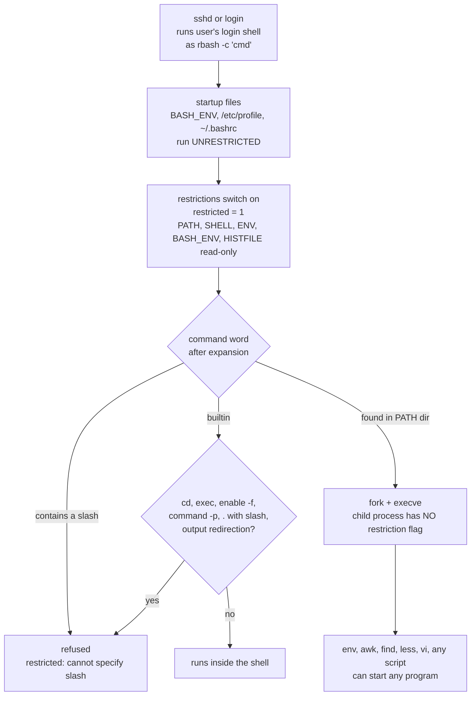

# Restricted Shells

> [!summary] Claim
> A restricted shell is a deny-list of syntax enforced inside one shell process after its startup files have run, so it narrows what a user can type but cannot contain what the commands they are allowed to run can do.

Part of [Shell Security](README.md) in [Shell and Unix Engineering](../README.md).

## TL;DR

- Mechanism: `rbash`, `bash -r`, `zsh -r`, `rksh` and `mksh -r` set one flag in the shell's own memory, and the builtins, the command lookup, and the redirection code consult that flag before doing `cd`, a path-qualified command, a variable change, or an output redirection.
- Rule: treat it as a guardrail for trusted but clumsy users, never as a security boundary; the real boundary is a kernel mechanism (a forced command, a chroot, a container, an unprivileged user) described in [[Sandboxing-Scripts]].
- Trap: the flag is not inherited by anything the shell starts, so every command left on `PATH` that can run another program (`env`, `awk`, `find`, an editor, a pager, any script) is a way out, and the restrictions switch on only after the startup files ran.
- Portability fact: POSIX.1-2024 deliberately has no restricted shell, dash, BusyBox ash, yash and posh have none (each rejects `-r`, measured in the shell matrix), and bash, zsh, ksh93 and mksh each restrict a different set (HISTFILE, IFS, `exec`, `.` and `set +r` all differ).
- When not to use it: whenever an attacker rather than a colleague is on the other end; use `ForceCommand` or `command=` with a purpose-built program, plus a chroot, namespace, or container.

## Mental model



The login path starts the shell with the restricted name, and the shell first runs every startup file with the flag still clear, so a startup file the user can write or influence runs with full power.
Only after those files finish does the shell set `restricted`, make `PATH` and friends read-only, and begin judging each command word: a slash after expansion is refused, a handful of builtins refuse themselves, and an output redirection is refused.
Everything else is looked up in the directories of the (now frozen) `PATH` and started with `fork` and `execve`, and from that point the kernel knows nothing about the shell's flag, so the child is exactly as powerful as the user and the child can run anything it is able to run.

## How it works

### Specification status

POSIX.1-2024 standardizes no restricted shell.
The `sh` utility page says so in its rationale: the options associated with a restricted shell (command name `rsh` and the `-r` option) were excluded because the standard developers considered that the implied level of security could not be achieved and they did not want to raise false expectations (POSIX.1-2024 XCU sh, RATIONALE).
That sentence is the standard's own verdict on the feature.
Every restricted mode in this note is therefore an implementation extension, and no script can rely on it being there or on what it covers.

POSIX does specify the piece that makes restricted shells leak: when `execl()` of a found utility fails with `ENOEXEC`, the shell "shall execute a command equivalent to having a shell invoked with the pathname resulting from the search as its first operand" (POSIX.1-2024 XCU 2.9.1.4 Command Search and Execution).
A shell invoked afresh is by definition not restricted.

### Activation

| Shell | Name | Option | Later switch | Applied |
|---|---|---|---|---|
| bash | exactly `rbash`, after stripping one leading `-` (`shell_is_restricted` and `maybe_make_restricted` in bash-5.3 shell.c) | `-r`, `--restricted` | `set -r` (bash-5.3 flags.c, `change_flag`) | after startup files (bash-5.3 shell.c, `main`) |
| zsh | basename starting with `r` (default build, `RESTRICTED_R` in zsh-5.9 configure.ac and Src/init.c, `init_misc`) | `-r` | `setopt RESTRICTED`, takes effect at once | after init scripts; the option route is immediate |
| ksh93 | `sh_type` accepts an `r` (and `k`) prefix, so `rksh` (ksh93u+m 1.0.10 sh/init.c) | `-r` | `set -r` | after `/etc/profile` and the profile (sh/main.c, `sh_main` clears then restores the flag) |
| mksh | basename after `-` processing starts with `r` or `R` (mksh R59c main.c, `ksh_eq(*ccp, 'R', 'r')`; links named `rmksh` and `Rmksh` both restricted, measured in the shell matrix) | `-r`, command line only | none (`OF_CMDLINE` in sh_flags.opt) | after profile and `ENV` (main.c, `main_init`) |

bash does the sequencing explicitly: it saves the `-r` request in `saverst`, sets `restricted = 0`, runs the startup files, then restores it with `restricted = saverst || restricted` and calls `maybe_make_restricted` (bash-5.3 shell.c, `main`).
The comment in that code states the consequence: `bash -r` or `set -r` invoked from a startup file turns the restrictions on after the startup files are executed.
Two things happen earlier, because `shell_initialize` computes `should_be_restricted` before anything is read: shell functions are not imported from the environment, and `SHELLOPTS` and `BASHOPTS` are not parsed (bash-5.3 shell.c, `shell_initialize`; bash(1) RESTRICTED SHELL).
I measured the `SHELLOPTS` half: `env SHELLOPTS=xtrace bash -r -c 'echo "$SHELLOPTS"'` printed `braceexpand:hashall:interactive-comments` with no `xtrace` (bash 5.3.15), and an exported `BASH_FUNC_foo%%` function was not imported by `bash -r` while a plain `bash` did import it.
An environment-carried function definition is therefore never parsed by a restricted bash, which is the property [[Shellshock]] turned on for the unrestricted case; bash CHANGES records that restricted shells stopped exporting functions in bash-2.05a-alpha1 and that a restricted shell attempting to import them was fixed in bash-4.4-alpha.

`maybe_make_restricted` then makes five variables read-only: `PATH`, `SHELL`, `ENV`, `BASH_ENV`, `HISTFILE` (bash-5.3 shell.c).
If the build defines `RBASH_STATIC_PATH_VALUE` it first overwrites `PATH` with that value and clears the hash table, but that define is commented out in the shipped `config-top.h` (line 66, value `"/rbin:/usr/rbin"`), so a stock rbash keeps whatever `PATH` the caller supplied.
The shell name that triggers all this is the compile-time constant `RESTRICTED_SHELL_NAME`, `"rbash"` (bash-5.3 config-bot.h).
I confirmed the exactness in the shell matrix lab (bash arm): a link named `rbash` restricts, links named `rbashx` and `Rbash` do not.

### What bash enforces, and where

The flag is a plain global `int restricted` (bash-5.3 flags.c).
There is no kernel object behind it.
Each restriction is an `if (restricted)` at the one place that would do the forbidden thing:

| Restriction | Enforcement point (bash-5.3) | Message measured on 5.3.15 |
|---|---|---|
| `cd` | `cd_builtin`, builtins/cd.def | `cd: restricted` |
| assign or unset `PATH`, `SHELL`, `ENV`, `BASH_ENV`, `HISTFILE` | read-only attribute set in `maybe_make_restricted` | `PATH: readonly variable`, `unset: PATH: cannot unset: readonly variable` |
| command word containing `/` | `execute_disk_command`, execute_cmd.c, tested on the expanded word | `/bin/echo: restricted: cannot specify '/' in command names` |
| `.` with a slash or `-p` | `source_builtin`, builtins/source.def | `.: ./x: restricted` |
| `history` file with a slash | `history_builtin`, builtins/history.def | `history: /tmp/x: restricted` (not on 3.2) |
| `hash -p` with a slash, `BASH_CMDS[x]=/abs` | `hash_builtin`; `assign_hashcmd` in variables.c | `hash: /bin/ls: restricted` |
| output redirection `>`, `>\|`, `<>`, `>&word` to a file, `&>`, `>>` | `do_redirection_internal`, redir.c (`WRITE_REDIRECT` in command.h) | `f: restricted: cannot redirect output` |
| `/dev/tcp` and `/dev/udp` redirections | `redir_special_open`, redir.c | `restricted: cannot redirect output` |
| `exec` | `exec_builtin`, builtins/exec.def | `exec: restricted` |
| `enable -f`, `-d`, re-enabling a disabled builtin | `enable_builtin`, `enable_shell_command`, builtins/enable.def | `enable: restricted` |
| `command -p` | `check_command_builtin`, execute_cmd.c | `command: -p: restricted` |
| `set +r`, `shopt -u restricted_shell` | `change_flag`, flags.c; `set_restricted_shell`, builtins/shopt.def | `set: +r: invalid option`; `shopt -u` silently does nothing |
| exporting functions to children | `maybe_make_export_env`, variables.c (`restricted ? 0 : make_func_export_array ()`) | no message; the child environment carries no function definitions |

Four details matter more than the list.

- The slash test runs after expansion on the final command word, so `x=/bin/sh; $x` is refused just as `/bin/sh` is (measured, both 5.3 and 3.2).
  The check is on the string `mbschr(pathname, '/')`, not on where the file lives.
- A restricted shell can still read anything the user can read: input redirection `<` is not in `WRITE_REDIRECT`, so `read -r l < /etc/hosts`, `echo "$(< /etc/hosts)"` and `echo /etc/*` all work (lab `read` attempt, measured).
  Only writes and a few pathnames are policed.
- The redirection list is a hand-maintained enumeration, and it has been incomplete before: bash CHANGES for bash-5.0-alpha says restricted shells can no longer redirect from `/dev/tcp` or `/dev/udp`, "since the kernel calls make those file descriptors read-write".
  On macOS bash 3.2.57 `cat < /dev/tcp/127.0.0.1/1` was not refused (it tried to connect and got "Connection refused"), while `exec 3>/dev/tcp/...` was.
- `local PATH=/x` inside a function is refused with `local: PATH: readonly variable`, because the read-only attribute is on the variable, not on the assignment syntax (measured on 5.3.15 and 3.2.57).

### The one-way door: processes started by the shell

`restricted` lives in the shell's address space.
`fork` copies it, so a subshell (`( ... )`, `$( ... )`, a pipeline stage) is still restricted; `execve` replaces the image, so nothing the shell execs carries it.
It is also not exported: in a restricted bash `SHELLOPTS` is `braceexpand:hashall:interactive-comments`, with no trace of `restricted` (measured).
The consequences, all measured on bash 5.3.15 and 3.2.57 with the lab:

- A script with a `#!` line: the kernel runs the named interpreter, a fresh shell with no flag.
  The `$-` printed inside such a script was `hB`, no `r`, and its `cd /` worked.
- A script without a `#!` line: the `execve` fails with `ENOEXEC`, bash forks a shell to interpret it, and `shell_execve` clears the flag first (`if (restricted) change_flag ('r', FLAG_OFF)`, bash-5.3 execute_cmd.c).
  The manual documents it: "When a command that is found to be a shell script is executed, rbash turns off any restrictions in the shell spawned to execute the script" (bash(1) RESTRICTED SHELL).
  Sourcing the same file with `. noshebang` ran it restricted (`flags=hrBc`, `cd: restricted`), which is the safer way to run helper code.
- An external program: `sh -c 'cd /; pwd'`, `env sh -c ...`, `awk 'BEGIN { system("cd /; pwd") }'` and `find . -exec sh -c ... \;` all printed `/`.
  `awk` `system()` is a standard awk feature, so the escape exists in every awk flavor.

The bash manual says this itself in the closing paragraph of its restricted-shell section: the restricted mode "is only one component of a useful restricted environment", and it recommends a `PATH` that allows "only a few verified commands (commands that allow shell escapes are particularly vulnerable)", a current directory that is non-writable and not `$HOME`, not allowing the restricted shell to execute shell scripts, and cleaning variables such as `VISUAL` or `PAGER`.
It ends with: "Modern systems provide more secure ways to implement a restricted environment, such as jails, zones, or containers" (GNU Bash Reference Manual 5.3, section 6.10).
zsh's manual is blunter.
It says "A restricted shell is very difficult to implement safely" (zsh 5.9 manual, 4.3 Restricted Shell).
It adds that "The feature may be removed in a future version of zsh".

### How it is reached: sshd and login shells

A restricted shell matters because the login shell is the thing that parses the client's input.
sshd runs a requested command "via the user's shell using its `-c` option", and "all commands are run under the user's login shell as specified in the system password database" (sshd(8), OpenBSD man page).
`ForceCommand` also "is invoked by using the user's login shell with the `-c` option" (sshd_config(5)).
So with `rbash` as the login shell, `ssh host 'cmd args'` becomes `rbash -c 'cmd args'` and the client chooses the string.
If `bash` or `sh` is on `PATH`, `ssh host bash` (no slash, no redirection) is simply an allowed command, and the user has an unrestricted shell; the lab shows the same thing as the `shescape` attempt.
sshd_config(5) warns about the adjacent hole in its own words: for `AcceptEnv`, "be warned that some environment variables could be used to bypass restricted user environments", and `PermitUserEnvironment` (`~/.ssh/environment` and `environment=`) is off by default for the same reason.
The startup-file ordering adds a chain that needs no allowed interpreter at all: if an allowed command can write `~/.bash_profile` or `~/.bashrc` (an `scp` or `sftp` upload, `tee`, `dd`, `sed -i`), the next session runs that file before the restriction starts.
That chain is my inference from the code order above and the `BASH_ENV` demonstration in the lab, not a cited incident; see [[BASH_ENV-and-ENV]] for the variable-driven variant.

### zsh

zsh restricts a different and in places longer list (zsh 5.9 manual 4.3): `cd`; changing or unsetting `EGID`, `EUID`, `GID`, `HISTFILE`, `HISTSIZE`, `IFS`, `LD_AOUT_LIBRARY_PATH`, `LD_AOUT_PRELOAD`, `LD_LIBRARY_PATH`, `LD_PRELOAD`, `MODULE_PATH`, `module_path`, `PATH`, `path`, `SHELL`, `UID` and `USERNAME` (17 names; eleven carry `PM_RESTRICTED` in the Src/params.c tables, and the other six, `SHELL`, `HISTFILE` and the four loader variables, are the `rparams` list in Src/options.c that `dosetopt` hands to `restrictparam` when `RESTRICTED` is set); a command name with `/` (Src/exec.c, `execute`); hashing a command (`bin_hash`, `setpmcommand` for the `commands` table); writing redirections (`execcmd_exec`); `exec`; `jobs -Z`; and the `ARGV0` parameter.
The Src/params.c table also flags `SAVEHIST`, which the manual does not list: `zsh -r -c 'SAVEHIST=5'` failed with `SAVEHIST: restricted` (zsh 5.9.2, measured).
Things zsh does not restrict: sourcing a file by path (`. /path` worked, measured), loading modules, and `readonly`, which the zsh manual says "is not a security feature in zsh as it can be undone".
The consequence is documented and I reproduced it: `zmodload zsh/mapfile && mapfile[$dir/f]=text` wrote a file inside `zsh -r`, and `zmodload zsh/files && zf_mkdir $dir/d` created a directory, matching the manual's warning that modules such as `zsh/system`, `zsh/mapfile` and `zsh/files` "allow bypassing most of the restrictions".
Once on, the restriction cannot be removed: `unsetopt RESTRICTED` and `set +r` both fail with `can't change option`, and a function using `LOCAL_OPTIONS` does not restore it (Src/exec.c `doshfunc`: "restore all shell options except PRIVILEGED and RESTRICTED").
Under `zsh --emulate sh` the same restrictions hold, with one measured difference: `command -p echo` is refused in native zsh and runs the builtin under sh emulation.

### ksh93 and mksh

ksh93 restricts `cd`, `SHELL`, `ENV`, `FPATH` and `PATH`, command names with a slash, output redirection (`>`, `>|`, `<>`, `>>`), adding or deleting builtins, and `command -p` (ksh93u+m 1.0.10 builtins.c, option `-r` text); the source also refuses `exec` (bltins/misc.c `b_exec`) and `.` with a slash (measured on 2012-08-01 ksh93u+: `.: /etc/hosts: restricted`).
The profile is read first with the flag cleared (`rshflag` in `sh_main`), then the flag is restored.
macOS `/bin/ksh` (ksh93u+ 2012-08-01) lets the user undo it: `/bin/ksh -r -c 'set +r; cd /; echo $?'` printed `0`, and `$-` lost its `r`.
ksh93u+m changed that on 2020-06-10: "'set +r' is no longer able to unset the restricted option" (ksh93u+m NEWS), and the 1.0.10 source in `sh/args.c` raises `restricted` for `set +r`.
Measured in the shell matrix on ksh93u+m 1.0.10: `set +r` fails with `set: r: restricted`, `. /etc/hostname` with `.: /etc/hostname: restricted`, `exec echo hi` with `exec: echo: restricted`, and `FPATH=/x` with `FPATH: restricted`.
Inside a ksh93u+ virtual subshell I also saw `( unset PATH; ... )` succeed, with the change confined to that subshell; ksh93u+m 1.0.10 refuses the same command with `unset: PATH: restricted` (measured in the shell matrix).

mksh restricts five things (mksh.1, `-r`): `cd` and `chdir`, changing `SHELL`, `ENV` and `PATH` (implemented by running `typeset -r PATH ENV SHELL` after the startup files, `restr_com` in main.c), command names given with a path, `command -p`, and redirections that create files (the `O_CREAT` test in `iosetup`, exec.c).
The test is on the open flags, not on whether the file exists: `>`, `>|`, `>>` and `<>` all open with `O_CREAT`, so `echo x > existing` is refused too (`existing: restricted`, the file left empty, measured in the shell matrix on mksh R59 2020/10/31 and R59 2025/04/26).
It does not restrict `exec` or `.` (measured on both builds).
`HISTFILE` differs by build: the R59c source and Alpine's mksh R59 2020/10/31 leave it writable, while Debian's mksh R59 2025/04/26 adds it to the read-only set (`typeset -r` lists `HISTFILE`, and `HISTFILE=/tmp/h` fails with `read-only: HISTFILE`, measured in the shell matrix).

### Shells with no restricted mode

`dash -r -c 'echo started'` printed `dash: 0: Illegal option -r` and exited 2 (measured, dash 0.5.12 from Homebrew), and dash 0.5.12's `optletters` table has no `r`.
BusyBox 1.37.0 `ash` has no `r` in its `optletters_optnames` table (shell/ash.c), and yash 2.58.1's `shell_options` table (option.c) has none.
The Debian posh(1) manual lists only `-c`, `-i`, `-l` and `-s` as invocation options.
Measured in the shell matrix, all three refuse the option: posh 0.14.1 prints `posh: -r: unknown option` and exits 1, BusyBox 1.37.0 ash prints `illegal option -r` and exits 2, and yash 2.58.1 prints ``yash: `r' is not a valid option`` and exits 2.

## Numbers and limits

| Quantity | Value | Source |
|---|---|---|
| Restricted-shell options in POSIX.1-2024 | 0 (excluded on purpose) | POSIX.1-2024 XCU sh, RATIONALE |
| Bullets in bash 5.3 RESTRICTED SHELL list | 15 | bash-5.3 doc/bash.1, counted |
| Variables bash makes read-only | 5: `PATH`, `SHELL`, `ENV`, `BASH_ENV`, `HISTFILE` | bash-5.3 shell.c, `maybe_make_restricted` |
| Default `PATH` forced by rbash | none; `RBASH_STATIC_PATH_VALUE` is commented out | bash-5.3 config-top.h, line 66 |
| Parameters zsh restricts | 17 names documented (plus `SAVEHIST`, undocumented) | zsh 5.9 manual 4.3; `PM_RESTRICTED` in Src/params.c and `rparams` in Src/options.c |
| Variables ksh93 restricts | 4: `SHELL`, `ENV`, `FPATH`, `PATH` | ksh93u+m 1.0.10 builtins.c |
| Restrictions mksh lists | 5 | mksh R59c mksh.1 |
| `$-` of `bash -r -c` on bash 5.3.15 | `hrBc` | measured here |
| `HISTFILE` read-only in restricted bash | from 5.1-alpha; writable on 3.2.57 | bash-5.3 CHANGES (5.1-alpha section); measured on 3.2.57 |
| `BASH_CMDS` assignment bypass | fixed in 4.4-beta2; CVE-2019-9924, NVD published 2019-03-22 | bash-5.3 CHANGES (4.4-beta2 section); NVD |
| `enable f` shorthand bypass of the `-f` restriction | fixed in 5.3-beta | bash-5.3 CHANGES, bash-5.3-beta section |
| Lab: attempts, control attempts, tests | 18, 17, 16 | the lab; 16 of 16 passed under bash 5.3.15 (as of 2026-11) |

I did not benchmark the cost of the checks; each is one integer test in code that already runs, so no meaningful overhead is expected, but that is a design inference, not a measurement.

## Portability

| Shell | Restricted mode | Evidence |
|---|---|---|
| POSIX sh | none, by decision | POSIX.1-2024 XCU sh, RATIONALE |
| macOS bash 3.2.57 | yes (`-r`, name `rbash`); `HISTFILE` writable, `history -a /tmp/x` allowed, `cat < /dev/tcp/...` not refused, no `BASH_CMDS` | measured here; bash-5.3 CHANGES for the later fixes |
| bash 5.3.15 | yes; 15 documented restrictions, `HISTFILE` read-only, `BASH_CMDS` guarded | measured here; lab passes under it |
| zsh 5.9.2 native | yes (`-r`, `r*` name, `RESTRICTED`); also restricts `IFS`, `HISTFILE` and (undocumented) `SAVEHIST`; `.` not restricted; modules bypass | measured here; zsh 5.9 manual and source; `zsh/mapfile` also loads in `zsh -r` in both matrix images |
| zsh `--emulate sh` | same flag and list; `command -p echo` is not refused | measured here (lab `commandp`) |
| dash 0.5.12 | none; `-r` is `Illegal option -r` | measured here; dash 0.5.12 `optletters` |
| ksh93u+m 1.0.10 | yes; `set +r` refused; `.` with slash, `exec` and `unset PATH` in a subshell refused; `HISTFILE` and `IFS` writable | source (sh/args.c, NEWS 2020-06-10); `attempt.sh` run by hand in the shell matrix (Debian image), every verdict as the lab expects |
| ksh93u+ 2012-08-01 (macOS `/bin/ksh`) | yes; `set +r` lifts it | measured here |
| mksh R59 (2020/10/31 and 2025/04/26) | yes, command line only (`set -r` is `unknown option`); no `exec` or `.` restriction; `>` refused even to an existing file; `HISTFILE` writable in 2020/10/31, read-only in Debian's 2025/04/26 | mksh R59c source and manual; `attempt.sh` run by hand in the shell matrix (Alpine and Debian images) |
| yash 2.58.1 | none; ``yash: `r' is not a valid option``, exit 2 (no `r` option in `shell_options`) | source; measured in the shell matrix (Alpine image) |
| posh 0.14.1 | none; `posh: -r: unknown option`, exit 1 (manual lists only `-c -i -l -s`) | Debian posh(1) manual; measured in the shell matrix (Debian image) |
| BusyBox ash 1.37.0 | none; `illegal option -r`, exit 2 (no `r` in `optletters_optnames`) | source; measured in the shell matrix (Alpine `sh` and Debian `busybox ash`) |
| GNU, BSD, BusyBox, uutils utilities | not a shell feature, but the escapes depend on them: `env` and `sh` exist everywhere, and `awk` `system()` ran on the host awk (one true awk 20200816) | lab `shescape`, `envescape`, `awkescape`; other awk flavors left to the matrix |

The lab asserts every row it can run under `lab_shell_family` arms: five families restrict (bash, zsh, zsh-sh, ksh93, mksh) and four reject `-r` (dash, yash, busybox, posh).
Every row is now backed by a run as well as a source reading; the one mismatch the by-hand runs found was the mksh `histfile` arm, which now branches on the mksh build date because Debian's 2025/04/26 build makes `HISTFILE` read-only.

## Worked example

Lab: [lab](../labs/17-restricted-shells/).

The probe `attempt.sh` runs one forbidden action per name in a subshell and prints `NAME: allowed` or `NAME: blocked`, decided by the real effect (the directory changed, the file appeared, the variable changed), never by an error string.
Simplified excerpt:

```sh
try_cd() {
  cd / || return 1
  out=$(pwd) || return 1
  [ "$out" = / ]
}
try_redirect() {
  echo data >"$dir/out"
  [ -s "$dir/out" ]
}
try_awkescape() {
  out=$(awk 'BEGIN { system("cd / && pwd") }') || return 1
  [ "$out" = / ]
}
# A subshell keeps a fatal error (an assignment to a readonly variable) from ending the probe.
if ("try_$name"); then echo "$name: allowed"; else echo "$name: blocked"; fi
```

The bats file runs every attempt twice, without and with `-r`, so a `blocked` verdict can only come from the restriction (simplified excerpt):

```sh
expect_attempt() {
  rm -f "$DIR/out" "$DIR/app"
  if [ -n "$1" ]; then run_lab "$1" "$ATTEMPT" "$2" "$DIR"; else run_lab "$ATTEMPT" "$2" "$DIR"; fi
  got=$(printf '%s\n' "$output" | awk -F': ' -v n="$2" '$1 == n { v = $2 } END { print v }')
  # ... compare with the expected verdict for the shell family
}

@test "an allowed command escapes: sh, env and awk start an unrestricted process" {
  check_attempts shescape envescape awkescape
}
```

Output captured from running `attempt.sh` by hand under bash 5.3.15, once without and once with `-r` (`PATH` includes the fixture `bin/` directory):

```
cd         control=allowed   restricted=blocked
path       control=allowed   restricted=blocked
shellvar   control=allowed   restricted=blocked
histfile   control=allowed   restricted=blocked
ifs        control=allowed   restricted=allowed
slash      control=allowed   restricted=blocked
commandp   control=allowed   restricted=blocked
exec       control=allowed   restricted=blocked
redirect   control=allowed   restricted=blocked
append     control=allowed   restricted=blocked
read       control=allowed   restricted=allowed
dot        control=allowed   restricted=blocked
setplus    control=allowed   restricted=blocked
shescape   control=allowed   restricted=allowed
envescape  control=allowed   restricted=allowed
awkescape  control=allowed   restricted=allowed
plain      control=allowed   restricted=allowed
hashbang   control=allowed   restricted=allowed
```

Output of one run of the bats file under `LAB_SHELL=bash` (bash 5.3.15), the only full run of the lab:

```
1..16
ok 1 control: without -r every attempt succeeds, so a blocked verdict means the restriction fired
ok 2 -r is accepted by bash, zsh, ksh93 and mksh and rejected by dash, yash, BusyBox ash and posh
ok 3 restricted shells refuse cd and changes to SHELL and PATH
ok 4 restricted shells refuse a command name that contains a slash, and command -p
ok 5 restricted shells refuse output redirection but not reading a file
ok 6 the protected-variable list differs by shell: HISTFILE and IFS
ok 7 exec and the dot builtin are restricted in some shells and not in others
ok 8 set +r lifts the restriction in macOS ksh93u+ 2012 and nowhere else
ok 9 an allowed command escapes: sh, env and awk start an unrestricted process
ok 10 a script found on PATH runs unrestricted, with or without a #! line
ok 11 the restricted flag shows in the option string only when -r is given
ok 12 set -r inside a running shell turns the restrictions on where the shell allows it
ok 13 the restricted name prefix works in bash (exactly rbash), zsh, ksh93 and mksh
ok 14 bash runs BASH_ENV before the restriction starts; no other shell reads it
ok 15 bash shopt restricted_shell reports the state and cannot be switched off
ok 16 zsh modules write files in restricted mode; the other shells have no such module
```

The same run printed bats warning BW01 for the `zmodload` probe (exit 127 is the expected result there, and `run_lab` cannot pass `run -127`).
The other families' arms were not run through bats; I ran the same `attempt.sh` by hand under macOS bash 3.2.57, zsh 5.9.2, `zsh --emulate sh` and ksh93u+ 2012 to check the expected verdicts, and later under mksh R59 2020/10/31 (Alpine), mksh R59 2025/04/26 and ksh93u+m 1.0.10 (Debian) in the shell matrix images, where every verdict matched the lab except mksh `histfile` on the 2025/04/26 build (`blocked`, not `allowed`).

## Pitfalls

> [!warning] Treating rbash as a sandbox
> Trigger: a login shell of `rbash` and a `PATH` of "safe" tools is used to confine an untrusted user.
> Symptom: the user runs `env sh`, `awk 'BEGIN { system("sh") }'`, an editor's shell escape, or an uploaded `.bashrc`, and has a normal shell; the lab proves the first two.
> Fix: put a kernel boundary around the account (`ForceCommand` to a purpose-built program, `ChrootDirectory`, a container, an unprivileged user with [[Dropping-Privileges]]) and keep the restricted shell only as a typo guard; POSIX excluded the feature so as not to "raise false expectations", and the bash and zsh manuals both point to jails and containers instead.

> [!warning] Restrictions start after the startup files
> Trigger: the user can write `~/.bashrc`, `~/.bash_profile`, a file named by `BASH_ENV`, or (through `PermitUserEnvironment` or `AcceptEnv`) the environment sshd gives the shell.
> Symptom: code in that file runs with `restricted` still clear; in the lab a `BASH_ENV` file did `cd /` successfully and printed `startup: cd worked`, then `cd` failed in the command itself.
> Fix: make the home directory and every startup file root-owned and read-only, leave `PermitUserEnvironment` at its default `no`, accept no environment variables, and read [[BASH_ENV-and-ENV]].

> [!warning] Scripts and helpers on PATH run unrestricted
> Trigger: an allowed command is a shell script (with or without `#!`), a wrapper around `git`, `man`, `less` or `vi`, or anything that spawns a subprocess.
> Symptom: the script's `cd /` worked in the lab and its `$-` had no `r`; the bash manual says rbash "turns off any restrictions in the shell spawned to execute the script".
> Fix: allow only compiled, audited programs that never exec user-influenced strings, and never put a writable directory on `PATH`; the bash manual advises a non-writable working directory other than `$HOME` and cleaning `VISUAL` and `PAGER`.

> [!warning] A bypass of the restriction list itself
> Trigger: the enumeration of forbidden operations misses one.
> Symptom: CVE-2019-9924 (NVD, published 2019-03-22): "rbash in Bash before 4.4-beta2 did not prevent the shell user from modifying BASH_CMDS, thus allowing the user to execute any command with the permissions of the shell"; bash CHANGES records the fix in the 4.4-beta2 section ("Fixed a bug that allowed assignments to BASH_CMDS when the shell was in restricted mode") and a later hash-table fix in 5.0-alpha.
> Other missed items fixed over time: `enable f` as a shorthand for `enable -f` (5.3-beta), `/dev/tcp` read redirection (5.0-alpha), history file pathnames and a writable `HISTFILE` (5.1-alpha).
> Fix: pin a current bash, and do not read "restricted" as "audited"; the list is a denylist and grows by incident.

> [!warning] Wrapper shells that filter the command line
> Trigger: a program (rssh, lshell, a custom `command=` script) accepts a limited set of commands and passes arguments through.
> Symptom: NVD records rssh 2.3.2 with the rsync protocol enabled allowing local users to "bypass intended restricted shell access via a (1) `-e` or (2) `--` command line option" (CVE-2012-2251, published 2013-01-11), rssh 2.3.3 and earlier allowing the same "via crafted environment variables in the command line" (CVE-2012-3478, published 2012-08-31), and lshell 0.9.16 allowing remote authenticated users to "break out of a limited shell and execute arbitrary commands" (CVE-2016-6902 and CVE-2016-6903, published 2017-04-24).
> Fix: this is the same structural failure as rbash, an allow-list that hands attacker text to a powerful program; see [[Argument-Injection-and-Double-Dash]] and [[Command-Injection]], and validate with a real grammar plus a kernel boundary.

> [!warning] `set +r` and the 2012 ksh93
> Trigger: relying on `/bin/ksh -r` on macOS, ksh93u+ 2012-08-01.
> Symptom: `set +r` removes the restriction (measured: `cd /` then succeeded and `$-` lost its `r`).
> Fix: ksh93u+m refuses `set +r` since 2020-06-10 (NEWS); better, do not depend on it, and test the shell you ship.

> [!warning] Allow-listed modules and builtins in zsh
> Trigger: a zsh restricted shell with `zmodload` available.
> Symptom: `zmodload zsh/mapfile && mapfile[$f]=text` wrote a file, and `zsh/files` created a directory, inside `zsh -r` (measured), exactly what the zsh manual warns about.
> Fix: disable `zmodload` and the dangerous modules in the startup file the restricted user cannot edit, or do not use zsh for this.

> [!warning] Reading is not restricted
> Trigger: the assumption that "no redirection" means "no data access".
> Symptom: `echo "$(< /etc/hosts)"`, `read -r l < file` and `echo /etc/*` all worked in `bash -r` (lab `read` attempt), so file names and contents the user can read are exposed, including secrets that should not be in readable files in the first place ([[Secrets-in-argv-env-and-History]]).
> Fix: file permissions and a separate account, not shell syntax.

> [!warning] Version drift and name matching
> Trigger: deploying `rbash` across hosts with different bash versions, or relying on a renamed binary.
> Symptom: `HISTFILE` writable on 3.2.57 and read-only on 5.3.15 (measured); only the exact basename `rbash` restricts bash (a link named `rbashx` or `Rbash` is a normal shell, lab bash arm), while mksh restricts any name starting with `r` or `R` and zsh any starting with `r`.
> Fix: assert the restricted state at login (`shopt -q restricted_shell`, or check for `r` in `$-`), and test on the exact bash you deploy.

## Security and robustness

Threat model.
Restricted mode helps against a cooperative user who should not wander: it blocks `cd`, stray writes by redirection, and typing a full path to the wrong binary.
It does not help against a user who is trying to get out, because the attack surface is not the shell but the sum of every program on `PATH`, every startup file, and the environment handed over by the login path.
The three checks that decide whether a given deployment holds are: can any allowed program start another program, can the user cause any file to be read as a startup file or script, and can the user influence the environment of the login shell.

If you must use it, follow the bash manual's own recipe and add the kernel layer:

- Build a `PATH` directory containing symlinks to a few audited compiled programs, and make it and the user's home root-owned and non-writable (the manual: a non-writable working directory other than `$HOME`).
- Set the login shell's startup files from root-owned locations and neutralize user ones; for an interactive restricted bash, `--noprofile` and `--norc` exist for that (bash(1) invocation options), but a user who chooses the command line can pass different ones, so the files, not the flags, must be the control.
- Use sshd's own constraints, which are enforced by the daemon rather than the shell: `ForceCommand`, `command=` with `restrict` in `authorized_keys` (the sshd(8) example is `restrict,command="dump /home"`), `ChrootDirectory`, and `PermitUserEnvironment no`.
- Keep the account unprivileged and out of [[sudo-and-sudoers]] rules that name a shell-capable program.
- Remove `awk`, `find`, `env`, `xargs`, `less`, `man`, editors, interpreters and anything with `-exec`, `system`, `!`, or `--checkpoint-action` style hooks from the allowed set; the lab already shows three of these in a single attempt each.

For [[Hostile-Filenames]] and [[PATH-Hijacking]] the relevant rule is the same: a restricted shell does not change how arguments are parsed by the programs it starts, and an attacker who controls a directory on `PATH` controls what runs.
Supply-chain and incident context: [[xz-Utils-Backdoor]] is the reminder that a boundary expressed as policy inside one program is only as strong as the weakest program the policy lets through, and [[Supply-Chain-Pinning-and-Verification]] covers keeping the allowed binaries trustworthy.

## The principal's view

Decision: do not choose a restricted shell as a control.
Choose it, if at all, as a visible speed bump that stops accidents, and say so in the design document, because POSIX itself declined to standardize it for exactly that reason.
The trade-off is cost against assurance: configuring `rbash` takes ten minutes and sounds like a control, and the cost of the false sense of security is the incident in which an attacker with one allowed `awk` or one writable startup file owns the account.
A purpose-built forced command (a small program with its own argument grammar, run through `ForceCommand` or `command=` with `restrict`, in a chroot or container, under an unprivileged user) costs days and gives a boundary you can reason about.
Use a different tool when: the user is not trusted, the allowed set includes any interpreter or any program that can exec, the account must be reachable over `scp`/`sftp`/`rsync` (the protocols themselves reach the filesystem and, as the rssh CVEs show, wrappers around them fail), or compliance needs evidence of containment.
Use a different language when the wrapper must parse client input: write the forced command in a memory-safe language with an explicit grammar rather than in shell, where, as the rest of this folder shows, data becomes code by default ([[Shell-Threat-Model]]).
Operationally, if rbash exists in a fleet, inventory it as a risk-accepted legacy control, pin the bash version, and audit login shells with `getent passwd`.

## Interview questions

> [!question] L5: What is a restricted shell, and how do you start one in bash?
>
> > [!success]- Answer
> > It is a shell mode that refuses a fixed list of operations: `cd`, changing `PATH` and a few other variables, command names with a slash, output redirection, `exec`, and a few builtin options.
> > You start it by running bash under the exact name `rbash`, or with `-r` or `--restricted`, or by running `set -r` in a running shell.
> > POSIX specifies none of this.
> >
> > Follow-up: What is the name check, and is `Rbash` restricted?

> [!question] L5: Predict the output: `bash -r -c 'PATH=/x; echo after'; echo "status=$?"`
>
> > [!success]- Answer
> > It prints `bash: line 1: PATH: readonly variable` and then `status=1`.
> > `after` is never printed because the failed assignment to a read-only variable ends the non-interactive shell (measured on bash 5.3.15 and 3.2.57).
> > `PATH` was made read-only by `maybe_make_restricted` once the startup files finished.
> >
> > Follow-up: What changes if the line is `bash -r -c 'echo hi > /dev/null; echo done'`?
> > It prints the error `/dev/null: restricted: cannot redirect output` and then `done`, because a refused redirection fails only that command.

> [!question] L6: An admin sets `rbash` with `PATH=/home/jail/bin` holding `ls`, `cat`, `less`, `env`. Name three ways out.
>
> > [!success]- Answer
> > `env sh -c ...` or `env bash` starts an unrestricted shell, because `env` execs a program and the child has no restriction flag.
> > `less` (and editors and `man`) have shell escapes that run a command through `sh`.
> > Any writable startup file or script is run before restrictions or as a fresh shell; and `ssh host bash` works if `bash` is on `PATH`, since sshd runs `rbash -c 'bash'` and that command word has no slash.
> >
> > Follow-up: Which of these does the bash manual itself warn about?
> > The manual warns about "commands that allow shell escapes" on `PATH` and recommends a non-writable working directory and cleaned environment variables.

> [!question] L6: Why do the restrictions start after the startup files, and what does that cost you?
>
> > [!success]- Answer
> > The administrator's profile needs to run unrestricted to set `PATH` and disable builtins, so bash clears `restricted`, runs the startup files, then sets it again (bash-5.3 shell.c, `main`).
> > The cost is that any startup file the user can write or influence (`~/.bashrc`, `BASH_ENV`, an accepted environment variable) runs with full power.
> > The fix is root-owned read-only startup files and an unmodified login environment.
> >
> > Follow-up: Which environment-derived inputs does bash ignore in restricted mode from the start?
> > Exported shell functions and `SHELLOPTS` and `BASHOPTS`.

> [!question] L6: Debug this: the login wrapper is meant to give users a restricted session, but they can run anything.
>
> ```sh
> #!/bin/sh
> PATH=/home/jail/bin
> export PATH
> exec bash -r
> ```
>
> > [!success]- Answer
> > The wrapper sets `PATH` and then resolves `bash` through it, so either the exec fails because `bash` is not in `/home/jail/bin`, or `bash` is in that directory and is therefore an allowed command: typing `bash` starts an unrestricted shell (the lab `shescape` attempt).
> > Separately, the new bash reads the user's `~/.bashrc` and any `BASH_ENV` before the restriction starts, so a user-writable startup file runs unrestricted.
> > Fix: do not rely on the wrapper; make startup files root-owned, pass `--noprofile --norc` as defence in depth, drop `bash` and every interpreter from the allowed directory, and enforce the boundary with `ForceCommand` and a chroot or container.
> >
> > Follow-up: Does the `-r` flag stop `bash` (no slash) from being run once the shell is up?
> > No, a command word without a slash is looked up in `PATH`, so it runs.

> [!question] L6: Why does a script on `PATH` escape a restricted bash even though it is run by the restricted shell?
>
> > [!success]- Answer
> > The shell forks and `execve`s it, and the flag lives only in the shell's memory, so the new process starts clean.
> > With a `#!` line the kernel runs the interpreter; without one `execve` returns `ENOEXEC`, POSIX requires the shell to run it "as a shell invoked" on the file (POSIX.1-2024 XCU 2.9.1.4), and bash clears its flag in the child (`shell_execve`).
> > The lab shows `cd /` working inside such a script while the same command is refused in the shell itself.
> >
> > Follow-up: How would you run helper code and keep the restriction?
> > Source it with `.` and a slash-free name, so it runs in the restricted shell (measured: `. noshebang` ran restricted).

> [!question] L7: Why did POSIX leave restricted shells out and zsh warn that the feature "may be removed", and what does that say about the design?
>
> > [!success]- Answer
> > The policy is enforced by the program being restricted, as a denylist of syntax, in the same address space the user is attacking, and it says nothing about what other programs do.
> > POSIX XCU sh RATIONALE says the implied level of security "could not be achieved" and that they "did not want to raise false expectations".
> > The list is also incomplete by construction: bash has fixed `BASH_CMDS` (4.4-beta2, CVE-2019-9924), `/dev/tcp` reads (5.0-alpha), `HISTFILE` (5.1-alpha) and `enable f` (5.3-beta).
> >
> > Follow-up: What would a sound design look like?
> > A kernel-enforced boundary (separate unprivileged account, chroot or container, a forced command in sshd) and an application-level grammar for the one thing the user may do.

> [!question] L7+: Design remote access for a vendor who must run three diagnostic commands on a production host.
>
> > [!success]- Answer
> > Give them a dedicated unprivileged account and an SSH key restricted with `restrict,command="/usr/local/bin/diag"` (sshd(8) key options), so the shell never parses their input.
> > `diag` is a small compiled program that accepts a fixed set of subcommands with no free-form arguments, runs the three diagnostics with absolute paths and a clean environment, and logs each invocation.
> > Put the account in a chroot or container, set `PermitUserEnvironment no`, accept no environment variables, and forbid forwarding with `restrict`.
> > A restricted shell would at most be an extra layer, never the control.
> >
> > Follow-up: What do the rssh CVEs add to this design?
> > They show that a wrapper that forwards user-controlled options (`-e`, `--`, environment) to a powerful program is exploitable, so the forced command must not forward anything.

> [!question] L7: How do zsh, ksh93 and mksh differ from bash, and which differences are security relevant?
>
> > [!success]- Answer
> > zsh also restricts `IFS`, `HISTFILE` and the loader variables, and refuses `RESTRICTED` being unset, but it does not restrict `.` or modules, and `zsh/mapfile` writes a file despite the write ban.
> > ksh93 refuses `set +r` only from ksh93u+m (2020-06-10 NEWS); the 2012 macOS ksh93u+ lets you turn it off.
> > mksh restricts only five things and not `exec` or `.`, and its `-r` is command-line only; whether `HISTFILE` is read-only depends on the build (writable in mksh R59 2020/10/31, read-only in Debian's R59 2025/04/26, measured in the shell matrix).
> > Each difference is an escape or a surprise if you assume one shell's list applies to another.
> >
> > Follow-up: How does a script detect that it runs restricted?
> > In bash `shopt -q restricted_shell`, elsewhere an `r` in `$-`; both are measured in the lab.

## Related

Prerequisites: [[xz-Utils-Backdoor]]

Next: [[Sandboxing-Scripts]]

See also: [[Shell-Threat-Model]], [[BASH_ENV-and-ENV]], [[Shellshock]], [[PATH-Hijacking]], [[Command-Injection]], [[Argument-Injection-and-Double-Dash]], [[Dropping-Privileges]], [[sudo-and-sudoers]], [[Secrets-in-argv-env-and-History]], [[Supply-Chain-Pinning-and-Verification]]

## Further reading

- POSIX.1-2024 XCU `sh`, RATIONALE (https://pubs.opengroup.org/onlinepubs/9799919799/utilities/sh.html): the standard's statement that a restricted shell was excluded because its security could not be achieved.
- POSIX.1-2024 XCU 2.9.1.4 Command Search and Execution (https://pubs.opengroup.org/onlinepubs/9799919799/utilities/V3_chap02.html): the `ENOEXEC` rule that makes a script run in a fresh shell.
- GNU Bash Reference Manual 5.3, section 6.10 The Restricted Shell (https://www.gnu.org/software/bash/manual/html_node/The-Restricted-Shell.html): the authoritative list and the maintainers' own caveats.
- bash-5.3 `shell.c`, `flags.c`, `execute_cmd.c`, `redir.c`, `builtins/*.def` and `CHANGES` (https://ftp.gnu.org/gnu/bash/bash-5.3.tar.gz): where each restriction lives and the bypasses fixed over time.
- zsh 5.9 manual, 4.3 Restricted Shell (https://zsh.sourceforge.io/Doc/Release/Invocation.html): the longest and most candid warning, including the module and environment-variable escapes.
- ksh93u+m NEWS and `src/cmd/ksh93/sh/args.c` (https://github.com/ksh93/ksh/archive/refs/tags/v1.0.10.tar.gz): the 2020-06-10 `set +r` change.
- mksh R59c `mksh.1`, `main.c`, `exec.c` (https://github.com/MirBSD/mksh/archive/refs/tags/mksh-R59c.tar.gz): the smallest restriction list and how it is applied.
- sshd(8) and sshd_config(5) (https://man.openbsd.org/sshd.8, https://man.openbsd.org/sshd_config.5): how the login shell receives the client's command, `ForceCommand`, `restrict`, and the `AcceptEnv` warning.
- NVD records CVE-2019-9924, CVE-2012-2251, CVE-2012-3478, CVE-2016-6902 and CVE-2016-6903 (https://services.nvd.nist.gov/): the incident class for rbash and for wrapper shells.
