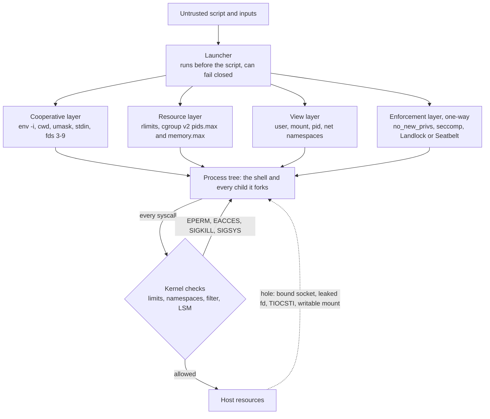

# Sandboxing Scripts

> [!summary] Claim
> A shell script cannot sandbox itself: confinement is a property a launcher fixes before the script runs and the kernel enforces, so `env -i`, a short `PATH`, and restricted modes only shape what a cooperative script inherits, while resource limits, `no_new_privs`, namespaces, seccomp, Landlock, and Seatbelt are what bound a hostile one.

Part of [Shell Security](README.md) in [Shell and Unix Engineering](../README.md).

## TL;DR

- Mechanism: a sandbox is process state inherited across `fork(2)` and `execve(2)` and checked by the kernel on every syscall; the launcher sets it, the script cannot unset it, and the one-way pieces (`no_new_privs`, seccomp filters, Landlock domains, lowered hard limits) are what make it a boundary.
- Rule: decide the adversary first (buggy, injected-into, hostile author, kernel exploit), scrub the inherited environment as the cheap cooperative layer, enforce with kernel mechanisms as an allow-list, apply the filter last, and fail closed if any step fails.
- Trap: the shell's own controls are advisory, because an absolute path, an in-shell `/dev/tcp` redirection, a write to any directory the uid owns, or a leaked descriptor all bypass them; the lab shows the write-anywhere, connect, and leaked-descriptor cases as passing tests, and the `/dev/tcp` case rests on the Bash manual.
- Portability: the cooperative layer is POSIX (`env -i`, `umask`, `ulimit`, `n>&-`) but shells diverge on `ulimit` (posh has none), on killed-child status (128+N, 256+N in ksh93, 384+N in yash), and on inherited signal masks; the kernel layer is per-OS (Linux seccomp and Landlock, macOS Seatbelt, OpenBSD pledge and unveil, FreeBSD Capsicum).
- When not to use it: when the script's author is hostile or the data is worth more than the host, a shared-kernel sandbox is the wrong boundary, so run it in a VM or microVM, and do not build the policy engine in shell at all.

## Mental model



The launcher sits above the script in the tree, so it is the only component that can apply policy before untrusted code runs and the only one that can refuse to start when a layer cannot be applied.
The cooperative layer and the resource layer shape what the process tree inherits, but nothing in them stops a syscall the policy forgot, which is why the enforcement layer exists and why its pieces are one-way.
The view layer changes what names resolve to (paths, process ids, network devices) rather than what is permitted, so it removes targets instead of checking calls.
Every syscall from the shell and from each child it forks goes through the kernel check on the right of the diagram, and the dotted arrow is the failure mode that dominates real incidents: a resource the launcher left reachable.

## How it works

### What "sandbox" means for a script

A process holds ambient authority: whatever its uid, groups, capabilities, descriptors, working directory, and mounts can reach.
The POSIX shell execution environment is made of exactly the inheritable pieces: open files, working directory, file creation mask, file size limit, traps, exported variables, and the rest (POSIX.1-2024 XCU 2.13).
A utility runs in a separate environment whose initial value is the parent's, and the shell executes it with `execl()`-style semantics (POSIX.1-2024 XCU 2.9.1.6).
A sandbox is therefore a restriction on that inherited state plus a kernel check that holds after `execve`.
Resource limits are the clearest example: a child inherits its parent's limits and they are preserved across `execve(2)` (getrlimit(2), man-pages 6.19, 2026-02-08).

Two properties separate a boundary from a convention.
First, irreversibility: the script must not be able to take the restriction off.
Second, completeness: every path to the protected resource must be covered, not just the path the script is expected to use.

- `PR_SET_NO_NEW_PRIVS` cannot be unset once set and is inherited across `fork`, `clone`, and `execve` (Linux `no_new_privs` documentation, docs.kernel.org as fetched 2026-11-21).
- A seccomp filter attached to a thread is preserved across `execve(2)` and constrains children (seccomp(2)).
- Capsicum capability mode, once entered with `cap_enter(2)`, is inherited by future children and cannot be cleared (capsicum(4)).
- OpenBSD `pledge()` can only reduce what still works; revoked subsystems cannot be re-activated (pledge(2)).
- A hard resource limit lowered by an unprivileged process cannot be raised again, and POSIX `ulimit` with no `-H` or `-S` sets both limits (POSIX.1-2024 XCU `ulimit`).
  [[Resource-Limits-and-ulimit]] owns the unit and signal details.

Everything else a shell can set (`PATH`, `set -r`, `umask`, a `trap`, a function that shadows a command) is reversible or bypassable by the script, which is the content of [[Restricted-Shells]] and the reason this note puts enforcement in the kernel.

### The cooperative layer, and what each step really does

`env -i` runs the utility with exactly the environment given on its command line and ignores the inherited one completely (POSIX.1-2024 XCU `env`).
An allow-list is the only safe shape, because the dangerous variables are an open set: `BASH_ENV` and `ENV` make a starting shell execute a file ([[BASH_ENV-and-ENV]]), exported functions are code ([[Shellshock]]), `IFS` changes splitting ([[IFS-Attacks]]), `LD_*` and `DYLD_*` change the loader, and credentials ride in ordinary variables ([[Secrets-in-argv-env-and-History]]).
The shell side is specified too: variables are initialized only from environment entries with valid names, and it is unspecified whether entries with invalid names still reach a child (POSIX.1-2024 XCU 2.5.3 and 2.13).
BusyBox 1.37.0 ash on Alpine keeps and re-exports an invalid name such as `bad-ident=x`, while Debian's build drops it (measured in the shell matrix), so a scrub done by the shell is weaker than a scrub done by `env -i`.

The working directory is the next inherited resource.
For a relative operand that does not begin with dot or dot-dot, `cd` searches the `CDPATH` directories first and, when a non-empty `CDPATH` directory is used, writes the new directory to standard output (POSIX.1-2024 XCU `cd`).
A launcher therefore unsets `CDPATH`, uses `cd --`, and records `pwd -P` rather than trusting the argument (the lab's `confine.sh`).
Temporary-file placement is a separate attack class ([[Temporary-File-Attacks]]); the launcher's part is to point `HOME` and `TMPDIR` at a private scratch directory and use `umask 077` (POSIX.1-2024 XCU 2.13 lists the file creation mask as inherited state; [[Permissions-umask-and-Special-Bits]]).

Descriptors are the leakiest inheritance.
A script reads any descriptor it inherits, which is how an unrelated open file becomes readable to confined code.
The portable closing syntax is `n>&-`, and implementations must support redirections only for descriptors 0 to 9 (POSIX.1-2024 XCU 2.7), so a shell wrapper can portably close `3` to `9` and nothing beyond.
The Bash manual says redirections using descriptors greater than 9 should be used with care because they may conflict with descriptors the shell uses internally (Bash Reference Manual, 3.6 Redirections).
The reliable fix is at the source, with `O_CLOEXEC` in the program that opened the descriptor ([[Close-on-Exec-and-Descriptor-Inheritance]]).
The incident that made this concrete was CVE-2019-5736, where runc through 1.0-rc6 allowed a container process to overwrite the host runc binary because of file-descriptor mishandling related to `/proc/self/exe` (NVD, published 2019-02-11).

Standard input is the same story in one line: give the child `/dev/null` so it cannot read the caller's terminal or pipe.

Resource limits belong here only as guard rails.
`ulimit -c 0` stops core files, which can hold secrets from memory, and `ulimit -f 0` makes any write to a regular file fail: the kernel sends `SIGXFSZ` and, if the signal is ignored, the write fails with `EFBIG` (getrlimit(2); [[Resource-Limits-and-ulimit]]).
`RLIMIT_NPROC` counts processes (threads on Linux) for the real user id, is not enforced for root, `CAP_SYS_ADMIN`, or `CAP_SYS_RESOURCE`, and therefore cannot isolate a subtree (getrlimit(2)); that job belongs to cgroup v2 `pids.max`, which is a hard limit on the number of processes in the cgroup and its descendants (Linux cgroup-v2 documentation).

Process-group and session setup decide who can signal and who can type into whom.
`setsid(2)` detaches the child from the controlling terminal, which matters because of `TIOCSTI` (see Pitfalls); [[Sessions-Process-Groups-and-Controlling-Terminals]] has the model.
Wall-clock limits are the supervisor's job, with `timeout` or a watchdog that kills a whole process group or cgroup, not a single pid ([[Timeouts-in-Scripts]], [[timeout]]).

An inherited blocked-signal mask passes through some shells and not others: dash, ksh93, and mksh unblock it at startup, while bash, zsh, yash, posh, and BusyBox ash pass it to their children (measured in the shell matrix), so a launcher that cares resets the mask in C before `exec`.

Every item above is inherited state and none is a check.
The lab proves the limit with tests that pass: a confined command writes to any directory its uid can reach, and a confined command still reaches `connect(2)`.

### The kernel layer

#### `no_new_privs`

`execve` can grant a new program privileges its parent lacked: setuid and setgid bits and file capabilities.
`PR_SET_NO_NEW_PRIVS` makes `execve` promise not to grant anything the caller could not already do, and it cannot be unset (Linux `no_new_privs` documentation).
In the kernel, `check_unsafe_exec()` marks the exec unsafe with `LSM_UNSAFE_NO_NEW_PRIVS` when `task_no_new_privs(current)` is true, and `bprm_fill_uid()` returns early so the set-user-ID and set-group-ID bits are not applied (Linux `fs/exec.c`, `check_unsafe_exec` and `bprm_fill_uid`).
The flag exists mainly so unprivileged code can install seccomp filters: a filter that survives `execve` could otherwise be used against a setuid program, for example by making a `setuid(2)` call report success without happening (seccomp(2)).

#### seccomp-bpf

A seccomp filter is a classic BPF program run on every syscall of the thread and its descendants.
It reads a fixed `struct seccomp_data` holding the syscall number, the `AUDIT_ARCH_*` value, the instruction pointer, and six argument registers (seccomp(2)).
It returns a 32-bit value: the high 16 bits are the action and the low 16 bits are data, such as the `errno` for `SECCOMP_RET_ERRNO`.
With several filters, all run, most recently installed first, and the highest-precedence action wins; the order is `SECCOMP_RET_KILL_PROCESS`, `SECCOMP_RET_KILL_THREAD`, `SECCOMP_RET_TRAP`, `SECCOMP_RET_ERRNO`, `SECCOMP_RET_USER_NOTIF`, `SECCOMP_RET_TRACE`, `SECCOMP_RET_LOG`, `SECCOMP_RET_ALLOW` (seccomp(2)).
An unknown action is treated as kill.

Installation is `prctl(PR_SET_SECCOMP, SECCOMP_MODE_FILTER, &prog)` or the `seccomp(2)` syscall, and it requires `CAP_SYS_ADMIN` in the user namespace or `no_new_privs` already set, else it fails with `EACCES` (seccomp(2); Linux `kernel/seccomp.c`, `seccomp_prepare_filter`).
A program may hold at most `BPF_MAXINSNS` (4096) instructions, and the total across all filters on a thread is capped at `MAX_INSNS_PER_PATH`, 32768 instructions with 4 counted as overhead per existing filter (seccomp(2); `kernel/seccomp.c`: `MAX_INSNS_PER_PATH` is `(1 << 18) / sizeof(struct sock_filter)`).

The design limit matters more than the mechanics: BPF programs cannot dereference pointers, so a filter judges only register values, and that is what removes time-of-check-to-time-of-use races but also means seccomp cannot express "only paths under `/work`" (Linux seccomp filter documentation).
The kernel documentation says it directly: "System call filtering isn't a sandbox", it is a tool for minimizing the exposed kernel surface that sandbox builders use.
Path policy needs a mechanism that sees paths: Landlock, Seatbelt, or a mount namespace.

The sharp edges are all about identifying the syscall:

- Check `arch` first, because numbering differs per architecture and some architectures run several ABIs.
- On x86-64 the x32 ABI also reports `AUDIT_ARCH_X86_64` and is told apart by `__X32_SYSCALL_BIT` in the number, so a deny-list by number is bypassable unless it also handles that bit; kernels before 5.4 also wrongly permitted numbers 512 to 547 (seccomp(2)).
- libc wrappers do not always map to the syscall of the same name: `fork` is `clone`, `exit` is `exit_group`, and since glibc 2.26 `open` calls `openat` (seccomp(2), Caveats).
- A deny-list needs updating whenever a dangerous syscall is added, and values can be re-represented without changing meaning, so the man page strongly recommends an allow-list.
- Filtering can break legitimate rare code paths that tests never reach (seccomp(2), Caveats).

The lab's `kconfine` is a deliberately small deny-list: it returns `EPERM` for `connect(2)` and allows the rest, so unrelated work still succeeds, and the note's pitfall about `sendto(2)` on a UDP socket is the reason to use an allow-list in production.

#### Landlock

Landlock lets an unprivileged process restrict its own ambient filesystem and network access, using three syscalls: `landlock_create_ruleset(2)`, `landlock_add_rule(2)`, and `landlock_restrict_self(2)` (landlock(7)).
A ruleset names the access rights it handles; rights it does not handle stay unrestricted, so a policy is explicit about its own scope.
Rules attach to file hierarchies (and, since ABI 4, TCP ports); files opened before enforcement are not subject to the restrictions; domains stack, and access requires every layer to grant it (landlock(7)).
Landlock requires `no_new_privs` unless the caller has `CAP_SYS_ADMIN` in its namespace, and leaving it unset lets a confined process run setuid binaries as confused deputies (Landlock documentation).
Availability is a boot-time property: the kernel needs `CONFIG_SECURITY_LANDLOCK=y` and `landlock` in the active LSM list, and a program must probe with `LANDLOCK_CREATE_RULESET_VERSION` and decide what to do when the answer is `ENOSYS` or `EOPNOTSUPP` (Landlock documentation).

The ABI grows by version, and the man page orients each one to a mainline kernel (landlock(7), as of 2026-11): ABI 1 at 5.13 (filesystem rights), 2 at 5.19 (`REFER`), 3 at 6.2 (`TRUNCATE`), 4 at 6.7 (TCP bind and connect), 5 at 6.10 (`IOCTL_DEV`), 6 at 6.12 (abstract UNIX socket and signal scoping), 7 at 6.15 (audit logging flags), 8 at 7.0 (`TSYNC`), 9 at 7.1 (`RESOLVE_UNIX`).
The Landlock documentation page also lists ABI 10 (UDP rights) and ABI 12 (capability and namespace rules); that page is dated October 2026, so treat anything past ABI 9 as new.
The design rule for a launcher is best-effort degradation only where the missing feature is not part of the threat model; a launcher that silently runs unconfined because the kernel lacks Landlock is a fail-open bug.

#### Namespaces, `chroot`, and `pivot_root`

A namespace changes what a name refers to, for one resource class per type: cgroup root (`CLONE_NEWCGROUP`), System V and POSIX IPC (`CLONE_NEWIPC`), network devices and ports (`CLONE_NEWNET`), mount points (`CLONE_NEWNS`), process ids (`CLONE_NEWPID`), boot and monotonic clocks (`CLONE_NEWTIME`), user and group ids (`CLONE_NEWUSER`), and hostname (`CLONE_NEWUTS`) (namespaces(7)).
Creating most of them needs `CAP_SYS_ADMIN`; since Linux 3.8 creating a user namespace needs no privilege, and `CLONE_NEWUSER` combined with other flags is created first, which is what lets an unprivileged caller create all of them in one call (namespaces(7), user_namespaces(7)).
Inside a new user namespace a process gains a full capability set scoped to that namespace, and a non-user namespace is owned by the user namespace of its creator, so privileged operations on it are checked against that owner (user_namespaces(7)).
Holding `CAP_SYS_ADMIN` in the owning user namespace lets a process create bind mounts and mount `/proc`, `/sys`, `devpts`, `tmpfs`, `ramfs`, and `mqueue` (and `bpf` since 4.4, overlayfs since 5.11), but never block-device filesystems (user_namespaces(7)).
Nesting is bounded: 32 levels for user namespaces since 3.11 and 32 for PID namespaces since 3.7 (user_namespaces(7), pid_namespaces(7)).

Three namespace facts drive sandbox design.

- The first process in a new PID namespace is its init, signals to it are limited to ones it handles (except `SIGKILL` and `SIGSTOP` from an ancestor), and when it exits the kernel kills every other process in that namespace, which makes a PID namespace a reliable "no orphans" cleanup (pid_namespaces(7)).
- A new network namespace has no devices but loopback, so it removes the network instead of filtering it (bubblewrap README; systemd.exec `PrivateNetwork=`).
- The uid and gid maps make the sandbox's root an unprivileged id outside; Linux 3.19 added `/proc/PID/setgroups` so that writing a gid map requires first denying `setgroups(2)`, because dropping groups in a new namespace could grant access to files with permissions such as `rwx---rwx` (user_namespaces(7)).

`chroot(2)` is not in this family.
The Linux man page states that it "is not intended to be used for any kind of security purpose, neither to fully sandbox a process nor to restrict filesystem system calls", that the caller's current directory can remain outside the new root, that open descriptors are not closed, and that a root caller can leave with `mkdir foo; chroot foo; cd ..` (chroot(2)).
It also needs `CAP_SYS_CHROOT`, and the kernel documents that unprivileged `chroot` is disallowed because it would let a process replace `/etc/passwd` from the point of view of a setuid program it runs (Linux `no_new_privs` documentation).
The documented stronger primitives are `pivot_root(2)` inside a private mount namespace, which is what bubblewrap builds, and FreeBSD `jail(8)` (chroot(2), NOTES).

#### cgroups v2

Resource control that outlives one process needs a group.
`pids.max` is a hard cap on processes in the cgroup and its descendants; `memory.max` is the memory hard limit that invokes the OOM killer in the cgroup when usage cannot be reduced; `cpu.max` bounds CPU bandwidth; and writing `1` to `cgroup.kill` kills the whole tree with `SIGKILL`, handling concurrent forks (Linux cgroup-v2 documentation).
Writing `pids.max` does not retroactively remove processes: organizational operations are not blocked by policy, so `pids.current` can exceed `pids.max` (same document).
Unprivileged use requires delegation by a manager such as systemd ([[cgroups-v2-from-the-Shell]]).

### Launcher tools

`bwrap` (bubblewrap) builds an empty tmpfs root in a new mount namespace and lets the caller bind what should be visible, with `--ro-bind`, `--proc`, `--dev`, `--tmpfs`, `--unshare-all` (IPC, PID, net, and UTS, plus user and cgroup only where possible, because it expands to `--unshare-user-try` and `--unshare-cgroup-try`), `--clearenv`, `--seccomp FD` for a compiled cBPF program, `--cap-drop ALL`, `--die-with-parent`, and `--new-session` (bwrap(1) from `bwrap.xml`).
Its README is explicit that "the level of protection between the sandboxed processes and the host system is entirely determined by the arguments passed to bubblewrap", that it uses `PR_SET_NO_NEW_PRIVS`, and that everything mounted into the sandbox can potentially be used to escalate privileges (bubblewrap README, Sandbox security and Limitations).
It also has `--disable-userns`, implemented with the `user.max_user_namespaces` sysctl set to 1 and a nested user namespace, and `--not-a-security-boundary`, which only makes some setup failures non-fatal.
`unshare(1)` exposes the namespace flags (`--net`, `--mount-proc`, `--fork`, `--kill-child`, `--map-root-user`).
`setpriv(1)` sets `--no-new-privs`, the bounding set, and groups, and its page documents `--seccomp-filter file` (raw BPF code from a file), `--landlock-access` and `--landlock-rule`, and `--reset-env` (setpriv(1) as fetched 2026-11-21); the Landlock options arrived in util-linux 2.40 and `--seccomp-filter` in 2.41 (util-linux v2.40 and v2.41 release notes), so probe `setpriv --help` on older targets.
Those two are how a shell script reaches the kernel layer without a compiled launcher ([[Namespaces-from-the-Shell-unshare-and-nsenter]], [[Linux-Capabilities]]).

systemd applies the same primitives from unit properties, and `systemd-run --property=NAME=VALUE` (`-p`) sets them on a transient service or scope (systemd-run(1)).
The relevant `systemd.exec(5)` directives include `NoNewPrivileges=`, `ProtectSystem=` (`strict` mounts the whole hierarchy read-only except `/dev`, `/proc`, and `/sys`), `PrivateNetwork=` (a new network namespace with only `lo`), `RestrictAddressFamilies=`, `SystemCallFilter=`, `MemoryDenyWriteExecute=`, and `DynamicUser=`.
A launcher that fails closed is visible in the exit codes systemd reserves: 205 for failing to adjust resource limits, 227 for failing to disable new privileges, and 228 for failing to apply system call filters (systemd.exec(5), exit codes table); these are the reserved statuses for failed setup steps, which is the fail-closed shape a launcher should have ([[systemd-Units-for-Scripts]]).

### macOS and the BSDs

macOS has Seatbelt, reachable as `sandbox-exec(1)` and `sandbox_init(3)`, both marked DEPRECATED in their manual pages (dated 2017-03-09), which point developers to App Sandbox.
The `sandbox_init(3)` page also says the named profiles (`kSBXProfileNoNetwork` and the others) "must not be used when building against macOS SDK >= 27.0" and that processes opting into them will be killed (the `sandbox_init(3)` page shipped in the macOS 27.3 Command Line Tools SDK, as of 2026-11).
Measured on macOS 27.3, arm64, 2026-11-21: `sandbox-exec -p '(version 1)(allow default)(deny file-write*)' /bin/sh -c 'echo hi > f'` fails with "Operation not permitted" and creates no file; `sandbox_init()` called with a custom profile string and `flags` of 0 enters the sandbox; `(deny network*)` did not stop `socket(2)` from succeeding, while `(deny network-outbound)` turned `connect(2)` to `127.0.0.1:1` from `ECONNREFUSED` (61) into `EPERM` (1).
The sandbox is inherited across `execve`, which the lab checks by exec'ing a second `kconfine` after the first has confined itself; the shipped pages do not say whether a process can leave the sandbox, and the lab does not test it, so this note claims inheritance only.
Apple does not document the profile language in these pages, so a profile string is an implementation detail of a deprecated interface; treat it as a short-lived adapter rather than an API.

OpenBSD splits the policy in two.
`pledge(2)` declares the subsystems a program will use as a promise string, about three dozen of them; using another one kills the process with an uncatchable `SIGABRT`; later calls can only reduce (pledge(2)).
`unveil(2)` restricts the visible filesystem to listed paths with `r`, `w`, `x`, `c` permissions; accesses outside return `EACCES` or `ENOENT`; it can be locked; and a program started with `execve(2)` begins with no unveils, so it protects one program rather than a tree (unveil(2)).
FreeBSD Capsicum's `cap_enter(2)` enters capability mode, in which access to global namespaces such as the filesystem and PID space is restricted and only delegated descriptors work, inherited by future children and not clearable (capsicum(4), first in FreeBSD 9.0).
FreeBSD `jail(8)` is the stronger-than-chroot primitive that the Linux `chroot(2)` page points to.

### Stronger boundaries

A namespace-and-seccomp sandbox shares the host kernel, so its attack surface is the kernel's syscall interface.
gVisor places an application kernel (the Sentry) between the container and the host, intercepting its syscalls; Firecracker runs workloads in KVM microVMs with a deliberately minimal device model (gVisor documentation, Firecracker README).
Those, or a full VM, are the choice when the author of the script is the adversary.

### Shell features that act without `exec`

PATH and restricted-mode thinking assumes commands run as separate programs.
Shells also act in-process.
Bash opens TCP and UDP sockets itself for `/dev/tcp/host/port` and `/dev/udp/host/port` redirections, and `enable -f filename` loads a new builtin from a shared object on systems that support dynamic loading (Bash Reference Manual, 3.6 Redirections and 4.2 Bash Builtin Commands).
No `exec` happens, so no `PATH` or command-name rule sees it, and only a kernel-level check on the `connect(2)` syscall does.
The restricted-shell list in the same manual names `enable -f`, redirection operators, and `exec` but does not list `/dev/tcp` (Bash Reference Manual, 6.10 The Restricted Shell), and it states that restrictions are turned off in the shell that runs a script ([[Restricted-Shells]]).

### The launcher recipe

The order matters because later steps need syscalls an earlier step may remove.

1. Choose the tier (see Security and robustness) and decide what failure means: always refuse to run.
2. Create a private scratch directory and decide the only paths the script may touch.
3. Close or never inherit descriptors; hand the child `/dev/null` for stdin.
4. Build the environment from an allow-list.
5. Set resource limits and place the tree in a cgroup with `pids.max`, `memory.max`, and a way to kill the group.
6. Start a new session (`setsid`) so the script has no controlling terminal.
7. Create namespaces and the mount layout, then drop capabilities.
8. Set `no_new_privs`, then install seccomp and Landlock last, because the launcher itself needs `mount`, `unshare`, and similar syscalls before that point.
9. `exec` the interpreter on the script; the filters survive the exec.
10. Supervise: enforce a wall-clock limit on the whole group, cap output size, map signal exit statuses, and treat any setup error as a refusal.

A shell can do steps 1 to 5 itself and reach the rest by invoking `bwrap`, `systemd-run`, `setpriv`, or a small compiled launcher; the shell language has no builtin that installs a seccomp filter or a Landlock ruleset.

## Numbers and limits

| Quantity | Value | Source and date |
| --- | --- | --- |
| Instructions per seccomp filter | at most 4096 (`BPF_MAXINSNS`) | seccomp(2) ERRORS; `kernel/seccomp.c` `seccomp_prepare_filter` (as of 2026-11) |
| Instructions across all filters on a thread | at most 32768, with 4 added per existing filter | seccomp(2) ERRORS; `kernel/seccomp.c` `MAX_INSNS_PER_PATH` is `(1 << 18) / sizeof(struct sock_filter)` |
| Instructions in the lab's `kconfine` filter | 7 on aarch64, 9 on x86-64 (the x32 check adds 2) | counted from `kconfine.c` in the lab |
| Nested user namespaces | 32 (since Linux 3.11) | user_namespaces(7), man-pages 6.19 |
| Nested PID namespaces | 32 (since Linux 3.7) | pid_namespaces(7), man-pages 6.19 |
| Seccomp architectures with filter support | x86-64, i386, x32 (3.5); ARM (3.8); s390 (3.8); MIPS (3.16); ARM-64 (3.19); PowerPC (4.3); Tile (4.3); PA-RISC (4.6) | seccomp(2) NOTES, man-pages 6.19 |
| Landlock first kernel | 5.13 (ABI 1); ABI 9 at 7.1 | landlock(7), as of 2026-11 |
| `ulimit -f` unit | 512-byte blocks in POSIX | POSIX.1-2024 XCU `ulimit` |
| Status of a command killed by `SIGXFSZ` (25) as seen by bats under bash | 153 | lab test, macOS 27.3 arm64, bash 5.3.15, 2026-11-21; also 153 from `dd` under bash 3.2.57, dash, zsh, and ksh93u+ 2012 via `confine.sh` on the same host |
| `confine.sh` setup-failure status | 125 | the lab script |
| `TIOCSTI` needs `CAP_SYS_ADMIN` when `dev.tty.legacy_tiocsti` is false | since Linux 6.2 | TIOCSTI(2const), man-pages 6.19 |
| `glibc` `open` wrapper uses `openat` | since glibc 2.26 | seccomp(2) Caveats |
| `RLIMIT_NPROC` scope | per real user id, threads on Linux, root and two capabilities exempt | getrlimit(2), man-pages 6.19 |
| macOS `connect` to a closed loopback port before and after `(deny network-outbound)` | `ECONNREFUSED` (61), then `EPERM` (1) | measured here, macOS 27.3 arm64, 2026-11-21 |
| CVE-2016-2779 (util-linux `runuser`, `TIOCSTI`) | published 2017-02-07 | NVD |
| CVE-2017-5226 (bubblewrap, `TIOCSTI`) | published 2017-03-29 | NVD |
| CVE-2019-5736 (runc, `/proc/self/exe`) | published 2019-02-11; fixed in Docker 18.09.2 | NVD |

The lab prints no timing or overhead figure, and this note makes no claim about seccomp or namespace overhead.

## Portability

The cooperative layer is portable shell; the rows below record where the shells differ in ways that change a launcher.
"Measured here" means run on macOS 27.3 arm64 on 2026-11-21 with the shell named; "lab asserts" means a test in the lab encodes the behavior for the integrator's matrix but it was not run here; other cells cite a source.

| Shell | `ulimit -c 0` and `-f` for `confine.sh` | `$?` after a child dies of a signal | Inherited blocked signal mask | Other fact that matters here |
| --- | --- | --- | --- | --- |
| POSIX sh | `-c`, `-f`, `-n`, `-s`, `-t`, `-v` are specified; `-f` is in 512-byte units (POSIX.1-2024 XCU `ulimit`) | greater than 128, implementation-defined which signal; values above 255 are permitted (XCU 2.8.2) | not addressed in the sections read | environment names must be valid to initialize variables; whether invalid ones reach children is unspecified (XCU 2.5.3, 2.13) |
| macOS bash 3.2.57 (`/bin/sh`, `/bin/bash`) | measured here: `confine.sh -f 0` ran, child killed, status 153, `ulimit -f` and `-c` print 0 | 128 + N | passes it to children | bash 3.2 uses 1024-byte blocks for `-f` even in POSIX mode ([[Resource-Limits-and-ulimit]]; measured here: under `/bin/sh`, `ulimit -f 1` still allowed a 700-byte write) |
| current bash (5.3.15) | measured here: 12 of 12 lab tests pass with `sh` resolving to bash 5.3.15 | 128 + N | passes it to children | `/dev/tcp` and `/dev/udp` redirections open sockets inside the shell (Bash Reference Manual 3.6) |
| zsh native | measured here: `confine.sh` under `/bin/zsh` and `zsh` gave status 153 and the exact five-variable environment | 128 + N | passes it to children | native zsh does not field split unquoted expansions (shell matrix) |
| zsh `--emulate sh` | lab asserts the same outcome; not run here | 128 + N | passes it to children | splits unquoted expansions like sh (shell matrix) |
| dash | measured here: status 153, environment and limits as expected | 128 + N | unblocks it at startup | Debian `sh` is dash 0.5.12 (shell matrix) |
| ksh93 | measured here with macOS `/bin/ksh` (93u+ 2012-08-01): status 153 through the `exec` chain | 256 + N (measured here: `$?` was 281 after `SIGXFSZ`) | unblocks it at startup | ksh93u+ 2012 and ksh93u+m 1.0.10 differ in places, branch on `lab_shell_version` |
| mksh | lab asserts enforcement; not run here | 128 + N | unblocks it at startup | non-interactive mksh catches `SIGTERM`, so a kill can be swallowed before the child execs (shell matrix) |
| yash | lab asserts enforcement; not run here | 384 + N | passes it to children | `<(cmd)` is process redirection, not substitution (shell matrix) |
| posh | lab asserts refusal with status 125 because posh has no `ulimit` builtin ([[Resource-Limits-and-ulimit]]); not run here | 128 + N | passes it to children | posh 0.14.1 inherits `IFS` from the environment (shell matrix), so the `env -i` scrub in `confine.sh` is what protects the child |
| BusyBox ash | lab asserts enforcement; not run here | 128 + N | passes it to children | on Alpine (1.37.0) an invalid environment name such as `bad-ident=x` is kept and re-exported; Debian's build drops it (shell matrix) |

The exact wording of the status column comes from the matrix entry "Signal exit status: 128 + N in most shells, 256 + N in ksh93, 384 + N in yash", and the signal-mask column from "dash, ksh93, and mksh unblock it at startup; bash, zsh, yash, posh, and BusyBox ash pass it on".

| Tool or kernel feature | Linux | macOS | BSDs | Source |
| --- | --- | --- | --- | --- |
| `env -i` | POSIX requires `-i`; lab asserts it on Linux, not run here | the lab ran `/usr/bin/env -i` on this host | POSIX requires it | POSIX.1-2024 XCU `env`; measured here for macOS |
| syscall filter | seccomp-bpf (`prctl` 3.5 on x86, `seccomp(2)` 3.17) | none exposed; Seatbelt operates on operations | OpenBSD `pledge(2)`; FreeBSD `cap_enter(2)` | seccomp(2); pledge(2); capsicum(4) |
| path policy | Landlock (5.13, ABI 1) or a mount namespace | Seatbelt `file-write*` and similar | OpenBSD `unveil(2)`; FreeBSD capability mode | landlock(7); keith.github.io man pages; unveil(2); capsicum(4) |
| network removal | `CLONE_NEWNET`, `PrivateNetwork=` | `(deny network-outbound)` | not covered here | namespaces(7); systemd.exec(5); measured here |
| process-tree kill | PID namespace init exit, cgroup `cgroup.kill`, `bwrap --die-with-parent` | none measured | not covered here | pid_namespaces(7); cgroup-v2 docs; bwrap(1) |
| launcher CLI | `bwrap`, `systemd-run -p`, `unshare(1)`, `setpriv(1)` (with `--seccomp-filter` and `--landlock-access`) | `sandbox-exec(1)` (deprecated) | `jail(8)` | man pages cited above |
| `unshare`, `bwrap`, `setsid`, `prlimit` binaries | util-linux and distribution packages | measured here: `/usr/bin/unshare`, `/usr/bin/setsid`, `/usr/bin/prlimit` do not exist and `bwrap` is not installed | not covered here | `ls` and `command -v` on this host, 2026-11-21 |
| `timeout` | GNU coreutils | `/usr/bin/timeout` exists here (macOS 27.3) | not covered here | measured here; see [[timeout]] |

## Worked example

[lab](../labs/17-sandboxing-scripts/)

The lab has two halves, matching the claim.
`confine.sh` is the cooperative layer and is shell.
`kconfine.c` is the smallest useful kernel layer: it applies a policy and then `exec`s, which is the launcher pattern in about 150 lines of C.
The tests prove each half and then prove where the first half stops.

`confine.sh`, verbatim from the lab:

```sh
#!/bin/sh
# confine.sh: the cooperative layer of a script sandbox.
# Runs an absolute-path command with a scrubbed environment, a fixed working directory, a closed
# stdin, no inherited descriptors 3-9, a restrictive umask, and optional resource limits.
# It bounds what the command inherits; it does not bound what the command can do (see the note).
# Usage: confine.sh [-f BLOCKS] SCRATCH CMD [ARG...]
#   -f BLOCKS  cap the size of any file the command writes (also disables core dumps)
#   CMD        must be an absolute path: no PATH search, and "name=value" cannot be mistaken
#              for an environment assignment by env
# Exit status: 125 when the confinement cannot be set up (fail closed), else the status of CMD.
fsize=
if [ "${1-}" = -f ]; then
  [ "$#" -ge 2 ] || exit 125
  fsize=$2
  shift 2
fi
if [ "$#" -lt 2 ]; then
  echo "usage: confine.sh [-f BLOCKS] SCRATCH CMD [ARG...]" >&2
  exit 125
fi
case $2 in
  /*) ;;
  *)
    echo "confine.sh: CMD must be an absolute path: $2" >&2
    exit 125
    ;;
esac
# A hostile CDPATH can make cd land somewhere else and print the directory.
unset CDPATH
cd -- "$1" || exit 125
scratch=$(pwd -P) || exit 125
shift
umask 077
if [ -n "$fsize" ]; then
  # Fail closed: a shell without ulimit (posh) must refuse, never run the command unlimited.
  # shellcheck disable=SC3045 # POSIX.1-2024 XCU ulimit defines -c and -f; ShellCheck still flags them
  ulimit -c 0 || exit 125
  # shellcheck disable=SC3045 # same as above
  ulimit -f "$fsize" || exit 125
fi
exec /usr/bin/env -i PATH=/usr/bin:/bin HOME="$scratch" TMPDIR="$scratch" LANG=C LC_ALL=C "$@" \
  0</dev/null 3>&- 4>&- 5>&- 6>&- 7>&- 8>&- 9>&-
```

The Linux policy installer from `kconfine.c` (simplified excerpt, aarch64 variant; the lab file adds the x32 check on x86-64 and the macOS `sandbox_init` branch):

```c
struct kf_insn filter[] = {
    {KF_LD_W_ABS, 0, 0, KF_OFF_ARCH},         /* A = seccomp_data.arch */
    {KF_JEQ_K, 1, 0, KF_AUDIT_ARCH},          /* native ABI: skip the kill */
    {KF_RET_K, 0, 0, KF_RET_KILL_PROCESS},
    {KF_LD_W_ABS, 0, 0, KF_OFF_NR},           /* A = syscall number */
    {KF_JEQ_K, 0, 1, (uint32_t)SYS_connect},  /* connect: next insn, else skip it */
    {KF_RET_K, 0, 0, KF_RET_ERRNO | (uint32_t)EPERM},
    {KF_RET_K, 0, 0, KF_RET_ALLOW},
};
prctl(PR_SET_NO_NEW_PRIVS, 1, 0, 0, 0);       /* required before an unprivileged filter */
prctl(PR_SET_SECCOMP, KF_SECCOMP_MODE_FILTER, &prog, 0, 0);
```

One test, simplified: a write past `ulimit -f 0` kills the command, and the wrapper refuses when the shell has no `ulimit`.

```sh
run_lab "$CONFINE" -f 0 "$SCRATCH" /bin/dd if=/dev/zero of=big bs=1 count=1
case $(limit_mode) in
  enforced)
    [ "$status" -eq 153 ] # 128 + SIGXFSZ (25) on Linux and macOS
    [ ! -s "$SCRATCH/big" ]
    ;;
  refused) [ "$status" -eq 125 ] ;;
  *) false ;;
esac
```

Captured on macOS 27.3 arm64, bats with `sh` resolving to bash 5.3.15, 2026-11-21, one run of `bats --tap sandboxing.bats` (the Linux branch of `kconfine` and the Linux arm of the last test have not been run here, so the integrator's matrix decides them):

```text
1..12
ok 1 confine.sh passes exactly the allow-listed environment and drops hostile variables
ok 2 confine.sh gives the command /dev/null as standard input
ok 3 confine.sh closes descriptors 3-9 that the parent leaked
ok 4 confine.sh runs in SCRATCH with umask 077 even when the parent umask is 022
ok 5 confine.sh -f 0 sets the file-size and core limits the command inherits
ok 6 a write past the file-size limit kills the command with SIGXFSZ
ok 7 confine.sh fails closed on a relative or name=value command, a bad scratch, or a bare -f
ok 8 confine.sh is not filesystem confinement: the command still writes outside SCRATCH
ok 9 confine.sh does not stop network access: connect(2) is attempted and fails for other reasons
ok 10 kconfine: connect(2) is denied after confinement, in a program exec'd afterwards
ok 11 kconfine is a deny-list: unrelated work, including writes and forks, still succeeds
ok 12 the kernel layer is visible to the platform: /proc on Linux, Seatbelt file-write deny on macOS
```

The same probe run by hand on the same host shows the two states of `connect(2)` directly:

```text
$ kconfine connect
connect: errno=61 (Connection refused)
$ kconfine confine kconfine connect
connect: EPERM
$ kconfine confine /bin/sh -c ': > made && /bin/echo wrote'
wrote
```

On Linux the first line is expected to read `connect: errno=111 (Connection refused)` when loopback is up, and any `errno` other than `EPERM` still satisfies the test, because the claim is that the unconfined call is not blocked by policy.

## Pitfalls

> [!warning] The shell's own restrictions are mistaken for a boundary
> Trigger: a runner relies on `rbash`, a short `PATH`, or `env -i` to contain a script.
> Symptom: the script uses an absolute path, a redirection the shell performs itself (`/dev/tcp`), or any directory the uid can write; in the lab the confined command wrote outside its scratch directory and reached `connect(2)`.
> The Bash manual itself says restricted mode is turned off in the shell spawned to run a script and must be paired with a controlled `PATH` and a vetted command set (Bash Reference Manual 6.10).
> Fix: treat the cooperative layer as hygiene and enforce with the kernel layer; see [[Restricted-Shells]].

> [!warning] `chroot` used as a jail
> Trigger: a service or build step calls `chroot(2)` or `chroot(8)` and treats the directory as a sandbox.
> Symptom: a privileged caller leaves with `mkdir foo; chroot foo; cd ..`, an open descriptor reaches outside, and a directory moved out of the tree can be followed back (chroot(2)).
> Fix: use a private mount namespace with `pivot_root`, or Landlock for path policy, with `no_new_privs`; on FreeBSD use `jail(8)` or Capsicum.

> [!warning] Terminal injection through `TIOCSTI`
> Trigger: a sandboxed process keeps the parent's controlling terminal.
> Symptom: it uses the `TIOCSTI` ioctl to push characters into the terminal input buffer and the parent shell runs them after the sandbox exits; CVE-2016-2779 did this to `runuser` in util-linux and CVE-2017-5226 did it to bubblewrap sandboxes (NVD).
> Fix: start the sandbox in a new session (`setsid`, `bwrap --new-session`) or deny the ioctl with seccomp; Linux 6.2 added the `dev.tty.legacy_tiocsti` sysctl, which when false makes the operation require `CAP_SYS_ADMIN` (TIOCSTI(2const)).

> [!warning] A descriptor leaks the secret the sandbox hides
> Trigger: the parent opened a file, socket, or directory without `O_CLOEXEC`, then ran the confined command.
> Symptom: the child reads it through the inherited number; the lab's control test reads a secret through descriptor 7.
> CVE-2019-5736 is the container-runtime form: runc mishandled a file descriptor related to `/proc/self/exe` and a container process overwrote the host runc binary (NVD).
> Fix: set close-on-exec where the descriptor is created ([[Close-on-Exec-and-Descriptor-Inheritance]]); a shell wrapper can only close `3` to `9` and should still do so.

> [!warning] A seccomp deny-list that misses the sibling syscall
> Trigger: a filter blocks `connect(2)` or `open(2)` by number.
> Symptom: `sendto(2)` on a UDP socket, `openat(2)` (glibc's `open` since 2.26), a 32-bit or x32 entry, or `socketcall` still reaches the target; filters also break rare legitimate paths (seccomp(2), Caveats).
> The lab's `kconfine` is a deny-list on purpose and its test shows unrelated syscalls still pass.
> Fix: write an allow-list, check `arch` and `__X32_SYSCALL_BIT` first, generate it with libseccomp, and test it with a program that tries the bypasses.

> [!warning] Landlock or another feature degrades to nothing
> Trigger: a launcher requests Landlock, the kernel lacks it (`ENOSYS`, `EOPNOTSUPP`), and the launcher continues.
> Symptom: the script runs with no filesystem restriction and nothing reports it.
> Landlock needs `CONFIG_SECURITY_LANDLOCK=y` and `landlock` in the LSM list at boot, and ABI features arrive per kernel (landlock(7), Landlock documentation).
> Fix: probe the ABI, require the minimum your threat model needs, and refuse otherwise.

> [!warning] A wrapper that ignores a failed setup step
> Trigger: `ulimit -f 100 2>/dev/null; exec cmd`, or `cd "$dir"; exec cmd` without checking.
> Symptom: in a shell with no `ulimit` (posh) or a denied `setrlimit`, the command runs unlimited; with a failed `cd` it runs in the wrong directory.
> Fix: check every step and exit with a distinct status, as `confine.sh` does with 125; systemd reserves 205, 227, and 228 for the same reason (systemd.exec(5)).

> [!warning] `RLIMIT_NPROC` used as a fork-bomb cap
> Trigger: `ulimit -u` or `setrlimit(RLIMIT_NPROC)` is the only process limit.
> Symptom: the limit counts every process of the real uid, is not enforced for root, `CAP_SYS_ADMIN`, or `CAP_SYS_RESOURCE`, and so can neither isolate one script nor stop a privileged one (getrlimit(2)).
> Fix: put the tree in a cgroup with `pids.max` and kill it with `cgroup.kill` ([[cgroups-v2-from-the-Shell]]).

> [!warning] Mounts and sockets that carry privilege into the sandbox
> Trigger: a bind mount of a directory or a D-Bus or container-runtime socket into the sandbox.
> Symptom: the sandbox asks a service on the other side of the socket to run a command; the bubblewrap README gives a D-Bus socket and systemd as the example.
> Fix: mount read-only and minimal, proxy or omit sockets, and treat every mounted object as part of the attack surface (bubblewrap README, Limitations).

> [!warning] Unprivileged user namespaces are not available, or are narrowed
> Trigger: a launcher assumes `unshare --user` works.
> Symptom: on a kernel or distribution that restricts it (Ubuntu added an AppArmor-based restriction, opt-in at the 23.10 release through the `kernel.apparmor_restrict_unprivileged_userns` sysctl, with the announced plan to enable it by default through a stable release update) or where a `max_user_namespaces` limit has been reached, namespace creation fails.
> The restriction exists because user namespaces expose kernel interfaces normally reserved for root to unprivileged users (Ubuntu announcement).
> Fix: probe at startup, fail closed, and choose a different boundary (a VM or a rootful runtime) instead of dropping the namespace.

> [!warning] Building new tooling on `sandbox-exec`
> Trigger: a macOS launcher generates Seatbelt profile strings.
> Symptom: both `sandbox-exec(1)` and `sandbox_init(3)` are marked DEPRECATED, and the named profiles must not be used with SDK 27.0 or later (processes using them are killed) (as of 2026-11).
> Fix: keep the adapter small and replaceable, prefer App Sandbox for apps, and use a VM when the script is hostile.

> [!warning] Orphans outlive the sandbox
> Trigger: the script starts a background job and the launcher exits or times out.
> Symptom: the grandchild keeps running with the sandbox's privileges after the supervisor reports done.
> Fix: kill by group or cgroup, not by pid; a PID namespace kills everything when its init exits (pid_namespaces(7)) and `bwrap --die-with-parent` sends `SIGKILL` down the tree when the parent dies (bwrap(1)).

## Security and robustness

Name the adversary, because each tier needs a different boundary.

| Tier | Adversary | Enough | Not enough |
| --- | --- | --- | --- |
| 0 | a trusted script with a bug | `confine.sh`-style hygiene, rlimits, a scratch directory | nothing more is needed |
| 1 | a trusted script processing hostile data (injection, see [[Command-Injection]]) | the cooperative layer plus no network and a read-only filesystem view from a launcher | trusting `PATH` |
| 2 | an untrusted script author, honest kernel | user, mount, PID, and net namespaces, `no_new_privs`, an allow-list seccomp filter, Landlock, cgroups, a new session | any one mechanism alone |
| 3 | an author with a kernel exploit | a VM or microVM, or an application kernel such as gVisor | a shared-kernel sandbox |

Robustness rules that fall out of the mechanisms:

- Fail closed: any setup step that fails ends the run with a distinct status, and a missing feature is a refusal, not a downgrade.
- Allow-list the environment, the mounts, and the syscalls; deny-lists age.
- Apply `no_new_privs` before filters, and filters last, so the launcher's own setup is not blocked.
- Pass the script and its inputs as data (a file under the scratch directory, a pipe), never as part of a command line the launcher builds ([[Argument-Injection-and-Double-Dash]], [[eval-and-sh-c]]).
- Remove ambient credentials: an agent socket or token in the environment, a cloud metadata endpoint, a mounted socket ([[Secrets-in-argv-env-and-History]], [[Untrusted-Input-in-CI]]).
- Make denials observable: seccomp can log with `SECCOMP_FILTER_FLAG_LOG` (since Linux 4.14) and the `actions_logged` file controls which actions are logged (seccomp(2)); a denied call that nobody sees looks like a flaky script.
- Test the sandbox by attacking it: a test suite that tries the escapes in this note (outside write, connect, `TIOCSTI`, leaked descriptor, fork storm) and expects each to fail.
- Keep policy next to the code that needs it and review it like code; a sandbox profile nobody understands will be loosened on the first failure.

Residual risk: a shared-kernel sandbox is exactly as strong as the kernel interface it leaves reachable, user namespaces enlarge that interface, side channels are out of scope for every mechanism here, and the confused-deputy path through any bound socket stays open until the socket is removed.

## The principal's view

The decision is not "which sandbox" but "should this script run here at all".
Prefer designs where untrusted shell never exists: parse a data format in a memory-safe language, call a library, or run the work in a job that already has a boundary (a CI runner VM, a container with a restrictive profile, a microVM).
When shell must run, choose the boundary by tier from the table above, and spend effort on three things: a launcher that fails closed, an allow-list policy, and a test suite that attacks it.

Trade-offs to name:

- Namespaces plus seccomp plus Landlock are cheap to start and need no hypervisor, and they share the host kernel, so a kernel bug is a sandbox escape.
- A microVM or an application kernel gives a stronger boundary at the cost of boot time, memory, and operational complexity; do not take that cost for tier 0 and tier 1 work.
- An allow-list is safer and breaks more scripts; the cost of the false positives is paid once, in policy maintenance, instead of on every incident.
- Each platform has its own primitive, so portability costs a launcher per OS; hide it behind one interface and test each.

Use a different tool when:

- the launcher needs more than ten lines of policy logic: write it in Go, Rust, or C, or drive `bwrap` or `systemd-run` from a small wrapper;
- the boundary must cover a hostile author: use a VM;
- the real risk is injection into a trusted script: fix the quoting and the interface, not the sandbox ([[Command-Injection]]);
- the platform is macOS: use App Sandbox for applications and a VM for hostile code, and keep any Seatbelt string behind an adapter.

Do not ship a shell script that claims to be a sandbox.
The honest name for what `confine.sh` does is "environment hygiene", and the note's tests exist to make that name stick.

## Interview questions

> [!question] L5: Why is `env -i PATH=/usr/bin /bin/sh untrusted.sh` not a sandbox?
>
> > [!success]- Answer
> > It changes what the process inherits and nothing about what it may do.
> > The script can run any program by absolute path, write to any directory its uid can write, open network connections, and read any descriptor the launcher leaked.
> > In the lab the confined command writes outside its scratch directory and still reaches `connect(2)`.
> > A boundary needs the kernel to refuse the syscall, through limits, namespaces, a filter, or an LSM.
> >
> > Follow-up: which of those can a launcher apply without root on Linux?

> [!question] L5: What does `3>&-` do in `exec cmd 3>&-`, and why does `confine.sh` stop at descriptor 9?
>
> > [!success]- Answer
> > It closes descriptor 3 in the new process image, so `cmd` does not inherit whatever the parent had open there.
> > POSIX requires shells to support redirection of descriptors 0 to 9 and leaves larger numbers implementation-defined, so a portable wrapper cannot close more.
> > The robust fix is `O_CLOEXEC` in the code that opened the descriptor.
> >
> > Follow-up: how would a C launcher close everything above 2?

> [!question] L5: Predict the output, under bash or dash as `sh`, under ksh93, and under yash
>
> ```sh
> sh -c 'ulimit -f 0; /bin/dd if=/dev/zero of=f bs=1 count=1 2>/dev/null; echo "status=$?"; ls -l f'
> ```
>
> > [!success]- Answer
> > `dd` opens `f`, creating it with size 0, and its first write exceeds the file-size limit, so the kernel sends `SIGXFSZ` and `dd` dies.
> > The shell prints `status=153` under bash and dash (128 plus signal 25), `status=281` under ksh93 (256 plus 25), and `status=409` under yash (384 plus 25).
> > `ls -l f` then shows a zero-length file.
> > Measured on macOS 27.3 on 2026-11-21: bash 3.2 and dash print `status=153`, macOS `/bin/ksh` (93u+ 2012) prints `status=281`, and bash and ksh93 also report the kill on standard error ("Filesize limit exceeded: 25", "Exceeded file size limit") because only `dd`'s own standard error is discarded; the yash value comes from the shell matrix.
> > One more trap: the limit binds the shell too, so if the shell's standard output is a regular file, its own `echo` exceeds the limit and the shell dies with status 153 before printing anything (measured under bash 3.2 with `> out.txt`).
> > If the shell had ignored `SIGXFSZ`, the write would fail with `EFBIG` and `dd` would exit 1 with "File too large".
> >
> > Follow-up: why does the number differ between shells, and what does POSIX require?

> [!question] L6: Debug this script, which is meant to run `$2` confined in directory `$1`
>
> ```sh
> #!/bin/sh
> ulimit -f 100 2>/dev/null
> cd "$1"
> exec env PATH=/usr/bin "$2"
> ```
>
> > [!success]- Answer
> > It fails open in several places.
> > The `ulimit` error is discarded, so a shell without `ulimit` runs the command unlimited, and `-f 100` also sets the hard limit in units that differ between shells.
> > The `cd` is unchecked, so a failure leaves the command in the caller's directory, and a hostile `CDPATH` can redirect a relative operand.
> > `env` without `-i` passes every inherited variable, including `BASH_ENV` and credentials, and a `$2` of `FOO=bar` is consumed as an assignment while a relative `$2` is searched on the caller's `PATH`.
> > Descriptors and stdin are inherited.
> > `confine.sh` fixes each: check and exit 125, `unset CDPATH`, `cd --`, `env -i` with an allow-list, an absolute-path requirement, `0</dev/null`, and `3>&-` through `9>&-`.
> >
> > Follow-up: what is still missing for a hostile script even after those fixes?

> [!question] L6: Why must `no_new_privs` be set before an unprivileged process installs a seccomp filter?
>
> > [!success]- Answer
> > Without it, an unprivileged process could attach a filter that survives `execve` and then run a setuid program under that filter.
> > The filter could make a `setuid(2)` call return success without happening, so the program keeps root while believing it dropped it.
> > The kernel refuses with `EACCES` unless the thread has `CAP_SYS_ADMIN` in its user namespace or `no_new_privs` is set (`seccomp_prepare_filter`).
> > With the bit set, `execve` never grants new privileges, so the filter cannot be turned against a privileged program.
> >
> > Follow-up: what does `no_new_privs` do to a binary with file capabilities?

> [!question] L6: Seccomp or Landlock: which expresses "write only under `/work`"?
>
> > [!success]- Answer
> > Landlock.
> > A seccomp filter sees register values and cannot dereference the path pointer, which is deliberate: it removes time-of-check-to-time-of-use races but also means it cannot judge a path.
> > Landlock attaches rights to file hierarchies and checks them in the kernel when the file is opened.
> > Use seccomp to shrink the syscall surface and Landlock (or a mount namespace) for path policy; they stack.
> >
> > Follow-up: what happens to a file opened before the Landlock ruleset is enforced?

> [!question] L6: Why do chroot jails leak?
>
> > [!success]- Answer
> > `chroot(2)` changes only how paths starting with `/` resolve, and the man page says it is not meant for security.
> > It does not change the working directory, does not close descriptors, and a privileged caller can `chroot` a subdirectory and `cd ..` out.
> > A directory moved out of the tree can be reached from a descriptor or working directory that stayed inside it.
> > A private mount namespace with `pivot_root` removes the old root from view, and `no_new_privs` closes the setuid route.
> >
> > Follow-up: what does FreeBSD provide that Linux `chroot` does not?

> [!question] L7+: Design the runner for untrusted shell snippets in a CI product
>
> > [!success]- Answer
> > Start from the adversary: customers can submit arbitrary scripts, so the threat is tier 2 or 3 and the boundary is a microVM or an application kernel, with namespaces and seccomp inside it as defense in depth.
> > The launcher is a small compiled program or `systemd-run` service that fails closed, writes the script into a fresh scratch filesystem, sets an allow-list environment, applies `no_new_privs`, a seccomp allow-list and Landlock, and places the tree in a cgroup with `pids.max`, `memory.max`, and a wall-clock limit enforced with `cgroup.kill`.
> > Egress is denied by default with an explicit allow-list, secrets are injected per job and never ambient, and the sandbox has no access to the metadata service or runtime sockets.
> > Observability: seccomp and audit logs, resource accounting, and a denial counter per policy rule.
> > Verification: an escape test suite run on every kernel and image upgrade, because ABI and policy drift silently.
> >
> > Follow-up: how do you roll out a stricter policy without breaking customers?

> [!question] L7+: A bubblewrap sandbox built with `--unshare-all` was still escaped, so what are the likely holes?
>
> > [!success]- Answer
> > Without `--new-session` and without a seccomp rule denying `TIOCSTI`, a process with the controlling terminal can inject keystrokes into the parent shell (CVE-2017-5226).
> > Anything mounted or bound in is attack surface: a D-Bus socket can ask systemd to run commands, a writable bind mount of a sensitive directory is a write path, and a mounted runtime socket is control of the runtime.
> > An inherited descriptor reaches outside regardless of the mount layout.
> > User namespaces give the sandbox `CAP_SYS_ADMIN` over its own namespaces, so unrestricted kernel surface (mounts, nested namespaces) is reachable unless `--disable-userns` and a seccomp filter limit it.
> > The README states that protection is entirely determined by the arguments given, so the audit is of the argument list.
> >
> > Follow-up: which of these does a microVM remove?

> [!question] L7+: Why is cgroup `pids.max` the right limit for a fork bomb and `RLIMIT_NPROC` is not?
>
> > [!success]- Answer
> > `RLIMIT_NPROC` is per real user id across all of that user's processes, so it bounds the sum rather than one script, and it is not enforced for root, `CAP_SYS_ADMIN`, or `CAP_SYS_RESOURCE`.
> > `pids.max` is a hard limit on processes in one cgroup and its descendants, so it bounds exactly the tree you placed there.
> > Pair it with `cgroup.kill`, which kills the tree with `SIGKILL` and handles concurrent forks, so cleanup does not race the bomb.
> > Note that lowering `pids.max` below `pids.current` does not kill anything; it only blocks new forks.
> >
> > Follow-up: what protects the supervisor itself from being starved?

## Related

Prerequisites: [[Restricted-Shells]]

Next: [[Untrusted-Input-in-CI]]

See also: [[Shell-Threat-Model]], [[Command-Injection]], [[eval-and-sh-c]], [[Argument-Injection-and-Double-Dash]], [[Hostile-Filenames]], [[PATH-Hijacking]], [[IFS-Attacks]], [[BASH_ENV-and-ENV]], [[Shellshock]], [[Temporary-File-Attacks]], [[sudo-and-sudoers]], [[Dropping-Privileges]], [[Secrets-in-argv-env-and-History]], [[Piped-Installers]], [[Supply-Chain-Pinning-and-Verification]], [[xz-Utils-Backdoor]], [[Resource-Limits-and-ulimit]], [[Environment-Variables-and-Inheritance]], [[Close-on-Exec-and-Descriptor-Inheritance]], [[Sessions-Process-Groups-and-Controlling-Terminals]], [[seccomp]], [[Namespaces-from-the-Shell-unshare-and-nsenter]], [[Mounts-and-Mount-Namespaces]], [[cgroups-v2-from-the-Shell]], [[Linux-Capabilities]], [[systemd-Units-for-Scripts]], [[Timeouts-in-Scripts]], [[timeout]], [[Permissions-umask-and-Special-Bits]]

## Further reading

- POSIX.1-2024 XCU 2.13 Shell Execution Environment and 2.9.1.6 Non-built-in Utility Execution (https://pubs.opengroup.org/onlinepubs/9799919799/utilities/V3_chap02.html): the inherited state a launcher can set, and the unspecified treatment of invalid environment names.
- POSIX.1-2024 `env` and `ulimit` (https://pubs.opengroup.org/onlinepubs/9799919799/utilities/env.html, https://pubs.opengroup.org/onlinepubs/9799919799/utilities/ulimit.html): the scrub primitive and the limits that survive `exec`.
- seccomp(2) (https://man7.org/linux/man-pages/man2/seccomp.2.html): filter format, return actions, `arch` and x32 caveats, and installation rules.
- Linux seccomp filter documentation (https://docs.kernel.org/userspace-api/seccomp_filter.html): why BPF cannot dereference pointers and why "System call filtering isn't a sandbox".
- Linux `no_new_privs` documentation (https://docs.kernel.org/userspace-api/no_new_privs.html): the one-way bit that makes unprivileged sandboxing safe.
- Linux Landlock documentation and landlock(7) (https://docs.kernel.org/userspace-api/landlock.html, https://man7.org/linux/man-pages/man7/landlock.7.html): path and network policy for unprivileged processes, ABI versions.
- namespaces(7), user_namespaces(7), pid_namespaces(7) (https://man7.org/linux/man-pages/man7/namespaces.7.html): the view layer and its privilege rules.
- chroot(2) (https://man7.org/linux/man-pages/man2/chroot.2.html): the maintainers' statement that `chroot` is not a security mechanism.
- getrlimit(2) (https://man7.org/linux/man-pages/man2/getrlimit.2.html): inheritance across `exec`, `RLIMIT_NPROC` and `RLIMIT_FSIZE` semantics.
- Linux cgroup v2 documentation (https://docs.kernel.org/admin-guide/cgroup-v2.html): `pids.max`, `memory.max`, `cpu.max`, `cgroup.kill`.
- bubblewrap README and manual (https://raw.githubusercontent.com/containers/bubblewrap/main/README.md): the clearest statement of sandbox limitations and the `TIOCSTI` caveat.
- systemd.exec(5) and systemd-run(1) (https://www.freedesktop.org/software/systemd/man/latest/systemd.exec.html): sandboxing directives and fail-closed exit codes.
- sandbox-exec(1) and sandbox_init(3) (https://keith.github.io/xcode-man-pages/sandbox_init.3.html): the deprecation notice and the SDK 27.0 named-profile rule.
- OpenBSD pledge(2) and unveil(2) (https://man.openbsd.org/pledge.2, https://man.openbsd.org/unveil.2): promise-based syscall and path restriction.
- FreeBSD capsicum(4) and jail(8) (https://man.freebsd.org/cgi/man.cgi?query=capsicum&sektion=4&format=html): capability mode and the stronger-than-chroot alternative.
- NVD records for CVE-2016-2779, CVE-2017-5226, and CVE-2019-5736 (https://services.nvd.nist.gov/rest/json/cves/2.0?cveId=CVE-2017-5226): the primary incident descriptions and dates.
- Bash Reference Manual, Redirections and The Restricted Shell (https://www.gnu.org/software/bash/manual/html_node/Redirections.html): in-shell `/dev/tcp` and what restricted mode does and does not do.
- Ubuntu, restricted unprivileged user namespaces (https://ubuntu.com/blog/ubuntu-23-10-restricted-unprivileged-user-namespaces): why distributions narrow user namespaces.
- gVisor documentation and Firecracker README (https://gvisor.dev/docs/, https://raw.githubusercontent.com/firecracker-microvm/firecracker/main/README.md): the stronger boundaries for hostile authors.
