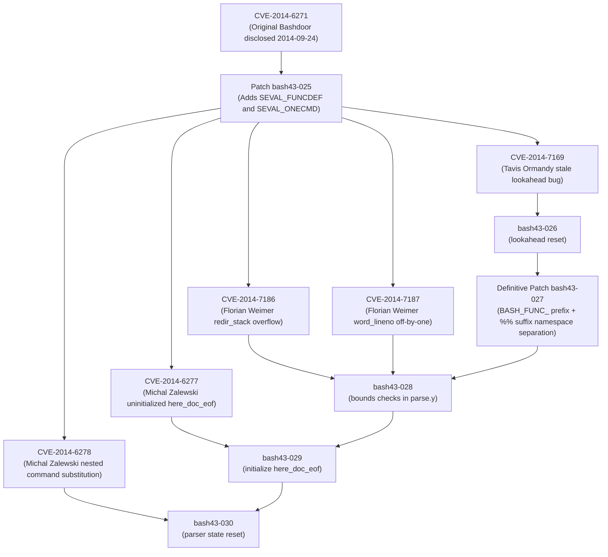

# Shellshock

> [!summary] Claim
> Shellshock is an environment evaluation vulnerability where the GNU Bash environment import routine unconditionally executed arbitrary shell code appended to exported function definitions during process initialization.

Part of [Shell Security](README.md) in [Shell and Unix Engineering](../README.md).

## TL;DR

- Mechanism: GNU Bash scanned inherited environment variables for values starting with `() {` and passed the concatenated name and value directly to `parse_and_execute()`, which parsed the function definition and executed trailing shell commands without bounds.
- Rule: Never invoke a full shell parser on untrusted environment variables; sanitize incoming process environments before executing child interpreters or web helpers.
- Trap: Relying on the initial point patch (`bash43-025`) left systems exposed to parser bypasses such as CVE-2014-7169 (file creation via a stale lookahead character, fixed in `bash43-026`) and CVE-2014-6278 (code execution through nested command substitutions, fixed in `bash43-030`).
- Portability fact: Standard POSIX `export` operates strictly on shell variables without an `-f` flag, and non-Bash shells (dash, zsh, ksh93, mksh, BusyBox ash) never evaluate imported environment variables with a shell parser.
- When not to use it: Never use `export -f` to transmit subroutines across privilege boundaries or network services; serialize structured parameters explicitly via files, pipes, or command-line arguments instead.

## Mental model

```mermaid
flowchart TD
  subgraph Vuln["Vulnerable Path (Bash <= 4.3 patch 24)"]
    A["Untrusted Input<br/>(HTTP Header, DHCP Option, SSH Env)"] --> B["Environment Array envp<br/>('HTTP_USER_AGENT=() { :;}; id')"]
    B --> C["Kernel execve(2)<br/>(Copies raw strings to child stack)"]
    C --> D["Bash initialize_shell_variables()<br/>(Matches STREQN('() {', string, 4))"]
    D --> E["builtins/evalstring.c parse_and_execute()<br/>(Invokes parser without SEVAL_FUNCDEF)"]
    E --> F["Arbitrary Code Execution<br/>(Function defined AND 'id' runs before script)"]
  end

  subgraph Hardened["Hardened Path (Bash >= 4.3 patch 27 / 5.x)"]
    G["Untrusted Input<br/>(HTTP Header, DHCP Option, SSH Env)"] --> H["Environment Array envp<br/>('HTTP_USER_AGENT=() { :;}; id')"]
    H --> I["Kernel execve(2)<br/>(Copies raw strings to child stack)"]
    I --> J["Bash initialize_shell_variables()<br/>(Checks BASH_FUNC_ prefix AND %% suffix)"]
    J --> K["Prefix Mismatch<br/>(Treated strictly as inert string variable)"]
    J --> L["Legitimate Exported Function<br/>('BASH_FUNC_foo%%=() { ...; }')"]
    L --> M["parse_and_execute(SEVAL_FUNCDEF|SEVAL_ONECMD)<br/>(Enforces single function definition; aborts trailing code)"]
  end
```



In the vulnerable path, external network protocols mapped untrusted input strings directly into operating system environment variables across the `execve(2)` process boundary.
When the newly spawned Bash process initialized, its startup routine inspected every environment variable value and treated any string beginning with `() {` as an exported shell function definition.
Because the variable was passed to `parse_and_execute()` with only non-interactive flags, the Bison parser defined the function and then continued parsing and executing every subsequent command word in the string with the ambient authority of the target process.
In the hardened path, Bash enforces strict namespace separation by requiring exported function variable names to start with the prefix `BASH_FUNC_` and terminate with the suffix `%%`.
Variables originating from standard protocols like HTTP CGI cannot match this pattern, so Bash imports them exclusively as passive data strings.
Even when a variable name matches the prefix and suffix, Bash passes `SEVAL_FUNCDEF` and `SEVAL_ONECMD` to `parse_and_execute()`, ensuring that any payload containing trailing commands triggers a fatal parser usage error without executing the injected code.

## How it works

The Unix environment model and shell function architectures collided in GNU Bash to produce Shellshock.
Understanding the root cause requires tracing the lifecycle of environment variables across the kernel boundary, through Bash's startup sequence, into the Bison grammar parser, and across network service adapters.

### 1. The Kernel Environment Boundary: `execve(2)`

The Unix process creation model separates address space duplication (`fork(2)`) from program execution (`execve(2)`).
Under POSIX.1-2024 XSH `execve`:

```c
int execve(const char *pathname, char *const argv[], char *const envp[]);
```

The operating system kernel treats `argv` and `envp` as null-terminated arrays of pointers to null-terminated byte sequences.
The kernel copies these raw bytes onto the new process stack without interpreting shell syntax, control operators, or variable names.
Under POSIX.1-2024 XBD 8.1, the environment variable names used by the standard utilities consist solely of uppercase letters, digits, and underscores, without a leading digit, and applications must tolerate other names.
However, the kernel `execve(2)` system call enforces no such lexical restrictions.
Any NUL-terminated byte string is accepted; even the `key=value` shape is only a convention ([execve(2)](https://man7.org/linux/man-pages/man2/execve.2.html) describes `envp` entries as "conventionally of the form key=value").
The kernel places the strings on the new stack, and the C runtime start-up code points the global `environ` at them before calling `main()`.

### 2. The Architectural Origin of Function Exporting (1989-2014)

POSIX specifies standard environment variables for passing data, but POSIX.1-2024 XCU 2.9.5 and XCU `export` specify no mechanism to export shell functions across `execve(2)` (`export` takes only `-p`).
Standard POSIX subroutines live purely in shell process memory.
The function import code that Shellshock exploited entered GNU Bash 1.03 on August 5, 1989, written by then-maintainer Brian Fox ([David A. Wheeler's Shellshock analysis](https://dwheeler.com/essays/shellshock.html)), so that child shell processes could inherit `export -f` function definitions without re-sourcing script files.
Because Unix kernels provide no native interface for passing structured subroutines across `execve(2)`, Bash serialized functions directly into the string environment array `envp`.
Bash used the function's name as the environment variable key, and prefixed the serialized function body with the four-character sequence `() {`.
For example, exporting a function named `render` produced the environment string:

```text
render=() { echo "rendering"; }
```

When a child Bash process spawned, its variable initialization routine `initialize_shell_variables()` in `variables.c` iterated through `environ`.
Prior to the Shellshock patches, the import logic appeared as follows (excerpt from `variables.c` in the bash-4.3 release tarball, line 352, and the pre-image of `bash43-025`):

```c
/* GNU Bash variables.c (pre-patch initialize_shell_variables) */
if (privmode == 0 && read_but_dont_execute == 0 && STREQN ("() {", string, 4))
  {
    string_length = strlen (string);
    temp_string = (char *)xmalloc (3 + string_length + char_index);

    strcpy (temp_string, name);
    temp_string[char_index] = ' ';
    strcpy (temp_string + char_index + 1, string);

    parse_and_execute (temp_string, name, SEVAL_NONINT|SEVAL_NOHIST);

    /* If the function parse succeeded, mark it as exported and imported */
    if (temp_var = find_function (name))
      {
        VSETATTR (temp_var, (att_exported|att_imported));
        array_needs_making = 1;
      }
  }
```

Bash concatenated the variable name, an ASCII space, and the variable value into `temp_string`, producing a synthetic statement such as `render () { echo "rendering"; }`.
It then invoked `parse_and_execute()` in `builtins/evalstring.c` with flags `SEVAL_NONINT | SEVAL_NOHIST`.

### 3. The CVE-2014-6271 Parser Fall-Through

The fundamental flaw in CVE-2014-6271 lay in the assumptions of `parse_and_execute()`.
In GNU Bash, `parse_and_execute()` is the internal engine that drives `eval` and `bash -c`.
It wraps the input string in a memory buffer, invokes the Bison grammar parser `yyparse()`, builds an abstract syntax tree of `COMMAND *` structs, and executes them in a loop until the string reaches its terminating null byte:

```c
/* Conceptual flow in builtins/evalstring.c */
while (*bash_input.location.string)
  {
    command = parse_command ();
    if (command)
      execute_command (command);
  }
```

When `initialize_shell_variables()` passed `temp_string` to `parse_and_execute()`, it intended only to register a function definition.
However, because no flags restricted the parser to a single command or enforced function definition types, `parse_and_execute()` continued running.
If an attacker supplied an environment variable such as:

```text
x=() { :;}; /bin/cat /etc/passwd
```

`temp_string` became `x () { :;}; /bin/cat /etc/passwd`.
During `yyparse()`, the parser recognized `x () { :;};` as a valid function definition command (POSIX.1-2024 XCU 2.9.5).
The shell executed that command, registering `x` as an empty dummy function in its hash table.
Instead of returning, the evaluation loop immediately parsed the next token sequence: `/bin/cat /etc/passwd`.
The shell invoked `execute_command()` on this secondary command, executing `/bin/cat` with the ambient permissions of the running process.
This execution occurred inside Bash's own start-up, in `shell_initialize()`, which `main()` in `shell.c` calls after `parse_shell_options()` has read the command-line options (which is how `-p` can suppress the import) but before startup files are read, before the `-c` string runs, and before any script named in `argv` is opened (bash 5.3 `shell.c` lines 493, 580, and 722).

### 4. Attack Vectors and Protocol Amplification

Shellshock transformed from a local shell quirk into an internet-wide crisis because multiple standard network protocols translate untrusted user input into environment variables.

#### Vector 1: Common Gateway Interface (CGI 1.1, RFC 3875)
The Common Gateway Interface (RFC 3875 Section 4.1.18) says the server SHOULD set protocol-specific meta-variables, and that each HTTP request header it passes becomes a variable named by converting the field name to uppercase, translating hyphens to underscores, and prepending `HTTP_` (the server is not required to pass every header).
When a web client sends:

```http
GET /cgi-bin/status.sh HTTP/1.1
Host: example.com
User-Agent: () { :;}; /bin/sleep 10
Cookie: () { :;}; echo "Content-Type: text/plain"; echo; /usr/bin/id
```

The web server (such as Apache HTTP Server with `mod_cgi` or `mod_cgid`, Nginx with `fcgiwrap`, or lighttpd) populates the environment table for the child process:

```text
HTTP_USER_AGENT=() { :;}; /bin/sleep 10
HTTP_COOKIE=() { :;}; echo "Content-Type: text/plain"; echo; /usr/bin/id
```

When the web server invoked `execve()` on a shell script starting with `#!/bin/bash`, or when a script in Perl, Python, C, or PHP invoked `system(3)`, `popen(3)`, or backticks, the C library or language runtime ran `/bin/sh -c`.
On Linux distributions where `/bin/sh` was symlinked to `/bin/bash` (such as Red Hat Enterprise Linux, CentOS, Fedora, and Debian/Ubuntu prior to dash migration), Bash initialized its environment.
It parsed `HTTP_USER_AGENT`, executed `/bin/sleep 10`, parsed `HTTP_COOKIE`, output HTTP response headers, and ran `/usr/bin/id`.
This provided unauthenticated remote code execution over HTTP without needing valid credentials or an existing command injection flaw in the web application itself.

#### Vector 2: OpenSSH Forced Commands (`ForceCommand`)
System administrators frequently configure OpenSSH to restrict users to specific actions using `ForceCommand` in `sshd_config` or `command="..."` in `~/.ssh/authorized_keys`.
This pattern is fundamental to Git hosting systems (such as Gitolite and Gitosis), rsync backup endpoints, and administrative jump boxes.
When a user connects, `sshd` prepares the process environment and runs the forced command through the user's login shell with `-c`, placing the command the client asked for in `SSH_ORIGINAL_COMMAND` ([sshd_config(5) `ForceCommand`](https://man.openbsd.org/sshd_config#ForceCommand)):

```sh
# SSH_ORIGINAL_COMMAND holds the client's requested command, verbatim
"$SHELL" -c "$forced_command"
```

The client controls `SSH_ORIGINAL_COMMAND` (and `TERM`, plus any variables allowed by `AcceptEnv` such as `LC_*`), and an unpatched Bash processed those variables before executing the forced command string.
An attacker restricted to `git-receive-pack` could request the command `() { :;}; /bin/sh`, bypassing the authorization layer entirely and getting an unrestricted shell as the restricted account.

#### Vector 3: ISC DHCP Client (`dhclient-script`)
The Internet Systems Consortium (ISC) DHCP client (`dhclient`) receives network configuration parameters from DHCP servers on the local broadcast domain.
When `dhclient` binds an address, it passes protocol options (such as option 114 default URL, option 15 domain name, option 12 host name, and option 119 domain search; option 6 is the DNS server list, RFC 2132 Section 3.8) to `dhclient-script` as environment variables such as `new_domain_name`.
In many Linux distributions, `dhclient-script` was an executable shell script running as `root` with `#!/bin/bash`.
A malicious rogue DHCP server or an attacker on an untrusted Wi-Fi or Ethernet segment could broadcast crafted DHCP options containing `() { :;}; <payload>`.
When the victim machine requested an IP address, `dhclient` executed `dhclient-script`, granting the attacker instant, unauthenticated root code execution.

#### Vector 4: Print Filters, Mail Delivery, and Sudo
Red Hat's Shellshock FAQ for CVE-2014-6271 assessed other services one by one ([Red Hat article 1200223](https://access.redhat.com/articles/1200223)).
It believed CUPS was affected, because various user-supplied values are stored in environment variables when CUPS filters are executed.
It did not believe Postfix could be made to set an arbitrary environment variable, because Postfix replaces various characters with `?`, but noted that a filter run by the mail server could still set one.
Sudo was not affected by default: sudo specifically looks for environment variables that are also functions, although a command it runs can still set one for its own Bash children.
[sudoers(5)](https://www.sudo.ws/docs/man/sudoers.man/) documents the rule: environment variables with a value beginning with `()` are removed unless both the name and the value are matched by `env_keep` or `env_check`, and before sudo 1.8.11 such variables were always removed.

### 5. The Patch Cascade and Secondary Vulnerabilities

Fixing Shellshock proved exceptionally difficult because parser evaluation of untrusted strings is fragile.
A succession of six distinct CVEs emerged in under two weeks: NVD published the records between 2014-09-24 and 2014-09-30, and the last fix, `bash43-030`, shipped on 2014-10-05 ([Wheeler](https://dwheeler.com/essays/shellshock.html)).
Each patch header in the [bash-4.3-patches](https://ftp.gnu.org/gnu/bash/bash-4.3-patches/) directory names its reporter; Bash 3.2 received the same sequence as `bash32-052` through `bash32-057`.



#### CVE-2014-6271 and Patch `bash43-025`
Reported by Stephane Chazelas (the `bash43-025` header credits him, and its `builtins/common.h` change is dated 2014-09-12) and published on September 24, 2014 (NVD).
Chet Ramey issued patch level 25 for Bash 4.3, introducing two new execution control flags in `builtins/evalstring.c` and `builtins/common.h` (values confirmed in the `bash43-025` diff and in bash 5.3 `builtins/common.h` lines 51 and 52):
- `SEVAL_FUNCDEF` (`0x080`): Enforces that the parsed command node must have type `cm_function_def`.
- `SEVAL_ONECMD` (`0x100`): Instructs the evaluation loop to terminate immediately after executing the first parsed command.

If a command did not evaluate to a function definition, Bash output a diagnostic warning (`ignoring function definition attempt`), set the exit code to `EX_BADUSAGE`, and broke out of the evaluation loop.

#### CVE-2014-7169: Parser Redirection and Lookahead Bug
Within hours of the release of `bash43-025`, security researcher Tavis Ormandy demonstrated that the patch was incomplete (the tweet that `bash43-026` cites, status 514887394294652929, decodes to 2014-09-24 21:21 UTC).
The `bash43-026` header describes the flaw: "bash can incorrectly save a lookahead character and return it on a subsequent call, even when reading a new line"; the lexer in `parse.y` did not discard that state after a syntax error inside an imported function definition.
Ormandy's tweet, quoted in the oss-security thread ([oss-sec q3/688](https://seclists.org/oss-sec/2014/q3/688)), read "The bash patch seems incomplete to me, function parsing is still brittle", followed by this proof of concept:

```sh
env X='() { (a)=>\' sh -c "echo date"; cat echo
```

On the Linux distributions of the time `sh` was Bash, so the `sh -c` form reached the vulnerable parser; on a system where `sh` is another shell, run `bash -c` instead.

The payload `(a)=>\` contained a syntax error in the middle of a redirection operator.
The parser failed while processing the function, but left the lookahead token and redirection structure dangling in memory.
When Bash proceeded to evaluate the command string `echo date`, the parser combined the dangling redirection with the new tokens, transforming the execution into `>echo date`.
This evaluated the `date` command and redirected its standard output into a file named literally `echo`.
This allowed remote attackers to overwrite files and write arbitrary data to disk across CGI interfaces.

#### CVE-2014-7186: Here-Document Redirection Stack Overflow
Florian Weimer of Red Hat audited `parse.y` and discovered that Bash queued pending here-documents using a fixed-size internal array:

```c
/* GNU Bash parse.y (before bash43-028) */
static REDIRECT *redir_stack[10];
```

When one command carried more than 10 here-documents awaiting their bodies (for example `true <<EOF <<EOF ...` repeated), the grammar actions stored `redir_stack[need_here_doc++]` without a bounds check, resulting in out-of-bounds pointer writes, memory corruption, and shell crashes; `bash43-028` ("many here-documents attached to a single command") raised the array to `HEREDOC_MAX` (16) and added the check.

#### CVE-2014-7187: Nested Flow-Control Line Number Overflow
Florian Weimer also discovered an off-by-one in `read_token_word()` in `parse.y`, which records the line number of each open loop or `case` word in a static array:

```c
/* GNU Bash parse.y (before bash43-028) */
#define MAX_CASE_NEST 128
static int word_lineno[MAX_CASE_NEST];
static int word_top = -1;
```

The guard allowed `word_top` to reach 128, so the 129th nested `for` loop wrote one element past the end of the array, causing an out-of-bounds write and denial of service (NVD calls it an "off-by-one error"); `bash43-028` enlarged the array to `MAX_CASE_NEST+1`.

#### CVE-2014-6277 and CVE-2014-6278: Two-Stage Parser Command Execution
Security researcher Michal Zalewski (`lcamtuf`) utilized American Fuzzy Lop (AFL) to fuzz Bash's environment parsing routines ([his write-up](https://lcamtuf.blogspot.com/2014/10/bash-bug-how-we-finally-cracked.html)).
CVE-2014-6277 identified an uninitialized memory read and pointer corruption during malformed function imports: `make_redirect()` left the `here_doc_eof` field of a here-document redirection unset when the delimiter was never found, and later code treated it as a valid pointer (`bash43-029`).
More critically, CVE-2014-6278 demonstrated that even with `SEVAL_FUNCDEF` and `SEVAL_ONECMD` active, the parser could still be tricked into running code that followed the function definition.
Zalewski published this payload:

```sh
HTTP_COOKIE='() { _; } >_[$($())] { echo hi mom; id; }' bash -c :
```

In Zalewski's words, "a sequence of nested `$...` statements within a redirect appears to cause the parser to bail out without properly resetting its state, and puts it in the mood for executing whatever comes next", so the trailing `{ echo hi mom; id; }` ran despite the post-parse `SEVAL_FUNCDEF` check; `bash43-030` ("a combination of nested command substitutions and function importing") fixed it.

### 6. The Definitive Fix: Namespace Separation

The security community recognized that exposing a general-purpose Turing-complete parser to untrusted environment values was fundamentally unfixable without strict namespace isolation.
Florian Weimer proposed a defense-in-depth architectural change: decouple the environment variable name from standard identifiers.
Red Hat's interim patch accepted only names beginning with `BASH_FUNC_` and ending with `()`; Chet Ramey adopted the scheme upstream in `bash43-027` (reported-by Florian Weimer) with the suffix changed to `%%` ([Wheeler](https://dwheeler.com/essays/shellshock.html)), and the later patches `bash43-028` through `bash43-030` fixed the remaining parser bugs.

In modern Bash (`variables.c`), function importing is governed by strict prefix and suffix macros (excerpt from bash 5.3 `variables.c` lines 86 to 89 and the import block whose condition ends at line 403, with some comments removed):

```c
/* GNU Bash variables.c */
#define BASHFUNC_PREFIX   "BASH_FUNC_"
#define BASHFUNC_PREFLEN  10  /* strlen(BASHFUNC_PREFIX) */
#define BASHFUNC_SUFFIX   "%%"
#define BASHFUNC_SUFFLEN  2   /* strlen(BASHFUNC_SUFFIX) */

#if defined (FUNCTION_IMPORT)
  /* If exported function, define it now. Don't import functions from
     the environment in privileged mode. */
  if (privmode == 0 && read_but_dont_execute == 0 && 
      STREQN (BASHFUNC_PREFIX, name, BASHFUNC_PREFLEN) &&
      STREQ (BASHFUNC_SUFFIX, name + char_index - BASHFUNC_SUFFLEN) &&
      STREQN ("() {", string, 4))
    {
      size_t namelen;
      char *tname;

      namelen = char_index - BASHFUNC_PREFLEN - BASHFUNC_SUFFLEN;
      tname = name + BASHFUNC_PREFLEN;
      tname[namelen] = '\0';

      string_length = strlen (string);
      temp_string = (char *)xmalloc (namelen + string_length + 2);

      memcpy (temp_string, tname, namelen);
      temp_string[namelen] = ' ';
      memcpy (temp_string + namelen + 1, string, string_length + 1);

      if (absolute_program (tname) == 0 && (posixly_correct == 0 || valid_identifier (tname)))
        parse_and_execute (temp_string, tname, SEVAL_NONINT|SEVAL_NOHIST|SEVAL_FUNCDEF|SEVAL_ONECMD);
      else
        free (temp_string);

      if (temp_var = find_function (tname))
        {
          VSETATTR (temp_var, (att_exported|att_imported));
          array_needs_making = 1;
        }
      else
        {
          if (temp_var = bind_invalid_envvar (name, string, 0))
            {
              VSETATTR (temp_var, (att_exported | att_imported | att_invisible));
              array_needs_making = 1;
            }
          last_command_exit_value = EXECUTION_FAILURE;
          report_error (_("error importing function definition for `%s'"), tname);
        }

      tname[namelen] = BASHFUNC_SUFFIX[0];
    }
  else
#endif /* FUNCTION_IMPORT */
```

This implementation establishes multiple defense boundaries:
1. Name isolation:
An environment variable is only checked for function import if its key starts with `BASH_FUNC_` and ends with `%%`.
Because RFC 3875 prepends `HTTP_` to every header-derived name, HTTP requests can never create a variable starting with `BASH_FUNC_`; the prefix is what protects CGI, since HTTP field names may themselves contain `%` (`tchar` in [RFC 9110 Section 5.6.2](https://www.rfc-editor.org/rfc/rfc9110#section-5.6.2)).
2. Value verification:
The variable value must still begin with `() {`.
3. Privileged mode immunity:
If `privmode != 0` (the shell is invoked with `-p`, the effective UID or GID differs from the real one, or the shell is restricted), Bash completely disables function importation; `shell_initialize()` passes `privileged_mode||restricted||should_be_restricted||running_setuid` (bash 5.3 `shell.c` line 1963).
4. Execution confinement:
The extracted function string is evaluated with `SEVAL_NONINT | SEVAL_NOHIST | SEVAL_FUNCDEF | SEVAL_ONECMD`, terminating execution if any command other than a single function definition is encountered.

## Numbers and limits

The following limits, buffer bounds, and metrics govern Shellshock, environment variable passing, and Bash function export mechanisms.

| Metric / Parameter | Value / Limit | Source / Verification | Description |
| :--- | :--- | :--- | :--- |
| Latency to Discovery | 25 years | August 5, 1989 to September 12, 2014 | Time elapsed from Brian Fox's Bash 1.03 commit to Stephane Chazelas's disclosure |
| CVE-2014-6271 CVSS v3.1 | 9.8 (Critical) | NVD / NIST Record | Base Score: `CVSS:3.1/AV:N/AC:L/PR:N/UI:N/S:U/C:H/I:H/A:H` |
| CVE-2014-7169 CVSS v3.1 | 9.8 (Critical) | NVD / NIST Record | Base Score: `CVSS:3.1/AV:N/AC:L/PR:N/UI:N/S:U/C:H/I:H/A:H` |
| CVE-2014-6278 CVSS v3.1 | 8.8 (High) | NVD record, CISA ADP score (NVD's own score is CVSS v2 10.0) | Base Score: `CVSS:3.1/AV:N/AC:L/PR:N/UI:R/S:U/C:H/I:H/A:H` |
| `BASHFUNC_PREFIX` Length | 10 bytes | bash 5.3 `variables.c` line 87 (`BASHFUNC_PREFLEN`) | ASCII string length of `"BASH_FUNC_"` required on modern imported function keys |
| `BASHFUNC_SUFFIX` Length | 2 bytes | bash 5.3 `variables.c` line 89 (`BASHFUNC_SUFFLEN`) | ASCII string length of `"%%"` required on modern imported function keys |
| Legacy Ephemeral Suffix | 2 bytes | Fedora / RHEL interim patch (`"()"`, per Wheeler) | Early non-standardized patch suffix before upstream settled on `"%%"` |
| Function Signature Length | 4 bytes | bash 5.3 `variables.c` line 403 (`STREQN("() {", string, 4)`) | Minimum magic byte prefix required in environment values for function recognition |
| `redir_stack` Array Limit | 10 pointers | `parse.y` before `bash43-028` (CVE-2014-7186) | Maximum pending here-documents on one command before out-of-bounds parser corruption; now `HEREDOC_MAX` 16 with a check |
| `word_lineno` Array Limit | 128 integers | `parse.y` before `bash43-028` (CVE-2014-7187) | `MAX_CASE_NEST` entries, but the guard let index 128 be written (off-by-one at the 129th nested loop); now `MAX_CASE_NEST+1` |
| `VARIABLES_HASH_BUCKETS` | 1024 buckets | bash 5.3 `variables.c` line 82 | Internal hash table bucket count for shell variables (must be power of two) |
| `FUNCTIONS_HASH_BUCKETS` | 512 buckets | bash 5.3 `variables.c` line 83 | Internal hash table bucket count for imported and user-defined functions |
| Linux `ARG_MAX` Environment Limit | 2,097,152 bytes | Linux 2.6.23+ (`RLIMIT_STACK / 4`; `getconf ARG_MAX` measured on Debian 13 with an 8 MiB stack, as of 2026-11) | Total maximum size of `argv` plus `envp` passed across `execve(2)` by default |
| macOS `ARG_MAX` Environment Limit | 1,048,576 bytes | Measured via `getconf ARG_MAX` (macOS 27.3, as of 2026-11) | Total maximum size of `argv` plus `envp` passed across `execve(2)` on Darwin |
| POSIX Pipe Buffer Atomicity | 512 / 4096 bytes | `PIPE_BUF` (POSIX minimum and macOS / Linux; `getconf PIPE_BUF /` measured) | Atomic write limit for standard stream redirection and command evaluation pipes |

## Portability

The table below summarizes function export behavior, environment evaluation across `execve(2)`, and Shellshock vulnerability status across shells and standard userlands.
Every row for a current shell was measured in the shell matrix (Debian 13 and Alpine 3.22 images plus the macOS host, as of 2026-11): `f(){ ...; }; export -f f`, then `env 'BASH_FUNC_f%%=() { echo func-ok; }' SHELL -c 'f'` and a check of whether the child's `env` still lists the variable, then `env 'x=() { :;}; echo INJECTED' SHELL -c 'echo COMPLETED'`; no current shell printed `INJECTED`.
The legacy and pre-patch rows rest on the `bash43-025` diff and the NVD records.
The `export-f`, `modern-import`, and `name-passthrough` tests in the lab assert the per-shell cells for export, import, and pass-through; only the Bash 3.2.57 host run is shown in the Worked example.

| Shell / Implementation | Export Function Syntax | Environment Encoding Across `execve` | Parses Arbitrary Env Vars as Functions | Vulnerable to CVE-2014-6271 | Modern Hardening Mechanism |
| :--- | :--- | :--- | :--- | :--- | :--- |
| POSIX.1-2024 `sh` | None (`export` lacks `-f`) | Functions not exported across `execve` | No | No | Conforms to XCU `export`; environment inheritance restricted to variables |
| GNU Bash < 4.3.25 | `export -f name` | `name=() { ...; }` | Yes (checks `() {` in value) | Yes (CVSS 9.8) | None (unhardened legacy implementation) |
| macOS Bash 3.2.57 (as of 2026-11) | `export -f name` | `BASH_FUNC_name%%=() { ...; }` | No (requires prefix and suffix) | No (patch level 57 includes upstream `bash32-052` to `bash32-057`) | Enforces `BASH_FUNC_` prefix, `%%` suffix, and `SEVAL_FUNCDEF`; trailing code measured as rejected; drops in `-p` |
| GNU Bash 5.2 / 5.3 (5.2.37 in the Debian and Alpine images, 5.3.15 on the host, as of 2026-11) | `export -f name` | `BASH_FUNC_name%%=() { ...; }` | No (requires prefix and suffix) | No (Patched upstream) | Enforces `BASH_FUNC_` prefix, `%%` suffix, `SEVAL_FUNCDEF`, and `SEVAL_ONECMD` |
| Zsh (native 5.9, as of 2026-11) | None (`export -f` fails with "invalid option(s)" on Debian and Alpine; macOS `/bin/zsh` 5.9 accepts it and only prints the definition) | Functions not exported across `execve` | No (ignores `BASH_FUNC_`, passes it on unchanged) | No | Does not parse environment variables as code; uses `fpath` for autoloading |
| Zsh (`--emulate sh`, as of 2026-11) | None (`export -f` fails) | Functions not exported across `execve` | No (ignores `BASH_FUNC_`, passes it on unchanged) | No | Emulation preserves native memory model; no environment function execution |
| Dash 0.5.12 (as of 2026-11) | None (`export: Illegal option -f`) | Functions not exported across `execve` | No (drops the invalid name `BASH_FUNC_f%%` from the environment it passes on) | No | Minimal POSIX execution engine; zero parser invocations during startup |
| KornShell 93 (93u+ / 93u+m 1.0.10, as of 2026-11) | `typeset -xf name` (accepted; `export -f` is an unknown option) | Functions not serialized to `envp` (a child `ksh -c name` gives "not found") | No (ignores `BASH_FUNC_`, passes it on unchanged) | No | Uses `FPATH` directory indexing; never evaluates functions from environment strings |
| Mksh R59 (2020/10/31 Alpine, 2025/04/26 Debian, as of 2026-11) | None (`export: -f: unknown option`) | Functions not exported across `execve` | No (drops the invalid name from the environment it passes on) | No | Pure string environment import without parser invocation |
| Yash 2.58.1 (as of 2026-11) | None (`export -f` fails: "the -f option cannot be used with the -x option") | Functions not exported across `execve` | No (ignores `BASH_FUNC_`, passes it on unchanged) | No | Strictly adheres to POSIX variable semantics during startup |
| Posh 0.14.1 (as of 2026-11) | None (`export: invalid option -- 'f'`) | Functions not exported across `execve` | No (drops the invalid name from the environment it passes on) | No | Stripped Debian policy checking shell; no function serialization |
| BusyBox ash 1.37.0 (as of 2026-11) | None (`export: illegal option -f`) | Functions not exported across `execve` | No (Alpine passes the invalid name on; Debian's build drops it) | No | Embedded Almquist derivative; environment variables imported as plain strings |

## Worked example

The probe [shellshock-probe.sh](../labs/17-shellshock/shellshock-probe.sh) in [lab](../labs/17-shellshock/) takes a mode and the shell under test (default `sh`), starts that shell as a child with a crafted environment, and prints one `mode:result` line.
Its nine modes cover function export, legacy value syntax, unprefixed function variables, prefixed import, trailing-code rejection, the `-p` drop, the CVE-2014-7169 and CVE-2014-6278 payloads, invalid-name pass-through, and RFC 3875 header mapping.
The parser-bypass mode swaps Zalewski's `echo hi mom; id` for `printf RAN%s 42`, because a patched Bash echoes the rejected source line in its diagnostic and only the executed form prints `RAN42`.
It cannot show a vulnerable result on a patched system, so the `vulnerable`, `imported`, `file-created`, and `code-ran` branches are untested here; they exist so that a run against an old Bash would report the failure.

Here is the complete source of `shellshock-probe.sh`:

```sh
#!/bin/sh
# shellshock-probe.sh: audit shell function export, import, and environment evaluation boundaries.
#
# Usage:
#   shellshock-probe.sh MODE [SHELL [ARG...]]
#
# SHELL is the shell under test (default: sh); every mode starts it as a child with a crafted
# environment, so the answer describes that shell, not the shell that runs this script.
#
#   export-f            does `export -f` put BASH_FUNC_name%% in the environment of a child
#   legacy-import       does a `() {` value in an unprefixed variable run trailing code
#   legacy-name         is a function defined in an unprefixed variable (name=() { ...; }) imported
#   modern-import       is BASH_FUNC_name%%=() { ...; } imported as a function
#   trailing-rejection  is code appended after a BASH_FUNC_name%% definition refused
#   privmode-drop       does -p drop the import that works without -p
#   parser-bypass       do the CVE-2014-7169 and CVE-2014-6278 payloads still misbehave
#   name-passthrough    does the shell pass an invalid name such as BASH_FUNC_name%% to children
#   cgi-header          is an RFC 3875 header-derived variable kept as pure data
set -u

mode=${1:-help}
if [ "$#" -gt 0 ]; then
  shift
fi
if [ "$#" -eq 0 ]; then
  set -- sh
fi

case $mode in
  export-f)
    # The child shell defines and exports a function, then lists its own environment.
    out=$(
      "$@" -c '
        lab_test_fn() { printf "active\n"; }
        export -f lab_test_fn 2>/dev/null
        env
      ' 2>/dev/null
    )
    case $out in
      *'BASH_FUNC_lab_test_fn%%='*)
        printf 'export-f:supported\n'
        ;;
      *)
        printf 'export-f:unsupported\n'
        ;;
    esac
    ;;

  legacy-import)
    # In unpatched Bash <= 4.3 patch 24 this printed INJECTED before COMPLETED.
    raw_out=$(
      env x='() { :;}; printf "INJECTED\n"' "$@" -c 'printf "COMPLETED\n"' 2>&1
    )
    case $raw_out in
      *INJECTED*)
        printf 'legacy-import:vulnerable\n'
        ;;
      *COMPLETED*)
        printf 'legacy-import:safe\n'
        ;;
      *)
        printf 'legacy-import:error\n'
        ;;
    esac
    ;;

  legacy-name)
    # Unpatched Bash imported any variable whose value began with "() {" as a function.
    res=$(
      env 'lab_fn=() { printf "func-ok\n"; }' "$@" -c 'lab_fn' 2>/dev/null
    )
    case $res in
      func-ok)
        printf 'legacy-name:imported\n'
        ;;
      *)
        printf 'legacy-name:ignored\n'
        ;;
    esac
    ;;

  modern-import)
    res=$(
      env 'BASH_FUNC_lab_fn%%=() { printf "func-ok\n"; }' "$@" -c 'lab_fn' 2>/dev/null
    )
    case $res in
      func-ok)
        printf 'modern-import:imported\n'
        ;;
      *)
        printf 'modern-import:ignored\n'
        ;;
    esac
    ;;

  trailing-rejection)
    # Bash 4.3 patch 25 and later refuse the whole value when anything follows the definition.
    out=$(
      env 'BASH_FUNC_lab_fn%%=() { :; }; printf "INJECTED\n"' "$@" -c ':' 2>&1
    )
    case $out in
      *INJECTED*)
        printf 'trailing-rejection:vulnerable\n'
        ;;
      *'error importing function definition'*)
        printf 'trailing-rejection:rejected\n'
        ;;
      *)
        printf 'trailing-rejection:ignored\n'
        ;;
    esac
    ;;

  privmode-drop)
    # The control run without -p must import the function, or the -p run proves nothing.
    plain=$(
      env 'BASH_FUNC_lab_fn%%=() { printf "func-ok\n"; }' "$@" -c 'lab_fn' 2>/dev/null
    )
    priv=$(
      env 'BASH_FUNC_lab_fn%%=() { printf "func-ok\n"; }' "$@" -p -c 'lab_fn' 2>/dev/null
    )
    case $plain:$priv in
      func-ok:func-ok)
        printf 'privmode:imported\n'
        ;;
      func-ok:*)
        printf 'privmode:dropped\n'
        ;;
      *)
        printf 'privmode:no-import\n'
        ;;
    esac
    ;;

  parser-bypass)
    # Run the CVE-2014-7169 and CVE-2014-6278 payloads both prefixed (reaching the parser in a
    # patched Bash) and unprefixed (the pre-patch shape), in a scratch directory.
    # The 6278 payload prints RAN42 from printf RAN%s 42: the diagnostic that echoes the rejected
    # source line contains the text "RAN%s 42" but never "RAN42", so only execution matches.
    tmp=$(mktemp -d "${TMPDIR:-/tmp}/shellshock-probe.XXXXXX") || exit 1
    out7169=clean
    out6278=clean
    for name in 'BASH_FUNC_x%%' X; do
      (cd "$tmp" && env "$name=() { (a)=>\\" "$@" -c 'echo date' >/dev/null 2>&1)
      if [ -e "$tmp/echo" ]; then
        out7169=file-created
      fi
      leak=$(
        cd "$tmp" && env "$name=() { _; } >_[\$(\$())] { printf RAN%s 42; }" "$@" -c ':' 2>&1
      )
      case $leak in
        *RAN42*)
          out6278=code-ran
          ;;
        *)
          :
          ;;
      esac
    done
    rm -f "$tmp/echo"
    rmdir "$tmp"
    printf 'parser-bypass:7169=%s 6278=%s\n' "$out7169" "$out6278"
    ;;

  name-passthrough)
    # Names that are not valid shell identifiers are handled differently by each shell.
    out=$(
      env 'BASH_FUNC_lab_fn%%=() { :; }' "$@" -c 'env' 2>/dev/null
    )
    case $out in
      *'BASH_FUNC_lab_fn%%='*)
        printf 'name-passthrough:passed\n'
        ;;
      *)
        printf 'name-passthrough:dropped\n'
        ;;
    esac
    ;;

  cgi-header)
    # RFC 3875 maps the header User-Agent to HTTP_USER_AGENT, which no shell treats as a function.
    payload='() { :;}; printf "INJECTED\n"'
    val=$(
      # shellcheck disable=SC2016 # expansion belongs to the child shell
      env "HTTP_USER_AGENT=$payload" "$@" -c 'printf "%s" "$HTTP_USER_AGENT"' 2>/dev/null
    )
    printf 'cgi-header:data=%s\n' "$val"
    ;;

  help | *)
    printf 'usage: shellshock-probe.sh {export-f|legacy-import|legacy-name|modern-import|trailing-rejection|privmode-drop|parser-bypass|name-passthrough|cgi-header} [SHELL [ARG...]]\n' >&2
    exit 2
    ;;
esac
```

Executing `shellshock-probe.sh` across all probe modes on a modern, patched system produces the following output (captured on the macOS host, where `/bin/sh` is Bash 3.2.57):

```text
$ labs/17-shellshock/shellshock-probe.sh export-f
export-f:supported

$ labs/17-shellshock/shellshock-probe.sh legacy-import
legacy-import:safe

$ labs/17-shellshock/shellshock-probe.sh legacy-name
legacy-name:ignored

$ labs/17-shellshock/shellshock-probe.sh modern-import
modern-import:imported

$ labs/17-shellshock/shellshock-probe.sh trailing-rejection
trailing-rejection:rejected

$ labs/17-shellshock/shellshock-probe.sh privmode-drop
privmode:dropped

$ labs/17-shellshock/shellshock-probe.sh parser-bypass
parser-bypass:7169=clean 6278=clean

$ labs/17-shellshock/shellshock-probe.sh name-passthrough
name-passthrough:passed

$ labs/17-shellshock/shellshock-probe.sh cgi-header
cgi-header:data=() { :;}; printf "INJECTED\n"
```

Running the corresponding test suite [test.bats](../labs/17-shellshock/test.bats) under Bats 1.14.0 on the macOS host (`/bin/sh` is Bash 3.2.57) reports the nine assertions below.
Each test starts the shell under test as the child, so under another shell the same file asserts that shell's measured values; only the host run is shown here, and the other shells' expectations come from the Portability measurements.

```text
$ bats labs/17-shellshock/test.bats
1..9
ok 1 export-f puts BASH_FUNC_name%% in the environment only under bash
ok 2 legacy value syntax in an unprefixed variable does not execute injected commands
ok 3 an unprefixed variable holding a function definition is not imported
ok 4 modern BASH_FUNC_%% imports functions under bash but is ignored by POSIX shells
ok 5 trailing commands after BASH_FUNC_%% definitions are rejected without execution
ok 6 privileged mode (-p) drops the function import that works without -p
ok 7 the CVE-2014-7169 and CVE-2014-6278 payloads do nothing in the shell under test
ok 8 an invalid environment name such as BASH_FUNC_name%% is passed on or dropped per shell
ok 9 RFC 3875 CGI HTTP header mapping preserves injected strings as literal data
```

## Pitfalls

> [!warning] Pitfall 1: Unsanitized Protocol-to-Environment Mapping (CGI and RFC 3875)
>
> Trigger: Configuring web servers (Apache HTTP Server `mod_cgi`, Nginx `fcgiwrap`, lighttpd) to pass untrusted HTTP request headers directly into CGI process environment blocks.
>
> Symptom: Remote unauthenticated code execution running under the web server user identity (`www-data`, `apache`, or `nobody`) the instant any shell script or child process executes.
>
> Incident: In September 2014, within days of CVE-2014-6271 disclosure, automated botnets scanned IPv4 space targeting `/cgi-bin/` endpoints via crafted `User-Agent` and `Referer` headers; one, dubbed "wopbot", actively scanned and attacked systems at Akamai and the U.S. Department of Defense ([Wheeler](https://dwheeler.com/essays/shellshock.html)).
>
> Fix: Eliminate legacy CGI gateways in favor of typed application servers (FastCGI, WSGI, ASGI) that pass request metadata over structured binary protocols; ensure `/bin/sh` links to `dash` or a minimal POSIX shell; sanitize or drop unneeded environment variables before invoking child processes.

> [!warning] Pitfall 2: Bypassing OpenSSH `ForceCommand` and Authorized Keys Restrictions
>
> Trigger: Relying on OpenSSH `ForceCommand` or `~/.ssh/authorized_keys` `command="..."` to restrict users to administrative menus, `git-shell`, or rsync, while assigning Bash as the user login shell.
>
> Symptom: Restricted remote users bypass command whitelists and gain arbitrary interactive root or shell execution.
>
> Incident: The CVE-2014-6271 NVD record names the OpenSSH `ForceCommand` feature as an attack vector: on Git hosting setups (such as Gitolite) and other forced-command accounts, the client's requested command lands in `SSH_ORIGINAL_COMMAND`, and a value like `() { :;}; /bin/sh` ran before the forced command could validate it.
>
> Fix: Restrict `AcceptEnv` in `/etc/ssh/sshd_config` to explicitly validated variables; configure restricted user accounts with dedicated static binaries (such as `/usr/bin/git-shell`) as their login shells in `/etc/passwd` instead of general-purpose shells; use `no-pty` in authorized keys.

> [!warning] Pitfall 3: Rogue DHCP Servers Achieving Unauthenticated Root Compromise
>
> Trigger: Client workstations or cloud instances running ISC DHCP client (`dhclient`) with default configuration scripts written in GNU Bash (`/etc/dhcp/dhclient-script`).
>
> Symptom: Instant root compromise when connecting to an untrusted local area network or rogue Wi-Fi access point without user interaction.
>
> Incident: The CVE-2014-6271 NVD record lists scripts executed by DHCP clients as an attack vector: `dhclient` exported server-supplied DHCP options (including option 114 URL and option 15 domain name) directly to `dhclient-script` environment variables, allowing attackers on the local Ethernet segment to achieve remote root execution (Red Hat tracked the flaw as [Bugzilla entry 1141597](https://bugzilla.redhat.com/show_bug.cgi?id=1141597), titled "CVE-2014-6271 bash: specially-crafted environment variables can be used to inject shell commands").
>
> Fix: Upgrade GNU Bash to patch level `bash43-030` or later (the level that closes all six CVEs); rewrite network configuration scripts in pure POSIX `sh` without Bash extensions; sanitize all network-received options before exporting them to child environments.

> [!warning] Pitfall 4: Relying on Incomplete Parser Hotfixes (CVE-2014-7169 and CVE-2014-6278)
>
> Trigger: Applying only the initial point patch (`bash43-025`) without deploying the prefix-suffix namespace separation patch (`bash43-027`) and the parser fixes through `bash43-030`.
>
> Symptom: Systems remain vulnerable to arbitrary file overwrites via a stale parser lookahead (CVE-2014-7169) and secondary command execution via nested command substitutions in a redirection (CVE-2014-6278).
>
> Incident: Security researcher Tavis Ormandy demonstrated arbitrary file overwrite capability hours after the initial patch; Michal Zalewski subsequently published working proof-of-concept exploits bypassing `SEVAL_FUNCDEF` with nested command substitutions inside a redirection that left the parser state unreset (`() { _; } >_[$($())] { ... }`).
>
> Fix: Verify that installed Bash packages include the definitive `BASH_FUNC_<name>%%` namespace separation patch; confirm that `env x='() { :;}; echo vuln' bash -c :` and `env 'BASH_FUNC_x%%=() { :;}; echo vuln' bash -c :` both fail safely without outputting `vuln`; the lab's `legacy-import`, `trailing-rejection`, and `parser-bypass` modes automate the same checks.

> [!warning] Pitfall 5: Assuming Setuid Binaries and Sudo Are Insulated from Environment Traps
>
> Trigger: Invoking Bash under `sudo` with `env_reset` disabled or with an `env_keep` pattern that names a function variable, or running legacy setuid wrappers without stripping inherited environment blocks.
>
> Symptom: Local privilege escalation from an unprivileged user to `root`.
>
> Incident: No sudo incident is documented here, and the sources argue against assuming one: Red Hat's FAQ states that commands run via sudo are not affected by CVE-2014-6271, and sudoers(5) removes variables whose value begins with `()` unless both name and value are matched by `env_keep` or `env_check` (always removed before sudo 1.8.11).
> The documented residue is administrator-made: sudoers(5) shows `env_keep += "BASH_FUNC_my_func%%=()*"` as the pattern that would preserve a function, and with `env_reset` disabled only `env_check` and `env_delete` filter anything (since sudo 1.8.21 a pattern in `env_delete` matches Bash functions).
>
> Fix: Ensure `env_reset` is active in `/etc/sudoers` (the default in modern sudo); invoke Bash with `-p` (privileged mode) which unconditionally disables function importation; avoid interpreted setuid scripts entirely as detailed in [[Dropping-Privileges]] and [[setuid-and-Interpreted-Scripts]].

## Security and robustness

Shellshock is a textbook violation of boundary separation between code and data.
When designing secure systems, apply the following principles:

1. Environment variables are an untrusted input surface:
Processes inherit environment variables across `execve(2)` from the caller.
The caller controls the length, keys, values, and ordering of environment strings.
A secure program must treat `environ` with the same skepticism as an untrusted network socket or command-line vector.

2. Macro processors are unsafe protocol parsers:
The Unix shell is a string-substitution macro processor, not a typed application runtime.
Passing untrusted network data through a shell parser inevitably creates injection opportunities through parameter expansion, arithmetic evaluation, or grammar edge cases.
Web servers and daemon helpers must never invoke a shell parser to handle raw network input.

3. System shell decoupling:
System daemons and utility scripts should invoke `/bin/sh` rather than `/bin/bash`.
On modern operating systems, `/bin/sh` should resolve to `dash` (Debian/Ubuntu) or BusyBox `ash` (Alpine Linux).
These shells do not implement function exporting, have no Bison parser in their environment import loop, and present an order-of-magnitude smaller attack surface.

4. Privileged mode hardening:
Whenever a script runs with elevated privileges (such as via `sudo` or setuid wrappers), it must invoke Bash with `-p` or execute `set -p`.
In privileged mode, Bash reads no startup files (so `BASH_ENV` and `ENV` are ignored), disables function importation from `BASH_FUNC_...%%`, and ignores `SHELLOPTS`, `BASHOPTS`, `CDPATH`, and `GLOBIGNORE` from the environment.
Per bash(1), the same protections apply automatically when Bash starts with effective IDs that differ from the real IDs and `-p` is not given, and then Bash also resets the effective user ID to the real one; `-p` is what keeps the effective ID, and `set +p` later resets it.

## The principal's view

At staff-plus and principal engineering levels, Shellshock is evaluated not as a single bug in Bash, but as an architectural failure resulting from conflating the control channel with the data channel.

For 25 years, Bash prioritized interactive developer convenience over interface security.
Exporting functions across `execve(2)` without re-sourcing dotfiles was convenient for interactive users spawning subshells.
However, implementing that convenience by executing an arbitrary-length string inside an unconstrained macro parser on every process startup introduced systemic vulnerability across the entire Unix infrastructure.

The principal engineer's rules for Unix systems architecture:

1. Ban shell intermediaries on network boundaries:
Web gateways, API proxies, and microservices must execute application handlers directly via typed `execve(2)` wrappers rather than through intermediate shell pipelines (`sh -c`).
If a script interpreter must be launched, pass arguments strictly as positional vectors in `argv`, never as serialized scripts or dynamically constructed environment variables.

2. Enforce minimal execution environments:
Production container images and hardened virtual machine appliances should omit GNU Bash unless it is explicitly required by complex deployment orchestration.
Standardizing production base images on Alpine Linux (BusyBox) or minimal Debian (Dash) eliminates Bash-specific parser attack surfaces by design.

3. Use explicit serialization for state propagation:
When subroutines or application state must cross process boundaries, pass structured data (JSON, Protocol Buffers, or key-value pairs) over private Unix domain sockets or file descriptors.
Never rely on shell function export mechanisms to distribute business logic to child processes.

## Interview questions

> [!question] L5: What was the root cause of CVE-2014-6271 (Shellshock) in GNU Bash?
>
> > [!success]- Answer
> > GNU Bash allowed functions to be exported to child processes by encoding them into environment variables starting with `() {`.
> > During startup, `initialize_shell_variables()` scanned `environ` and passed any variable whose value began with `() {` to `parse_and_execute()`.
> > Because `parse_and_execute()` lacked flags restricting execution to function definitions or limiting execution to a single command, it parsed the function definition and then unconditionally executed any trailing commands appended to the string.
> > These trailing commands executed immediately with the privileges of the running shell process, during `shell_initialize()`, after option parsing but before the script or the `-c` string ran.
> >
> > Follow-up: Why were other shells like Dash, Zsh, and Ksh93 immune to this vulnerability?

> [!question] L5: How did RFC 3875 (CGI 1.1) turn Shellshock into a critical remote code execution flaw?
>
> > [!success]- Answer
> > RFC 3875 Section 4.1.18 specifies that the client HTTP request headers a web server passes become environment variables prefixed with `HTTP_`.
> > An unauthenticated remote attacker could send an HTTP request with a header like `User-Agent: () { :;}; /bin/id`.
> > The web server mapped this header to `HTTP_USER_AGENT="() { :;}; /bin/id"` in the environment of the CGI process.
> > When the web server executed a CGI script written in Bash, or when a script in another language invoked `/bin/sh` (symlinked to Bash), Bash evaluated the environment variable on startup and executed the attacker's payload.
> >
> > Follow-up: Could an attacker achieve remote code execution if the CGI script was written in C or Perl?

> [!question] L6: Predict the output of the following command on a vulnerable Bash 4.3 shell versus a modern patched Bash 5.3 shell:
> ```sh
> env 'BASH_FUNC_test_fn%%=() { :; }; echo INJECTED' bash -c 'test_fn'
> ```
>
> > [!success]- Answer
> > On an unpatched legacy Bash 4.3 shell (prior to patch 25), the old importer checks only the value, so it parses `BASH_FUNC_test_fn%% () { :; }; echo INJECTED`: it defines a function literally named `BASH_FUNC_test_fn%%` (a valid function name outside POSIX mode, as `bash -c 'BASH_FUNC_x%% () { :; }; declare -F'` shows) and prints `INJECTED`, after which `test_fn` itself is not found.
> > On a modern patched Bash 5.3 shell, the shell inspects `BASH_FUNC_test_fn%%` and invokes `parse_and_execute()` with `SEVAL_FUNCDEF | SEVAL_ONECMD`.
> > The whole string parses as one list, so the first command is a `cm_connection`, not a `cm_function_def`; Bash prints `warning: test_fn: ignoring function definition attempt` and ``error importing function definition for `test_fn'`` on stderr and defines nothing.
> > The string `INJECTED` is never printed, and the subsequent `test_fn` invocation outputs `bash: line 1: test_fn: command not found` with exit status 127 (measured with Bash 5.3.15; the 127 comes from the failed command lookup, not from the import).
> >
> > Follow-up: What error code does `parse_and_execute()` assign when `SEVAL_FUNCDEF` is violated?

> [!question] L6: Explain why the initial patch for CVE-2014-6271 (`bash43-025`) failed, leading to CVE-2014-7169.
>
> > [!success]- Answer
> > Patch `bash43-025` added `SEVAL_FUNCDEF` and `SEVAL_ONECMD` to stop `parse_and_execute()` after defining a function, but it still passed untrusted environment values to the Bison grammar parser.
> > Security researcher Tavis Ormandy demonstrated that a syntax error inside a redirection construct (`() { (a)=>\`) caused the parser to fail while leaving a saved lookahead character and dangling redirection state behind (the `bash43-026` description).
> > When Bash subsequently parsed the actual command string specified in `argv` (`sh -c "echo date"` in Ormandy's tweet), the dangling redirection combined with the new tokens to form `>echo date`.
> > This evaluated the `date` command and redirected its standard output to create a file named `echo`, proving that arbitrary file creation and command redirection remained possible without full code execution.
> >
> > Follow-up: How did CVE-2014-6278 bypass the `SEVAL_FUNCDEF` check?

> [!question] L6: Debug this script: Why does an attacker break out of this OpenSSH restricted backup account, and how do you fix it?
> ```text
> # /etc/passwd
> backupuser:x:1005:1005:Backup:/home/backupuser:/bin/bash
> 
> # /home/backupuser/.ssh/authorized_keys
> command="/usr/bin/rdiff-backup --server",no-port-forwarding,no-X11-forwarding ssh-ed25519 AAAAC3... backup@client
> ```
>
> > [!success]- Answer
> > The account uses `/bin/bash` as its login shell, meaning OpenSSH executes `/bin/bash -c "/usr/bin/rdiff-backup --server"` when the client connects.
> > If Bash is unpatched, the client controls `SSH_ORIGINAL_COMMAND` (set to whatever command it requested), `TERM`, and any variables OpenSSH accepts through `AcceptEnv` (such as `LC_*`), so a value containing a function definition will execute arbitrary code during Bash startup before `rdiff-backup` runs.
> > To fix this vulnerability, change the user's login shell in `/etc/passwd` to a dedicated non-shell binary or a dedicated compiled wrapper.
> > Furthermore, ensure `/etc/ssh/sshd_config` disables `AcceptEnv`, and add `no-pty,no-user-rc` to the authorized keys options list.
> >
> > Follow-up: Why does `ForceCommand` fail to insulate against environment evaluation flaws?

> [!question] L7: How does modern Bash's `BASH_FUNC_<name>%%` naming convention prevent exploitation across RFC 3875 CGI gateways?
>
> > [!success]- Answer
> > RFC 3875 Section 4.1.18 specifies that HTTP request headers are converted to environment variables by prepending `HTTP_`, converting characters to uppercase, and replacing hyphens with underscores.
> > Under this conversion specification, every header-derived name begins with `HTTP_`; the rest is the uppercased field name, which as an HTTP `tchar` token may still contain characters such as `%`, `!`, or `.` (RFC 9110 Section 5.6.2).
> > Modern GNU Bash requires that any environment variable intended for function importation must begin with the prefix `BASH_FUNC_` and end with the suffix `%%`.
> > Because an HTTP client cannot cause a web server to create an environment variable name starting with `BASH_FUNC_`, the incoming request headers can never match the function import check in `variables.c`; the prefix, not the `%%` suffix, is what closes the CGI vector.
> > Bash consequently treats all incoming HTTP headers strictly as ordinary string variables, never passing their values to `parse_and_execute()`.
> >
> > Follow-up: Does the POSIX standard permit percent signs (`%`) in environment variable names?

> [!question] L7: Contrast how GNU Bash, Dash, and Zsh handle function inheritance across `fork(2)` versus `execve(2)`.
>
> > [!success]- Answer
> > Across `fork(2)`, all three shells preserve functions identically because the child process inherits an exact copy-on-write duplicate of the parent process memory space, including function hash tables and syntax trees.
> > Across `execve(2)`, the operating system kernel wipes process memory and loads a clean executable image, preserving only `argv` and `envp`.
> > GNU Bash serializes exported functions (`export -f`) into `envp` using the `BASH_FUNC_<name>%%` encoding, parsing and reconstructing them in child Bash instances during shell initialization (`shell_initialize()`).
> > Dash and Zsh do not support exporting functions across `execve(2)`: dash and the Linux builds of zsh 5.9 reject `export -f` (macOS `/bin/zsh` accepts it but only prints the definition); child instances start with empty function tables and must reload functions from files or autoloading directories (`fpath` in Zsh).
> >
> > Follow-up: What performance and security trade-offs exist between environment function serialization and directory autoloading?

> [!question] L7: Critique the security and systems architecture of an infrastructure proposal to distribute cluster-wide utility functions via `export -f` in the environment.
>
> > [!success]- Answer
> > Exporting functions across `execve(2)` via the environment is an anti-pattern that violates boundary separation and creates subtle failure modes.
> > First, environment variables increase process startup overhead because every child Bash process must invoke its parser to re-compile the function AST, consuming CPU cycles and memory for utilities that never call the function.
> > Second, large exported functions consume operating system environment space, risking `E2BIG` errors when invoking utilities with large argument lists near the `ARG_MAX` limit.
> > Third, environment serialization exposes the shell parser to potential syntax errors and memory corruption if environment strings are truncated or manipulated by non-Bash intermediate processes.
> > The robust architecture packages shared functions into modular, version-controlled library scripts sourced explicitly by tools that require them, or compiles them into standalone binary executables located on the `PATH`.
> >
> > Follow-up: How does `ARG_MAX` account for environment variable sizes on Linux versus macOS?

## Related

Prerequisites: [[BASH_ENV-and-ENV]]

Next: [[Temporary-File-Attacks]]

See also:
- [[Shell-Threat-Model]]
- [[Command-Injection]]
- [[eval-and-sh-c]]
- [[Argument-Injection-and-Double-Dash]]
- [[PATH-Hijacking]]
- [[IFS-Attacks]]
- [[Dropping-Privileges]]
- [[sudo-and-sudoers]]
- [[Restricted-Shells]]
- [[Sandboxing-Scripts]]

## Further reading

- [CVE-2014-6271 NVD Vulnerability Record](https://nvd.nist.gov/vuln/detail/CVE-2014-6271): The official National Vulnerability Database technical record, CVSS scoring, and vulnerability taxonomy for the original Shellshock flaw.
- [CVE-2014-7169 NVD Vulnerability Record](https://nvd.nist.gov/vuln/detail/CVE-2014-7169): The NVD specification covering the parser state recovery and dangling file redirection bypass discovered by Tavis Ormandy.
- [CVE-2014-6278 NVD Vulnerability Record](https://nvd.nist.gov/vuln/detail/CVE-2014-6278): The NVD record documenting Michal Zalewski's two-stage parser evaluation bypass affecting incomplete Shellshock patches.
- [RFC 3875 (CGI Version 1.1)](https://datatracker.ietf.org/doc/html/rfc3875): Section 4.1.18 specifies the protocol mapping of HTTP request headers to process environment variables.
- [CVE-2014-6271 prenotification forwarded to oss-security (2014-09-24)](https://seclists.org/oss-sec/2014/q3/650): Florian Weimer's posting of the vendor advisory, crediting Stephane Chazelas with the discovery and describing the mechanics of environment function evaluation in GNU Bash.
- [GNU Bash Git Repository (git.savannah.gnu.org)](https://git.savannah.gnu.org/cgit/bash.git): Upstream source repository containing `variables.c`, `builtins/evalstring.c`, and patch levels `bash43-025` through `bash43-030`.
- [POSIX.1-2024 Issue 8 Base Specifications (IEEE Std 1003.1-2024)](https://pubs.opengroup.org/onlinepubs/9799919799/): Defines the shell execution environment (XCU 2.13), function definition commands (XCU 2.9.5), and the `export` utility (XCU export).
- [Chet Ramey's upstream patch release on oss-security (2014-09-25)](https://seclists.org/oss-sec/2014/q3/734): Ramey's post shipping the official fixes for bash-2.05b through bash-4.3 (up to `bash43-026`); the `BASH_FUNC_` prefix scheme that followed in `bash43-027` is traced in [David A. Wheeler's Shellshock analysis](https://dwheeler.com/essays/shellshock.html).
