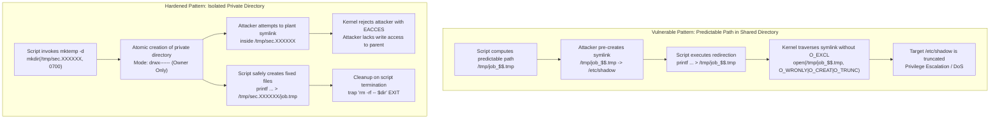

# Temporary File Attacks

> [!summary] Claim
> Shared world-writable directories expose scripts using predictable paths to symlink clobbering, FIFO blocking, and unauthorized inspection unless paths are created atomically with exclusive permissions or isolated within a private directory.

## TL;DR

- Insecure temporary files in shared directories suffer Time-of-Check to Time-of-Use (TOCTOU) races where attackers pre-create symlinks, hardlinks, or FIFOs that cause unprivileged truncation, privilege escalation, or indefinite hangs upon shell redirection.
- Always create an exclusive temporary directory via `dir=$(mktemp -d)` with `trap 'rm -rf -- "$dir"' EXIT HUP INT TERM` and `umask 077`, placing all subsequent temporary files inside that private namespace.
- Relying on `$$`, `$RANDOM`, or `mktemp -u` leaves a predictable filename or a TOCTOU window between generation and creation where an attacker can plant a trap before redirection opens the path.
- The `mktemp` utility is omitted entirely from POSIX.1-2024 (there is no `utilities/mktemp.html` page in the 2024 edition, as of 2026-11), but virtually all modern Unix systems provide implementations that differ primarily in template syntax and default behaviors between GNU coreutils and BSD/macOS.
- Avoid temporary files entirely when data can stream through Unix pipelines or process substitution, or when writing privileged daemons where Linux `O_TMPFILE` or systemd `PrivateTmp=yes` provide kernel-level namespace isolation.

## Mental model



In the vulnerable pattern, a script selects a predictable filename in a shared world-writable directory such as `/tmp` using the process ID `$$` or `$RANDOM`.
An unprivileged local attacker anticipates or races this choice and creates a symbolic link at that exact path pointing to a sensitive file such as `/etc/shadow`.
When the victim script redirects output with `>`, the shell issues an `open(2)` system call with flags `O_WRONLY | O_CREAT | O_TRUNC` but without `O_EXCL`.
The kernel resolves the symbolic link and truncates the attacker-specified target file with the effective privileges of the victim script.
In contrast, the hardened pattern relies on `mktemp -d` to invoke the `mkdir(2)` system call with restrictive mode `0700` (`drwx------`).
Because directory creation is atomic and the resulting directory is owned exclusively by the script's user with no permissions granted to group or others, any attempt by an adversary to create, delete, or link files inside that directory is rejected by the kernel with `EACCES`.
The script can then safely use fixed filenames inside its private directory without exposing itself to symlink attacks, and a POSIX signal trap cleans up the entire directory hierarchy upon exit.

## How it works

### System Call Primitives and Flag Mechanics

At the operating system interface, standard shell output redirection `> path` maps directly to the `open(2)` or `openat(2)` system call.
When a script executes `cmd > "$filepath"` under standard shell settings, the shell itself calls:

```c
int fd = open(filepath, O_WRONLY | O_CREAT | O_TRUNC, 0666);
```

If `filepath` does not exist, the kernel allocates a new inode and creates a directory entry with permissions masked by the process `umask`.
However, if `filepath` already exists as a symbolic link, the VFS pathname lookup machinery follows the link to its target.
The kernel then checks whether the invoking process has write access to the target inode, not the symbolic link itself.
If the victim script runs as `root` or as the owner of the target file, the target is opened and immediately truncated to zero bytes by `O_TRUNC`.

To eliminate this race condition, atomic creation requires two critical flags:

```c
int fd = open(filepath, O_WRONLY | O_CREAT | O_EXCL, 0600);
```

When `O_CREAT` and `O_EXCL` are combined, POSIX.1-2024 requires that `open(2)` fail with `EEXIST` if the named file already exists.
Crucially, if the final component of `filepath` is a symbolic link, `open(2)` fails with `EEXIST` regardless of whether the symbolic link points to an existing file or is dangling (POSIX.1-2024 XSH `open()`: "regardless of the contents of the symbolic link").
This atomicity closes the Time-of-Check to Time-of-Use (TOCTOU) window because existence verification and file creation occur as a single indivisible operation inside the kernel, which holds the parent directory's lock across the lookup and the create.

Modern Unix systems provide additional specialized flags:
- `O_NOFOLLOW`: If the trailing component of the path is a symbolic link, the open fails with `ELOOP` (POSIX.1-2024 XSH `open()`, also Linux and macOS) or `EMLINK` (FreeBSD, which documents the deviation in its `open(2)` STANDARDS section).
- `O_TMPFILE` (Linux 3.11+, introduced by commit `60545d0d4610`, June 2013): Creates an unnamed temporary inode in the specified filesystem directory without linking any entry into the directory namespace.
  Because no directory entry exists, other processes cannot locate, open, or race the file.
  The inode is released automatically when the last file descriptor is closed, though it can optionally be linked into the filesystem later via `linkat(AT_FDCWD, "/proc/self/fd/N", dirfd, name, AT_SYMLINK_FOLLOW)`.

### POSIX Specification and Shell Rationale

POSIX.1-2024 defines shell redirection in Shell and Utilities (XCU) Section 2.7.2 (Redirecting Output).
Under standard operation, the shell opens the destination operand for writing, creating it if it does not exist or truncating it via `O_TRUNC` if it does.
When the `noclobber` option is active (`set -C` or `set -o noclobber`), POSIX.1-2024 XCU 2.7.2 mandates:

> "Output redirection using the '>' format shall fail if the noclobber option is set ... and the file named by the expansion of word exists and is either a regular file or a symbolic link that resolves to a regular file; it may also fail if the file is a symbolic link that does not resolve to an existing file.
> The check for existence, file creation, and open operations shall be performed atomically as is done by the open() function as defined in System Interfaces volume of POSIX.1-2024 when the O_CREAT and O_EXCL flags are set..."

POSIX Rationale XRAT C.2.7.2 documents that historical shells implemented `noclobber` insecurely by calling `stat(2)` to verify non-existence followed separately by `creat(2)`.
This two-step sequence introduced a TOCTOU race condition that rendered `set -C` unusable for reliable lockfiles or safe temporary file generation.
XRAT C.2.7.2 encourages implementations to add an `O_NOCLOBBER` flag to `open()` (listed under FUTURE DIRECTIONS) so the whole operation becomes atomic; without it, compliant shells implement one of two algorithms that XRAT C.2.7.2 spells out:
1. The "exclusive create first" method: Attempt `open(path, O_WRONLY | O_CREAT | O_EXCL, 0666)`.
   If successful, redirection succeeds.
   If it fails (XRAT's minor variation: only with `EEXIST`), open the existing path without `O_CREAT` or `O_TRUNC` and `fstat(2)` it; if it is a non-regular file (such as `/dev/null` or a FIFO) the redirection succeeds, and if it is a regular file the shell closes it and fails the redirection.
2. The "stat first" method: Check the destination with `stat(2)` and fail if it is a regular file, otherwise open an existing non-regular file without `O_CREAT` and confirm its type with `fstat(2)`, and fall back to `O_CREAT | O_EXCL`.
   XRAT records this method as the one "in widespread use"; GNU bash 5.3 `redir.c` (`noclobber_open()`) follows it, adding `O_EXCL` only when the `stat(2)` failed.

Despite these shell-level guarantees, the `mktemp` command-line utility is not standardized in POSIX.1-2024.
The C API standardizes `mkstemp(3)`, `mkdtemp(3)`, and `mkostemp(3)` in POSIX.1-2024 System Interfaces (XSH; `mkostemp()` shares the `mkstemp()` page), but shell script portability for `mktemp` rests on de facto implementation consensus between BSD and GNU coreutils.

### Kernel VFS Mechanics

Linux implements file link and sticky directory protections in `fs/namei.c`:

1. Sticky Directory Enforcement (`S_ISVTX`):
   When a directory has the sticky bit set (`chmod +t` or octal mode `01000`, standard on `/tmp` as mode `1777`), the kernel function `may_delete()` (through `check_sticky()`) enforces that unprivileged processes can only delete or rename files they own or that sit in a directory they own.
   An attacker cannot delete another user's temporary file to plant a replacement.
   However, `S_ISVTX` does not prevent a user from creating new files, nor does it prevent other processes from opening existing symlinks or FIFOs created by the attacker.

2. Protected Symlinks (`fs.protected_symlinks`):
   Introduced by Kees Cook in Linux 3.6 (commit `800179c9b8a1`, "fs: add link restrictions") and implemented in `fs/namei.c:may_follow_link()`.
   When `sysctl fs.protected_symlinks = 1`, the kernel permits following a symbolic link inside a sticky world-writable directory (`S_ISVTX && S_IWOTH`) only if:
   - The user ID of the follower matches the user ID of the symbolic link owner (current source: `vfsuid_eq_kuid(vfsuid, current_fsuid())`), or
   - The owner of the directory matches the owner of the symbolic link (current source: `vfsuid_eq(nd->dir_vfsuid, vfsuid)`).
   If neither condition holds, the kernel aborts pathname resolution with `-EACCES` ("Permission denied") and logs an `AUDIT_ANOM_LINK` "follow_link" audit record.
   The check runs only for a trailing symlink: `pick_link()` calls `may_follow_link()` only under `WALK_TRAILING`.

3. Protected Hardlinks (`fs.protected_hardlinks`):
   Implemented in `fs/namei.c:may_linkat()`.
   When `sysctl fs.protected_hardlinks = 1`, users cannot create a hardlink to a target file unless they own the target file, or the target is a regular file to which they already hold read and write access (`safe_hardlink_source()` also rejects setuid files and setgid executables).
   This blocks unprivileged users from hardlinking sensitive system files (such as `/etc/shadow`) into `/tmp` to pin old inodes or manipulate file permissions via scripts.

4. Protected FIFOs and Regular Files (`fs.protected_fifos`, `fs.protected_regular`):
   Introduced by Salvatore Mesoraca in Linux 4.19 (commit `30aba6656f61`) and implemented in `fs/namei.c:may_create_in_sticky()`.
   When set to `1` (or `2` for group-writable sticky directories), the kernel disallows `open(2)` calls with `O_CREAT` (without `O_EXCL`) on pre-existing FIFOs or regular files in sticky directories unless the caller owns the file or the directory owner owns the file.
   This prevents attackers from planting regular files or named pipes to intercept data or stall scripts.

All four sysctls default to `0` in the kernel itself (the `sysctl_protected_*` variables in `fs/namei.c` are uninitialized statics); systemd's `sysctl.d/50-default.conf` sets all four to `1`, which is why most systemd distributions run with them enabled (as of 2026-11).

### Shell Implementation Internals

Different shell families handle temporary files and inline data with varying degrees of filesystem interaction:

- GNU Bash (`lib/sh/tmpfile.c`):
  Bash implements internal temporary file creation through `sh_mktmpfd()` and `sh_mktmpname()`.
  When a temporary file is required (for history editing, legacy here-documents, or named-pipe process substitution), Bash uses `get_tmpdir()`, which consults `$TMPDIR` only when the caller passes `MT_USETMPDIR` and otherwise uses the system directory (`P_tmpdir`, then `/tmp`, `/var/tmp`, `/usr/tmp`), builds a template with random characters, and calls `mkstemp(3)` to open the file descriptor.
  For here-documents (`<<EOF`), Bash writes the expanded lines to an `sh-thd` temporary file, reopens it read-only, and unlinks the path before the command reads it (`redir.c`); bash 3.2 passes no `MT_USETMPDIR`, so it ignores `$TMPDIR` and uses `P_tmpdir` (`/var/tmp/` in the macOS SDK), while bash 5.x honors `$TMPDIR`.
  Starting in Bash 5.1 (CHANGES, bash-5.1-alpha, item 3c), Bash uses anonymous pipes (`pipe(2)`) for here-documents and here-strings no larger than `HEREDOC_PIPESIZE` (the pipe buffer size, 4096 on FreeBSD), falling back to a temporary file only when the content is larger; Debian bash 5.2.37 shows a `fifo` on standard input for a one-line here-document (measured in the shell matrix).

- Dash (`dash`):
  Dash implements here-documents entirely in memory and anonymous pipes.
  In `parser.c` and `redir.c`, Dash pipes the expanded document into the child command's standard input via `pipe(2)`.
  Dash never writes here-documents to `/tmp`, eliminating filesystem race conditions entirely for inline blocks; dash 0.5.12 and BusyBox 1.37.0 ash (which derives from the same Almquist code) both show a `fifo` on standard input for a here-document (measured in the shell matrix).

- Zsh and Ksh:
  Zsh implements the process substitution `=(cmd)` by writing output to a temporary file whose name starts with `$TMPPREFIX` (default `/tmp/zsh`, so `/tmp/zsh<random>`; it does not consult `$TMPDIR`), whereas `<(cmd)` uses anonymous pipes exposed through `/dev/fd/N` on operating systems that support it; zsh 5.9 also stages here-documents in a regular temporary file (measured in the shell matrix).
  ksh93u+m 1.0.10 feeds `<(cmd)` through a `pipe(2)` (`readlink /proc/self/fd/0` shows `pipe:[...]`) and stages here-documents in a deleted temporary file under `/dev/shm`; mksh R59 keeps a named here-document file such as `/tmp/shXXXXXX.tmp` in place while the command runs (both measured in the shell matrix).
  On operating systems lacking `/dev/fd/N`, shells such as bash fall back to creating temporary named pipes (`mkfifo`) in the temporary directory, reintroducing filesystem race surfaces if names collide.

## Numbers and limits

| Parameter / Limit | Exact Value | Boundary Condition / Behavior | Primary Source |
| :--- | :--- | :--- | :--- |
| `pid_max` default (Linux) | `32768` (`PID_MAX_DEFAULT`) | Compile-time default; the kernel raises it at boot to `1024` PIDs per possible CPU when that is larger, and systemd's `50-pid-max.conf` sets `4194304` on 64-bit systems; either way PIDs are sequential and predictable | Linux kernel `include/linux/threads.h`, `kernel/pid.c`; systemd `sysctl.d/50-pid-max.conf` (as of 2026-11) |
| `pid_max` maximum (Linux 64-bit) | `4194304` (`2^22`, `PID_MAX_LIMIT`) | Maximum PID limit configurable via `/proc/sys/kernel/pid_max` | Linux kernel `include/linux/threads.h` (as of 2026-11) |
| `$RANDOM` range (Bash / ksh) | `0` to `32767` (`15` bits) | Park-Miller "minimal standard" generator (`16807 * x mod (2^31 - 1)`); its 31-bit state can be brute-forced from a few outputs | GNU bash 5.3 `lib/sh/random.c:brand()` (as of 2026-11) |
| GNU `mktemp` default template | `tmp.XXXXXXXXXX` | 10 alphanumeric characters yielding `62^10` (`~8.39 x 10^17`) possible combinations; a template needs at least 3 consecutive `X`s | GNU coreutils manual, `mktemp invocation` (as of 2026-11) |
| BSD `mktemp` template | Any number of trailing `X`s | macOS accepts even one `X` (`mktemp /tmp/fooX` succeeds, measured on macOS); 6 `X`s yield `62^6` (`56800235584`, `~5.68 x 10^10`) names, only `36^6` on case-insensitive filesystems | macOS `mktemp(1)` man page (as of 2026-11) |
| Sticky bit octal value | `01000` (`S_ISVTX`) | Enforces deletion/rename restrictions to file owner or directory owner | POSIX.1-2024 `<sys/stat.h>` (as of 2026-11) |
| Standard `/tmp` permissions | `1777` (`drwxrwxrwt`) | World-writable with sticky bit enabled | Convention; systemd `tmpfiles.d/tmp.conf` (`q /tmp 1777 root root 10d`) |
| Common default umask | `0022` | Results in `0644` files (`rw-r--r--`); readable by all local unprivileged users | Distribution default (`login.defs`, `pam_umask`); POSIX.1-2024 does not fix a default |
| Hardened temporary umask | `0077` | Results in `0600` files (`rw-------`) and `0700` directories (`rwx------`) from the shell's `0666` and `mkdir`'s `0777` requests | POSIX.1-2024 XCU `umask` (mode bits cleared by the mask); not asserted by the lab, whose tests 3 and 4 check `mktemp`'s own `0600` and `0700` modes |
| `fs.protected_symlinks` default | `0` in the kernel, `1` under systemd | Denies following symlinks in sticky world-writable directories unless owners match | Linux `fs/namei.c` (`sysctl_protected_symlinks`); systemd `sysctl.d/50-default.conf` |
| `fs.protected_hardlinks` default | `0` in the kernel, `1` under systemd | Blocks hardlinking to files not owned by caller without read/write permissions | Linux `fs/namei.c`; systemd `sysctl.d/50-default.conf` |
| `fs.protected_fifos` default | `0` in the kernel, `1` under systemd (`2` is opt-in) | Rejects `O_CREAT` open on existing FIFOs in sticky world-writable directories (`2`: also group-writable) | Linux `fs/namei.c`, `Documentation/admin-guide/sysctl/fs.rst`; systemd `sysctl.d/50-default.conf` |
| `fs.protected_regular` default | `0` in the kernel, `1` under systemd (`2` is opt-in) | Rejects `O_CREAT` open on existing regular files in sticky world-writable dirs (`2`: also group-writable) | Linux `fs/namei.c`, `Documentation/admin-guide/sysctl/fs.rst`; systemd `sysctl.d/50-default.conf` |
| `PIPE_BUF` atomic write limit | `4096` bytes (Linux), `512` bytes (macOS) | Max bytes guaranteed atomic into a pipe; larger writes can interleave | `getconf PIPE_BUF /`, measured in the shell matrix; POSIX.1-2024 `<limits.h>` requires at least `512` |
| `O_TMPFILE` availability | Linux `3.11+` | Requires filesystem support: initially ext2, ext3, ext4, UDF, Minix, and tmpfs (3.11); later XFS (3.15), Btrfs (3.16), F2FS (3.16), ubifs (4.9) | Linux `open(2)` man-page (commit `60545d0d4610`) |

## Portability

| Implementation | `mktemp` CLI Default Behavior | `set -C` (`noclobber`) Enforcement | Here-Document Mechanism | Process Substitution `<(cmd)` Mechanism | Default Temp Directory Fallback |
| :--- | :--- | :--- | :--- | :--- | :--- |
| POSIX.1-2024 `sh` | Not standardized in POSIX | Mandatory atomic existence check and create, as with `O_CREAT \| O_EXCL` (XCU 2.7.2) | Unspecified (pipes or temporary files permitted) | Not standardized in POSIX | `/tmp` |
| macOS Bash 3.2.57 | BSD `mktemp` (no arguments behaves as `-t tmp`, creating `$TMPDIR/tmp.XXXXXXXXXX` under `/var/folders/...`, measured) | Refuses a symlink to a regular file (measured as `/bin/sh`); "stat first" method with `O_EXCL` create | Temp file from `sh_mktmpfd()` in `P_tmpdir` (`/var/tmp/`), ignoring `$TMPDIR`, unlinked after reopen (regular file on stdin, measured) | Anonymous pipes exposed via `/dev/fd/N` | `/var/folders/*/*/*/T/` via `$TMPDIR` |
| GNU Bash 5.1 to 5.3 | GNU `mktemp` (defaults to `tmp.XXXXXXXXXX` in `$TMPDIR`) | Refuses a symlink to a regular file and a dangling symlink (measured, Debian 5.2.37); "stat first" method with `O_EXCL` create (`redir.c`) | Anonymous pipes up to `HEREDOC_PIPESIZE` (`fifo` measured); unlinked temp files in `$TMPDIR` for larger | Pipes exposed via `/dev/fd/N` (`fifo` measured) | `/tmp` |
| Zsh 5.9 (native) | OS utility (`mktemp`) | Refuses a symlink to a regular file and a dangling symlink (`NO_CLOBBER`, measured) | Regular temporary file (measured) under `$TMPPREFIX` | Pipes via `/dev/fd/N` (`fifo` measured); `=(cmd)` creates `$TMPPREFIX<random>` files | `$TMPPREFIX`, default `/tmp/zsh` (measured) |
| Zsh 5.9 (`--emulate sh`) | OS utility (`mktemp`) | Refuses a symlink to a regular file and a dangling symlink (measured, macOS zsh 5.9.2) | Regular temporary file (measured, macOS zsh 5.9.2) | Pipes via `/dev/fd/N` | `$TMPPREFIX`, default `/tmp/zsh` |
| Dash 0.5.12 | No builtin utility (relies on external binary, `/usr/bin/mktemp` measured) | Refuses a symlink to a regular file and a dangling symlink (measured) | Anonymous pipes via `pipe(2)` (`fifo` measured) | Not supported (syntax error, measured) | `/tmp` |
| Ksh93u+m 1.0.10 | No builtin utility (relies on external binary) | Refuses a symlink to a regular file and a dangling symlink (measured) | Deleted temporary file under `/dev/shm` (measured on Debian) | `/dev/fd/N` backed by `pipe(2)` (`pipe:[...]` measured); sockets are used for pipelines, not for `<(cmd)` | `/tmp` |
| Mksh R59 | No builtin utility (relies on external binary) | Refuses a symlink to a regular file and a dangling symlink (measured) | Named temp file such as `/tmp/shXXXXXX.tmp`, present while the command runs (measured) | Not supported (syntax error, measured) | `/tmp` |
| Posh 0.14.1 | No builtin utility (relies on external binary) | Refuses a symlink to a regular file and a dangling symlink (measured) | Regular temporary file (measured; directory not checked) | Not supported (syntax error, measured) | `/tmp` |
| BusyBox 1.37.0 `ash` | Builtin applet `mktemp` (supports `-d`, `-q`, `-t`, `-p DIR`, template; `/bin/mktemp -> /bin/busybox` on Alpine) | Refuses a symlink to a regular file (measured on Alpine) | Anonymous pipes (`fifo` measured on Alpine) | Supported in Alpine's build (`fifo` measured); depends on build options | `/tmp` |
| GNU coreutils | `mktemp` binary; defaults to `tmp.XXXXXXXXXX` | N/A (utility level) | N/A | N/A | `$TMPDIR` else `/tmp` |
| BSD / macOS core | `mktemp` binary; no arguments behaves as `-t tmp` | N/A (utility level) | N/A | N/A | `$TMPDIR` else `/tmp` |
| uutils coreutils | Rust `mktemp`; mirrors the GNU flags `-d`, `-u`, `-q`, `--suffix`, `-p`/`--tmpdir`, and `-t` (uutils `mktemp` help strings, as of 2026-11) | N/A (utility level) | N/A | N/A | `$TMPDIR` else `/tmp` |

## Worked example

The companion test suite for this note lives in [lab](../labs/17-temporary-file-attacks/).
It demonstrates three core scenarios: a vulnerable script clobbering a target through a pre-created symlink, a `set -C` guard blocking the clobber, and a hardened script creating a private directory with automatic trap cleanup.

### Vulnerable Script (`vulnerable_temp.sh`)

```sh
#!/usr/bin/env sh
# Predictable temporary file anti-pattern using process ID ($$)
set -eu

work_dir="${1:-.}"
target_name="${2:-job_$$}"
tmpfile="${work_dir}/${target_name}.tmp"

# Simulates writing sensitive or state data via redirection
printf '%s\n' "CRITICAL_PAYLOAD_DATA" >"$tmpfile"
printf 'WROTE: %s\n' "$tmpfile"
```

### Noclobber Guard Script (`noclobber_guard.sh`)

```sh
#!/usr/bin/env sh
# Demonstrating atomic noclobber protection against pre-existing files/symlinks
set -eu

target_path="$1"
payload="$2"

# Enable noclobber
set -C

# Attempt to write to target path
# Under POSIX XCU 2.7.2, redirection with > must fail if file or symlink to regular file exists
# Redirect stderr before stdout so any redirection diagnostic from the shell is silenced
if 2>/dev/null printf '%s\n' "$payload" >"$target_path"; then
  printf 'RESULT: SUCCESS\n'
else
  printf 'RESULT: BLOCKED\n'
fi
```

### Hardened Temporary Directory Script (`secure_tempdir.sh`)

```sh
#!/usr/bin/env sh
# Secure temporary directory pattern
set -eu

parent_dir="${1:-.}"

# Ensure restrictive umask so created directories are private (0700)
old_umask=$(umask)
umask 077

# Create private temporary directory atomically
workdir=$(mktemp -d "${parent_dir}/secure_job.XXXXXX") || exit 1

# Install cleanup trap across normal exit and terminating signals
trap 'rm -rf -- "$workdir"' EXIT HUP INT TERM

# Restore umask if needed
umask "$old_umask"

# Inside the private 0700 directory, fixed filenames are immune to external symlink races
job_file="${workdir}/payload.dat"
printf '%s\n' "PROTECTED_DATA" >"$job_file"

printf 'DIR_CREATED: %s\n' "$workdir"
printf 'PAYLOAD: %s\n' "$(cat "$job_file")"
```

### Captured Lab Output

Executing the Bats suite `temp_attacks.bats` runs all test cases and verifies each mechanism:

```
1..6
ok 1 vulnerable_temp.sh follows pre-created symlink and overwrites target
ok 2 noclobber_guard.sh blocks redirection when target is pre-existing symlink
ok 3 mktemp creates regular file with 0600 mode
ok 4 mktemp -d creates directory with 0700 mode
ok 5 secure_tempdir.sh cleans up directory on exit via trap
ok 6 pre-created FIFO with peer demonstrates data interception
```

In test 1, an unprivileged attacker pre-creates a symbolic link `victim_job.tmp -> target_secret.txt`.
When `vulnerable_temp.sh` runs, standard redirection resolves the link and overwrites `target_secret.txt` with `CRITICAL_PAYLOAD_DATA`.
In test 2, `noclobber_guard.sh` runs with `set -C`; the shell's noclobber check (in bash, the "stat first" method with `O_EXCL` on the create step) detects the pre-existing link to a regular file, aborts the redirection without writing, and outputs `RESULT: BLOCKED`; the test asserts both that output and that the target still holds `ORIGINAL_SECRET`.
The output above is from a single run of the suite on the macOS host (2026-11), where `#!/usr/bin/env sh` is bash 3.2 in POSIX mode.
In test 5, `secure_tempdir.sh` executes inside its isolated directory, prints `PAYLOAD: PROTECTED_DATA`, and the `EXIT` trap unlinks the directory hierarchy before the process terminates.

## Pitfalls

> [!warning] Predictable PID filename collision and symlink hijacking
> Trigger: Constructing temporary paths using process ID expansions like `/tmp/job_$$.tmp` or timestamp variables.
> Symptom: Unprivileged local users monitor `/tmp`, predict the target filename, and create a symbolic link pointing to a critical system file (e.g., `/etc/shadow` or `/etc/ld.so.preload`), resulting in arbitrary file corruption or privilege escalation when a privileged script executes.
> Fix: Never construct temporary filenames by string concatenation with `$$` or `$RANDOM`; always use `mktemp` or create a private directory via `mktemp -d`.
> Incident: CVE-2008-5374 (`bash-doc` 3.2 scripts `aliasconv.sh`, `aliasconv.bash`, and `cshtobash` using predictable `/tmp/cb$$.?` paths vulnerable to symlink overwrites, per NVD).

> [!warning] The dry-run TOCTOU race of mktemp -u
> Trigger: Invoking `tmpfile=$(mktemp -u)` to generate a filename without creating it, followed later by `> "$tmpfile"` or `touch "$tmpfile"`.
> Symptom: The interval between name generation and file creation leaves an open race window where an adversary can pre-create a symbolic link, hardlink, or FIFO at that path.
> Fix: Let `mktemp` create the file atomically and return the opened path, or allocate an isolated directory with `mktemp -d` and create files inside it.
> Incident: Documented across multiple Unix utilities and classified under CWE-377 (Insecure Temporary File) and CWE-367 (Time-of-Check to Time-of-Use Race Condition).

> [!warning] Shared-directory symlink escalation in privileged daemon scripts
> Trigger: Privileged daemons or maintenance shell scripts writing log files, caches, or state files into `/tmp` or `/var/tmp`.
> Symptom: An unprivileged local service user creates a symbolic link from the anticipated log file to `/etc/ld.so.preload`, gaining root execution upon service restart.
> Fix: Confine service logs and temporary files to dedicated directories owned by the service user (e.g., `/var/log/service/` mode `0750`), or enable systemd `PrivateTmp=yes`.
> Incident: CVE-2016-6664 (`mysqld_safe` wrapper script in Oracle MySQL through 5.5.51, 5.6.32, and 5.7.14, MariaDB, and Percona Server, when using file-based logging, lets local users with access to the `mysql` account gain root through a symlink attack on error logs; the log directory is writable by that account, not a shared `/tmp`, per NVD).

> [!warning] Directory-swap bypass of fs.protected_symlinks
> Trigger: Operating on nested paths inside shared temporary directories without descriptor-relative system calls (`openat`).
> Symptom: An attacker creates a subfolder and a file within it, and then swaps the subfolder for a symbolic link to an arbitrary system directory; because `fs.protected_symlinks` only inspects trailing components (`may_follow_link()` runs only under `WALK_TRAILING` in `fs/namei.c`), intermediate component symlinks can be followed.
> Fix: Traverse directories using directory file descriptors with `O_DIRECTORY | O_NOFOLLOW`, or avoid nesting inside shared temporary directories.
> Incident: CVE-2018-6954 (`systemd-tmpfiles` in systemd through 237 mishandling symbolic links in non-terminal path components, permitting local users to gain ownership of arbitrary system files even with `fs.protected_symlinks` on, per NVD).

> [!warning] Pre-created FIFO denial of service and stream interception
> Trigger: Redirecting script output to a predictable path where an adversary has executed `mkfifo "$filepath"`.
> Symptom: The script hangs indefinitely on the `open(2)` system call waiting for a reader process to connect, causing background cron jobs or automated deployment scripts to deadlock.
> If an attacker connects a background reader, confidential data redirected into the path is exfiltrated in real time.
> Fix: Create temporary files inside a private directory mode `0700`, or ensure kernel sysctl `fs.protected_fifos = 1` is enforced.
> Incident: Widespread denial of service vulnerabilities in Unix print spoolers and mail transfer agents.

> [!warning] Secret leakage through permissive default umask
> Trigger: Writing authentication tokens, API credentials, or private keys to temporary files without explicitly restricting the process umask.
> Symptom: Standard system umask `0022` creates files with mode `0644` (`rw-r--r--`), making confidential payloads readable by every local user on the system.
> Fix: Run `old_umask=$(umask); umask 077` before invoking temporary file creation routines, ensuring files receive mode `0600` (`rw-------`).
> Incident: Classified under CWE-732 (Incorrect Permission Assignment for Critical Resource), recurring frequently in developer tools and installation wrappers.

> [!warning] TOCTOU symlink replacement during file staging and editing
> Trigger: Copying a sensitive file to a shared temporary directory for user editing, followed by copying the modified file back as a privileged user.
> Symptom: An unprivileged user replaces the temporary staging file with a symbolic link immediately before the privileged copy-back occurs, redirecting the write to an arbitrary target.
> Fix: Avoid staging files in shared directories; verify file descriptors via `fstat(2)` before and after editing, and use `O_NOFOLLOW` on open operations.
> Incident: CVE-2021-23240 (`sudoedit` flaw in `selinux_edit_copy_tfiles` in Sudo before 1.9.5 allowing local users to gain file ownership or escalate privileges via symlink replacement during file staging; it affects SELinux RBAC support in permissive mode only, per NVD).

## Security and robustness

Building robust temporary file workflows requires adhering to four defensive layers:

### 1. The Private Directory Pattern (Gold Standard)

The most resilient pattern in portable shell scripting is the private directory pattern:

```sh
# Allocate private temporary directory
workdir=$(mktemp -d "${TMPDIR:-/tmp}/job.XXXXXX") || exit 1

# Install cleanup trap covering exit and terminating signals
trap 'rm -rf -- "$workdir"' EXIT HUP INT TERM

# All subsequent files use fixed names inside the private directory
temp_data="${workdir}/data.raw"
printf '%s\n' "secret_data" > "$temp_data"
```

Because `mktemp -d` creates the directory with permissions `0700` (`drwx------`), no unprivileged user can create directory entries, create symlinks, or open files inside it.
Fixed, descriptive filenames like `data.raw` can be used safely without introducing TOCTOU vulnerabilities.

### 2. Signal Traps and Exit Guarantees

Temporary files must be cleaned up reliably even when a script is interrupted.
POSIX requires that an `EXIT` trap (signal 0) runs when the shell exits normally or via `exit`.
However, POSIX.1-2024 XCU `trap` says the `EXIT` condition occurs when the shell exits normally and only "may occur" when the shell terminates abnormally from a signal (other than `SIGKILL`) whose trap action is the default, so cleanup on `SIGINT`, `SIGTERM`, or `SIGHUP` is not guaranteed.
To ensure deterministic cleanup across all POSIX shells:
- Always bind the cleanup routine to `EXIT HUP INT TERM`.
- In scripts that handle signals explicitly, preserve the correct exit status by resetting the trap and re-sending the signal to the process (`trap - INT; kill -INT $$`).

### 3. Pipeline In-Memory Processing

The most secure temporary file is the one that was never written to disk.
Whenever possible, stream intermediate data between processes using standard Unix pipelines:

```sh
# Insecure: disk staging
dump_database > /tmp/db.sql
process_data < /tmp/db.sql
rm -f /tmp/db.sql

# Secure: in-memory streaming pipeline
dump_database | process_data
```

For commands that require multiple inputs, modern shells provide process substitution (`<(cmd)`), which passes anonymous pipes via `/dev/fd/N` without allocating entries in the filesystem namespace:

```sh
# Compare outputs of two commands without writing to disk
diff -u <(generate_baseline) <(generate_candidate)
```

### 4. Linux Kernel and Container Hardening

For production environments running on modern Linux:
- Verify kernel sysctl parameters:
  Ensure `fs.protected_symlinks = 1`, `fs.protected_hardlinks = 1`, `fs.protected_fifos = 2`, and `fs.protected_regular = 2` are set in a local drop-in such as `/etc/sysctl.d/99-tmp-hardening.conf` (systemd's own `50-default.conf` ships all four at `1`, so the `2` values are an explicit opt-in).
- Systemd Service Isolation:
  In systemd service units, configure `PrivateTmp=yes`.
  This gives the service a new mount namespace (`CLONE_NEWNS`) with private `/tmp` and `/var/tmp` directories, ensuring daemons cannot see or race files created by other system users; with `PrivateTmp=yes` their backing storage stays on the host's `/tmp` and `/var/tmp`, while `PrivateTmp=disconnected` backs each with a fresh `tmpfs` instance (`systemd.exec(5)`).
- Mount Namespace Isolation:
  For batch tasks and untrusted script execution, wrap processes in an unshared mount namespace via `unshare -m` with a private `tmpfs` mounted on `/tmp`.

## The principal's view

At staff-plus and principal level, temporary file handling is evaluated as an architectural boundary, not merely a scripting chore.

The primary architectural decision is whether state belongs on the filesystem at all.
Shared directories like `/tmp` are inherently multi-tenant, untrusted communication channels.
Any script that stages data in `/tmp` implicitly establishes a security boundary with every other process on the machine.
The first architectural choice is zero-disk processing: eliminate intermediate temporary files by streaming payloads through pipes or utilizing `/dev/fd` abstractions.

When intermediate data must hit disk due to memory pressure or multi-pass analysis algorithms, the principal engineer isolates the execution environment rather than relying on pathname hygiene.
Relying on scripts to correctly implement `mktemp`, `umask`, and signal traps across dozens of microservices is an anti-pattern that fails at scale.
The robust engineering response is containerization or namespace isolation:
- At the orchestration layer (Kubernetes / systemd), configure ephemeral volumes, `emptyDir` mounts, or `PrivateTmp=yes`.
  This guarantees that `/tmp` is private to the container or service, rendering cross-user symlink and FIFO attacks physically impossible at the VFS layer.
- At the operating system layer, configure modern Linux sysctl mitigations (`fs.protected_*`) as mandatory baseline security policies.

When shell scripts outgrow basic glue logic and require complex temporary file staging, atomic rollback semantics, or multi-process synchronization, migrate the implementation to Go, Rust, or C.
Low-level languages provide direct access to `openat2(2)` with `RESOLVE_NO_SYMLINKS`, `renameat2(2)` with `RENAME_NOREPLACE`, and `O_TMPFILE`.
These system calls guarantee link-free, race-free filesystem operations that cannot be fully expressed in shell command language.

## Interview questions

> [!question] L5: Why is constructing a temporary filename with `TMPFILE="/tmp/job_$$"` insecure on a multi-user Unix system?
>
> > [!success]- Answer
> > The process ID `$$` is a predictable integer bounded on Linux by `/proc/sys/kernel/pid_max`, whose compile-time default is `32768` (`PID_MAX_DEFAULT`), raised at boot on many-CPU machines and set to `4194304` by systemd on 64-bit systems.
> > Because PIDs wrap sequentially, an unprivileged attacker can predict or exhaust the PID space in seconds and pre-create symbolic links at those paths pointing to sensitive targets like `/etc/shadow`.
> > When a script executes `printf ... > "$TMPFILE"`, standard redirection uses `O_CREAT | O_TRUNC` without `O_EXCL`, causing the kernel to follow the symbolic link and truncate the target file.
> > The vulnerability also exposes scripts to pre-created FIFOs that cause the script to hang indefinitely waiting for a reader.
> >
> > Follow-up: How does `mktemp -d` mitigate this vulnerability compared to `mktemp`?

> [!question] L5: Predict the output and filesystem result of running `set -C; echo "new data" > link.tmp` when `link.tmp` is a symbolic link pointing to an existing file `target.txt`.
>
> > [!success]- Answer
> > The shell prints an error diagnostic to standard error indicating that the file cannot be overwritten, the command returns a non-zero exit status, and `target.txt` remains unchanged.
> > Under POSIX.1-2024 XCU 2.7.2, when `noclobber` (`set -C`) is active, output redirection with `>` must fail if the target exists and is a regular file or a symbolic link resolving to a regular file.
> > The shell performs this check atomically using flags equivalent to `O_CREAT | O_EXCL`.
> > Because `link.tmp` resolves to an existing regular file, the open operation fails with `EEXIST`, preventing the clobber.
> >
> > Follow-up: What happens if `link.tmp` is a dangling symbolic link pointing to a non-existent file?

> [!question] L6: Debug this script and identify the exact vulnerability: `tmp=$(mktemp -u /tmp/test.XXXXXX); echo "data" > "$tmp"`.
>
> > [!success]- Answer
> > The script suffers from a Time-of-Check to Time-of-Use (TOCTOU) race condition because `mktemp -u` operates in dry-run mode and prints a filename without creating it.
> > Between the execution of `mktemp -u` and the shell redirection `> "$tmp"`, the path is left vacant in the world-writable directory.
> > An adversary monitoring filesystem events can immediately create a symbolic link or FIFO at that exact path before the redirection executes.
> > When the redirection opens the path, standard `open(2)` without `O_EXCL` follows the attacker's symbolic link and clobbers the target.
> > The fix is to omit `-u` and let `mktemp` create the file atomically with mode `0600`, or create a private directory using `mktemp -d`.
> >
> > Follow-up: Why does the GNU coreutils manual call using the output of `mktemp -u` to create a file "inherently unsafe"?

> [!question] L6: How does creating a private temporary directory with `mktemp -d` fundamentally solve temporary file security compared to creating individual files with `mktemp`?
>
> > [!success]- Answer
> > Creating a directory with `mktemp -d` executes `mkdir(2)` atomically with permissions `0700` (`drwx------`).
> > In the Unix filesystem model, creating, deleting, or linking directory entries requires write and execute permissions on the parent directory.
> > Because only the directory owner holds permissions on the created directory, no other local user can create symbolic links, hardlinks, or FIFOs inside it.
> > Inside this private namespace, the script can safely use static, predictable filenames without risk of race conditions or link planting.
> > Furthermore, cleaning up the private directory via `rm -rf -- "$dir"` in an `EXIT` trap automatically reclaims all intermediate files in a single operation.
> >
> > Follow-up: What happens to files inside that directory if the script process is killed by `SIGKILL`?

> [!question] L6: What protection does the Linux sysctl `fs.protected_symlinks = 1` provide, and what is its primary limitation?
>
> > [!success]- Answer
> > `fs.protected_symlinks = 1` causes the Linux VFS to disallow following symbolic links inside sticky world-writable directories unless the follower owns the symlink or the directory owner owns the symlink.
> > This prevents unprivileged users from planting symlinks in `/tmp` to trick root or other users into truncating files during output redirection.
> > However, its primary limitation is that it only evaluates the trailing component of a pathname during resolution.
> > If a script traverses a sub-path where an intermediate directory component is swapped for a symbolic link, `fs.protected_symlinks` does not block traversal.
> >
> > Follow-up: Which landmark CVE demonstrated this intermediate directory swap bypass in a system utility?

> [!question] L6: How can an unprivileged local attacker use a pre-created named pipe (FIFO) in `/tmp` to cause a Denial of Service against a privileged script?
>
> > [!success]- Answer
> > The attacker creates a FIFO at the predicted temporary file path using `mkfifo /tmp/job_output.tmp`.
> > When the victim script attempts to write to that path using standard shell redirection `> /tmp/job_output.tmp`, the shell issues `open(path, O_WRONLY | O_CREAT | O_TRUNC)`.
> > Under standard POSIX open semantics for FIFOs without `O_NONBLOCK`, opening a FIFO for writing blocks the calling process until another process opens the FIFO for reading.
> > Because the attacker never opens the FIFO for reading, the victim script hangs indefinitely in the kernel's `open(2)` call, halting batch jobs, cron tasks, or boot scripts.
> >
> > Follow-up: How does setting `fs.protected_fifos = 1` mitigate this attack on Linux 4.19+?

> [!question] L7: Explain how `systemd-tmpfiles` was exploited in CVE-2018-6954 despite Linux kernel `fs.protected_symlinks` being enabled.
>
> > [!success]- Answer
> > `systemd-tmpfiles` recursively adjusted permissions and ownership on files and directories specified in configuration files under `/tmp`.
> > An attacker created a legitimate directory `/tmp/exploit` containing a file, and then raced `systemd-tmpfiles` by replacing the directory `/tmp/exploit` with a symbolic link pointing to an arbitrary system directory like `/etc`.
> > Because `fs.protected_symlinks` only restricts following symbolic links that appear as the final component of a path or during direct link following, non-terminal path component resolution was permitted.
> > `systemd-tmpfiles` followed the directory symlink into `/etc` and executed `chmod` or `chown` on files inside the target directory, granting the unprivileged user ownership of critical system files.
> > The vulnerability demonstrated that pathname-based recursion in shared directories is inherently unsafe without descriptor-based directory traversal (`openat` with `O_NOFOLLOW | O_DIRECTORY`).
> >
> > Follow-up: How does modern `systemd-tmpfiles` defend against non-terminal directory symlink substitution?

> [!question] L7+: Design an atomic, link-safe file update mechanism for a high-security daemon in C or Rust that prevents all temporary file hijacking and TOCTOU races.
>
> > [!success]- Answer
> > The daemon opens the parent directory using `open(dirpath, O_DIRECTORY | O_CLOEXEC)`.
> > It creates an unnamed temporary inode in that filesystem using `openat(dirfd, ".", O_TMPFILE | O_RDWR | O_CLOEXEC, 0600)`.
> > The daemon writes its configuration or state payload into the resulting file descriptor and flushes it to storage using `fsync(fd)`.
> > To atomically publish the updated file over the old target, it links the file into the namespace using `linkat(AT_FDCWD, "/proc/self/fd/N", dirfd, "target.new", AT_SYMLINK_FOLLOW)`.
> > Finally, it invokes `renameat(dirfd, "target.new", dirfd, "target.conf")`, which atomically replaces an existing target; `renameat2(..., RENAME_NOREPLACE)` is the opposite choice, failing with `EEXIST` when the target exists, and suits first-time publication only.
> > This architecture completely eliminates temporary filenames on disk during payload writing, prevents symlink hijacking, and guarantees atomic replacement without intermediate incomplete states.
> >
> > Follow-up: What filesystem fallback must be implemented if the underlying storage driver does not support `O_TMPFILE`?

## Related

Prerequisites: [[Shellshock]]

Next: [[sudo-and-sudoers]]

See also:
- [[Shell-Threat-Model]]
- [[Command-Injection]]
- [[Hostile-Filenames]]
- [[Dropping-Privileges]]
- [[Secrets-in-argv-env-and-History]]
- [[Sandboxing-Scripts]]

## Further reading

- POSIX.1-2024 Shell Command Language (Section 2.7.2 Output Redirection): Formal specification of shell output redirection semantics and mandatory atomic noclobber behavior.
- POSIX.1-2024 Shell and Utilities Rationale (Section C.2.7.2): Detailed technical history of historical shell TOCTOU races and fallback algorithms for atomic redirection.
- Linux Kernel sysctl Documentation (`Documentation/admin-guide/sysctl/fs.rst`): Authoritative specification of `fs.protected_symlinks`, `fs.protected_hardlinks`, `fs.protected_fifos`, and `fs.protected_regular`.
- Linux Kernel VFS Source (`fs/namei.c`): Primary source implementation of `may_follow_link()`, `may_linkat()`, and `may_create_in_sticky()`.
- GNU Bash Source (`lib/sh/tmpfile.c` and `redir.c`): Internal implementation of temporary file descriptors, `sh_mktmpfd()`, and here-document buffering.
- Todd Miller's OpenBSD `mktemp(1)` Manual: Original design rationale for introducing `mktemp` to remediate race conditions in Unix shell scripts.
- Dawid Golunski's MySQL Privilege Escalation Advisory (CVE-2016-6664): Technical postmortem demonstrating local root escalation via symlink exploitation in the `mysqld_safe` shell wrapper.
- Sudo security advisory "Symbolic link attack in SELinux-enabled sudoedit" (CVE-2021-23240, found by Matthias Gerstner of the SUSE security team): Primary analysis of symlink race conditions during temporary file staging in privileged commands.
- Dmitry E. Oboukhov's Debian Security Audit (CVE-2008-5374): His August 2008 debian-devel mass-bug-filing proposal, "The possibility of attack with the help of symlinks in some Debian packages", linked a report of vulnerable temporary-file use across Debian sid; the CVE record cites that thread, and it names only the `bash-doc` scripts `aliasconv.sh`, `aliasconv.bash`, and `cshtobash`.
