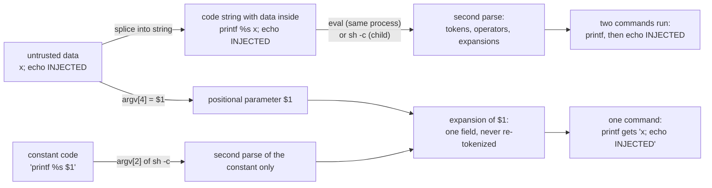

# eval and sh -c

> [!summary] Claim
> `eval` and `sh -c` are the two doors through which a shell turns a string back into code, and the only safe way through either door is to keep the code string constant and carry every piece of data as an operand or a variable reference that the second parse never sees.

Part of [Shell Security](README.md) in [Shell and Unix Engineering](../README.md).

## TL;DR

- Mechanism: `eval` joins its operands with spaces and parses the result in the current shell; `sh -c string name args` parses `string` in a new process and binds `name` to `$0` and `args` to `$1` onward, and `system(3)`, `popen(3)`, `ssh`, `find -exec sh -c`, cron, and `subprocess(shell=True)` are all `sh -c` underneath.
- Rule: the code string is a constant in single quotes; data travels as `sh -c 'code "$1"' sh "$data"` or as `eval "$name=\$value"`, never spliced into the string.
- Trap: the word after the code string is `$0`, not `$1`, so `sh -c 'cmd "$1"' "$data"` silently drops the data into `$0`, and Python's `Popen(['cmd "$1"', data], shell=True)` makes the same mistake for you.
- Portability fact: POSIX.1-2024 requires `system()` and `popen()` to pass `--` after `-c` (Austin Group Defect 1440); glibc does since 2.38 and musl does not (as of 2026-11), and bash's `printf %q` output uses `$'...'`, which dash 0.5.12 and posh 0.14.1 cannot parse.
- When not to use it: if you can call `execve` with an argument vector (`find -exec cmd {} +`, `xargs -0`, `subprocess.run([...])`, `watch -x`), do that and there is no second parse to defend.

## Mental model



Read the diagram from the left.
The same untrusted bytes can reach the second parser in two ways.
On the upper path they are concatenated into the code string, so the second parse (by `eval` in the current process, or by a child shell started with `-c`) sees `;` as a command separator and runs a command the author never wrote.
On the lower path the code string is a constant that contains only a reference, `$1`, and the data rides in a separate `argv` slot that the kernel copies without interpretation.
The second parse tokenizes only the constant; the data enters during parameter expansion, after token recognition is finished, so it can never become an operator.
Every safe idiom in this note is a way to stay on the lower path.

## How it works

### Two doors, one parser

POSIX defines `eval` as: "The eval utility shall construct a command string by concatenating arguments together, separating each with a `<space>` character. The constructed command string shall be tokenized (see 2.3 Token Recognition), parsed (see 2.10 Shell Grammar), and executed by the shell in the current environment" (POSIX.1-2024 XCU eval).
It defines `sh -c` as: "Read commands from the command_string operand. Set the value of special parameter 0 ... from the value of the command_name operand and the positional parameters (`$1`, `$2`, and so on) in sequence from the remaining argument operands. No commands shall be read from the standard input" (POSIX.1-2024 XCU sh, OPTIONS).
The command string itself is "interpreted by the shell as one or more commands, as if the string were the argument to the system() function", and an empty command string makes `sh` exit 0 (POSIX.1-2024 XCU sh, OPERANDS).
If `command_name` is absent, `$0` becomes "the first argument passed to sh from its parent (for example, argv[0] for a C program)" (same section).

The two doors differ in exactly three ways.

| Property | `eval STRING` | `sh -c STRING NAME ARGS` |
|---|---|---|
| Process | the current shell | a new process (`fork` plus `execve`, or `posix_spawn`) |
| What the string can change | every variable, function, trap, option, `cwd`, open descriptor of the caller | only the child; the caller sees an exit status and whatever the child wrote |
| How data can enter safely | as a variable the string references (`eval "$n=\$v"`) | as `NAME` and `ARGS`, which become `$0` and `$1` onward |

The detailed mechanics of `eval` itself (operand joining, special built-in status, `command eval`, granularity of parsing) are in [[The-eval-Builtin]]; this note is about the security boundary that both doors share.

### How `-c` binds `$0` and `$@` in real shells

dash parses options in `procargs()`; when it meets `c` it records `minusc`, then after option parsing takes the next word as the command string and, if another word follows, jumps to `setarg0` to make it `arg0`; every remaining word becomes a positional parameter (dash git `src/options.c`, `procargs`, under the comment `POSIX 1003.2: first arg after -c cmd is $0, remainder $1...`).
If `-c` has no operand at all, dash stops with "-c requires an argument" (same function).
bash stores the operand in `command_execution_string` and calls `bind_args(argv, arg_index, argc, 0)`; with `start_index == 0` it assigns the first remaining word to both `shell_name` and `dollar_vars[0]` and passes the rest to `remember_args(args->next, 1)` (bash-5.3 shell.c, `bind_args`).
bash then calls `run_one_command()`, which hands the string to `parse_and_execute(savestring(command), "-c", SEVAL_NOHIST|SEVAL_RESETLINE)` (bash-5.3 shell.c, `run_one_command`).
Because `$0` is the slot after the string, the conventional placeholder is the literal word `sh` (or the program's name), which also makes diagnostics read naturally: dash prints `myname: 1: nonexistent_cmd_q7: not found` for `dash -c nonexistent_cmd_q7 myname`, while zsh and yash ignore `$0` here and print `zsh:1: command not found: nonexistent_cmd_q7` and ``yash: no such command `nonexistent_cmd_q7'`` (lab test 13).
Debian's mksh R59 2025/04/26 also prefixes its diagnostics with `E: `, so it prints `E: myname: nonexistent_cmd_q7: inaccessible or not found`, where Alpine's mksh R59 2020/10/31 starts with `myname:` (measured in the shell matrix images, 2026-11).

### `system()`, `popen()`, and the `--` change

`system(command)` "shall behave as if a child process were created using fork(), and the child process invoked the sh utility using execl() as follows: `execl(<shell path>, "sh", "-c", "--", command, (char *)0);`" (POSIX.1-2024 XSH system).
The `--` is new in Issue 8 (Austin Group Defect 1440); the rationale says that before it "portable applications needed to take care not to pass a command string beginning with `<hyphen-minus>` ('-') or `<plus-sign>` ('+'), as it would then be interpreted as containing options" (POSIX.1-2024 XSH system, RATIONALE and CHANGE HISTORY).
`popen()` received the same change (POSIX.1-2024 XSH popen, CHANGE HISTORY).
glibc's `do_system()` now spawns `SHELL_PATH` (`/bin/sh`) with `{ "sh", "-c", "--", line }` through `__posix_spawn`, and `spawn_process()` in `libio/iopopen.c` does the same for `popen`; the change is commit "system: Add "--" after "-c" for sh (BZ #28519)" dated 2023-03-28, target milestone 2.38 (glibc git, `sysdeps/posix/system.c`; glibc Bugzilla 28519).
musl still spawns `{"sh", "-c", (char *)cmd, 0}` in both `system()` and `popen()` (musl git `src/process/system.c`, `src/stdio/popen.c`, as of 2026-11), so on Alpine a command string that starts with `-` or `+` is still read as shell options.
`system()` also ignores `SIGINT` and `SIGQUIT` and blocks `SIGCHLD` in the caller while it waits (POSIX.1-2024 XSH system), which is why a Ctrl-C during `system("sleep 100")` kills the child but not the caller.
Every shell in the lab accepts `--` between `-c` and the string (lab test 3), which a conforming `system()` now depends on.

The same `sh -c` hides inside many tools that take "a command" as one string:

| Interface | What actually runs | Source |
|---|---|---|
| `system(3)`, `popen(3)`, awk `system()` and `print \| cmd` | `sh -c -- STRING` (musl: no `--`) | POSIX.1-2024 XSH system, popen; XCU awk |
| `ssh host ARG...` | client joins the `ARG`s with single spaces; server runs `$SHELL -c JOINED` with the user's login shell | OpenSSH `ssh.c` (`sshbuf_putf(command, "%s%s", i ? " " : "", av[i])`), `session.c` `do_child()` (`argv[1] = "-c"`) |
| `find ... -exec sh -c 'code' sh {} +` | one `sh -c` per batch, names as operands | POSIX.1-2024 XCU find, EXAMPLES |
| crontab command field | `sh`, after `%` is turned into newline | POSIX.1-2024 XCU crontab |
| Python `subprocess` with `shell=True` | `Popen(['/bin/sh', '-c', args[0], args[1], ...])` | Python `subprocess` documentation |
| `sudo -s CMD` | user's shell with `-c` and a backslash-escaped copy of `CMD` | Qualys advisory for CVE-2021-3156, quoting `parse_args()` |
| `watch CMD` | `sh -c CMD`; `watch -x` calls `exec` instead | procps `watch(1)` |

### Process topology and the last-command exec

`sh -c 'a; b'` costs at least one extra process (the shell) on top of the commands.
Several shells then save a process by executing the final simple command in place of themselves.
bash marks a command `CMD_NO_FORK` when `should_suppress_fork()` holds: `startup_state == 2` (the `-c` case), `parse_and_execute_level == 1`, the whole string has been parsed, no alias is being expanded, job control is off, and `should_optimize_fork()` holds, which requires a simple command, no `EXIT` or `ERR` trap, no trapped signals, no redirections, and no `time` or `!` (bash-5.3 builtins/evalstring.c, `should_suppress_fork` and `should_optimize_fork`).
`can_optimize_connection()` extends this to the right side of `;`, `&&`, and `||` when that side is a simple command (same file), and the bash-5.1-alpha CHANGES entry reads "Bash attempts to optimize the number of times it forks when executing commands in subshells and from `bash -c'".
dash's `evalstring()` passes `EV_EXIT` to the last command it parses when `parser_eof()` is true, and dash has optimized a single `dash -c "command"` since the 2011-07-07 commit "Optimize dash -c "command" to avoid a fork" (dash git `src/eval.c`, `evalstring`, and history).
The upstream 0.5.12 `evalstring()` contains the same line, and the split between dash builds is a distribution patch, not a dash version: Debian's `0004-SHELL-Disable-sh-c-command-sh-c-exec-command-optimiza.diff` (2011-09-25, still in Debian's 0.5.12-12 and 0.5.13.5-1) changes `main()` to call `evalstring(minusc, 0)` instead of `evalstring(minusc, sflag ? 0 : EV_EXIT)`, so Debian's (and therefore Ubuntu's) `/bin/sh` forks even a single `dash -c cmd` (sources.debian.org, dash `debian/patches`).
Measured in the shell matrix images (2026-11): Debian's dash 0.5.12 prints `dash` for both `/bin/cat /proc/$$/comm` and `: ; /bin/cat /proc/$$/comm`, while Alpine's unpatched dash 0.5.12 and Homebrew's dash 0.5.13.5 print `cat`.
The visible consequences are that `$$` names the final command's process, signals sent to that PID reach the command directly, and a trap on `EXIT` silently turns the optimization off.
The lab shows `: ; /bin/cat /proc/$$/comm` printing `cat` where the shell execs in place: bash 5.1 and later, zsh, ksh93, yash, BusyBox ash, and upstream dash (Alpine 0.5.12, Homebrew 0.5.13.5); bash 3.2 and 4.4, Debian's patched dash, mksh, and posh fork and print their own name (lab test 12; the Debian and Alpine dash, mksh, posh, ksh93u+m, yash, and BusyBox results are from the shell matrix images, and bash 4.4 from the earlier shell matrix, which agrees with the bash-5.1-alpha CHANGES entry that introduced the optimization).

### Why splicing fails and quoting works

Token recognition happens before expansion, so the result of `"$1"` is one field whatever bytes it holds (POSIX.1-2024 XCU 2.3 and 2.6).
Splicing undoes that ordering: the data is pasted into the text before the second tokenizer runs, so every byte of it is eligible to be an operator, a quote, a reserved word, an assignment, a redirection, or a substitution.
Wrapping the spliced data in quotes only moves the problem: a `'` in the data closes a single-quoted wrapper, and a `$(...)` in the data runs inside a double-quoted wrapper (lab test 5).

When a string must be built (for `ssh`, for a `sh -c` you do not control, for a file of commands), quote each word for the parser that will read it.
Inside single quotes every byte keeps its literal value, and "a single-quote cannot occur within single-quotes" (POSIX.1-2024 XCU 2.2.2), so the only byte that needs work is `'` itself, which becomes the four bytes `'\''`: close the quote, a backslash-escaped quote, reopen.
The result is correct for every byte string a shell can hold, including newlines, control bytes, backslashes, `*`, a leading `-`, and the empty string, which becomes `''`; the lab round-trips fourteen hostile words through a second shell's `-c` byte for byte (lab test 8).
bash's own `sh_single_quote()` uses the same rule, allocating `3 + 4 * strlen(string)` bytes for the worst case (bash-5.3 lib/sh/shquote.c).
bash's `printf %q` and `${var@Q}` are different: when `ansic_shouldquote()` finds a non-printing byte they call `ansic_quote()` and emit `$'...'` (bash-5.3 builtins/printf.def and lib/sh/shquote.c `sh_quote_reusable`; bash-2.05b-alpha1 CHANGES entry u: `printf %q` "now uses `$'...'` quoting to print the argument if it contains non-printing characters").
`$'...'` is standard only since POSIX.1-2024 XCU 2.2.4; dash added it in the commit "parser: Add dollar single quote" (2024-06-22, first released in 0.5.13), posh 0.14.1 still lacks it, and a shell without it reads `$'a\nb'` as a literal `$` followed by the four characters `a\nb` (lab test 11).
Measured here, `printf %q` of `a`, newline, `b` gives `$'a\nb'` in bash 5.3, bash 3.2, and ksh93u+ 2012, `a$'\n'b` in zsh 5.9, and `%q: invalid directive` in dash 0.5.13.5.

### Safe `eval`

`eval` is safe when the string it parses contains only constants and names you have validated, and data is reached through a `$` that the second parse expands rather than through bytes the first parse pasted in.
`eval "$name=\$value"` is the canonical form: after the first parse the string is `v=$value`, which the second parse treats as an assignment whose value is one expansion, never re-tokenized (lab test 10).
`eval "$name=$value"` pastes the value in, so `x;echo INJECTED` assigns `x` and then runs `echo` (same test).
The name must match the POSIX definition of a name, "a word consisting solely of underscores, digits, and alphabetics from the portable character set" whose first character is not a digit (POSIX.1-2024 XBD 3.216); a name such as `v;id` is otherwise code.
`eval "set -- $quoted"` with words produced by `shquote` restores a list of arguments exactly, which is how `getopt`-style tools hand a parsed argument vector back to a shell.
`eval "$(tool)"` (for example `ssh-agent -s`) is safe only to the extent that you trust `tool` and every input it echoes back.
`eval` does not portably accept `--`; POSIX recommends a leading space, `eval " $commands"`, when the first word might start with `-` (POSIX.1-2024 XCU eval, APPLICATION USAGE).

## Numbers and limits

| Quantity | Value | Source |
|---|---|---|
| Longest single `sh -c` command string on Linux | `MAX_ARG_STRLEN` = `PAGE_SIZE * 32` = 131,072 bytes with 4 KiB pages; longer fails `execve` with `E2BIG` | Linux `include/uapi/linux/binfmts.h`; `execve(2)` (as of 2026-11) |
| Longest `eval` string | no kernel limit (no `execve`); an `eval` of `ARG_MAX` plus 65,536 bytes succeeds in every matrix shell | [[The-eval-Builtin]] lab test 14 (the `ARG_MAX` payload test: `eval` runs it, `execve` fails with `E2BIG`); rerun here for dash 0.5.13.5, bash 5.3, and zsh 5.9 with a 1,114,112-byte string |
| `getconf ARG_MAX` on macOS 27.3 | 1,048,576 bytes | measured here (2026-11) |
| Bytes in `argv` that can carry data | every byte except NUL, because each `argv` string is NUL-terminated | `execve(2)` |
| Cost of `dash -c :` spawned from dash | about 3.0 to 3.4 ms each (2.95 to 3.11 s per 1,000 in three runs; 3.35 s in a later rerun) | measured here: Apple M3 Pro, macOS 27.3, dash 0.5.13.5 (2026-11) |
| Cost of `bash -c :` (bash 5.3) spawned from dash | about 6.5 to 7.5 ms each (6.50 to 6.90 s per 1,000 in three runs; 7.45 s in a later rerun) | measured here, same machine and loop |
| Cost of 1,000 `eval :` in dash | under 10 ms in total (below `time -p` resolution) | measured here, same machine and loop |
| Worst-case size of a single-quoted word | `4n + 2` bytes for `n` input bytes (every byte a `'`) | by construction; bash allocates `3 + 4 * strlen` in `sh_single_quote` |
| Exit status when the `-c` string names a missing command | 127 | POSIX.1-2024 XCU 2.8.2; lab test 13 |
| Extra processes for `sh -c 'a; b'` | 1 (the shell) when the shell execs `b` in place; 2 (shell plus a fork for `b`) otherwise | lab test 12 |
| glibc release that added `--` to `system` and `popen` | 2.38 | glibc Bugzilla 28519 |

## Portability

Shell behavior (lab test numbers refer to `test.bats`):

| Shell | `$0` and `$@` binding (tests 1, 2) | `sh -c -- STRING` (test 3) | `$'...'` in a `-c` string (test 11) | Last command exec'd in place (test 12) | `command_name` in "not found" message (test 13) |
|---|---|---|---|---|---|
| POSIX.1-2024 sh | required (XCU sh) | required in practice, since `system()` passes it | required (XCU 2.2.4) | not specified | not specified |
| macOS bash 3.2 | yes | accepted | parsed | no (forks) | yes |
| bash 5.3 | yes | accepted | parsed | yes (5.1 and later) | yes |
| zsh 5.9 native | yes | accepted | parsed | yes | no, prints `zsh:1:` |
| zsh 5.9 `--emulate sh` | yes | accepted | parsed | yes | no, prints `zsh:1:` |
| dash 0.5.12 (Debian, patched) | yes | accepted | not parsed (literal `$`) | no (forks; Debian patch 0004) | yes |
| dash 0.5.12 (Alpine, upstream) | yes | accepted | not parsed (literal `$`) | yes | yes |
| dash 0.5.13.5 (Homebrew, upstream) | yes | accepted | parsed | yes | yes |
| ksh93u+ 2012 (macOS) | yes | accepted | parsed | yes | yes |
| ksh93u+m 1.0.10 | yes | accepted | parsed | yes | yes |
| mksh R59 | yes | accepted | parsed | no (forks) | yes (Debian's R59 2025/04/26 prefixes `E: `) |
| yash 2.58.1 | yes | accepted | parsed | yes | no, prints `yash:` |
| posh 0.14.1 | yes | accepted | not parsed (literal `$`) | no (forks) | yes |
| BusyBox 1.37.0 ash | yes | accepted | parsed | yes | yes (`myname: line 0:`) |

The rows for bash 5.3, bash 3.2, dash 0.5.13.5, zsh 5.9, and ksh93u+ 2012 were run on the macOS host; every cell of the rows for both dash 0.5.12 builds, ksh93u+m, mksh, yash, posh, and BusyBox ash was measured by hand in the shell matrix's Debian and Alpine images (2026-11), and the `$'...'` and exec cells agree with the earlier shell matrix runs.

Libraries and utilities:

| Implementation | Passes `--` after `-c` in `system`/`popen` | Replaces `{}` inside a larger `-exec` argument |
|---|---|---|
| POSIX.1-2024 | required | implementation-defined (XCU find) |
| glibc 2.38 and later | yes | n/a |
| musl (as of 2026-11) | no | n/a |
| GNU find | n/a | yes, "everywhere it occurs in the arguments" (`find(1)`) |
| FreeBSD and macOS find | n/a | yes, "If "{}" occurs anywhere, it gets replaced" (`function.c`) |
| BusyBox find | n/a | yes, `count_strstr(..., "{}")` then `xmalloc_substitute_string()` (`findutils/find.c`) |

The last column is why `-exec sh -c '... {} ...'` is injectable on every common `find` (lab tests 15 and 16 run it on the host's `find`).

## Worked example

The [lab](../labs/17-eval-and-sh-c/) has two scripts and a 16-test `test.bats`.
`quote-and-eval.sh` is the reusable part: a portable `shquote`, the unsafe and safe ways to `eval`, and a name check.

```sh
#!/bin/sh
# quote-and-eval.sh: build shell code from data safely, and show what breaks when you do not.
# Usage: quote-and-eval.sh MODE [ARG...]
#   quote ARG...              print the ARGs as one POSIX-quoted, space-joined command string
#   eval-join ARG...          eval "$@": join with spaces and re-parse, exactly as ssh does (unsafe)
#   eval-quoted ARG...        quote every ARG first, then eval: each ARG stays one word
#   setvar NAME VALUE         validate NAME, then eval "NAME=\$2": VALUE is never re-parsed
#   setvar-unsafe NAME VALUE  validate NAME, then eval "NAME=VALUE": VALUE is re-parsed as code
set -u

# shquote WORD: print WORD as one single-quoted shell word that every POSIX shell parses
# back to the identical bytes. Each ' becomes '\'' (close the quote, an escaped quote, reopen).
shquote() {
  sq_in=$1
  sq_out=
  while :; do
    case $sq_in in
      *\'*)
        sq_out=$sq_out${sq_in%%\'*}\'\\\'\'
        sq_in=${sq_in#*\'}
        ;;
      *)
        sq_out=$sq_out$sq_in
        break
        ;;
    esac
  done
  printf "'%s'" "$sq_out"
}

# quote_all ARG...: print every ARG quoted, separated by single spaces, with no newline.
quote_all() {
  qa_sep=
  for qa_arg; do
    printf '%s' "$qa_sep"
    shquote "$qa_arg"
    qa_sep=' '
  done
}

# show ARG...: print the argument count, then each argument in angle brackets.
show() {
  printf '%s args:' "$#"
  if [ "$#" -gt 0 ]; then
    printf ' <%s>' "$@"
  fi
  printf '\n'
}

# is_name WORD: succeed if WORD is a POSIX name (XBD 3.216), the only thing safe to splice.
is_name() {
  case $1 in
    '' | [!a-zA-Z_]* | *[!a-zA-Z0-9_]*) return 1 ;;
    *) return 0 ;;
  esac
}

mode=${1-}
if [ "$#" -gt 0 ]; then
  shift
fi

case $mode in
  quote)
    quote_all ${1+"$@"}
    ;;
  eval-join)
    # shellcheck disable=SC2294 # joining and re-parsing the words is the defect this mode shows
    eval ${1+"$@"}
    ;;
  eval-quoted)
    code=$(quote_all ${1+"$@"})
    eval "$code"
    ;;
  setvar | setvar-unsafe)
    if ! is_name "$1"; then
      printf 'invalid name: %s\n' "$1" >&2
      exit 2
    fi
    if [ "$mode" = setvar ]; then
      eval "$1=\$2"
    else
      eval "$1=$2"
    fi
    value=
    eval "value=\$$1"
    printf '%s=%s\n' "$1" "$value"
    ;;
  *)
    printf 'usage: %s quote|eval-join|eval-quoted|setvar|setvar-unsafe [ARG...]\n' "$0" >&2
    exit 64
    ;;
esac
```

Output captured under dash 0.5.13.5 on macOS (the lab asserts the same lines in every shell):

```console
$ ./quote-and-eval.sh eval-join show 'a b' 'c;echo INJECTED'
3 args: <a> <b> <c>
INJECTED
$ ./quote-and-eval.sh eval-quoted show 'a b' 'c;echo INJECTED'
2 args: <a b> <c;echo INJECTED>
$ ./quote-and-eval.sh quote "it's" '' 'a b' '$(id)'
'it'\''s' '' 'a b' '$(id)'
$ ./quote-and-eval.sh setvar v 'x;echo INJECTED'
v=x;echo INJECTED
$ ./quote-and-eval.sh setvar-unsafe v 'x;echo INJECTED'
INJECTED
v=x
$ ./quote-and-eval.sh setvar 'v;id' x; echo "rc=$?"
invalid name: v;id
rc=2
```

`eval-join` is exactly what `ssh host "$@"` does on the far side: the words are joined with spaces, so `a b` becomes two words and `;` ends the command.
`quote` prints no trailing newline, so its output can be captured with `$(...)` and pasted into an `ssh` command line or a `-c` string; lab test 8 does that with fourteen hostile words and gets every byte back.

`find-exec.sh` shows the most common `sh -c` bug in the wild (simplified excerpt; the lab file adds a usage branch and ShellCheck directives):

```sh
find "$dir" -type f -exec sh -c 'printf "<%s>\n" "{}"' \;          # embed: unsafe
find "$dir" -type f -exec sh -c 'printf "<%s>\n" "$1"' sh {} \;    # argv: safe
```

With one file named `x$(echo INJECTED)`, captured under dash 0.5.13.5 with macOS `find`:

```console
$ ./find-exec.sh "$dir" embed
<DIR/xINJECTED>
$ ./find-exec.sh "$dir" argv
<DIR/x$(echo INJECTED)>
```

The double quotes around `{}` did not help: `find` pasted the name into the code string, and the inner `sh` ran the command substitution inside them.

## Pitfalls

> [!warning] The missing `command_name`
> Trigger: `sh -c 'cmd "$1"' "$data"`, or `xargs sh -c 'cmd "$@"'` with no placeholder, or Python `subprocess.run(['cmd "$1"', data], shell=True)`.
> Symptom: the first data word becomes `$0`, `$1` is empty, and `"$@"` is one short; nothing fails loudly (lab test 2 prints `<first file><1><second>`).
> Fix: always pass a placeholder, conventionally `sh`, after the code string: `sh -c 'cmd "$1"' sh "$data"`.
> Source: POSIX.1-2024 XCU sh (`command_name` sets `$0`); the Python documentation states that with `shell=True` and a sequence, "Popen does the equivalent of: `Popen(['/bin/sh', '-c', args[0], args[1], ...])`".

> [!warning] `{}` inside `find -exec sh -c` code
> Trigger: `find . -exec sh -c 'tar czf "{}.tgz" "{}"' \;`.
> Symptom: a file named `x$(cmd)` or `a";cmd;"` runs `cmd` as you, because GNU, BSD, and BusyBox `find` all substitute `{}` inside a larger argument (lab test 15 on the host's `find`; GNU per `find(1)`, BSD per `function.c`, BusyBox per `findutils/find.c`).
> Fix: `find . -exec sh -c 'for f do tar czf "$f.tgz" "$f"; done' sh {} +`; the POSIX `find` page itself uses `sh -c 'mv "$@" ../old/' sh {} +` as its example.
> Source: GNU `find(1)` warns "There are unavoidable security problems surrounding use of the -exec action"; POSIX.1-2024 XCU find makes the substitution implementation-defined. See [[find-print0-and-exec-Plus]] and [[Hostile-Filenames]].

> [!warning] `ssh` re-parses your arguments on the remote side
> Trigger: `ssh host rm -- "$file"` or `ssh host "$@"`.
> Symptom: the client joins all words with single spaces and the server runs the user's login shell with `-c` and that one string, so a file name with a space or `;` is split or executed remotely.
> Fix: quote every word with `shquote` for the remote shell (`ssh host "rm -- $(shquote "$file")"`), or send data on standard input; see [[SSH-Remote-Command-Quoting]].
> Source: OpenSSH `ssh.1`: "the arguments will be appended to the command, separated by spaces, before it is sent to the server"; `session.c` `do_child()` sets `argv[1] = "-c"`.

> [!warning] Quoting for the wrong parser
> Trigger: building a string with bash `printf %q` or `${var@Q}` and running it under `/bin/sh` on Debian or Ubuntu, under posh, or on a host whose login shell is fish.
> Symptom: bash emits `$'a\nb'` for a value with a newline; dash 0.5.12 and posh read it as `$a\nb` (lab test 11); fish treats `\\` and `\'` as escapes inside single quotes, so even POSIX `'...'` quoting of a value with a backslash pair changes bytes there.
> Fix: emit only POSIX single-quote quoting (`shquote`) for `sh`, and know which shell parses the string (for `ssh`, the remote user's login shell).
> Source: bash-5.3 `printf.def` (`ansic_quote` when `ansic_shouldquote`); fish documentation: "The only meaningful escape sequences in single quotes are \', which escapes a single quote and \\, which escapes the backslash symbol".

> [!warning] Escaping instead of passing
> Trigger: a home-grown escaper that backslash-escapes "dangerous" characters before building a `sh -c` string.
> Symptom: every escaper encodes a model of the parser, and models drift: sudo's `-s` mode backslash-escapes every byte that is not alphanumeric, `_`, `-`, or `$`, and the matching unescape in `set_cmnd()` overflowed a heap buffer when an argument ended in a single backslash (CVE-2021-3156, "Baron Samedit", root for any local user, sudo before 1.9.5p2); the Node.js `shell-quote` package used the character class `[A-z]` where it meant `[A-Za-z]` in its Windows drive-letter regex, letting the metacharacters between `Z` and `a` (among them the backtick and `\`) through (CVE-2021-42740, fixed in 1.7.3).
> Fix: pass data as operands; if a string is unavoidable, use single-quote quoting, whose only rule is `'` to `'\''`.
> Source: Qualys advisory for CVE-2021-3156 (quoting `parse_args()` lines 587 to 595); NVD CVE-2021-3156 and CVE-2021-42740.

> [!warning] Template expansion before the shell runs
> Trigger: a GitHub Actions step with `run: title="${{ github.event.pull_request.title }}"`.
> Symptom: the runner substitutes the expression into the script text before the shell starts, so a pull request titled `a"; ls $GITHUB_WORKSPACE"` runs `ls` on the runner; branch names such as `zzz";echo${IFS}"hello";#` are valid attack strings too.
> Fix: bind the value to an environment variable (`env: TITLE: ${{ github.event.pull_request.title }}`) and reference `"$TITLE"` in the script, which is the `eval "$n=\$v"` rule applied to a CI system.
> Source: GitHub Docs, "Script injections" and "Secure use reference" (as of 2026-11).

> [!warning] `eval` of environment-controlled strings
> Trigger: a launcher that builds a command line from `JAVA_OPTS`-style variables and runs it through `eval`.
> Symptom: anyone who can set those variables runs code as the user who starts the launcher.
> Fix: build an argument list (`set -- "$@" "$opt"`) and run `"$@"`, or validate each word.
> Source: NVD CVE-2021-32751: Gradle's `gradlew` and generated start scripts before 7.2 were "vulnerable to arbitrary code execution when an attacker is able to change environment variables", patched "by removing the use of `eval`"; NVD CVE-2019-9891: the `getopt_simple` function from the Advanced Bash Scripting Guide "allows privilege escalation and execution of commands when used in a shell script called, for example, via sudo".

> [!warning] A command string that starts with `-` or `+`
> Trigger: `system(user_string)` on musl, or on a glibc older than 2.38, where `user_string` begins with `-`; or `eval "$cmd"` where `$cmd` begins with `-`.
> Symptom: the shell parses the string as options (`sh -c -x ...` style), which at best fails and at worst changes shell behavior.
> Fix: never let data start the code string; for `eval`, POSIX recommends a leading space, `eval " $commands"`.
> Source: POSIX.1-2024 XSH system, RATIONALE; XCU eval, APPLICATION USAGE; musl `src/process/system.c`.

> [!warning] `%` in a crontab line
> Trigger: `0 3 * * * tar czf /backup/$(date +%F).tgz /etc`.
> Symptom: cron turns the first `%` into a newline, runs only `tar czf /backup/$(date +`, and feeds the rest to standard input.
> Fix: escape it as `\%`, or move the command into a script file.
> Source: POSIX.1-2024 XCU crontab: "A `<percent-sign>` character in this field shall be translated to a `<newline>`".

## Security and robustness

- Count the parsers.
  Every layer that receives a string and runs it (`ssh`, the remote login shell, `sudo -s`, `sh -c`, `eval`, cron, a CI template engine) is one parse, and data that crosses `k` of them needs exactly `k` correct layers of quoting; the robust number is zero.
- Make the code string a constant.
  Write it in single quotes in the caller so the caller's own expansions never touch it, and let ShellCheck's SC2016 directive document that `$1` belongs to the inner shell.
- Pass data positionally.
  `sh -c 'code' sh "$@"` carries any number of arbitrary byte strings (except NUL) through the kernel's `argv` without interpretation.
- Validate names before splicing them.
  The only data that can safely appear inside an `eval` string is a validated name (`is_name`) or a decimal integer with a strict `case` check, as [[Command-Injection]] shows for arithmetic.
- The child inherits the environment.
  A non-interactive `bash -c` reads `BASH_ENV` before running the string, but bash started under the name `sh` (so `sh -c` where `/bin/sh` is bash, as on macOS) does not: "A non-interactive shell invoked with the name sh does not attempt to read any other startup files" (Bash Reference Manual, Bash Startup Files; bash-5.3 `shell.c` guards `execute_env_file` with `act_like_sh == 0`; measured here with bash 5.3 and macOS `/bin/sh`); POSIX `ENV` applies only to interactive shells (POSIX.1-2024 XCU sh, ENVIRONMENT VARIABLES); see [[BASH_ENV-and-ENV]] and, for the command lookup the child then performs, [[PATH-Hijacking]].
- Preserve exit status and signals.
  `system()` returns a wait status, not an exit code, and ignores `SIGINT` and `SIGQUIT` while waiting; a caller that loops over `system()` must check `WIFSIGNALED` or it cannot be interrupted.
- Prefer no shell at all.
  `find -exec cmd {} +`, `xargs -0 cmd`, `watch -x`, `subprocess.run([...])`, and `posix_spawnp` remove the second parse entirely.

## The principal's view

The decision is not "how do we escape this" but "why is there a second parser here at all".
A staff-plus engineer treats every `eval`, `sh -c`, `system()`, `shell=True`, remote `ssh` command, and CI template that reaches a shell as an interpreter boundary, and asks for one of three justifications: the string is a compile-time constant with data passed positionally; the string is built by one audited quoting function whose target parser is known; or the boundary is removed by calling `execve` with a vector.
The trade-off is convenience against blast radius.
`sh -c` buys pipelines, redirections, and globbing in one line at a cost of about 3 to 7 ms and one parse per call; `eval` buys dynamic names and argument-list reconstruction in pure POSIX shell at the cost of making every byte that reaches it potential code.
Both are worth it when the code is constant, and neither is worth it when the code is assembled from data, because the correctness argument then depends on every intermediate parser (remote login shell, `/bin/sh` flavor, quoting function, template engine) behaving as assumed, and the incidents above are each one of those assumptions failing.
When a script starts building code from data at runtime (dynamic dispatch on user input, generated remote command lines, multi-hop `ssh`), the policy is to move that logic into a language whose process API takes an argument vector, and keep shell for the constant glue.

## Interview questions

> [!question] L5: What does `sh -c 'echo "$1"' hello` print, and why?
>
> > [!success]- Answer
> > It prints an empty line.
> > The first word after the command string is `command_name`, which becomes `$0`, so `hello` is `$0` and `$1` is unset.
> > The fix is a placeholder: `sh -c 'echo "$1"' sh hello` prints `hello`.
> >
> > Follow-up: where else does this placement rule bite you without a visible `sh -c` (think Python `shell=True` with a list)?

> [!question] L5: Predict the output: `x='a b'; sh -c "printf '<%s>' $x"; echo; sh -c 'printf "<%s>" "$1"' sh "$x"`.
>
> > [!success]- Answer
> > The first command prints `<a><b>` and the second prints `<a b>`.
> > In the first, the outer shell pastes `a b` into the string inside double quotes, so the inner shell parses `printf '<%s>' a b` and sees two operands.
> > In the second, the code is constant and `a b` arrives as `$1`, which `"$1"` expands to one field.
> >
> > Follow-up: what would the first form do with `x='a; reboot'`?

> [!question] L5: Why does wrapping spliced data in single quotes, `sh -c "cmd '$x'"`, not make it safe?
>
> > [!success]- Answer
> > The data can contain a single quote, which closes the wrapper, after which the rest of the data is unquoted code.
> > With `x="a'; echo INJECTED; echo '"` the inner shell runs `cmd 'a'`, then `echo INJECTED`, then `echo ''` (lab test 5).
> > Double quotes fail the same way to `$(...)`, backquotes, and `"`.
> >
> > Follow-up: what is the smallest transformation that makes single-quote wrapping correct for every input?

> [!question] L6: Debug this script: `for f in "$@"; do ssh backup "gzip -9 $f && mv $f.gz /archive/"; done`.
>
> > [!success]- Answer
> > `$f` is pasted into a string that the remote login shell parses with `-c`, so a name with a space breaks into two words and a name with `;`, `$(...)`, or a quote runs code on the backup host.
> > Quoting with double quotes inside the string is not enough because the remote parse still sees the bytes.
> > A correct version quotes the word for the remote shell: `q=$(shquote "$f"); ssh backup "gzip -9 -- $q && mv -- $q.gz /archive/"`, where `shquote` turns each `'` into `'\''`.
> > Better still, stream names over standard input to a constant remote script, `printf '%s\0' "$@" | ssh backup 'xargs -0 sh -c '\''for f do gzip -9 -- "$f" && mv -- "$f.gz" /archive/; done'\'' sh'`, so no name is ever parsed.
> > The `--` stops a name that begins with `-` from becoming an option; see [[Argument-Injection-and-Double-Dash]].
> >
> > Follow-up: what changes if the backup user's login shell is fish?

> [!question] L6: Is `eval "$name=\$value"` safe if `$value` is attacker-controlled? Is `eval "$name=$value"`?
>
> > [!success]- Answer
> > The first is safe provided `$name` is a validated POSIX name.
> > After the first parse the string is `v=$value`; the second parse sees an assignment whose value is a parameter expansion, and expansions are never re-tokenized, so any bytes in `$value` stay data.
> > The second pastes the value into the text, so `x;echo INJECTED` becomes an assignment followed by a command (lab test 10).
> > If `$name` is not validated, `v;id` is code in both forms.
> >
> > Follow-up: how would you read a variable whose name is in `$name` without `eval` in bash, and why is that not portable?

> [!question] L6: Why did POSIX.1-2024 add `--` to the `execl()` call that defines `system()`, and does every libc follow it?
>
> > [!success]- Answer
> > Without `--`, a command string beginning with `-` or `+` is parsed by `sh` as options, so portable applications had to avoid such strings; Austin Group Defect 1440 added `--` so `system()` and `popen()` are safe for any string.
> > glibc adopted it in 2.38 (BZ 28519) and spawns `sh -c -- line`; musl still spawns `sh -c cmd` as of 2026-11.
> > It also means every conforming `sh` must accept `--` after `-c`, which all the lab's shells do.
> >
> > Follow-up: what does `system()` do with `SIGINT`, `SIGQUIT`, and `SIGCHLD` in the caller while it waits, and why?

> [!question] L7: A service runs `sh -c "$template"` where operators edit `$template` and users supply fields that are substituted into it. Design the boundary.
>
> > [!success]- Answer
> > Separate the two trust levels by position, not by escaping.
> > The operator template becomes the constant code string and refers to fields only as `"$1"`, `"$2"`, or named environment variables, and the service execs `sh -c "$template" svc "$field1" "$field2"` with an argument vector.
> > User fields then never pass through a tokenizer, so no escaping function exists to get wrong.
> > Validate fields that the template must use in non-string positions (names, integers) with strict `case` patterns, and run the child with a fixed `PATH`, a clean environment, and dropped privileges.
> > Reject templates that contain the old splice syntax at load time so the unsafe path cannot come back.
> >
> > Follow-up: which CI system feature is this same design, and what is its documented safe form?

> [!question] L7: Why can `sh -c 'trap "cleanup" EXIT; long_task'` behave differently under signals from `sh -c 'long_task'` in bash 5.1 and later?
>
> > [!success]- Answer
> > Without a trap, bash marks the final simple command `CMD_NO_FORK` and execs it in place, so the PID the caller holds is `long_task` itself and a signal reaches it directly.
> > `should_optimize_fork()` refuses when an `EXIT` trap is set, so with the trap bash forks and waits, and the PID the caller holds is the shell; a signal sent to that PID reaches the shell rather than `long_task`, which can outlive its parent.
> > Debian's patched dash (the `/bin/sh` of Debian and Ubuntu), mksh, posh, and bash 4.4 and older always fork, so the same supervisor code behaves differently across `/bin/sh` implementations, and even between two builds of the same dash version (lab test 12).
> >
> > Follow-up: how would you make a supervisor deliver a signal to the whole job regardless of which shell runs it?

> [!question] L7: A colleague proposes replacing every `sh -c` in a codebase with bash `printf %q` quoting. Evaluate it.
>
> > [!success]- Answer
> > It fixes splicing only when the parser on the other side understands `$'...'`, because `%q` emits `$'...'` for non-printing bytes, which dash 0.5.12 and posh read as a literal `$` and which fish parses differently.
> > It also keeps the second parser in place, so correctness still depends on every layer agreeing on quoting.
> > The stronger change is to make each code string constant and pass data as operands; where a string must cross `ssh`, use POSIX single-quote quoting and know the remote login shell.
> >
> > Follow-up: how would you enforce the rule in CI (ShellCheck codes, a grep for splice patterns, or a wrapper API)?

## Related

Prerequisites: [[Command-Injection]]

Next: [[Argument-Injection-and-Double-Dash]]

See also: [[The-eval-Builtin]], [[Shell-Threat-Model]], [[Hostile-Filenames]], [[BASH_ENV-and-ENV]], [[PATH-Hijacking]], [[sudo-and-sudoers]], [[SSH-Remote-Command-Quoting]], [[find-print0-and-exec-Plus]], [[Dollar-Single-Quotes]], [[Quoting-Backslash-Single-and-Double]], [[Special-Parameters]], [[Program-Startup-argv-envp-and-ARG_MAX]], [[Posix-Spawn-and-Vfork]]

## Further reading

- POSIX.1-2024 XCU `sh`: the normative definition of `-c`, `command_name`, and `command_string`.
- POSIX.1-2024 XCU `eval` and XCU 2.2.2 to 2.2.4: what `eval` re-parses and the quoting rules that make a string safe to re-parse.
- POSIX.1-2024 XSH `system` and `popen`, RATIONALE: why `--` was added and how the caller handles signals.
- GNU bash 5.3 source, `shell.c` (`bind_args`, `run_one_command`) and `builtins/evalstring.c` (`should_suppress_fork`): how `-c` binds operands and when bash execs the last command.
- dash git, `src/options.c` (`procargs`) and `src/eval.c` (`evalstring`): the minimal reference implementation of the same rules.
- OpenSSH portable, `ssh.c` and `session.c` (`do_child`): proof that a remote command is a joined string run through the login shell's `-c`.
- Qualys, "Baron Samedit" advisory for CVE-2021-3156: a complete case study of escape-then-unescape around a `-c` string.
- GitHub Docs, "Script injections": the same splice defect in a CI template engine, with the environment-variable fix.
- Python `subprocess` documentation, "Security Considerations": the `shell=True` mapping onto `sh -c` and its `$0` placement.
