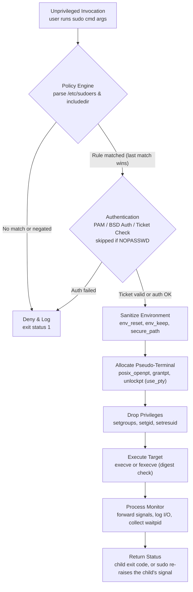

# sudo and sudoers

> [!summary] Claim
> Sudo delegates privileged execution without exposing root credentials by evaluating declarative policy specifications in sudoers, enforcing environment sanitization, isolating the controlling terminal via a dedicated pseudo-terminal, and transitioning process credentials at the kernel system-call boundary.

Part of [Shell Security](README.md) in [Shell and Unix Engineering](../README.md).

## TL;DR

- Mechanism: `sudo` is a set-user-ID root binary that parses declarative policies in `/etc/sudoers`, authenticates the invoking user unless the matching rule says `NOPASSWD`, rebuilds the environment from an allowlist via `env_reset`, allocates an isolated pseudo-terminal via `use_pty`, drops privileges to target credentials with `setgroups(2)` and `setresuid(2)`, and executes the target binary.
- Rule: grant least privilege by specifying absolute binary paths with strict argument regular expressions, enforce `Defaults env_reset` and `Defaults secure_path`, delegate file modifications through `sudoedit` rather than interactive editors, and always validate syntax via `visudo -c -s`.
- Trap: wildcard arguments in `sudoers` rules concatenate into a single space-separated string during matching, allowing `/bin/cat /var/log/messages*` to match `/bin/cat /var/log/messages /etc/shadow` and bypass command restrictions.
- Portability fact: `sudo` is not specified by POSIX, relying instead on POSIX credential primitives (`POSIX.1-2024 XSH 3 setuid`, `setreuid`, `setresuid`), while OpenBSD replaces `sudo` with the minimal `doas` utility in base.
- When not to use it: do not use `sudo` inside automated daemon pipelines, CI/CD jobs, or container workloads; rely on native Linux capabilities, systemd scoped units, service accounts, or container namespaces without set-user-ID binaries.

## Mental model



The user invokes `sudo`, which starts execution with real UID set to the calling user and effective UID set to 0 via the filesystem set-user-ID bit (`POSIX.1-2024 XSH 3 execve`).
Sudo first queries the policy engine, which parses `/etc/sudoers` and included files, because it must find the matching rule to know whether `NOPASSWD` applies; only then does it authenticate the invoker via PAM or a cached timestamp ticket (`struct timestamp_entry`); in `plugins/sudoers/sudoers.c`, `sudoers_check_common()` calls `sudoers_lookup()` before `check_user()`.
Once a rule matches under last-match-wins semantics, sudo rebuilds the environment (with `env_reset`, only `env_keep` and `env_check` survivors are copied), replaces `PATH` with `secure_path` when that option is set, and allocates a fresh pseudo-terminal (`use_pty`) to block terminal injection.
In the child process, sudo adjusts supplementary groups via `setgroups(2)`, sets group IDs via `setegid(2)` and `setgid(2)`, switches user IDs via `setresuid(2)`, and calls `execve(2)` or `fexecve(2)` (`src/exec.c`).
The parent process monitors execution, forwards signals such as `SIGINT` and `SIGWINCH`, logs input and output if configured, and returns the child termination status to the shell.

## How it works

### The privilege boundary and binary activation

Privilege elevation in Unix systems requires kernel intervention.
The `sudo` executable file (`/usr/bin/sudo`) has the set-user-ID bit enabled, typically with permissions `4755` (`-rwsr-xr-x`) and ownership `root:root` on Linux; the macOS host ships it as `4511` (`-r-s--x--x`) owned by `root:wheel` (measured with `ls -l /usr/bin/sudo`, as of 2026-11).
When an unprivileged user executes `sudo`, the kernel sets the effective user ID (EUID) of the resulting process to 0 while keeping the real user ID (RUID) equal to the invoker; `execve` then copies the new EUID (0) into the saved set-user-ID (SUID).
POSIX specifies this behavior in [`POSIX.1-2024 XSH 3 execve`](https://pubs.opengroup.org/onlinepubs/9799919799/functions/execve.html): if the set-user-ID mode bit of the new process image file is set, the effective user ID of the new process image shall be set to the user ID of the new process image file, and the effective user ID is then saved as the saved set-user-ID.
Because EUID is 0, the process gains superuser privilege, allowing it to read restricted configuration files (`/etc/sudoers`, `/etc/shadow`), open raw sockets, and change process credentials.

### Authentication and ticket caching

Before checking authorization, `sudo` validates the caller identity.
Unless the matching rule contains the `NOPASSWD:` tag, `sudo` queries PAM (`pam_authenticate(3)`) or BSD Authentication to verify the invoker password.
To prevent repetitive password prompts, `sudo` caches successful authentication in a ticket file under `/run/sudo/ts/<user>` (Linux; `sudoers(5)` names `/var/run/sudo/ts` as the build default) or `/var/db/sudo/ts/<user>` (the macOS host, measured with `ls -ld /var/db/sudo/ts`, as of 2026-11).
As documented in [`sudoers_timestamp(5)`](https://www.sudo.ws/docs/man/sudoers_timestamp.man/), modern versions use a structured multi-record format (comments lightly expanded):

```c
struct timestamp_entry {
    unsigned short version;     /* version number (new entries use 2) */
    unsigned short size;        /* entry size in bytes */
    unsigned short type;        /* TS_GLOBAL, TS_TTY, or TS_PPID */
    unsigned short flags;       /* TS_DISABLED, TS_ANYUID */
    uid_t auth_uid;             /* uid to authenticate as */
    pid_t sid;                  /* session ID associated with tty/ppid */
    struct timespec start_time; /* session/ppid start time */
    struct timespec ts;         /* time stamp (CLOCK_MONOTONIC) */
    union {
        dev_t ttydev;           /* tty device number */
        pid_t ppid;             /* parent pid */
    } u;
};
```

The ticket caching mechanism enforces four critical invariants:
1. Monotonic timing: timestamps use a monotonic time source (which does not move backward) where the system supports one, preferring one that keeps counting during suspend, rather than `CLOCK_REALTIME`, neutralizing system clock manipulation attacks where a local user moves wall-clock time backward (`sudoers_timestamp(5)`, field `ts`).
2. Session validation: the record stores `start_time`, the start time of the session leader (`TS_TTY`) or of the parent process (`TS_PPID`), preventing ticket reuse after the user logs out and the session or PID is recycled (`sudoers_timestamp(5)`; field added in sudoers 1.8.22).
3. Terminal scoping: the default `timestamp_type=tty` isolates tickets to a single controlling terminal device (`ttydev`), ensuring an active ticket in one shell session does not permit unauthenticated commands in an adjacent terminal.
4. Revocation: running `sudo -k` sets the `TS_DISABLED` flag on the current session's record (`sudoers_timestamp(5)`), while `sudo -K` removes every cached credential for the user regardless of terminal or parent process (`sudo(8)`).

### Policy parsing and evaluation semantics

The default policy module (`sudoers.so`) reads `/etc/sudoers` and included files referenced by `@include` or `@includedir` (and legacy `#include` / `#includedir`).
The policy engine evaluates rules using explicit lexical semantics:
- Top-to-bottom evaluation: rules are evaluated sequentially in the order they appear.
- Last match wins: when multiple rules match the invoking user, host, target runas identity, and command, the final matching entry in the file takes precedence.
- Aliases: four distinct alias categories exist: `User_Alias`, `Runas_Alias`, `Host_Alias`, and `Cmnd_Alias`.
- Alias naming: names must consist entirely of uppercase letters, numbers, and underscores, beginning with an uppercase letter (`[A-Z][A-Z0-9_]*`).
- Reserved words: `sudoers(5)` reserves `ALL` plus the option names `CHROOT`, `PRIVS`, `LIMITPRIVS`, `ROLE`, `TYPE`, `TIMEOUT`, `CWD`, `NOTBEFORE`, and `NOTAFTER`, and it also treats every valid `Defaults` option name as reserved; attempting to define an alias matching a reserved word triggers a syntax error.
- Include directory hygiene: `@includedir /etc/sudoers.d` parses files in sorted lexical order, explicitly skipping files whose names end in `~` or contain a `.` character to prevent editor backup files and package manager artifacts (`.rpmnew`, `.dpkg-dist`) from altering system privileges (`sudoers(5)`; the lab's `visudo` test proves that `99_corrupt~` and `50_corrupt.bak` are skipped).
- Recursion limit: `sudo` enforces a compile-time hard limit of 128 nested include files to guard against circular include loops (`MAX_SUDOERS_DEPTH` in `plugins/sudoers/toke.l`; also stated in `sudoers(5)`).

### Command matching and the wildcard argument trap

A command specification in `sudoers` consists of an optional digest, optional tags, an absolute binary path, and optional command-line arguments.
Command matching operates under strict rules defined in `sudoers(5)`:
- Path resolution: commands must be specified with fully qualified paths; relative paths are rejected.
- String concatenation: `sudo` concatenates all command-line arguments into a single space-separated string before matching against the `sudoers` pattern.
- Globbing across delimiters: in command-line arguments, shell glob characters (`*`, `?`, `[...]`) match any character, including white space and directory separators (`/`); in the command's path name, by contrast, a wildcard does not match `/`, so `/usr/bin/*` matches `/usr/bin/who` but not `/usr/bin/X11/xterm` (`sudoers(5)`, Wildcards).
- The traversal vulnerability: because `*` matches spaces and slashes, a rule granting `/bin/cat /var/log/messages*` matches the invocation `sudo cat /var/log/messages /etc/shadow`, allowing the user to view arbitrary files (this exact example is in `sudoers(5)`).
- Regular expressions: to prevent wildcard argument traversal, `sudo` 1.9.10 and later supports POSIX extended regular expressions for path names and arguments, written starting with `^` and ending with `$`; `sudoers(5)` rewrites the example as:
  `%operator ALL = /bin/cat ^/var/log/messages[^[:space:]]*$`
- Command digests: rules can specify SHA-2 digests (`sha224:`, `sha256:`, `sha384:`, `sha512:` in hex or base64, supported since 1.8.7); when specified, `sudo` hashes the target executable and, under the default `fdexec=digest_only`, executes the open file descriptor via `fexecve(2)` to eliminate Time-of-Check to Time-of-Use (TOCTOU) binary replacement races (`sudoers(5)`).

### Environment sanitization (`env_reset` and `secure_path`)

Shells and runtime linkers load libraries and execute startup scripts based on environment variables.
Allowing an untrusted caller to pass an arbitrary environment across a privilege boundary results in immediate privilege escalation.
Modern `sudo` enables `Defaults env_reset` by default, which constructs a clean environment table in `plugins/sudoers/env.c`.
The environment sanitization pipeline operates through three tables (verified against `plugins/sudoers/env.c`, as of 2026-11):
1. `initial_badenv_table`: the default `env_delete` list, applied when `env_reset` is not in effect, including when a user whose command carries `SETENV` disables it with `sudo -E`; with `env_reset` on (the default), a variable survives only if it is in `env_keep` or passes `env_check`, and variables a `SETENV` user sets on the command line bypass all three lists (`sudoers(5)`, `SETENV and NOSETENV`):
   - Dynamic linker overrides: `LD_*`, `_RLD*`, `SHLIB_PATH` (HP-UX builds only), `LIBPATH` and `LDR_*` (AIX builds only), `DYLD_*` (macOS builds only).
   - Shell startup and execution controls: `BASH_ENV`, `ENV`, `IFS`, `PS4`, `GLOBIGNORE`, `BASHOPTS`, `SHELLOPTS`, plus the zsh and ksh hooks `FPATH`, `NULLCMD`, `READNULLCMD`, `ZDOTDIR`, and `TMPPREFIX`.
   - Exported shell functions: `*=()*` (the Shellshock-era bash function encoding; since sudo 1.8.21 an `env_delete` pattern, before that values beginning with `()` were always removed, per `sudoers(5)`).
   - Language runtime path overrides: `PYTHONHOME`, `PYTHONPATH`, `PYTHONSTARTUP`, `PYTHONINSPECT`, `PYTHONUSERBASE`, `PERLLIB`, `PERL5LIB`, `PERL5OPT`, `PERL5DB`, `PERLIO_DEBUG`, `RUBYLIB`, `RUBYOPT`, `NODE_OPTIONS`, `NODE_PATH`, `JAVA_TOOL_OPTIONS`, `_JAVA_OPTIONS`, `CLASSPATH`, `GIT_SSH_COMMAND`, `GIT_CONFIG_*`.
   - Terminal and locale databases: `TERMINFO`, `TERMINFO_DIRS`, `TERMPATH`, `TERMCAP` (the source comment notes that it should apply only to values beginning with `/`, but the table entry matches by name), `GCONV_PATH`.
2. `initial_checkenv_table`: contains variables that are checked for dangerous characters (`%` and `/`), including `COLORTERM`, `LANG`, `LANGUAGE`, `LC_*`, `LINGUAS`, `TERM`, and `TZ`.
3. `initial_keepenv_table`: contains safe variables preserved across elevation, including `COLORS`, `DISPLAY`, `HOSTNAME`, `KRB5CCNAME`, `LS_COLORS`, `PATH`, `PS1`, `PS2`, `XAUTHORITY`, `XAUTHORIZATION`, and `XDG_CURRENT_DESKTOP`.

Furthermore, `Defaults secure_path` resets the `PATH` variable to a trusted value, ensuring that `sudo` never searches caller-controlled directories for executables.
The option itself is disabled by default in the plugin (`sudoers(5)`); the upstream default `sudoers` file (`plugins/sudoers/sudoers.in`) sets it to `/usr/local/sbin:/usr/local/bin:/usr/sbin:/usr/bin:/sbin:/bin` (the `secure_path` value in `configure.ac`, changeable with `--with-secure-path-value`), and distributions commonly ship an equivalent line.

### Terminal isolation and pseudo-terminal allocation (`use_pty`)

A classic vulnerability in set-user-ID programs running on an interactive terminal is the `TIOCSTI` terminal injection attack (CVE-2005-4890).
The `TIOCSTI` ioctl allows a process attached to a terminal to inject characters directly into the terminal input queue; it is a BSD and Linux terminal ioctl that POSIX does not specify.
If a privileged command run under `sudo` drops privileges or executes an untrusted sub-command, that unprivileged child can inject commands (such as `\nrm -rf ~\n`) into the caller terminal.
After `sudo` exits and returns control to the user's unprivileged shell, the injected keystrokes are read and executed with the caller's privileges.
To eliminate this entire class of attacks, modern `sudo` enables `Defaults use_pty` by default (on by default in sudo 1.9.14 and later, per `sudoers(5)`); it has no effect when `sudo` itself is not attached to a terminal.
When `use_pty` is active:
1. Sudo opens a new pseudo-terminal pair via `openpty(3)` or, where that is missing, `posix_openpt()` (`src/get_pty.c`).
2. The privileged command runs in a child process attached to the slave pseudo-terminal.
3. The parent `sudo` process remains attached to the user real terminal and acts as a bidirectional proxy, forwarding standard I/O and terminal resize signals (`SIGWINCH`).
4. Any `TIOCSTI` call executed by the child injects bytes only into its own private slave pseudo-terminal, leaving the administrator controlling terminal completely untouched.

### Credential transition and execution

The actual execution setup occurs in `src/exec.c` inside the function `exec_setup()`.
The kernel credential switch follows a strict sequence (verified against `src/exec.c`, as of 2026-11):
1. Group initialization: `set_user_groups()` calls `sudo_setgroups(details->cred.ngroups, details->cred.groups)` to update the supplementary group vector.
2. Group credential switch: the same function then calls `setegid(details->cred.egid)` and `setgid(details->cred.gid)`; there is no `setresgid` call; `exec_setup()` then applies the priority, the `umask`, and the policy's resource limits.
3. Close file descriptors: `close_fds()` calls `closefrom_except()` to close every descriptor from the policy's `closefrom` value (3 by default) upward, except those explicitly preserved (`preserved_fds`, plus debug and error pipes), neutralizing file descriptor leakage attacks; this happens before `chroot` and the UID change.
4. Process limit management: `sudo` temporarily unlimits `RLIMIT_NPROC` (`unlimit_nproc()` in `src/limits.c`) because, per its source comment, Linux's `setuid()` returns `EAGAIN` if the target UID's process limit would be exceeded; `setuid(2)` notes that since Linux 3.1 this error no longer occurs there and the check moved to `execve(2)`.
5. User credential switch: `sudo` calls `setresuid(uid, euid, euid)` (or `setreuid(2)` on systems lacking `setresuid`, or plain `setuid` as a last resort), then `restore_nproc()`.
6. Working directory change: if `CWD=` is specified, `sudo` switches directory after dropping privileges.
7. Execution: `sudo_execve()` in `src/exec_common.c` calls `fexecve(2)` if a verified digest descriptor is present, or `execve(2)`.
   If `execve(2)` of a path (not a descriptor) fails with `ENOEXEC` (a shell script lacking a binary format or shebang), `sudo` falls back to `execve(_PATH_SUDO_BSHELL, ["sh", path, ...], envp)`.

### Safe file editing with `sudoedit`

Running full-featured text editors (`vi`, `vim`, `nano`, `emacs`) directly under `sudo` is inherently unsafe because editors provide shell escapes (`:!sh`), python/lua macro scripting, and arbitrary file write capabilities.
To solve this, `sudo` provides `sudoedit` (`sudo -e`).
The `sudoedit` mechanism in `src/sudo_edit.c` operates through five discrete phases:
1. Policy validation: `sudo` verifies that the caller is authorized in `sudoers` to edit the specified file paths (e.g., `operator ALL = sudoedit /etc/hosts`).
2. Temporary copy creation: `sudo` opens the destination file with the target (runas) user's credentials (`switch_user()` to the runas UID in `src/sudo_edit.c`), creates a temporary copy with `mkstemps(3)` (mode `0600`) in `/var/tmp` or `/tmp` owned by the invoking unprivileged user, and records the original's size and high-resolution mtime (`osize`, `struct timespec omtim`).
3. Privilege drop: `sudo` drops root privileges completely, reverting real and effective credentials to the invoking user.
4. Editor execution: `sudo` runs the user preferred editor (chosen from `SUDO_EDITOR`, `VISUAL`, `EDITOR`, or `Defaults editor`) on the temporary file as the unprivileged user.
5. Copy-back: after the editor process terminates, `sudo` re-evaluates the temporary file; if its mtime or size changed, `sudo` switches back to the target user's credentials and overwrites the original file in place with `sudo_copy_file()`; this is an in-place overwrite, not an atomic rename, and on failure the edit is left in the temporary file (`src/sudo_edit.c`).

## Numbers and limits

| Property | Value / Limit | Mechanism / Source | Measured / Date |
|---|---|---|---|
| Include nesting limit | 128 | `MAX_SUDOERS_DEPTH` in `plugins/sudoers/toke.l`; stated in `sudoers(5)` | Verified in source `(as of 2026-11)` |
| Timestamp ticket timeout | 5 minutes | `Defaults timestamp_timeout = 5` in `sudoers(5)` | Verified in man page `(as of 2026-11)` |
| Sudoers grammar version | 50 | Sudoers policy grammar version | Measured via `sudo -V` on the macOS host `(as of 2026-11)` |
| Policy plugin version | 1.9.17p2 | Sudoers policy plugin release | Measured via `sudo -V` on the macOS host `(as of 2026-11)` |
| Default `sudoers` file mode | `0440` (`-r--r-----`) | `SUDOERS_MODE` default in `configure.ac` (`--with-sudoers-mode` changes it) | Verified in source `(as of 2026-11)` |
| Sudoers temporary file permissions | `0600` (`-rw-------`) | Sudoedit temporary file from `mkstemps(3)` in `sudo_edit_mktemp()` | Verified in `src/sudo_edit.c` `(as of 2026-11)` |
| Maximum numeric UID boundary | 4294967295 (`(uid_t)-1` with a 32-bit `uid_t`) | Special "leave unchanged" value in `setresuid(2)` and `setreuid(2)` / CVE-2019-14287 advisory | Lab probe proves `setreuid(-1, -1)` leaves IDs unchanged `(as of 2026-11)` |
| Default `secure_path` | `/usr/local/sbin:/usr/local/bin:/usr/sbin:/usr/bin:/sbin:/bin` | Set by the upstream default `sudoers` file (`plugins/sudoers/sudoers.in`, value from `configure.ac`); the option itself is off by default per `sudoers(5)` | Verified in source `(as of 2026-11)` |
| `use_pty` default status | Enabled by default | Default since sudo version 1.9.14 | Verified in `sudoers(5)` `(as of 2026-11)` |
| Kernel `TIOCSTI` sysctl | `dev.tty.legacy_tiocsti = 0` | Linux kernel 6.2+ toggle (`CONFIG_LEGACY_TIOCSTI`); when 0, `TIOCSTI` needs `CAP_SYS_ADMIN` | Verified in `drivers/tty/tty_io.c` and Kernelnewbies Linux 6.2 `(as of 2026-11)` |
| Codebase footprint: sudo | well over 100,000 lines of C (about 5.8 MB of C source) | `sudo-project/sudo` repository | GitHub languages API `(as of 2026-11)` |
| Codebase footprint: doas | ~1,100 lines (`doas.c` 498, `doas.h` 49, `env.c` 235, `parse.y` 354) | OpenBSD `doas` base implementation, in base since OpenBSD 5.8 | Counted with `wc -l` on `openbsd/src` master `(as of 2026-11)` |
| Default execution umask | `0022` | Union with user umask unless `umask_override` | Verified in `sudoers(5)` `(as of 2026-11)` |
| Sudo normal exit values | 0 (success), 1 (error/denial) | Exit codes on authorization/exec failure | Verified in `sudo(8)` `(as of 2026-11)` |
| Sudo signal exit status | 128 + N in most shells (256 + N in ksh93, 384 + N in yash) | `sudo` sends itself the signal that killed the command (`sudo(8)` EXIT VALUE); the shell encodes it | Shell encoding measured in the shell matrix `(as of 2026-11)` |

## Portability

The table below contrasts privilege delegation implementations, system calls, and utility behavior across platforms and shells.

| Mechanism / Surface | Linux (glibc / systemd) | macOS (Darwin 24) | FreeBSD 14 | OpenBSD 7.6 | BusyBox / Alpine |
|---|---|---|---|---|---|
| Primary delegation utility | `sudo` (`/usr/bin/sudo`) | `sudo` (`/usr/bin/sudo`) | `sudo` (ports) / `doas` | `doas` (`/usr/bin/doas`) in base | `doas` (`OpenDoas`) or `sudo` |
| Credential system call | `setresuid(2)`, `setresgid(2)` | `setreuid(2)`, `setregid(2)` | `setresuid(2)`, `setresgid(2)` | `setresuid(2)`, `setresgid(2)` | `setresuid(2)` (musl) |
| Configuration file | `/etc/sudoers`, `/etc/sudoers.d/` | `/private/etc/sudoers` | `/usr/local/etc/sudoers` | `/etc/doas.conf` | `/etc/doas.conf` or `/etc/sudoers` |
| Configuration editor | `visudo` (`/usr/sbin/visudo`) | `visudo` (`/usr/sbin/visudo`) | `visudo` (ports) | None (`doas -C` for check) | `visudo` (`sudo` package); `doas` package has no `vidoas` |
| Authentication backend | Linux-PAM / SSSD | OpenPAM / LocalDirectory | OpenPAM (port option `PAM`, default on) | BSD Authentication | Neither builds PAM: `sudo` reports method `passwd`, `doas` is built `--without-pam` |
| Ticket storage path | `/run/sudo/ts/<user>` | `/var/db/sudo/ts/<user>` | `/var/run/sudo/ts/<user>` | `persist` uses the kernel tty ioctl `TIOCSETVERAUTH` (no file) | `/run/sudo/ts` or `doas` persist |
| Binary integrity pinning | `sha256:` digest in `sudoers` | `sha256:` digest in `sudoers` | `sha256:` digest in `sudoers` | Not supported in `doas.conf` | `sha256:` in `sudo` (musl) |
| File descriptor execution | `fexecve(2)` | `fexecve(2)` | `fexecve(2)` | No `fexecve` (no OpenBSD man page); `doas` calls `execvpe(3)` | `fexecve(2)` (musl) |
| `TIOCSTI` kernel protection | `sysctl dev.tty.legacy_tiocsti=0` (then needs `CAP_SYS_ADMIN`) | No sysctl; unprivileged use needs the controlling tty (else `EACCES`) | No sysctl in 14.4; `security.bsd.allow_tiocsti` exists in 14-STABLE and `main` | Neutered in 6.2 (returns `EIO`); definition removed in 6.4 (`ENOTTY`) | Kernel dependent |
| Sub-command restriction | `NOEXEC` (seccomp or dso) | `NOEXEC` (`__interpose`) | `NOEXEC` (`LD_PRELOAD`) | Pledge / unveil (native) | `NOEXEC` (`LD_PRELOAD`) |
| POSIX shell wrapper behavior | `sh -c 'sudo cmd'` runs clean | `/bin/sh` runs clean | `/bin/sh` runs clean | `/bin/sh` runs clean | BusyBox `ash` runs clean |

Evidence for the table: the macOS column's `setreuid`-only credential call (the SDK's `unistd.h` declares `setreuid` and no `setresuid`), `/private/etc/sudoers`, `visudo`, and the `/var/db/sudo/ts` ticket directory were measured on the host; the `NOEXEC` mechanisms follow `src/sudo_noexec.c` (`__interpose` on macOS, a seccomp filter where Linux supports it, `LD_PRELOAD` elsewhere); the OpenBSD `persist` and `execvpe` cells follow `usr.bin/doas/doas.c`.
The lab's tests prove none of these cells beyond `visudo` include handling (its `visudo` test is a no-op where `visudo` is absent).
The remaining cells rest on these sources and measurements `(as of 2026-11)`:
- macOS `TIOCSTI`: `sysctl -a` on the macOS 27.3 host has no `tiocsti` key, an unprivileged `ioctl(TIOCSTI)` on a pty slave that is not the controlling tty returned `EACCES`, and `bsd/kern/tty.c` in xnu checks only `suser()`, `FREAD`, and `isctty()`.
- FreeBSD `TIOCSTI`: `tty_sti_check()` in `sys/kern/tty.c` gates on the `security.bsd.allow_tiocsti` sysctl (added in June 2026); the `releng/14.4` and `releng/15.0` trees lack it and `stable/14` (14.5) and `stable/15` have it, so a 14.x release gets the knob only from 14.5.
- OpenBSD `TIOCSTI`: the commit of 2017-06-29 made it return `EIO` without acting (first shipped in 6.2), and the commit of 2018-06-16 deleted the definition so the ioctl returns `ENOTTY` (6.4).
- FreeBSD paths and authentication: the `security/sudo` port sets `--sysconfdir=${PREFIX}/etc` (so `/usr/local/etc/sudoers`), `--with-rundir=/var/run/sudo`, and enables `PAM` by default; `vidoas` ships with the separate `security/doas` port.
- Alpine: a `sudo` 1.9.17p2 and `doas` 6.8.2 install on Alpine 3.22 showed `/etc/sudoers`, `/etc/doas.conf`, ticket directory `/run/sudo/ts`, authentication method `passwd`, `/usr/sbin/visudo`, and no `vidoas`; the `aports` `APKBUILD` files pass `--without-pam` to both.

Across shell families in automated scripts:
- POSIX `sh`: invoking `sudo -n command` ensures non-interactive failure instead of hanging on an unavailable TTY password prompt.
- macOS `bash 3.2`: functions exported via `export -f` are converted to environment variables with format `BASH_FUNC_name%%=() { ... }` (measured with bash 3.2.57 on the macOS host), which `sudo` drops: with `env_reset` because the name is not in `env_keep` and `env_should_keep()` rejects values starting with `() `, and without it via the `*=()*` pattern in `initial_badenv_table`.
- Current `bash` (5.3): respects non-zero exit codes from `sudo` under `set -e`; preserves `PIPESTATUS[0]` when `sudo` is the first stage in a pipeline.
- `zsh`: native zsh does not perform field splitting on unquoted `$SUDO_USER` or `$SUDO_COMMAND` unless `SH_WORD_SPLIT` is active, while `zsh --emulate sh` does split them, as measured in the shell matrix.
- `dash` and `BusyBox ash`: lack `PIPESTATUS`; scripts checking `sudo` in pipelines must rely on standard pipe mechanics or temporary status files.

## Worked example

The worked example audits a target `sudoers` configuration for structural security vulnerabilities, unanchored wildcard argument crossing, GTFOBins shell escape vectors, reserved word misuse, and syntax errors.
The full test suite and probe scripts are available in the [lab](../labs/17-sudo-and-sudoers/).
The probes `arg_cross_probe.sh` and `env_filter.sh` model sudo's matching and filtering rules in shell and `uid_bypass_probe.c` exercises the kernel's `setreuid(-1, -1)` semantics; none of them runs `sudo`, and only the `visudo` test exercises sudo's own parser.

Here is the complete implementation of `sudoers_audit.sh`:

```sh
#!/bin/sh
# sudoers_audit.sh: audits sudoers configuration files for critical anti-patterns,
# privilege escalation risks, wildcard argument traps, and syntax errors.
#
# Usage:
#   sudoers_audit.sh <sudoers-file>

set -eu

if [ "$#" -lt 1 ]; then
  printf 'Usage: %s <sudoers-file>\n' "$0" >&2
  exit 2
fi

target="$1"

if [ ! -f "$target" ]; then
  printf 'Error: file not found: %s\n' "$target" >&2
  exit 2
fi

critical_count=0
warning_count=0

report() {
  severity="$1"
  line_no="$2"
  msg="$3"
  printf '[%s] line %s: %s\n' "$severity" "$line_no" "$msg"
  if [ "$severity" = "CRITICAL" ]; then
    critical_count=$((critical_count + 1))
  elif [ "$severity" = "WARNING" ]; then
    warning_count=$((warning_count + 1))
  fi
}

# 1. Run visudo syntax validation if available
if command -v visudo >/dev/null 2>&1; then
  if ! visudo_err=$(visudo -c -s -f "$target" 2>&1); then
    report "CRITICAL" "0" "visudo syntax validation failed: $visudo_err"
  fi
fi

# 2. Analyze directives line by line
line_num=0
has_env_reset=0
has_secure_path=0

while IFS= read -r raw_line || [ -n "$raw_line" ]; do
  line_num=$((line_num + 1))

  # Strip comments (unless #include or #includedir)
  case "$raw_line" in
    \#include*)
      clean_line="$raw_line"
      ;;
    \#*)
      continue
      ;;
    *)
      clean_line="${raw_line%%#*}"
      ;;
  esac

  # Trim leading and trailing whitespace
  clean_line=$(printf '%s' "$clean_line" | awk '{$1=$1};1')
  [ -n "$clean_line" ] || continue

  # Check Defaults settings
  case "$clean_line" in
    *env_reset*)
      has_env_reset=1
      ;;
    *) ;;
  esac
  case "$clean_line" in
    *secure_path=*)
      has_secure_path=1
      ;;
    *) ;;
  esac

  # Check for reserved words used as alias names
  case "$clean_line" in
    *Alias[[:space:]]ALL[[:space:]]* | *Alias[[:space:]]ALL=*)
      report "CRITICAL" "$line_num" "reserved word ALL used as alias name"
      ;;
    *Alias[[:space:]]CHROOT[[:space:]]* | *Alias[[:space:]]CHROOT=*)
      report "CRITICAL" "$line_num" "reserved word CHROOT used as alias name"
      ;;
    *Alias[[:space:]]CWD[[:space:]]* | *Alias[[:space:]]CWD=*)
      report "CRITICAL" "$line_num" "reserved word CWD used as alias name"
      ;;
    *Alias[[:space:]]TIMEOUT[[:space:]]* | *Alias[[:space:]]TIMEOUT=*)
      report "CRITICAL" "$line_num" "reserved word TIMEOUT used as alias name"
      ;;
    *) ;;
  esac

  # Check for ineffective command negation: ALL, !...
  case "$clean_line" in
    *=*\ ALL,\ !* | *=*ALL,\ !*)
      report "CRITICAL" "$line_num" "ineffective command subtraction: negation with ALL can be bypassed via copies, hardlinks, or secondary shells"
      ;;
    *) ;;
  esac

  # Check for wildcard argument crossing in command specifications
  case "$clean_line" in
    *"/bin/cat "*\* | *"/cat "*\*)
      report "CRITICAL" "$line_num" "wildcard argument crossing trap: cat argument ends in wildcard, allows reading arbitrary files"
      ;;
    *) ;;
  esac

  # Check for interactive editors or pagers granted without sudoedit or NOEXEC
  case "$clean_line" in
    *\ /usr/bin/vi\ * | *\ /bin/vi\ * | *\ /usr/bin/vi | *\ /bin/vi | *\ /usr/bin/vim* | *\ /usr/bin/nano*)
      case "$clean_line" in
        *NOEXEC:* | *sudoedit*)
          ;;
        *)
          report "CRITICAL" "$line_num" "editor granted without sudoedit or NOEXEC: allows shell escape to full root"
          ;;
      esac
      ;;
    *\ /usr/bin/less* | *\ /usr/bin/more* | *\ /usr/bin/view*)
      case "$clean_line" in
        *NOEXEC:*)
          ;;
        *)
          report "WARNING" "$line_num" "pager granted without NOEXEC: allows shell escape (:!sh)"
          ;;
      esac
      ;;
    *\ /usr/bin/awk* | *\ /usr/bin/find* | *\ /usr/bin/tee*)
      case "$clean_line" in
        *NOEXEC:*)
          ;;
        *)
          report "WARNING" "$line_num" "utility with shell execution or arbitrary file write granted: evaluate NOEXEC or restrict arguments"
          ;;
      esac
      ;;
    *) ;;
  esac

  # Check included directories for invalid file patterns
  case "$clean_line" in
    @includedir\ * | \#includedir\ *)
      inc_dir="${clean_line#*includedir }"
      inc_dir=$(printf '%s' "$inc_dir" | awk '{$1=$1};1')
      if [ -d "$inc_dir" ]; then
        for f in "$inc_dir"/*; do
          [ -e "$f" ] || continue
          base="${f##*/}"
          case "$base" in
            *~ | *.*)
              report "WARNING" "$line_num" "file $base in includedir contains . or ends in ~ and will be silently ignored by sudo"
              ;;
            *) ;;
          esac
        done
      fi
      ;;
    *) ;;
  esac
done <"$target"

if [ "$has_env_reset" -eq 0 ]; then
  report "WARNING" "0" "missing explicit Defaults env_reset (recommended for defensive hygiene)"
fi

if [ "$has_secure_path" -eq 0 ]; then
  report "WARNING" "0" "missing explicit Defaults secure_path (recommended to prevent PATH hijacking)"
fi

printf 'Audit complete: %d critical, %d warnings\n' "$critical_count" "$warning_count"

if [ "$critical_count" -gt 0 ]; then
  exit 1
fi
exit 0
```

When evaluated against a test file containing anti-patterns:

```sudoers
Defaults env_reset
Defaults secure_path="/usr/local/sbin:/usr/local/bin:/usr/sbin:/usr/bin:/sbin:/bin"
User_Alias ALL = root
operator ALL = (ALL) ALL, !/bin/sh
webadmin ALL = (root) /bin/cat /var/log/nginx/*
secops ALL = (root) /usr/bin/vim
```

Run once on the macOS host (sudo 1.9.17p2 `visudo`, as of 2026-11), the script produced this output; the lab asserts each finding and the exit status separately rather than this exact text, and the first line's path and wording come from the installed `visudo`:

```text
[CRITICAL] line 0: visudo syntax validation failed: /tmp/test.sudoers:3:12: syntax error, reserved word ALL used as an alias name
User_Alias ALL = root
           ^~~
[CRITICAL] line 3: reserved word ALL used as alias name
[CRITICAL] line 4: ineffective command subtraction: negation with ALL can be bypassed via copies, hardlinks, or secondary shells
[CRITICAL] line 5: wildcard argument crossing trap: cat argument ends in wildcard, allows reading arbitrary files
[CRITICAL] line 6: editor granted without sudoedit or NOEXEC: allows shell escape to full root
Audit complete: 5 critical, 0 warnings
```

## Pitfalls

> [!warning] The Wildcard Argument Crossing Trap
> Trigger: configuring a `sudoers` rule with unanchored wildcard arguments, such as `%operator ALL = (root) /bin/cat /var/log/messages*`.
> Symptom: an unprivileged user executes `sudo cat /var/log/messages /etc/shadow` and successfully dumps the system password shadow database.
> Fix: replace glob wildcards with anchored regular expressions (sudo 1.9.10 and later; `sudoers(5)` suggests `^/var/log/messages[^[:space:]]*$`, and the lab's probe uses `^/var/log/messages/[a-zA-Z0-9._-]+$`), or enforce exact command path and argument specifications without wildcards.

> [!warning] Shell Escapes via Administrative Utilities (GTFOBins)
> Trigger: granting `sudo` execution rights to standard interactive utilities such as `vim`, `less`, `more`, `awk`, `find`, `tee`, or `systemctl`.
> Symptom: the user executes the program under `sudo` and triggers a built-in shell escape (e.g. `:!sh` in `vim`, `!sh` in `less`, `awk 'BEGIN {system("/bin/sh")}'`, `find . -exec /bin/sh \;`), instantly obtaining an unrestricted root shell.
> Fix: never grant raw editor binaries; use `sudoedit` for file editing, apply the `NOEXEC:` tag to prevent sub-process execution, or grant tightly scoped wrapper scripts that sanitize arguments.

> [!warning] The Ineffective Negation Trap
> Trigger: attempting to grant broad administrative privileges while excluding shells using negation syntax: `bill ALL = ALL, !/bin/sh, !/bin/bash`.
> Symptom: user `bill` copies `/bin/sh` to `/tmp/sh` or hardlinks it, then runs `sudo /tmp/sh`, or runs `sudo python -c 'import pty; pty.spawn("/bin/sh")'`, trivially gaining root.
> Fix: follow `sudoers(5)` security guidance: do not subtract commands from `ALL`; use an allowlist of specific required commands rather than a blocklist of excluded binaries.

> [!warning] Terminal Command Injection via TIOCSTI (CVE-2005-4890)
> Trigger: running `sudo` on a legacy system or with `Defaults !use_pty`, allowing privileged child processes to share the invoker controlling terminal.
> Symptom: a compromised or unprivileged sub-process issues `ioctl(0, TIOCSTI, &c)` to inject arbitrary commands into the caller terminal buffer, executing commands under the caller identity once `sudo` exits.
> Fix: ensure `Defaults use_pty` is active in `sudoers` (default since sudo 1.9.14), or set the Linux kernel sysctl `dev.tty.legacy_tiocsti = 0` (Linux kernel 6.2+); the sysctl still lets a process holding `CAP_SYS_ADMIN` use `TIOCSTI` (`drivers/tty/tty_io.c`), so it stops an unprivileged sub-process but not a child still running as root.

> [!warning] Sudoedit Parameter Injection (CVE-2023-22809)
> Trigger: a user with `sudoedit` privileges on a benign file sets their `SUDO_EDITOR`, `VISUAL`, or `EDITOR` environment variable to include command options and extra paths: `EDITOR="vim -- /etc/shadow"`.
> Symptom: vulnerable versions of `sudo` (1.8.0 through 1.9.12p1, per the [sudo advisory](https://www.sudo.ws/security/advisories/sudoedit_any/)) split the editor variable on spaces and appended the target file after `--`, allowing the user to edit arbitrary system files.
> Fix: upgrade `sudo` to 1.9.12p2 or later, which rejects a user editor containing a `--` argument, or apply the advisory's workaround `Defaults!sudoedit env_delete+="SUDO_EDITOR VISUAL EDITOR"` so `sudoedit` ignores the user's editor variables; note that `env_editor` only governs `visudo`, not `sudoedit` (`sudoers(5)`).

> [!warning] Integer Parsing and Setresuid UID -1 Bypass (CVE-2019-14287)
> Trigger: a sudoers configuration allows running commands as any user except root: `alice ALL = (ALL, !root) /usr/bin/id`.
> Symptom: user `alice` runs `sudo -u#-1 id -u` or `sudo -u#4294967295 id -u`; `sudo` parses `-1` as integer `-1`, matches `ALL` (the bug needs `ALL` listed first in the Runas specification), and invokes `setresuid(-1, -1, -1)`, which [POSIX](https://pubs.opengroup.org/onlinepubs/9799919799/functions/setresuid.html) specifies leaves the UID unchanged (0), executing the command as root.
> Fix: upgrade `sudo` to version 1.8.28 or later (all earlier versions are affected, per the [sudo advisory](https://www.sudo.ws/security/advisories/minus_1_uid/)), where numeric user IDs are validated and `-1` / `4294967295` are explicitly rejected.

> [!warning] Command Line Unescaping Heap Overflow - Baron Samedit (CVE-2021-3156)
> Trigger: invoking `sudoedit` with `-s` (shell mode) and arguments ending in a single trailing backslash (`\`): `sudoedit -s '\'`.
> Symptom: an unauthenticated local user triggers a heap buffer overflow in `set_cmnd()` during argument unescaping (named in the [Qualys advisory](https://www.qualys.com/2021/01/26/cve-2021-3156/baron-samedit-heap-based-overflow-sudo.txt)), overwriting internal heap structures and gaining root privilege without any sudoers permissions.
> Fix: upgrade `sudo` to 1.8.32 or 1.9.5p2 or later (affected: 1.7.7 through 1.7.10p9, 1.8.2 through 1.8.31p2, and 1.9.0 through 1.9.5p1, per the [sudo advisory](https://www.sudo.ws/security/advisories/unescape_overflow/)); the advisory lists no workaround, so audit systems to verify patch deployment.

> [!warning] Silent Ignore of Misnamed Files in includedir
> Trigger: dropping a file named `01_webadmin.conf` or `backup_rules~` into `/etc/sudoers.d/`.
> Symptom: `sudo` silently ignores the configuration rules because `sudoers(5)` ignores any filename in an `@includedir` directory that contains a period (`.`) or ends in a tilde (`~`).
> Fix: name files in `/etc/sudoers.d/` using only alphanumeric characters and underscores (e.g. `/etc/sudoers.d/01_webadmin`), and check inclusions with `visudo -c`.

> [!warning] Environment Leaks via Unfiltered env_keep
> Trigger: configuring `Defaults env_keep += "PYTHONPATH PERL5LIB NODE_OPTIONS"` to facilitate user development scripts.
> Symptom: an attacker with permission to run a single python or node utility as root sets `PYTHONPATH=/tmp/evil` containing a malicious module, achieving instant root code execution.
> Fix: never add runtime library search paths (`PYTHONPATH`, `PERL5LIB`, `NODE_PATH`, `RUBYLIB`) to `env_keep`; use wrappers that explicitly scrub or lock runtime environments.

## Security and robustness

Hardening `sudo` and `sudoers` requires defense-in-depth across the operating system, the sudoers policy, and the application scripts:

### Sudoers baseline configuration

A production `sudoers` file must establish restrictive defaults at the beginning of `/etc/sudoers`:

```sudoers
# Mandatory security defaults
Defaults env_reset
Defaults secure_path="/usr/local/sbin:/usr/local/bin:/usr/sbin:/usr/bin:/sbin:/bin"
Defaults use_pty
Defaults log_input, log_output
Defaults iolog_dir="/var/log/sudo-io"
Defaults timestamp_type=tty
Defaults timestamp_timeout=5
Defaults passwd_tries=3
Defaults umask=0027
Defaults umask_override
```

### Policy design rules
- Absolute paths: every command specification must use an absolute path; never omit the leading `/`.
- Reject wildcards in arguments: avoid shell globs in arguments; use exact argument lists or strictly anchored regular expressions (`^...$`).
- Disallow interpreters: never grant `sudo` rights on general-purpose scripting interpreters (`python`, `perl`, `ruby`, `node`, `bash`, `sh`).
  If a script must be run as root, write a compiled C wrapper or place the script in root-owned `/usr/local/sbin` with mode `0700` and grant permission only to that specific script.
- Mandatory `sudoedit`: always configure file modifications via `sudoedit /path/to/file` rather than `sudo vi /path/to/file`.
- Command digest pinning: for critical commands, specify cryptographic SHA-256 hashes (`sha256:...`) to ensure that binary tampering or library replacement attacks fail before execution.

### Operational hygiene
- Always use `visudo`: never edit `/etc/sudoers` or `/etc/sudoers.d/*` with standard text editors; `visudo` locks the file against simultaneous edits, edits a temporary copy named after the target with `.tmp` appended (so in the same directory and filesystem), verifies syntax before installing it, and prevents concurrent write corruption (`visudo(8)`).
- Automated CI validation: integrate `visudo -c -s -f <file>` into infrastructure-as-code pipelines to catch undefined aliases and syntax errors before deploying rules to production fleets.
- Restrict file permissions: ensure `/etc/sudoers` and all files in `/etc/sudoers.d/` have mode `0440` and are owned by `root:root`.

## The principal's view

At staff-plus and principal level, the central security reality is that fine-grained `sudoers` rule sets are almost always an illusion of security.
The Unix command-line utility surface was designed for interactive power and flexibility, not for capability confinement.
Hundreds of common utilities (documented extensively in GTFOBins) provide mechanisms to execute sub-commands, read arbitrary files, write arbitrary files, load shared libraries, or trigger environment escapes.
Attempting to create a "safe" restricted sudoers configuration that grants an unprivileged user access to utilities like `tar`, `find`, `awk`, `man`, `less`, `curl`, `rsync`, or `systemctl` inevitably grants full root equivalence.

The principal engineer's architecture decisions follow clear operational principles:
1. Sudo is an interactive human tool, not a service authentication mechanism: automated deployment pipelines, CI/CD runners, and background daemons must never call `sudo`.
   Automation should use dedicated service identities, role-based access control, short-lived API tokens, or container orchestrator privileges.
2. The Sudo-less architecture: modern production infrastructure aims to eliminate `sudo` entirely from production hosts.
   By leveraging immutable machine images, ephemeral credentials via mTLS/OIDC, and isolated container boundaries, engineers do not log into individual servers or escalate privileges interactively.
3. Native privilege partitioning over monolithic elevation: when an application requires specific privileged operations (such as binding to port 443 or tracing network interfaces), assign discrete Linux capabilities (`CAP_NET_BIND_SERVICE`, `CAP_NET_ADMIN`) using `setcap(8)` or systemd unit directives (`AmbientCapabilities=`), rather than running the application via `sudo`.
4. Choosing the right elevation tool: where interactive administrative elevation is necessary, consider the attack surface.
   `sudo` contains well over 100,000 lines of C (about 5.8 MB of C source, per GitHub's language statistics as of 2026-11), supports LDAP, PAM, SSSD, complex plugin APIs, JSON serialization, and remote logging protocols.
   On minimalistic or security-critical Unix hosts (e.g. OpenBSD or container bastions), `doas` offers a vastly smaller attack surface (about 1,100 lines of C and yacc in OpenBSD's `usr.bin/doas`, as of 2026-11) with a simple declarative syntax (`doas.conf`) that eliminates complex features like wildcard string concatenation and plugin dynamic loading.

## Interview questions

> [!question] L5: Explain how `sudo` transitions execution privileges from an unprivileged invoking user to a target user (`root`), specifying the exact system calls executed and the order in which process attributes are switched.
>
> > [!success]- Answer
> > Sudo is installed as a set-user-ID root binary (`mode 4755`), so the kernel sets its effective user ID to 0 at execution time while keeping the real user ID equal to the caller (`POSIX.1-2024 XSH 3 execve`).
> > After verifying the sudoers policy and authenticating the caller, `sudo` forks and the child runs `exec_setup()` in `src/exec.c`.
> > Sudo first calls `setgroups(2)` (through `sudo_setgroups()`) to configure the supplementary group list for the target user.
> > Sudo then calls `setegid(2)` and `setgid(2)` to set the group IDs, and applies the priority, `umask`, and policy resource limits.
> > Sudo closes unnecessary file descriptors via `closefrom_except()` (from descriptor 3 upward by default, keeping explicitly preserved ones) to eliminate file descriptor leaks.
> > Sudo unlimits `RLIMIT_NPROC` temporarily via `setrlimit(2)` because, per its source comment, the Linux kernel returns `EAGAIN` if the target UID process count exceeds the limit during a user switch (since Linux 3.1 that check moved from `setuid(2)` to `execve(2)`, per `setuid(2)`).
> > Sudo calls `setresuid(2)` (or `setreuid(2)`) to set the real, effective, and saved user IDs to the target user.
> > Finally, `sudo` restores `RLIMIT_NPROC`, changes to the policy's working directory if needed, and invokes `execve(2)` or `fexecve(2)` to replace the process image with the authorized target command.
> >
> > Follow-up: Why must `setgroups(2)` precede `setresuid(2)`?

> [!question] L5: How does `sudo`'s `env_reset` directive protect against environment injection attacks, and what mechanism enforces command search path integrity when executing commands?
>
> > [!success]- Answer
> > `Defaults env_reset` discards the caller untrusted environment and constructs a minimal, clean environment table from scratch, copying only variables in `env_keep` or that pass `env_check`.
> > When `env_reset` is off, or a `SETENV` user disables it with `sudo -E`, sudo instead strips the variables in `env_delete`, whose default is `initial_badenv_table`: dynamic linker overrides (`LD_PRELOAD`, `DYLD_*`), shell execution controls (`BASH_ENV`, `ENV`, `IFS`), shell function definitions (`*=()*`), and language search paths (`PYTHONPATH`, `PERL5LIB`, `NODE_OPTIONS`).
> > Sudo inspects preserved locale variables (`LANG`, `LC_*`, `TERM`) to reject values containing traversal slashes or formatting percent characters.
> > To enforce search path integrity, `Defaults secure_path` resets `PATH` to a trusted system directory list (`/usr/local/sbin:/usr/local/bin:/usr/sbin:/usr/bin:/sbin:/bin` in the upstream default `sudoers` file; the option is off unless set).
> > This prevents `PATH` hijacking attacks where an attacker prepends a writable directory (such as `/tmp` or `~/bin`) containing a malicious wrapper script.
> >
> > Follow-up: What happens if an administrator specifies `sudo env PATH=$PATH command`?

> [!question] L6: Predict the output and security outcome of running `sudo /bin/cat /var/log/messages /etc/shadow` on a system whose sudoers configuration contains: `operator ALL = (root) /bin/cat /var/log/messages*`
>
> > [!success]- Answer
> > Sudo permits the command to execute as root, and `cat` dumps both `/var/log/messages` and `/etc/shadow` to stdout.
> > Before checking authorization, `sudo` concatenates all command-line arguments into a single space-separated string: `/var/log/messages /etc/shadow`.
> > In `sudoers` grammar, glob characters (`*`, `?`, `[...]`) match across whitespace and directory separators (`/`).
> > Because `*` matches the space and the subsequent string `/etc/shadow`, the concatenated invocation matches the rule `/bin/cat /var/log/messages*`.
> > This behavior represents the classic sudoers wildcard argument crossing trap.
> > To fix this vulnerability, the administrator must anchor the pattern using regular expressions (sudo 1.9.10 and later; `sudoers(5)` gives `^/var/log/messages[^[:space:]]*$`) or avoid argument wildcards entirely.
> >
> > Follow-up: How should the sudoers command specification be rewritten to allow only files directly within `/var/log/messages/` without permitting argument crossing?

> [!question] L6: A junior engineer attempts to provide a safe file editing privilege in `/etc/sudoers` using `junior ALL = (root) NOPASSWD: /usr/bin/vim /etc/nginx/nginx.conf`.
> Identify the critical security vulnerability in this configuration, demonstrate the exploit vector, and provide the correct sudoers directive to remediate it.
>
> > [!success]- Answer
> > The configuration permits immediate, unconstrained privilege escalation to root.
> > Even though an argument `/etc/nginx/nginx.conf` is specified, `vim` is an interactive editor that permits arbitrary shell execution from its internal command prompt.
> > The user executes `sudo vim /etc/nginx/nginx.conf`, types `:!/bin/sh` or `:shell`, and presses enter.
> > Vim spawns `/bin/sh` as a child process with inherited root privileges, completely bypassing the file restriction.
> > Furthermore, `vim` can open and overwrite arbitrary files using `:w /etc/shadow` or load arbitrary plugins.
> > To remediate this, remove `/usr/bin/vim` from `sudoers` and replace it with `sudoedit`: `junior ALL = (root) NOPASSWD: sudoedit /etc/nginx/nginx.conf`.
> > Sudoedit copies the file to a temporary location, drops privileges to the calling user, runs the user editor unprivileged, and copies the changes back with the target user's credentials, overwriting the original in place (`src/sudo_edit.c`).
> >
> > Follow-up: How does `sudoedit` isolate the text editor process from superuser privileges during file editing?

> [!question] L6: Why does modern `sudo` allocate a dedicated pseudo-terminal (`use_pty`) by default when running commands from an interactive shell, and what attack does this prevent?
>
> > [!success]- Answer
> > When a program runs directly in the caller terminal, it shares the controlling terminal device with the caller shell.
> > A malicious or compromised child process executed under `sudo` can issue the `TIOCSTI` terminal ioctl (`ioctl(0, TIOCSTI, &char)`) to inject arbitrary characters into the terminal input buffer.
> > These characters remain buffered in the terminal input queue after `sudo` terminates.
> > When control returns to the caller unprivileged shell, the shell reads the injected keystrokes and executes them as the invoking user.
> > Modern `sudo` enables `Defaults use_pty` by default, which allocates a new pseudo-terminal pair via `openpty(3)` or `posix_openpt(2)`.
> > Sudo runs the privileged command inside the slave pseudo-terminal while the parent `sudo` process proxies I/O to the real terminal.
> > Any `TIOCSTI` ioctl executed by the child injects bytes into its own disconnected slave pseudo-terminal, completely neutralizing terminal command injection.
> >
> > Follow-up: What kernel ioctl was abused in CVE-2005-4890, and how did Linux kernel 6.2 mitigate this at the kernel level?

> [!question] L7+: In CVE-2019-14287, an attacker with a sudoers entry of `alice ALL = (ALL, !root) /usr/bin/id` could execute commands as root by passing `sudo -u#-1 id` or `sudo -u#4294967295 id`.
> Explain the root cause in terms of C type conversions and POSIX system call semantics.
>
> > [!success]- Answer
> > The sudoers rule `(ALL, !root)` authorized user `alice` to run commands as any user ID matching `ALL`, provided the user was not `root` (`uid 0`).
> > Sudo parsed the `#uid` argument using string conversion functions (`strtoid` / `strtol`), converting `-1` to `(uid_t)-1`, which is unsigned `4294967295`.
> > Because `4294967295` does not equal `0`, the policy check concluded that the target was not root, and matched the rule because `ALL`, listed first in the Runas specification, permitted any numeric UID ([sudo advisory](https://www.sudo.ws/security/advisories/minus_1_uid/)).
> > Sudo then passed the target UID `(uid_t)-1` to `setresuid(uid, euid, euid)`.
> > Under `POSIX.1-2024 XSH 3 setresuid`, passing an argument of `-1` instructs the kernel to leave the corresponding user ID unchanged.
> > Because `sudo` was already running with effective UID 0 (set-user-ID root), calling `setresuid(-1, -1, -1)` left the process running as user ID 0.
> > Sudo executed the command with full root privileges while logging the target user as `4294967295`.
> >
> > Follow-up: Why did this bypass also evade PAM session logging?

> [!question] L7+: Sudo provides `NOEXEC` and `INTERCEPT` tags to restrict or log child processes spawned by permitted commands.
> Compare the underlying mechanisms of dynamic linker interposition (`dso` via `LD_PRELOAD`) versus system call tracing (`trace` via `seccomp` and `ptrace`), identifying three distinct bypass vectors for `dso`.
>
> > [!success]- Answer
> > The `dso` mechanism preloads a dynamic shared object (`sudo_noexec.so`) using the `LD_PRELOAD` environment variable.
> > The shared object interposes wrapper functions over standard C library calls (`execve`, `execl`, `system`, `popen`) to intercept or block process execution.
> > The `trace` mechanism uses Linux kernel `seccomp(2)` filtering and `ptrace(2)` to trap `execve(2)` system calls directly at the kernel boundary.
> > The `dso` mechanism is vulnerable to three major bypass vectors:
> > First, statically linked binaries do not load dynamic libraries or consult `LD_PRELOAD`, executing raw syscalls unimpeded.
> > Second, binaries that invoke the dynamic linker directly (such as `/lib64/ld-linux-x86-64.so.2 /bin/sh`) or invoke direct syscalls via assembly/inline language runtimes bypass interposed C library functions.
> > Third, on Linux systems with glibc, internal libc calls (such as certain paths in `system()` or `popen()`) historically invoked internal unexported symbols (CVE-2016-7032, sudo 1.6.8 through 1.8.14p3) rather than the interposed public symbols; sudo 1.8.15 fixed it by wrapping `system()` and `popen()` directly ([sudo advisory](https://www.sudo.ws/security/advisories/noexec_bypass/)).
> > In contrast, `trace` traps system calls at the kernel boundary regardless of binary linking or C library implementation.
> >
> > Follow-up: Why can neither `dso` nor `trace` intercept shell built-in commands when a shell is permitted?

> [!question] L7+: As a Principal Infrastructure Architect, evaluate the trade-offs between granular, fine-grained `sudoers` rule sets and an immutable, "sudo-less" production architecture using ephemeral credentials, service accounts, and container boundaries.
>
> > [!success]- Answer
> > Fine-grained `sudoers` policies suffer from high configuration complexity, fragile maintenance, and widespread privilege escalation leaks via GTFOBins escapes and wildcard traversals.
> > Granular rules require ongoing audits across OS package updates, because minor utility updates can introduce flags that allow arbitrary file reading or shell execution.
> > Sudoers rules also fail to provide cryptographic workload identity or distributed auditability across multi-cloud environments.
> > A sudo-less architecture replaces host-level interactive elevation with immutable infrastructure: hosts run read-only root filesystems without interactive logins.
> > Workloads authenticate using short-lived cryptographic tokens (SPIFFE/SPIRE, OIDC, AWS IAM Roles for Service Accounts) rather than elevated host processes.
> > Operational changes occur through automated declarative deployment pipelines (GitOps) with peer code review and automated testing.
> > When emergency host debugging is required, systems grant ephemeral, time-bounded, just-in-time access logged via session recording bastions.
> > This eliminates set-user-ID binaries from the attack surface, prevents credential persistence, and enforces zero-trust access boundaries.
> >
> > Follow-up: When privilege escalation on a host is unavoidable, when should an organization prefer OpenBSD's `doas` over `sudo`?

## Related

Prerequisites: [[Temporary-File-Attacks]]

Next: [[Dropping-Privileges]]

See also: [[Shell-Threat-Model]], [[Command-Injection]], [[eval-and-sh-c]], [[Argument-Injection-and-Double-Dash]], [[Hostile-Filenames]], [[PATH-Hijacking]], [[BASH_ENV-and-ENV]], [[Restricted-Shells]], [[Sandboxing-Scripts]]

## Further reading

- `sudo(8)`: https://www.sudo.ws/docs/man/sudo.man/
  Primary documentation for sudo command-line invocation, flags, authentication semantics, and exit codes.
- `sudoers(5)`: https://www.sudo.ws/docs/man/sudoers.man/
  Authoritative specification for sudoers grammar, alias syntax, tag definitions, regular expressions, and security caveats.
- `visudo(8)`: https://www.sudo.ws/docs/man/visudo.man/
  Specification for atomic sudoers editing, file locking, syntax parsing, and include file checking.
- `sudoers_timestamp(5)`: https://www.sudo.ws/docs/man/sudoers_timestamp.man/
  Documentation of the binary multi-record credential cache format, monotonicity guarantees, and session validation.
- Sudo Source Repository: https://github.com/sudo-project/sudo
  Primary implementation source code for environment sanitization (`plugins/sudoers/env.c`), credential setup (`src/exec.c`), pseudo-terminal handling (`src/exec_pty.c`), and sudoedit (`src/sudo_edit.c`).
- POSIX.1-2024 Specifications (`POSIX.1-2024 XSH 3 setuid`, `setreuid`, `setresuid`, `execve`): https://pubs.opengroup.org/onlinepubs/9799919799/
  Standard definitions for Unix credential transitions, ID immobility on `-1`, and set-user-ID binary execution semantics.
- Todd Miller, Sudo Security Advisories (CVE-2019-14287, CVE-2021-3156, CVE-2023-22809): https://www.sudo.ws/security/advisories/
  Maintainer postmortems and technical analyses of landmark sudo privilege escalation vulnerabilities.
- OpenBSD `doas` and `doas.conf`: https://man.openbsd.org/doas.1
  Documentation for OpenBSD's minimal, audited privilege elevation alternative to sudo.
- GTFOBins: https://gtfobins.github.io/
  Comprehensive curated catalog of Unix binaries that bypass local administrative restrictions and break out of restricted shells.
