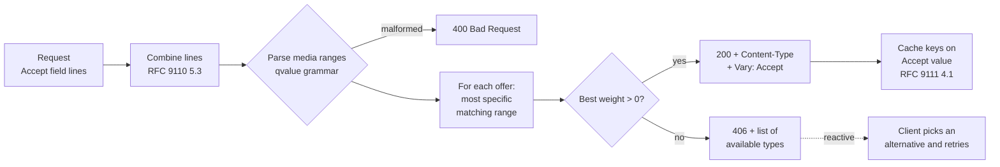

# Proactive vs Reactive Content Negotiation, Media Type Parameters, and Quality Values (RFC 9110)

> [!summary] Claim
> A media type's weight comes from the most specific `Accept` range that matches it, not the highest `q`, so `text/html;q=0, */*` refuses HTML; a server that gets this wrong, forgets `Vary: Accept`, or answers a bad `Content-Type` with anything but `415` breaks caches and clients in ways no test of the happy path will catch.

Part of [HTTP Semantics and Wire Protocols](README.md) in [API Engineering](../README.md).

## TL;DR

- Mechanism: in proactive negotiation the client sends `Accept`, the server scores each representation it can produce, picks the best one with nonzero weight, and names the request fields it used in `Vary`; in reactive negotiation the server returns a list (`300` or `406`) and the client picks.
- Contract rule: the weight of a type is the `q` of the most specific matching range (`type/subtype;params` > `type/subtype` > `type/*` > `*/*`), `q=0` means "not acceptable", and a missing `Accept` means "no preference" (RFC 9110 Sections 12.4.1 and 12.5.1).
- Trap: a matcher that returns the first matching range without checking its weight (Litestar 2.25.0 `Accept.best_match`) serves a type the client explicitly refused with `q=0`, and the published RFC 9110 Table 5 itself contains a wrong row fixed by verified erratum 7138.
- Portability: negotiation semantics are version-independent (RFC 9110 Section 6), so HTTP/1.1, HTTP/2, and HTTP/3 behave the same; the variance is in frameworks, where FastAPI 0.162.0 answers a wrong `Content-Type` with `422`, not `415`.
- When not to use it: for machine-to-machine APIs, a distinct URI per format or a single format is simpler to cache and debug than negotiating on every request (RFC 9110 Section 12.1 lists the costs).

## Mental model



The server first joins repeated `Accept` field lines into one comma-separated value, because RFC 9110 Section 5.3 makes that join semantically neutral, and a framework that reads only the first line drops preferences.
It parses each member into a media range and an integer weight, rejecting anything outside the `qvalue` grammar.
For every representation it can produce, it finds the most specific range that matches and takes that range's weight; the offer with the highest nonzero weight wins, ties going to the server's own preference order.
A winner goes out with `Content-Type` and `Vary: Accept`, which tells every cache on the path to key the stored response on the `Accept` value (RFC 9111 Section 4.1).
No winner means `406 Not Acceptable` with a list of what is available, which is the hand-off to reactive negotiation: the client reads the list and asks again.

## How it works

### Three negotiation patterns

RFC 9110 Section 12 defines three patterns: proactive (server-driven, Section 12.1), reactive (agent-driven, Section 12.2), and request content negotiation (Section 12.3), where a response's `Accept` or `Accept-Encoding` tells the client what to send next time.
Proactive negotiation saves a round trip but, per Section 12.1, cannot know what is "best", costs bandwidth and privacy on every request, complicates the origin, and "limits the reusability of responses for shared caching".
Reactive negotiation costs a second request, and RFC 9110 defines no automatic selection mechanism for it (Section 12.2); `300 Multiple Choices` and `406 Not Acceptable` carry the list.
Section 12.4.1 lets a server either honor an unsatisfiable negotiation field with `406` or disregard it and send a default; both are conforming.

### Media type grammar

A media type is `type "/" subtype parameters`, with case-insensitive type and subtype tokens (RFC 9110 Section 8.3.1).
Parameters are `*( OWS ";" OWS [ parameter ] )`, each `parameter-name "=" parameter-value`, where the value is a `token` or a `quoted-string`, quoted and unquoted forms are equivalent, and no whitespace is allowed around `=` (RFC 9110 Section 5.6.6).
Parameter names are case-insensitive; whether values are depends on the parameter (RFC 9110 Section 5.6.6), and `charset` values are matched case-insensitively (RFC 9110 Section 8.3.2).
Section 8.3.1 lists `text/html;charset=utf-8`, `Text/HTML;Charset="utf-8"`, `text/html; charset="utf-8"`, and `text/html;charset=UTF-8` as equivalent, preferring the first.
Inside a `quoted-string`, a `quoted-pair` (`\` plus one `HTAB`, `SP`, `VCHAR`, or `obs-text` octet, never a control character) stands for the octet after the backslash (RFC 9110 Section 5.6.4), so a comma inside quotes does not end an `Accept` member.
RFC 6838 Section 4.2 restricts registered names to 127 characters and says they SHOULD be at most 64, and Section 4.2.8 formalizes structured syntax suffixes such as `+json` and `+xml`.

### Quality values and precedence

The weight grammar is `qvalue = ( "0" [ "." 0*3DIGIT ] ) / ( "1" [ "." 0*3("0") ] )`: at most three decimals, `0` means "not acceptable", and a missing `q` means `1` (RFC 9110 Section 12.4.2).
Three decimals and the range 0 to 1 give exactly 1001 weights, so the lab stores weights as integer thousandths instead of floats: `0.001` stays distinct from `0`, and `nan`, `inf`, `1e0`, and `1.5` are syntax errors rather than numbers.
`Accept = #( media-range [ weight ] )`, where a media range is `*/*`, `type/*`, or `type/subtype`, followed by parameters (RFC 9110 Section 12.5.1).
Senders SHOULD send `q` last and recipients SHOULD treat any parameter named `q` as the weight regardless of position; the media type registry disallows parameters named `q`.
The precedence rule is the heart of the section: "If more than one media range applies to a given type, the most specific reference has precedence", and "the media type quality factor associated with a given type is determined by finding the media range with the highest precedence that matches the type" (RFC 9110 Section 12.5.1).
For `Accept: text/*;q=0.3, text/plain;q=0.7, text/plain;format=flowed, text/plain;format=fixed;q=0.4, */*;q=0.5`, Table 5 assigns `text/html;level=3` a weight of 0.7, which is wrong: only `text/*;q=0.3` and `*/*;q=0.5` match it, and the more specific `text/*` wins, so the weight is 0.3.
RFC Errata ID 7138 (Technical, verified 2022-11-09) records exactly that correction; the row survived from RFC 7231, whose example header did contain `text/html;q=0.7`.

### Wildcards, absence, and the empty header

A request without a negotiation field "implies that the sender has no preference" (RFC 9110 Section 12.4.1), so the server's first choice wins.
If a field is present and no wildcard is in it, "values that are not explicitly mentioned in the field are considered unacceptable" (RFC 9110 Section 12.4.3).
The two combine into a sharp edge: a present but empty `Accept:` is an empty list (the `#element` rule in RFC 9110 Section 5.6.1.2 allows it), contains no wildcard, and therefore accepts nothing, while an absent `Accept` accepts everything.
`Accept: */*;q=0` is the documented way to ask for `406` instead of a fallback (RFC 9110 Section 12.4.3 note).
Recipients MUST ignore "a reasonable number of empty list elements" but not so many that they become a denial-of-service vector (RFC 9110 Section 5.6.1.2); the lab bounds the list at 64 members, empty ones included.

### Charsets

RFC 6657 Section 3 makes the default charset of a `text/*` type a property of the subtype, not of the protocol, and forbids protocols from overriding it; Section 4 keeps `text/plain` at `US-ASCII`.
So the `ISO-8859-1` default for `text` types that RFC 2616 carried is gone (RFC 7231 Appendix B removed it), and a server that decodes a `text/plain` body without a `charset` as UTF-8 or Latin-1 is guessing.
JSON exchanged outside a closed ecosystem "MUST be encoded using UTF-8" (RFC 8259 Section 8.1), and the `application/json` registration defines no `charset` parameter: "Adding one really has no effect on compliant recipients" (RFC 8259 Section 11).
`Accept-Charset` is deprecated because UTF-8 is "nearly ubiquitous" and the field "makes passive fingerprinting far too easy" (RFC 9110 Section 12.5.2).

### The request side: `Content-Type`, `415`, and `406`

`406 Not Acceptable` is about the response the client will accept, and the server SHOULD list available representations in its content (RFC 9110 Section 15.5.7).
`415 Unsupported Media Type` is about the request content the client sent; the server can send an `Accept` response field naming the media types it would have taken (RFC 9110 Section 15.5.16).
`Content-Type` is a singleton field; when it arrives more than once, recipients "often attempt to handle this error by using the last syntactically valid member", which RFC 9110 Section 8.3 warns causes interoperability and security issues when implementations disagree.
A response cached under `Vary: Accept` MUST NOT be reused without revalidation unless the new request's `Accept` matches the stored one after whitespace, line-combining, and case normalization (RFC 9111 Section 4.1).

### Source implementations

Starlette sets the response type in `Response.init_headers`: when `media_type` `startswith("text/")` and `"charset="` is not in its lowercased form, it appends `"; charset=" + self.charset` (starlette 1.10.0 starlette/responses.py, Response.init_headers).
The prefix test is case-sensitive, so `Text/Plain` is sent without a charset, and `application/json` correctly gets none.
`Headers.__getitem__` returns the first matching field line and `Headers.getlist` returns all of them (starlette 1.10.0 starlette/datastructures.py, Headers), so `request.headers["accept"]` silently drops a second `Accept` line.
FastAPI decides whether to parse a body as JSON inside `get_request_handler` by loading the header into `email.message.Message` and checking `get_content_maintype() == "application"` and a subtype of `json` or ending in `+json`; anything else, or a missing header when `strict_content_type` is true (the default), leaves the body as raw bytes, which then fails model validation (fastapi 0.162.0 fastapi/routing.py, get_request_handler).
FastAPI's frontend fallback parses `Accept` with `_iter_accept_media_types`, which converts `q` with `float()` and treats any value `!= 0` as acceptable, so `q=nan` counts as acceptable (fastapi 0.162.0 fastapi/routing.py, _iter_accept_media_types and _is_frontend_navigation_request).
Litestar's `MediaTypeHeader.priority` returns `(quality, specificity)` with quality in hundredths, and `Accept.__init__` sorts ranges by that key in descending order; `best_match` returns the first provided type matched by the first range in that order and never compares the weight with zero (litestar 2.25.0 litestar/datastructures/headers.py, MediaTypeHeader.priority and Accept.best_match).
The sort puts `*/*` before `text/html;q=0`, so `text/html;q=0, */*` matches `text/html` through `*/*`; but even `Accept: text/html;q=0` alone, with no wildcard, returns `text/html`, because a `q=0` range is still a match, as the lab proves.
The ASGI HTTP scope delivers headers as an ordered list in which "Duplicates are possible and must be preserved in the message as received" (ASGI HTTP and WebSocket specification, connection scope `headers`), so combining field lines is the application's job.

## Numbers and limits

| Quantity | Value | Source |
|---|---|---|
| Distinct `qvalue` weights | 1001 (0.000 to 1.000, three decimals) | Derived from RFC 9110 Section 12.4.2 grammar |
| Default weight when `q` is absent | 1 | RFC 9110 Section 12.4.2 |
| Registered type or subtype name length | <= 127 characters, SHOULD be <= 64 | RFC 6838 Section 4.2 |
| Default `charset` of `text/plain` | `US-ASCII` | RFC 6657 Section 4 |
| Accept members parsed by the lab before `400` | 64, empty members included | Lab constant `MAX_ACCEPT_MEMBERS` |
| Selection cost | O(offers x ranges) | Lab `negotiate` loops over offers, `quality` over ranges |
| `negotiate()` on the 63-byte, 4-member `Accept: text/html,application/xhtml+xml,application/xml;q=0.9,*/*;q=0.8`, 3 offers | 13.3 us | Measured: `min(timeit.repeat(lambda: negotiate(accept, REPORT_TYPES), number=20000, repeat=5)) / 20000` under `uv run --frozen python` from `labs/`, best of two runs, Apple M3 Pro, macOS 27.2 (`uname -r` 27.2.0) arm64, CPython 3.14.6 (2026-11) |
| `negotiate()` on a 2519-byte, 64-member `Accept` (63 `application/vnd.example.vN+json;q=0.5` ranges plus `*/*;q=0.1`), 3 offers | 252.6 us | Same run as above |
| RFC 9110 Table 5 erratum | ID 7138, Technical, reported 2022-09-23, verified 2022-11-09 | RFC Editor errata record (as of 2026-11) |
| python-multipart `Content-Type` ReDoS | fixed in python-multipart 0.0.7, FastAPI 0.109.1, Starlette 0.36.2 | CVE-2024-24762, GHSA-2jv5-9r88-3w3p (as of 2026-11) |

The two timings are single-machine measurements of a pure-Python parser, useful only for the ratio: 16 times the members (40 times the bytes) cost 19 times the time, which is why an unbounded `Accept` is a CPU amplification vector.

## Portability

| Dimension | Result | Evidence |
|---|---|---|
| CPython 3.12.16 | 47 passed | Lab run in the `python:3.12-trixie` container (Python 3.12.16, aarch64, Docker 29.8.2 via OrbStack on macOS 27.2) with `uv run --frozen`; CPython 3.12.13 on macOS also passed 47 (2026-11) |
| CPython 3.13.18 | 47 passed | Lab run under `uv run --frozen --python /opt/homebrew/bin/python3.13` in its own environment |
| CPython 3.14.10 | 47 passed | Lab run under `uv run --frozen --python /opt/homebrew/bin/python3.14` in its own environment; the workspace `.venv` (3.14.6) also passes 47 |
| CPython 3.15.2 | 47 passed under the lock | Lab run under `uv run --frozen --python /opt/homebrew/bin/python3.15` in its own environment, and again in the `python:3.15-trixie` container (Python 3.15.2, aarch64) |
| CPython 3.15.0b3 (pre-release, not in the matrix) | Fails before collection under the lock: the `hypothesis` 6.170.14 pytest plugin raises `ModuleNotFoundError: No module named 'hypothesis._native'` (its wheel ships only `_native.abi3t-darwin.so`) | Lab run; 3.15.2 is unaffected |
| CPython 3.15.2t free-threaded | Not run: no 3.15.2t interpreter on this machine; on 3.15.0b3t and 3.14.6t the lock cannot install because `psycopg-binary==3.3.8` has no wheel; in a 3.15.0b3t side environment with the direct pins (FastAPI, Starlette, httpx, httpcore, Litestar, pydantic, pydantic-core, anyio, pytest, pytest-asyncio), 47 passed with `sys._is_gil_enabled()` false | Lab runs (2026-11) |
| Debian Trixie (glibc) and Alpine (musl libc) containers | 47 passed on each: `python:3.14-trixie` (Debian GNU/Linux 13, Python 3.14.10), `python:3.14-alpine` (Alpine Linux, Python 3.14.10), `python:3.12-alpine` (Python 3.12.16); all aarch64 | Lab runs: the labs tree copied into the container, `pip install uv`, then `uv run --frozen --python $(which python) pytest <test path> -q`; x86_64 not run (2026-11) |
| Starlette 1.10.0 | Appends `; charset=utf-8` only to lowercase `text/` types; `headers[...]` returns the first field line only | Lab test plus starlette/responses.py and starlette/datastructures.py |
| FastAPI 0.162.0 | Wrong or missing `Content-Type` on a model body yields `422`, not `415`; `+json` subtypes parse; a `charset=utf-16` parameter is ignored | Lab test plus fastapi/routing.py |
| Litestar 2.25.0 | `Accept.best_match` serves a type refused with `q=0`, with or without a following wildcard | Lab test plus litestar/datastructures/headers.py |
| Uvicorn, Hypercorn, Granian | Negotiation runs in the application; servers must pass duplicate header lines through in order | ASGI specification; not exercised against each server in this lab |
| HTTP/1.1, HTTP/2, HTTP/3 | Same semantics; only the field encoding differs | RFC 9110 Section 6; not exercised over the wire in this lab |

## Worked example

The [implementation](../labs/src/api_labs/f01_http_semantics_and_wire_protocols/content_negotiation.py) is a strict RFC 9110 parser, an integer-weight matcher, and a two-route Starlette app; the [test](../labs/tests/f01_http_semantics_and_wire_protocols/test_content_negotiation_media_types_and_charsets.py) checks it and three framework behaviors.

The core of the matcher, a simplified excerpt (docstrings and comments trimmed):

```python
@dataclass(frozen=True, slots=True)
class MediaRange:
    media: MediaType
    weight: int

    @property
    def specificity(self) -> tuple[bool, bool, int]:
        return (self.media.type != "*", self.media.subtype != "*", len(self.media.params))

    def matches(self, offer: MediaType) -> bool:
        if self.media.type not in ("*", offer.type):
            return False
        if self.media.subtype not in ("*", offer.subtype):
            return False
        offered = dict(offer.params)
        return all(offered.get(name) == value for name, value in self.media.params)


def parse_qvalue(text: str) -> int:
    if not _QVALUE.match(text):
        raise ValueError(f"invalid qvalue {text!r}")
    whole, _, frac = text.partition(".")
    return int(whole) * 1000 + int((frac + "000")[:3])


def quality(offer: MediaType, ranges: Sequence[MediaRange]) -> int:
    best: MediaRange | None = None
    for candidate in ranges:
        if candidate.matches(offer) and (best is None or candidate.specificity > best.specificity):
            best = candidate
    return 0 if best is None else best.weight


def negotiate(accept: str | None, offers: Sequence[str]) -> str | None:
    if accept is None:
        return offers[0] if offers else None
    ranges = parse_accept(accept)
    best_offer: str | None = None
    best_weight = 0
    for offer in offers:
        weight = quality(parse_media_type(offer), ranges)
        if weight > best_weight:
            best_offer, best_weight = offer, weight
    return best_offer
```

`specificity` is a tuple, so Python's lexicographic tuple order is exactly the RFC ladder: any concrete type beats `*/*`, any concrete subtype beats `type/*`, and more parameters beat fewer.
The strict `>` in `quality` makes the first-listed range win a specificity tie, and the strict `>` in `negotiate` makes the server's order win a weight tie and keeps `q=0` offers from ever being chosen.

Two tests, a simplified excerpt:

```python
def test_rfc9110_table5_with_verified_erratum_7138() -> None:
    ranges = parse_accept(
        "text/*;q=0.3, text/plain;q=0.7, text/plain;format=flowed, "
        "text/plain;format=fixed;q=0.4, */*;q=0.5"
    )
    expected = {
        "text/plain;format=flowed": 1000,
        "text/plain": 700,
        "text/html": 300,
        "image/jpeg": 500,
        "text/plain;format=fixed": 400,
        "text/html;level=3": 300,  # the published table says 0.7; erratum 7138 corrects it
    }
    got = {offer: quality(parse_media_type(offer), ranges) for offer in expected}
    assert got == expected


def test_litestar_2_25_0_best_match_serves_an_explicitly_refused_type() -> None:
    accept = Accept("text/html;q=0, */*")
    assert list(accept) == ["*/*", "text/html;q=0"]
    assert accept.best_match(["text/html"]) == "text/html"
    assert Accept("text/html;q=0").best_match(["text/html"]) == "text/html"
```

The app's `GET /report` combines repeated `Accept` lines, offers `application/json`, `text/csv`, and `text/html;charset=utf-8` in that order, always sends `Vary: Accept`, and answers `406` with an `available` list or `400` for a malformed header.
Its `POST /notes` takes `application/json`, any `application/*+json`, and `text/plain` with a charset, rejects everything else with `415` plus `Accept: application/json, text/plain`, and rejects two `Content-Type` lines with `400`.

Output captured on macOS 27.2 (Apple M3 Pro, `uname -r` 27.2.0), CPython 3.14.6, from `labs/`:

```text
$ uv run --frozen pytest tests/f01_http_semantics_and_wire_protocols/test_content_negotiation_media_types_and_charsets.py -q -k "table5 or litestar or fastapi or q_zero or repeated"
.....                                                                    [100%]
5 passed, 42 deselected in 0.19s
$ uv run --frozen pytest tests/f01_http_semantics_and_wire_protocols/test_content_negotiation_media_types_and_charsets.py -q
...............................................                          [100%]
47 passed in 0.19s
```

## Pitfalls

> [!warning] Sorting `Accept` by `q` and returning the first match
> Trigger: a matcher sorts ranges by `(q, specificity)` and returns the first match without checking its weight, as Litestar 2.25.0 `Accept.best_match` does.
> Symptom: `Accept: text/html;q=0, */*`, and even `Accept: text/html;q=0` alone, still gets HTML, the one type the client refused.
> Fix: compute each offer's weight from its most specific matching range (RFC 9110 Section 12.5.1), then compare weights and never select a weight of 0; the lab's `quality` and `negotiate` do this and its test pins the Litestar behavior.

> [!warning] Trusting the RFC's own example table
> Trigger: a conformance test copies RFC 9110 Table 5 verbatim.
> Symptom: the test expects 0.7 for `text/html;level=3` and fails against a correct implementation, or passes against a wrong one.
> Fix: use the corrected value 0.3 from verified erratum 7138, and check the errata page whenever a spec example looks inconsistent with its prose.

> [!warning] Missing `Vary: Accept`
> Trigger: a negotiated response is cacheable but carries no `Vary`.
> Symptom: a shared cache stores the CSV variant and serves it to JSON clients; RFC 9111 Section 4.1 notes that resources "mistakenly omit the Vary header field from their default response", which then wins for later requests.
> Fix: send `Vary: Accept` on every response from a negotiated resource, including `406` and the no-`Accept` default; normalize `Accept` at the edge to keep the cache key space small.

> [!warning] Reading only the first `Accept` line
> Trigger: `request.headers["accept"]` in Starlette or any API that returns the first field line.
> Symptom: a client or proxy that splits preferences across two lines gets `406` or the wrong type.
> Fix: join `getlist("accept")` with `", "` (RFC 9110 Section 5.3); the lab's `test_repeated_accept_field_lines_are_combined` fails if this is reverted.

> [!warning] `422` where `415` belongs
> Trigger: FastAPI 0.162.0 receives a JSON body labelled `text/plain`, or with no `Content-Type`.
> Symptom: `422` with `model_attributes_type`, which tells the client its JSON is wrong when the label is.
> Fix: check `Content-Type` before validation (a dependency or middleware) and return `415` with an `Accept` response field (RFC 9110 Section 15.5.16); keep `strict_content_type` on, since FastAPI documents it as a CSRF defense.

> [!warning] Regex parsing of `Content-Type` parameters
> Trigger: `python-multipart` before 0.0.7 parsed `Content-Type` options with a backtracking regular expression.
> Symptom: CVE-2024-24762: a crafted header stalls the event loop "indefinitely (minutes or more)", per NVD; python-multipart 0.0.7, FastAPI 0.109.1, and Starlette 0.36.2 shipped fixes (GHSA-2jv5-9r88-3w3p; the FastAPI and Starlette advisories GHSA-qf9m-vfgh-m389 and GHSA-93gm-qmq6-w238 were withdrawn as its duplicates on 2024-02-16).
> Fix: parse media types with a linear scanner like the lab's `_parse`, cap header length and list members, and keep `python-multipart` current.

> [!warning] Guessing a charset
> Trigger: decoding `text/plain` without a `charset` as UTF-8, or honoring `application/json; charset=utf-16`.
> Symptom: mojibake, or two parsers in one request path disagreeing about the same bytes; FastAPI 0.162.0 accepts `charset=utf-16` and ignores it, as the lab shows.
> Fix: apply the subtype's rule (`US-ASCII` for `text/plain`, RFC 6657 Section 4; UTF-8 only for JSON, RFC 8259 Section 8.1) and reject what you cannot decode with `415`.

> [!warning] Case-sensitive `text/` check when adding a charset
> Trigger: `Response(media_type="Text/Plain")` in Starlette 1.10.0.
> Symptom: the response goes out without `charset`, so a client applying the `US-ASCII` default misreads UTF-8 text.
> Fix: write media types in lowercase, the form RFC 9110 Section 8.3.1 prefers, or set `charset` explicitly.

## Security and robustness

- Parser denial of service: treat `Accept` and `Content-Type` as attacker-controlled input; parse linearly, cap the number of members (RFC 9110 Section 5.6.1.2 asks for a bound), and reject oversize headers before negotiating; CVE-2024-24762 is the regex failure mode (OWASP API4:2023 Unrestricted Resource Consumption).
- Float coercion: `float()` accepts `nan`, `inf`, `1e0`, and `1_0`, none of which is a `qvalue`; integer thousandths from a strict regex remove the whole class, as `test_qvalue_outside_the_grammar_is_rejected` shows.
- Content-type confusion: two `Content-Type` lines let a WAF and the application pick different members (RFC 9110 Section 8.3); reject duplicates with `400`, as the lab does, rather than taking the first or last.
- MIME sniffing: RFC 9110 Section 8.3 warns that user agents that override `Content-Type` risk "privilege escalation"; always send an accurate `Content-Type`, and pair it with `X-Content-Type-Options: nosniff`, whose only defined value is `nosniff`, matched case-insensitively (WHATWG Fetch Standard Section 3.6, as of 2026-11).
- CSRF through lax body parsing: FastAPI documents that a browser sends a `fetch()` with a `Blob` body and no `Content-Type` without a CORS preflight, so a server that parses such a body as JSON exposes unauthenticated local APIs; strict `Content-Type` checking closes it.
- Cache poisoning and splitting: a missing `Vary` mixes variants in a shared cache; an unnormalized `Accept` key multiplies cache entries, so normalize or bucket `Accept` at the edge.
- Fingerprinting: detailed `Accept`, `Accept-Charset`, and `Accept-Language` values identify users (RFC 9110 Section 17.13); servers should not require them, and clients should send generic values.
- Error representations are negotiated too: Section 12.1 says preferences apply to "representations of error or processing status", so a `406` or `415` body should itself be in a widely accepted format such as `application/problem+json`.

## The principal's view

The decision is not "how do we parse `Accept`" but "is the representation part of the resource identity or a negotiable property of it".
For a public API consumed by generated SDKs, one format per URI (or an explicit `format` query parameter) makes every response cacheable without `Vary`, makes logs self-describing, and removes a class of proxy and CDN bugs; the cost is URI proliferation and losing the browser's ability to pick.
For resources consumed by browsers and humans, proactive negotiation on `Accept`, `Accept-Language`, and `Accept-Encoding` is worth it, but only with one shared, conformant negotiation library per organization, because every framework in this note has a different subtle deviation and a fleet of services each rolling its own produces inconsistent `406` and cache behavior.
Make the request side strict and the response side forgiving: `415` with `Accept` for a wrong request type is cheap and debuggable, while answering a client's odd `Accept` with a sensible default rather than `406` is often the better product decision, which RFC 9110 Section 12.4.1 explicitly allows.
Version through media type parameters (`application/vnd.example+json;version=2`) only if every cache, gateway, and SDK in the path can key on parameters; otherwise version in the URI or a dedicated field, and see [[Protocol-Design-Over-HTTP-BCP-56-RFC-9205]] for the BCP 56 guidance on building protocols over HTTP.
Choose a different paradigm when the representation choice is really a schema choice: gRPC and GraphQL fix the encoding and move variation into the schema, which removes negotiation entirely at the cost of HTTP cache friendliness.

## Interview questions

> [!question] L5: What is the difference between `406 Not Acceptable` and `415 Unsupported Media Type`?
>
> > [!success]- Answer
> > `406` is about the response: no representation matches the client's proactive negotiation fields such as `Accept` (RFC 9110 Section 15.5.7).
> > `415` is about the request: the content the client sent has a `Content-Type` or `Content-Encoding` the method does not support (RFC 9110 Section 15.5.16).
> > A `406` SHOULD list available representations, and a `415` can carry an `Accept` response field naming the request types the server would take.
> >
> > Follow-up: What does FastAPI 0.162.0 return when a model endpoint receives JSON labelled `text/plain`, and why is that unhelpful?

> [!question] L5: What does `q=0` mean, and what does a missing `q` mean?
>
> > [!success]- Answer
> > `q=0` marks a range as "not acceptable", and a missing `q` means weight 1 (RFC 9110 Section 12.4.2).
> > The grammar allows at most three decimals, so valid weights are 0, 0.001 through 0.999, and 1.
> > A server should never choose an offer whose weight is 0, even if nothing else matches.
> >
> > Follow-up: Why does the lab store weights as integer thousandths instead of `float`?

> [!question] L5: Are `text/html;charset=utf-8` and `Text/HTML; charset="UTF-8"` the same media type?
>
> > [!success]- Answer
> > Yes: type and subtype are case-insensitive, parameter names are case-insensitive, quoted and unquoted `token` values are equivalent, and `charset` values match case-insensitively (RFC 9110 Sections 5.6.6, 8.3.1, and 8.3.2).
> > The whitespace after `;` is allowed as `OWS`, but whitespace around `=` is not.
> > RFC 9110 prefers the first form for consistency.
> >
> > Follow-up: Which parameter values stay case-sensitive, and who decides?

> [!question] L6: Predict the output: with `Accept: text/*;q=0.3, text/plain;q=0.7, text/plain;format=flowed, text/plain;format=fixed;q=0.4, */*;q=0.5`, what weights do `text/html;level=3`, `image/jpeg`, and `text/plain;format=fixed` get?
>
> > [!success]- Answer
> > `text/html;level=3` gets 0.3, because only `text/*;q=0.3` and `*/*;q=0.5` match it and `text/*` is more specific.
> > `image/jpeg` gets 0.5 from `*/*`, and `text/plain;format=fixed` gets 0.4 from its exact parameterized range.
> > The published RFC 9110 Table 5 says 0.7 for `text/html;level=3`; verified erratum 7138 corrects it to 0.3, and the lab's Table 5 test asserts the corrected value.
> >
> > Follow-up: What would a matcher that takes the maximum `q` of all matching ranges return for `text/html;level=3`?

> [!question] L6: Debug this API: a CDN in front of `GET /report` serves CSV to some clients that sent `Accept: application/json`, and the origin logs show those requests never reached it, so what is wrong?
>
> > [!success]- Answer
> > The origin negotiates on `Accept` but omits `Vary: Accept`, so the cache keys the stored CSV response on the URI alone and reuses it for every client (RFC 9111 Section 4.1).
> > The fix is `Vary: Accept` on every response from that resource, including the default and the `406`.
> > Then purge the poisoned entries and normalize `Accept` at the edge so the cache key space does not explode.
> >
> > Follow-up: Why does RFC 9111 say a cache should prefer the most recent stored response with a valid `Vary` when some stored responses lack one?

> [!question] L6: Why is an empty `Accept:` header different from no `Accept` header?
>
> > [!success]- Answer
> > No `Accept` means the client has no preference, so any representation is fine (RFC 9110 Section 12.4.1).
> > An empty `Accept` is an empty list with no wildcard, and values not mentioned are unacceptable (RFC 9110 Section 12.4.3), so strictly nothing is acceptable.
> > The server may still disregard the field and send a default instead of `406`.
> >
> > Follow-up: How does `Accept: */*;q=0` differ from an empty `Accept` in intent?

> [!question] L7+: Your organization runs 300 services in four frameworks, each with its own `Accept` handling, so what do you standardize, and how do you roll it out?
>
> > [!success]- Answer
> > Standardize one negotiation library with a conformance suite built from RFC 9110 Section 12.5.1 plus errata, including `q=0` overriding wildcards, repeated field lines, empty `Accept`, and parameter matching.
> > Standardize the policy around it: `Vary` on every negotiated response, strict `415` with `Accept` on requests, `application/problem+json` errors, and a cap on header size and members.
> > Roll out behind shadow evaluation that logs where the new selection differs from the old, because "fixing" a framework like Litestar's weight-blind `best_match` changes what real clients receive.
> >
> > Follow-up: Which of those rules belongs in the gateway rather than in each service, and what breaks if the gateway rewrites `Accept`?

> [!question] L7+: When would you choose reactive negotiation, or none at all, over proactive negotiation for an API?
>
> > [!success]- Answer
> > Proactive negotiation saves a round trip but costs cache reuse, privacy, and server complexity (RFC 9110 Section 12.1).
> > Reactive negotiation (a `300` or `406` list of URIs) suits shared caches and cases where the server cannot infer capabilities, at the cost of a second request (RFC 9110 Section 12.2).
> > For SDK-driven APIs, distinct URIs per format avoid negotiation and `Vary` entirely; for browser-facing documents, proactive negotiation is worth its cost.
> >
> > Follow-up: How do structured syntax suffixes such as `+json` change the trade-off for vendor media types?

> [!question] L7+: A security review flags your media type parser; what do you check?
>
> > [!success]- Answer
> > Linear-time parsing with no backtracking regular expressions, since CVE-2024-24762 stalled event loops through a `Content-Type` regex.
> > Bounds on header length and list members, strict `qvalue` grammar instead of `float()`, and correct `quoted-string` and `quoted-pair` handling so commas and quotes cannot split members.
> > Rejection of duplicate `Content-Type` lines, because two components choosing different members is a classic confusion attack (RFC 9110 Section 8.3).
> >
> > Follow-up: How would you fuzz the parser so that it is checked against a reference implementation rather than against itself?

## Related

Prerequisites: [[Structured-Field-Values-for-HTTP-RFC-9651]]

Next: [[HTTP-Compression-Gzip-Brotli-Zstandard-and-BREACH]]

See also: [[REST-APIs]], [[02-Programming-Languages/Python/Python-Backend-Interview-Prep/05-REST-API-Design]], [[CSV-Quoting-and-Edge-Cases]], [[XML-with-xmlstarlet]], [[HTTP-Message-Abstraction-RFC-9110]], [[Protocol-Design-Over-HTTP-BCP-56-RFC-9205]], [[Range-Requests-Partial-Content-and-206-Semantics]]

- Lab: `labs/tests/f01_http_semantics_and_wire_protocols/test_content_negotiation_media_types_and_charsets.py`

## Further reading

- [RFC 9110 Section 12](https://www.rfc-editor.org/rfc/rfc9110.html#section-12) - the normative content negotiation model, `Accept` precedence, `qvalue` grammar, and `Vary`.
- [RFC 9110 errata](https://www.rfc-editor.org/errata_search.php?rfc=9110&rec_status=15&presentation=records) - erratum 7138 corrects Table 5 in Section 12.5.1.
- [RFC 9111 Section 4.1](https://www.rfc-editor.org/rfc/rfc9111.html#section-4.1) - how caches compute keys from `Vary` and choose among stored variants.
- [RFC 6838](https://www.rfc-editor.org/rfc/rfc6838.html) - media type naming rules, length limits, and structured syntax suffixes.
- [RFC 6657](https://www.rfc-editor.org/rfc/rfc6657.html) - why default charsets belong to the `text/*` subtype and why `text/plain` stays `US-ASCII`.
- [RFC 8259 Sections 8.1 and 11](https://www.rfc-editor.org/rfc/rfc8259.html#section-8.1) - JSON is UTF-8 and `application/json` has no `charset` parameter.
- [ASGI HTTP and WebSocket specification](https://asgi.readthedocs.io/en/latest/specs/www.html) - duplicate header lines reach the application in order.
- [Litestar 2.25.0 `headers.py`](https://github.com/litestar-org/litestar/blob/v2.25.0/litestar/datastructures/headers.py) - the `(quality, specificity)` sort and the weight-blind `best_match` behind the `q=0` divergence.
- [FastAPI 0.162.0 `routing.py`](https://github.com/fastapi/fastapi/blob/0.162.0/fastapi/routing.py) - `get_request_handler` and its `email.message` `Content-Type` check.
- [CVE-2024-24762](https://nvd.nist.gov/vuln/detail/CVE-2024-24762) - `Content-Type` regex denial of service in python-multipart, FastAPI, and Starlette.
