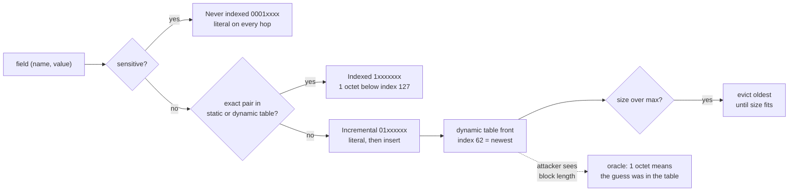

# HPACK Header Compression: Static Table, Dynamic Table Eviction, and CRIME/BREACH Defenses (RFC 7541)

> [!summary] Claim
> HPACK turns a repeated header field into a 1-octet index into a per-connection FIFO table bounded by `SETTINGS_HEADER_TABLE_SIZE`, which saves bytes only for fields that repeat and leaks secrets to anyone who can share the encoder and see lengths, unless sensitive fields are sent as never-indexed literals on every hop.

Part of [HTTP Semantics and Wire Protocols](README.md) in [API Engineering](../README.md).

## TL;DR

- Mechanism: a field is either an index into one address space (61 static entries, then the dynamic table, newest first) or a literal that the encoder may insert at the front of the dynamic table, after evicting the oldest entries until the new entry fits under the maximum size (RFC 7541 Sections 2.3.3 and 4.4).
- Contract rule: an entry costs name octets + value octets + 32, the HTTP/2 default maximum is 4,096 octets, a size change must be signalled at the start of the next field block, and a decoding error is a connection error of type `COMPRESSION_ERROR` (RFC 7541 Sections 4.1 and 4.2; RFC 9113 Sections 4.3 and 6.5.2).
- Trap: `h2 4.4.1` never-indexes only `authorization`, `proxy-authorization`, and cookies shorter than 20 bytes, so an `x-api-key` sent through a connection shared by mutually distrustful clients becomes a 1-octet index that confirms a correct guess (lab: 21 octets of signal for a right guess, 0 for a guess one character off).
- Portability: the 22-test lab passes on CPython 3.12.13, 3.13.18, 3.14.6, 3.14.10, 3.15.2, free-threaded 3.15.0b3, and the Debian Trixie and Alpine musl containers; Hypercorn 0.18.0 advertises a 64 KiB header-list limit through `h2`, Granian 2.8.7 defaults to a 16 MiB header limit, and HTTP/3 replaces HPACK with QPACK, whose dynamic table capacity defaults to 0 (RFC 9204 Section 5).
- When not to use it: HPACK is not optional in HTTP/2, but its dynamic table is; for a hop that carries mixed-trust traffic and low-repetition headers, advertise `SETTINGS_HEADER_TABLE_SIZE` 0 and accept the bytes (lab: 19,023 instead of 13,163 octets for 80 requests, 44.5% more).

## Mental model



The encoder first decides whether a field is sensitive; a sensitive field is sent as a never-indexed literal.
For any other field, an exact name and value match becomes an indexed representation, and the index costs one octet while it is below 127.
A miss becomes a literal, and the literal kind decides the future: an incremental literal is inserted at the front of the dynamic table, where it becomes index 62 and pushes every older entry one index higher, while a never-indexed literal is sent in full and must stay a literal when an intermediary re-encodes it (RFC 7541 Section 6.2.3).
When an insertion would push the table over its maximum size, entries are first evicted from the oldest end until the new entry fits (RFC 7541 Section 4.4).
`hpack 4.2.0` runs the two decisions in the opposite order, table lookup first, which is a pitfall below.
The dotted arrow is the security problem: anyone who can put a guess into the same encoder and observe the encoded length learns whether the guess matched a table entry (RFC 7541 Section 7.1).
The lab proves each arrow: `test_eviction_matches_rfc_7541_appendix_c5_at_256_octets`, `test_h2_never_indexes_authorization_on_every_request`, and `test_compression_oracle_confirms_only_whole_value_guesses`.

## How it works

### One address space, two tables

Indices 1 to 61 name the static table of RFC 7541 Appendix A, most entries with an empty value such as `authorization` at 23 and `cookie` at 32, and indices above 61 name the dynamic table, newest entry first (RFC 7541 Section 2.3.3).
An index above the sum of both lengths MUST be a decoding error (RFC 7541 Section 2.3.3), and index 0 in an indexed representation is a decoding error (RFC 7541 Section 6.1).
Each direction of a connection has its own pair of tables: the request and response dynamic tables are independent (RFC 7541 Section 2.2).
The decoder's only state is its dynamic table; the encoder decides every insertion and the decoder replays them (RFC 7541 Sections 2.2 and 2.3.2).

### Wire layout

The first octet of each representation selects its kind; the prefix length N of the integer that follows is fixed per kind (RFC 7541 Section 6).

| Pattern | Kind | Integer prefix | Effect on the dynamic table | RFC 7541 |
| --- | --- | --- | --- | --- |
| `1xxxxxxx` | Indexed field | 7 bits, index | none | Section 6.1 |
| `01xxxxxx` | Literal with incremental indexing | 6 bits, name index or 0 | insert at front | Section 6.2.1 |
| `001xxxxx` | Dynamic table size update | 5 bits, new maximum | evict to fit | Section 6.3 |
| `0001xxxx` | Literal never indexed | 4 bits, name index or 0 | none, and none on any later hop | Section 6.2.3 |
| `0000xxxx` | Literal without indexing | 4 bits, name index or 0 | none | Section 6.2.2 |

An integer below 2^N-1 fits in the prefix; otherwise the prefix is all ones and the remainder follows in 7-bit groups, least significant group first, with the high bit as a continuation flag (RFC 7541 Section 5.1).
RFC 7541 Appendix C.1.2 encodes 1337 with a 5-bit prefix as `1f 9a 0a`, and the lab asserts it; at the boundary, 30 is `1e` and 31 is already `1f 00`.
A string literal is one H bit (Huffman or raw), a 7-bit-prefix length, and the octets (RFC 7541 Section 5.2).
The static Huffman code of Appendix B favours common header characters but is not guaranteed to shrink a value: in the lab `application/json` goes from 16 to 11 octets while `~` x 10 grows from 10 to 17, and `hpack 4.2.0` Huffman-codes every literal when `huffman=True` without comparing lengths (hpack 4.2.0 src/hpack/hpack.py, Encoder._encode_literal and Encoder._encode_indexed_literal).
RFC 7541 Section 7.2 states that no attack against the static Huffman code is known.

Two concrete blocks from the RFC, both reproduced byte for byte in `test_request_sequence_matches_rfc_7541_appendix_c3_byte_for_byte`:

```text
C.3.1  82 86 84 41 0f 77 77 77 2e 65 78 61 6d 70 6c 65 2e 63 6f 6d
       |  |  |  |  |  "www.example.com" (15 raw octets)
       |  |  |  |  H=0, length 15
       |  |  |  01 000001: incremental literal, name = static 1 (:authority)
       |  |  1 0000100: static 4 (:path /)
       |  1 0000110: static 6 (:scheme http)
       1 0000010: static 2 (:method GET)
C.3.2  82 86 84 be 58 08 6e 6f 2d 63 61 63 68 65
                ^ be = 1 0111110: index 62, the :authority entry inserted by C.3.1
```

### Table size and eviction

An entry's size is its name length plus its value length plus 32 octets, computed on the un-Huffman-coded strings; the 32 is an estimate of per-entry overhead such as two pointers and two reference counts (RFC 7541 Section 4.1).
Before an insertion, entries are evicted from the end until the table has room; an entry larger than the whole table empties it and is not an error (RFC 7541 Section 4.4), which `test_entry_larger_than_the_table_empties_it_without_error` shows with a 338-octet entry against a 256-octet table.
RFC 7541 Appendix C.5 runs three responses through a 256-octet table: the second response evicts `:status: 302` to insert `:status: 307`, and the third leaves exactly `set-cookie`, `content-encoding`, and `date` at 215 octets; the lab's `hpack` encoder produces those bytes, preceded in the first block by the size update `3f e1 01` (256) that the RFC example omits, and the decoder holds that table after each step.
The maximum is set by the decoder's `SETTINGS_HEADER_TABLE_SIZE`, initially 4,096 octets (RFC 9113 Sections 4.3.1 and 6.5.2).
After an endpoint acknowledges a reduction below the current size, its encoder MUST start the next field block with a size update at or below the new maximum, and the peer MUST treat a block that does not as `COMPRESSION_ERROR` (RFC 9113 Section 4.3.1).
If the maximum changes more than once between two blocks, the smallest value MUST be signalled and the final one always is, "resulting in at most two" updates (RFC 7541 Section 4.2).
A size update that exceeds the acknowledged limit MUST be a decoding error (RFC 7541 Section 6.3).

### Implementation in hpack 4.2.0 and h2 4.4.1

`HeaderTable.add` evicts from the right of a `deque` and inserts on the left, and clears the table outright when the entry is larger than `maxsize` (hpack 4.2.0 src/hpack/table.py, HeaderTable.add and HeaderTable._shrink).
`HeaderTable.search` looks up the static table through a dict built at import time and then scans the dynamic table linearly, returning a perfect match, else a static name match, else the newest dynamic name match (hpack 4.2.0 src/hpack/table.py, HeaderTable.search).
`Encoder.add` chooses `INDEX_INCREMENTAL` (`0x40`) for ordinary fields and `INDEX_NEVER` (`0x10`) for sensitive ones; it never emits the without-indexing form (`INDEX_NONE` is defined but unused by the encoder), so every non-sensitive field enters the table (hpack 4.2.0 src/hpack/hpack.py, Encoder.add).
`Encoder.add` uses sensitivity only to pick the literal prefix and to skip the insertion, after the table search has already chosen the representation: a sensitive field whose exact pair is already in the table is emitted as an indexed representation, which `test_hpack_emits_an_index_for_a_sensitive_value_already_in_the_table` reproduces through `h2`.
`Encoder.header_table_size` appends every change to `table_size_changes`, and `encode` emits all of them, so 100, 50, 200 become three updates `3f 45 3f 13 3f a9 01` rather than the two (50, 200) that RFC 7541 Section 4.2 describes (hpack 4.2.0 src/hpack/hpack.py, Encoder._encode_table_size_change); the `hpack` decoder accepts several updates in sequence, per its 3.0.0 changelog.
`Decoder.decode` rejects a size update after the first field, rejects one above `max_allowed_table_size`, and raises `OversizedHeaderListError` once the running sum of `32 + len(name) + len(value)` exceeds `max_header_list_size`, default 2^16 (hpack 4.2.0 src/hpack/hpack.py, Decoder.decode and Decoder._update_encoding_context).
`decode_integer` accepts at most `VARINT_MAX_LENGTH` = 5 octets after the prefix octet and raises `HPACKDecodingError` when a sixth would be needed; the 4.2.0 changelog calls this restricting decoding "to uint32", but the lab decodes a 6-octet integer of 31 + 2^35 - 1, so the bound is on octets, not on 32-bit values (hpack 4.2.0 src/hpack/hpack.py, decode_integer).
With the default `normalize_outbound_headers=True`, `h2` runs every outbound header list through `normalize_outbound_headers` before encoding (h2 4.4.1 src/h2/stream.py, H2Stream._build_headers_frames), and its last stage `_secure_headers` wraps `authorization`, `proxy-authorization`, and any `cookie` shorter than 20 bytes in `NeverIndexedHeaderTuple` (h2 4.4.1 src/h2/utilities.py, _secure_headers); when `split_outbound_cookies` is on, cookie crumbs are split before that stage, so each short crumb is never-indexed and a crumb of 20 bytes or more is still an incremental literal (h2 4.4.1 src/h2/utilities.py, normalize_outbound_headers; `test_split_outbound_cookies_never_indexes_each_short_crumb`).
A received never-indexed literal comes back from `h2` as a `NeverIndexedHeaderTuple`, so a proxy that forwards `event.headers` unchanged keeps the representation, which RFC 7541 Section 6.2.3 requires; `test_never_indexed_survives_h2_decode_and_proxy_reencode` proves it.
`H2Connection` advertises `SETTINGS_MAX_HEADER_LIST_SIZE` 65,536 by default "to advertise our defence against CVE-2016-6581" and applies the peer's `SETTINGS_HEADER_TABLE_SIZE` to its encoder when it acknowledges the peer's settings (h2 4.4.1 src/h2/connection.py, H2Connection.__init__ and H2Connection._acknowledge_settings).
`_decode_headers` maps `OversizedHeaderListError` to `DenialOfServiceError` (`GOAWAY` `ENHANCE_YOUR_CALM`) and every other `HPACKError` to `ProtocolError` (`GOAWAY` `PROTOCOL_ERROR`) (h2 4.4.1 src/h2/connection.py, _decode_headers); RFC 9113 Section 4.3 says a decoding error MUST be `COMPRESSION_ERROR`, and the lab records `PROTOCOL_ERROR` for an invalid index and for a misplaced size update.

## Numbers and limits

| Quantity | Value | Source |
| --- | --- | --- |
| Static table entries | 61 (indices 1 to 61) | RFC 7541 Appendix A; hpack 4.2.0 `STATIC_TABLE` |
| Per-entry overhead | 32 octets | RFC 7541 Section 4.1 |
| Default `SETTINGS_HEADER_TABLE_SIZE` | 4,096 octets | RFC 9113 Section 6.5.2 |
| Default `SETTINGS_MAX_HEADER_LIST_SIZE` | unlimited in the RFC; 65,536 in `h2 4.4.1` and Hypercorn 0.18.0; 16 MiB `max_headers_size` in Granian 2.8.7 (as of 2026-11) | RFC 9113 Section 6.5.2; h2 connection.py; hypercorn config.py; granian http.py |
| Indexed field cost | 1 octet for indices below 127 | RFC 7541 Sections 5.1 and 6.1 |
| `hpack 4.2.0` integer length limit | 6 octets (prefix + 5), largest 5-bit-prefix value 34,359,738,398 | lab, `test_integer_octet_limit_is_six_octets_and_admits_values_above_uint32` |
| Lab API request, first field block | 237 octets | lab, `h2 4.4.1` client, `typical_api_request` |
| Same request, second and later blocks | 162 to 163 octets, of which 131 are the never-indexed `authorization` literal | lab |
| 80 requests, 4,096-octet table vs table size 0 | 13,163 vs 19,023 octets | lab, `test_peer_table_size_zero_disables_dynamic_indexing` |
| Unique `x-request-id` entry | 80 octets (12 + 36 + 32) | lab |
| First request that re-sends the stable fields after churn | request 50, a 229-octet block | lab, `test_unique_request_ids_churn_the_table_and_evict_stable_entries` |
| HPACK bomb, CVE-2016-6581 shape | a 4,085-octet block that decodes to 17 x 4,096 = 69,632 octets; `hpack` rejects it at the 17th field | lab; advisory states a ratio "of 4,096 or better" |
| Oracle signal for a correct 28-byte cookie guess | 21 octets saved; 0 for a guess one character off | lab |
| QPACK static table and default capacity | 99 entries indexed from 0; `SETTINGS_QPACK_MAX_TABLE_CAPACITY` default 0 | RFC 9204 Section 3.1, Appendix A, and Section 5 |
| Lab runtime | 22 tests in 0.06 s | `uv run --frozen pytest ... -q`, Apple Silicon arm64, macOS 27.2, CPython 3.14.6 workspace venv |

## Portability

| Dimension | Behavior | Evidence |
| --- | --- | --- |
| CPython 3.12.13 | 22 passed; the matrix pin 3.12.16 is not installed here | lab, `UV_PROJECT_ENVIRONMENT=<tmp> uv sync --frozen --python 3.12.13`, then `uv run --frozen pytest` |
| CPython 3.13.18 | 22 passed | lab, same procedure with `--python 3.13.18` |
| CPython 3.14.6 and 3.14.10 | 22 passed on each | lab, workspace `.venv` (3.14.6) and the same procedure with `--python 3.14.10` |
| CPython 3.15.2 | 22 passed | lab, same procedure with `--python 3.15.2` |
| CPython 3.15 free-threaded | 22 passed on 3.15.0b3t with `sys._is_gil_enabled()` `False`; 3.15.2t is not installed here | lab, reduced venv with only the locked `h2`, `hpack`, `hyperframe`, `pytest`, and `pytest-asyncio` pins and their locked dependencies, run with `PYTHONPATH=src`, because the full lock fails on 3.15t (`psycopg-binary==3.3.8` has no wheel or source distribution for the platform) |
| Containers (Debian Trixie glibc, Alpine musl) | 22 passed on each: `python:3.14-slim-trixie` (CPython 3.14.10, glibc 2.41, Debian 13) and `python:3.14-alpine` (CPython 3.14.10, musl, Alpine), both aarch64 under OrbStack on the macOS host | lab, `docker run --rm` with the lab mounted read-only, a `python -m venv` holding the same reduced pins as the 3.15t leg, and `PYTHONPATH=src`; the full lock was not synced in the containers |
| `hpack 4.2.0`, `h2 4.4.1`, `hyperframe 6.1.0` | Every number above, the RFC 7541 Appendix C vectors, and the error codes | lab, all versions above |
| Hypercorn 0.18.0 | Builds an `h2` server connection and advertises `MAX_HEADER_LIST_SIZE` from `h2_max_header_list_size`, default 2^16 (evaluating that settings expression with a default `Config()` here gave 65536); HPACK behavior is therefore `h2`'s | source read (config.py, protocol/h2.py, H2Protocol.__init__); a live Hypercorn server was not started |
| Granian 2.8.7 | `HTTP2Settings.max_headers_size` defaults to 16 MiB; HPACK is the Rust `h2` crate 0.4.20, pulled in by `hyper` 1.12.0 with the `http2` feature, not `hpack`; its encoder emits a never-indexed literal only for a field the caller marked sensitive and holds no name list outside its tests | source read (granian/http.py, HTTP2Settings; granian v2.8.7 Cargo.lock; hyper v1.12.0 Cargo.toml; h2 v0.4.20 src/hpack/encoder.rs, encode_not_indexed); not run |
| Uvicorn 0.54.0 | `http2=True` raises unless `http="zttp"` is selected (`pip install zttp`); the lab does not install it, so Uvicorn's HPACK behavior is not covered | source read (uvicorn/config.py, Config.load); not run |
| HTTP/1.1 | No header compression: fields are sent as text on every request | RFC 7541 Section 1; see [[HTTP-1-1-Framing-Keep-Alive-and-Chunked-Encoding]] |
| HTTP/2 | HPACK, one encoder and one decoder context per direction per connection | RFC 9113 Section 4.3.1; lab |
| HTTP/3 over QUIC | QPACK: same 32-octet entry size and FIFO eviction, except that an entry larger than the capacity is a `QPACK_ENCODER_STREAM_ERROR` instead of emptying the table; a 99-entry static table, a dynamic table that starts at capacity 0, and an `N` bit that plays the never-indexed role | RFC 9204 Sections 3.2.1, 3.2.2, 5, and 7.1.3; not run; see [[HTTP-3-Framing-and-QPACK-Header-Compression-RFC-9114]] |

## Worked example

The [implementation](../labs/src/api_labs/f01_http_semantics_and_wire_protocols/hpack_compression.py) parses field blocks into representations, captures the `HEADERS` field blocks an `h2` client really sends, feeds hand-built blocks to an `h2` server, and measures the compression oracle; the [test](../labs/tests/f01_http_semantics_and_wire_protocols/test_hpack_header_compression_and_dynamic_table_security.py) has 22 tests and checks the RFC 7541 Appendix C vectors and every number in this note.

The oracle probe, the CRIME question asked of HPACK:

```python
def oracle_signal(victim: Sequence[Header], guess: Header) -> int:
    """Octets saved on *guess* because *victim* went first through the same encoder.

    A positive value means the shared dynamic table confirmed the guess (RFC 7541 Section 7.1).
    """
    shared = Encoder()
    shared.encode(list(victim))
    probe = len(shared.encode([guess]))
    control = len(Encoder().encode([guess]))
    return control - probe
```

A shared encoder plays an intermediary that coalesces a victim and an attacker onto one upstream connection (RFC 7541 Section 7.1.1); the control encoder is fresh, so the difference is exactly what the dynamic table gave away.

```python
@pytest.mark.unit
def test_compression_oracle_confirms_only_whole_value_guesses() -> None:
    victim = [(b"cookie", SECRET)]
    assert oracle_signal(victim, (b"cookie", SECRET)) == 21
    assert oracle_signal(victim, (b"cookie", SECRET[:-1] + b"7")) == 0
    assert oracle_signal(victim, (b"cookie", SECRET[:-1])) == 0


@pytest.mark.unit
def test_never_indexed_victim_closes_the_oracle() -> None:
    victim = [NeverIndexedHeaderTuple(b"cookie", SECRET)]
    assert oracle_signal(victim, (b"cookie", SECRET)) == 0
```

`SECRET` is `session=8f14e45fceea167a5a36`, 28 bytes, so `h2` would index it (only cookies shorter than 20 bytes are never-indexed).
The correct guess costs 1 octet instead of 22, the 21-octet signal; a guess with the last character wrong, or one character short, saves nothing, because HPACK matches whole values and not prefixes, which is the property RFC 7541 Section 7.1.1 credits with turning CRIME's character-at-a-time search into brute force.
The never-indexed victim leaves no entry to hit, so the signal is 0.

What `h2` puts on the wire for an ordinary API call, request after request:

```python
@pytest.mark.unit
def test_h2_never_indexes_authorization_on_every_request() -> None:
    blocks = h2_request_blocks(REQUESTS[:10])
    for block in blocks:
        never = [r for r in parse_representations(block) if r.kind is Kind.NEVER_INDEXED]
        assert [(r.index, r.octets) for r in never] == [(23, 131)]
        assert block[1:].count(b"\x1f\x08") >= 1
```

`1f 08` is the never-indexed pattern with a 4-bit prefix holding static index 23 (`authorization`): 15 in the prefix, then 8.
The `authorization` value is 148 bytes (`Bearer ` plus a 141-byte token), and its never-indexed literal costs 131 octets in every one of the ten requests, about 80% of the 162-octet steady-state block, which is the price of the defense.

The HPACK bomb at the `hpack` limit and through `h2`:

```python
@pytest.mark.unit
def test_hpack_bomb_hits_the_64_kib_header_list_limit_at_the_17th_field() -> None:
    at_limit = hpack_bomb_block(15)
    headers = list(Decoder().decode(at_limit, raw=True))
    assert len(headers) == 16
    assert sum(entry_size(n, v) for n, v in headers) == 65536
    with pytest.raises(ValueError, match="too small"):
        hpack_bomb_block(1, table_size=38)
    over = hpack_bomb_block(16)
    assert len(over) == 4085
    with pytest.raises(OversizedHeaderListError):
        list(Decoder().decode(over, raw=True))
    outcome = deliver_block_to_h2_server(over)
    assert outcome.exception == "DenialOfServiceError"
    assert outcome.goaway_error_code == ErrorCodes.ENHANCE_YOUR_CALM
```

Fifteen 1-octet references after the literal, which is 4,069 octets on the wire and creates a 4,096-octet entry, decode to exactly 65,536 octets of header list, which the `>` comparison in `Decoder.decode` still allows; the sixteenth reference makes it 69,632 and the decoder raises, and the `h2` server answers with `GOAWAY` `ENHANCE_YOUR_CALM`.

Captured run, from `labs/`, CPython 3.14.6, macOS 27.2 on arm64:

```text
$ uv run --frozen pytest tests/f01_http_semantics_and_wire_protocols/test_hpack_header_compression_and_dynamic_table_security.py -q
......................                                                   [100%]
22 passed in 0.06s
```

## Pitfalls

> [!warning] Assuming `h2` protects every secret header
> Trigger: an API gateway built on `h2 4.4.1` forwards `x-api-key`, a session cookie of 20 bytes or more, or a signed URL token as ordinary fields on an upstream connection shared by many tenants.
> Symptom: the field is inserted into the upstream dynamic table and later requests carrying the same value collapse to a 1-octet index, so a tenant who controls request headers and observes TLS record lengths can confirm guesses (RFC 7541 Section 7.1.1); the lab shows the index on the second request and the 21-octet signal.
> Fix: wrap every credential-bearing field in `NeverIndexedHeaderTuple` at ingress, or keep a separate upstream connection per trust domain.

> [!warning] Marking a field sensitive after the same value was indexed
> Trigger: one code path sends `x-api-key: k` as a plain tuple, and a later request on the same connection sends the same value as `NeverIndexedHeaderTuple`.
> Symptom: `hpack 4.2.0` finds the exact pair in the table and emits an indexed representation, so the never-indexed request still uses the table, and a proxy forwarding a received never-indexed field this way breaks the RFC 7541 Section 6.2.3 rule that it MUST use the same representation (`test_hpack_emits_an_index_for_a_sensitive_value_already_in_the_table`).
> Fix: classify fields as sensitive by name at one choke point before any encoding, so a value never reaches the table first.

> [!warning] HPACK bomb (CVE-2016-6581)
> Trigger: a peer inserts a field the size of the whole dynamic table and then sends a field block of repeated 1-octet references to it.
> Symptom: per NVD, `hpack` 1.0.0 to 2.2.0 could be driven to a compression ratio "of 4,096 or better, meaning that 16kB of data can decompress to 64MB" (CVSS 3.0 base score 7.5); the project's advisory of 2016-08-04 says a few such blocks allocate gigabytes.
> Fix: `hpack` 2.3.0 added `max_header_list_size` (default 64 KiB) and `OversizedHeaderListError`; keep a decompressed-size cap on every decoder you run, and note that it is per field block, so a peer can still spend 4,085 octets per stream to make you build 64 KiB of header list, which is what `SETTINGS_MAX_CONCURRENT_STREAMS` and rate limits are for.

> [!warning] Per-request unique headers churn the table
> Trigger: every request carries a unique `x-request-id`, trace identifier, or timestamp, and `hpack` inserts every non-sensitive literal.
> Symptom: each request inserts an 80-octet entry that is never reused; in the lab the stable fields are evicted together and re-sent as literals at request 50 (a 229-octet block instead of 162 to 163), after which they are indexed again until the table fills once more.
> Fix: send unique fields as literals without indexing, which `hpack 4.2.0`'s `Encoder` cannot do, or raise the table size; measure before choosing, because a larger table also raises the decoder memory you commit per connection.

> [!warning] Expecting `COMPRESSION_ERROR` from `h2`
> Trigger: an operator alerts on `GOAWAY` `COMPRESSION_ERROR` to detect corrupt or hostile field blocks.
> Symptom: `h2 4.4.1` sends `PROTOCOL_ERROR` for an invalid index or a misplaced size update, and `ENHANCE_YOUR_CALM` for an oversized header list (a resource limit rather than a decoding error), although RFC 9113 Section 4.3 requires `COMPRESSION_ERROR` for decoding errors (lab, `test_invalid_index_is_protocol_error_not_compression_error_in_h2`).
> Fix: alert on all three codes, and test your own server's mapping rather than assuming the RFC's.

> [!warning] Lowering `SETTINGS_HEADER_TABLE_SIZE` mid-connection
> Trigger: a server cuts its advertised table size under memory pressure.
> Symptom: RFC 9113 Section 4.3.1 warns that reducing the value "is not widely interoperable", and the reduction binds the peer only after it acknowledges the setting; `hpack 4.2.0` also emits every intermediate size it was given rather than the minimum and the final value.
> Fix: choose the table size in the connection preface, where the RFC says a reduction below 4,096 is "somewhat better supported", and treat later reductions as best effort.

## Security and robustness

- Threat model, confidentiality: a compression context shared by mutually distrustful parties is an oracle for anyone who can choose fields and observe lengths, and TLS gives "only a limited amount of protection" for length (RFC 7541 Section 7.1); the parties are clients coalesced by a proxy, origins coalesced toward a client, or web origins sharing a browser connection (RFC 7541 Section 7.1.1).
- CRIME and BREACH: CRIME (CVE-2012-4929, 2012) recovered headers compressed with TLS or SPDY DEFLATE, which matched prefixes and so leaked one character at a time (RFC 7541 Sections 1 and 7.1); BREACH (CVE-2013-3587) targets HTTP response bodies compressed together with reflected input, which HPACK does not touch, so it is covered in [[HTTP-Compression-Gzip-Brotli-Zstandard-and-BREACH]].
- The RFC's rule for both: on a secure channel, do not compress confidential and attacker-controlled data in one context unless each source has its own dictionary, and do not compress if the source cannot be determined (RFC 9113 Section 10.6).
- HPACK's own mitigations, in the order the RFC gives them (it calls segregation the "ideal solution"): segregate the table by entity, penalize fields that see many distinct values, and send never-indexed literals for sensitive or low-entropy values (RFC 7541 Sections 7.1.2 and 7.1.3); padding only raises the number of guesses (RFC 7541 Section 7.1).
- Entropy matters: a whole-value guess against a 128-bit token is infeasible, while a 4-digit PIN or a short session cookie is not, which is why `h2` never-indexes short cookies (RFC 7541 Section 7.1.1; h2 4.4.1 utilities.py, _secure_headers).
- Threat model, availability: RFC 7541 Section 7.3 bounds table memory with `SETTINGS_HEADER_TABLE_SIZE`, but not the decompressed header list; that needs `SETTINGS_MAX_HEADER_LIST_SIZE`, which is only advisory to the peer, plus an enforced decoder cap and a `431` response for oversized requests (RFC 9113 Sections 6.5.2 and 10.5.1).
- Input validation the decoder must do: integers and string lengths bounded in value and octet count, Huffman padding of at most 7 bits and equal to the EOS prefix, no EOS symbol, no index 0 or beyond the table, and size updates only at the start of a block and never above the acknowledged limit (RFC 7541 Sections 2.3.3, 4.2, 5.1, 5.2, 6.1, 6.3, and 7.4).
- OWASP mapping: the HPACK bomb and unbounded header lists are API4:2023 Unrestricted Resource Consumption; oracle leaks of credentials feed API2:2023 Broken Authentication.
- Defense in depth: never-index credentials at the first hop and preserve the representation on every hop (RFC 7541 Section 7.1.3), cap header lists, cap concurrent streams, and isolate tenants at the connection level when a gateway multiplexes them upstream.

## The principal's view

The decision is who shares a compression context: every HTTP/2 connection is one HPACK context per direction, so connection pooling policy at a gateway or service mesh is also a confidentiality policy.
A shared upstream pool maximizes header reuse, the lab's 237 -> 162 octets, but makes every tenant on the pool a potential prober of every other tenant's indexed fields; per-tenant pools or never-indexing all credentials remove the oracle at the cost of more connections and more bytes.
The bytes are smaller than intuition suggests: in the lab the never-indexed bearer token is 131 of 162 octets per request, so the compression an API actually gets from HPACK is mostly the pseudo-headers and a few stable fields, and the security-sensitive fields are exactly the ones you should not compress.
Set the table size from evidence: measure which fields repeat, keep unique identifiers out of the table where the encoder allows it, and size `SETTINGS_HEADER_TABLE_SIZE` against per-connection memory multiplied by your connection count.
Library defaults are policy you did not choose: `h2` decides which fields are sensitive by a two-name list and a cookie length, maps decode failures to `PROTOCOL_ERROR`, and `hpack` cannot emit literals without indexing; if those choices matter, own them in a wrapper and test them, as this lab does.
Choose a different protocol when the trade-off flips: HTTP/1.1 behind a trusted proxy has no compression oracle at all, and HTTP/3's QPACK starts with a zero-capacity dynamic table and lets the decoder bound blocked streams (RFC 9204 Section 5), which changes both the memory and the head-of-line calculus ([[HTTP-3-Framing-and-QPACK-Header-Compression-RFC-9114]]).

## Interview questions

> [!question] L5: How does HPACK encode `:method: GET` on the first request, and why is it one octet?
>
> > [!success]- Answer
> > `:method: GET` is static table entry 2 (RFC 7541 Appendix A), so it is an indexed representation: high bit 1 and the index in a 7-bit prefix, `0x82` (RFC 7541 Section 6.1).
> > No dynamic state is needed, so it is one octet on every request, including the first.
> > A field whose name is static but whose value is new, such as `:authority`, costs a name index plus a literal value on first use.
> >
> > Follow-up: What does index 62 refer to, and why does its meaning change from one request to the next?

> [!question] L5: How big is a dynamic table entry, and what happens when a new entry does not fit?
>
> > [!success]- Answer
> > Name octets plus value octets plus 32, measured before Huffman coding (RFC 7541 Section 4.1).
> > The oldest entries are evicted until the new one fits; an entry larger than the whole table empties the table and is not an error (RFC 7541 Section 4.4).
> > With the 4,096-octet default, a unique 36-character `x-request-id` costs 80 octets per request.
> >
> > Follow-up: Why might the 32-octet overhead be a poor estimate for a Python implementation?

> [!question] L6: Predict the output: an `hpack 4.2.0` `Decoder` with the default `max_header_list_size` decodes a block holding one 4,096-octet incremental literal followed by 15 `0xbe` octets, and then the same block with 16 `0xbe` octets; what happens each time?
>
> > [!success]- Answer
> > The first block decodes to 16 fields of 4,096 octets each, 65,536 in total, which equals the limit and passes because the check is `>`.
> > The second reaches 69,632 at the 17th field and raises `OversizedHeaderListError`; through `h2 4.4.1` the server sends `GOAWAY` `ENHANCE_YOUR_CALM`.
> > The second block is only 4,085 octets on the wire.
> >
> > Follow-up: Why does a per-block limit not stop a peer that opens 100 streams at once?

> [!question] L6: Debug this API: a multi-tenant gateway built on `h2` forwards each tenant's `x-api-key` to a shared upstream HTTP/2 pool, and a penetration test confirms another tenant's key from TLS record sizes alone; what is wrong and how do you fix it?
>
> > [!success]- Answer
> > `h2 4.4.1` never-indexes only `authorization`, `proxy-authorization`, and cookies shorter than 20 bytes, so `x-api-key` is an incremental literal and enters the shared upstream encoder's dynamic table.
> > A tenant who sends a guessed key through the same pool sees a 1-octet field when the guess matches and a full literal when it does not (RFC 7541 Section 7.1.1).
> > Fix: wrap credential fields in `NeverIndexedHeaderTuple` at ingress before any request with that value is encoded, because `hpack` indexes a sensitive field whose exact value is already in the table, or split the pool per tenant.
> >
> > Follow-up: Which metric or test would catch the regression if someone adds a new credential header next year?

> [!question] L6: Why does HPACK resist CRIME better than DEFLATE did, and why is it not immune?
>
> > [!success]- Answer
> > DEFLATE matched prefixes, so each correct character shortened the output and the secret fell one character at a time (RFC 7541 Section 7.1).
> > HPACK only matches whole name and value pairs, so a guess is either right or wrong, and the attacker is reduced to brute force (RFC 7541 Section 7.1.1); the lab sees 0 signal for a guess one character off.
> > Low-entropy values are still recoverable, so the RFC adds never-indexed literals and per-entity tables.
> >
> > Follow-up: Why does padding not solve the problem?

> [!question] L6: A server lowers `SETTINGS_HEADER_TABLE_SIZE` from 4,096 to 0 mid-connection; what must each side do, and what does the peer's next field block look like?
>
> > [!success]- Answer
> > The reduction binds only after the client acknowledges the `SETTINGS` frame (RFC 9113 Section 4.3.1).
> > The client's next field block MUST begin with a dynamic table size update to 0, the single octet `0x20`, which evicts every entry (RFC 7541 Sections 4.2 and 4.3), and the server MUST treat a block that lacks it as `COMPRESSION_ERROR`.
> > From then on, every field that is not static is a literal; in the lab `hpack` still sends them as incremental literals into a zero-size table.
> >
> > Follow-up: Why does RFC 9113 call mid-connection reductions "not widely interoperable"?

> [!question] L7+: You own the HTTP/2 edge for a multi-tenant API platform; how do you decide connection pooling and HPACK policy?
>
> > [!success]- Answer
> > Treat each upstream connection as one compression context and decide which parties may share it; mutually distrustful tenants on one context is the RFC 7541 Section 7.1.1 attack setup.
> > Never-index credentials by name at ingress, preserve never-indexed fields on every hop, and keep per-tenant pools where the header mix includes guessable values.
> > Size the table from measured repetition and memory per connection, and cap decompressed header lists and concurrent streams for availability.
> > Accept the cost explicitly: more connections and more header bytes for isolation.
> >
> > Follow-up: How would you prove in CI that a new header added by a product team does not reopen the oracle?

> [!question] L7+: Compare HPACK and QPACK, and say when the difference matters to an API platform.
>
> > [!success]- Answer
> > HPACK assumes a total ordering of frames across all streams, which is why RFC 9204 Section 1 says it would induce head-of-line blocking for field sections if used over QUIC.
> > QPACK sends table insertions on a separate encoder stream, lets the decoder bound blocked streams with `SETTINGS_QPACK_BLOCKED_STREAMS`, and starts with dynamic table capacity 0 (RFC 9204 Sections 2.1.2 and 5).
> > Entry sizing (32-octet overhead) and FIFO eviction are the same, except that QPACK treats an entry larger than the capacity as an error instead of emptying the table (RFC 9204 Sections 3.2.1 and 3.2.2), and the `N` bit carries the never-indexed rule (RFC 9204 Section 7.1.3).
> > It matters for lossy mobile clients and for capacity planning, because an HTTP/3 peer gets no dynamic compression until the decoder opts in.
> >
> > Follow-up: What new denial-of-service surface does a separate encoder stream create?

> [!question] L7+: An engineer proposes advertising `SETTINGS_HEADER_TABLE_SIZE` 65,536 everywhere to improve compression; how do you evaluate it?
>
> > [!success]- Answer
> > Measure first: in the lab most of the steady-state block is a never-indexed token, and a bigger table only helps fields that repeat but get evicted, such as stable fields displaced by unique request identifiers.
> > The cost is decoder memory per connection, 16 times the default, multiplied by the connection count, and a larger target for the table-filling half of the HPACK bomb.
> > A cheaper fix for churn is to keep unique fields out of the table, which needs an encoder that emits literals without indexing.
> >
> > Follow-up: How would you measure HPACK compression ratio in production without logging header values?

## Related

Prerequisites: [[HTTP-2-Flow-Control-and-Window-Update-Mechanics]]

Next: [[HTTP-2-Prioritization-and-Extensible-Priorities-RFC-9218]]

See also: [[HTTP-Evolution-HTTP1-HTTP2-HTTP3]], [[HTTP-2-Binary-Framing-and-Stream-State-Machine]], [[HTTP-3-Framing-and-QPACK-Header-Compression-RFC-9114]], [[HTTP-Compression-Gzip-Brotli-Zstandard-and-BREACH]], [[HTTP-Message-Abstraction-RFC-9110]], [[HTTP-1-1-Framing-Keep-Alive-and-Chunked-Encoding]], [[QUIC-Transport-Streams-and-Connection-Migration-RFC-9000]]

- Lab: `labs/tests/f01_http_semantics_and_wire_protocols/test_hpack_header_compression_and_dynamic_table_security.py`

## Further reading

- [RFC 7541](https://www.rfc-editor.org/rfc/rfc7541.html): HPACK itself; Sections 4 and 6 for the table and wire format, Section 7 for probing and memory, Appendix C for test vectors.
- [RFC 9113 Section 4.3](https://www.rfc-editor.org/rfc/rfc9113.html#section-4.3): field blocks, compression state, and the `COMPRESSION_ERROR` rule in HTTP/2.
- [RFC 9113 Section 10.6](https://www.rfc-editor.org/rfc/rfc9113.html#section-10.6): the separate-dictionary rule for confidential and attacker-controlled data.
- [RFC 9113 Section 10.5.1](https://www.rfc-editor.org/rfc/rfc9113.html#section-10.5.1): field block size limits and `431`.
- [RFC 9204](https://www.rfc-editor.org/rfc/rfc9204.html): QPACK, the HTTP/3 successor and what it changes about ordering and blocking.
- [hpack v4.2.0 src/hpack/hpack.py](https://github.com/python-hyper/hpack/blob/v4.2.0/src/hpack/hpack.py): the encoder and decoder the lab measures.
- [hpack CVE-2016-6581 advisory](https://github.com/python-hyper/hpack/blob/v4.2.0/docs/source/security/CVE-2016-6581.rst): the HPACK bomb and the header-list cap that fixed it.
- [h2 v4.4.1 src/h2/utilities.py](https://github.com/python-hyper/h2/blob/v4.4.1/src/h2/utilities.py): `_secure_headers`, the never-index policy most Python HTTP/2 stacks inherit.
