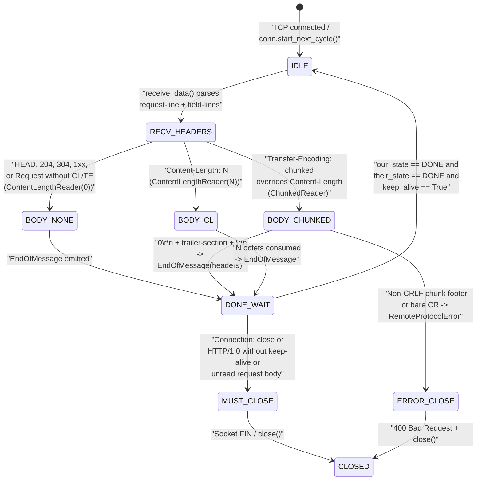

# HTTP/1.1 Wire Framing, Persistent Connections, and Chunked Transfer Coding (RFC 9112)

> [!summary] Claim
> Because HTTP/1.1 serializes sequential messages over a continuous TCP byte stream without out-of-band frame headers, safe persistent connection reuse requires every intermediary and origin server to compute identical payload boundaries using the eight-step precedence algorithm in `(RFC 9112 Section 6.3)` (`no-body status/method` -> `Transfer-Encoding: chunked` -> `Content-Length` -> `connection close`).

Part of [HTTP Semantics and Wire Protocols](README.md) in [API Engineering](../README.md).

## TL;DR

HTTP/1.1 frames messages in plain ASCII and binary octets as `start-line CRLF *( field-line CRLF ) CRLF [ message-body ]` `(RFC 9112 Section 2.1)`, relying on explicit length headers or `chunked` transfer coding so multiple request/response exchanges can share one persistent TCP socket `(RFC 9112 Section 9.3)`.
When both `Transfer-Encoding` and `Content-Length` appear on a message, `Transfer-Encoding` overrides `Content-Length` under `(RFC 9112 Section 6.3)` step 3, and any recipient that accepts the message rather than rejecting it with `400 Bad Request` must remove `Content-Length` before forwarding and close the connection after responding `(RFC 9112 Section 6.1)`.
The primary production trap is boundary desynchronization or TCP `RST` half-close truncation: if an origin sends an early `413 Content Too Large` or `401 Unauthorized` response and closes the socket while unread request body bytes remain in its kernel receive buffer, the operating system emits a TCP `RST` that destroys the response in flight before the client reads it `(RFC 9112 Section 9.6)`.
Across the Python ASGI stack, `h11 0.16.0` enforces strict `b"\r\n"` chunk footer verification after `CVE-2025-43859` `(h11 0.16.0 h11/_readers.py, ChunkedReader.__call__)` and strips `Content-Length` when emitting `Transfer-Encoding: chunked` responses `(h11 0.16.0 h11/_connection.py, Connection._clean_up_response_headers_for_sending)`, whereas CPython's standard library `http.client` still discards two arbitrary bytes after each chunk payload without verifying `b"\r\n"` `(CPython 3.14.6 Lib/http/client.py, HTTPResponse._get_chunk_left)`.
Do not use HTTP/1.1 `Transfer-Encoding: chunked` when both peers support HTTP/2 `(RFC 9113 Section 8.2.2)` or HTTP/3 `(RFC 9114 Section 4.2)` where binary `DATA` frames carry explicit length prefixes natively, or when a known-size payload can be sent with a fixed `Content-Length` header to avoid chunk framing overhead and streaming parser attack surface.

## Mental model



An HTTP/1.1 parser alternates strictly between control metadata (`start-line` and `field-line` headers terminated by an empty `CRLF` line) and a raw `message-body` byte range whose length is locked in at the transition out of `RECV_HEADERS` `(RFC 9112 Section 2.1)`.
Because the payload itself contains no framing escape sequences under `Content-Length` and uses inline hexadecimal length prefixes under `Transfer-Encoding: chunked` `(RFC 9112 Section 7.1)`, the byte immediately following `EndOfMessage` on a persistent connection is interpreted as the first character of the next `request-line` (`method`) or `status-line` (`HTTP-version`).
In `h11 0.16.0`, `_body_framing` inspects the message headers once when transitioning into `SEND_BODY` and instantiates either `ContentLengthReader`, `ChunkedReader`, or `Http10Reader` `(h11 0.16.0 h11/_connection.py, _body_framing)`.
A persistent socket can return to `IDLE` via `Connection.start_next_cycle()` only when both `CLIENT` and `SERVER` state machines reach `DONE` with `_cstate.keep_alive` still true; any framing error, `Connection: close` token, or unconsumed request body forces `MUST_CLOSE` so bytes from an aborted transfer cannot bleed into the next request cycle `(h11 0.16.0 h11/_state.py, ConnectionState)`.

## How it works

### Wire message grammar and header-to-body boundary

RFC 9112 defines an `HTTP-message` on the wire as a sequence of octets matching the ABNF grammar in `(RFC 9112 Section 2.1)`:

```text
HTTP-message   = start-line CRLF
                 *( field-line CRLF )
                 CRLF
                 [ message-body ]
start-line     = request-line / status-line
request-line   = method SP request-target SP HTTP-version
status-line    = HTTP-version SP status-code SP [ reason-phrase ]
field-line     = field-name ":" OWS field-value OWS
```

Every `start-line` and `field-line` is delimited by `CRLF` (`0x0d 0x0a`, or `b"\r\n"`), and the header section ends at the first empty line (`b"\r\n\r\n"` after the final header value) `(RFC 9112 Section 2.1)`.
Although `(RFC 9112 Section 2.2)` permits a recipient to accept a single `LF` (`0x0a`) as a line terminator in control lines, a sender must always emit `CRLF`, and a recipient must reject any bare `CR` (`0x0d` not immediately followed by `0x0a`) in a `start-line`, `field-line`, or `chunk-size` line to prevent parser split attacks.
Furthermore, whitespace between `field-name` and the colon `:` is forbidden: a server must reject any request header line containing space or horizontal tab before the colon with `400 Bad Request` `(RFC 9112 Section 5.1)`.
`h11 0.16.0` splits a header block on `\n`, so it accepts a bare `LF` line ending `(h11 0.16.0 h11/_receivebuffer.py, ReceiveBuffer.maybe_extract_lines)`, and `header_field_re` (compiled from `header_field` in `h11/_abnf.py`) rejects any whitespace preceding the colon `(h11 0.16.0 h11/_readers.py, header_field_re)`.
A bare `CR` is rejected in the request line only because the line then fails the request-line regex: `GET / HTTP/1.1\rHost: a` raises `RemoteProtocolError: illegal request line` (measured with `h11 0.16.0`, CPython 3.14.6, macOS 27.2 arm64).
Also retired by `(RFC 9112 Section 5.2)` is `obs-fold` (multiline header folding via `CRLF 1*( SP / HTAB )`), which non-`message/http` recipients must either reject with `400 Bad Request` or normalize to spaces before interpreting field values.

### Body length determination precedence (RFC 9112 Section 6.3)

Unlike HTTP/2 or HTTP/3, HTTP/1.1 does not prefix every message with a binary length field; instead, every recipient determines the exact number of `message-body` octets on the wire by evaluating the eight-step ordered decision cascade in `(RFC 9112 Section 6.3)`:

1. Any response to a `HEAD` request and any `1xx` (Informational), `204 No Content`, or `304 Not Modified` response is always terminated by the first empty line after the header fields (`0` body bytes on the wire), regardless of `Content-Length` or `Transfer-Encoding` headers present `(RFC 9112 Section 6.3)`.
2. Any `2xx` (Successful) response to a `CONNECT` request implies that the connection immediately switches to a raw byte tunnel after the empty header termination line (`0` HTTP body bytes) `(RFC 9112 Section 6.3)`.
3. If a `Transfer-Encoding` header field is present and `Content-Length` is also present, `Transfer-Encoding` overrides `Content-Length` `(RFC 9112 Section 6.3)`.
   Because dual headers indicate an upstream framing error or an active request smuggling attempt, a recipient should reject the message with `400 Bad Request` and close the connection, or else strip `Content-Length` before forwarding and close the connection after responding `(RFC 9112 Section 6.1)` (see [[HTTP-Request-Smuggling-CL-TE-and-Desync-Mechanics]]).
4. If `Transfer-Encoding` is present and `chunked` is the final transfer coding, the message body length is determined by reading chunks until the `0`-length terminating chunk and trailer section are consumed `(RFC 9112 Section 6.3)`.
   If `Transfer-Encoding` is present on a request and the final coding is not `chunked`, the server cannot determine the message boundary and must respond with `400 Bad Request` and close the connection `(RFC 9112 Section 6.3)`.
   If a server receives a `Transfer-Encoding` coding it does not implement, it must respond with `501 Not Implemented` `(RFC 9112 Section 6.1)`.
5. If a valid `Content-Length` header field is present without `Transfer-Encoding`, its decimal value defines the exact length in octets of the `message-body` `(RFC 9112 Section 6.3)`.
   If a message contains multiple `Content-Length` header lines with differing values, or a single `Content-Length` containing non-identical comma-separated values or non-digit characters, the recipient must reject it as invalid `(RFC 9112 Section 6.3)`.
6. If this is a request message and neither `Transfer-Encoding` nor `Content-Length` is present, the message body length is `0` octets `(RFC 9112 Section 6.3)`.
7. Otherwise, this is a response message without declared length framing, so its body is terminated by the server closing the underlying TCP connection (`EOF`) `(RFC 9112 Section 6.3)`.

In `h11 0.16.0`, `Connection._body_framing` implements this exact cascade in Python `(h11 0.16.0 h11/_connection.py, _body_framing)`:
- When `request_method == b"HEAD"`, `status_code in (204, 304)`, or `request_method == b"CONNECT"` with `200 <= status_code < 300`, `_body_framing` returns `("content-length", (0,))`.
- Next, if `transfer-encoding` is present, `_body_framing` asserts that it equals `[b"chunked"]` and returns `("chunked", ())`.
- When `h11` serializes an outgoing `Response` that carries both `Content-Length` and `Transfer-Encoding: chunked`, `Connection._clean_up_response_headers_for_sending` actively deletes `Content-Length` via `set_comma_header(headers, b"content-length", [])` so the wire bytes never violate `(RFC 9112 Section 6.1)` `(h11 0.16.0 h11/_connection.py, Connection._clean_up_response_headers_for_sending)`.
- If `content-length` is present, `_validate_content_length` verifies there is exactly one unique integer matching `r"[0-9]+"` and returns `("content-length", (length,))`.
- Finally, if neither header is present, `_body_framing` returns `("content-length", (0,))` for a `Request` and `("http/1.0", ())` (`Http10Reader`, which reads until socket `EOF`) for a `Response` `(h11 0.16.0 h11/_connection.py, _body_framing)`.

By contrast, `gunicorn 26.2.0` takes the stricter option permitted by `(RFC 9112 Section 6.1)` step 3: inside `Message.set_body_reader`, if `chunked` is true and `content_length is not None`, Gunicorn immediately raises `InvalidHeader("CONTENT-LENGTH", req=self)` and returns `400 Bad Request` `(gunicorn 26.2.0 gunicorn/http/message.py, Message.set_body_reader)`.

### Chunked transfer coding wire layout, extensions, and trailers

When an origin or client streams a dynamically generated payload (such as Starlette's `StreamingResponse`, server-sent NDJSON, or a streamed upload) over HTTP/1.1 without knowing the total byte count ahead of time, it applies the `chunked` transfer coding defined in `(RFC 9112 Section 7.1)`:

```text
chunked-body   = *chunk
                 last-chunk
                 trailer-section
                 CRLF

chunk          = chunk-size [ chunk-ext ] CRLF
                 chunk-data CRLF
chunk-size     = 1*HEXDIG
last-chunk     = 1*("0") [ chunk-ext ] CRLF

chunk-ext      = *( BWS ";" BWS chunk-ext-name
                    [ BWS "=" BWS chunk-ext-val ] )
chunk-ext-name = token
chunk-ext-val  = token / quoted-string
chunk-data     = 1*OCTET ; a sequence of chunk-size octets
trailer-section = *( field-line CRLF )
```

A concrete wire encoding of the 14-byte payload `b"stream-payload"` in 6-byte chunks with one `Server-Timing` trailer field looks like this on the socket:

```text
Offset  Hexadecimal wire octets                           ASCII representation
------  ------------------------------------------------  --------------------------
0x0000  36 0d 0a 73 74 72 65 61 6d 0d 0a                  6\r\nstream\r\n
0x000b  36 0d 0a 2d 70 61 79 6c 6f 0d 0a                  6\r\n-paylo\r\n
0x0016  32 0d 0a 61 64 0d 0a                              2\r\nad\r\n
0x001d  30 0d 0a                                          0\r\n
0x0020  53 65 72 76 65 72 2d 54 69 6d 69 6e 67 3a 20      Server-Timing: 
0x002f  64 62 3b 64 75 72 3d 34 2e 32 0d 0a               db;dur=4.2\r\n
0x003b  0d 0a                                             \r\n
```

Three parser invariants govern `chunked-body` decoding:

1. **Hexadecimal `chunk-size` and `chunk-ext` stripping**:
   `chunk-size` is a base-16 unsigned integer (`1*HEXDIG`, digits `0-9`, `a-f`, `A-F`) giving the exact byte count of `chunk-data`, excluding the trailing `CRLF` `(RFC 9112 Section 7.1)`.
   Optional `chunk-ext` parameters follow a semicolon `;` on the same line `(RFC 9112 Section 7.1.1)`.
   Recipients that do not understand a chunk extension must ignore it and strip everything from the first `;` to the `CRLF`, but must reject any bare `CR` inside `chunk-ext` so an attacker cannot smuggle a synthetic line break inside an extension value `(RFC 9112 Section 7.1.1)`.
   In `h11 0.16.0`, `chunk_header_re` is compiled in `h11/_readers.py` as `b"(?P<chunk_size>([0-9A-Fa-f]){1,20})(?P<chunk_ext>;.*)?[ \\t]*\\r\\n"`, bounding `chunk_size` to at most `20` hexadecimal digits (`16^20 - 1` octets), `(h11 0.16.0 h11/_readers.py, chunk_header_re)`.
   Because `chunk_ext` is `;.*` and `ReceiveBuffer.maybe_extract_next_line` only searches for `\r\n`, h11 accepts a bare `CR` inside a chunk extension: `5;x=\ry\r\nhello\r\n0\r\n\r\n` parses into one `Data` event and `EndOfMessage` (measured with `h11 0.16.0`, CPython 3.14.6, macOS 27.2 arm64).

2. **Mandatory `CRLF` chunk footer verification**:
   Every `chunk-data` block of `size` octets must be followed immediately by `b"\r\n"` before the next `chunk-size` line begins `(RFC 9112 Section 7.1)`.
   If a parser merely skips `2` bytes after `chunk-data` without asserting `wire[data_end:data_end + 2] == b"\r\n"`, an attacker who can inject bytes when an upstream proxy and downstream server disagree on chunk boundaries can hide chunk headers inside those two skipped bytes (`CVE-2025-43859`).

3. **`last-chunk` (`0\r\n`) and `trailer-section` restrictions**:
   A chunk whose `chunk-size` evaluates to `0` (`1*("0")`) marks the end of the payload octets, but does **not** end the HTTP message until the `trailer-section` and final terminating `CRLF` (`b"\r\n"`) are read `(RFC 9112 Section 7.1.2)`.
   Therefore, an empty chunked message body is the 5-byte sequence `b"0\r\n\r\n"`.
   Under `(RFC 9110 Section 6.5.1)`, a sender must not generate trailer fields that are required for message framing (`Transfer-Encoding`, `Content-Length`), routing (`Host`), request modifiers (`Cache-Control`, `Expect`, `Max-Forwards`, `Pragma`, `Range`, `TE`), authentication (`Authorization`, `Set-Cookie`), or response control data, and a recipient must never merge forbidden trailer fields into the main header dictionary as if they had been validated before the body was processed.
   When `h11 0.16.0` parses a chunked message, `ChunkedReader.__call__` inspects `_reading_trailer`, extracts trailer lines via `buf.maybe_extract_lines()`, and decodes them via `_decode_header_lines` into `EndOfMessage(headers=...)` rather than mutating `Request.headers` or `Response.headers` retroactively `(h11 0.16.0 h11/_readers.py, ChunkedReader)`.

### Persistent connections, keep-alive defaults, and TCP half-close resets

In HTTP/1.0, connections closed after every response unless negotiated via `Connection: keep-alive`; in HTTP/1.1, connections are persistent by default unless either peer sends `Connection: close` `(RFC 9112 Section 9.3)`.
Specifically, a recipient determines whether a connection remains persistent after the current message via `(RFC 9112 Section 9.3)`:
- If the `Connection` header contains the `close` connection option (case-insensitive token), the connection is not persistent and must close after the current response is complete.
- Otherwise, if the received protocol is `HTTP/1.1` (or later), the connection will persist after the current response.
- Otherwise, if the received protocol is `HTTP/1.0`, the connection persists only if the `Connection` header contains the `keep-alive` token and the message body length is self-delimited (not terminated by EOF) `(RFC 9112 Section 9.3)`.

Additionally, `(RFC 9110 Section 7.6.1)` requires any proxy or gateway to parse the tokens listed inside the `Connection` header field value and remove both the `Connection` header itself and every header field whose name matches a listed connection token (such as `Keep-Alive`, `TE`, `Transfer-Encoding`, `Upgrade`, or custom hop-by-hop headers) before forwarding the message to the next hop.

When closing a connection before reading the entire request body (for example, returning `413 Content Too Large`, `401 Unauthorized`, or `429 Too Many Requests`), an origin server faces the **TCP reset problem** documented in `(RFC 9112 Section 9.6)`:
- If the server sends its HTTP error response and immediately calls `close()` while the client is still transmitting request body segments (or while unread request body bytes sit in the server kernel's TCP receive buffer), the server's TCP stack sends a `RST` packet instead of a clean `FIN` (or sends a `RST` the moment the next in-flight client data segment arrives).
- When the client's kernel receives a TCP `RST`, it immediately purges its own unacknowledged send buffer and often discards unread response bytes sitting in the client's socket receive buffer, causing the client application to raise `ConnectionResetError` (`ECONNRESET`) instead of seeing the `413 Content Too Large` response `(RFC 9112 Section 9.6)`.
- To avoid this, `(RFC 9112 Section 9.6)` specifies a two-stage close: the server sends the response with `Connection: close`, performs a half-close on the write side (`shutdown(SHUT_WR)` -> TCP `FIN`), continues reading and discarding incoming socket bytes for a short grace period until it receives the client's `FIN`, and only then closes the socket descriptor completely.

### ASGI server and HTTP client implementation mechanics

Across the pinned Python API stack in `labs/` `(as of 2026-11)`:
- **Uvicorn (`uvicorn 0.54.0`)**:
  `H11Protocol` in `uvicorn/protocols/http/h11_impl.py` pairs an `h11.Connection(h11.SERVER)` with an `asyncio.Transport` and configures a default `timeout_keep_alive: int = 5` seconds in `uvicorn/config.py` `(uvicorn 0.54.0 uvicorn/config.py, Config.__init__)`.
  When an ASGI application sends `http.response.start` without a `content-length` or `transfer-encoding` header on an HTTP/1.1 connection (for example, `starlette.responses.StreamingResponse`), `h11.Connection.send` automatically appends `Transfer-Encoding: chunked` unless the status code or method forbids a body `(h11 0.16.0 h11/_connection.py, Connection._clean_up_response_headers_for_sending)`.
  Conversely, `starlette.responses.Response.init_headers` computes `str(len(body))` and sets `content-length` whenever a non-empty synchronous `body` byte string is present and the status is not `204` or `304` `(starlette 1.10.0 starlette/responses.py, Response.init_headers)`.
  At the end of `RequestResponseCycle.send`, Uvicorn checks `if self.conn.our_state is h11.DONE and self.conn.their_state is h11.DONE: self.conn.start_next_cycle()` and schedules the `timeout_keep_alive_handler` timer; if the client has not finished sending its request body (`their_state is h11.SEND_BODY`), Uvicorn closes the transport instead of recycling the connection `(uvicorn 0.54.0 uvicorn/protocols/http/h11_impl.py, RequestResponseCycle.send)`.
- **Hypercorn (`hypercorn 0.18.0`)**:
  `H11Protocol` in `hypercorn/protocol/h11.py` wraps `h11.Connection(h11.SERVER, max_incomplete_event_size=self.config.h11_max_incomplete_size)` with default `keep_alive_timeout = 5.0` seconds and default `h11_max_incomplete_size = 16 * 1024` (`16,384` bytes) `(hypercorn 0.18.0 hypercorn/config.py, Config)`.
  Notably, before calling `recycle()`, Hypercorn drains any unconsumed request body via `await self.stream.Close()` / `self._maybe_recycle()`, waiting to read until `EndOfMessage` before calling `self.connection.start_next_cycle()` `(hypercorn 0.18.0 hypercorn/protocol/h11.py, H11Protocol._maybe_recycle)`.
- **HTTPX and HTTPCore (`httpx 0.28.1`, `httpcore 1.0.9`)**:
  `AsyncHTTP11Connection` in `httpcore/_async/http11.py` wraps `h11.Connection(our_role=h11.CLIENT, max_incomplete_event_size=self._max_incomplete_event_size)` with class attribute `MAX_INCOMPLETE_EVENT_SIZE = 100 * 1024` (`102,400` bytes, or `100 KiB`) `(httpcore 1.0.9 httpcore/_async/http11.py, AsyncHTTP11Connection.MAX_INCOMPLETE_EVENT_SIZE)`.
  `httpx.Limits` defaults to `max_connections=100`, `max_keepalive_connections=20`, and `keepalive_expiry=5.0` seconds `(httpx 0.28.1 httpx/_config.py, DEFAULT_LIMITS)`.
  In `AsyncHTTP11Connection._response_closed`, the client calls `self._h11_state.start_next_cycle()` only if `self._h11_state.our_state is h11.DONE and self._h11_state.their_state is h11.DONE`; otherwise it closes the socket `(httpcore 1.0.9 httpcore/_async/http11.py, AsyncHTTP11Connection._response_closed)`.

## Numbers and limits

| Parameter or metric | Value | Source or measurement context |
|---|---|---|
| `h11` default `max_incomplete_event_size` | `16,384` bytes (`16 KiB`) | `DEFAULT_MAX_INCOMPLETE_EVENT_SIZE = 16 * 1024` `(h11 0.16.0 h11/_connection.py, DEFAULT_MAX_INCOMPLETE_EVENT_SIZE)` `(as of 2026-11)` |
| `h11` maximum `chunk-size` hex digits | `20` hex digits (`16^20 - 1` octets) | `chunk_header_re` `b"(?P<chunk_size>([0-9A-Fa-f]){1,20})..."` `(h11 0.16.0 h11/_readers.py, chunk_header_re)` `(as of 2026-11)` |
| `httpcore` client `max_incomplete_event_size` | `102,400` bytes (`100 KiB`) | `AsyncHTTP11Connection.MAX_INCOMPLETE_EVENT_SIZE = 100 * 1024` `(httpcore 1.0.9 httpcore/_async/http11.py, AsyncHTTP11Connection.MAX_INCOMPLETE_EVENT_SIZE)` `(as of 2026-11)` |
| `httpx` default connection pool limits | `max_connections=100`, `max_keepalive_connections=20`, `keepalive_expiry=5.0` s | `DEFAULT_LIMITS` `(httpx 0.28.1 httpx/_config.py, DEFAULT_LIMITS)` `(as of 2026-11)` |
| `uvicorn` default `timeout_keep_alive` | `5` s | `timeout_keep_alive: int = 5` `(uvicorn 0.54.0 uvicorn/config.py, Config.__init__)` `(as of 2026-11)` |
| `uvicorn` read/write pause watermark | `65,536` bytes (`64 KiB`) (`HIGH_WATER_LIMIT`) | `(uvicorn 0.54.0 uvicorn/protocols/http/flow_control.py, HIGH_WATER_LIMIT)` `(as of 2026-11)` |
| `hypercorn` default `keep_alive_timeout` and header buffer | `5.0` s; `h11_max_incomplete_size = 16,384` bytes | `(hypercorn 0.18.0 hypercorn/config.py, Config)` `(as of 2026-11)` |
| `granian` HTTP/1 defaults | `keep_alive=True`, `max_buffer_size=417,792` bytes (`8192 + 4096 * 100`), `header_read_timeout=30,000` ms | `(granian 2.8.7 granian/http.py, HTTP1Settings)` `(as of 2026-11)` |
| `CPython` `http.client` max header line and count | `_MAXLINE = 65,536` bytes (`64 KiB`), `_MAXHEADERS = 100` | `(CPython 3.14.6 Lib/http/client.py, _MAXLINE)` `(as of 2026-11)` |
| Empty `chunked-body` wire size | `5` bytes (`b"0\r\n\r\n"`) | `last-chunk` (`30 0d 0a`) + empty `trailer-section` + `CRLF` (`0d 0a`) `(RFC 9112 Section 7.1)` |
| Chunk framing wire overhead (`64 KiB` body, `chunk_size=4096`) | `133` bytes (`0.20%` overhead; `65,669` wire bytes for `65,536` payload bytes) | `16` chunks x `8` bytes (`b"1000\r\n"` + `b"\r\n"`) + `5` bytes (`b"0\r\n\r\n"`); measured in `labs/` (`CPython 3.14.6`, `macOS 27.2 arm64`) |
| Chunk framing wire overhead (`64 KiB` body, `chunk_size=64`) | `6,149` bytes (`9.38%` overhead; `71,685` wire bytes for `65,536` payload bytes) | `1,024` chunks x `6` bytes (`b"40\r\n"` + `b"\r\n"`) + `5` bytes (`b"0\r\n\r\n"`); measured in `labs/` (`CPython 3.14.6`, `macOS 27.2 arm64`) |
| `encode_chunked` + `decode_chunked_with_trailers` roundtrip latency (`64 KiB`, `chunk_size=4096`) | `26.0 us` median per roundtrip | Measured via `timeit` (`1,000` iterations) in `labs/` on `macOS 27.2 arm64` (`Darwin 27.2.0`), `CPython 3.14.6` |

## Portability

| Runtime, server, or protocol | `Content-Length` + `Transfer-Encoding: chunked` behavior | Chunk footer `b"\r\n"` validation | Trailer field handling | Persistent connection reuse rule | Verification source |
|---|---|---|---|---|---|
| `CPython 3.12.13`, `3.13.18`, `3.14.6` + `h11 0.16.0` | Incoming: `ChunkedReader` overrides `Content-Length`; outgoing `Response`: strips `Content-Length` | Strict: raises `RemoteProtocolError("malformed chunk footer: ...")` (`CVE-2025-43859` fix) | Parsed into `EndOfMessage.headers`; kept separate from `Request.headers` | Requires `our_state is DONE` and `their_state is DONE` before `start_next_cycle()` | Proven by `25 passed` in `test_http_1_1_framing_keep_alive_and_chunked_encoding.py` under CPython 3.12.13, 3.13.18, and 3.14.6 on `macOS 27.2 arm64`; 3.15.0b3 and 3.15.0b3t blocked by workspace dependency build failure (`lupa==2.8` SIGSEGV) |
| `CPython 3.14.6` stdlib `http.client` / `http.server` | `HTTPResponse._check_close` sets `chunked = True` first and ignores `content-length` when `chunked` is active | Lenient: `HTTPResponse._get_chunk_left` calls `self._safe_read(2)` without verifying `b"\r\n"` | Read via `parse_headers(self.fp)` and discarded after `0\r\n` | `BaseHTTPRequestHandler.handle_one_request` closes unless `protocol_version >= "HTTP/1.1"` and `close_connection == False` | `(CPython 3.14.6 Lib/http/client.py, HTTPResponse._get_chunk_left)` and `(CPython 3.14.6 Lib/http/server.py, BaseHTTPRequestHandler)` |
| `uvicorn 0.54.0` (`h11` backend) | Delegates to `h11 0.16.0`; emits `Transfer-Encoding: chunked` when response lacks `content-length` | Enforced via `h11.ChunkedReader` (`400 Bad Request` on `RemoteProtocolError`) | ASGI `http.request` does not expose request trailers; response trailers require ASGI `http.response.trailers` extension | Recycles immediately if both states are `DONE`; closes transport if `their_state` still in `SEND_BODY` | `(uvicorn 0.54.0 uvicorn/protocols/http/h11_impl.py, RequestResponseCycle.send)` |
| `hypercorn 0.18.0` (`h11` backend) | Delegates to `h11 0.16.0` | Enforced via `h11.ChunkedReader` | Passes `EndOfMessage` after body completion | Actively drains unread request body before calling `connection.start_next_cycle()` | `(hypercorn 0.18.0 hypercorn/protocol/h11.py, H11Protocol._maybe_recycle)` |
| `gunicorn 26.2.0` | Rejects any request containing both `Transfer-Encoding: chunked` and `Content-Length` with `400 Bad Request` (`InvalidHeader("CONTENT-LENGTH")`) | `ChunkedReader.parse_chunked` checks `rest[:2] == b"\r\n"`, raising `ChunkMissingTerminator(rest[:2])` otherwise | Parsed via `parse_trailers` into `req.trailers` | Defaults to `keepalive = 2` s; forces `must_close()` on protocol error or `Connection: close` | `(gunicorn 26.2.0 gunicorn/http/message.py, Message.set_body_reader)` and `(gunicorn 26.2.0 gunicorn/http/body.py, ChunkedReader)` |
| `granian 2.8.7` (Rust `hyper` HTTP/1 engine) | Managed in Rust `hyper` HTTP/1 codec (`HTTP1Settings.keep_alive = True`) | Enforced by Rust `hyper::proto::h1::role` parser | Handled in Rust transport layer | Controlled by `HTTP1Settings(keep_alive=True, max_buffer_size=417792)` | `(granian 2.8.7 granian/http.py, HTTP1Settings)` |
| HTTP/2 `[[HTTP-2-Binary-Framing-and-Stream-State-Machine\|RFC 9113]]` | `Transfer-Encoding`, `Keep-Alive`, `Connection`, `Upgrade`, and `Proxy-Connection` are forbidden (`PROTOCOL_ERROR` stream reset) | Not applicable: `DATA` frames carry a 24-bit binary length header | Sent as a final `HEADERS` frame with `END_STREAM` set (`0x1`) | Single multiplexed TCP connection; stream lifecycle is independent of connection persistence | `(RFC 9113 Section 8.1)` and `(RFC 9113 Section 8.2.2)` |
| HTTP/3 `[[HTTP-3-Framing-and-QPACK-Header-Compression-RFC-9114\|RFC 9114]]` | `Transfer-Encoding`, `Keep-Alive`, `Connection`, `Upgrade`, and `Proxy-Connection` are forbidden (`H3_MESSAGE_ERROR`) | Not applicable: QUIC stream `DATA` frames use variable-length integer length prefixes | Sent as a trailing `HEADERS` frame on the bidirectional QUIC request stream | Each HTTP request/response exchange uses its own dedicated QUIC bidirectional stream; `FIN` closes the stream, not the connection | `(RFC 9114 Section 4.1)` and `(RFC 9114 Section 4.2)` |

## Worked example

The lab implementation in [implementation](../labs/src/api_labs/f01_http_semantics_and_wire_protocols/chunked.py) and its test suite in [test](../labs/tests/f01_http_semantics_and_wire_protocols/test_http_1_1_framing_keep_alive_and_chunked_encoding.py) implement a strict `RFC 9112 Section 7.1` chunked encoder/decoder with trailer validation (`FORBIDDEN_TRAILER_FIELDS` per `RFC 9110 Section 6.5.1`) and drive `h11 0.16.0` server state machines across chunked reassembly, `Transfer-Encoding` vs `Content-Length` precedence, `CVE-2025-43859` non-`CRLF` chunk footer rejection, unread-body `MUST_CLOSE` transitions, and Starlette ASGI `StreamingResponse` vs `JSONResponse` framing.

Full byte-identical source of [implementation](../labs/src/api_labs/f01_http_semantics_and_wire_protocols/chunked.py):

```python
"""HTTP/1.1 chunked transfer coding and h11 connection lifecycle helpers (RFC 9112)."""

from __future__ import annotations

from dataclasses import dataclass
from typing import TYPE_CHECKING

import h11

if TYPE_CHECKING:
    from collections.abc import Sequence

_HEX_BYTES = frozenset(b"0123456789abcdefABCDEF")
_MAX_CHUNK_HEX_DIGITS = 20
FORBIDDEN_TRAILER_FIELDS: frozenset[bytes] = frozenset(
    {b"host", b"content-length", b"transfer-encoding", b"trailer", b"authorization", b"te"}
)


@dataclass(frozen=True, slots=True)
class DecodedChunked:
    """Payload and validated trailer fields extracted from a chunked-body."""

    body: bytes
    trailers: tuple[tuple[bytes, bytes], ...]


@dataclass(frozen=True, slots=True)
class H11ExchangeSummary:
    """Result of one HTTP/1.1 request/response cycle on an h11 server connection."""

    method: bytes
    target: bytes
    body: bytes
    trailers: tuple[tuple[bytes, bytes], ...]
    wire_response: bytes
    reusable: bool


def encode_chunked(
    body: bytes,
    *,
    chunk_size: int = 4096,
    trailers: Sequence[tuple[bytes, bytes]] = (),
) -> bytes:
    """Encode *body* and *trailers* using HTTP/1.1 chunked coding (RFC 9112 Section 7.1)."""
    if chunk_size <= 0:
        raise ValueError("chunk_size must be positive")
    parts: list[bytes] = []
    for start in range(0, len(body), chunk_size):
        chunk = body[start : start + chunk_size]
        size_line = f"{len(chunk):x}\r\n".encode("ascii")
        parts.append(size_line + chunk + b"\r\n")
    parts.append(b"0\r\n")
    for raw_name, raw_value in trailers:
        name = raw_name.strip().lower()
        if not name or name in FORBIDDEN_TRAILER_FIELDS:
            raise ValueError(f"forbidden trailer field: {raw_name!r}")
        parts.append(raw_name + b": " + raw_value + b"\r\n")
    parts.append(b"\r\n")
    return b"".join(parts)


def decode_chunked_with_trailers(wire: bytes) -> DecodedChunked:
    """Decode an HTTP/1.1 chunked-body into its payload and validated trailer fields."""
    out = bytearray()
    offset = 0
    while True:
        line_end = wire.find(b"\r\n", offset)
        if line_end == -1:
            raise ValueError("unterminated chunk size line")
        size_line = wire[offset:line_end]
        semi = size_line.find(b";")
        if semi != -1:
            if b"\r" in size_line[semi:]:
                raise ValueError("bare CR in chunk extension")
            hex_digits = size_line[:semi]
        else:
            hex_digits = size_line
        if not (1 <= len(hex_digits) <= _MAX_CHUNK_HEX_DIGITS) or not all(
            b in _HEX_BYTES for b in hex_digits
        ):
            raise ValueError("invalid chunk size hex digits")
        size = int(hex_digits, 16)
        offset = line_end + 2
        if size == 0:
            trailers: list[tuple[bytes, bytes]] = []
            while True:
                trailer_end = wire.find(b"\r\n", offset)
                if trailer_end == -1:
                    raise ValueError("missing or trailing bytes after terminating chunk")
                if trailer_end == offset:
                    if offset + 2 != len(wire):
                        raise ValueError("missing or trailing bytes after terminating chunk")
                    return DecodedChunked(body=bytes(out), trailers=tuple(trailers))
                field_line = wire[offset:trailer_end]
                colon = field_line.find(b":")
                if colon <= 0 or field_line[colon - 1 : colon] in (b" ", b"\t"):
                    raise ValueError("malformed trailer field line")
                name = field_line[:colon].lower()
                if name in FORBIDDEN_TRAILER_FIELDS:
                    raise ValueError(f"forbidden trailer field: {name!r}")
                value = field_line[colon + 1 :].strip(b" \t")
                trailers.append((name, value))
                offset = trailer_end + 2
        data_end = offset + size
        if data_end + 2 > len(wire) or wire[data_end : data_end + 2] != b"\r\n":
            raise ValueError("truncated chunk data or missing chunk CRLF")
        out.extend(wire[offset:data_end])
        offset = data_end + 2


def decode_chunked(wire: bytes) -> bytes:
    """Decode an HTTP/1.1 chunked-body byte sequence into the reconstructed payload."""
    return decode_chunked_with_trailers(wire).body


def step_h11_server_exchange(
    conn: h11.Connection,
    raw_request: bytes,
    *,
    response_status: int = 200,
    response_headers: Sequence[tuple[bytes, bytes]] = (),
    response_body: bytes = b"",
) -> H11ExchangeSummary:
    """Run one request/response cycle on *conn* and recycle if both roles reach DONE."""
    conn.receive_data(raw_request)
    first_event = conn.next_event()
    if not isinstance(first_event, h11.Request):
        raise ValueError(f"expected h11.Request, got {first_event!r}")
    body_parts: list[bytes] = []
    while True:
        event = conn.next_event()
        if isinstance(event, h11.Data):
            body_parts.append(bytes(event.data))
        elif isinstance(event, h11.EndOfMessage):
            trailers = tuple((k, v) for k, v in event.headers)
            break
        else:
            raise ValueError(f"incomplete request body: {event!r}")
    out_chunks: list[bytes] = [
        conn.send(h11.Response(status_code=response_status, headers=list(response_headers)))
    ]
    if response_body:
        out_chunks.append(conn.send(h11.Data(data=response_body)))
    out_chunks.append(conn.send(h11.EndOfMessage()))
    reusable = conn.our_state is h11.DONE and conn.their_state is h11.DONE
    if reusable:
        conn.start_next_cycle()
    return H11ExchangeSummary(
        method=first_event.method,
        target=first_event.target,
        body=b"".join(body_parts),
        trailers=trailers,
        wire_response=b"".join(out_chunks),
        reusable=reusable,
    )
```

A simplified excerpt from [test](../labs/tests/f01_http_semantics_and_wire_protocols/test_http_1_1_framing_keep_alive_and_chunked_encoding.py) verifying `Transfer-Encoding` precedence over `Content-Length`, `CVE-2025-43859` chunk footer validation, and unread-body connection closure:

```python
# simplified excerpt from tests/f01_http_semantics_and_wire_protocols/test_http_1_1_framing_keep_alive_and_chunked_encoding.py
@pytest.mark.unit
def test_h11_transfer_encoding_precedence_over_content_length() -> None:
    chunked_body = encode_chunked(b"trusted-chunk", chunk_size=7)
    raw_request = (
        b"POST /v1/ingest HTTP/1.1\r\n"
        b"Host: api.example.test\r\n"
        b"Content-Length: 999\r\n"
        b"Transfer-Encoding: chunked\r\n"
        b"\r\n" + chunked_body
    )
    conn = h11.Connection(h11.SERVER)
    summary = step_h11_server_exchange(
        conn,
        raw_request,
        response_status=200,
        response_headers=[(b"content-length", b"50"), (b"transfer-encoding", b"chunked")],
        response_body=b"streamed",
    )
    assert summary.body == b"trusted-chunk"
    assert b"Transfer-Encoding: chunked\r\n" in summary.wire_response
    assert b"Content-Length" not in summary.wire_response
    assert b"\r\n8\r\nstreamed\r\n0\r\n\r\n" in summary.wire_response


@pytest.mark.unit
@pytest.mark.parametrize(
    "bad_footer_chunk",
    [
        b"3\r\nxxx__0\r\n\r\n",
        b"3\r\nxxx\r_0\r\n\r\n",
        b"3\r\nxxx_\n0\r\n\r\n",
    ],
)
def test_h11_rejects_cve_2025_43859_non_crlf_chunk_footers(bad_footer_chunk: bytes) -> None:
    conn = h11.Connection(h11.SERVER)
    conn.receive_data(
        b"POST /v1/smuggle HTTP/1.1\r\n"
        b"Host: api.example.test\r\n"
        b"Transfer-Encoding: chunked\r\n"
        b"\r\n" + bad_footer_chunk
    )
    assert isinstance(conn.next_event(), h11.Request)
    assert isinstance(conn.next_event(), h11.Data)
    with pytest.raises(h11.RemoteProtocolError, match="malformed chunk footer"):
        conn.next_event()
```

Captured output from running `uv run --frozen pytest tests/f01_http_semantics_and_wire_protocols/test_http_1_1_framing_keep_alive_and_chunked_encoding.py -q` in `labs/` under `CPython 3.14.6` on `macOS 27.2 arm64`:

```text
.........................                                                [100%]
25 passed in 0.05s
```

## Pitfalls

> [!warning] Lenient chunk footer skipping enables request smuggling (`CVE-2025-43859` in `h11 < 0.16.0` and `CPython http.client`)
> - **Trigger**: A parser reads `chunk-size` bytes of `chunk-data` and advances the buffer by `2` octets without checking that those two octets are literally `b"\r\n"` (`0x0d 0x0a`).
> - **Symptom**: In `h11 <= 0.14.0`, `ChunkedReader` tracked `self._bytes_to_discard = 2` as an integer counter, silently discarding any two characters (such as `b"XX"` or `b"\n0"`) after a chunk body (`GHSA-vqfr-h8mv-ghfj`, `CVE-2025-43859`, CVSS 9.1), which allows an attacker to smuggle a second HTTP request across a persistent connection when paired with a front-end proxy that parses chunk boundaries differently, while even in `CPython 3.14.6` standard library `http.client.HTTPResponse._get_chunk_left` still executes `self._safe_read(2)` without verifying `b"\r\n"` `(CPython 3.14.6 Lib/http/client.py, HTTPResponse._get_chunk_left)`.
> - **Fix**: Upgrade `h11` to `>= 0.16.0` (commit `114803a29ce50116dc47951c690ad4892b1a36ed`, which compares `bytes_read != self._bytes_to_discard` against `b"\r\n"` and raises `LocalProtocolError("malformed chunk footer: ...")`), and never expose `CPython` stdlib `http.client` or `http.server` directly to untrusted multi-tenant proxy chains.

> [!warning] Loose `Transfer-Encoding` token matching in origin servers (`CVE-2024-1135` and `CVE-2024-6827` in `gunicorn < 22.0.0`)
> - **Trigger**: An origin server accepts malformed `Transfer-Encoding` header values such as prefix/suffix obfuscations (`Transfer-Encoding: chunked, identity`), whitespace before the header colon, or multiple conflicting `Transfer-Encoding` headers that a reverse proxy ignores and forwards using `Content-Length`.
> - **Symptom**: The reverse proxy frames the request using `Content-Length` while Gunicorn switches to `ChunkedReader` (or vice versa), allowing an attacker to poison the persistent socket and hijack the next user's request (`GHSA-w3h3-4rj7-4ph4` / `CVE-2024-1135` and `GHSA-hc5x-x2vx-497g` / `CVE-2024-6827`).
> - **Fix**: Run `gunicorn >= 22.0.0` (pinned at `26.2.0` in `labs/`), which rejects any `Transfer-Encoding` combined with `Content-Length` (`InvalidHeader("CONTENT-LENGTH")`) and validates `chunked` as the sole final transfer coding `(gunicorn 26.2.0 gunicorn/http/message.py, Message.set_body_reader)`.

> [!warning] Dual `Content-Length` and `Transfer-Encoding: chunked` on incoming requests leaves `keep_alive = True` in `h11 0.16.0`
> - **Trigger**: A client or misconfigured proxy sends an HTTP/1.1 request carrying both `Content-Length` and `Transfer-Encoding: chunked` to an `h11`-based server (`uvicorn` or `hypercorn`).
> - **Symptom**: `h11 0.16.0` correctly prioritizes `ChunkedReader` over `Content-Length` under `(RFC 9112 Section 6.3)` step 3, but it leaves `_cstate.keep_alive = True` on the connection `(h11 0.16.0 h11/_connection.py, _keep_alive)` even though `(RFC 9112 Section 6.1)` requires the server to close the connection after responding to neutralize any residual smuggling desynchronization.
> - **Fix**: Add an ASGI middleware or edge reverse proxy rule (Nginx, Envoy) that inspects incoming HTTP/1.1 requests and immediately returns `400 Bad Request` with `Connection: close` whenever both `content-length` and `transfer-encoding` appear in the raw request header list.

> [!warning] Early `4xx`/`5xx` response without draining the request body triggers a TCP `RST` that erases the response
> - **Trigger**: An endpoint rejects a large `POST` or `PUT` upload early (for example, returning `413 Content Too Large` or `401 Unauthorized` after inspecting headers) and immediately closes the socket while the client is still streaming body chunks.
> - **Symptom**: When `Uvicorn` sees `conn.their_state is h11.SEND_BODY` at response completion, it calls `transport.close()` immediately `(uvicorn 0.54.0 uvicorn/protocols/http/h11_impl.py, RequestResponseCycle.send)`, and because unread client payload bytes arrive at the closed TCP socket, the kernel emits a TCP `RST` that causes the client (`curl`, browser, or `httpx`) to fail with `ConnectionResetError` instead of parsing the `413 Content Too Large` status code `(RFC 9112 Section 9.6)`.
> - **Fix**: For small bounded uploads, drain the remaining body up to a safety cap before closing (as `Hypercorn` does in `H11Protocol._maybe_recycle`); for large uploads, require clients to send `Expect: 100-continue` `(RFC 9110 Section 10.1.1)` so validation happens before payload bytes are transmitted, or terminate HTTP at a reverse proxy that implements lingering close `(RFC 9112 Section 9.6)`.

> [!warning] Reverse proxy keep-alive idle timeout race causes intermittent `502 Bad Gateway` / `RemoteProtocolError`
> - **Trigger**: An upstream HTTP client pool (`httpx.AsyncClient` with `keepalive_expiry=5.0` s) or reverse proxy (ALB, Nginx) holds an idle persistent connection open for the exact same duration as the origin server's idle timer (`uvicorn --timeout-keep-alive 5` s).
> - **Symptom**: The proxy selects an idle socket to dispatch a new `POST` request at `t = 4.999` s while Uvicorn's `timeout_keep_alive_handler` simultaneously sends a TCP `FIN` at `t = 5.000` s, and because `POST` is not idempotent `(RFC 9110 Section 9.2.2)`, the proxy cannot automatically retry the request on a fresh connection `(RFC 9112 Section 9.3.1)` and surfaces `502 Bad Gateway` to the caller.
> - **Fix**: Always configure the origin server's keep-alive idle timeout strictly higher than its immediate upstream proxy or client pool (for example, `httpx` `keepalive_expiry=5.0` s or ALB idle timeout `60` s -> `uvicorn --timeout-keep-alive 65` s).

## Security and robustness

- **Desynchronization and request smuggling surface (`OWASP API8:2023 Security Misconfiguration`)**:
  Every HTTP/1.1 request smuggling vulnerability (`CL.TE`, `TE.CL`, `TE.TE`) exploits a discrepancy in how two hops on a persistent connection implement `(RFC 9112 Section 6.3)` or `(RFC 9112 Section 7.1)` (see [[HTTP-Request-Smuggling-CL-TE-and-Desync-Mechanics]]).
  Defense in depth requires four controls:
  1. Reject any request containing both `Content-Length` and `Transfer-Encoding` with `400 Bad Request` and close the connection `(RFC 9112 Section 6.1)`.
  2. Reject multiple `Content-Length` headers or non-digit `Content-Length` values (`+42`, `-1`, `0x10`) `(RFC 9112 Section 6.3)`.
  3. Enforce strict `CRLF` line termination and chunk footer verification (`b"\r\n"`), rejecting bare `CR` anywhere in headers or chunk extensions `(RFC 9112 Section 2.2)` and `(RFC 9112 Section 7.1.1)`.
  4. Prefer normalizing traffic to HTTP/2 (`RFC 9113`) at the edge load balancer or speaking HTTP/2 end-to-end so text-based `Content-Length` vs `Transfer-Encoding` ambiguity is eliminated at the wire framing layer.
- **Unbounded header and chunk-extension memory exhaustion (`Slowloris` and `h11_max_incomplete_size`)**:
  Before an HTTP/1.1 parser can emit `h11.Request`, it must buffer the entire header block up to `b"\r\n\r\n"`; similarly, before emitting `h11.Data` for a chunk, it must buffer the entire `chunk-size [ chunk-ext ] CRLF` line.
  Without an upper bound on incomplete event buffering, a client sending header bytes or chunk extension bytes without `b"\r\n"` can exhaust worker memory (`OWASP API4:2023 Unrestricted Resource Consumption`).
  `h11 0.16.0` bounds this via `max_incomplete_event_size = 16,384` bytes (`16 KiB`), raising `RemoteProtocolError("Receive buffer too long")` inside `Connection.next_event` when unparsed buffer data exceeds the cap `(h11 0.16.0 h11/_connection.py, Connection.next_event)`.
  Complement size limits with a hard header read deadline (such as `granian`'s `header_read_timeout = 30,000` ms or an edge proxy `client_header_timeout = 10s`) to drop slow-drip `Slowloris` sockets.
- **Trailer field injection (`RFC 9110 Section 6.5.1`)**:
  Because `trailer-section` fields arrive *after* the application has already streamed or processed the message body, allowing trailer fields like `Host`, `Authorization`, `Content-Length`, `Transfer-Encoding`, or `Set-Cookie` to overwrite or merge into the request header map enables post-authentication privilege escalation and cache poisoning.
  Parsers must keep trailer fields in a segregated collection (`EndOfMessage.headers` in `h11`) and enforce an explicit allowlist of declared safe trailer names (such as `Server-Timing` or a cryptographic digest header declared in `Trailer`).

## The principal's view

A staff-plus engineer treats HTTP/1.1 wire framing as a legacy compatibility boundary that should be isolated and strictly normalized at the outermost edge proxy rather than trusted across internal service hops.
Within a modern service mesh or internal microservice fleet, running HTTP/1.1 over persistent connection pools forces an unpleasant trade-off between connection churn (if pools are small) and head-of-line blocking plus idle file-descriptor bloat (because each concurrent in-flight request pins an exclusive TCP socket until `EndOfMessage`) (see [[HTTP-1-1-Pipelining-and-Head-of-Line-Blocking]]).
Moreover, every hop that re-parses and re-serializes HTTP/1.1 text headers and `chunked` bodies re-introduces `CL.TE` / `TE.CL` desynchronization risk whenever proxy and origin parser tolerances diverge (`CVE-2025-43859`, `CVE-2024-1135`).

Consequently, the architectural standard for production Python API platforms is:
1. Terminate untrusted external HTTP/1.1, HTTP/2, and HTTP/3 traffic at a hardened L7 edge proxy (Envoy, Nginx, Cloudflare) that enforces strict `RFC 9112` grammar, strips ambiguous dual `Content-Length` + `Transfer-Encoding` requests with `400 Bad Request`, and buffers or normalizes chunked request bodies before forwarding.
2. When origin Python workers (`uvicorn`, `hypercorn`, `granian`) sit behind an L7 proxy over HTTP/1.1, set the origin's keep-alive idle timeout (`--timeout-keep-alive 65`) strictly above the proxy's upstream keep-alive timeout (`60` s) to eliminate idle-close race `502 Bad Gateway` errors, and pin `h11 >= 0.16.0` and `gunicorn >= 22.0.0`.
3. Choose fixed `Content-Length` responses (`JSONResponse`, serialized `bytes`) whenever the payload fits comfortably in memory (`<= 1 MiB`), reserving `StreamingResponse` (`Transfer-Encoding: chunked`) strictly for unbounded or high-latency incremental streams (LLM token streaming, large CSV/Parquet exports, NDJSON event feeds) where time-to-first-byte (`TTFB`) or bounded worker RSS outweighs chunk framing overhead and the inability of HTTP/1.1 intermediaries to compute byte-range caches.
4. For internal service-to-service RPC or high-concurrency streaming, replace HTTP/1.1 with HTTP/2 (`gRPC` or `httpx.AsyncClient(http2=True)`) so length-prefixed binary `DATA` frames multiplex over a single connection per peer without text-based chunk parsing.

## Interview questions

> [!question] L5: How does an HTTP/1.1 client know where a `200 OK` response body ends when the server sends neither `Content-Length` nor `Transfer-Encoding: chunked`, and what does that mean for connection reuse?
>
> > [!success]- Answer
> > Under `(RFC 9112 Section 6.3)` step 7, a response message with neither `Transfer-Encoding` nor `Content-Length` (and whose status code and request method allow a body) is framed by the server closing the underlying TCP connection (`EOF`).
> > In `h11 0.16.0`, `Connection._body_framing` returns `("http/1.0", ())` and selects `Http10Reader`, which emits `Data` events until `receive_data(b"")` signals socket closure `(h11 0.16.0 h11/_connection.py, _body_framing)`.
> > Because the message boundary is indistinguishable from socket closure, the persistent connection cannot be reused for a subsequent request and transitions to `MUST_CLOSE` / `CLOSED` `(RFC 9112 Section 9.3)`.
> >
> > Follow-up: Why does this fallback apply only to HTTP responses and never to HTTP requests?

> [!question] L5: Why does an empty HTTP/1.1 `Transfer-Encoding: chunked` body require `5` bytes (`b"0\r\n\r\n"`) on the wire instead of `3` bytes (`b"0\r\n"`)?
>
> > [!success]- Answer
> > Under the ABNF grammar `chunked-body = *chunk last-chunk trailer-section CRLF` in `(RFC 9112 Section 7.1)`, `last-chunk` is `b"0\r\n"` (`1*("0") [ chunk-ext ] CRLF`), which signals only that zero payload chunks remain and that the parser must now read `trailer-section`.
> > Even when `trailer-section` contains zero `field-line` headers, the final `CRLF` (`b"\r\n"`) that terminates the `chunked-body` after `trailer-section` is mandatory.
> > If a sender emits only `b"0\r\n"`, a compliant parser remains blocked inside `ChunkedReader` waiting for either a trailer `field-line` or the terminating `b"\r\n"` and never emits `EndOfMessage`.
> >
> > Follow-up: Which HTTP header fields are explicitly forbidden from appearing inside that `trailer-section` under `RFC 9110 Section 6.5.1`?

> [!question] L6: Predict the output: What are the exact wire headers and body framing emitted by `h11 0.16.0` when an application passes `headers=[(b"content-length", b"50"), (b"transfer-encoding", b"chunked")]` and `body=b"streamed"` on a `200 OK` `h11.Response`?
>
> > [!success]- Answer
> > `h11.Connection.send` emits `Transfer-Encoding: chunked\r\n` and **strips** the `Content-Length: 50` header completely from the serialized wire response, followed by the chunked payload `b"8\r\nstreamed\r\n0\r\n\r\n"`.
> > Inside `h11 0.16.0`, `_body_framing` checks `transfer-encoding` before `content-length` per `(RFC 9112 Section 6.3)` step 3, selecting `ChunkedWriter`, while `Connection._clean_up_response_headers_for_sending` executes `set_comma_header(headers, b"content-length", [])` whenever `framing_type == "chunked"` so the emitted message obeys `(RFC 9112 Section 6.1)` `(h11 0.16.0 h11/_connection.py, Connection._clean_up_response_headers_for_sending)`.
> > If the `Content-Length: 50` header were left on the wire alongside `Transfer-Encoding: chunked`, an upstream proxy prioritizing `Content-Length` would wait for `50` bytes while `h11` only wrote `18` chunked wire bytes (`b"8\r\nstreamed\r\n0\r\n\r\n"`), stalling or desynchronizing the connection.
> >
> > Follow-up: What happens in `h11 0.16.0` versus `gunicorn 26.2.0` when a server *receives* an incoming `POST` request containing both `Content-Length: 999` and `Transfer-Encoding: chunked`?

> [!question] L6: What was the exact parser flaw in `h11 <= 0.14.0` (`CVE-2025-43859`), and why does skipping `2` bytes after `chunk-data` without comparing against `b"\r\n"` create a critical vulnerability?
>
> > [!success]- Answer
> > In `h11 <= 0.14.0`, `ChunkedReader` tracked the `CRLF` following `chunk-data` using an integer counter `self._bytes_to_discard = 2` and sliced two bytes off the receive buffer without checking their values (`GHSA-vqfr-h8mv-ghfj`, `CVE-2025-43859`).
> > Consequently, `h11` accepted malformed chunks such as `b"3\r\nxxx__0\r\n\r\n"` or `b"3\r\nxxx\r_0\r\n\r\n"` as valid `3`-byte chunks followed by a `0`-byte terminating chunk.
> > When deployed behind or in front of another HTTP/1.1 parser that treats bare `\r` or `\n` differently, an attacker can craft a payload where one parser sees the chunk end inside the payload while `h11` discards two control bytes as a chunk footer, desynchronizing the persistent connection and smuggling a second HTTP request.
> > Commit `114803a29ce50116dc47951c690ad4892b1a36ed` in `h11 0.16.0` fixed this by setting `self._bytes_to_discard = b"\r\n"` and raising `LocalProtocolError("malformed chunk footer: ...")` (surfaced as `RemoteProtocolError`) if the two bytes after `chunk-data` do not equal `b"\r\n"` `(h11 0.16.0 h11/_readers.py, ChunkedReader.__call__)`.
> >
> > Follow-up: Does CPython 3.14's standard library `http.client.HTTPResponse` verify those two bytes after each chunk?

> [!question] L6: Debug this API: Why do clients uploading a `50 MiB` file to a FastAPI/Uvicorn endpoint that validates an `Authorization` bearer token in the dependency graph experience intermittent `ConnectionResetError` (`[Errno 54] Connection reset by peer`) instead of receiving `401 Unauthorized` when their token is expired, and how do you fix it?
>
> > [!success]- Answer
> > The FastAPI dependency rejects the expired token immediately after Uvicorn parses the request headers (`conn.their_state is h11.SEND_BODY`) and sends the `401 Unauthorized` response while the client is still actively transmitting the `50 MiB` request body over the TCP socket.
> > When `RequestResponseCycle.send` in `uvicorn 0.54.0` finishes writing `EndOfMessage`, it checks `if self.conn.our_state is h11.DONE and self.conn.their_state is h11.DONE`; because `their_state` is still `h11.SEND_BODY`, Uvicorn cannot call `start_next_cycle()` and immediately calls `self.transport.close()` `(uvicorn 0.54.0 uvicorn/protocols/http/h11_impl.py, RequestResponseCycle.send)`.
> > Closing a TCP socket while unread data sits in the kernel receive buffer (or while in-flight client segments continue to arrive) causes the server OS to transmit a TCP `RST` packet `(RFC 9112 Section 9.6)`, which instructs the client OS to abort the socket and discard unread response buffers before the client reads the `401 Unauthorized` status.
> > To fix it, either configure clients to send `Expect: 100-continue` on large uploads so the `401 Unauthorized` is returned before body transmission begins, place Uvicorn behind an L7 reverse proxy (Nginx/Envoy) with lingering close enabled, or switch the upload endpoint to HTTP/2 where `RST_STREAM` (`NO_ERROR`) closes the single stream after the response `HEADERS` and `DATA` frames without resetting the TCP connection `(RFC 9113 Section 8.1)`.
> >
> > Follow-up: How does `hypercorn 0.18.0` handle an unread request body differently from `uvicorn 0.54.0` in `H11Protocol._maybe_recycle`, and what is the denial-of-service risk of draining an unbounded body in the application server?

> [!question] L7+: Why are `Transfer-Encoding: chunked` and `Connection: keep-alive` explicitly forbidden in HTTP/2 (`RFC 9113 Section 8.2.2`) and HTTP/3 (`RFC 9114 Section 4.2`), and how do those protocols solve the two problems those headers existed to solve in HTTP/1.1?
>
> > [!success]- Answer
> > In HTTP/1.1, `Connection: keep-alive` / `close` was needed because messages share a single unmultiplexed byte stream where socket lifetime and message lifetime were originally coupled, and `Transfer-Encoding: chunked` was needed because text headers precede the body on that stream and cannot retroactively declare a dynamic payload's length without closing the socket.
> > Both HTTP/2 and HTTP/3 introduce a binary framing layer below HTTP semantics: every payload chunk is already wrapped in a length-prefixed `DATA` frame (a 24-bit length field in HTTP/2 `RFC 9113 Section 6.1`, or a QUIC variable-length integer in HTTP/3 `RFC 9114 Section 7.1`), and stream completion is signaled out-of-band by the `END_STREAM` flag on the final frame in HTTP/2 or the QUIC stream `FIN` bit in HTTP/3.
> > Allowing `Transfer-Encoding: chunked` inside `DATA` frames would create redundant double-framing and re-introduce parser desynchronization bugs at HTTP/2-to-HTTP/1.1 downgrade proxies; therefore, `(RFC 9113 Section 8.2.2)` and `(RFC 9114 Section 4.2)` require any peer receiving `transfer-encoding`, `connection`, `keep-alive`, `upgrade`, or `proxy-connection` to treat the message as malformed (`PROTOCOL_ERROR` or `H3_MESSAGE_ERROR`).
> >
> > Follow-up: When an HTTP/2 edge proxy downgrades a streaming HTTP/2 request (where the client sends `HEADERS` without `content-length` followed by multiple `DATA` frames) to an HTTP/1.1 origin, what wire transformation must the proxy perform?

> [!question] L7+: How do you size `keep-alive` idle timeouts and connection pool limits across a three-tier topology (`httpx.AsyncClient` -> Envoy/ALB -> `uvicorn` workers) to prevent both tail-latency `502 Bad Gateway` spikes and file-descriptor exhaustion?
>
> > [!success]- Answer
> > Tail-latency `502 Bad Gateway` spikes occur when an upstream tier dispatches a request (especially a non-idempotent `POST` or `PATCH` that cannot be retried under `RFC 9112 Section 9.3.1`) onto a persistent socket at the exact millisecond the downstream tier fires its idle keep-alive timer and sends a TCP `FIN`.
> > To prevent this race, enforce a strictly increasing idle timeout invariant from client to origin: `T_idle(httpx) < T_idle(proxy_upstream) < T_idle(uvicorn)`.
> > For example, set `httpx.Limits(keepalive_expiry=15.0)` (default `5.0` s), the proxy's upstream idle timeout to `60` s, and `uvicorn --timeout-keep-alive 75` (default `5` s in `uvicorn 0.54.0 uvicorn/config.py`), ensuring the client or proxy always initiates active closure `FIN` first while the server is still waiting in `IDLE`.
> > Simultaneously, bound `max_connections` per client instance so that `num_client_pods x max_connections` stays below the origin worker file-descriptor ceiling (`ulimit -n`) and `uvicorn --limit-concurrency`, preventing idle keep-alive sockets from starving active requests.
> >
> > Follow-up: Why does `RFC 9112 Section 9.3.1` forbid an HTTP client or proxy from automatically retrying a `POST` request when a persistent connection closes before any response status line is received, unless out-of-band idempotency guarantees exist?

> [!question] L7+: What are the wire-protocol and architectural failure modes when a platform team reads authentication HMAC signatures from an HTTP/1.1 `X-Payload-Signature` trailer field so clients can sign multi-gigabyte uploads in a single streaming pass?
>
> > [!success]- Answer
> > First, `(RFC 9110 Section 6.5.1)` explicitly prohibits using trailer fields for authentication and requires recipients to process the message body before trailer fields are even received on the wire.
> > If the application streams the multi-gigabyte upload into object storage or a database as `h11.Data` events arrive, any downstream side effects or storage writes happen *before* `EndOfMessage(headers=...)` delivers `X-Payload-Signature`; if the application buffers the entire multi-gigabyte body before checking the trailer, it defeats single-pass streaming and exposes workers to memory/disk exhaustion.
> > Second, trailer support across HTTP intermediaries is brittle: proxies may buffer and re-frame the request using `Content-Length` (stripping trailers), and in Python ASGI (`uvicorn 0.54.0`), the standard `http.request` scope/receive event dictionary does not surface request trailers from `h11.EndOfMessage.headers` to the application at all `(uvicorn 0.54.0 uvicorn/protocols/http/h11_impl.py, H11Protocol.handle_events)`.
> > A sound principal design instead authenticates the request headers up front with a short-lived pre-signed token (`Authorization`) and, if streaming integrity is required without buffering, uses chunk-level signatures (such as AWS SigV4 streaming payload chunks where each `64 KiB` application frame is signed sequentially) rather than relying on end-of-stream HTTP trailers.
> >
> > Follow-up: Under what exact conditions does `RFC 9110 Section 6.5.2` allow a sender to generate trailer fields without knowing in advance whether the recipient will process them?

## Related

Prerequisites: [[URI-Syntax-Resolution-and-Templates-RFC-6570]], [[HTTP-Message-Abstraction-RFC-9110]]

Next: [[HTTP-1-1-Pipelining-and-Head-of-Line-Blocking]], [[HTTP-Request-Smuggling-CL-TE-and-Desync-Mechanics]]

See also: [[HTTP-2-Binary-Framing-and-Stream-State-Machine]], [[HTTP-3-Framing-and-QPACK-Header-Compression-RFC-9114]], [[TCP-Head-of-Line-Blocking-Under-Packet-Loss]], [[HTTP-Evolution-HTTP1-HTTP2-HTTP3]], [[curl-in-Depth]]

- Lab: `labs/tests/f01_http_semantics_and_wire_protocols/test_http_1_1_framing_keep_alive_and_chunked_encoding.py`

## Further reading

- [RFC 9112: HTTP/1.1](https://www.rfc-editor.org/rfc/rfc9112.html) - The normative IETF specification for HTTP/1.1 message syntax, the Section 6.3 body-length precedence cascade, Section 7.1 chunked transfer coding, and Section 9 persistent connection management.
- [RFC 9110: HTTP Semantics](https://www.rfc-editor.org/rfc/rfc9110.html) - Defines protocol-independent HTTP semantics, including Section 6.5 trailer field restrictions, Section 7.6.1 `Connection` hop-by-hop header stripping, and Section 8.6 `Content-Length`.
- [RFC 9113: HTTP/2](https://www.rfc-editor.org/rfc/rfc9113.html) - Section 8.2.2 explains why connection-specific headers (`Transfer-Encoding`, `Keep-Alive`, `Connection`, `Upgrade`, `Proxy-Connection`) are banned in binary-framed HTTP/2 streams.
- [RFC 9114: HTTP/3](https://www.rfc-editor.org/rfc/rfc9114.html) - Sections 4.1 and 4.2 specify how QUIC stream framing and `DATA` frames replace HTTP/1.1 chunked transfer coding and connection-level keep-alive signaling.
- [GHSA-vqfr-h8mv-ghfj / CVE-2025-43859: h11 ChunkedReader malformed chunk footer vulnerability](https://github.com/python-hyper/h11/security/advisories/GHSA-vqfr-h8mv-ghfj) - Primary security advisory and upstream commit `114803a29ce50116dc47951c690ad4892b1a36ed` detailing how skipping two unverified bytes after `chunk-data` enabled HTTP/1.1 request smuggling in `h11 < 0.16.0`.
- [GHSA-w3h3-4rj7-4ph4 / CVE-2024-1135: Gunicorn Transfer-Encoding validation vulnerability](https://github.com/advisories/GHSA-w3h3-4rj7-4ph4) - Primary advisory explaining how improper validation of `Transfer-Encoding` headers in `gunicorn < 22.0.0` led to HTTP request smuggling.
