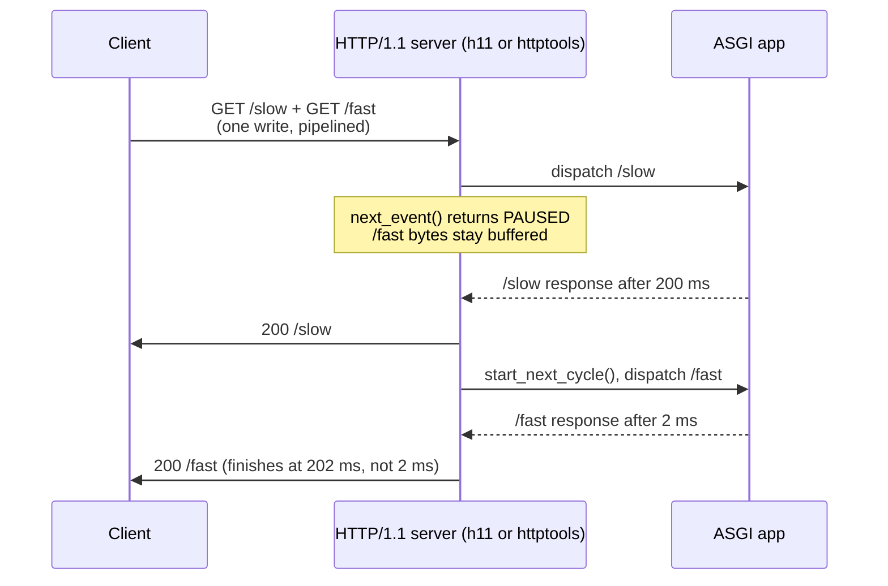

# HTTP/1.1 Pipelining Hazards and Application-Layer Head-of-Line Blocking

> [!summary] Claim
> HTTP/1.1 pipelining lets a client put many requests on one connection, but responses carry no request identifier, so the server must answer in arrival order and one slow response delays every response queued behind it; HTTP/2 removes that coupling by giving each exchange its own stream identifier.

Part of [HTTP Semantics and Wire Protocols](README.md) in [API Engineering](../README.md).

## TL;DR

- Mechanism: a pipelining client writes request N+1 before response N arrives, and the only thing that pairs a response with its request is its position in the byte stream.
- Contract: a server may process pipelined safe requests in parallel but MUST send the responses in the order the requests were received (RFC 9112 Section 9.3.2), so one slow response holds back all later ones.
- Trap: parallel processing does not fix the delay, because in-order delivery means every response still waits for its slowest predecessor; and a server that breaks the ordering pairs responses with the wrong requests (CVE-2023-46137, CVE-2024-41671).
- Portability: on CPython 3.12.13 through 3.15.2 (lab), Uvicorn 0.54.0 handles one pipelined request at a time per connection with both `h11` and `httptools` (the `httptools` case segfaults only on the 3.15.0b3 beta), Hypercorn 0.18.0 and Granian 2.8.7 do the same in a probe run, the `h11` client and `httpcore` refuse to pipeline, and `http.client` sends at most one request ahead, after the previous response's headers are read.
- When not to use it: never turn on client pipelining for new work; for concurrency on one connection use HTTP/2 or HTTP/3 streams, and on HTTP/1.1 use more connections.

## Mental model



The client sends both requests in one write, so the bytes of `GET /fast` reach the server while `/slow` is still being handled.
The server's parser gives the app only `/slow`; `h11` reports `PAUSED` for the buffered `/fast` bytes until the server calls `start_next_cycle()`, and that happens only after the `/slow` response is complete.
`/fast` therefore reaches the app at 200 ms and completes at 202 ms, even though its own handling takes 2 ms.
The lab's socket test watches this happen on a real Uvicorn server: while `/slow` is held, the app has seen only `["/slow"]` and the client has received no bytes at all.

## How it works

### The contract: order is the only correlation

RFC 9112 lets a client that supports persistent connections pipeline, meaning send several requests without waiting for each response (RFC 9112 Section 9.3.2).
The server side of the rule is short: "A server MAY process a sequence of pipelined requests in parallel if they all have safe methods (Section 9.2.1 of [HTTP]), but it MUST send the corresponding responses in the same order that the requests were received" (RFC 9112 Section 9.3.2).
The ordering rule exists because an HTTP/1.1 response has no field that names its request.
A response is a `status-line`, header fields, and a body whose length the client derives from framing rules that depend on the request (a response to `HEAD` never has a body) (RFC 9112 Section 6.3).
The client knows which request a response answers only by counting.
A pipelined burst on the wire is just requests placed back to back:

```text
GET /a HTTP/1.1\r\nHost: t\r\n\r\nGET /b HTTP/1.1\r\nHost: t\r\n\r\nGET /c HTTP/1.1\r\nHost: t\r\nConnection: close\r\n\r\n
|<-------- 28 bytes ---------->|<-------- 28 bytes ---------->|<------------------ 47 bytes ------------------>|
```

The response stream mirrors it with no correlation field:

```text
HTTP/1.1 200 \r\ncontent-length: 2\r\n\r\n/aHTTP/1.1 200 \r\ncontent-length: 2\r\n\r\n/b...
```

Those are the exact bytes `h11 0.16.0` produced in the lab (`h11` sends an empty reason phrase).
Two failure modes follow from position-based pairing.
If any response is late, every later response is late too; that is application-layer head-of-line blocking, which RFC 9113 names as the reason HTTP/1.1 clients open several connections: pipelining "only partially addressed request concurrency and still suffers from application-layer head-of-line blocking" (RFC 9113 Section 1).
If any response is missing, extra, or out of order, every later response is paired with the wrong request.

RFC 9112 also restricts what a client should pipeline.
A user agent SHOULD NOT pipeline requests after a non-idempotent method until it has that method's final status code (RFC 9112 Section 9.3.2).
A client that retries after a failed connection MUST NOT pipeline immediately after reconnecting, because the first unanswered request may have caused an error response that the TCP reset problem can destroy again (RFC 9112 Section 9.3.2, Section 9.6).
A client SHOULD NOT automatically retry a request with a non-idempotent method unless it knows the request is actually idempotent or can detect that the original was never applied; the idempotent methods are `PUT`, `DELETE`, and the safe methods `GET`, `HEAD`, `OPTIONS`, and `TRACE` (RFC 9110 Section 9.2.1, Section 9.2.2).
When a response carries `Connection: close`, the client SHOULD NOT assume that requests it pipelined behind it will be processed (RFC 9112 Section 9.6).

### How the Python servers meet the contract: one request at a time

Each Python server here meets the ordering rule the simplest way possible: it never has more than one request in flight per connection.

`h11` builds the rule into its state machine.
In `Connection._extract_next_receive_event`, when the peer's state is `DONE` and the receive buffer still holds bytes, it returns `PAUSED` without parsing them (h11 0.16.0 h11/_connection.py, Connection._extract_next_receive_event).
`next_event()` documents `PAUSED` as "not in a state where we can process incoming data", and the only way out is `start_next_cycle()`, which raises `LocalProtocolError` unless both roles are `DONE` (h11 0.16.0 h11/_connection.py, Connection.next_event, Connection.start_next_cycle; h11 0.16.0 h11/_state.py, ConnectionState.start_next_cycle).
The lab drives this directly: after answering `/a`, `h11` reports `PAUSED` with exactly 75 bytes (`/b` plus `/c`) still buffered, and after `/b` it reports 47 bytes.

Uvicorn's `h11` protocol relies on that pause.
When `handle_events` gets `h11.PAUSED`, it calls `self.flow.pause_reading()` and stops, and `on_response_complete` later calls `self.flow.resume_reading()`, `self.conn.start_next_cycle()`, and `self.handle_events()` to release the next buffered request (uvicorn 0.54.0 uvicorn/protocols/http/h11_impl.py, H11Protocol.handle_events, H11Protocol.on_response_complete).

Uvicorn's `httptools` protocol parses ahead instead of stopping.
`httptools` calls `on_headers_complete` for each pipelined request it finds in a read, and if the current cycle is not complete, Uvicorn calls `self.flow.pause_reading()` and queues the new cycle with `self.pipeline.appendleft((self.cycle, app))` (uvicorn 0.54.0 uvicorn/protocols/http/httptools_impl.py, HttpToolsProtocol.on_headers_complete).
`on_response_complete` pops the oldest queued cycle and starts its ASGI task (uvicorn 0.54.0 uvicorn/protocols/http/httptools_impl.py, HttpToolsProtocol.on_response_complete).
`appendleft` plus `pop` makes the queue FIFO, which is the ordering rule.
The constructor also calls `set_dangerous_leniencies(lenient_data_after_close=True)` so the parser tolerates pipelined bytes after a `Connection: close` request (uvicorn 0.54.0 uvicorn/protocols/http/httptools_impl.py, HttpToolsProtocol.__init__).

Hypercorn's HTTP/1.1 protocol is also built on `h11`: on `h11.PAUSED` it clears and awaits `self.can_read`, and `_maybe_recycle` calls `start_next_cycle()` and sets `can_read` once the stream is closed (hypercorn 0.18.0 hypercorn/protocol/h11.py, H11Protocol._handle_events, H11Protocol._maybe_recycle).
It uses a single constant `STREAM_ID = 1` for every HTTP/1.1 request (hypercorn 0.18.0 hypercorn/protocol/h11.py, STREAM_ID).
The source reading is confirmed by a probe run (see Portability): Hypercorn started `/mid` only after `/slow` finished and `/fast` only after `/mid` finished.
The lab's pytest module does not run Hypercorn.

The ASGI app itself has no head-of-line blocking.
The lab's in-process test sends `/slow` and `/fast` concurrently through `httpx.ASGITransport`; `/slow` waits until `/fast` has finished, and both complete.
That works only because the two calls are independent.
The head-of-line blocking comes from the HTTP/1.1 connection, not from Starlette or ASGI.

### Clients that refuse to pipeline

The main Python clients do not pipeline, and `http.client` allows only a bounded overlap.
An `h11` client whose state is `DONE` after sending a request raises `LocalProtocolError: can't handle event type Request when role=CLIENT and state=DONE` if asked to send a second one; the lab asserts this.
`httpcore` wraps that `h11` client: `AsyncHTTP11Connection.is_available` is true only in state `IDLE`, and `handle_async_request` raises `ConnectionNotAvailable` unless the state is `NEW` or `IDLE` (httpcore 1.0.9 httpcore/_async/http11.py, AsyncHTTP11Connection.is_available, AsyncHTTP11Connection.handle_async_request).
The pool treats that exception as a race, clears the assignment, and tries again (httpcore 1.0.9 httpcore/_async/connection_pool.py, AsyncConnectionPool.handle_async_request).
CPython's `http.client` raises `CannotSendRequest` if `putrequest` is called in any state other than `_CS_IDLE`, and its module docstring says "a second request may not be started until {response-headers-read}" (CPython 3.14.6 Lib/http/client.py, HTTPConnection.putrequest).
Once `getresponse()` has read the first response's headers, the connection is back in `_CS_IDLE`, so a second request can be written while the first body is still unread; `getresponse()` then raises `ResponseNotReady` until the first response is closed (CPython 3.14.6 Lib/http/client.py, HTTPConnection.getresponse).
A loopback probe on CPython 3.14.6 confirmed it: the server received `GET /b` while it was still withholding the body of `/a`.
Outside Python, curl disabled pipelining in 7.62.0 and scheduled removal of the code for 7.65.0, stating that "Both Firefox and Chrome dropped pipelining support entirely since a long time back now" (curl blog, 2019-04-06).

### Why HTTP/2 removes the coupling, and what it leaves behind

HTTP/2 gives each request/response exchange a stream, identified by a 31-bit integer; client-initiated streams use odd identifiers (RFC 9113 Section 5.1.1).
"A single HTTP/2 connection can contain multiple concurrently open streams, with either endpoint interleaving frames from multiple streams" (RFC 9113 Section 5).
Because every `HEADERS` and `DATA` frame carries its stream identifier, the server can finish responses in any order and the client still pairs each with its request.
The lab's `h2_exchange` opens streams 1 (`/slow`) and 3 (`/fast`) on one `h2 4.4.1` connection, has the server finish stream 3 first, and the client sees `StreamEnded` for 3 and then 1, each with the right body.
Concurrency is still capped by `SETTINGS_MAX_CONCURRENT_STREAMS`, which RFC 9113 recommends be "no smaller than 100" (RFC 9113 Section 6.5.2).
HTTP/2 also fixes the retry ambiguity: a `GOAWAY` frame names the last stream the sender might have processed, so the client knows which higher-numbered streams it can safely retry (RFC 9113 Section 6.8).
HTTP/2 does not remove TCP head-of-line blocking: "TCP head-of-line blocking is not addressed by this protocol" (RFC 9113 Section 1); see [[TCP-Head-of-Line-Blocking-Under-Packet-Loss]].
HTTP/3 maps each request to its own QUIC bidirectional stream (stream 0, then 4, 8, and so on) and says at least 100 request streams SHOULD be permitted (RFC 9114 Section 6.1).

## Numbers and limits

| Quantity | Value | Source |
| --- | --- | --- |
| Pipelined burst: 1 request at 200 ms, 99 at 2 ms, serial on 1 connection | p50 `298` ms, p99 `396` ms, max `398` ms | lab model, `completion_times` with `Schedule.SERIAL` (command below) |
| Same burst, parallel processing with in-order delivery (RFC 9112 Section 9.3.2) | p50 `200` ms, p99 `200` ms | lab model, `Schedule.PARALLEL_IN_ORDER` |
| Same burst, serial, spread round-robin over 6 connections | p50 `20` ms, p99 `230` ms, max `232` ms | lab model, `connections=6` |
| Same burst, multiplexed streams on 1 connection | p50 `2` ms, p99 `2` ms, max `200` ms | lab model, `Schedule.MULTIPLEXED` |
| `h11` buffered bytes when paused after `/a` in a 3-request burst | `75` (28 + 47) | lab, `test_h11_server_releases_pipelined_requests_one_cycle_at_a_time` |
| `h11` default `max_incomplete_event_size` | `16 * 1024` bytes | h11 0.16.0 h11/_connection.py, `DEFAULT_MAX_INCOMPLETE_EVENT_SIZE` |
| Uvicorn request body high-water mark before `pause_reading()` | `65536` bytes | uvicorn 0.54.0 uvicorn/protocols/http/flow_control.py, `HIGH_WATER_LIMIT` |
| Uvicorn default keep-alive timeout | `5` s | uvicorn 0.54.0 uvicorn/config.py, `Config.__init__` `timeout_keep_alive` |
| Uvicorn `httptools` memory per queued pipelined request | about `2311` bytes of Python allocations (28-byte `GET` on the wire), `2.31` MB for 1000 queued cycles | probe `queue_memory.py` below, `tracemalloc`, Uvicorn 0.54.0 |
| Uvicorn `httptools` queue length from one read | `9361` queued cycles (`21.6` MB) when `12000` requests were written, i.e. one 256 KiB `recv()` of 28-byte requests | same probe |
| Uvicorn `h11` memory while paused | `269614` bytes for the same `12000`-request write, which is the one buffered 256 KiB read | same probe |
| asyncio bytes per `recv()` on a selector transport | `256 * 1024` | CPython 3.14.6 Lib/asyncio/selector_events.py, `_SelectorTransport.max_size` |
| HTTP/2 recommended minimum `SETTINGS_MAX_CONCURRENT_STREAMS` | `100` | RFC 9113 Section 6.5.2 |
| HTTP/3 minimum concurrent request streams (SHOULD) | `100` | RFC 9114 Section 6.1 |

The four latency rows come from a deterministic model, not from wall-clock timing.
The model assumes the whole burst arrives at t=0 and ignores network transfer, so it isolates the scheduling effect.
Command, run from `labs/` on macOS 27.2 arm64 (Darwin 27.2.0) with CPython 3.14.6 (the workspace `.venv`):

```sh
uv run --frozen python -c "
from api_labs.f01_http_semantics_and_wire_protocols.pipelining import Schedule, completion_times, nearest_rank
burst = (200, *([2] * 99))
for name, sch, k in [('serial, 1 conn', Schedule.SERIAL, 1), ('parallel in order, 1 conn', Schedule.PARALLEL_IN_ORDER, 1), ('serial, 6 conns', Schedule.SERIAL, 6), ('multiplexed, 1 conn', Schedule.MULTIPLEXED, 1)]:
    t = completion_times(burst, sch, connections=k)
    print(f'{name}: p50={nearest_rank(t, 50)} p99={nearest_rank(t, 99)} max={max(t)} sum={sum(t)}')
"
```

```text
serial, 1 conn: p50=298 p99=396 max=398 sum=29900
parallel in order, 1 conn: p50=200 p99=200 max=200 sum=20000
serial, 6 conns: p50=20 p99=230 max=232 sum=5134
multiplexed, 1 conn: p50=2 p99=2 max=200 sum=398
```

Read the parallel row closely: a server that does everything RFC 9112 allows still gives every one of the 100 responses a 200 ms latency, because the first response gates all the others.
Six connections cap the damage at about one sixth of the requests (lane 0 holds 17 of the 100), which is why the p99 still lands in the slow lane.

## Portability

| Dimension | Behavior | Evidence |
| --- | --- | --- |
| CPython `3.12.13` (the matrix's `3.12.16` is not installed here) | 17 passed | lab, `uv run --frozen --python 3.12.13` |
| CPython `3.13.18` | 17 passed | lab, `uv run --frozen --python 3.13.18` |
| CPython `3.14.6` and `3.14.10` | 17 passed on each | lab, workspace `.venv` and `uv run --frozen --python 3.14.10` |
| CPython `3.15.2` (Homebrew) | 17 passed, including the `httptools` case | lab, `uv run --frozen --python /opt/homebrew/bin/python3.15`; the workspace lock syncs on it |
| CPython `3.15.0b3` | 16 passed; the `httptools` case crashes the interpreter (`Fatal Python error: Segmentation fault` at `httptools_impl.py` line 174, `data_received`) | lab, `uv run --no-project --python 3.15.0b3` with the pinned lab dependencies; the workspace lock syncs but pytest fails to start (`ModuleNotFoundError: No module named 'hypothesis._native'`) (as of 2026-11) |
| CPython `3.15.0b3` free-threaded (the matrix's `3.15.2t` is not installed here) | Same as `3.15.0b3`: 16 passed, the `httptools` case segfaults | lab, `uv run --no-project --python 3.15.0b3+freethreaded`; the workspace lock fails on `psycopg-binary==3.3.8`, which has no wheel for it |
| `h11 0.16.0` server | Releases one request per cycle and reports `PAUSED` while later bytes are buffered | lab, all CPython versions above |
| `h11 0.16.0` client and `httpcore 1.0.9` | Will not pipeline: `LocalProtocolError` from `h11`, `ConnectionNotAvailable` from `httpcore` | lab (h11), source read (httpcore 1.0.9 httpcore/_async/http11.py) |
| CPython `http.client` | At most one request ahead: `CannotSendRequest` unless `_CS_IDLE`, which returns once the previous response's headers are read; `ResponseNotReady` until that response is closed | source read (CPython 3.14.6 Lib/http/client.py, HTTPConnection.putrequest, HTTPConnection.getresponse) and a loopback probe on 3.14.6 |
| Uvicorn 0.54.0, `http="h11"` | Holds `/mid` and `/fast` unseen by the app and sends no bytes until `/slow` completes; responses go out in order | lab socket test, all CPython versions above |
| Uvicorn 0.54.0, `http="httptools"` (httptools 0.9.0) | Same ordering via the FIFO `pipeline` deque | lab socket test on 3.12.13, 3.13.18, 3.14.6, 3.14.10, 3.15.2; crashes on 3.15.0b3 and its free-threaded build |
| Uvicorn 0.54.0 HTTP/2 | Needs `http2=True` together with `http="zttp"` and the optional `zttp` package; `zttp` is not pinned here, so it is not tested | source read (uvicorn 0.54.0 uvicorn/config.py, Config.load) |
| Hypercorn 0.18.0 HTTP/1.1 | One request per cycle: waits on `can_read` while `h11` reports `PAUSED`; in the probe the app started `/slow`, then `/mid` 1.002 s later, then `/fast` 0.503 s after that, and the client received no bytes in the first 0.4 s | source read (hypercorn 0.18.0 hypercorn/protocol/h11.py) and the server probe below |
| Granian 2.8.7 (`--interface asgi`, one worker, default HTTP stack) | One request at a time: the app saw `/slow`, then `/mid` 1.001 s later (after `/slow` finished), then `/fast` 0.502 s after `/mid` (after `/mid` finished); no response bytes in the first 0.4 s; the three responses arrived in request order | server probe below, run on CPython 3.14.6; Granian's Rust source was not read |
| Debian Trixie and Alpine (musl) containers | Not run: the lab was not executed in a container | none |
| HTTP/1.1 | Responses in request order; slow responses delay later ones | RFC 9112 Section 9.3.2, lab |
| HTTP/2 | Streams finish in any order; correlation by stream identifier | RFC 9113 Section 5, lab (`h2 4.4.1`) |
| HTTP/3 over QUIC | One request per QUIC bidirectional stream with per-stream reliability, so a lost packet on one stream does not block the others | RFC 9114 Section 1.1, Section 1.2, Section 6.1; not run in this lab |

### Server probe: Granian and Hypercorn

The lab's pytest module runs Uvicorn only, so Granian and Hypercorn were probed with two throwaway scripts (not part of the lab).
The ASGI app prints when each request reaches it, `t` being seconds since the module was imported, and sleeps 1.0 s for `/slow` and 0.5 s for `/mid`:

```python
import asyncio, sys, time
T0 = time.monotonic()
async def app(scope, receive, send):
    if scope["type"] != "http":
        return
    path = scope["path"]
    print(f"START {path} t={time.monotonic()-T0:.3f}", file=sys.stderr, flush=True)
    if path == "/slow":
        await asyncio.sleep(1.0)
    elif path == "/mid":
        await asyncio.sleep(0.5)
    body = path.encode()
    await send({"type": "http.response.start", "status": 200, "headers": [(b"content-length", str(len(body)).encode())]})
    await send({"type": "http.response.body", "body": body})
```

The client writes the three requests in one `sendall`, checks whether any byte arrives in 0.4 s, then reads to EOF:

```python
import socket, sys, time
port = int(sys.argv[1])
s = socket.create_connection(("127.0.0.1", port))
t0 = time.monotonic()
s.sendall(b"GET /slow HTTP/1.1\r\nHost: t\r\n\r\nGET /mid HTTP/1.1\r\nHost: t\r\n\r\nGET /fast HTTP/1.1\r\nHost: t\r\nConnection: close\r\n\r\n")
s.settimeout(0.4)
try:
    d = s.recv(65536); print("early bytes:", d)
except TimeoutError:
    print("no bytes in first 0.4s")
s.settimeout(5)
buf = b""
while True:
    d = s.recv(65536)
    if not d: break
    buf += d
print(f"total {time.monotonic()-t0:.2f}s")
print(buf)
```

Commands, with the lab's `.venv` binaries on macOS 27.2 arm64 (Darwin 27.2.0), CPython 3.14.6, `granian 2.8.7`, `hypercorn 0.18.0`:

```sh
granian --interface asgi --host 127.0.0.1 --port 18791 --workers 1 --no-ws gapp:app
hypercorn gapp:app --bind 127.0.0.1:18792
python gprobe.py 18791   # and 18792
```

Captured output (response bodies abbreviated to the status lines and bodies; each server also printed its own `date` header):

```text
granian:   no bytes in first 0.4s | total 1.51s | START /slow t=2.885, /mid t=3.886, /fast t=4.388
           responses in order: /slow, /mid, /fast (the last with connection: close)
hypercorn: no bytes in first 0.4s | total 1.51s | START /slow t=2.783, /mid t=3.785, /fast t=4.288
           responses in order: /slow, /mid, /fast (the last with Connection: close)
```

Both servers started each request only after the previous response was complete: the gaps of about 1.0 s and 0.5 s equal the sleeps of `/slow` and `/mid`.
Granian's `/fast` started after `/mid` finished, so it does not process queued pipelined requests concurrently either.

## Worked example

The [implementation](../labs/src/api_labs/f01_http_semantics_and_wire_protocols/pipelining.py) has three parts: an `h11` server loop that answers a pipelined burst, a deterministic latency model, and an in-memory HTTP/2 exchange.
The [test](../labs/tests/f01_http_semantics_and_wire_protocols/test_http_1_1_pipelining_and_head_of_line_blocking.py) adds an in-process ASGI check and a socket test that runs real Uvicorn.

Simplified excerpt (the two core functions are copied verbatim from `pipelining.py`; imports, the dataclass, and the HTTP/2 helper are omitted):

```python
def serve_pipelined_h11(wire: bytes, respond: Callable[[h11.Request], bytes]) -> PipelineTrace:
    """Feed one burst of pipelined requests to an h11 server and answer them one cycle at a time.

    h11 returns ``PAUSED`` once the client half of a cycle is ``DONE`` while bytes of the next
    request are still buffered, so a request is released only after ``start_next_cycle``.
    """
    conn = h11.Connection(h11.SERVER)
    conn.receive_data(wire)
    dispatched: list[bytes] = []
    paused: list[int] = []
    out: list[bytes] = []
    while True:
        event = conn.next_event()
        if not isinstance(event, h11.Request):
            break  # NEED_DATA: every buffered request has been answered
        dispatched.append(event.target)
        end = conn.next_event()
        if not isinstance(end, h11.EndOfMessage):
            raise ValueError(f"request bodies are out of scope for this lab: {end!r}")
        body = respond(event)
        out.append(conn.send(h11.Response(status_code=200, headers=_length(body))) or b"")
        out.append(conn.send(h11.Data(data=body)) or b"")
        out.append(conn.send(h11.EndOfMessage()) or b"")
        if conn.our_state is not h11.DONE or conn.their_state is not h11.DONE:
            break
        buffered = len(conn.trailing_data[0])
        if conn.next_event() is h11.PAUSED:
            paused.append(buffered)
        conn.start_next_cycle()
    return PipelineTrace(tuple(dispatched), tuple(paused), b"".join(out))


def completion_times(
    service_ms: Sequence[int], schedule: Schedule, *, connections: int = 1
) -> tuple[int, ...]:
    """Return when each response finishes for a burst sent at t=0, ignoring network transfer.

    Requests are spread round-robin over *connections*; each connection applies *schedule*.
    """
    if connections < 1:
        raise ValueError("connections must be >= 1")
    if any(s < 0 for s in service_ms):
        raise ValueError("service times must be non-negative")
    finish = [0] * len(service_ms)
    for lane in range(connections):
        indices = range(lane, len(service_ms), connections)
        clock = 0
        for i in indices:
            if schedule is Schedule.SERIAL:
                clock += service_ms[i]
            elif schedule is Schedule.PARALLEL_IN_ORDER:
                clock = max(clock, service_ms[i])
            else:
                clock = service_ms[i]
            finish[i] = clock
    return tuple(finish)
```

Simplified excerpt of the socket test (setup, server start, and cleanup omitted; the lines shown are verbatim):

```python
        reader, writer = await asyncio.open_connection("127.0.0.1", port)
        # Three requests, so two are queued behind /slow and a LIFO queue would answer /fast first.
        writer.write(
            b"GET /slow HTTP/1.1\r\nHost: t\r\n\r\n"
            b"GET /mid HTTP/1.1\r\nHost: t\r\n\r\n"
            b"GET /fast HTTP/1.1\r\nHost: t\r\nConnection: close\r\n\r\n"
        )
        await writer.drain()
        await asyncio.wait_for(slow_started.wait(), timeout=5)

        # Bounded negative check: /mid and /fast are on the wire but must not reach the app or
        # the client.
        with pytest.raises(TimeoutError):
            await asyncio.wait_for(reader.read(1), timeout=0.2)
        assert started == ["/slow"]
        # Back-pressure: Uvicorn stops reading the socket while the queued requests wait, so the
        # backlog stays in the kernel buffer and TCP flow control reaches the client.
        (protocol,) = server.server_state.connections
        assert isinstance(protocol.transport, asyncio.Transport)
        assert not protocol.transport.is_reading()
```

The test runs once with `http="h11"` and once with `http="httptools"`.
Replacing Uvicorn's `httptools` queue check with `if True:` makes this test fail with `DID NOT RAISE TimeoutError`: the queued responses reach the client while `/slow` is still held, so the responses are now out of order on the wire.
That is the same class of bug as CVE-2023-46137.
Replacing the queue's `pop()` with `popleft()` (LIFO) also fails it: `/fast` runs before `/mid`, its `Connection: close` ends the connection, and the app sees `["/slow", "/fast"]`, so `/mid` is never answered.
Removing `start_next_cycle()` from Uvicorn's `h11` `on_response_complete` fails the `h11` case with a `TimeoutError`, because the buffered requests are never released.
Removing `pause_reading()` from Uvicorn's `h11` `PAUSED` branch, or from the `httptools` queueing branch, passed the earlier version of this test; the `is_reading()` assertion above now fails each of those mutants.

Output captured from `labs/` on macOS 27.2 arm64 (Darwin 27.2.0), CPython 3.14.6:

```sh
uv run --frozen pytest tests/f01_http_semantics_and_wire_protocols/test_http_1_1_pipelining_and_head_of_line_blocking.py -q
```

```text
.................                                                        [100%]
17 passed in 0.94s
```

## Pitfalls

> [!warning] Responses sent in completion order instead of request order
> Trigger: a server runs pipelined requests concurrently and writes each response as soon as it is ready.
> Symptom: the client pairs response 1 with request 2; behind a pooling reverse proxy, one user can receive another user's response.
> Real case: before 23.10.0rc1, `twisted.web` processed requests sent in one TCP packet "asynchronously without guaranteeing the response order", so an attacker who controls a slow endpoint could change the response a victim got for a second pipelined request (CVE-2023-46137, CVSS 3.1 5.3).
> A later advisory, fixed in 24.7.0rc1, reported that `twisted.web` could still process pipelined requests out of order; the advisory warns that behind connection-pooling reverse proxies "it may be possible for remote attackers to receive responses intended for other clients" (CVE-2024-41671, GHSA-c8m8-j448-xjx7, CVSS 3.1 8.3 from the GitHub CNA).
> Fix: queue responses in arrival order (Uvicorn's `pipeline` deque) or run one request at a time (`h11` `PAUSED`); test it by pipelining a slow request in front of a fast one, as this lab does.

> [!warning] Client codecs that pair responses by counting
> Trigger: a pipelining client takes one entry off its pending-request queue for every response it parses, interim `1xx` responses included.
> Symptom: the pairing shifts by one, the client applies the wrong body-length rule (for example the `HEAD` no-body rule to a `GET` response), and every later response is parsed from the wrong byte offset.
> Real case: Netty's `HttpClientCodec` before 4.2.13.Final and 4.1.133.Final called `queue.poll()` once per response including `103`, so a pipelined `GET` then `HEAD` desynchronized the stream (CVE-2026-42584).
> Fix: do not count `1xx` responses as final responses (RFC 9110 Section 15.2), or do not pipeline at all, which is the default in Python clients.

> [!warning] Retrying a pipeline that contained a non-idempotent request
> Trigger: the connection drops after a pipelined `POST`, and the client replays everything it has no response for.
> Symptom: duplicate orders or payments, because the server may have applied the `POST` before the connection failed.
> Fix: never pipeline after a non-idempotent method (RFC 9112 Section 9.3.2), retry only idempotent requests automatically (RFC 9110 Section 9.2.2), and use idempotency keys on unsafe endpoints.

> [!warning] Pipelined requests behind `Connection: close` or an early error close
> Trigger: the server answers request 1 with `Connection: close` or closes after a `4xx`, while requests 2 and 3 are already in its receive buffer.
> Symptom: the server's TCP stack can send a reset that wipes the client's unread copy of response 1 (the TCP reset problem), and requests 2 and 3 are never processed.
> Fix: servers half-close and drain before the full close (RFC 9112 Section 9.6); clients treat unanswered pipelined requests as not processed and retry them one at a time, without pipelining right after reconnecting (RFC 9112 Section 9.3.2).

> [!warning] Expecting `asyncio.gather` over one HTTP/1.1 client to run in parallel on one socket
> Trigger: an engineer caps an `httpx` pool at one connection and expects concurrent requests to share it.
> Symptom: requests run one after another, because `httpcore` gives a request only to an HTTP/1.1 connection in state `IDLE`, so the extra requests wait for the pool.
> Fix: allow enough connections for the concurrency you need, or enable HTTP/2 with `httpx.AsyncClient(http2=True)` against a server that negotiates it.

## Security and robustness

Position-based pairing is the root weakness.
Any parser disagreement that adds or removes one message on a reused connection shifts every later response, which is how request smuggling turns into response queue poisoning; see [[HTTP-Request-Smuggling-CL-TE-and-Desync-Mechanics]].
Pipelining does not create that bug, but it widens what the bug can reach: requests from several users may sit in one upstream connection's queue at once when a proxy pipelines inbound (RFC 9112 Section 9.3.2 allows it).

Resource consumption (OWASP API4:2023 Unrestricted Resource Consumption) is the second threat.
A client can write thousands of tiny pipelined requests in one burst.
Uvicorn's `h11` path stops parsing at `PAUSED` and calls `pause_reading()`, so the backlog stays in the `h11` buffer and the kernel socket buffer, and TCP flow control pushes back on the client.
The `httptools` path parses everything in the current read before it pauses, so one read of up to 256 KiB (asyncio's `recv()` size) can queue many `RequestResponseCycle` objects in `pipeline` at once.
The probe below measured it: with `/slow` held, each queued 28-byte `GET` cost about 2.3 KB of Python allocations, an 82-fold amplification, and one read queued 9361 cycles (21.6 MB), while `h11` held only the 256 KiB read it had received.
`on_response_complete` calls `resume_reading()` on every response, so the queue is bounded per read, not over the life of the connection: a client that keeps writing can refill it as responses complete (uvicorn 0.54.0 uvicorn/protocols/http/httptools_impl.py, HttpToolsProtocol.on_response_complete).
I did not measure the refill over time or the memory of many such connections together.

Probe script (not part of the lab; `queue_memory.py`, run with `python -I`), verbatim:

```python
import asyncio
import gc
import socket
import tracemalloc

import uvicorn


async def measure(http_impl: str, queued: int) -> None:
    release = asyncio.Event()
    started = asyncio.Event()

    async def app(scope, receive, send):
        if scope["path"] == "/slow":
            started.set()
            await release.wait()
        await send({"type": "http.response.start", "status": 200, "headers": [(b"content-length", b"1")]})
        await send({"type": "http.response.body", "body": b"x"})

    sock = socket.socket()
    sock.bind(("127.0.0.1", 0))
    server = uvicorn.Server(uvicorn.Config(app, http=http_impl, lifespan="off", log_level="warning"))
    serving = asyncio.create_task(server.serve(sockets=[sock]))
    while not server.started:
        await asyncio.sleep(0.01)
    _, writer = await asyncio.open_connection("127.0.0.1", sock.getsockname()[1])
    gc.collect()
    tracemalloc.start()
    before = tracemalloc.get_traced_memory()[0]
    get = b"GET /q HTTP/1.1\r\nHost: t\r\n\r\n"
    writer.write(b"GET /slow HTTP/1.1\r\nHost: t\r\n\r\n" + get * queued)
    await writer.drain()
    await asyncio.wait_for(started.wait(), 5)
    await asyncio.sleep(0.5)
    gc.collect()
    grown = tracemalloc.get_traced_memory()[0] - before
    (protocol,) = server.server_state.connections
    cycles = len(getattr(protocol, "pipeline", ()))
    print(f"{http_impl}: wrote {queued} GETs ({len(get) * queued} B), queued cycles {cycles}, traced growth {grown} B")
    release.set()
    writer.close()
    server.should_exit = True
    await asyncio.wait_for(serving, 10)
    tracemalloc.stop()
    sock.close()


for impl in ("h11", "httptools"):
    for count in (1000, 5000, 12000):
        asyncio.run(measure(impl, count))
```

Output on macOS 27.2 arm64 (Darwin 27.2.0), CPython 3.14.6, Uvicorn 0.54.0, `httptools 0.9.0`, `h11 0.16.0`, run as `python -I -W ignore queue_memory.py` with the lab's `.venv` interpreter:

```text
h11: wrote 1000 GETs (28000 B), queued cycles 0, traced growth 37762 B
h11: wrote 5000 GETs (140000 B), queued cycles 0, traced growth 147301 B
h11: wrote 12000 GETs (336000 B), queued cycles 0, traced growth 269614 B
httptools: wrote 1000 GETs (28000 B), queued cycles 1000, traced growth 2311012 B
httptools: wrote 5000 GETs (140000 B), queued cycles 5000, traced growth 11522636 B
httptools: wrote 12000 GETs (336000 B), queued cycles 9361, traced growth 21566796 B
```

`tracemalloc` counts Python allocations only, so the real resident cost is higher; the tail of 2639 requests in the 12000 case stayed in the kernel socket buffer because reading was paused.
Keep the server's per-connection limits in front of the app: a proxy with request and header limits, Uvicorn's `limit_concurrency`, and the keep-alive timeout.

Input-validation edge cases to test for any HTTP/1.1 server you put in production:
- a slow request followed by a fast one in one write: responses must come back in request order (this lab);
- a pipelined request after a `Connection: close` request: it must not be processed (RFC 9112 Section 9.6);
- a pipelined request after a request whose body the server rejected early: the server must read the whole body or close (RFC 9112 Section 9.3);
- interim `100` or `103` responses before a pipelined final response: the client must not count them as final.

Defense in depth: terminate HTTP/1.1 at an edge proxy that speaks HTTP/2 to clients and does not pipeline upstream, keep upstream connections single-request, and make unsafe endpoints idempotent with keys so that a replay is harmless.

## The principal's view

The decision is not whether to enable pipelining; nobody should in new work.
The decision is where per-connection head-of-line blocking is allowed to exist in your request path, and how many connections you pay to hide it.
On HTTP/1.1, concurrency costs connections: each one costs a handshake, a TLS session, server memory, and a congestion-control state, and RFC 9112 asks clients to be conservative because many parallel connections can cause congestion (RFC 9112 Section 9.4).
HTTP/2 buys concurrency on one connection and makes retries safe with `GOAWAY`, but it moves head-of-line blocking down to TCP, where one lost packet stalls every stream.
HTTP/3 removes that last layer at the cost of UDP middlebox issues and a younger server ecosystem.

For a Python API fleet, the usual answer is to terminate HTTP/2 or HTTP/3 at the edge proxy and run ASGI servers on HTTP/1.1 upstream with a connection pool, accepting that each upstream connection carries one request at a time.
That keeps the blocking inside your data center, where round trips are short and the proxy can open more connections, and keeps the Python server on its best-tested code path.
The organizational trade-off is ownership: the edge team owns the protocol work, and service teams must still keep slow handlers from tying up pooled connections, which is a timeout and back-pressure policy, not a protocol setting.
Choose a different design when one connection must carry many long or streaming exchanges, such as gRPC streaming, long polling, or server-sent events: there, use HTTP/2 end to end or a message-based protocol.

## Interview questions

> [!question] L5: What does RFC 9112 require of a server that receives pipelined requests?
>
> > [!success]- Answer
> > It may process them in parallel if they all use safe methods, but it MUST send the responses in the order the requests arrived (RFC 9112 Section 9.3.2).
> > The order is required because HTTP/1.1 responses carry no request identifier.
> > The client pairs responses with requests only by position.
> >
> > Follow-up: Why does processing in parallel not fix head-of-line blocking?

> [!question] L5: Why can a client automatically retry a pipelined `GET` but not a pipelined `POST` after the connection drops?
>
> > [!success]- Answer
> > `GET` is idempotent, so repeating it has the same intended effect even if the first copy was applied (RFC 9110 Section 9.2.2).
> > The client cannot tell whether the server applied the `POST` before the failure.
> > RFC 9112 Section 9.3.2 therefore says a user agent SHOULD NOT pipeline after a non-idempotent request until that request's final status arrives.
> >
> > Follow-up: How does an HTTP/2 `GOAWAY` frame change this?

> [!question] L5: Predict the output: an `h11` server gets `GET /a`, `GET /b`, and `GET /c` (the last with `Connection: close`; 28, 28, and 47 bytes) in one `receive_data` call, so after you answer `/a`, what does `next_event()` return and how many bytes are still buffered?
>
> > [!success]- Answer
> > It returns `h11.PAUSED`, not the `/b` request.
> > `75` bytes (all of `/b` and `/c`) are still in the buffer, because `h11` will not parse a new request until `start_next_cycle()` (h11 0.16.0 h11/_connection.py, Connection._extract_next_receive_event).
> > After `/b` it pauses again with `47` bytes; after `/c` there is no pause, because `close` puts both sides into `MUST_CLOSE`.
> >
> > Follow-up: What does Uvicorn's `h11` protocol do with the socket while `h11` reports `PAUSED`?

> [!question] L6: For a pipelined burst of 100 requests where the first takes 200 ms and the other 99 take 2 ms, what are p50 and p99 for serial processing on one connection, for parallel processing with in-order delivery, and for HTTP/2 streams?
>
> > [!success]- Answer
> > Serial: request i finishes at 200 + 2i ms, so p50 is 298 ms and p99 is 396 ms (nearest rank).
> > Parallel with in-order delivery: every response waits for the first one, so p50 and p99 are both 200 ms.
> > HTTP/2 streams: each response completes on its own, so p50 and p99 are 2 ms and only the slow request takes 200 ms.
> > These numbers come from the lab model, which ignores network transfer.
> >
> > Follow-up: What do six HTTP/1.1 connections give, and why does p99 stay high?

> [!question] L6: How do Uvicorn's `h11` and `httptools` protocols differ when a client pipelines?
>
> > [!success]- Answer
> > The `h11` protocol stops parsing when `h11` reports `PAUSED`, calls `pause_reading()`, and resumes in `on_response_complete` with `start_next_cycle()`.
> > The `httptools` protocol parses every request in the bytes it has already read and queues extra cycles in a `deque` with `appendleft`, starting the next with `pop` when a response completes.
> > Both send responses in request order and both have at most one ASGI task per connection.
> > The `httptools` path can therefore hold several parsed requests in memory at once.
> >
> > Follow-up: How would you bound that queue?

> [!question] L6: Debug this API: a service behind a load balancer that reuses upstream HTTP/1.1 connections sometimes returns another customer's order JSON, and the origin is a custom asyncio server that starts a task per parsed request and writes each response when its task finishes; what is wrong?
>
> > [!success]- Answer
> > The origin writes responses in completion order, not request order, which breaks RFC 9112 Section 9.3.2 when the balancer pipelines or when requests arrive back to back.
> > A fast request queued behind a slow one gets its response written first, and the balancer hands it to the client of the slow request.
> > This is the CVE-2023-46137 and CVE-2024-41671 pattern in `twisted.web`.
> > Fix the origin to queue responses in arrival order or run one request at a time per connection, and add a test that pipelines a slow request in front of a fast one.
> >
> > Follow-up: What would you check on the load balancer to confirm whether it pipelines upstream?

> [!question] L7+: Your edge proxy speaks HTTP/2 to clients and HTTP/1.1 to Python origins: where does head-of-line blocking remain, and what would you change first?
>
> > [!success]- Answer
> > Client side: TCP head-of-line blocking on the HTTP/2 connection under packet loss (RFC 9113 Section 1).
> > Upstream: each pooled HTTP/1.1 connection carries one request at a time, so a slow handler holds its connection and the pool has to grow or queue.
> > I would first measure pool wait time and handler latency per route, set per-route timeouts, and isolate slow routes into their own pool so they cannot starve fast ones.
> > Moving to HTTP/3 at the edge helps lossy client networks; HTTP/2 upstream helps only if the origin server supports it and the pool is the real bottleneck.
> >
> > Follow-up: How do you keep that design from hiding request smuggling risk?

> [!question] L7+: Why did browsers and curl give up on HTTP/1.1 pipelining instead of fixing it?
>
> > [!success]- Answer
> > A client cannot know in advance whether every server and intermediary on the path keeps response order and handles pipelined bytes correctly, and one broken hop corrupts every later response.
> > curl's maintainer cited known bugs, a fragile feature without enough tests, and the fact that Firefox and Chrome had dropped it, and named HTTP/2 multiplexing as the replacement (curl blog, 2019-04-06).
> > HTTP/2 fixes the cause, position-based pairing, by labeling every frame with a stream identifier, so the fix had to be a new framing layer, not a client heuristic.
> >
> > Follow-up: Which HTTP/1.1 deployments still see pipelined traffic, and how would you test a server against it?

> [!question] L7+: Is "the server processes pipelined requests in parallel" ever worth implementing?
>
> > [!success]- Answer
> > Only for safe methods, and only if responses are buffered and released in arrival order (RFC 9112 Section 9.3.2).
> > It lowers each response's completion time to the slowest of its predecessors instead of the sum, but it still blocks every response behind the slowest earlier one.
> > It costs memory for buffered responses and adds an ordering bug class that has produced CVEs.
> > For most APIs the better investment is HTTP/2 at the edge and one request per upstream connection.
> >
> > Follow-up: How would you size the response buffer, and what do you do when it fills?

## Related

Prerequisites: [[HTTP-1-1-Framing-Keep-Alive-and-Chunked-Encoding]]

Next: [[HTTP-Request-Smuggling-CL-TE-and-Desync-Mechanics]]

See also: [[HTTP-Evolution-HTTP1-HTTP2-HTTP3]], [[HTTP-2-Binary-Framing-and-Stream-State-Machine]], [[TCP-Head-of-Line-Blocking-Under-Packet-Loss]], [[QUIC-Transport-Streams-and-Connection-Migration-RFC-9000]], [[HTTP-Message-Abstraction-RFC-9110]]

- Lab: `labs/tests/f01_http_semantics_and_wire_protocols/test_http_1_1_pipelining_and_head_of_line_blocking.py`

## Further reading

- [RFC 9112 Section 9.3.2](https://www.rfc-editor.org/rfc/rfc9112.html#section-9.3.2): the pipelining rules for clients, servers, and intermediaries.
- [RFC 9112 Section 9.6](https://www.rfc-editor.org/rfc/rfc9112.html#section-9.6): `Connection: close` semantics and the TCP reset problem that makes pipelined retries dangerous.
- [RFC 9110 Section 9.2](https://www.rfc-editor.org/rfc/rfc9110.html#section-9.2): safe and idempotent methods, which decide what may be pipelined and retried.
- [RFC 9113 Section 1 and Section 5](https://www.rfc-editor.org/rfc/rfc9113.html#section-5): why HTTP/2 exists and how streams replace position-based pairing.
- [RFC 9113 Section 6.8](https://www.rfc-editor.org/rfc/rfc9113.html#section-6.8): `GOAWAY` and the last-stream identifier that makes HTTP/2 retries decidable.
- [RFC 9114 Section 6.1](https://www.rfc-editor.org/rfc/rfc9114.html#section-6.1): HTTP/3 request streams over QUIC.
- [GHSA-c8m8-j448-xjx7](https://github.com/twisted/twisted/security/advisories/GHSA-c8m8-j448-xjx7): a reproducible out-of-order pipelining bug with a `printf | nc` proof of concept.
- [CVE-2026-42584](https://nvd.nist.gov/vuln/detail/CVE-2026-42584): a client-side pairing bug from counting `1xx` responses in a pipeline.
- [curl says bye bye to pipelining](https://daniel.haxx.se/blog/2019/04/06/curl-says-bye-bye-to-pipelining/): the maintainer's reasons for removing the feature.
