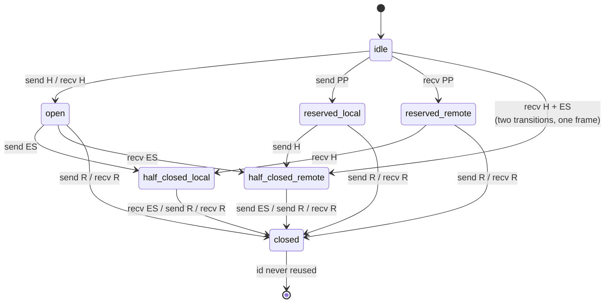

# HTTP/2 Binary Framing Layer, Frame Types, and the Stream Lifecycle State Machine (RFC 9113)

> [!summary] Claim
> HTTP/2 replaces HTTP/1.1's text delimiters with a 9-octet length-prefixed frame header and a per-stream state machine, so every frame is either legal for the stream's current state or a precisely typed stream error (`RST_STREAM`) or connection error (`GOAWAY`), and the security of a server depends on which of those two it picks and on bounding work that the state machine itself never bounds.

Part of [HTTP Semantics and Wire Protocols](README.md) in [API Engineering](../README.md).

## TL;DR

Mechanism: every HTTP/2 frame is `Length (24) | Type (8) | Flags (8) | R (1) | Stream Identifier (31)` followed by `Length` payload octets, and each of the ten core frame types carries rules about which of the seven stream states it may be sent or received in `(RFC 9113 Section 4.1)` `(RFC 9113 Section 5.1)`.
Contract rule: a frame that is illegal for its stream's state is a connection error of type `PROTOCOL_ERROR` by default, a stream error of type `STREAM_CLOSED` after the peer's `END_STREAM`, and a `FRAME_SIZE_ERROR` when the length breaks the type's fixed size or `SETTINGS_MAX_FRAME_SIZE` `(RFC 9113 Section 5.1)` `(RFC 9113 Section 4.2)`.
Trap: `RST_STREAM` moves a stream straight to `closed`, which frees its `SETTINGS_MAX_CONCURRENT_STREAMS` slot, so a 100-stream limit let the lab push 1000 requests through one `receive_data` call; that is the Rapid Reset mechanism (`CVE-2023-44487`).
Portability: `h2 4.4.1` (the state machine under Hypercorn and HTTPX) passed the same 37 tests on CPython 3.12.13, 3.13.18, 3.14.6, 3.14.10, 3.15.2, and 3.15.0b3 free-threaded (as of 2026-11), and it diverges from the RFC in measured places: it ignores `RST_STREAM` on an idle stream, treats its own `GOAWAY` as terminal, and buffers an oversize frame in full before rejecting it.
When not to use it: do not hand-roll an HTTP/2 frame parser for production; use a maintained stack (`h2`, nghttp2, hyper, Go `x/net/http2`), and prefer HTTP/3 when loss on long-RTT paths makes TCP head-of-line blocking the bottleneck ([[TCP-Head-of-Line-Blocking-Under-Packet-Loss]]).

## Mental model



`H` is a `HEADERS` frame (with any `CONTINUATION` frames), `ES` the `END_STREAM` flag, `R` a `RST_STREAM` frame, and `PP` a `PUSH_PROMISE` on another stream, as in Figure 2 of `(RFC 9113 Section 5.1)`; the direct `idle` -> `half-closed (remote)` arrow is not drawn in Figure 2 but is the two transitions one `HEADERS` frame with `END_STREAM` causes.
The two `half-closed` states are named from the observer's side: the endpoint that sent `END_STREAM` is `half-closed (local)` and may still receive anything, while the endpoint that received it is `half-closed (remote)` and must answer any further `DATA` or `HEADERS` with `STREAM_CLOSED`.
Because `END_STREAM` is processed as a separate event from the frame carrying it, a bodyless `GET` (`HEADERS` with `END_STREAM`) takes the server from `idle` to `half-closed (remote)` in one frame, which the lab observes directly.
The arrow from `open` to `closed` on `R` is the one with operational consequences: it needs no acknowledgment and no round trip, and only `open` and `half-closed` streams count toward the concurrency limit `(RFC 9113 Section 5.1.2)`.

## How it works

### The 9-octet frame header

All frames begin with a fixed 9-octet header followed by a variable-length payload `(RFC 9113 Section 4.1)`:

```text
HTTP Frame {
  Length (24),
  Type (8),
  Flags (8),
  Reserved (1),
  Stream Identifier (31),
  Frame Payload (..),
}
```

`Length` counts payload octets only, excluding the 9-octet header, and values above `2^14` (`16,384`) must not be sent unless the receiver advertised a larger `SETTINGS_MAX_FRAME_SIZE`, whose legal range is `2^14` to `2^24-1` (`16,777,215`) `(RFC 9113 Section 4.2)`.
Unknown frame types must be ignored and discarded, unused flags must be ignored on receipt and sent as zero, and the reserved bit must be sent unset and ignored on receipt `(RFC 9113 Section 4.1)`.
Stream identifier `0x0` addresses the connection itself (`SETTINGS`, `PING`, `GOAWAY`, connection-level `WINDOW_UPDATE`).
`hyperframe 6.1.0` decodes the header with one `struct.Struct(">HBBBL")` unpack, reassembles the 24-bit length as `(fields[0] << 8) + fields[1]`, masks the stream identifier with `& 0x7FFFFFFF`, and falls back to `ExtensionFrame` for unknown types `(hyperframe 6.1.0 src/hyperframe/frame.py, Frame.parse_frame_header)`.
Its constructor rejects stream `0` for frames whose `stream_association` is `has-stream` and a non-zero stream for `no-stream` frames such as `SettingsFrame` and `PingFrame` `(hyperframe 6.1.0 src/hyperframe/frame.py, Frame.__init__)`.

A fresh `h2 4.4.1` client emits this `HEADERS` frame for `GET https://example.org/resource`; the bytes were captured in a one-off run (CPython 3.14.6, macOS 27.2 arm64, decoded with `split_frames` and `hpack.Decoder`) and are pinned byte for byte by `test_get_request_is_one_headers_frame_with_end_stream_and_end_headers`:

```text
00 00 15 01 05 00 00 00 01 | 82 87 41 88 2f 91 d3 5d 05 5c f6 4d 44 87 62 c2 a0 f6 d8 42 ff
FrameHeader(length=21, type=1, flags=5, stream_id=1)
[(':method', 'GET'), (':scheme', 'https'), (':authority', 'example.org'), (':path', '/resource')]
```

`00 00 15` is a 21-octet payload, `01` is `HEADERS`, `05` is `END_HEADERS (0x04) | END_STREAM (0x01)`, and `00 00 00 01` is client stream 1; the payload is the HPACK field block covered in [[HPACK-Header-Compression-and-Dynamic-Table-Security]].

### Connection preface and SETTINGS

The client opens with the 24 octets `0x505249202a20485454502f322e300d0a0d0a534d0d0a0d0a` (`PRI * HTTP/2.0\r\n\r\nSM\r\n\r\n`) followed by a possibly empty `SETTINGS` frame, the server's preface is a `SETTINGS` frame, and both must be acknowledged `(RFC 9113 Section 3.4)`.
`SETTINGS` is a list of 6-octet `Identifier (16) | Value (32)` pairs on stream 0; a length that is not a multiple of 6 is a `FRAME_SIZE_ERROR` and a non-zero stream identifier is a `PROTOCOL_ERROR` `(RFC 9113 Section 6.5)` `(RFC 9113 Section 6.5.1)`.
The lab decodes the `h2 4.4.1` client's first `SETTINGS` payload as `HEADER_TABLE_SIZE=4096`, `ENABLE_PUSH=1`, `MAX_CONCURRENT_STREAMS=100`, `INITIAL_WINDOW_SIZE=65535`, `MAX_FRAME_SIZE=16384`, `MAX_HEADER_LIST_SIZE=65536`, and identifier `0x8` (`ENABLE_CONNECT_PROTOCOL`, defined outside RFC 9113) `=0`; the server sends `ENABLE_PUSH=0`.
The `100` and `65536` are h2 choices, not RFC defaults: `H2Connection.__init__` seeds `local_settings` with `MAX_CONCURRENT_STREAMS: 100` because the protocol default is unbounded, and `DEFAULT_MAX_HEADER_LIST_SIZE = 2**16` `(h2 4.4.1 src/h2/connection.py, H2Connection.__init__)` `(h2 4.4.1 src/h2/connection.py, H2Connection.DEFAULT_MAX_HEADER_LIST_SIZE)`.

### Frame types and their state rules

| Type | Code | Flags | Stream | Fixed size | Key rule (RFC 9113) |
|---|---|---|---|---|---|
| `DATA` | `0x0` | `END_STREAM 0x1`, `PADDED 0x8` | non-zero | none | only flow-controlled type; receipt outside `open` or `half-closed (local)` is stream error `STREAM_CLOSED` (Section 6.1) |
| `HEADERS` | `0x1` | `END_STREAM`, `END_HEADERS 0x4`, `PADDED`, `PRIORITY 0x20` | non-zero | none | opens a stream; without `END_HEADERS` the next frame must be `CONTINUATION` on the same stream (Section 6.2) |
| `PRIORITY` | `0x2` | none | non-zero | 5 | deprecated; legal in every state including `idle` and `closed` (Sections 5.3.2, 6.3) |
| `RST_STREAM` | `0x3` | none | non-zero | 4 | moves the stream to `closed`; on an `idle` stream it is a connection error `PROTOCOL_ERROR` (Section 6.4) |
| `SETTINGS` | `0x4` | `ACK 0x1` | 0 | multiple of 6 | `ACK` with a payload is `FRAME_SIZE_ERROR` (Section 6.5) |
| `PUSH_PROMISE` | `0x5` | `END_HEADERS`, `PADDED` | non-zero | none | forbidden once the client sets `ENABLE_PUSH=0` (Section 6.6) |
| `PING` | `0x6` | `ACK` | 0 | 8 | must be answered with an identical `ACK` payload (Section 6.7) |
| `GOAWAY` | `0x7` | none | 0 | >= 8 | carries `Last-Stream-ID` and an error code (Section 6.8) |
| `WINDOW_UPDATE` | `0x8` | none | either | 4 | increment `1` to `2^31-1`; see [[HTTP-2-Flow-Control-and-Window-Update-Mechanics]] (Section 6.9) |
| `CONTINUATION` | `0x9` | `END_HEADERS` | non-zero | none | must follow `HEADERS`, `PUSH_PROMISE`, or `CONTINUATION` without `END_HEADERS` (Section 6.10) |

A field block must travel as a contiguous run of `HEADERS` or `PUSH_PROMISE` plus `CONTINUATION` frames with no frame of any other type or stream in between, and even an extension frame in that gap is a `PROTOCOL_ERROR` `(RFC 9113 Section 4.3)` `(RFC 9113 Section 5.5)`.
The receiver must decompress every field block even for frames it will discard, because the HPACK context is connection state `(RFC 9113 Section 4.3)`.

### Stream identifiers

Client streams are odd, server streams are even, and a new stream's identifier must exceed every identifier its initiator has used; anything else is a connection error `PROTOCOL_ERROR` `(RFC 9113 Section 5.1.1)`.
Opening stream `n` implicitly closes every lower-numbered idle stream of the same initiator, and identifiers are never reused, so a long-lived connection ends after `2^30` client streams and must be replaced `(RFC 9113 Section 5.1.1)`.

### Stream errors versus connection errors

A stream error sends `RST_STREAM` and leaves other streams running; a connection error should send `GOAWAY` carrying the last peer stream that was processed and then must close the TCP connection `(RFC 9113 Section 5.4.1)` `(RFC 9113 Section 5.4.2)`.
An endpoint may always escalate a stream error to a connection error, and must not answer a `RST_STREAM` with a `RST_STREAM` `(RFC 9113 Section 5.4.1)` `(RFC 9113 Section 5.4.2)`.
In `closed`, receipt of anything but `PRIORITY` may be treated as a connection error `STREAM_CLOSED`, except that an endpoint that sent `RST_STREAM` on an `open` or `half-closed (local)` stream must minimally process and discard whatever arrives afterwards (update HPACK state for field blocks, count `DATA` against the connection window), because the peer may have sent those frames before it saw the reset `(RFC 9113 Section 5.1)`.

### How h2 4.4.1 implements the machine

`h2` models each stream as `H2StreamStateMachine` with a `StreamState` `IntEnum` (`IDLE`, `RESERVED_REMOTE`, `RESERVED_LOCAL`, `OPEN`, `HALF_CLOSED_REMOTE`, `HALF_CLOSED_LOCAL`, `CLOSED`) and drives it from a dict `_transitions` keyed by `(StreamState, StreamInputs)` whose values are `(side_effect, end_state)` `(h2 4.4.1 src/h2/stream.py, _transitions)`.
`H2StreamStateMachine.process_input` treats a missing key as illegal: it sets the state to `CLOSED` and raises `ProtocolError` `(h2 4.4.1 src/h2/stream.py, H2StreamStateMachine.process_input)`.
Entries such as `(HALF_CLOSED_REMOTE, RECV_DATA)` map to `reset_stream_on_error`, which marks the stream closed by `SEND_RST_STREAM` and raises `StreamClosedError` with error code `STREAM_CLOSED` `(h2 4.4.1 src/h2/stream.py, H2StreamStateMachine.reset_stream_on_error)`.
`H2Connection._receive_frame` turns that into a stream error (a queued `RST_STREAM`) only when the stream was closed by a reset; otherwise the exception propagates and `H2Connection.receive_data` calls `_terminate_connection`, which queues `GOAWAY` with `last_stream_id = highest_inbound_stream_id` and the exception's `error_code` `(h2 4.4.1 src/h2/connection.py, H2Connection._receive_frame)` `(h2 4.4.1 src/h2/connection.py, H2Connection.receive_data)`.
`DATA` on a closed stream takes a separate path, `_handle_data_on_closed_stream`, which still credits the connection flow-control window before queuing `RST_STREAM`, as `(RFC 9113 Section 6.9)` requires `(h2 4.4.1 src/h2/connection.py, H2Connection._handle_data_on_closed_stream)`.
Framing errors are caught one layer lower, in `FrameBuffer`: `__next__` first waits until `length + 9` octets are buffered and only then calls `_validate_frame_length`, which raises `FrameTooLargeError` (`FRAME_SIZE_ERROR`) above `max_frame_size`, a body that `hyperframe` rejects with `InvalidFrameError` raises `FrameDataMissingError` (`FRAME_SIZE_ERROR`) while `InvalidDataError` becomes a plain `ProtocolError` `(h2 4.4.1 src/h2/frame_buffer.py, FrameBuffer.__next__)`, and `_update_header_buffer` raises `ProtocolError("Invalid frame during header block.")` for an interleaved frame and `ProtocolError("Too many continuation frames received.")` once the buffered block exceeds `CONTINUATION_BACKLOG = 64` frames `(h2 4.4.1 src/h2/frame_buffer.py, FrameBuffer._update_header_buffer)`.

## Numbers and limits

| Parameter | Value | Source or measurement |
|---|---|---|
| Frame header size | 9 octets | `(RFC 9113 Section 4.1)` |
| Default and minimum `SETTINGS_MAX_FRAME_SIZE` | `16,384` octets (`2^14`) | `(RFC 9113 Section 6.5.2)` |
| Maximum `SETTINGS_MAX_FRAME_SIZE` | `16,777,215` octets (`2^24-1`) | `(RFC 9113 Section 4.2)` |
| Client connection preface | 24 octets | `(RFC 9113 Section 3.4)` |
| Fixed payload sizes | `PRIORITY` 5, `RST_STREAM` 4, `PING` 8, `WINDOW_UPDATE` 4, `SETTINGS` multiple of 6 | `(RFC 9113 Sections 6.3, 6.4, 6.5, 6.7, 6.9)` |
| Maximum padding per padded frame | 255 octets (`Pad Length` is 8 bits) | `(RFC 9113 Section 6.1)` |
| Stream identifier space | 31 bits; `2^30` odd client identifiers per connection | `(RFC 9113 Section 5.1.1)` |
| Initial `SETTINGS_HEADER_TABLE_SIZE` | `4,096` octets | `(RFC 9113 Section 6.5.2)` |
| Recommended minimum `SETTINGS_MAX_CONCURRENT_STREAMS` | 100 (protocol default: unlimited) | `(RFC 9113 Section 6.5.2)` |
| Error codes defined | 14 (`0x0` `NO_ERROR` to `0xd` `HTTP_1_1_REQUIRED`) | `(RFC 9113 Section 7)` |
| `h2` local `MAX_CONCURRENT_STREAMS` and `MAX_HEADER_LIST_SIZE` | 100 and `65,536` | `(h2 4.4.1 src/h2/connection.py, H2Connection.__init__)`; 100 also measured: the 101st `HEADERS` raised `TooManyStreamsError` |
| `h2` `CONTINUATION_BACKLOG` | 64 frames per field block, counting the `HEADERS` frame | `(h2 4.4.1 src/h2/frame_buffer.py, CONTINUATION_BACKLOG)`; measured: `HEADERS` + 63 `CONTINUATION` accepted, + 64 rejected |
| `h2` octets buffered before rejecting an oversize frame | the whole declared frame, up to `16,777,224` (`2^24-1` + 9); measured: a `DATA` header declaring `16,777,215` octets plus `100,000` payload octets produced no error, and the `FRAME_SIZE_ERROR` arrived only when the rest was delivered | `(h2 4.4.1 src/h2/frame_buffer.py, FrameBuffer.__next__)`; lab test `test_h2_buffers_an_oversize_frame...` |
| `h2` remembered closed streams | `MAX_CLOSED_STREAMS = 2**16` | `(h2 4.4.1 src/h2/connection.py, H2Connection.MAX_CLOSED_STREAMS)` |
| Rapid Reset attacker cost in the lab | `26,007` octets (2000 frames) for 1000 `HEADERS` + `RST_STREAM(CANCEL)` pairs (`26.0` per pair after HPACK indexing) | measured from `labs/` with `uv run --frozen python` on CPython 3.14.6, macOS 27.2 arm64 (`uname -r` `27.2.0`): a fresh `connected_pair()` per run, then `client.send_headers(sid, REQUEST)` and `client.reset_stream(sid, ErrorCodes.CANCEL)` for odd `sid` 1 to 1999, and `len(client.data_to_send())`; identical in every run (as of 2026-11) |
| `h2` server CPU for that burst | `19.27 ms` median, `18.93 ms` min over 20 runs of one `receive_data` call, no application work; three repeated 20-run sets gave medians of `19.27`, `19.56`, and `19.50 ms` | same script, `time.perf_counter()` around one `server.receive_data(wire)`; a single-machine sample, not a benchmark-grade measurement |
| Rapid Reset peak reported by Google | over 398 million requests per second, in August 2023 (blog published 2023-10-10) | Google Cloud blog, see Further reading |
| Rapid Reset peak reported by Cloudflare | just above 201 million requests per second (blog published 2023-10-10) | Cloudflare blog, see Further reading |

## Portability

| Runtime, implementation, or protocol | Frame and stream-state behavior | Evidence |
|---|---|---|
| CPython 3.12.13 + `h2 4.4.1` | All 37 lab tests pass; the matrix's 3.12.16 is not installed on this machine, so 3.12.13 stands in | `UV_PROJECT_ENVIRONMENT=<tmp venv> uv run --frozen --python 3.12.13 pytest <test> -q`, macOS 27.2 arm64 (as of 2026-11) |
| CPython 3.13.18 + `h2 4.4.1` | All 37 pass | same command with `--python 3.13.18` |
| CPython 3.14.6 and 3.14.10 + `h2 4.4.1` | All 37 pass on both | workspace `.venv` (3.14.6) and `--python 3.14.10` |
| CPython 3.15.2 + `h2 4.4.1` | All 37 pass | `--python 3.15.2` |
| CPython 3.15t free-threaded | All 37 pass on 3.15.0b3t with `sys._is_gil_enabled() == False`, in a minimal `uv venv` holding only the pinned `h2 4.4.1`, `hpack 4.2.0`, `hyperframe 6.1.0`, `pytest 9.2.0`, `pytest-asyncio 1.4.1.post1` with `PYTHONPATH=src`; 3.15.2t is not installed here and `uv run --frozen --python 3.15t` fails because `psycopg-binary==3.3.8` has no wheel for that platform | verifier rerun, macOS 27.2 arm64 (as of 2026-11); not the locked workspace |
| Debian Trixie (glibc 2.41) and Alpine 3.24 (musl), CPython 3.14.10, linux aarch64 | All 37 pass on both with the locked environment | `docker run --rm` of `python:3.14-slim-trixie` and `python:3.14-alpine` on this Mac, lab mounted read-only, `UV_PROJECT_ENVIRONMENT=/tmp/venv uv run --frozen pytest <test> -q` (as of 2026-11) |
| `h2 4.4.1` versus RFC 9113 | `RST_STREAM` on an idle stream is ignored (RFC: connection error `PROTOCOL_ERROR`); the 101st concurrent stream is a connection error `PROTOCOL_ERROR` (RFC: stream error `PROTOCOL_ERROR` or `REFUSED_STREAM`, escalation permitted); its own `GOAWAY` moves the connection machine to `CLOSED`, where only `SEND_GOAWAY` and `RECV_GOAWAY` are legal, so every later received frame other than `GOAWAY` is a `PROTOCOL_ERROR`, even `DATA` on a stream at or below `Last-Stream-ID`; an oversize frame is fully buffered before `FRAME_SIZE_ERROR` (RFC 9113 Section 4.2 sets the error, not the timing) | lab tests `test_h2_ignores_rst_stream_on_idle_stream...`, `test_101st_concurrent_stream...`, `test_h2_treats_its_own_goaway_as_terminal...`, `test_h2_buffers_an_oversize_frame...`; `(h2 4.4.1 src/h2/connection.py, H2ConnectionStateMachine._transitions)`; `(RFC 9113 Sections 4.2, 5.1.2, 6.4, 6.8)` |
| Hypercorn 0.18.0 | Server built on `h2.connection.H2Connection` with local `MAX_CONCURRENT_STREAMS = config.h2_max_concurrent_streams` (default 100), `MAX_HEADER_LIST_SIZE = config.h2_max_header_list_size` (default `2**16`), `ENABLE_CONNECT_PROTOCOL = 1`; on `ProtocolError` it flushes h2's queued `GOAWAY` and closes; it calls `close_connection()` once `keep_alive_requests > keep_alive_max_requests` (default 1000), and the counter increments per created stream, including streams reset immediately | `(hypercorn 0.18.0 src/hypercorn/protocol/h2.py, H2Protocol.__init__)`, `(hypercorn 0.18.0 src/hypercorn/protocol/h2.py, H2Protocol.handle)`, `(hypercorn 0.18.0 src/hypercorn/config.py, Config)`; source reading, not exercised in the lab |
| Uvicorn 0.54.0 | HTTP/2 only with `http2=True` plus `http="zttp"` (otherwise `Config.load` raises `ValueError`) and the separate `zttp` package, which is not in the lab lock; `zttp_h2_impl.py` defines `FORBIDDEN_HEADERS` (`connection`, `keep-alive`, `proxy-connection`, `transfer-encoding`, `upgrade`) with a comment citing RFC 9113 Section 8.2.2 and strips those names from the application's outbound response headers and trailers | `(uvicorn 0.54.0 uvicorn/config.py, Config.load)`, `(uvicorn 0.54.0 uvicorn/protocols/http/zttp_h2_impl.py, FORBIDDEN_HEADERS)`; not exercised |
| Granian 2.8.7 | Stream machine is in native code; Python-visible `HTTP2Settings` defaults `max_concurrent_streams=200`, `max_frame_size=16384`, `initial_stream_window_size=1048576` | `(granian 2.8.7 granian/http.py, HTTP2Settings)`; not exercised |
| HTTPX 0.28.1 / httpcore 1.0.9 client | Uses `h2` with `validate_inbound_headers=False`; replaces local settings with `ENABLE_PUSH=0`, `MAX_CONCURRENT_STREAMS=100`, `MAX_HEADER_LIST_SIZE=65536` and deletes `ENABLE_CONNECT_PROTOCOL` before the preface | `(httpcore 1.0.9 httpcore/_async/http2.py, AsyncHTTP2Connection._send_connection_init)` |
| HTTP/1.1 | No frame layer; message boundaries come from `Content-Length` or `chunked`, so a desync attack targets the length rules instead | [[HTTP-1-1-Framing-Keep-Alive-and-Chunked-Encoding]], [[HTTP-Request-Smuggling-CL-TE-and-Desync-Mechanics]] |
| HTTP/3 over QUIC | Frames are a `Type (i)` varint then a `Length (i)` varint; `RST_STREAM`, `PING`, and `WINDOW_UPDATE` do not exist because QUIC provides stream lifecycle, liveness, and flow control, `CONTINUATION` does not exist because HTTP/3 permits larger `HEADERS` and `PUSH_PROMISE` frames, and `PRIORITY` has no HTTP/3 equivalent | `(RFC 9114 Section 7.1)`, `(RFC 9114 Appendix A.2.5)`, [[HTTP-3-Framing-and-QPACK-Header-Compression-RFC-9114\|HTTP/3 framing]] |

## Worked example

The [implementation](../labs/src/api_labs/f01_http_semantics_and_wire_protocols/h2_stream_states.py) is a hand-written RFC 9113 Section 4.1 header codec plus drivers that run an `h2 4.4.1` client and server against each other in memory, inject hand-built frames, and decode the bytes each endpoint queues in response; the [test](../labs/tests/f01_http_semantics_and_wire_protocols/test_http_2_binary_framing_and_stream_state_machine.py) holds 37 cases.

Full source of the implementation:

```python
"""HTTP/2 frame header codec and h2 stream state machine drivers (RFC 9113 Sections 4 and 5)."""

from __future__ import annotations

from dataclasses import dataclass
from enum import IntEnum
from typing import TYPE_CHECKING

import h2.config
import h2.connection
import h2.events
import h2.exceptions
from h2.errors import ErrorCodes

if TYPE_CHECKING:
    from collections.abc import Sequence

    from h2.stream import StreamState

FRAME_HEADER_LEN = 9
MAX_FRAME_LENGTH = (1 << 24) - 1
MAX_STREAM_ID = (1 << 31) - 1
RESERVED_BIT = 1 << 31
CLIENT_PREFACE = b"PRI * HTTP/2.0\r\n\r\nSM\r\n\r\n"

FLAG_END_STREAM = 0x01
FLAG_ACK = 0x01
FLAG_END_HEADERS = 0x04
FLAG_PADDED = 0x08
FLAG_PRIORITY = 0x20


class FrameType(IntEnum):
    """Frame type codes registered by RFC 9113 Section 6."""

    DATA = 0x00
    HEADERS = 0x01
    PRIORITY = 0x02
    RST_STREAM = 0x03
    SETTINGS = 0x04
    PUSH_PROMISE = 0x05
    PING = 0x06
    GOAWAY = 0x07
    WINDOW_UPDATE = 0x08
    CONTINUATION = 0x09


@dataclass(frozen=True, slots=True)
class FrameHeader:
    """The fixed 9-octet frame header (RFC 9113 Section 4.1)."""

    length: int
    type: int
    flags: int
    stream_id: int


@dataclass(frozen=True, slots=True)
class RawFrame:
    """One decoded frame: header plus the payload octets it announced."""

    header: FrameHeader
    payload: bytes


@dataclass(frozen=True, slots=True)
class Outcome:
    """What one call to ``H2Connection.receive_data`` did."""

    error: str | None
    error_code: ErrorCodes | None
    events: tuple[str, ...]
    emitted: tuple[RawFrame, ...]

    def emitted_types(self) -> tuple[int, ...]:
        """Frame type codes the endpoint queued in response."""
        return tuple(frame.header.type for frame in self.emitted)

    def goaway(self) -> tuple[int, int]:
        """``(last_stream_id, error_code)`` of the single GOAWAY the endpoint queued."""
        payloads = [f.payload for f in self.emitted if f.header.type == FrameType.GOAWAY]
        if len(payloads) != 1:
            raise ValueError(f"expected exactly one GOAWAY, got {len(payloads)}")
        last = int.from_bytes(payloads[0][0:4], "big") & MAX_STREAM_ID
        return last, int.from_bytes(payloads[0][4:8], "big")

    def rst_stream(self) -> tuple[int, int]:
        """``(stream_id, error_code)`` of the single RST_STREAM the endpoint queued."""
        frames = [f for f in self.emitted if f.header.type == FrameType.RST_STREAM]
        if len(frames) != 1:
            raise ValueError(f"expected exactly one RST_STREAM, got {len(frames)}")
        return frames[0].header.stream_id, int.from_bytes(frames[0].payload, "big")


def encode_frame_header(
    length: int, frame_type: int, flags: int, stream_id: int, *, reserved: bool = False
) -> bytes:
    """Serialize Length(24) Type(8) Flags(8) R(1) Stream Identifier(31), big-endian."""
    if not 0 <= length <= MAX_FRAME_LENGTH:
        raise ValueError("length must fit in 24 bits")
    if not 0 <= frame_type <= 0xFF or not 0 <= flags <= 0xFF:
        raise ValueError("type and flags must fit in 8 bits")
    if not 0 <= stream_id <= MAX_STREAM_ID:
        raise ValueError("stream identifier must fit in 31 bits")
    word = stream_id | (RESERVED_BIT if reserved else 0)
    return length.to_bytes(3, "big") + bytes((frame_type, flags)) + word.to_bytes(4, "big")


def decode_frame_header(data: bytes) -> FrameHeader:
    """Parse a 9-octet header; the reserved bit is ignored on receipt (RFC 9113 Section 4.1)."""
    if len(data) != FRAME_HEADER_LEN:
        raise ValueError("frame header is exactly 9 octets")
    return FrameHeader(
        length=int.from_bytes(data[0:3], "big"),
        type=data[3],
        flags=data[4],
        stream_id=int.from_bytes(data[5:9], "big") & MAX_STREAM_ID,
    )


def build_frame(frame_type: int, flags: int, stream_id: int, payload: bytes = b"") -> bytes:
    """Prefix *payload* with a frame header whose Length field equals ``len(payload)``."""
    return encode_frame_header(len(payload), frame_type, flags, stream_id) + payload


def split_frames(wire: bytes) -> tuple[RawFrame, ...]:
    """Cut a byte stream that holds only whole frames into frames."""
    frames: list[RawFrame] = []
    offset = 0
    while offset < len(wire):
        if offset + FRAME_HEADER_LEN > len(wire):
            raise ValueError("truncated frame header")
        header = decode_frame_header(wire[offset : offset + FRAME_HEADER_LEN])
        end = offset + FRAME_HEADER_LEN + header.length
        if end > len(wire):
            raise ValueError("truncated frame payload")
        frames.append(RawFrame(header, wire[offset + FRAME_HEADER_LEN : end]))
        offset = end
    return tuple(frames)


def decode_settings(payload: bytes) -> dict[int, int]:
    """Decode SETTINGS parameters: 16-bit identifier, 32-bit value (RFC 9113 Section 6.5.1)."""
    if len(payload) % 6:
        raise ValueError("SETTINGS payload must be a multiple of 6 octets")
    return {
        int.from_bytes(payload[i : i + 2], "big"): int.from_bytes(payload[i + 2 : i + 6], "big")
        for i in range(0, len(payload), 6)
    }


def connected_pair() -> tuple[h2.connection.H2Connection, h2.connection.H2Connection]:
    """Return ``(client, server)`` after both prefaces and both SETTINGS ACKs were exchanged."""
    client = h2.connection.H2Connection(h2.config.H2Configuration(client_side=True))
    server = h2.connection.H2Connection(h2.config.H2Configuration(client_side=False))
    client.initiate_connection()
    server.initiate_connection()
    server.receive_data(client.data_to_send())
    client.receive_data(server.data_to_send())
    server.receive_data(client.data_to_send())
    client.receive_data(server.data_to_send())
    return client, server


def stream_state(conn: h2.connection.H2Connection, stream_id: int) -> StreamState | None:
    """The endpoint's own view of a stream, or ``None`` if it holds no stream object."""
    stream = conn.streams.get(stream_id)
    return None if stream is None else stream.state_machine.state


def feed(conn: h2.connection.H2Connection, wire: bytes) -> Outcome:
    """Deliver *wire* to *conn* and record the events, the error, and the frames it queued."""
    try:
        events = conn.receive_data(wire)
    except h2.exceptions.ProtocolError as exc:
        return Outcome(
            error=type(exc).__name__,
            error_code=ErrorCodes(exc.error_code),
            events=(),
            emitted=split_frames(conn.data_to_send()),
        )
    return Outcome(
        error=None,
        error_code=None,
        events=tuple(type(event).__name__ for event in events),
        emitted=split_frames(conn.data_to_send()),
    )


def trace_exchange(
    request: Sequence[tuple[str, str]], request_body: bytes, response_body: bytes
) -> list[tuple[str, StreamState | None, StreamState | None]]:
    """Walk one request/response on stream 1 and snapshot both endpoints after each step."""
    client, server = connected_pair()
    steps: list[tuple[str, StreamState | None, StreamState | None]] = []

    def snap(label: str) -> None:
        steps.append((label, stream_state(client, 1), stream_state(server, 1)))

    snap("start")
    client.send_headers(1, request, end_stream=not request_body)
    snap("client sends HEADERS")
    server.receive_data(client.data_to_send())
    snap("server receives HEADERS")
    if request_body:
        client.send_data(1, request_body, end_stream=True)
        snap("client sends DATA+END_STREAM")
        server.receive_data(client.data_to_send())
        snap("server receives DATA+END_STREAM")
    server.send_headers(1, [(":status", "200")])
    server.send_data(1, response_body, end_stream=True)
    snap("server sends HEADERS, DATA+END_STREAM")
    client.receive_data(server.data_to_send())
    snap("client receives response")
    return steps


class RemoteResetBudget:
    """Close the connection with ENHANCE_YOUR_CALM once peer resets exceed a budget.

    A sketch of the per-connection reset accounting that CVE-2023-44487 (Rapid Reset)
    mitigations use; the stream concurrency limit alone does not bound this work.
    """

    def __init__(self, conn: h2.connection.H2Connection, max_remote_resets: int) -> None:
        self.conn = conn
        self.max_remote_resets = max_remote_resets
        self.remote_resets = 0
        self.tripped = False

    def receive(self, wire: bytes) -> Outcome:
        """Feed *wire*, count peer RST_STREAMs, and emit GOAWAY when the budget is exceeded."""
        if self.tripped:
            raise RuntimeError("connection already closed by the reset budget")
        events = self.conn.receive_data(wire)
        self.remote_resets += sum(
            1 for e in events if isinstance(e, h2.events.StreamReset) and e.remote_reset
        )
        if self.remote_resets > self.max_remote_resets:
            self.tripped = True
            self.conn.close_connection(ErrorCodes.ENHANCE_YOUR_CALM)
        return Outcome(
            error=None,
            error_code=None,
            events=tuple(type(event).__name__ for event in events),
            emitted=split_frames(self.conn.data_to_send()),
        )
```

A simplified excerpt of the test (verbatim lines; imports and the helper builders are omitted) showing the error-class table and the Rapid Reset pair:

```python
@pytest.mark.unit
@pytest.mark.parametrize(
    ("make_case", "exception", "error_code", "last_stream_id"),
    [
        (_data_on_idle_stream, "NoSuchStreamError", ErrorCodes.PROTOCOL_ERROR, 1),
        (_window_update_on_idle_stream, "NoSuchStreamError", ErrorCodes.PROTOCOL_ERROR, 1),
        (_lower_stream_id_after_higher, "StreamIDTooLowError", ErrorCodes.PROTOCOL_ERROR, 3),
        (_even_stream_id_from_client, "ProtocolError", ErrorCodes.PROTOCOL_ERROR, 0),
        (_ping_inside_header_block, "ProtocolError", ErrorCodes.PROTOCOL_ERROR, 0),
        (_extension_frame_inside_header_block, "ProtocolError", ErrorCodes.PROTOCOL_ERROR, 0),
        (_data_on_stream_zero, "ProtocolError", ErrorCodes.PROTOCOL_ERROR, 1),
        (_settings_on_stream_one, "ProtocolError", ErrorCodes.PROTOCOL_ERROR, 0),
        (_headers_on_stream_closed_by_end_stream, "StreamClosedError", ErrorCodes.STREAM_CLOSED, 1),
        (_frame_over_max_frame_size, "FrameTooLargeError", ErrorCodes.FRAME_SIZE_ERROR, 1),
        (_rst_stream_with_5_octets, "FrameDataMissingError", ErrorCodes.FRAME_SIZE_ERROR, 1),
        (_ping_with_7_octets, "FrameDataMissingError", ErrorCodes.FRAME_SIZE_ERROR, 0),
    ],
    ids=[
        "data-idle",
        "window-update-idle",
        "stream-id-regression",
        "even-id-from-client",
        "ping-inside-field-block",
        "extension-inside-field-block",
        "data-stream-0",
        "settings-stream-1",
        "headers-after-closed",
        "frame-over-16384",
        "rst-stream-5-octets",
        "ping-7-octets",
    ],
)
def test_connection_errors_emit_goaway_with_the_rfc_error_code(
    make_case: Case, exception: str, error_code: ErrorCodes, last_stream_id: int
) -> None:
    conn, wire = make_case()
    outcome = feed(conn, wire)
    assert outcome.error == exception
    assert outcome.error_code is error_code
    assert outcome.emitted_types() == (FrameType.GOAWAY,)
    assert outcome.goaway() == (last_stream_id, error_code)


@pytest.mark.unit
def test_rapid_reset_runs_1000_requests_through_a_100_stream_limit() -> None:
    client, server = connected_pair()
    for stream_id in range(1, 2001, 2):
        client.send_headers(stream_id, REQUEST)
        client.reset_stream(stream_id, ErrorCodes.CANCEL)

    outcome = feed(server, client.data_to_send())
    assert outcome.error is None
    assert outcome.events.count("RequestReceived") == 1000
    assert outcome.events.count("StreamReset") == 1000
    assert server.open_inbound_streams == 0
    assert server.local_settings.max_concurrent_streams == 100
```

Captured output, from `labs/`, CPython 3.14.6, macOS 27.2 arm64:

```text
$ uv run --frozen pytest tests/f01_http_semantics_and_wire_protocols/test_http_2_binary_framing_and_stream_state_machine.py -q
.....................................                                    [100%]
37 passed in 0.10s
```

## Pitfalls

> [!warning] The concurrency limit does not bound request rate
> Trigger: a client sends `HEADERS` then `RST_STREAM` on each new stream, so each stream lives in `open` for one frame.
> Symptom: the server dispatches a full request per stream while `open_inbound_streams` never exceeds 1; the lab drove 1000 `RequestReceived` events through a limit of 100 for `26,007` octets of input.
> Incident: `CVE-2023-44487`, "request cancellation can reset many streams quickly, as exploited in the wild in August through October 2023" (NVD); Google measured over 398 million requests per second and Cloudflare just above 201 million.
> Fix: count resets (and the ratio of reset to completed streams) per connection and close with `GOAWAY`; Cloudflare reports that lowering the stream limit to 64 broke legitimate clients and was reverted to 100.

> [!warning] Unbounded CONTINUATION frames
> Trigger: `HEADERS` without `END_HEADERS` followed by an endless run of `CONTINUATION`, which the receiver must keep decoding because HPACK is connection state `(RFC 9113 Section 4.3)`.
> Symptom: memory or CPU exhaustion; CERT/CC VU#421644 (2024-04-03) lists Go `CVE-2023-45288`, nghttp2 `CVE-2024-28182`, Apache httpd `CVE-2024-27316`, Envoy `CVE-2024-30255`, and others.
> Fix: cap the frame count and decoded size of a field block and close the connection, as `h2 4.4.1` does at 64 frames (`HEADERS` + 63 `CONTINUATION` accepted, + 64 rejected with `GOAWAY` `PROTOCOL_ERROR` in the lab).

> [!warning] Treating a late frame as a connection error
> Trigger: the server receives `DATA` on a stream after the client's `END_STREAM` (a buggy client or a retransmitting proxy).
> Symptom: if the endpoint escalates to `GOAWAY`, every other in-flight stream on the connection dies; requests on streams at or below `Last-Stream-ID` that had not completed cannot be retried, except idempotent ones such as `GET`, `PUT`, or `DELETE` `(RFC 9113 Section 5.4.3)` `(RFC 9113 Section 6.8)`.
> Fix: answer with `RST_STREAM` `STREAM_CLOSED` as `h2 4.4.1` does in the lab (stream error, other streams untouched), and reserve connection errors for state that is actually corrupted.

> [!warning] Graceful shutdown with h2's close_connection
> Trigger: a server built directly on `h2` calls `close_connection(NO_ERROR)` to drain.
> Symptom: `h2 4.4.1` moves its connection machine to `CLOSED`, and the lab shows the next in-flight `DATA` on stream 1 (at or below `Last-Stream-ID`) raising `ProtocolError`, although `(RFC 9113 Section 6.8)` says such streams "might still complete successfully".
> Fix: stop accepting new streams first (once its terminate event is set, Hypercorn resets each new `RequestReceived` stream and advertises `MAX_CONCURRENT_STREAMS: 0`, `(hypercorn 0.18.0 src/hypercorn/protocol/h2.py, H2Protocol._handle_events)`), finish existing streams, and send the final `GOAWAY` last; `(RFC 9113 Section 6.8)` recommends an initial `GOAWAY` with `Last-Stream-ID = 2^31-1` and `NO_ERROR`, then a second one after at least one round trip.

> [!warning] Frame-size limits that only apply after buffering
> Trigger: a peer sends a frame header declaring `Length = 16,777,215` on a connection whose `SETTINGS_MAX_FRAME_SIZE` is `16,384`, then trickles the payload.
> Symptom: `h2 4.4.1` raises nothing and queues nothing until the declared frame is complete, so each such connection can pin up to 16 MiB of buffer; the lab fed `100,000` payload octets with no reaction and saw `GOAWAY` `FRAME_SIZE_ERROR` only after the rest arrived.
> Fix: check `Length` against the advertised maximum as soon as the 9-octet header is readable, and bound per-connection receive buffers in the server, not only in the frame parser.

> [!warning] Assuming h2 enforces every RFC MUST
> Trigger: relying on the library to reject `RST_STREAM` for an idle stream.
> Symptom: `h2 4.4.1` returns no event and queues nothing (measured), because `_receive_rst_stream_frame` swallows `NoSuchStreamError`; RFC 9113 Section 6.4 requires a connection error `PROTOCOL_ERROR`.
> Fix: treat conformance gaps as findings, pin and test them (the lab test fails if h2 changes), and do not use library leniency as evidence that a peer is well behaved.

## Security and robustness

Threat model: the peer is untrusted, controls every octet after the TLS handshake, and pays almost nothing per frame; the server pays HPACK decoding, stream bookkeeping, and application dispatch.
`(RFC 9113 Section 10.5)` lists the frame-level amplifiers: tiny `WINDOW_UPDATE` increments, mandatory `PING` and `SETTINGS` acknowledgments, invalid requests that provoke `RST_STREAM` (the reset flood, `CVE-2019-9514`, one of the 2019 issues behind the `[NFLX-2019-002]` reference that Section 10.5 cites), floods of small or empty frames, and field-block compression, and it says implementations "SHOULD track the use of these features and set limits", with `ENHANCE_YOUR_CALM` as the connection error for excess.
This maps to OWASP API4:2023 Unrestricted Resource Consumption, at the transport layer below any application rate limiter, which sees only completed requests.
Boundary enforcement in order of cost: reject a bad preface at once, reject an oversize `Length` as soon as the header is readable (`h2 4.4.1` checks it before `parse_body` but only after the whole frame is buffered, as the lab measured), cap field blocks by frame count and decoded size, cap concurrent and total streams per connection, and account resets per connection; the lab's `RemoteResetBudget` sends `GOAWAY` `ENHANCE_YOUR_CALM` with `Last-Stream-ID = 21` on the 11th remote reset when the budget is 10.
That sketch only counts per `receive_data` call, so one large read can still dispatch a whole batch before it trips; a production guard sits inside the event loop that consumes events, or below the library.
Input validation edge cases the lab pins: stream `0` on `DATA` and non-zero on `SETTINGS` (both `PROTOCOL_ERROR`), even stream identifiers from a client, identifier regression, a `PING` inside a field block, an unknown extension frame inside a field block, and wrong fixed lengths (`FRAME_SIZE_ERROR`).
Defense in depth: an edge proxy terminates HTTP/2 with its own limits, the origin repeats them, and the application layer enforces body size and timeouts, because limits in `SETTINGS` "cannot be reduced instantaneously" and a server's limits are not known to a client immediately after the connection opens `(RFC 9113 Section 10.5)`.
Malformed messages (connection-specific headers such as `Transfer-Encoding`, uppercase field names, a `content-length` that does not match the `DATA` total) are stream errors `PROTOCOL_ERROR` that an intermediary must not forward `(RFC 9113 Section 8.1.1)` `(RFC 9113 Section 8.2.2)`; this is the HTTP/2 answer to the request smuggling that HTTP/1.1 length ambiguity allows, and a proxy that downgrades HTTP/2 to HTTP/1.1 without enforcing these rules can reopen it.

## The principal's view

The decision is not whether to support HTTP/2 but where its state machine runs and who owns its limits.
Terminating HTTP/2 at a hardened edge (a CDN, Envoy, or nginx) and speaking HTTP/1.1 or HTTP/2 to the origin moves Rapid Reset, CONTINUATION, and settings-flood exposure to a team whose job is patching protocol stacks on a CVE cadence, at the cost of a second hop, a second set of timeouts, and an HTTP/2-to-HTTP/1.1 downgrade that must re-validate `content-length` to avoid smuggling.
Exposing a Python ASGI server's HTTP/2 directly (Hypercorn with `h2`) is defensible for internal east-west traffic and gRPC-style long streams, but every frame then costs Python-level work (the lab measured about 19 ms of `h2` CPU per 1000 reset streams on one core), so the per-connection budgets must be explicit configuration, reviewed like any rate limit.
The organizational trade-off is ownership: protocol limits (`max_concurrent_streams`, `keep_alive_max_requests`, field-block caps) sit between platform and service teams and are the first thing nobody tunes, so make them part of the service template and its load test.
Choose HTTP/1.1 for simple request-response APIs behind a proxy that already multiplexes, HTTP/3 when clients are on lossy mobile paths ([[QUIC-Transport-Streams-and-Connection-Migration-RFC-9000]]), and HTTP/2 when you need many concurrent streams to one origin over TCP, as gRPC does ([[gRPC-and-Protocol-Buffers]]).

## Interview questions

> [!question] L5: What are the fields of the HTTP/2 frame header and their widths?
>
> > [!success]- Answer
> > `Length` (24 bits), `Type` (8), `Flags` (8), one reserved bit, and `Stream Identifier` (31), 9 octets in total, big-endian.
> > `Length` excludes the header and must not exceed the receiver's `SETTINGS_MAX_FRAME_SIZE`, initially `16,384`.
> > The reserved bit is sent as zero and ignored on receipt.
> >
> > Follow-up: Why does `GOAWAY` have no fixed length while `PING` must be exactly 8 octets?

> [!question] L5: Which frame types are allowed on stream 0, and what happens to a `DATA` frame on stream 0?
>
> > [!success]- Answer
> > `SETTINGS`, `PING`, and `GOAWAY` must use stream 0, and `WINDOW_UPDATE` may use it for the connection window.
> > `DATA`, `HEADERS`, `PRIORITY`, `RST_STREAM`, `PUSH_PROMISE`, and `CONTINUATION` must name a stream, so `DATA` on stream 0 is a connection error `PROTOCOL_ERROR` (RFC 9113 Section 6.1).
> > In `h2 4.4.1` it is rejected while the header is parsed, and the lab sees `GOAWAY` with `PROTOCOL_ERROR`.
> >
> > Follow-up: Where in `hyperframe` is that check made, and why before the payload is parsed?

> [!question] L5: Predict the output: after a client sends `HEADERS` for stream 1 with `END_STREAM` set, what state is stream 1 in on the server, and what does the server do with a later `DATA` frame on stream 1?
>
> > [!success]- Answer
> > The server goes from `idle` to `half-closed (remote)` in one frame, because `END_STREAM` is processed as a second event.
> > The later `DATA` is a stream error: `h2 4.4.1` queues exactly one `RST_STREAM` with `STREAM_CLOSED` (`0x5`) for stream 1, emits a `StreamReset` event, raises nothing, and the stream ends in `CLOSED`.
> > Other streams on the connection are unaffected.
> >
> > Follow-up: What changes if the stream had already reached `closed` through both sides' `END_STREAM` and the late frame is `HEADERS`?

> [!question] L6: Why must a receiver decode a field block it intends to discard, and what attack follows from that obligation?
>
> > [!success]- Answer
> > HPACK's dynamic table is shared by every field block on the connection, so skipping a block desynchronizes the decoder and corrupts every later request (RFC 9113 Section 4.3).
> > An attacker can therefore stream `CONTINUATION` frames that the server must keep decoding, which is the 2024 CONTINUATION flood (VU#421644, `CVE-2023-45288` in Go, `CVE-2024-27316` in Apache httpd).
> > The defense is a hard cap on frames and bytes per field block followed by a connection error, for example `h2`'s 64-frame `CONTINUATION_BACKLOG`.
> >
> > Follow-up: Why does a cap on decoded header size alone, without a frame cap, not fix the CPU side of this attack?

> [!question] L6: Explain why `SETTINGS_MAX_CONCURRENT_STREAMS = 100` did not stop Rapid Reset.
>
> > [!success]- Answer
> > Only streams in `open` or `half-closed` count toward the limit (RFC 9113 Section 5.1.2).
> > `RST_STREAM` moves a stream to `closed` immediately and unilaterally, so the slot is free before the server has finished, or even started, the work the `HEADERS` triggered.
> > In-flight requests are then bounded by bandwidth instead of round-trip time; the lab pushed 1000 requests through a 100-stream `h2` server in one read.
> > Mitigation counts resets per connection and closes the connection, not individual streams.
> >
> > Follow-up: How would you distinguish a browser that legitimately cancels many navigations from an attacker?

> [!question] L6: Debug this API: an HTTP/2 load balancer in front of a Hypercorn origin logs bursts of `GOAWAY` from the origin with `PROTOCOL_ERROR` and `Last-Stream-ID = 199`, and every in-flight request on that connection fails at once; what is the likely cause?
>
> > [!success]- Answer
> > `199` is the 100th odd client stream, which matches the origin's `MAX_CONCURRENT_STREAMS` of 100 (`h2`'s default and Hypercorn's `h2_max_concurrent_streams`).
> > The peer opened a 101st stream before seeing or honoring the limit, and `h2 4.4.1` raises `TooManyStreamsError` as a connection error, so all 100 open streams die; the lab reproduces exactly `GOAWAY(199, PROTOCOL_ERROR)`.
> > RFC 9113 Section 5.1.2 allows a stream error `REFUSED_STREAM` instead, which the client may retry safely (Section 8.7).
> > Fix by aligning the balancer's per-connection stream cap below the origin's, or by raising the origin limit, and verify with a load test at the boundary.
> >
> > Follow-up: Why can the client exceed the limit legitimately during the first round trip of a connection?

> [!question] L7+: If your edge terminates HTTP/2 and forwards HTTP/1.1 to origins, what new risks does the downgrade create, and how do you contain them?
>
> > [!success]- Answer
> > HTTP/2 frames carry exact lengths, but the HTTP/1.1 hop reintroduces `Content-Length` and `Transfer-Encoding` ambiguity, so an attacker-supplied `content-length` or a forbidden connection-specific header can become a smuggling primitive on the back hop.
> > RFC 9113 Section 8.1.1 makes a mismatched `content-length` and Section 8.2.2 makes `Transfer-Encoding` malformed, and an intermediary must not forward malformed messages.
> > Contain it by validating at the edge, regenerating framing headers for the back hop, normalizing to one framing per message, and running smuggling probes in CI against the real proxy chain.
> >
> > Follow-up: Which of these checks belong in the edge proxy and which in the origin, and why both?

> [!question] L7+: Design per-connection abuse controls for an HTTP/2 API gateway that serves both browsers and gRPC clients with long-lived connections.
>
> > [!success]- Answer
> > Track per connection: streams opened, streams reset by the peer, the ratio of reset to completed streams, control frames per second (`PING`, `SETTINGS`, `PRIORITY`, empty `DATA`), field-block frames and bytes, and outbound queue depth.
> > Apply budgets with hysteresis and close with `GOAWAY` `ENHANCE_YOUR_CALM`, as RFC 9113 Section 10.5 allows, rather than resetting streams one by one.
> > Give gRPC long-lived streams a lifetime cap via graceful `GOAWAY` and reconnect, and give browsers a higher reset tolerance, since Google's suggested trigger was more than 100 requests with over 50% cancelled.
> > Expose every budget as a metric, alert on trips, and load-test the thresholds against real client traces.
> >
> > Follow-up: How do you roll out a new reset threshold without causing a fleet-wide reconnect storm?

> [!question] L7+: When should an organization accept running a Python HTTP/2 stack (`h2` under Hypercorn) on the public internet?
>
> > [!success]- Answer
> > Only when a hardened proxy in front absorbs frame-level abuse, or when the traffic is authenticated and bounded, because every frame costs interpreter work and the library has measured conformance gaps (it ignores `RST_STREAM` on idle streams).
> > The upside is a single-language stack that is easy to inspect and test, as this lab shows.
> > The downside is CVE response time and CPU per frame (about 19 ms per 1000 reset streams measured here).
> > Decide with a threat model and a load test, and document the limits as configuration, not code.
> >
> > Follow-up: Which metrics would tell you that the decision needs revisiting?

## Related

Prerequisites: [[HTTP-Request-Smuggling-CL-TE-and-Desync-Mechanics]]

Next: [[HTTP-2-Flow-Control-and-Window-Update-Mechanics]]

See also: [[HTTP-Evolution-HTTP1-HTTP2-HTTP3]], [[gRPC-and-Protocol-Buffers]], [[HPACK-Header-Compression-and-Dynamic-Table-Security]], [[HTTP-2-Prioritization-and-Extensible-Priorities-RFC-9218]], [[TCP-Head-of-Line-Blocking-Under-Packet-Loss]], [[HTTP-3-Framing-and-QPACK-Header-Compression-RFC-9114]], [[HTTP-1-1-Framing-Keep-Alive-and-Chunked-Encoding]], [[Alt-Svc-and-HTTP-Version-Negotiation]]

- Lab: `labs/tests/f01_http_semantics_and_wire_protocols/test_http_2_binary_framing_and_stream_state_machine.py`

## Further reading

- [RFC 9113: HTTP/2](https://www.rfc-editor.org/rfc/rfc9113.html) - the normative frame formats (Section 4, 6), stream states (Section 5.1), error codes (Section 7), and denial-of-service list (Section 10.5); obsoletes RFC 7540 and RFC 8740.
- [RFC 9114: HTTP/3](https://www.rfc-editor.org/rfc/rfc9114.html) - Appendix A.2 maps every HTTP/2 frame type to its HTTP/3 fate.
- [RFC 9218: Extensible Prioritization Scheme for HTTP](https://www.rfc-editor.org/rfc/rfc9218.html) - the replacement for the deprecated `PRIORITY` frame signals.
- [h2 4.4.1 src/h2/stream.py](https://github.com/python-hyper/h2/blob/v4.4.1/src/h2/stream.py) - the `_transitions` table is the RFC state diagram as executable data.
- [h2 4.4.1 src/h2/frame_buffer.py](https://github.com/python-hyper/h2/blob/v4.4.1/src/h2/frame_buffer.py) - frame length validation and the `CONTINUATION` backlog.
- [hyperframe 6.1.0 src/hyperframe/frame.py](https://github.com/python-hyper/hyperframe/blob/v6.1.0/src/hyperframe/frame.py) - the 9-octet header codec and per-type payload parsers.
- [CVE-2023-44487 (NVD)](https://nvd.nist.gov/vuln/detail/CVE-2023-44487) - the Rapid Reset record.
- [Google Cloud: How it works, the novel HTTP/2 Rapid Reset DDoS attack](https://cloud.google.com/blog/products/identity-security/how-it-works-the-novel-http2-rapid-reset-ddos-attack) - primary postmortem with the mechanism and mitigation heuristics.
- [Cloudflare: HTTP/2 Rapid Reset technical breakdown](https://blog.cloudflare.com/technical-breakdown-http2-rapid-reset-ddos-attack/) - second primary postmortem, including the failed stream-limit reduction.
- [CERT/CC VU#421644: HTTP/2 CONTINUATION frames can be utilized for DoS attacks](https://kb.cert.org/vuls/id/421644) - the multi-vendor CONTINUATION flood disclosure.
- [CVE-2019-9514 (NVD)](https://nvd.nist.gov/vuln/detail/CVE-2019-9514) - the 2019 reset flood, the precursor class named in RFC 9113 Section 10.5.
