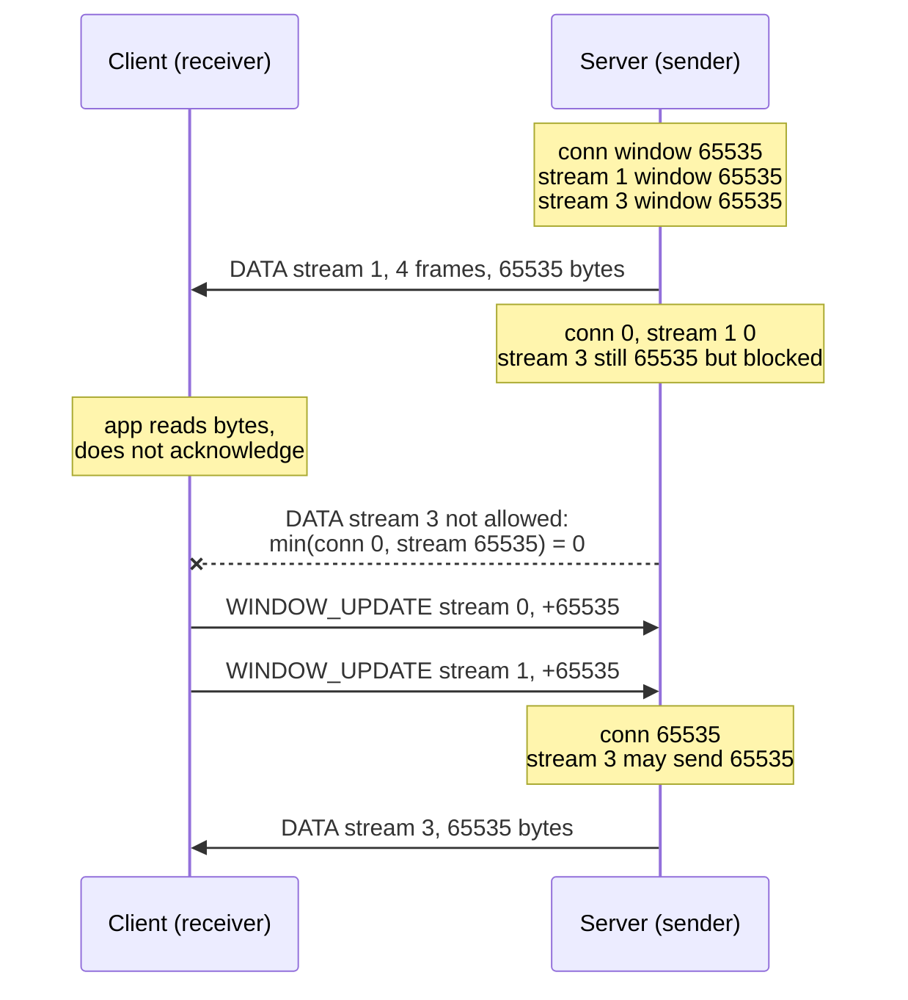

# HTTP/2 Stream and Connection Flow Control: WINDOW_UPDATE and Backpressure (RFC 9113)

> [!summary] Claim
> HTTP/2 gives every `DATA` byte two credit checks, one against its stream window and one against the shared connection window, so a receiver that stops returning credit on one stream stalls only that stream until the connection window runs out, and then it stalls every stream on the connection.

Part of [HTTP Semantics and Wire Protocols](README.md) in [API Engineering](../README.md).

## TL;DR

- Mechanism: the receiver grants byte credit with `WINDOW_UPDATE` frames (type `0x08`, 4-octet payload); the sender subtracts every `DATA` payload, padding included, from both the stream window and the connection window and may not send past either (RFC 9113 Section 6.9.1).
- Contract: both windows start at 65,535 octets, `SETTINGS_INITIAL_WINDOW_SIZE` changes only stream windows (and can drive them negative), only `WINDOW_UPDATE` on stream 0 changes the connection window, and no window may exceed 2^31-1 (RFC 9113 Sections 6.9.1 and 6.9.2).
- Trap: in `h2 4.4.1` a receiver that consumes `DataReceived` events but never calls `acknowledge_received_data` freezes the whole connection after 65,535 bytes, and one that acknowledges `len(event.data)` instead of `event.flow_controlled_length` leaks the padding bytes forever (lab).
- Portability: the lab gives the same 17 results on CPython 3.12.13, 3.12.16 (Debian 13 and Alpine 3.24 containers), 3.13.18, 3.14.6, 3.14.10, 3.15.2, and free-threaded 3.15.0b3 (3.15.2t was not available); Hypercorn 0.18.0 uses `h2` with the 65,535 defaults, Granian 2.8.7 defaults to 1 MiB windows, Uvicorn 0.54.0 needs the unpinned `zttp` package for HTTP/2, and HTTP/3 has no `WINDOW_UPDATE` because QUIC does flow control (RFC 9114 Appendix A.2.5).
- When not to use it: flow control bounds receiver memory, not fairness or latency; if the receiver has no memory constraint, advertise 2^31-1 and refill on every frame, which the RFC says effectively disables it (RFC 9113 Section 5.2.2).

## Mental model



The server starts with three windows of 65,535 octets: one for the connection and one per stream.
Sending 65,535 bytes on stream 1 drains stream 1's window and the shared connection window together, because each `DATA` frame is charged to both.
Stream 3 still has its full stream window, but the sender may send only `min(connection, stream)` bytes, which is now 0, so stream 3 is blocked by a stream it has nothing to do with.
Only when the client hands credit back, a `WINDOW_UPDATE` on stream 0 for the connection and a separate one on stream 1, can stream 3 move.
The lab proves each arrow: `test_stalled_stream_starves_siblings_at_default_connection_window` and `test_acknowledging_consumed_bytes_reopens_both_windows`.

## How it works

### Wire layout

A `WINDOW_UPDATE` is always 13 octets on the wire: the 9-octet frame header plus a 4-octet payload of one reserved bit and a 31-bit `Window Size Increment` (RFC 9113 Section 6.9, Figure 11).

```text
00 00 04 | 08 | 00    | 00 00 00 01        | 00 01 23 45
Length=4 | Type| Flags | R=0, Stream ID=1   | R=0, Increment=0x12345 (74,565)
```

This is the exact frame that `test_window_update_wire_layout_matches_hyperframe` builds with `encode_window_update(1, 0x12345)` and compares against `hyperframe` 6.1.0 `WindowUpdateFrame.serialize`.
Stream identifier 0 targets the connection window; any other identifier targets that stream (RFC 9113 Section 6.9).
The legal increment range is 1 to 2^31-1 (2,147,483,647) octets (RFC 9113 Section 6.9).

### Two windows, one sender rule

The sender keeps the windows; the receiver advertises them (RFC 9113 Section 6.9.1).
The sender MUST NOT send a flow-controlled frame longer than the space in either window, and after sending it reduces both windows by the frame length (RFC 9113 Section 6.9.1).
The 9-octet frame header is not counted, but the whole `DATA` payload is, including `Pad Length` and `Padding` (RFC 9113 Sections 6.9.1 and 6.1).
Only `DATA` frames are flow controlled, so `HEADERS`, `PING`, `SETTINGS`, and `WINDOW_UPDATE` itself flow even when both windows are 0 (RFC 9113 Section 5.2.1, item 5).
An empty `DATA` frame with `END_STREAM` MAY be sent with no window space (RFC 9113 Section 6.9.1), so the protocol always lets a sender finish a stream, although an `h2 4.4.1` receiver rejects that frame when the stream window is negative (see the error-class table).
Flow control is hop by hop: an intermediary does not forward `WINDOW_UPDATE` frames, although its own throttling indirectly propagates backpressure toward the origin (RFC 9113 Section 6.9).

### Receiver accounting

A receiver MUST count every flow-controlled frame against the connection window, even a frame in error, unless it treats the frame as a connection error, or the two ends' views of the window diverge (RFC 9113 Section 6.9).
RFC 9113 defines only the frame, not when to send it: the policy for how much credit to grant and when is left to the implementation (RFC 9113 Section 5.2.1, item 7).
Receivers are advised not to send very small increments, with a pointer to RFC 1122 Section 4.2.3.3 (RFC 9113 Section 6.9.1).
Endpoints MUST read and process frames from the TCP receive buffer as soon as data is available, because failing to read promptly can deadlock when critical frames such as `WINDOW_UPDATE` are not read and acted on (RFC 9113 Section 5.2.2).

### SETTINGS and negative windows

`SETTINGS_INITIAL_WINDOW_SIZE` (identifier `0x04`) sets the initial stream window; values above 2^31-1 are a connection error of type `FLOW_CONTROL_ERROR` (RFC 9113 Section 6.5.2).
When it changes, every open stream window moves by the difference between the new and old values, so a reduction can make a window negative; the sender MUST track the negative value and MUST NOT send new flow-controlled frames until `WINDOW_UPDATE` frames make it positive (RFC 9113 Section 6.9.2).
The RFC's own example is a client that sends 60 KB and then learns of a 16 KB initial window, leaving it at -44 KB (RFC 9113 Section 6.9.2); the lab reproduces it exactly: 61,440 bytes sent, `INITIAL_WINDOW_SIZE` 16,384, window -45,056 (`test_settings_reduction_drives_the_stream_window_negative`).
A `SETTINGS` frame cannot alter the connection window (RFC 9113 Section 6.9.2), which the same test confirms: the client's connection window stays at 65,535 - 61,440 = 4,095.

### Error classes

| Condition | RFC 9113 rule | `h2 4.4.1` behavior (lab) |
| --- | --- | --- |
| Increment 0 on a stream | Stream error, `PROTOCOL_ERROR` (Section 6.9) | Connection error: `GOAWAY` `PROTOCOL_ERROR`, because `hyperframe` raises `InvalidDataError` while parsing and `h2` maps it to `ProtocolError`; Section 5.4.1 permits treating a stream error as a connection error |
| Increment 0 on stream 0 | Connection error, `PROTOCOL_ERROR` (Section 6.9) | `GOAWAY` `PROTOCOL_ERROR` |
| Payload length other than 4 | Connection error, `FRAME_SIZE_ERROR` (Section 6.9) | `FrameDataMissingError`, `GOAWAY` `FRAME_SIZE_ERROR` |
| Stream window would exceed 2^31-1 | `RST_STREAM` `FLOW_CONTROL_ERROR` (Section 6.9.1) | `StreamReset` event, `RST_STREAM` `FLOW_CONTROL_ERROR`, connection survives |
| Connection window would exceed 2^31-1 | `GOAWAY` `FLOW_CONTROL_ERROR` (Section 6.9.1) | `FlowControlError`, `GOAWAY` `FLOW_CONTROL_ERROR` |
| Peer sends `DATA` beyond the window | Peer violated flow control: `FLOW_CONTROL_ERROR` (Section 7) | `FlowControlError` at byte 65,536, `GOAWAY` `FLOW_CONTROL_ERROR` |
| Empty `DATA` with `END_STREAM` on a negative stream window | MAY be sent with no window space (Section 6.9.1) | Sender allows it; receiver raises `FlowControlError` ("Flow control window shrunk below 0") and sends `GOAWAY` `FLOW_CONTROL_ERROR`, because `window_consumed(0)` on a -45,056 window still fails the `< 0` check |
| Reserved bit set in the increment field | Section 6.9 calls it reserved; Section 4.1 says the header's reserved bit MUST be ignored on receipt | `GOAWAY` `PROTOCOL_ERROR`: `WindowUpdateFrame.parse_body` range-checks the raw 32-bit value without masking |

### Implementation in h2 4.4.1

`H2Connection.send_data` never buffers: if the frame is larger than `local_flow_control_window(stream_id)` it raises `FlowControlError`, and the check is `frame_size > 0 and frame_size > self.local_flow_control_window(stream_id)`, so an empty `END_STREAM` frame always passes; at a window of exactly 0 the comparison alone would pass it, and the `frame_size > 0` guard is what lets it out on a negative window (h2 4.4.1 src/h2/connection.py, H2Connection.send_data).
`local_flow_control_window` returns `min(self.outbound_flow_control_window, stream.outbound_flow_control_window)` (h2 4.4.1 src/h2/connection.py, H2Connection.local_flow_control_window).
Inbound credit is managed by `WindowManager`: `window_consumed` raises `FlowControlError` whenever the window is below 0 after subtracting, even for a 0-octet frame, and `process_bytes` decides whether to emit a `WINDOW_UPDATE` (h2 4.4.1 src/h2/windows.py, WindowManager).
A local `INITIAL_WINDOW_SIZE` reduction is applied to the inbound stream managers when the peer acknowledges the `SETTINGS`, so the receiver's own stream window goes negative too (h2 4.4.1 src/h2/connection.py, H2Connection._local_settings_acked; src/h2/stream.py, H2Stream._inbound_flow_control_change_from_settings); the lab shows that a legal empty `END_STREAM` frame on that stream then ends the connection with `GOAWAY` `FLOW_CONTROL_ERROR` (`test_empty_end_stream_and_trailers_are_allowed_on_a_closed_window`).
Its rule, in `_maybe_update_window`, is: emit when the application has processed at least half of `max_window_size`, or when the window is 0 and more than `min(1024, max_window_size // 4)` bytes have been processed (h2 4.4.1 src/h2/windows.py, WindowManager._maybe_update_window).
The lab hits both edges: acknowledging 32,766 bytes of a 65,535 window emits nothing, 32,767 emits `WINDOW_UPDATE` on stream 0 and on the stream; with the window at 0, 1,024 bytes emits nothing and 1,025 emits.
`acknowledge_received_data` feeds the connection manager and the stream manager, and its docstring says the size "must include the amount of padding" (h2 4.4.1 src/h2/connection.py, H2Connection.acknowledge_received_data).
A remote `INITIAL_WINDOW_SIZE` change is applied to stream windows only, through `_flow_control_change_from_settings` and `guard_increment_window` (h2 4.4.1 src/h2/connection.py, H2Connection._acknowledge_settings).
A stream-level overflow is turned into a local reset inside `H2Stream.receive_window_update` (h2 4.4.1 src/h2/stream.py, H2Stream.receive_window_update).
`DATA` that arrives on a stream the receiver already reset is still charged to the connection window and refunded through `process_bytes`, and each such frame draws a `RST_STREAM` `STREAM_CLOSED` (h2 4.4.1 src/h2/connection.py, H2Connection._handle_data_on_closed_stream); the lab sees one `WINDOW_UPDATE` of 32,768 and three `RST_STREAM` frames for three in-flight frames.

### Servers

Hypercorn 0.18.0 sends in chunks of `min(local_flow_control_window(stream_id), max_outbound_frame_size)` and blocks the stream in its scheduler when the chunk is empty (hypercorn 0.18.0 src/hypercorn/protocol/h2.py, H2Protocol._send_data).
It calls `acknowledge_received_data(event.flow_controlled_length, ...)` only after `await`ing delivery of the body chunk to the stream (hypercorn 0.18.0 src/hypercorn/protocol/h2.py, H2Protocol._handle_events; src/hypercorn/protocol/http_stream.py, HTTPStream.handle), and that delivery is `asyncio.Queue.put` on a queue of `max_app_queue_size` = 10 events (hypercorn 0.18.0 src/hypercorn/asyncio/task_group.py, TaskGroup.spawn_app; src/hypercorn/config.py, Config).
So credit returns when the ASGI app's receive queue has room, not when the app has processed the bytes.
On the send side, an ASGI `send` blocks once a stream's buffer reaches `BUFFER_HIGH_WATER` = 2 x 2^14 = 32,768 bytes (hypercorn 0.18.0 src/hypercorn/protocol/h2.py, StreamBuffer.push).
Hypercorn 0.18.0 `Config` has no window-size option; it exposes `h2_max_concurrent_streams`, `h2_max_header_list_size`, and `h2_max_inbound_frame_size` (hypercorn 0.18.0 src/hypercorn/config.py, Config), and `H2Protocol.__init__` builds `local_settings` without `INITIAL_WINDOW_SIZE`, so the `h2` default of 65,535 applies (hypercorn 0.18.0 src/hypercorn/protocol/h2.py, H2Protocol.__init__; h2 4.4.1 src/h2/settings.py, Settings).
Granian 2.8.7 is a Rust server whose `HTTP2Settings` defaults are `initial_connection_window_size` = 1 MiB, `initial_stream_window_size` = 1 MiB, `adaptive_window` = `False`, and `max_send_buffer_size` = 400 KiB (granian 2.8.7 granian/http.py, HTTP2Settings).
Uvicorn 0.54.0 raises `ValueError` for `http2=True` unless the `zttp` protocol is selected (uvicorn 0.54.0 uvicorn/config.py, Config.load); `zttp` is not pinned in this workspace.

## Numbers and limits

| Quantity | Value | Source |
| --- | --- | --- |
| Initial stream and connection window | 65,535 octets (2^16-1) | RFC 9113 Sections 5.2.1 and 6.9.2 |
| Maximum window, maximum increment | 2,147,483,647 octets (2^31-1) | RFC 9113 Sections 6.9 and 6.9.1 |
| Minimum increment | 1 octet | RFC 9113 Section 6.9 |
| `WINDOW_UPDATE` size on the wire | 13 octets (9 header + 4 payload) | RFC 9113 Sections 4.1 and 6.9; lab |
| Default `SETTINGS_MAX_FRAME_SIZE` | 16,384 octets, so a full default window is 4 `DATA` frames (3 x 16,384 + 16,383) | RFC 9113 Section 6.5.2; lab |
| Padding charged per padded frame | `Pad Length` octet + up to 255 padding octets | RFC 9113 Section 6.1; lab (`pad_length=10` costs 11 octets) |
| `h2 4.4.1` update threshold, open window | processed >= `max_window_size // 2` (32,767 for 65,535) | h2 4.4.1 windows.py; lab |
| `h2 4.4.1` update threshold, closed window | processed > `min(1024, max_window_size // 4)` | h2 4.4.1 windows.py; lab |
| Throughput bound with one window per RTT, 65,535 octets at 100 ms | 655,350 B/s (about 5.2 Mbit/s) | arithmetic `window / rtt`, asserted in `test_window_limited_throughput_bound`; RFC 9113 Section 5.2.3 states the bound qualitatively |
| Same bound with a 1 MiB window at 100 ms | 10,485,760 B/s (about 83.9 Mbit/s) | arithmetic, same test |
| Hypercorn 0.18.0 per-stream send buffer high-water mark | 32,768 bytes | hypercorn 0.18.0 protocol/h2.py, `BUFFER_HIGH_WATER` |
| Hypercorn 0.18.0 ASGI receive queue | 10 events | hypercorn 0.18.0 config.py, `max_app_queue_size` |
| Granian 2.8.7 default stream and connection windows | 1,048,576 octets each (as of 2026-11) | granian 2.8.7 granian/http.py |
| Lab runtime | 17 tests in 0.04 s to 0.11 s (0.05 s on 6 consecutive warm runs) | `uv run --frozen pytest tests/f01_http_semantics_and_wire_protocols/test_http_2_flow_control_and_window_update_mechanics.py -q`, Apple Silicon arm64, macOS 27.2 (`uname -r` 27.2.0), CPython 3.14.6 workspace venv, measured 2026-11-08 (other versions in Portability) |

## Portability

| Dimension | Behavior | Evidence |
| --- | --- | --- |
| CPython 3.12.13 | 17 passed | lab, `uv run --isolated --frozen --python 3.12`, macOS arm64 |
| CPython 3.12.16, Debian 13 (trixie, 13.7) | 17 passed | lab, `docker run python:3.12-slim-trixie` on arm64, venv with the locked `h2`, `hpack`, `hyperframe`, `pytest`, and `pytest-asyncio` pins |
| CPython 3.12.16, Alpine 3.24.4 (musl libc) | 17 passed | lab, `docker run python:3.12-alpine` on arm64, same reduced venv |
| CPython 3.13.18 | 17 passed | lab, `uv run --isolated --frozen --python 3.13` |
| CPython 3.14.6 and 3.14.10 | 17 passed on each | lab, workspace `.venv` (3.14.6) and `uv run --isolated --frozen --python 3.14.10` |
| CPython 3.15.2 | 17 passed | lab, `uv run --isolated --frozen --python 3.15.2` |
| CPython 3.15 free-threaded | 17 passed on 3.15.0b3t with the GIL disabled (`sys._is_gil_enabled()` is `False`); 3.15.2t was not available here, so that exact leg was not run | lab, reduced venv with only the locked `h2`, `hpack`, `hyperframe`, `pytest`, and `pytest-asyncio` pins, because the full lock fails on 3.15t (`psycopg-binary` 3.3.8 has no wheel, `aioquic` 1.7.2 fails to compile) |
| `h2 4.4.1` with `hyperframe 6.1.0` | Every row of the error-class table and every threshold above | lab, all versions above |
| Hypercorn 0.18.0 (HTTP/2 via `h2`) | 65,535 defaults, no window option, credit returned after the ASGI queue accepts the chunk | source read (protocol/h2.py, protocol/http_stream.py, asyncio/task_group.py, config.py); an in-process check on CPython 3.14.6 printed `max_app_queue_size` 10, no `Config` attribute containing "window", `BUFFER_HIGH_WATER` 32768, and `h2` `Settings(client=False).initial_window_size` 65535; no HTTP/2 connection to a running server was made |
| Granian 2.8.7 | 1 MiB default windows, configurable with `--http2-initial-connection-window-size` and `--http2-initial-stream-window-size` | source read (granian/http.py, granian/cli.py); `HTTP2Settings()` on CPython 3.14.6 printed 1048576 for both windows, `adaptive_window` `False`, and `max_send_buffer_size` 409600; no HTTP/2 connection to a running server was made |
| Uvicorn 0.54.0 | HTTP/2 only through the optional `zttp` protocol, which is not pinned or installed here, so Uvicorn's flow-control behavior was not tested | source read (uvicorn/config.py, Config.load); `Config("x:y", http2=True).load()` raised `ValueError` ("HTTP/2 requires the `zttp` HTTP protocol") and `import zttp` raised `ModuleNotFoundError` on CPython 3.14.6 |
| HTTP/1.1 | No application-layer flow control; one message at a time per connection, and backpressure is TCP's receive window | RFC 9112 Section 9.5 tells servers to "allow the underlying transport's flow-control mechanisms to resolve temporary overloads"; see [[HTTP-1-1-Framing-Keep-Alive-and-Chunked-Encoding]] |
| HTTP/2 | Stream and connection windows, credit by increment | RFC 9113 Section 6.9; lab |
| HTTP/3 over QUIC | No `WINDOW_UPDATE`; QUIC `MAX_STREAM_DATA` and `MAX_DATA` advertise absolute byte offsets, and every HTTP/3 frame header and payload is flow controlled, not just `DATA` | RFC 9114 Appendix A.2.3 and A.2.5; RFC 9000 Section 4.1; not run |

## Worked example

The [implementation](../labs/src/api_labs/f01_http_semantics_and_wire_protocols/http2_flow_control.py) wires two `h2` connections together in memory and adds a sender loop that respects both windows; the [test](../labs/tests/f01_http_semantics_and_wire_protocols/test_http_2_flow_control_and_window_update_mechanics.py) stalls a receiver and inspects every frame.

The sender loop, the correct way to use an `h2` connection that refuses to buffer:

```python
def send_permitted(conn: h2.connection.H2Connection, stream_id: int, data: bytes) -> int:
    """Send as much of *data* as both flow-control windows allow; return the bytes sent.

    `H2Connection.send_data` raises `FlowControlError` instead of buffering, so a correct
    sender asks `local_flow_control_window` (the minimum of the stream and connection
    windows) before every frame and keeps the remainder queued until a WINDOW_UPDATE arrives.
    """
    sent = 0
    while sent < len(data):
        window = conn.local_flow_control_window(stream_id)
        if window <= 0:
            break
        chunk = min(window, conn.max_outbound_frame_size, len(data) - sent)
        conn.send_data(stream_id, data[sent : sent + chunk])
        sent += chunk
    return sent
```

The stalled-receiver test at the default windows:

```python
@pytest.mark.unit
def test_stalled_stream_starves_siblings_at_default_connection_window() -> None:
    pair = new_pair()
    slow, sibling = open_response_streams(pair, 2)

    assert send_permitted(pair.server, slow, BODY) == DEFAULT_INITIAL_WINDOW
    assert send_permitted(pair.server, sibling, BODY) == 0
    assert pair.server.outbound_flow_control_window == 0

    result = pair.pump()
    received = [e for e in result.client_events if isinstance(e, h2.events.DataReceived)]
    assert sum(len(e.data or b"") for e in received) == DEFAULT_INITIAL_WINDOW
    assert window_updates(result.client_frames) == []
    assert send_permitted(pair.server, sibling, BODY) == 0
```

`BODY` is 100,000 bytes, so the server wants to send more than one window on each stream.
The slow stream gets exactly 65,535 bytes, the sibling gets 0, and the client, which received every byte but acknowledged none, puts no `WINDOW_UPDATE` on the wire.
The companion test `test_connection_credit_isolates_a_stalled_stream_until_it_saturates` first raises the client's connection window by 2 x 65,535 with `increment_flow_control_window`, and then four streams get `[65535, 65535, 65535, 0]`: the stalled first stream no longer blocks the second and third, and the fourth is blocked only when the connection window is spent.

Captured run, from `labs/`, CPython 3.14.6, macOS 27.2 on arm64:

```text
$ uv run --frozen pytest tests/f01_http_semantics_and_wire_protocols/test_http_2_flow_control_and_window_update_mechanics.py -q
.................                                                        [100%]
17 passed in 0.05s
```

## Pitfalls

> [!warning] Reading DATA without returning credit
> Trigger: an `h2`-based handler appends `event.data` to a buffer on `DataReceived` but never calls `acknowledge_received_data`.
> Symptom: the upload or download stops at 65,535 bytes, and so does every other stream on the connection, because the connection window is shared; the peer sees no error, only silence.
> Fix: acknowledge `event.flow_controlled_length` when the bytes leave your buffer, as Hypercorn 0.18.0 does after its queue `put`; proven by `test_stalled_stream_starves_siblings_at_default_connection_window` and `test_acknowledging_consumed_bytes_reopens_both_windows`.

> [!warning] Acknowledging the data length instead of the flow-controlled length
> Trigger: `conn.acknowledge_received_data(len(event.data), event.stream_id)` on a peer that pads frames.
> Symptom: each padded frame leaks its padding plus one octet of credit; in the lab four frames with `pad_length=10` leave the sender permanently 44 octets short, and a long-lived connection that pads every frame drifts toward a stall.
> Fix: always acknowledge `event.flow_controlled_length` (`test_padding_is_flow_controlled_and_acking_len_data_leaks_credit`).

> [!warning] Windows smaller than the bandwidth-delay product
> Trigger: keeping the 65,535-octet default on a high-latency path.
> Symptom: throughput caps at window / RTT whatever the link speed, 655,350 B/s at 100 ms; RFC 9113 Section 5.2.3 warns that receive throughput is then "limited by HTTP/2 flow control".
> Fix: raise `SETTINGS_INITIAL_WINDOW_SIZE` and send an early connection `WINDOW_UPDATE` sized to the expected bandwidth x RTT and to the memory you can afford per connection.

> [!warning] Tiny WINDOW_UPDATE increments (CVE-2019-9511, "Data Dribble")
> Trigger: a client requests large responses over many streams and manipulates window size and priority "to force the server to queue the data in 1-byte chunks" (NVD CVE-2019-9511; Netflix NFLX-2019-002, 2019-08-13).
> Symptom: CPU and memory exhaustion on servers that queue per-chunk state (CVSS 3.1 base score 7.5 per NVD).
> Fix: coalesce small credit before scheduling, cap queued frames per connection, and treat persistent tiny increments as `ENHANCE_YOUR_CALM`, as RFC 9113 Section 10.5 allows for suspicious activity.

> [!warning] Open HTTP/2 window, closed TCP window (CVE-2019-9517, "Internal Data Buffering")
> Trigger: the attacker "opens the HTTP/2 window so the peer can send without constraint; however, they leave the TCP window closed" (NVD CVE-2019-9517).
> Symptom: the server builds responses it cannot write and buffers them in user space (CVSS 3.1 base score 7.5 per NVD).
> Fix: bound user-space send buffers per stream and per connection independently of HTTP/2 credit, the way Hypercorn 0.18.0 blocks ASGI `send` at a 32,768-byte stream buffer; RFC 9113 Section 10.5 names this exact attack.

> [!warning] Expecting a SETTINGS reduction to take effect immediately
> Trigger: a server lowers `SETTINGS_INITIAL_WINDOW_SIZE` to shed memory under load.
> Symptom: data already in flight still arrives, and stream windows on the peer go negative and stay stalled until you send `WINDOW_UPDATE` (RFC 9113 Sections 6.9.2 and 6.9.3; lab reproduces -45,056); with an `h2 4.4.1` receiver, a peer that tries to end such a stream with an empty `END_STREAM` frame gets `GOAWAY` `FLOW_CONTROL_ERROR` for the whole connection (lab).
> Fix: budget for the old window until the `SETTINGS` ACK, or reset streams with `FLOW_CONTROL_ERROR` as Section 6.9.3 permits; on an `h2 4.4.1` receiver, grant credit with `WINDOW_UPDATE` before the peer needs to finish a stream whose window you drove negative.

## Security and robustness

- Threat model: flow control is the receiver's memory budget; the RFC says plainly that it exists "to protect endpoints that are operating under resource constraints" (RFC 9113 Section 5.2.2), so an attacker's goals are to make you buffer more than you advertised or to make you do more work per credited byte.
- OWASP mapping: both 2019 CVEs above are instances of API4:2023 Unrestricted Resource Consumption, whose checklist includes maximum allocable memory and execution timeouts.
- Validate every received frame: increment 1 to 2^31-1, payload exactly 4 octets, window never above 2^31-1, never accept `DATA` beyond the window; the lab's error-class table shows `h2 4.4.1` rejecting each case with the RFC's error code, sometimes at connection rather than stream scope.
- Account even for rejected frames: a `DATA` frame on a reset stream must still be charged to the connection window or the windows desynchronize (RFC 9113 Section 6.9); `h2 4.4.1` does it and also answers each such frame with `RST_STREAM`, which RFC 9113 Section 10.5 lists among the responses an attacker can farm.
- Reserved-bit strictness: `hyperframe 6.1.0` masks the reserved bit of the header's stream identifier with `0x7FFFFFFF` but range-checks the raw 32-bit `WINDOW_UPDATE` payload, so a set payload bit is a connection error `PROTOCOL_ERROR` (hyperframe 6.1.0 src/hyperframe/frame.py, Frame.parse_frame_header and WindowUpdateFrame.parse_body; lab).
  RFC 9113 Section 4.1 says the header's reserved bit MUST be ignored when receiving, and Section 6.9 (Figure 11) shows the payload bit as "Reserved (1)" without restating that rule, so ignoring it would also be consistent with that text.
  Whether any deployed peer sets that bit was not established, so treat this only as a strictness difference to know about, not as a known interoperability failure.
- Defense in depth: cap concurrent streams (`SETTINGS_MAX_CONCURRENT_STREAMS`), cap per-connection send buffers, cap total connection memory, and track control-frame rates, because flow control covers only `DATA` and most attacks in RFC 9113 Section 10.5 (`PING`, `SETTINGS`, `RST_STREAM`, `PRIORITY`, empty frames, field compression) consume no credit at all.
- Read promptly: a receiver that stops reading the socket while waiting on the application cannot see `WINDOW_UPDATE` or `SETTINGS` and can deadlock (RFC 9113 Section 5.2.2); the application backlog belongs in a bounded queue, not in the kernel buffer.

## The principal's view

The decision is how much memory each tier commits per connection, and therefore what window sizes to advertise: worst case is roughly the connection window plus whatever you buffer for writes, while the per-stream window bounds how much one slow consumer can pin.
At the edge, facing untrusted clients, keep windows modest, raise them per connection only when you have a bandwidth-delay estimate, and enforce independent send-buffer and stream caps, because the 2019 advisories show the attack surface is the work you do per credit, not the credit itself.
Inside the data center, where RTTs are small and peers are trusted, larger windows cost little and stop flow control from capping throughput; Granian's 1 MiB defaults are one data point, Hypercorn's fixed 65,535 another, and you should measure your own path before choosing.
An intermediary has two independent flow-control loops (RFC 9113 Section 6.9), so a slow downstream client is invisible to the upstream until the proxy's buffers fill; size the proxy's buffers deliberately or a single slow mobile client becomes upstream backpressure for every request multiplexed with it.
Multiplexing a bulk transfer and latency-sensitive calls over one connection couples them through the connection window and through TCP; separate connections, or HTTP/3 over QUIC, where loss on one stream does not block others ([[TCP-Head-of-Line-Blocking-Under-Packet-Loss]]), are the alternatives, at the cost of more handshakes and state.
Flow control is not prioritization: it says how much may be sent, not which stream goes first; that is [[HTTP-2-Prioritization-and-Extensible-Priorities-RFC-9218]].

## Interview questions

> [!question] L5: Which HTTP/2 frames consume flow-control window, and what is counted?
>
> > [!success]- Answer
> > Only `DATA` frames are flow controlled (RFC 9113 Section 5.2.1).
> > The whole payload counts, including the `Pad Length` octet and the padding, but not the 9-octet frame header (RFC 9113 Sections 6.1 and 6.9.1).
> > `HEADERS`, `PING`, `SETTINGS`, and `WINDOW_UPDATE` flow even with both windows at 0.
> >
> > Follow-up: Why must the receiver still count a `DATA` frame that arrives on a stream it already reset?

> [!question] L5: What are the initial window sizes, and how do you change each of them?
>
> > [!success]- Answer
> > Both the connection window and every new stream window start at 65,535 octets (RFC 9113 Section 6.9.2).
> > `SETTINGS_INITIAL_WINDOW_SIZE` changes the initial stream window and adjusts open streams by the delta.
> > Only a `WINDOW_UPDATE` on stream 0 changes the connection window; `SETTINGS` cannot.
> >
> > Follow-up: A client wants a 1 MiB connection window at startup; what exactly does it send?

> [!question] L6: Predict the output: with `h2 4.4.1`, a client sends 61,440 bytes on a new stream and then receives the server's `SETTINGS` with `INITIAL_WINDOW_SIZE` 16,384, so what do `client.local_flow_control_window(1)` and `client.outbound_flow_control_window` return, and what does `send_data(1, b"u")` do?
>
> > [!success]- Answer
> > `local_flow_control_window(1)` is -45,056: the stream window was 65,535 - 61,440 = 4,095 and moves by 16,384 - 65,535 = -49,151.
> > `outbound_flow_control_window` is 4,095, because `SETTINGS` never changes the connection window.
> > `send_data` raises `FlowControlError` until the server grants at least 45,057 octets on stream 1.
> >
> > Follow-up: Why does the RFC require the sender to keep tracking a negative window instead of clamping it to 0?

> [!question] L6: Debug this API: an `h2`-based gRPC proxy appends `event.data` from each `DataReceived` to a per-stream buffer and, after a worker drains it, calls `acknowledge_received_data(len(event.data), event.stream_id)`; uploads from one client work for hours and then every stream on that connection hangs, so what is wrong?
>
> > [!success]- Answer
> > It acknowledges `len(event.data)`, which omits padding, so every padded frame leaks `pad_length + 1` octets of credit and the connection window shrinks until it reaches 0.
> > Because the connection window is shared, every stream on that connection hangs at the same time while connections from non-padding clients are fine.
> > Fix: acknowledge `event.flow_controlled_length`, which `h2`'s own docstring requires; the lab shows the 44-octet leak for four padded frames.
> >
> > Follow-up: What metric would have shown this before the hang?

> [!question] L6: Why does `h2` not send a `WINDOW_UPDATE` for every acknowledged byte, and what is its rule?
>
> > [!success]- Answer
> > Each increment costs a 13-octet frame and sender work, and RFC 9113 Section 6.9.1 advises receivers against very small increments.
> > `h2 4.4.1` emits when processed bytes reach half the maximum window, or when the window is 0 and more than `min(1024, max // 4)` bytes are processed.
> > For a 65,535 window, 32,766 acknowledged bytes emit nothing and 32,767 emit an update; at a closed window 1,024 emit nothing and 1,025 emit.
> >
> > Follow-up: What does this batching cost a sender on a long-RTT path?

> [!question] L6: When a stream window overflows, and when the connection window overflows, what does each endpoint send?
>
> > [!success]- Answer
> > A stream window above 2^31-1 ends that stream with `RST_STREAM` `FLOW_CONTROL_ERROR`; the connection window above 2^31-1 ends the connection with `GOAWAY` `FLOW_CONTROL_ERROR` (RFC 9113 Section 6.9.1).
> > `h2 4.4.1` follows both: a `StreamReset` event with the connection still usable, versus a raised `FlowControlError` and a `GOAWAY`.
> >
> > Follow-up: Why is a zero increment on a stream a stream error in the RFC but a connection error in `h2`, and is that allowed?

> [!question] L7+: As the owner of an HTTP/2 edge proxy, how do you size windows and buffers, and what attacks does that choice expose?
>
> > [!success]- Answer
> > Start from memory per connection: the connection window bounds unacknowledged inbound bytes, and the stream window bounds what one stalled stream can pin.
> > Raise windows toward the bandwidth-delay product only for paths that need it, because window / RTT caps throughput (RFC 9113 Section 5.2.3).
> > Bound send buffers independently of HTTP/2 credit, or an open HTTP/2 window over a closed TCP window makes you buffer without limit (CVE-2019-9517).
> > Coalesce tiny increments and cap queued frames, or attackers make you queue 1-byte chunks (CVE-2019-9511).
> >
> > Follow-up: How does the proxy's own flow-control loop toward the upstream change when one downstream client is slow?

> [!question] L7+: Compare HTTP/2 and HTTP/3 flow control, and say when the difference matters.
>
> > [!success]- Answer
> > HTTP/2 grants relative increments with `WINDOW_UPDATE` and controls only `DATA`.
> > QUIC advertises absolute byte offsets with `MAX_STREAM_DATA` and `MAX_DATA` (RFC 9000 Section 4.1), and in HTTP/3 every frame header and payload is flow controlled (RFC 9114 Appendix A.2.3).
> > Absolute limits cannot over-grant when a credit frame is repeated or reordered, because a smaller or equal limit has no effect (RFC 9000 Section 4.1), and QUIC streams do not share a TCP byte stream, so loss on one stream does not block the others.
> > It matters for lossy mobile paths and for proxies that multiplex bulk and interactive traffic.
> >
> > Follow-up: Why can HTTP/2 use relative increments safely, when QUIC chose absolute offsets?

> [!question] L7+: The RFC says a deployment can effectively disable flow control, so how do you do it, and when would you?
>
> > [!success]- Answer
> > Advertise the maximum window (2^31-1) and send a `WINDOW_UPDATE` whenever data arrives (RFC 9113 Section 5.2.2).
> > Do it only where the receiver can absorb whatever the sender sends, such as a trusted in-cluster hop with its own admission control.
> > The sender is still bound by whatever the receiver advertises, and you lose per-stream isolation of memory.
> >
> > Follow-up: What would you monitor to prove the change did not move memory pressure somewhere else?

## Related

Prerequisites: [[HTTP-2-Binary-Framing-and-Stream-State-Machine]]

Next: [[HPACK-Header-Compression-and-Dynamic-Table-Security]]

See also: [[HTTP-Evolution-HTTP1-HTTP2-HTTP3]], [[gRPC-and-Protocol-Buffers]], [[HTTP-2-Prioritization-and-Extensible-Priorities-RFC-9218]], [[TCP-Head-of-Line-Blocking-Under-Packet-Loss]], [[QUIC-Transport-Streams-and-Connection-Migration-RFC-9000]], [[HTTP-3-Framing-and-QPACK-Header-Compression-RFC-9114]], [[HTTP-1-1-Pipelining-and-Head-of-Line-Blocking]], [[Backpressure-and-Tail-Latency]], [[High-Performance-TCP-and-Networking]]

- Lab: `labs/tests/f01_http_semantics_and_wire_protocols/test_http_2_flow_control_and_window_update_mechanics.py`

## Further reading

- [RFC 9113 Section 5.2](https://www.rfc-editor.org/rfc/rfc9113.html#section-5.2): flow-control principles, appropriate use, and the bandwidth-delay warning.
- [RFC 9113 Section 6.9](https://www.rfc-editor.org/rfc/rfc9113.html#section-6.9): the `WINDOW_UPDATE` frame, both windows, negative windows, and window reduction.
- [RFC 9113 Section 6.5.2](https://www.rfc-editor.org/rfc/rfc9113.html#section-6.5.2): `SETTINGS_INITIAL_WINDOW_SIZE` and `SETTINGS_MAX_FRAME_SIZE`.
- [RFC 9113 Section 10.5](https://www.rfc-editor.org/rfc/rfc9113.html#section-10.5): the denial-of-service list, including tiny increments and withheld TCP credit.
- [RFC 9000 Section 4](https://www.rfc-editor.org/rfc/rfc9000.html#section-4): QUIC's offset-based stream and connection flow control.
- [RFC 9114 Appendix A.2](https://www.rfc-editor.org/rfc/rfc9114.html#appendix-A.2): why HTTP/3 has no `WINDOW_UPDATE` and flow-controls every frame.
- [h2 v4.4.1 src/h2/windows.py](https://github.com/python-hyper/h2/blob/v4.4.1/src/h2/windows.py): the automatic window-update policy the lab measures.
- [Netflix NFLX-2019-002](https://github.com/Netflix/security-bulletins/blob/master/advisories/third-party/2019-002.md): the original advisory for Data Dribble and Internal Data Buffering.
