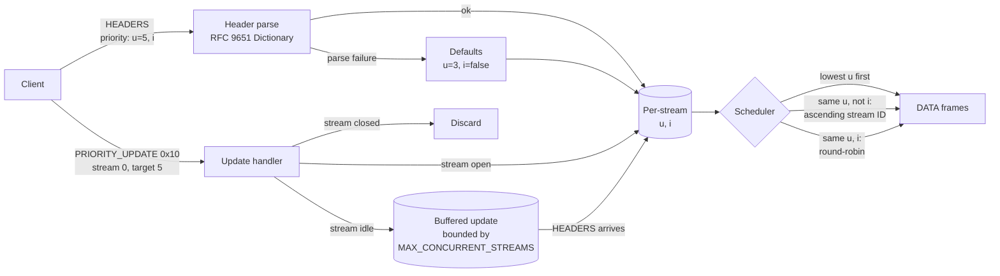

# Why RFC 7540 Stream Priority Trees Were Deprecated and Replaced by Extensible Priorities (RFC 9218)

> [!summary] Claim
> RFC 7540 asked clients to describe a relative, mutable dependency tree that servers found expensive to maintain, easy to abuse, and impossible to map onto HTTP/3, so RFC 9113 deprecated it and RFC 9218 replaced it with two absolute parameters, urgency `u=0..7` and incremental `i`, carried in an end-to-end `Priority` header and a hop-by-hop `PRIORITY_UPDATE` frame.

Part of [HTTP Semantics and Wire Protocols](README.md) in [API Engineering](../README.md).

## TL;DR

- Mechanism: a request carries `Priority: u=5, i`, a Structured Field Dictionary; the server sends lower urgency first, serves non-incremental responses of equal urgency one at a time in stream ID order, and round-robins incremental ones.
- Contract rule: unknown parameters, out-of-range values, and wrong types are ignored, a field that fails Structured Field parsing is ignored whole, and a `PRIORITY_UPDATE` carries the complete parameter set, so an omitted parameter means its default (RFC 9218 Sections 4 and 7, RFC 9651 Section 4.2).
- Trap: the RFC 7540 fields still exist on the wire for compatibility (RFC 9113 Section 5.3.2), and Python libraries such as h2 4.4.1 parse them but surface the RFC 9218 frame type `0x10` only as an `UnknownFrameReceived` event, so reprioritization silently does nothing unless the application handles it.
- Portability: the HTTP/2 frame is type `0x10` on stream 0, the HTTP/3 frame is `0xF0700` (request) or `0xF0701` (push) on the client control stream, and HTTP/3 never had the RFC 7540 tree (RFC 9114 Appendix A.2.1).
- When not to use it: priority is a hint, never a guarantee (RFC 9218 Section 10); do not use it for admission control, fairness between tenants, or anything that must hold under load.

## Mental model



A request's `priority` header is parsed as a Structured Field Dictionary; success yields `u` and `i`, and failure falls back to defaults rather than rejecting the request.
A `PRIORITY_UPDATE` frame arrives on stream 0 and names a target stream: an open target is reprioritized at once, an idle target has its update buffered until `HEADERS` opens it, and a closed target is discarded.
The buffer is bounded because RFC 9218 Section 7.1 caps idle prioritized plus active streams at `SETTINGS_MAX_CONCURRENT_STREAMS`.
The scheduler reads only per-stream `(u, i)` state: there is no tree, no parent, and no weight, so a stream's priority never depends on another stream's existence.

## How it works

### What RFC 7540 asked servers to do

RFC 7540 Section 5.3 let every stream declare a parent stream, an exclusive flag, and a weight from 1 to 256 (RFC 7540 Section 5.3.2), with a default of a non-exclusive dependency on stream `0x0` and weight 16 (RFC 7540 Section 5.3.5).
The signal travels in two places: the 5-octet priority block of a `HEADERS` frame with the `PRIORITY` flag `0x20` set, and the standalone `PRIORITY` frame (type `0x02`, length exactly 5 octets) that can be sent on a stream in any state, including idle and closed (RFC 9113 Sections 6.2 and 6.3).
The weight byte is the weight minus one (RFC 7540 Section 6.3); h2 4.4.1 adds one on receipt (h2 4.4.1 h2/connection.py, H2Connection._receive_priority_frame) and subtracts one on send (h2 4.4.1 h2/connection.py, _add_frame_priority).

```text
PRIORITY frame (RFC 9113 Section 6.3; Weight-1 encoding from RFC 7540 Section 6.3)
+-----------------------------------------------+
| Length (24) = 0x000005 | Type (8) = 0x02      |
| Unused Flags (8)       | R | Stream ID (31)   |
+-----------------------------------------------+
| E (1) | Stream Dependency (31) | Weight-1 (8) |
+-----------------------------------------------+
```

The tree is relative and stateful, and that is the root of every problem RFC 9218 Section 2 lists:

- Reprioritization moves whole subtrees, and making a stream depend on one of its own descendants first reparents the descendant (RFC 7540 Section 5.3.3).
- Removing a stream from the tree is expected to redistribute its weight among its children (RFC 7540 Section 5.3.4), so closing one stream changes the bandwidth share of others.
- A dependency on a stream that has already been dropped from the tree silently becomes the default priority, so servers SHOULD retain state for closed streams, and idle streams can be used as grouping nodes that are not counted against `SETTINGS_MAX_CONCURRENT_STREAMS` (RFC 7540 Section 5.3.4).
- Clients expressed the same intent with different shapes: in 2019 Cloudflare reported that Firefox built a grouping tree, Chromium a single list, Safari split bandwidth in parallel, and Edge and Internet Explorer did not prioritize (Cloudflare blog, Meenan, 2019-05-14).
- The scheme is defined relative to other requests on the same connection, which does not fit HTTP/3, which has no strong ordering guarantees across streams (RFC 9218 Section 2), and HTTP/3 shipped with no priority signal at all (RFC 9114 Appendix A.2.1).

RFC 9113 Section 5.3.1 states the verdict directly: "the prioritization signaling in RFC 7540 [RFC7540] was not successful."
RFC 9113 Section 5.3.2 deprecates it while keeping the frame fields so old peers still interoperate, and notes that the RFC 7540 defaults "are known to have poor performance under most conditions."

### What RFC 9218 does instead

Priority is a Dictionary (RFC 9651 Section 3.2, parsed per Section 4.2.2) with two registered keys (RFC 9218 Section 16):

- `u` is an Integer from 0 to 7, default 3; smaller is more urgent, and 7 is reserved for background work (RFC 9218 Section 4.1).
- `i` is a Boolean, default false; a bare key `i` parses as true (RFC 9651 Section 4.2.2, step 2.3.1), and it means the client can use partial content (RFC 9218 Section 4.2).

The values are absolute: `u=0` means the same thing whether the stream is alone on the connection or one of a hundred.
The `Priority` header is end-to-end, so a CDN can cache it with the response and an origin can send it on a response to steer the intermediary (RFC 9218 Sections 5, 8, and 14).
The response merge rule is asymmetric: an omitted parameter on a request means the default, but an omitted parameter on a response means "keep the client's value" (RFC 9218 Section 8).

Reprioritization uses a new frame that is hop-by-hop and sent only by clients (RFC 9218 Section 7):

```text
HTTP/2 PRIORITY_UPDATE (RFC 9218 Section 7.1, Figure 1), bytes for target 5, value "u=0"
00 00 07 | 10 | 00 | 00 00 00 00 | 00 00 00 05 | 75 3d 30
 length   type flags  stream 0     prioritized    "u=0"
```

The frame header's stream identifier MUST be 0, a prioritized stream ID of 0 is a `PROTOCOL_ERROR`, a server MUST NOT send it, and a failure to parse the value MAY be treated as a connection error (RFC 9218 Sections 7 and 7.1).
In HTTP/3 the frame is `0xF0700` for request streams and `0xF0701` for push streams, it carries a variable-length Prioritized Element ID, and it MUST arrive on the client control stream or the connection fails with `H3_FRAME_UNEXPECTED` (RFC 9218 Section 7.2).

`SETTINGS_NO_RFC7540_PRIORITIES` (`0x9`) lets an endpoint say it ignores the old signals; it MUST be 0 or 1, an endpoint that uses it MUST send it in the first `SETTINGS` frame, and a server that receives 1 MUST ignore RFC 7540 signals (RFC 9218 Section 2.1).
Until a client sees the server's `SETTINGS`, it SHOULD send both schemes (RFC 9218 Section 2.1.1).

### What the Python stack actually implements (as of 2026-11)

- h2 4.4.1 routes any unknown frame type to `H2Connection._receive_unknown_frame`, which logs at debug and returns an `UnknownFrameReceived` event (h2 4.4.1 h2/connection.py, H2Connection._receive_unknown_frame); the lab confirms a `PRIORITY_UPDATE` arrives as an `ExtensionFrame` with `type == 0x10`.
- h2 4.4.1 keeps unknown setting codes as plain integers (h2 4.4.1 h2/settings.py, _setting_code_from_int) and `_validate_setting` has no rule for `0x9` (h2 4.4.1 h2/settings.py, _validate_setting), so a value of 2 is accepted without the `PROTOCOL_ERROR` RFC 9218 Section 2.1 requires; the lab proves it.
- Hypercorn 0.18.0 schedules HTTP/2 `DATA` frames with the RFC 7540 tree from the `priority` package (hypercorn 0.18.0 hypercorn/protocol/h2.py, H2Protocol.__init__ creates `priority.PriorityTree()`), feeds it from `PriorityUpdated` events (hypercorn 0.18.0 hypercorn/protocol/h2.py, H2Protocol._priority_updated), and contains no handling of the `priority` header or frame type `0x10`.
- priority 2.0.0 refuses more than 1000 tree entries including the root (priority 2.0.0 priority/priority.py, PriorityTree.__init__ and PriorityTree.insert_stream), and its `remove_stream` reattaches children with their own weights instead of redistributing the removed stream's weight (priority 2.0.0 priority/priority.py, Stream.remove_child); the lab pins both.
- aioquic 1.7.2 `FrameType` has no `PRIORITY_UPDATE` member (aioquic 1.7.2 aioquic/h3/connection.py, FrameType), and the control stream reader passes only `SETTINGS` and `MAX_PUSH_ID` to `_handle_control_frame` and skips the payload of every other frame type, so an `0xF0700` frame on the control stream is dropped unread (aioquic 1.7.2 aioquic/h3/connection.py, H3Connection._receive_stream_data_uni).

## Numbers and limits

| Quantity | Value | Source |
| --- | --- | --- |
| Urgency range and default | `0..7`, default `3` | RFC 9218 Section 4.1 |
| Incremental default | `false` | RFC 9218 Section 4.2 |
| RFC 7540 weight range and default | `1..256`, default `16`, sent as weight - 1 | RFC 7540 Sections 5.3.2, 5.3.5, and 6.3 |
| `PRIORITY` frame payload | exactly 5 octets, else `FRAME_SIZE_ERROR` | RFC 9113 Section 6.3 |
| HTTP/2 `PRIORITY_UPDATE` type | `0x10`, stream 0 only | RFC 9218 Section 7.1 |
| HTTP/2 `PRIORITY_UPDATE` for `u=0` | 16 bytes (9 header + 4 stream ID + 3 value) | lab `test_h2_priority_update_wire_layout` |
| HTTP/3 `PRIORITY_UPDATE` types | `0xF0700` request, `0xF0701` push | RFC 9218 Section 7.2 |
| `SETTINGS_NO_RFC7540_PRIORITIES` | code `0x9`, initial `0`, values `0` or `1` | RFC 9218 Sections 2.1 and 16 |
| Buffered idle updates plus active streams | at most `SETTINGS_MAX_CONCURRENT_STREAMS` | RFC 9218 Section 7.1 |
| Structured Field Integer | at most 15 digits | RFC 9651 Section 4.2.4 |
| priority 2.0.0 tree capacity | 999 streams plus root, then `TooManyStreamsError` | lab `test_priority_tree_default_cap_counts_idle_grouping_nodes` |
| CVE-2019-9513 "Resource Loop" CVSS 3.1 base score | 7.5 | NVD API, published 2019-08-13 |
| Tree reprioritization cost, 999 streams | 52.5 to 52.8 us per call over 9,970 calls (3 runs) | measured, see below |
| RFC 9218 lab update cost, 999 streams | 2.80 us per call over 10,000 calls (3 runs) | measured, see below |

The two cost rows were re-measured on 2026-11-08 on an Apple M3 Pro, macOS 27.2 (`uname -r` = `27.2.0`), CPython 3.14.6, with priority 2.0.0, using a throwaway script (removed after the run, method below) run as `uv run --frozen python -I ../tmp_churn.py` from `labs/`.
It inserted 999 odd stream IDs, then looped `k` over `range(10_000)` with `a = ids[k % 999]` and `b = ids[(k * 7 + 3) % 999]`, skipped the 30 values of `k` where `a == b` (priority 2.0.0 raises `PriorityLoop` for a self-dependency, first at `k = 166`), and timed the remaining 9,970 calls of `PriorityTree.reprioritize(a, depends_on=b, weight=1 + k % 256, exclusive=bool(k & 1))`.
Separately it timed 10,000 `PriorityScheduler.priority_update(ids[k % 999], f"u={k % 8}")` calls on 999 open streams.
The roughly 19x gap is a property of these two Python implementations, not of the protocols.
Under `cProfile` (same script, machine, and workload), `parse_sf_dictionary` accounted for 0.128 s of the 0.148 s cumulative time of the 10,000 updates over 20,000 calls, because `priority_update` parses the value twice.
The lab's `next_chunk` is an O(n log n) scan per chunk that a production scheduler would replace with eight per-urgency queues.

## Portability

| Dimension | Behavior | Evidence |
| --- | --- | --- |
| CPython 3.12 | 52 lab tests pass on 3.12.13 (3.12.16 not installed here) | lab, `uv run --frozen --python 3.12.13` |
| CPython 3.13 | 52 lab tests pass on 3.13.18 | lab, `uv run --frozen --python 3.13.18` |
| CPython 3.14 | 52 lab tests pass on 3.14.6 and 3.14.10 | lab, workspace `.venv` and `uv run --frozen --python 3.14.10` |
| CPython 3.15 | 52 lab tests pass on 3.15.2 | lab, `uv run --frozen --python 3.15.2` |
| CPython 3.15t | 52 lab tests pass on the free-threaded 3.15.0b3 build (GIL off) in a reduced environment of the locked pure-Python dependencies; 3.15.2t is not installed here, and the full lock cannot install on 3.15.0b3t (`psycopg-binary==3.3.8` has no distribution for it) | lab, `uv run --frozen --python 3.15t` (install error) and `python -m pytest` in a reduced venv, see below |
| h2 4.4.1 | parses RFC 7540 `PRIORITY` into `PriorityUpdated`; surfaces `PRIORITY_UPDATE` as `UnknownFrameReceived`; accepts any value for setting `0x9` | lab, h2 4.4.1 h2/connection.py and h2/settings.py |
| priority 2.0.0 | RFC 7540 weighted tree; 1000-entry cap; no weight redistribution on removal | lab, priority 2.0.0 priority/priority.py |
| Starlette 1.10.0 | `Priority` is an ordinary request and response header; ASGI has no priority field in the scope | lab `test_priority_is_an_ordinary_end_to_end_header_through_asgi` |
| Uvicorn 0.54.0 | `http2=True` needs the optional `zttp` package and `http="zttp"` (uvicorn 0.54.0 uvicorn/config.py, Config.load); uvicorn/protocols/http/zttp_h2_impl.py has no priority handling; zttp 0.0.35 accepts a `0x10` frame and emits no event for it | uvicorn 0.54.0 source and METADATA (`zttp` is neither declared nor in this lock); zttp probe, see below |
| Hypercorn 0.18.0 | HTTP/2 uses the RFC 7540 tree; RFC 9218 header and frame are ignored | hypercorn 0.18.0 hypercorn/protocol/h2.py |
| Granian 2.8.7 | no priority handling in its Rust or Python source; HTTP/2 is hyper 1.12.0 over h2 0.4.20, which ignores `PRIORITY` frames and drops unknown frame types such as `0x10` | granian 2.8.7 sdist src/ (Cargo.lock pins h2 0.4.20, hyper 1.12.0); h2 0.4.20 src/proto/connection.rs, Connection::poll (`Some(Priority(frame))`, "TODO: handle"); src/frame/head.rs, Kind::new; src/codec/framed_read.rs, decode_frame (`Kind::Unknown`) |
| Debian 13 Trixie container | 52 lab tests pass on CPython 3.14.10 (glibc 2.41, aarch64) with the lock's pure-Python dependencies installed by `pip` | lab, `docker run python:3.14-slim-trixie`, see below |
| Alpine 3.24 container (musl) | 52 lab tests pass on CPython 3.14.10 (musl, aarch64) with the same dependencies | lab, `docker run python:3.14-alpine`, see below |
| HTTP/1.1 | no multiplexing, so no scheduling within a connection; back ends MAY schedule on `Priority` only when it can be scoped to one end client | RFC 9218 Section 13.2 |
| HTTP/2 | RFC 7540 fields retained but deprecated; RFC 9218 header plus frame `0x10` | RFC 9113 Section 5.3.2, RFC 9218 Section 7.1 |
| HTTP/3 over QUIC | no RFC 7540 tree ever; RFC 9218 header plus frames `0xF0700` and `0xF0701`; aioquic 1.7.2 drops the frame | RFC 9114 Appendix A.2.1, RFC 9218 Section 7.2, aioquic 1.7.2 aioquic/h3/connection.py |

Three portability facts come from runs and source reads made on 2026-11-08 on macOS 27.2 (`uname -r` = `27.2.0`), Apple M3 Pro.
The 3.15t run used a throwaway venv on CPython 3.15.0b3 free-threaded (`sys._is_gil_enabled()` returned `False`) with the lock's pinned versions of `h2`, `hyperframe`, `hpack`, `priority`, `httpx`, `starlette`, `pytest`, `pytest-asyncio`, and their pure-Python dependencies, run as `PYTHONPATH=src python -m pytest <test path> -q` from `labs/`, and it printed `52 passed`.
The container rows ran `python -m venv`, `pip install` of the pinned versions listed above, and `PYTHONPATH=src python -m pytest <test path> -q` against a read-only copy of `labs/src`, `labs/tests`, and `pyproject.toml`; the other CPython rows use the full lock, so the container rows do not cover compiled dependencies such as `psycopg-binary`.
The Uvicorn row rests on a throwaway venv with `zttp==0.0.35` (the latest PyPI release, not a pinned dependency of Uvicorn) on CPython 3.14.6: a server `zttp.Connection(zttp.SERVER, protocol=zttp.HTTP2)` fed the client preface, an empty `SETTINGS`, and a `0x10` frame on stream 0 produced only a `Settings` event, and a `0x10` frame on stream 5, which RFC 9218 Section 7.1 forbids, was accepted the same way.
The Granian row was read from the sdist and crates in the `Cargo.lock` checksums: no occurrence of `priority` in `src/` or `granian/`, and in h2 0.4.20 the `PRIORITY` handler is an empty arm and frame type bytes above `9` map to `Kind::Unknown`, which the decoder drops.

## Worked example

The [implementation](../labs/src/api_labs/f01_http_semantics_and_wire_protocols/extensible_priorities.py) has four parts: an RFC 9651 Dictionary parser, the RFC 9218 parameter rules, an HTTP/2 `PRIORITY_UPDATE` codec, and a scheduler; the [test](../labs/tests/f01_http_semantics_and_wire_protocols/test_http_2_prioritization_and_extensible_priorities_rfc_9218.py) pins the RFC behavior and the real behavior of h2 4.4.1 and priority 2.0.0.

Parameter extraction, where the `type(...) is int` check matters because a Python `bool` is an `int` and `u=?1` would otherwise become urgency 1:

```python
def parse_priority_params(field_value: str | None) -> PriorityParams:
    """Extract ``u`` and ``i``, ignoring unknown, out-of-range, or mistyped values.

    A field that fails Structured Field parsing is ignored as a whole (RFC 9651 Section 4.2).
    """
    if field_value is None:
        return PriorityParams()
    try:
        members = parse_sf_dictionary(field_value)
    except SFParseError:
        return PriorityParams()
    urgency: int | None = None
    incremental: bool | None = None
    u_value = members["u"][0] if "u" in members else None
    # bool is a subclass of int in Python: "u=?1" must not become urgency 1.
    if type(u_value) is int and 0 <= u_value <= 7:
        urgency = u_value
    i_value = members["i"][0] if "i" in members else None
    if type(i_value) is bool:
        incremental = i_value
    return PriorityParams(urgency=urgency, incremental=incremental)
```

The scheduler, with no tree and no weights:

```python
    def next_chunk(self) -> int | None:
        """Return the stream ID that sends the next chunk, or ``None`` when idle."""
        if not self._active:
            return None
        urgency = min(s.priority.urgency for s in self._active.values())
        level = sorted(sid for sid, s in self._active.items() if s.priority.urgency == urgency)
        sequential = [sid for sid in level if not self._active[sid].priority.incremental]
        if sequential:
            chosen = sequential[0]
        else:
            last = self._last_incremental.get(urgency, -1)
            chosen = next((sid for sid in level if sid > last), level[0])
            self._last_incremental[urgency] = chosen
        stream = self._active[chosen]
        stream.remaining -= 1
        if stream.remaining <= 0:
            del self._active[chosen]
            self._closed.add(chosen)
        return chosen
```

Two of the tests: the first shows `i` changing the order, the second shows what h2 4.4.1 does with the new frame.

```python
def test_scheduler_interleaves_incremental_and_serializes_non_incremental() -> None:
    incremental = PriorityScheduler()
    sequential = PriorityScheduler()
    for sid in (1, 3, 5):
        incremental.open(sid, "u=5, i", chunks=2)
        sequential.open(sid, "u=5", chunks=2)
    assert incremental.drain() == [1, 3, 5, 1, 3, 5]
    assert sequential.drain() == [1, 1, 3, 3, 5, 5]
```

```python
def test_h2_4_4_1_surfaces_priority_update_as_an_unknown_frame() -> None:
    server = _h2_server()
    settings = SettingsFrame(0).serialize()
    events = server.receive_data(H2_PREFACE + settings + encode_h2_priority_update(1, "u=0"))
    unknown = [e for e in events if isinstance(e, h2.events.UnknownFrameReceived)]
    assert len(unknown) == 1
    frame = unknown[0].frame
    assert isinstance(frame, ExtensionFrame)
    assert frame.type == 0x10
    assert frame.body == b"\x00\x00\x00\x01u=0"
```

Output captured from `labs/` on macOS 27.2 (Apple M3 Pro) with CPython 3.14.6:

```text
$ uv run --frozen pytest tests/f01_http_semantics_and_wire_protocols/test_http_2_prioritization_and_extensible_priorities_rfc_9218.py -q
....................................................                     [100%]
52 passed in 0.09s
```

## Pitfalls

> [!warning] Priority tree churn as a CPU attack (CVE-2019-9513)
> Trigger: a client opens many streams and keeps sending `PRIORITY` frames that move them around the tree.
> Symptom: per CVE.org, the attacker "creates multiple request streams and continually shuffles the priority of the streams in a way that causes substantial churn to the priority tree", which "can consume excess CPU" (CVE-2019-9513, published 2019-08-13, CVSS 3.1 7.5 per NVD; Netflix advisory 2019-002).
> Fix: cap tree size and the rate of `PRIORITY` frames, or stop maintaining the tree and advertise `SETTINGS_NO_RFC7540_PRIORITIES=1`; the lab measured about 53 us per reprioritization on a 999-stream priority 2.0.0 tree, against about 3 us per RFC 9218 update.

> [!warning] `bool` passes an `isinstance(x, int)` check
> Trigger: validating `u` with `isinstance(value, int)` in Python.
> Symptom: `priority: u=?1` becomes urgency 1 instead of being ignored, so a malformed client jumps the queue.
> Fix: check `type(value) is int`, as the lab does; swapping in `isinstance` makes `test_unknown_out_of_range_and_mistyped_parameters_are_ignored` fail.

> [!warning] Partial parsing of a broken field
> Trigger: regex-extracting `u=` from `u=0, i,` or `U=0`.
> Symptom: the request gets urgency 0 even though the field is invalid, and two servers disagree on the same bytes.
> Fix: run the full RFC 9651 parser and ignore the whole field on failure (RFC 9651 Section 4.2); the lab's parametrized failure cases all fall back to `u=3`.

> [!warning] Reprioritization that never happens
> Trigger: building an HTTP/2 server on h2 4.4.1 and handling only the documented priority events.
> Symptom: `PRIORITY_UPDATE` frames arrive as `UnknownFrameReceived`, h2 logs them at debug level, and the prefetch the browser upgraded to `u=0` stays at `u=7`.
> Fix: handle `UnknownFrameReceived` with `frame.type == 0x10`, validate it as in `decode_h2_priority_update`, and buffer updates for idle streams.

> [!warning] Same-urgency starvation
> Trigger: a large non-incremental response and a later small incremental one at the same urgency.
> Symptom: the small response waits for the whole large one; RFC 9218 Section 10 lists this exact case and RECOMMENDS avoiding starvation.
> Fix: give incremental streams a small share at equal urgency, or use size as an input; the lab scheduler deliberately keeps the simple order and `test_same_urgency_non_incremental_starves_later_incremental` pins it.

> [!warning] Cached responses with a request-derived `Priority`
> Trigger: an origin computes the `Priority` response header from request properties and the response is cacheable.
> Symptom: a cache replays a priority computed for another request.
> Fix: control cacheability with `Cache-Control` or `Vary`, as RFC 9218 Section 5 expects.

## Security and robustness

- Threat model: the client controls both signals, so priority is untrusted input that can buy bandwidth, not just a hint the server may ignore.
- Resource consumption: RFC 7540 allowed `PRIORITY` on idle and closed streams and asked servers to retain state beyond `SETTINGS_MAX_CONCURRENT_STREAMS` (RFC 7540 Section 5.3.4), which is the unbounded-state shape OWASP calls API4:2023 Unrestricted Resource Consumption.
- RFC 9218 bounds the equivalent state: only the most recent update per stream is kept, and idle prioritized plus active streams above `SETTINGS_MAX_CONCURRENT_STREAMS` is a `PROTOCOL_ERROR` (RFC 9218 Sections 7 and 7.1); the lab enforces both and discards updates for closed streams.
- Input validation: the frame header stream ID must be 0, the prioritized ID must not be 0, the value must be ASCII, and the Dictionary parser must honor the RFC 9651 length limits; the lab rejects each case and, as RFC 9113 Section 4.1 requires, ignores the Reserved bits on receipt.
- Fairness across users: a coalescing intermediary that forwards `Priority` from many clients onto one backend connection lets one user's `u=0` delay another user's responses, so RFC 9218 Section 13.1 suggests round-robin across clients and Section 13.2 says back ends SHOULD scope priority to one end client.
- Defense in depth: clamp client urgencies per tenant at the edge, reserve `u=7` for background traffic you generate yourself, and rate-limit `PRIORITY_UPDATE` as you would any control frame.

## The principal's view

The decision is not "which priority scheme" but "who owns scheduling": with RFC 9218 the client states a coarse, absolute intent and the server owns the policy, which is the opposite of RFC 7540, where the client tried to dictate a bandwidth split the server could neither verify nor cheaply maintain.
For an API platform, the practical rule is to accept `Priority` at the edge, merge it with server knowledge such as content type and size (RFC 9218 Section 8), and log the final `(u, i)` so you can debug ordering.
Do not build business semantics on it: priority does not survive an HTTP/1.1 back end as scheduling, it is advisory everywhere (RFC 9218 Section 10), and an intermediary may override it.
The organizational trade-off is that honoring priority needs a scheduler in the server or proxy that most Python ASGI servers do not have (as of 2026-11), so the leverage is usually in the CDN or proxy tier, not in application code.
If you need real isolation between workloads, use separate connections, separate hosts, or a queue with explicit admission control, not urgency values.
If you need ordered delivery of many small messages with per-message priority, a purpose-built protocol over WebSocket or gRPC streams, or HTTP/3 with a transport that honors stream priority (RFC 9218 Section 12), gives you more control than HTTP response scheduling.

## Interview questions

> [!question] L5: Why did RFC 9113 deprecate RFC 7540 stream priorities instead of fixing them?
>
> > [!success]- Answer
> > RFC 9113 Section 5.3.1 says the scheme was complex, unevenly implemented, and expressed very differently by different clients.
> > The tree is relative and stateful, so servers had to retain state for closed and idle streams and still got default priorities when state was dropped.
> > It also could not map onto HTTP/3, which has no strong ordering guarantees across streams (RFC 9218 Section 2).
> > Fixing it would have kept all of that state; RFC 9218 replaced it with two absolute values.
> >
> > Follow-up: Why does RFC 9113 still define the `PRIORITY` frame format?

> [!question] L5: What do `u` and `i` mean, and what are their defaults?
>
> > [!success]- Answer
> > `u` is urgency, an Integer from 0 to 7 where smaller is more urgent, default 3.
> > `i` is incremental, a Boolean meaning partial content is useful, default false.
> > A request that omits them is treated as `u=3` and not incremental.
> >
> > Follow-up: How does omission differ on a response header?

> [!question] L6: Predict the output: what does the lab's `parse_priority` return for `u=?1, i=1`, for `u=1, i, u=6`, and for `u=0, i,`?
>
> > [!success]- Answer
> > `u=?1, i=1` returns `Priority(3, False)`: `?1` is a Boolean, not an Integer, and `1` is an Integer, not a Boolean, so both are ignored.
> > `u=1, i, u=6` returns `Priority(6, True)`: a duplicate Dictionary key overwrites, so the last one wins (RFC 9651 Section 4.2.2).
> > `u=0, i,` returns `Priority(3, False)`: the trailing comma fails parsing, so the whole field is ignored.
> >
> > Follow-up: Which Python language detail makes the first case easy to get wrong?

> [!question] L6: What should a server do when a client sends `PRIORITY_UPDATE` for stream 9 before the `HEADERS` for stream 9?
>
> > [!success]- Answer
> > RFC 9218 Section 7 says the server SHOULD buffer the most recent update and apply it when the stream opens, overriding the header.
> > The buffer is bounded: idle prioritized plus active streams must not exceed `SETTINGS_MAX_CONCURRENT_STREAMS`, or it is a `PROTOCOL_ERROR` (Section 7.1).
> > The lab test `test_priority_update_for_idle_stream_is_buffered_and_overrides_header` shows `u=0, i` winning over a later `u=6` header.
> >
> > Follow-up: Why is this race more common in HTTP/3?

> [!question] L6: Debug this API: a Python HTTP/2 service built on h2 4.4.1 ignores browser reprioritization, and the access log shows prefetches finishing last even after the user navigates to them; what is happening?
>
> > [!success]- Answer
> > The browser sends `PRIORITY_UPDATE` (type `0x10`) on stream 0, and h2 4.4.1 does not implement RFC 9218.
> > It returns the frame as `UnknownFrameReceived` and logs it only at debug level, so the service never sees a priority event.
> > Fix: handle `UnknownFrameReceived` with `frame.type == 0x10`, validate stream 0 and a non-zero target, parse the value, and feed the scheduler.
> > Also check whether the service should advertise `SETTINGS_NO_RFC7540_PRIORITIES=1` and enforce that the peer's value is 0 or 1, since h2 does not.
> >
> > Follow-up: How would you prove the fix in a hermetic test?

> [!question] L7+: Why is `Priority` an end-to-end header but `PRIORITY_UPDATE` a hop-by-hop frame?
>
> > [!success]- Answer
> > How a client consumes a response is a property of the client, so it travels end-to-end and a cache can store it with the response (RFC 9218 Section 14).
> > How that intent translates into scheduling against other responses on one connection is per hop, so the frame applies to one connection only.
> > An intermediary can forward the header unchanged and also send its own `PRIORITY_UPDATE` to the next hop (RFC 9218 Section 4).
> >
> > Follow-up: What breaks if an intermediary rewrites the header instead?

> [!question] L7+: If you run a CDN that coalesces many clients onto one HTTP/2 connection to each origin, should the origin honor `Priority`?
>
> > [!success]- Answer
> > Only with care: one client's `u=0` can delay every response for another client on the same backend connection (RFC 9218 Section 13.1).
> > The origin can detect coalescing through configuration or `Forwarded` and `Via`, and then round-robin across clients instead of strict urgency.
> > The edge, which sees each client connection separately, is the right place for strict urgency ordering.
> >
> > Follow-up: How would you clamp urgency per tenant without breaking the RFC?

> [!question] L7+: How would you review a proposal to add a `w` weight parameter to Extensible Priorities to recover RFC 7540 weighted sharing?
>
> > [!success]- Answer
> > New parameters are allowed and unknown ones are ignored, so it is wire-safe (RFC 9218 Sections 4 and 4.3).
> > It must not change the meaning of `u` or `i` for receivers that do not understand it, and a one-character key needs Specification Required registration (Section 4.3.1).
> > Weights are relative to other streams, which reintroduces the cross-stream dependency RFC 9218 removed and makes merging at intermediaries ambiguous.
> > A vendor-prefixed longer key under Expert Review, plus measurement showing a gain over `i`, is the minimum bar.
> >
> > Follow-up: What evidence did RFC 9218 cite that simpler schemes perform as well?

> [!question] L5: What does a server that receives `SETTINGS_NO_RFC7540_PRIORITIES=1` have to do, and what if the value is 2?
>
> > [!success]- Answer
> > It MUST ignore RFC 7540 priority signals from that client (RFC 9218 Section 2.1).
> > Any value other than 0 or 1 MUST be a connection error of type `PROTOCOL_ERROR`.
> > The lab shows h2 4.4.1 accepts 2 silently, so the application must enforce it.
> >
> > Follow-up: When can a client stop sending RFC 7540 signals?

## Related

Prerequisites: [[HPACK-Header-Compression-and-Dynamic-Table-Security]]

Next: [[TCP-Head-of-Line-Blocking-Under-Packet-Loss]]

See also: [[HTTP-Evolution-HTTP1-HTTP2-HTTP3]], [[HTTP-2-Binary-Framing-and-Stream-State-Machine]], [[HTTP-2-Flow-Control-and-Window-Update-Mechanics]], [[Structured-Field-Values-for-HTTP-RFC-9651]], [[HTTP-3-Framing-and-QPACK-Header-Compression-RFC-9114]], [[QUIC-Transport-Streams-and-Connection-Migration-RFC-9000]]

- Lab: `labs/tests/f01_http_semantics_and_wire_protocols/test_http_2_prioritization_and_extensible_priorities_rfc_9218.py`

## Further reading

- [RFC 9218: Extensible Prioritization Scheme for HTTP](https://www.rfc-editor.org/rfc/rfc9218.html) - the replacement scheme, its frames, and the server scheduling guidance in Section 10.
- [RFC 9113: HTTP/2](https://www.rfc-editor.org/rfc/rfc9113.html) - Section 5.3 records why RFC 7540 priorities failed and what wire elements remain.
- [RFC 7540: HTTP/2 (obsoleted)](https://www.rfc-editor.org/rfc/rfc7540.html) - Section 5.3 is the only full description of the deprecated tree.
- [RFC 9114: HTTP/3](https://www.rfc-editor.org/rfc/rfc9114.html) - Appendix A.2.1 states that HTTP/3 shipped without any priority signaling.
- [RFC 9651: Structured Field Values for HTTP](https://www.rfc-editor.org/rfc/rfc9651.html) - the Dictionary parsing algorithm the `Priority` field depends on.
- [Marx, De Decker, Quax, and Lamotte, "Of the Utmost Importance: Resource Prioritization in HTTP/3 over QUIC", WEBIST 2019](https://www.doi.org/10.5220/0008191701300143) - simulations of eleven candidate HTTP/3 prioritization designs, cited by RFC 9218 Section 2 for simpler schemes matching RFC 7540 setups.
- [CVE-2019-9513](https://cveawg.mitre.org/api/cve/CVE-2019-9513) - the priority-tree churn denial of service.
