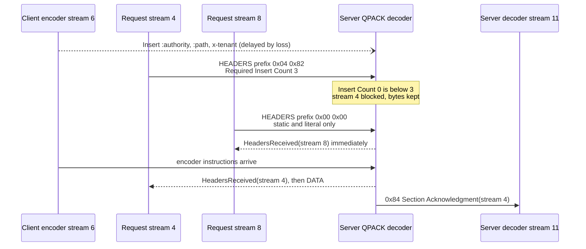

# HTTP/3 Frame Mapping over QUIC and QPACK Out-of-Order Header Compression (RFC 9114)

> [!summary] Claim
> HTTP/3 moves multiplexing into QUIC and keeps only a two-varint frame header, and QPACK moves every dynamic-table write onto one ordered encoder stream so that a lost packet blocks only the request whose field section references an entry still in flight, never the whole connection.

Part of [HTTP Semantics and Wire Protocols](README.md) in [API Engineering](../README.md).

## TL;DR

- Mechanism: each request owns one client-initiated bidirectional QUIC stream carrying `HEADERS`, `DATA`, and optional trailing `HEADERS` frames, each framed as `Type (i)`, `Length (i)`, payload, while each endpoint opens a control stream (`0x00`), a QPACK encoder stream (`0x02`), and a QPACK decoder stream (`0x03`) (RFC 9114 Section 6.2, RFC 9204 Section 4.2).
- Contract rule: an encoded field section starts with a Required Insert Count; if it exceeds the decoder's Insert Count the decoder blocks that stream alone, and the encoder must never put more streams at risk than the decoder's `SETTINGS_QPACK_BLOCKED_STREAMS` (RFC 9204 Section 2.1.2).
- Trap: `SETTINGS_MAX_FIELD_SECTION_SIZE` is advisory and counts decoded bytes plus `32` per field, so a 5-byte `HEADERS` frame that references one large dynamic entry can decode to `4,038` bytes in this lab; a limit on compressed frame size protects nothing.
- Portability: in the pinned stack only Hypercorn `0.18.0` serves HTTP/3, through aioquic `1.7.2`, whose `H3Connection` advertises a `4096`-byte table and `16` blocked streams and does not enforce a decoded field-section limit; Uvicorn `0.54.0` and Granian `2.8.7` have no HTTP/3 mode.
- When not to use it: low-loss east-west RPC inside one datacenter gains little from removing TCP head-of-line blocking and pays for UDP, userspace QUIC, and a second compression state machine; keep HTTP/2 there unless measurement says otherwise.

## Mental model



The client encoder decided to insert three field lines into the dynamic table and to reference them from the field section on stream `4`, so that section declares Required Insert Count `3`.
Stream `4` overtakes the encoder stream, which QUIC permits because it orders bytes only within a stream (RFC 9114 Section 6), so the decoder parks the section and its following `DATA` frame.
Stream `8` references only the static table and literals, declares Required Insert Count `0`, and decodes at once: the blocking is per stream, not per connection.
When the encoder instructions land, the decoder resumes stream `4`, delivers its headers and body in order, and writes a Section Acknowledgment on its own decoder stream so the encoder learns those entries are safe to reference without risk.
Every arrow in this diagram is asserted by the lab test `test_dynamic_reference_blocks_only_its_own_stream_until_encoder_stream_arrives`: both field-section prefixes and the `0x84` acknowledgment byte-for-byte, the encoder-stream inserts by first byte (`0xc0`) and total length (34 bytes), and the event order exactly.

## How it works

### Streams instead of a framing-layer multiplexer

HTTP/2 multiplexes inside one TCP byte stream, so every frame carries a fixed 9-octet header with a 31-bit stream identifier (RFC 9113 Section 4.1).
HTTP/3 delegates multiplexing to QUIC, so a frame is only `Type (i)`, `Length (i)`, and payload, where `(i)` is a QUIC variable-length integer (RFC 9114 Section 7.1).
The two most significant bits of a varint's first byte give its length of 1, 2, 4, or 8 bytes, carrying 6, 14, 30, or 62 usable bits (RFC 9000 Section 16).
A frame payload with extra or missing bytes, or a frame truncated by a clean stream end, is a connection error of type `H3_FRAME_ERROR` (RFC 9114 Section 7.1).
The HTTP/2 frame types HTTP/3 does not need are reserved, and receiving one is `H3_FRAME_UNEXPECTED`: `PING` (`0x06`) and `WINDOW_UPDATE` (`0x08`) because QUIC provides equivalent functionality and flow control, `CONTINUATION` (`0x09`) because a `HEADERS` frame may be as large as needed, and `PRIORITY` (`0x02`) because HTTP/3 itself defines no priority signal (RFC 9114 Section 7.2.8, Section 11.2.1, Appendix A.2.5).
There is no `END_STREAM` flag: the QUIC stream `FIN` ends the message (RFC 9114 Appendix A.2).

Client requests use client-initiated bidirectional streams `0`, `4`, `8`, and so on (RFC 9114 Section 6.1), which follows from the two low bits of a QUIC stream ID: bit `0x01` is the initiator and bit `0x02` the direction (RFC 9000 Section 2.1).
A message is one `HEADERS` frame, zero or more `DATA` frames, and an optional trailing `HEADERS` frame; `DATA` before `HEADERS`, or anything after the trailers, is `H3_FRAME_UNEXPECTED` (RFC 9114 Section 4.1).
Frame types of the form `0x1f * N + 0x21` are grease and must be ignored, which is how HTTP/3 does padding (RFC 9114 Section 7.2.8 and Section 10.7).

### The control stream and SETTINGS

Each endpoint opens exactly one control stream, type `0x00`, whose first frame must be `SETTINGS`; anything else first is `H3_MISSING_SETTINGS`, a second `SETTINGS` is `H3_FRAME_UNEXPECTED`, and closing the stream is `H3_CLOSED_CRITICAL_STREAM` (RFC 9114 Section 6.2.1 and Section 7.2.4).
Settings are declarations, not negotiations, and are sent once (RFC 9114 Section 7.2.4 and Appendix A.3).
HTTP/2 setting identifiers `0x00`, `0x02` to `0x05` are reserved and receiving one is `H3_SETTINGS_ERROR` (RFC 9114 Section 7.2.4.1).
The lab captured the bytes aioquic `1.7.2` writes on a fresh client's control stream `2`:

```text
00             stream type CONTROL
04 09          SETTINGS, length 9
   01 50 00    QPACK_MAX_TABLE_CAPACITY = 4096 (2-byte varint)
   07 10       QPACK_BLOCKED_STREAMS    = 16
   08 01       ENABLE_CONNECT_PROTOCOL  = 1 (RFC 9220)
   21 01       reserved grease setting 0x21 = 1
0d 01 08       MAX_PUSH_ID, length 1, value 8
```

Those values come from `H3Connection.__init__` and `H3Connection._get_local_settings` (aioquic 1.7.2 src/aioquic/h3/connection.py, H3Connection._get_local_settings), and `SETTINGS_MAX_FIELD_SECTION_SIZE` (`0x06`) is absent.

### QPACK: two tables, two extra streams

QPACK keeps HPACK's static and dynamic tables but forbids field sections from modifying the dynamic table; all inserts travel on the encoder stream, type `0x02`, as unframed instructions, and all acknowledgments travel back on the decoder stream, type `0x03` (RFC 9204 Section 2.2 and Section 4.2).
This gives the dynamic table a total order even though QUIC orders nothing across streams (RFC 9114 Appendix A.2.2).
Encoder instructions are Set Dynamic Table Capacity (`001` prefix), Insert with Name Reference (`1T`), Insert with Literal Name (`01`), and Duplicate (`000`) (RFC 9204 Section 4.3).
Decoder instructions are Section Acknowledgment (`1` + 7-bit stream ID), Stream Cancellation (`01` + 6-bit stream ID), and Insert Count Increment (`00` + 6-bit increment) (RFC 9204 Section 4.4).
The table starts at capacity `0`, and the encoder must send Set Dynamic Table Capacity before inserting; the capacity may not exceed the decoder's `SETTINGS_QPACK_MAX_TABLE_CAPACITY` (RFC 9204 Section 3.2.2 and Section 3.2.3).
In the lab, pylsqpack emits `3f e1 1f` the moment the peer's `SETTINGS` arrive: `001` + 5-bit prefix `31`, then continuation bytes `0xe1` and `0x1f` for `31 + 97 + 31 * 128 = 4096`.

### The field-section prefix decides who blocks

Every encoded field section begins with Required Insert Count (8-bit prefix integer) and a Sign bit plus Delta Base (7-bit prefix) (RFC 9204 Section 4.5.1).
Required Insert Count is one more than the largest absolute index referenced, or `0` if the section touches no dynamic entry (RFC 9204 Section 2.1.2).
It is sent modulo `2 * MaxEntries`, where `MaxEntries = floor(MaxTableCapacity / 32)`, so a long-lived connection never grows the prefix (RFC 9204 Section 4.5.1.1).
The lab's stream `4` field section is 7 bytes, `04 82 d1 d7 10 11 12`:

```text
04  Encoded Required Insert Count 4 -> 3   (MaxEntries = 4096 // 32 = 128)
82  Sign 1, Delta Base 2 -> Base = 3 - 2 - 1 = 0
d1  Indexed, static, index 17  :method: GET
d7  Indexed, static, index 23  :scheme: https
10  Indexed, post-Base index 0 -> absolute 0  :authority: api.example
11  Indexed, post-Base index 1 -> absolute 1  :path: /v1/items
12  Indexed, post-Base index 2 -> absolute 2  x-tenant: acme-prod
```

Post-Base indexing exists so a single-pass encoder can insert entries while encoding and still reference them (RFC 9204 Section 3.2.6 and Section 4.5.1.2).
When the decoder's Insert Count is below Required Insert Count, the stream is blocked and its bytes should stay inside that stream's flow-control window so a peer cannot use blocking to exhaust memory (RFC 9204 Section 2.2.1).
aioquic implements this by catching `pylsqpack.StreamBlocked` in `H3Connection._receive_request_or_push_data`, setting `stream.blocked`, and, when `Decoder.feed_encoder` on the encoder stream returns that stream ID, resuming the frame with `frame_data=None` (aioquic 1.7.2 src/aioquic/h3/connection.py, H3Connection._receive_stream_data_uni), which makes `H3Connection._decode_headers` call `Decoder.resume_header` (aioquic 1.7.2 src/aioquic/h3/connection.py, H3Connection._decode_headers).
After decoding a section with non-zero Required Insert Count the decoder must send a Section Acknowledgment, and the lab captured `0x84`, which is `1` + stream ID `4` (RFC 9204 Section 4.4.1).
If the stream is reset while blocked, the decoder sends Stream Cancellation so the encoder can release references, and the lab captured `0x44`, which is `01` + stream ID `4` (RFC 9204 Section 2.2.2.2); aioquic does this in `H3Connection._receive_stream_reset` via `Decoder.cancel_stream`.

### The encoder controls the risk

An encoder may reference only acknowledged entries and never block anyone, or reference in-flight entries for better compression and risk blocking, up to `SETTINGS_QPACK_BLOCKED_STREAMS` streams (RFC 9204 Section 2.1.2).
A decoder that sees more blocked streams than it advertised must fail with `QPACK_DECOMPRESSION_FAILED`, and the lab proves pylsqpack raises `DecompressionFailed` on the second blocked stream when the decoder allows `1` and a lying encoder assumes `16`.
pylsqpack passes the peer's `blocked_streams` straight to `lsqpack_enc_init` as the risked-stream limit (pylsqpack 1.0.0 src/pylsqpack/binding.c, Encoder_apply_settings).
With `blocked_streams = 0` the lab shows lsqpack still writes 34 bytes of inserts on the encoder stream but keeps Required Insert Count at `0` until those entries are acknowledged, so no decode ever blocks.
The lab also shows lsqpack sends a field line literally the first time it sees it and inserts it on the second sighting; that is observed behavior of pylsqpack `1.0.0`, not a protocol rule.

## Numbers and limits

| Parameter or metric | Value | Source or measurement context |
|---|---|---|
| QUIC varint lengths and range | 1, 2, 4, 8 bytes; 6, 14, 30, 62 usable bits; max `2^62 - 1` | (RFC 9000 Section 16) |
| HTTP/3 frame header | 2 bytes minimum (`Type` + `Length` varints) | (RFC 9114 Section 7.1) |
| HTTP/2 frame header | 9 octets fixed | (RFC 9113 Section 4.1) |
| Unidirectional streams a peer must be allowed | at least 3, with at least `1,024` bytes of flow-control credit each (SHOULD) | (RFC 9114 Section 6.2) |
| Concurrent request streams a server should permit | at least `100` | (RFC 9114 Section 6.1) |
| `SETTINGS_QPACK_MAX_TABLE_CAPACITY` and `SETTINGS_QPACK_BLOCKED_STREAMS` defaults | `0` and `0` | (RFC 9204 Section 5) |
| `SETTINGS_MAX_FIELD_SECTION_SIZE` default | unlimited | (RFC 9114 Section 7.2.4.1) |
| Per-entry and per-field overhead | `32` bytes | (RFC 9204 Section 3.2.1), (RFC 9114 Section 4.2.2) |
| `MaxEntries` and prefix modulus at capacity `4096` | `128` entries; Required Insert Count sent modulo `256` | (RFC 9204 Section 4.5.1.1) |
| aioquic `1.7.2` advertised QPACK settings | capacity `4096`, blocked streams `16`, client `MAX_PUSH_ID` `8` | (aioquic 1.7.2 src/aioquic/h3/connection.py, H3Connection.__init__); bytes captured in lab |
| `HEADERS` payload, first sight vs dynamic references | `38` bytes literal vs `7` bytes indexed, plus `34` bytes once on the encoder stream | measured in `labs/`, CPython `3.14.6`, macOS 27.2 arm64, pylsqpack `1.0.0` |
| Dynamic-table amplification, one `4,000`-byte value | `5`-byte `HEADERS` frame decodes to `4,038` bytes of field section (`807x`) after a one-time `2,509`-byte insert; each later request adds a 1-byte `Duplicate` | measured in `labs/`, CPython `3.14.6`, macOS 27.2 arm64 |
| Header-accordion wire-to-memory ratios reported by FoxIO | quic-go `0.56.0` about `15x`, quiche `0.29.2` about `20x`, lsquic `4.8.2` about `600-1800x`, aioquic `1.7.0` with mitmproxy about `20-30x`, Bun `1.4.3` about `4000x` | FoxIO, 2026-10-20, versions from its test matrix (as of 2026-11); aioquic `1.7.2` itself was not measured by FoxIO |
| Lab suite runtime | `41 passed` in `0.09s` to `0.12s` (three warm runs) | `uv run --frozen pytest ... -q` from `labs/`, CPython `3.14.6`, macOS 27.2 arm64 (`Darwin 27.2.0`), 2026-11 |

## Portability

| Runtime, library, server, or protocol | HTTP/3 and QPACK behavior | Verification |
|---|---|---|
| CPython `3.12.13`, `3.13.18`, `3.14.6`, `3.14.10`, `3.15.2` + aioquic `1.7.2` + pylsqpack `1.0.0` | Identical bytes: control stream `SETTINGS`, `0x04 0x82` prefix, `0x84` and `0x44` decoder instructions, and all error codes | `41 passed` under each interpreter, each in its own `uv` environment, macOS 27.2 arm64; `3.12.16` is not installed here, so `3.12.13` stands in for it |
| CPython `3.15.0b3` | Not run: `pytest` aborts at plugin import with `ModuleNotFoundError: No module named 'hypothesis._native'` | Run attempted here; failure is in the workspace's `hypothesis` wheel, not the lab |
| CPython `3.15t` free-threaded | Not run: `uv` resolved `3.15.0b3t` and could not install `psycopg-binary==3.3.8` (no wheel); `3.14.6t` fails the same way; `3.15.2t` is not available to `uv 0.11.26` here | Run attempted here |
| Debian Trixie and Alpine musl containers | Not run | No container leg was executed for this note |
| Uvicorn `0.54.0` | No HTTP/3: the installed package contains no QUIC or HTTP/3 code | grep of `uvicorn/` in the pinned environment |
| Hypercorn `0.18.0` | Serves HTTP/3 by wrapping aioquic: `H3Protocol` constructs `H3Connection(quic)` with defaults, and UDP listeners come from `Config.quic_bind`, so it inherits aioquic's QPACK settings and its lack of a decoded field-section limit | (hypercorn 0.18.0 hypercorn/protocol/h3.py, H3Protocol.__init__), (hypercorn 0.18.0 hypercorn/config.py, Config.quic_bind); source reading of the pinned release, no QUIC server was started here |
| Granian `2.8.7` | No HTTP/3 mode: `HTTPModes` is `auto`, `1`, `2` | (granian 2.8.7 granian/constants.py, HTTPModes) |
| aioquic `1.7.2` QPACK stream closure | `RESET_STREAM` on a peer encoder or decoder stream closes the connection with `H3_CLOSED_CRITICAL_STREAM`, but a clean `FIN` is accepted silently, although RFC 9204 Section 4.2 requires the same error for any closure | lab test `test_aioquic_closes_on_qpack_stream_reset_but_not_on_clean_fin`; only the control stream `FIN` is checked in `H3Connection._receive_stream_data_uni`, confirmed by reading the installed `aioquic/h3/connection.py` (identical to the `1.7.2` tag) and by the lab run |
| aioquic `1.7.2` field-section limit | `Setting.MAX_FIELD_SECTION_SIZE` is defined but never sent or enforced; a `21,034`-byte decoded section is delivered without error | lab test `test_aioquic_does_not_enforce_a_decoded_field_section_limit`; FoxIO reports the same for aioquic `1.7.0` (as of 2026-10-20) |
| HTTP/1.1 ([[HTTP-1-1-Framing-Keep-Alive-and-Chunked-Encoding\|RFC 9112]]) | No header compression; text framing; `Transfer-Encoding` exists | (RFC 9114 Section 4.1) forbids `Transfer-Encoding` in HTTP/3 |
| HTTP/2 ([[HPACK-Header-Compression-and-Dynamic-Table-Security\|HPACK]]) | Field blocks modify the table in place and must be decoded in connection order | (RFC 9114 Appendix A.2.2) |
| HTTP/3 (this note) | Field sections only reference table state; inserts travel on the encoder stream | (RFC 9204 Section 2.2) |

## Worked example

The [implementation](../labs/src/api_labs/f01_http_semantics_and_wire_protocols/h3_qpack.py) has two halves.
A from-scratch codec for QUIC varints, HTTP/3 frames, `SETTINGS`, QPACK prefix integers, and the field-section prefix, written straight from RFC 9000 Section 16 and RFC 9204 Section 4.5.1.
A harness, `H3Pair`, that joins two real aioquic `H3Connection` objects through `LoopbackQuic`, a `QuicConnection` subclass that skips `QuicConnection.__init__` exactly as aioquic's own `FakeQuicConnection` does (aioquic 1.7.2 tests/test_h3.py, FakeQuicConnection), and buffers bytes per stream so a test chooses which stream arrives first.
The [test](../labs/tests/f01_http_semantics_and_wire_protocols/test_http_3_framing_and_qpack_header_compression_rfc_9114.py) has 41 cases, all `@pytest.mark.unit`, no sockets.

Verbatim excerpt of the implementation (lines 151-198), the decoder side of the prefix:

```python
def decode_required_insert_count(encoded: int, max_table_capacity: int, total_inserts: int) -> int:
    """Reconstruct the Required Insert Count (RFC 9204 Section 4.5.1.1)."""
    max_entries = max_table_capacity // 32
    full_range = 2 * max_entries
    if encoded == 0:
        return 0
    if encoded > full_range:
        raise ValueError("QPACK_DECOMPRESSION_FAILED: encoded insert count out of range")
    max_value = total_inserts + max_entries
    max_wrapped = (max_value // full_range) * full_range
    required = max_wrapped + encoded - 1
    if required > max_value:
        if required <= full_range:
            raise ValueError("QPACK_DECOMPRESSION_FAILED: insert count did not wrap")
        required -= full_range
    if required == 0:
        raise ValueError("QPACK_DECOMPRESSION_FAILED: zero must be encoded as zero")
    return required


@dataclass(frozen=True, slots=True)
class FieldSectionPrefix:
    """Required Insert Count and Base of one encoded field section (RFC 9204 Section 4.5.1)."""

    required_insert_count: int
    base: int


def parse_field_section_prefix(
    block: bytes, max_table_capacity: int, total_inserts: int
) -> FieldSectionPrefix:
    """Decode the two-integer prefix that tells a decoder whether it must block."""
    encoded, offset = decode_prefixed_int(block, 0, 8)
    required = decode_required_insert_count(encoded, max_table_capacity, total_inserts)
    if offset >= len(block):
        raise ValueError("truncated field section prefix")
    sign = block[offset] & 0x80
    delta, _ = decode_prefixed_int(block, offset, 7)
    if sign:
        if required <= delta:
            raise ValueError("QPACK_DECOMPRESSION_FAILED: negative Base")
        return FieldSectionPrefix(required, required - delta - 1)
    return FieldSectionPrefix(required, required + delta)


def field_section_size(headers: Iterable[tuple[bytes, bytes]]) -> int:
    """Uncompressed size: name + value + 32 bytes per field line (RFC 9114 Section 4.2.2)."""
    return sum(len(name) + len(value) + FIELD_LINE_OVERHEAD for name, value in headers)
```

Verbatim excerpt of the test (lines 156-183), the out-of-order delivery the Mermaid diagram draws:

```python
@pytest.mark.unit
def test_dynamic_reference_blocks_only_its_own_stream_until_encoder_stream_arrives() -> None:
    pair = warmed_pair()
    pair.client.send_headers(4, REQUEST)
    pair.client.send_data(4, b"{}", end_stream=True)
    pair.client.send_headers(8, HEALTH, end_stream=True)

    assert len(headers_block(bytes(pair.client_quic.sent[0]))) == 38  # first sight: literals
    assert headers_block(pair.client_quic.pending(4)) == bytes.fromhex("0482d1d7101112")
    blocked = parse_field_section_prefix(headers_block(pair.client_quic.pending(4)), 4096, 0)
    assert blocked == FieldSectionPrefix(required_insert_count=3, base=0)
    assert headers_block(pair.client_quic.pending(8))[:2] == b"\x00\x00"  # static and literal
    free = parse_field_section_prefix(headers_block(pair.client_quic.pending(8)), 4096, 0)
    assert free.required_insert_count == 0
    assert pair.client_quic.pending(CLIENT_ENCODER)[:1] == b"\xc0"  # insert, static name 0
    assert len(pair.client_quic.pending(CLIENT_ENCODER)) == 34  # three inserts, still in flight

    # Request streams 4 and 8 overtake the encoder stream, as QUIC permits.
    early = pair.deliver("client", [4, 8])
    assert early == [HeadersReceived(headers=HEALTH, stream_id=8, stream_ended=True)]

    late = pair.deliver("client", [CLIENT_ENCODER])
    assert late == [
        HeadersReceived(headers=REQUEST, stream_id=4, stream_ended=False),
        DataReceived(data=b"{}", stream_id=4, stream_ended=True),
    ]
    assert pair.server_quic.pending(SERVER_DECODER) == b"\x84"  # Section Acknowledgment(4)
    assert pair.server_quic.close_error is None
```

`warmed_pair()` exchanges the control and QPACK streams and sends `REQUEST` once on stream `0`, because pylsqpack inserts a field line only on its second sighting.
Mutating `H3Pair.deliver` to flush every unidirectional stream before the requested streams, which models HTTP/2's total order, makes this test and the cancellation test fail, which proves they observe ordering rather than restating it.

Captured run, from `labs/`, CPython `3.14.6`, macOS 27.2 arm64 (`Darwin 27.2.0`):

```text
$ uv run --frozen pytest tests/f01_http_semantics_and_wire_protocols/test_http_3_framing_and_qpack_header_compression_rfc_9114.py -q
.........................................                                [100%]
41 passed in 0.10s
```

## Pitfalls

> [!warning] Limiting the compressed `HEADERS` frame instead of the decoded field section
> Trigger: a server caps `HEADERS` frame length but builds a header map from whatever QPACK decodes.
> Symptom: memory exhaustion from small frames; quic-go up to `0.56.0` enforced limits only on the compressed frame (CVE-2025-64702, fixed in `0.57.0`), and quiche omitted the 32-byte per-field overhead and preallocated from declared frame lengths (CVE-2026-12523, fixed in `0.29.3`).
> Fix: count `len(name) + len(value) + 32` per field as each line is decoded, abort at the budget, and answer `431` (RFC 9114 Section 4.2.2 and Section 10.5.1); the lab's `enforce_field_section_limit` is that check after the fact, and in aioquic `1.7.2` it is the application's job.

> [!warning] Buffering unknown frames whole
> Trigger: a parser waits for a complete frame of a type it will ignore anyway.
> Symptom: aioquic before `1.4.0` kept the payload of an incomplete non-`DATA` frame in an immutable `bytes` buffer and recopied it on every fragment, stalling the event loop for unrelated clients (GHSA-9hhx-9x9j-wqhp).
> Fix: discard unknown-type payload as it arrives, which aioquic `1.7.2` now does in `H3Connection._receive_request_or_push_data` with a comment citing RFC 9114 Section 10.5.

> [!warning] Stream registries keyed by peer-chosen IDs that never shrink
> Trigger: per-stream state is freed only when both halves end, but a peer's unidirectional stream has no local send half.
> Symptom: aioquic before `1.5.0` kept every finished reserved-type `0x21` stream in `H3Connection._stream`, and a remote peer OOM-killed 256 MiB servers (GHSA-jcfp-h9cf-vwp4); Netty's HTTP/3 codec through `4.2.17.Final` kept per-stream QPACK encoder state until a Section Acknowledgment that a hostile peer never sends (CVE-2026-100660).
> Fix: mark the absent half ended at creation (aioquic `1.7.2` does this in `H3Connection._get_or_create_stream`) and bound encoder state per connection, falling back to literals when the budget is spent.

> [!warning] Unbounded prefix-integer continuation bytes
> Trigger: a QPACK integer decoder that keeps consuming `0x80` continuation bytes and returns "need more" without bounding the run.
> Symptom: Netty's `QpackUtil.decodePrefixedInteger` through `4.2.17.Final` let a peer grow a buffer without limit and rescan it each time, O(N^2) CPU (CVE-2026-100661).
> Fix: reject after the bytes a 62-bit value can need; the lab's `decode_prefixed_int` stops after `9` continuation bytes and its test feeds 64.

> [!warning] Critical-stream lifecycle bugs
> Trigger: an implementation allows an encoder stream to be reopened or closed and keeps pointers to the old one.
> Symptom: NGINX's `ngx_http_v3_module` could be driven to reopen a QPACK encoder stream, causing a use-after-free in the worker (CVE-2026-42530).
> Fix: accept at most one encoder and one decoder stream per peer, treat a second as `H3_STREAM_CREATION_ERROR` and any closure as `H3_CLOSED_CRITICAL_STREAM` (RFC 9204 Section 4.2).
> aioquic `1.7.2` rejects a second stream in `H3Connection._receive_stream_data_uni` and a reset in `H3Connection._receive_stream_reset`, but the lab shows it accepts a clean `FIN` on either QPACK stream, so do not rely on it for that rule.

> [!warning] Reading `QPACK_BLOCKED_STREAMS = 0` as "dynamic table off"
> Trigger: an operator sets blocked streams to `0` to remove head-of-line risk and assumes compression state disappears.
> Symptom: the lab shows the encoder still inserting entries (34 bytes on the encoder stream) and the dynamic table still occupying memory up to the advertised capacity; only the references wait for acknowledgment.
> Fix: set `SETTINGS_QPACK_MAX_TABLE_CAPACITY = 0` to turn the dynamic table off, or keep both and accept a bounded number of blocked streams.

## Security and robustness

Threat model: an unauthenticated peer controls every byte on its streams, every stream ID, every setting, and the timing and order of delivery across streams.
The resource to protect is memory and event-loop time per connection, which is OWASP API4:2023 Unrestricted Resource Consumption at the protocol layer.

- Bound decoded state, not wire bytes.
  QPACK amplifies by design: the lab turns a `5`-byte frame into a `4,038`-byte field section, and FoxIO's header-accordion research reports seven of ten implementations vulnerable to some form of this (as of 2026-10-20).
  Advertise `SETTINGS_MAX_FIELD_SECTION_SIZE`, but enforce it yourself while decoding, because the setting is only advisory to the peer (RFC 9114 Section 10.5.1).
- Budget blocked streams as memory.
  Each blocked stream holds a field section the decoder cannot release, so worst-case decoder memory is roughly table capacity plus blocked streams times the largest section you accept; RFC 9204 Section 7.3 calls the blocked-stream limit only a proxy for memory, because the real cost depends on per-stream tracking; keep blocked bytes inside stream flow control (RFC 9204 Section 2.2.1).
- Validate every length against its container.
  Nested varint lengths must match exactly or the frame is `H3_FRAME_ERROR` (RFC 9114 Section 7.1 and Section 10.8); never preallocate from a declared length, the second half of quiche's CVE-2026-12523.
- Ignore what must be ignored, cheaply.
  Grease frames, settings, and stream types are legitimate, but processing them costs CPU, so count them and allow `H3_EXCESSIVE_LOAD` for abuse (RFC 9114 Section 10.5).
- Do not share a dynamic table across trust boundaries.
  An intermediary that coalesces many clients onto one upstream connection lets one client probe another's field values by observing encoded lengths; QPACK limits guesses to whole field lines but low-entropy values remain recoverable (RFC 9204 Section 7.1.1).
  Encode `Authorization` and `Cookie` as literals with the `N` bit so no hop indexes them (RFC 9204 Section 7.1.3).
- Treat 0-RTT requests as replayable and apply the HTTP early-data rules (RFC 9114 Section 10.9).

## The principal's view

The architectural decision is where HTTP/3 terminates and who owns QPACK limits.
In this Python stack only Hypercorn speaks HTTP/3, through aioquic, which leaves decoded-size enforcement to the application; most teams therefore terminate QUIC at an edge proxy or CDN they have load-tested against amplification and speak HTTP/2 or HTTP/1.1 to the Python service.
That buys a hardened, separately patched QUIC stack and keeps the application on well-understood framing, at the cost of losing end-to-end stream independence on the last hop and adding another hop's settings to every limit calculation (RFC 9114 Section 10.5.1 notes each hop applies its own limit).

The QPACK knobs are a latency, memory, and compression trade the decoder owns.
Capacity `0` with blocked streams `0` makes every request independent and removes the dynamic-table amplification path, at the cost of header bytes on every request; on a mobile client fleet with long-lived connections and repeated cookies the dynamic table usually pays for itself, while on a public edge facing anonymous clients a small table and a strict decoded budget is the defensible default.

Choose HTTP/3 when clients are on lossy or changing networks, which is where removing TCP head-of-line blocking and connection migration matter; see [[TCP-Head-of-Line-Blocking-Under-Packet-Loss]].
Choose HTTP/2 for datacenter-internal RPC where loss is rare, UDP may be rate-limited by middleboxes, and the operational tooling around TCP is mature.
Choose a different paradigm entirely, such as a message queue, when the real problem is fan-out or durability rather than per-request latency.

## Interview questions

> [!question] L5: Why does an HTTP/3 frame header carry no stream ID and no flags, when HTTP/2's carries both?
>
> > [!success]- Answer
> > QUIC already delivers each frame on a specific stream, so the stream identifier would be redundant.
> > Stream end is signalled by the QUIC `FIN`, so `END_STREAM` is unnecessary, and `CONTINUATION` no longer exists, so `END_HEADERS` is unnecessary too; the Flags field is gone (RFC 9114 Appendix A.2 and Appendix A.2.5).
> > The result is `Type (i)`, `Length (i)`, payload, as small as 2 bytes of header versus HTTP/2's fixed 9 octets (RFC 9114 Section 7.1, Appendix A.2).
> >
> > Follow-up: Which HTTP/2 frame types vanished, and what happens if a peer sends one anyway?

> [!question] L5: What are the first bytes on each unidirectional stream an HTTP/3 endpoint opens, and what is the first frame on the control stream?
>
> > [!success]- Answer
> > Each unidirectional stream starts with a varint stream type: `0x00` control, `0x02` QPACK encoder, `0x03` QPACK decoder, and `0x01` for server push streams.
> > The control stream's first frame must be `SETTINGS`, otherwise the peer closes with `H3_MISSING_SETTINGS`.
> > A grease frame first also fails, because an unknown type does not satisfy a required position (RFC 9114 Section 9), and the lab asserts that case.
> >
> > Follow-up: Why are the control streams a pair of unidirectional streams instead of one bidirectional stream?

> [!question] L6: Predict the output: with `SETTINGS_QPACK_MAX_TABLE_CAPACITY = 4096` and `0` inserts received, what does `parse_field_section_prefix(bytes.fromhex("0482d1d7101112"), 4096, 0)` return, and is the stream blocked?
>
> > [!success]- Answer
> > `MaxEntries` is `128`, so `FullRange` is `256`; encoded value `4` decodes to Required Insert Count `3`.
> > `0x82` has the Sign bit set and Delta Base `2`, so Base is `3 - 2 - 1 = 0`.
> > It returns `FieldSectionPrefix(required_insert_count=3, base=0)`.
> > Insert Count `0` is below `3`, so the stream is blocked until three inserts arrive on the encoder stream; the remaining bytes are post-Base references `0`, `1`, `2`.
> >
> > Follow-up: What would the first byte be if the same section were sent on a connection that had already done `300` inserts?

> [!question] L6: Why can HPACK not simply be reused over QUIC, and what single design change makes QPACK work?
>
> > [!success]- Answer
> > HPACK field blocks insert into the dynamic table as they are decoded, so every block must be decoded in the order encoded.
> > QUIC orders bytes only within a stream, so blocks on different streams would desynchronize the tables.
> > QPACK puts every insert on one ordered encoder stream and makes field sections read-only references, with a Required Insert Count that tells the decoder exactly when it is safe to proceed (RFC 9114 Appendix A.2.2, RFC 9204 Section 2.2).
> >
> > Follow-up: What does the decoder stream add that HPACK never needed?

> [!question] L6: Debug this API: an HTTP/3 edge shows a p99 latency spike only for requests carrying a large `x-tenant-context` header on lossy mobile networks, and the application sees their headers late although their stream bytes arrived early, so what is happening and what do you change?
>
> > [!success]- Answer
> > The encoder inserted the header on the encoder stream and referenced it before acknowledgment, so packet loss on the encoder stream leaves those request streams blocked at the decoder.
> > Confirm by counting blocked-stream events, for example `pylsqpack.StreamBlocked` handled in `H3Connection._receive_request_or_push_data`, and correlating them with encoder-stream retransmissions.
> > Fixes, in order of cost: lower the peer's risk by advertising a smaller `SETTINGS_QPACK_BLOCKED_STREAMS`, send the volatile header as a literal, or remove it.
> > Other requests are unaffected because blocking is per stream, which is why only this population shows the tail.
> >
> > Follow-up: Which setting do you change if you also need to remove the dynamic-table memory cost?

> [!question] L6: When a client resets a request stream whose `HEADERS` frame is still blocked, what must each side do, and what happens if the decoder forgets?
>
> > [!success]- Answer
> > The decoder sends Stream Cancellation (`0x40 | stream_id`, `0x44` for stream `4` in the lab) on its decoder stream (RFC 9204 Section 2.2.2.2).
> > The server also aborts its response; aioquic resets the stream with `H3_REQUEST_INCOMPLETE` because the application never saw the request.
> > Without the cancellation the encoder keeps counting the stream's references as outstanding, entries never become evictable, and the encoder eventually cannot insert (RFC 9204 Section 2.1.1).
> >
> > Follow-up: Why can the encoder not treat a Stream Cancellation as evidence the decoder received the inserts?

> [!question] L7+: Design the QPACK and field-section limits for a public HTTP/3 edge in front of Python services, and justify the memory bound.
>
> > [!success]- Answer
> > Advertise a modest table capacity and a small blocked-stream count, because together they bound decoder memory at roughly capacity plus blocked streams times the largest accepted section (RFC 9204 Section 7.3).
> > Advertise `SETTINGS_MAX_FIELD_SECTION_SIZE` and enforce it incrementally during decoding with the 32-byte overhead, since the lab shows `807x` amplification from a single entry and quic-go and quiche shipped CVEs for getting this wrong.
> > Bound encoder-side state for unacknowledged sections, as Netty's CVE-2026-100660 shows the encoder is attackable too.
> > Terminate QUIC at the edge and forward HTTP/2 to Python, because aioquic `1.7.2` does not enforce the decoded limit.
> >
> > Follow-up: How do these limits interact with an intermediary that re-encodes requests for a different upstream connection?

> [!question] L7+: Your platform team wants one upstream HTTP/3 connection per origin from a shared gateway carrying many tenants' traffic, so what is the security objection and how do you keep the latency win?
>
> > [!success]- Answer
> > A shared dynamic table lets one tenant probe another tenant's field values by choosing headers and observing encoded lengths (RFC 9204 Section 7.1.1).
> > Mitigate by segregating compression contexts per tenant, which in practice means separate connections or no dynamic-table indexing of tenant-controlled values.
> > Mark credentials and cookies never-indexed with the `N` bit so no hop indexes them (RFC 9204 Section 7.1.3).
> > The latency win comes from connection reuse and stream independence, which per-tenant connections or static-only encoding still keep.
> >
> > Follow-up: Does the same objection apply to HTTP/2 with HPACK, and what differs?

> [!question] L7+: When would you refuse to move an internal API from HTTP/2 to HTTP/3, and what evidence would change your mind?
>
> > [!success]- Answer
> > Inside one datacenter loss is rare, so TCP head-of-line blocking rarely sets the tail, and HTTP/3 adds UDP handling, a userspace transport, and a second compression state machine to operate and patch.
> > In the pinned Python stack only Hypercorn serves HTTP/3, so the choice also narrows the server options.
> > Evidence that would change the decision is measured tail latency attributable to TCP retransmission stalls across multiplexed streams, or clients that migrate networks.
> >
> > Follow-up: How would you measure head-of-line blocking stalls in production without a protocol change?

## Related

Prerequisites: [[QUIC-Transport-Streams-and-Connection-Migration-RFC-9000]], [[HTTP-2-Binary-Framing-and-Stream-State-Machine]], [[HPACK-Header-Compression-and-Dynamic-Table-Security]]

Next: [[Alt-Svc-and-HTTP-Version-Negotiation]]

See also: [[HTTP-Evolution-HTTP1-HTTP2-HTTP3]], [[TCP-Head-of-Line-Blocking-Under-Packet-Loss]], [[HTTP-2-Prioritization-and-Extensible-Priorities-RFC-9218]], [[HTTP-2-Flow-Control-and-Window-Update-Mechanics]], [[HTTP-Compression-Gzip-Brotli-Zstandard-and-BREACH]], [[HTTP-Message-Abstraction-RFC-9110]], [[tcpdump-and-tshark]]

- Lab: `labs/tests/f01_http_semantics_and_wire_protocols/test_http_3_framing_and_qpack_header_compression_rfc_9114.py`

## Further reading

- [RFC 9114: HTTP/3](https://www.rfc-editor.org/rfc/rfc9114.html) - the frame layout, stream mapping, settings, and error codes this note cites by section.
- [RFC 9204: QPACK](https://www.rfc-editor.org/rfc/rfc9204.html) - the blocking model, prefix encoding, decoder instructions, and Appendix B wire examples the lab reproduces.
- [RFC 9000: QUIC Transport](https://www.rfc-editor.org/rfc/rfc9000.html) - varint encoding (Section 16) and stream ID types (Section 2.1) that HTTP/3 builds on.
- [RFC 9113: HTTP/2](https://www.rfc-editor.org/rfc/rfc9113.html) - the 9-octet frame header and in-order assumptions HTTP/3 removes.
- [RFC 9218: Extensible Priorities](https://www.rfc-editor.org/rfc/rfc9218.html) - the HTTP/3 `PRIORITY_UPDATE` frame types `0xF0700` and `0xF0701` that replace HTTP/2 `PRIORITY` on the control stream.
- [aioquic 1.7.2 h3/connection.py](https://github.com/aiortc/aioquic/blob/1.7.2/src/aioquic/h3/connection.py) - a compact, readable HTTP/3 state machine whose comments cite RFC sections.
- [pylsqpack 1.0.0 binding.c](https://github.com/aiortc/pylsqpack/blob/1.0.0/src/pylsqpack/binding.c) - how the Python binding maps settings onto ls-qpack's encoder and decoder.
- [FoxIO, Header Accordions](https://foxio.io/blog/header-accordions-qpack-amplification-attacks-against-http-3-servers) - primary research on QPACK amplification across ten HTTP/3 implementations.
- [GHSA-9hhx-9x9j-wqhp](https://github.com/aiortc/aioquic/security/advisories/GHSA-9hhx-9x9j-wqhp) and [GHSA-jcfp-h9cf-vwp4](https://github.com/aiortc/aioquic/security/advisories/GHSA-jcfp-h9cf-vwp4) - two aioquic advisories that show how HTTP/3 state machines fail under hostile peers.
