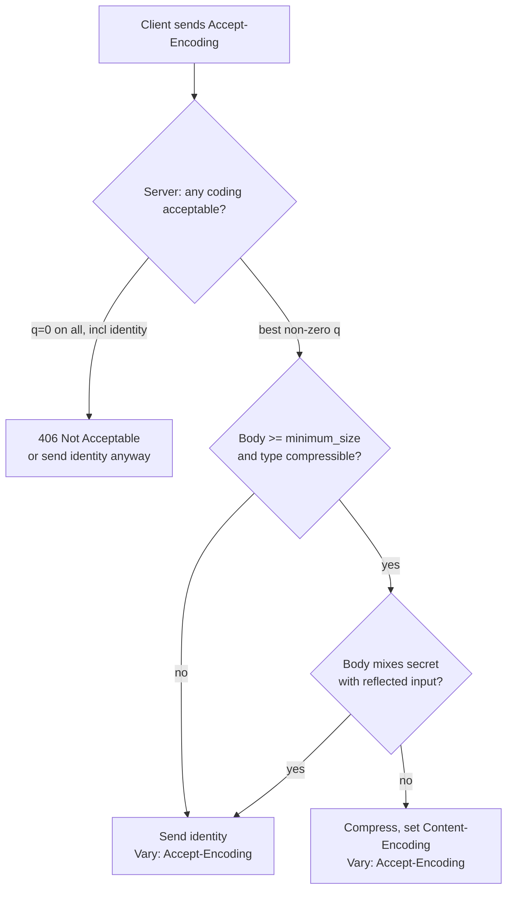

# HTTP Content-Encoding: Gzip, Brotli, Zstandard, Streaming Compression, and BREACH Mitigations

> [!summary] Claim
> `Content-Encoding` is an end-to-end property of the representation negotiated through `Accept-Encoding` q-values, and compressing attacker-influenced responses that also carry a secret leaks that secret through response size, so you choose the codec for ratio and CPU but you gate compression on the trust boundary.

Part of [HTTP Semantics and Wire Protocols](README.md) in [API Engineering](../README.md).

## TL;DR

- `Content-Encoding` lists the codings applied to a representation in application order, and the recipient decodes them to recover the media type (RFC 9110 Section 8.4).
- The contract rule: a server picks a coding by evaluating `Accept-Encoding` q-values, where `q=0` means "not acceptable" and `identity` stays acceptable by default unless `identity;q=0` or `*;q=0` excludes it (RFC 9110 Section 12.5.3).
- The trap: enabling compression on a response that reflects attacker input next to a secret turns response length into an oracle for that secret, which is the BREACH attack (CVE-2013-3587).
- Portability fact: the stdlib `zstd` binding (`compression.zstd`) only exists on CPython 3.14+ and only when CPython was built with libzstd (PEP 784), so a zstd code path must degrade on 3.12 and 3.13, while `gzip` and `brotli` work everywhere.
- Do not compress a response whose body mixes a secret with request-controlled data, and do not decompress an untrusted body without a hard output cap.

## Mental model



The server never compresses blindly: it first resolves the `Accept-Encoding` preference into one coding, then checks the response is worth compressing, and only then checks the security precondition that the body does not mix a secret with attacker-controlled text.
When the client excludes every coding including `identity`, the server either answers `406 Not Acceptable` (RFC 9110 Section 15.5.7) or sends a default representation anyway (RFC 9110 Section 12.1); `415` is for a request body in an unsupported coding, not for a failed response negotiation.
An origin server SHOULD send `Vary: Accept-Encoding` on a cacheable response whose representation depends on the negotiated coding, because a shared cache that does not key on it can serve a gzip body to a client that only accepts `identity` (RFC 9110 Section 12.5.5 and Section 8.8.3.3).

## How it works

A content coding is a transformation applied to a representation that preserves the underlying media type (RFC 9110 Section 8.4.1).
The sender that applies codings `MUST` list them in `Content-Encoding` in the order applied, and the coding `identity` is reserved for `Accept-Encoding` and `SHOULD NOT` appear in `Content-Encoding` (RFC 9110 Section 8.4).
Unlike `Transfer-Encoding`, which applies only during message transfer, content codings are a characteristic of the representation itself, so a gzip body and its unencoded form are distinct representations with distinct strong `ETag` values (RFC 9110 Section 8.4 and Section 8.8.3.3).

The registered codings differ in wire structure.
`gzip` is an LZ77 coding with a 32-bit CRC produced by the gzip program (RFC 9110 Section 8.4.1.3); a gzip body is a series of members (RFC 1952 Section 2.2), and each member starts with `ID1=31` (`0x1f`), `ID2=139` (`0x8b`), and `CM=8` for deflate, carries a 4-byte `MTIME`, and ends with an 8-byte trailer of `CRC32` then `ISIZE` modulo `2^32` (RFC 1952 Section 2.3 and Section 2.3.1).
`deflate` is the zlib data format of RFC 1950 wrapping a raw DEFLATE stream, and the RFC explicitly notes that some non-conformant implementations send raw DEFLATE without the zlib wrapper (RFC 9110 Section 8.4.1.2).
`br` is Brotli, LZ77 plus Huffman coding plus context modeling and a 122,784-byte static dictionary, with a sliding window from `1 KiB - 16 B` to `16 MiB - 16 B` and `WBITS` from 10 to 24; critically it has no magic number, its stream header carries only the `WBITS` field (RFC 7932 Section 2 and Section 9.1).
`zstd` frames begin with the little-endian magic `0xFD2FB528` (RFC 8878 Section 3.1.1), a body may concatenate several frames (RFC 8878 Section 3.1), and for HTTP the decoder `MUST` support a `Window_Size` up to and including 8 MB while encoders `MUST NOT` exceed it (RFC 9659 Section 3), tightening the mere recommendation in RFC 8878 Section 3.1.1.1.2 into a requirement.

Because `br` has no magic number, a receiver cannot sniff the coding from the bytes, which is exactly why `Content-Encoding` is mandatory metadata rather than something inferred.
The lab makes this concrete: `detect_coding` recognizes gzip and zstd from their magic prefixes but returns `None` for brotli.

Server-side, Starlette chooses gzip when the request's `Accept-Encoding` contains the substring `gzip` (starlette 1.10.0 starlette/middleware/gzip.py, `GZipMiddleware.__call__`), then compresses only when the body reaches `minimum_size` (default 500 bytes) and the content type is not in `DEFAULT_EXCLUDED_CONTENT_TYPES`; it adds `Vary: Accept-Encoding` and, for a streaming body, drops `Content-Length` because the final size is unknown until the stream ends (starlette 1.10.0 starlette/middleware/gzip.py, `IdentityResponder.send_with_compression`).
The substring test ignores q-values: the lab's `test_starlette_gzip_middleware_ignores_q_zero` shows Starlette 1.10.0 still gzips a response to `Accept-Encoding: gzip;q=0`, which RFC 9110 Section 12.5.3 Rule 3 defines as "not acceptable", so when clients may send `q=0` a q-value-aware negotiator such as `negotiate_content_coding` must replace or bypass the middleware, not sit inside it.
A route behind `GZipMiddleware` that negotiates `identity` still gets gzipped, because the middleware sees `gzip` in the header and an uncompressed body over `minimum_size`; the lab therefore attaches `GZipMiddleware` per route (`Route(..., middleware=[...])`) and leaves `/download` outside it, and `test_asgi_download_honors_gzip_q_zero` checks that `/download` answers `gzip;q=0` with no `Content-Encoding`.
Streaming compression flushes each chunk with `Z_SYNC_FLUSH` so the client receives data incrementally (starlette 1.10.0 starlette/middleware/gzip.py, `GZipResponder._compress_body`), which the lab mirrors in `GzipStreamCompressor`.
In HTTP/2 the `chunked` transfer coding cannot be used (RFC 9113 Section 8.1) and in HTTP/3 transfer codings are not defined at all (RFC 9114 Section 4.1), but `Content-Encoding` is unchanged because it lives above framing: it is message semantics, so it survives every wire serialization.

## Numbers and limits

| Quantity | Value | Source |
|---|---|---|
| gzip member magic and method | `0x1f 0x8b 0x08` (`ID1 ID2 CM`) | RFC 1952 Section 2.3.1 |
| gzip fixed trailer | 8 bytes: `CRC32` then `ISIZE mod 2^32` | RFC 1952 Section 2.3 and Section 2.3.1 |
| zstd frame magic | `0xFD2FB528` little-endian | RFC 8878 Section 3.1.1 |
| zstd HTTP decoder window ceiling | 8 MB (`MUST` support, `MUST NOT` exceed) | RFC 9659 Section 3 |
| brotli static dictionary | 122,784 bytes | RFC 7932 Section 8 and Appendix A |
| brotli window range | `1 KiB - 16 B` to `16 MiB - 16 B`, `WBITS` 10-24 | RFC 7932 Section 2 and Section 9.1 |
| brotli magic number | none; header is `WBITS` only | RFC 7932 Section 9.1 |
| `dcb` (dictionary brotli) header | 36 bytes: 4 magic + 32 SHA-256 | RFC 9842 Section 4 |
| `dcz` (dictionary zstd) header | 40 bytes: 8 magic + 32 SHA-256 | RFC 9842 Section 5 |
| qvalue range | 0 through 1, max 3 decimal digits, `q=0` = not acceptable | RFC 9110 Section 12.4.2 |
| empty-body encoded size, measured | gzip 20 B, br 1 B, zstd 9 B | lab, `test_empty_body_encoded_sizes` |
| ratio on the 139,790 B `demo_json_payload()`, measured | gzip-9 13.3x, br-11 31.9x, zstd-3 34.0x, zstd-19 34.1x | lab, see below |
| best encode time on same payload, measured | zstd-3 0.06-0.07 ms, gzip-9 1.0-1.1 ms, br-11 117-118 ms, zstd-19 139-145 ms | lab, see below |

Measured rows come from `measure_codecs(demo_json_payload(), repeats=5)` run as `uv run --frozen python -c "from api_labs.f01_http_semantics_and_wire_protocols.compression import demo_json_payload, measure_codecs; print(measure_codecs(demo_json_payload()))"` from `labs/`, four times, on macOS 27.2 (Darwin 27.2.0) arm64 with CPython 3.14.6 from uv, `zlib` 1.2.12, `brotli` 1.2.1, and `zstd` 1.5.7 (as of 2026-11); sizes were identical across runs and the table gives the range of best-of-5 times.
The payload is a synthetic 2000-row JSON object that is deliberately repetitive, so ratios are high; the ordering of the codecs, not the absolute ratios, is the transferable result.
The headline is the cost asymmetry: `br-11` costs roughly 100x the encode time of `gzip-9` and on this payload is still larger than `zstd-3`, which is both the fastest setting and within 0.4 percent of `zstd-19`, so the top levels (`br-11`, `zstd-19`) belong offline on static assets and dynamic responses lean on `zstd-3` or low-level gzip online; measure on your own bodies before picking, because brotli and zstd trade places across payload types.

## Portability

Every row ran the same test module with the dependencies pinned to `labs/uv.lock` (`starlette` 1.10.0, `httpx` 0.28.1, `brotli` 1.2.1, `h2` 4.4.1, `pytest` 9.2.0, `pytest-asyncio` 1.4.1.post1) in a fresh environment per interpreter, on 2026-11-08.

| Environment | CPython | zlib | Result | zstd path |
|---|---|---|---|---|
| macOS 27.2 arm64, uv | 3.12.13 | system | 52 passed | gated off |
| macOS 27.2 arm64, Homebrew | 3.13.18 | system | 52 passed | gated off |
| macOS 27.2 arm64, uv (workspace `.venv`) | 3.14.6 | system | 57 passed | stdlib |
| macOS 27.2 arm64, Homebrew | 3.14.10 | system | 57 passed | stdlib |
| macOS 27.2 arm64, Homebrew | 3.15.2 | system | 57 passed | stdlib |
| macOS 27.2 arm64, uv | 3.15.0b3 | system | 56 passed | stdlib |
| macOS 27.2 arm64, uv, free-threaded | 3.15.0b3t | system | 56 passed, 1 `RuntimeWarning` | stdlib |
| macOS 27.2 arm64, uv, free-threaded | 3.14.6t | system | 56 passed, 1 `RuntimeWarning` | stdlib |
| Docker `python:3.12-slim-trixie` (Debian 13, glibc 2.41, aarch64) | 3.12.16 | 1.3.1 | 51 passed | gated off |
| Docker `python:3.12-alpine` (Alpine 3.24.4, musl) | 3.12.16 | 1.3.2 | 51 passed | gated off |
| Docker `python:3.13-trixie` (glibc 2.41) | 3.13.18 | 1.3.1 | 51 passed | gated off |
| Docker `python:3.14-slim-trixie` (glibc 2.41) | 3.14.10 | 1.3.1 | 56 passed | stdlib |
| Docker `python:3.14-alpine` (musl) | 3.14.10 | 1.3.2 | 56 passed | stdlib |
| Docker `python:3.15-slim-trixie` (glibc 2.41) | 3.15.2 | 1.3.1 | 56 passed | stdlib |

The 3.12.13, 3.13.18, 3.14.6, 3.14.10, and 3.15.2 macOS rows were rerun on 2026-11-09 after `test_asgi_download_honors_gzip_q_zero` was added; the 3.15.0b3, free-threaded, and Docker rows are from the 2026-11-08 run, which predates that test and so counts one fewer.

| Behavior | Result | Proof |
|---|---|---|
| encoded sizes on `demo_json_payload()` | gzip-9 10,542 B, br-11 4,385 B on every interpreter and container, across zlib 1.2.12, 1.3.1, and 1.3.2; zstd-3 4,109 B and zstd-19 4,096 B on 3.14+ | `measure_codecs`, run in every container above |
| `compress("zstd", ...)` on 3.12 and 3.13 | raises `RuntimeError`; `server_codings()` omits `zstd`; the five zstd-parametrized cases are not generated, so nothing is skipped | PEP 784 adds `compression.zstd` in 3.14; `test_zstd_codec_is_gated_on_stdlib_binding` |
| free-threaded build | all tests pass; importing `_brotli` re-enables the GIL with a `RuntimeWarning`, a correctness-preserving fallback | 3.15.0b3t and 3.14.6t runs above |
| HTTP/1.1 | `Content-Encoding` and `Vary` set by the ASGI app; `Transfer-Encoding: chunked` delimits a streamed body | `test_asgi_download_negotiates_best_available_coding`; RFC 9110 Section 8.4 |
| HTTP/2 | `Content-Encoding: gzip` and `Vary` reach the client unchanged and the body decodes; `h2` 4.4.1 drops a `Transfer-Encoding` header before encoding | `test_http2_carries_content_encoding_and_strips_transfer_encoding`; RFC 9113 Section 8.2.2 |
| HTTP/3 over QUIC | `Content-Encoding` is unchanged and `Transfer-Encoding` MUST NOT be used; specification only, no QUIC run | RFC 9114 Section 4.1 |
| Uvicorn 0.54.0, Hypercorn 0.18.0, Granian 2.8.7 | ship no response-compression code (no content-coding implementation in the installed packages), so compression comes from application middleware such as `GZipMiddleware` | search of the installed packages in `labs/.venv` |

Not run: free-threaded 3.15.2t (not installed here and not offered by `uv python list`; 3.15.0b3t and 3.14.6t ran instead) and an HTTP/3 request over a real QUIC connection.
`Content-Encoding` is representation metadata, so `br` and `zstd` negotiate identically across all three HTTP versions (RFC 9110 Section 8.4); only the delimiting of a streamed body differs (RFC 9113 Section 8.1, RFC 9114 Section 4.1).

## Worked example

The implementation is [implementation](../labs/src/api_labs/f01_http_semantics_and_wire_protocols/compression.py) and the test is [test](../labs/tests/f01_http_semantics_and_wire_protocols/test_http_compression_gzip_brotli_zstandard_and_breach.py).

Negotiation implements the three acceptability rules of RFC 9110 Section 12.5.3, including the subtle Rule 2 that `identity` survives by default; it does not weigh an explicit `identity` qvalue against the codings, which the RFC leaves to the server:

```python
def negotiate_content_coding(
    accept_encoding: str | None,
    available: Sequence[str],
) -> str | None:
    """Select a content coding for a response per RFC 9110 Section 12.5.3.

    *available* lists the server's codings most-preferred first, excluding
    ``identity`` (always implicitly available).  Returns the chosen coding, or
    ``"identity"`` when the client wants no coding, or ``None`` when the client
    forbade every option including identity (caller answers ``406``, RFC 9110
    Section 15.5.7, or sends identity anyway).
    """
    # Rule 1: no field present means any coding is acceptable; take our first.
    if accept_encoding is None:
        return available[0] if available else "identity"

    prefs = _parse_accept_encoding(accept_encoding)

    # An empty field value means the user agent wants no content coding at all.
    if not prefs:
        return "identity"

    star = prefs.get("*")

    def acceptable(coding: str) -> float | None:
        """Return the effective qvalue for *coding*, or None if unacceptable."""
        if coding in prefs:
            q = prefs[coding]
        elif star is not None:
            q = star
        else:
            return None
        return None if q == 0.0 else q

    # Rank available codings by qvalue, breaking ties by server preference order.
    best: str | None = None
    best_q = 0.0
    for coding in available:
        q = acceptable(coding)
        if q is None:
            continue
        if best is None or q > best_q:
            best, best_q = coding, q

    if best is not None:
        return best

    # No non-identity coding is acceptable.  RFC 9110 Section 12.5.3 Rule 2:
    # identity (no coding) is acceptable by default unless excluded by
    # "identity;q=0", or by "*;q=0" with no more-specific entry for identity.
    if "identity" in prefs:
        identity_ok = prefs["identity"] != 0.0
    elif star is not None:
        identity_ok = star != 0.0
    else:
        identity_ok = True
    return "identity" if identity_ok else None
```

The decompression guard is the fix missing from the 2025 CVEs, capping output so a bomb cannot force one giant allocation, and refusing a truncated body rather than returning partial output; the gzip path decodes every member against one shared budget:

```python
def decompress_bounded(coding: str, data: bytes, *, max_output: int) -> bytes:
    """Decompress with a hard output cap, raising past *max_output* bytes.

    This is the guard missing from the streaming paths behind CVE-2025-66471
    (urllib3) and CVE-2025-69223 (aiohttp): a small, highly compressible input
    must never be allowed to allocate unbounded output.  Every decoder call gets
    an output limit of the remaining budget plus one byte, so memory stays
    O(max_output).  A body that ends before its final gzip member, brotli
    meta-block, or zstd frame raises :class:`TruncatedStreamError` instead of
    returning partial output, and a zstd frame whose window exceeds the 8 MB
    HTTP ceiling (RFC 9659 Section 3) is rejected before decoding.
    """
    if max_output < 0:
        raise ValueError("max_output must be non-negative")
    if coding == "identity":
        if len(data) > max_output:
            raise DecompressionLimitExceeded(f"{len(data)} > {max_output}")
        return data
    if coding == "gzip":
        return _decompress_bounded_gzip(data, max_output)
    if coding == "br":
        return _decompress_bounded_brotli(data, max_output)
    if coding == "zstd":
        return _decompress_bounded_zstd(data, max_output)
    raise ValueError(f"unsupported content coding: {coding!r}")


def _check_budget(out: bytearray, max_output: int) -> None:
    if len(out) > max_output:
        raise DecompressionLimitExceeded(f"exceeded {max_output} bytes")


def _decompress_bounded_gzip(data: bytes, max_output: int) -> bytes:
    # A gzip body is a series of members (RFC 1952 Section 2.2); decode each one.
    # max_length is never 0 here (0 would mean "unlimited" to zlib): the budget
    # check raises before the remaining budget can reach zero.
    out = bytearray()
    remaining = data
    while True:
        decoder = zlib.decompressobj(zlib.MAX_WBITS | 16)
        out += decoder.decompress(remaining, max_output + 1 - len(out))
        _check_budget(out, max_output)
        if not decoder.eof:
            raise TruncatedStreamError("gzip member ends before its trailer")
        remaining = decoder.unused_data
        if not remaining:
            return bytes(out)
```

The BREACH distinguisher shows the mechanism in one guessing step: the guess that extends the anchor with the secret's true next byte compresses smallest:

```python
def breach_distinguisher(
    secret: str,
    candidates: Iterable[str],
    *,
    anchor: str = 'csrf_token" value="',
    oracle: Callable[[bytes], int] | None = None,
) -> str:
    """Return the candidate prefix the compression length oracle ranks likeliest.

    This demonstrates the BREACH side channel in a single guessing step: a guess
    that extends *anchor* with the secret's true leading bytes back-references
    more of the reflected secret, so its DEFLATE output is the smallest.  It is a
    teaching distinguisher, not an extraction tool: it ranks caller-supplied
    candidates against a known *secret* and does no probing of its own.
    """
    size = oracle if oracle is not None else _deflate_size
    best: str | None = None
    best_size = 0
    for candidate in candidates:
        body = reflected_page(anchor + candidate, secret)
        length = size(body)
        if best is None or length < best_size:
            best, best_size = candidate, length
    if best is None:
        raise ValueError("candidates must be non-empty")
    return best
```

Running the test module from `labs/` on CPython 3.14.6, macOS 27.2 (Darwin 27.2.0) arm64:

```text
$ uv run --frozen pytest tests/f01_http_semantics_and_wire_protocols/test_http_compression_gzip_brotli_zstandard_and_breach.py -q
.........................................................                [100%]
57 passed in 0.74s
```

## Pitfalls

> [!warning] Compressing a secret next to reflected input leaks it (BREACH)
> Trigger: HTTP compression is on, a response reflects request-controlled data, and the same response carries a secret such as a CSRF token (breachattack.com; RFC 7457 Section 2.6).
> Symptom: an attacker who can make many requests and observe response sizes recovers the secret byte by byte, because a correct partial guess back-references the reflected secret and shrinks the compressed body (CVE-2013-3587).
> Fix: separate secrets from user input, randomize or mask secrets per request, and disable compression for responses that mix the two; the lab proves a fresh per-request mask changes the reflected bytes on every response, so the length signal has nothing stable to lock onto.

> [!warning] Decompressing an untrusted body without an output cap is a bomb
> Trigger: a server or client auto-decompresses a request or response from an untrusted peer with no limit on decoded size (CWE-409).
> Symptom: a small, highly compressible payload expands to exhaust CPU and memory; urllib3's streaming API decoded a whole bomb despite a small requested chunk (CVE-2025-66471, affected `>= 1.0, < 2.6.0`, fixed in 2.6.0), and aiohttp's `auto_decompress` had the same flaw server-side (CVE-2025-69223, affected `<= 3.13.2`, fixed in 3.13.3).
> Fix: decode with a hard output budget and abort when crossed, as `decompress_bounded` does; never trust a declared `ISIZE` or `Frame_Content_Size` as the allocation size.

> [!warning] Missing Vary: Accept-Encoding corrupts shared caches
> Trigger: a resource varies its representation by negotiated coding but omits `Vary: Accept-Encoding` (RFC 9110 Section 12.5.5).
> Symptom: a shared cache stores a gzip body and later serves it to a client that sent only `identity`, which cannot decode it.
> Fix: always emit `Vary: Accept-Encoding` on negotiated responses and give the encoded representation a distinct strong `ETag` from the unencoded one (RFC 9110 Section 8.8.3.3).

## Security and robustness

The threat model has two sides, and both reduce to "do not mix trust domains across a compressor."
Reading direction (BREACH): compressing a response that mixes a secret with attacker-influenced data makes response length a side channel for the secret, and the mitigations breachattack.com lists in order of effectiveness begin with disabling compression on that response, separating secrets from input, randomizing secrets per request, and masking secrets with a fresh per-request pad.
This vault classifies it under OWASP API Security `API8:2023 Security Misconfiguration`, since enabling compression globally without regard to response content is a misconfiguration (the OWASP entry does not name compression itself), and the newer dictionary codings `dcb` and `dcz` extend the same hazard: compressing secret data against a public dictionary still leaks it, so RFC 9842 Section 9.2 warns against compressing data from mixed sources, dictionaries included, and Section 9.3 requires clients to drop a response that fails its same-origin and readability checks and gives servers a `Sec-Fetch-Site` and `Sec-Fetch-Mode` test for when to avoid dictionary compression.

Writing direction (decompression bombs): accepting a compressed body from an untrusted peer and decoding it without bound is a classic data-amplification denial of service (CWE-409), realized in advisories published in December 2025 (urllib3) and January 2026 (aiohttp).
Defense in depth means a size cap on the decoder, a cap on the number of chained codings, a window-size ceiling, and refusing truncated bodies; RFC 9659 Section 3 fixes the zstd window at 8 MB for interoperability and Section 4 reminds decoders to fail frames that ignore that limit, which lets a decoder bound window memory before allocating (the lab passes `window_log_max=23` to `ZstdDecompressor`), and RFC 8878 Section 8 warns about a `Frame_Content_Size` smaller than the real output and recommends fuzz-testing decoders.
Input validation also means refusing a request body in a coding you do not support with `415 Unsupported Media Type` plus an `Accept-Encoding` header (RFC 9110 Section 8.4, Section 12.5.3, and Section 15.5.16), and answering a response negotiation that excludes every coding including `identity` with `406 Not Acceptable` (RFC 9110 Section 15.5.7), rather than silently mis-decoding.

## The principal's view

The staff-plus decision is where compression runs and what it is allowed to touch, not which algorithm wins a ratio benchmark.
Pre-compress static assets at the top levels (`br-11` or `zstd-19`) offline because their encode cost, about 100x that of `gzip-9` in the lab, is paid once and amortized over every download; serve dynamic responses with `zstd-3` or low-level gzip online because tail latency, not ratio, governs an interactive API, and `br-11` online would blow the latency budget.
Terminate compression at the edge (CDN or gateway) for cacheable public bodies so origins stay simple, but keep compression off at the edge for any response that carries per-user secrets, because the edge cannot see the trust boundary the application knows about.
The organizational trade-off is that a single global "enable gzip" switch is operationally cheap and a latent BREACH vulnerability, so the mature posture is compression-by-content-class: on for public, cacheable, secret-free bodies, off or masked for authenticated responses that reflect input.
Choose a different tool when the payload is already compressed (images, video, `application/zip`), where another pass wastes CPU for no gain, which is why Starlette excludes those media types by default (starlette 1.10.0 starlette/middleware/gzip.py, `DEFAULT_EXCLUDED_CONTENT_TYPES`).

## Interview questions

> [!question] L5: What does `Content-Encoding: gzip` tell a recipient, and how does it differ from `Transfer-Encoding: gzip`?
>
> > [!success]- Answer
> > `Content-Encoding` says the representation itself was gzip-coded and must be decoded to recover the media type, and it is end-to-end metadata that survives caching and every HTTP version (RFC 9110 Section 8.4).
> > `Transfer-Encoding` is a hop-by-hop property of one message transfer that does not change the representation, and it is a connection-specific field that HTTP/2 forbids and HTTP/3 does not define (RFC 9113 Section 8.2.2, RFC 9114 Section 4.1).
> > A gzip-encoded body is a distinct representation with its own strong `ETag`.
> >
> > Follow-up: Why must the encoded representation carry a different strong `ETag` from the unencoded one?

> [!question] L5: A client sends `Accept-Encoding: br;q=0, gzip`. The server supports `br` and `gzip`. What coding does it pick and why?
>
> > [!success]- Answer
> > It picks `gzip`, because `br;q=0` marks brotli as not acceptable and `gzip` has an implied `q=1` (RFC 9110 Section 12.5.3).
> > A qvalue of 0 always means "not acceptable", never "least preferred".
> >
> > Follow-up: What would it pick for `Accept-Encoding: br;q=0` with no `gzip` listed?

> [!question] L6: Explain the BREACH attack and the single strongest mitigation.
>
> > [!success]- Answer
> > BREACH exploits HTTP response compression when a response reflects attacker-controlled input next to a secret like a CSRF token (breachattack.com, CVE-2013-3587).
> > A guessed prefix that matches the secret compresses the response slightly smaller because DEFLATE back-references the repeated bytes, so response length leaks the secret one byte at a time.
> > The strongest mitigation is to not compress that response at all; weaker but useful ones are separating secrets from input, randomizing the secret per request, and masking it with a fresh per-request pad (breachattack.com orders them by effectiveness, and RFC 7457 Section 2.6 notes there is no TLS-level fix, so CSRF tokens need randomizing).
> >
> > Follow-up: TLS encrypts the body, so why does compression still leak the secret?

> [!question] L6: Why does a streaming compressed response drop `Content-Length`, and what replaces it on the wire?
>
> > [!success]- Answer
> > The final compressed size is unknown until the stream ends, so the server cannot set `Content-Length` up front (starlette 1.10.0 starlette/middleware/gzip.py, `IdentityResponder.send_with_compression`).
> > On HTTP/1.1 the body is delimited by `chunked` transfer coding; on HTTP/2 and HTTP/3 it is delimited by the end of the stream, since those protocols have no `chunked` coding (RFC 9113 Section 8.1, RFC 9114 Section 4.1).
> > Each chunk is flushed with `Z_SYNC_FLUSH` so the client can decode incrementally.
> >
> > Follow-up: How does a client know the body is complete and not truncated?

> [!question] L6: Why can a receiver sniff a gzip or zstd stream from its bytes but not a brotli stream?
>
> > [!success]- Answer
> > gzip starts with the magic `0x1f 0x8b 0x08` and zstd with `0xFD2FB528`, so a decoder can recognize them (RFC 1952 Section 2.3.1, RFC 8878 Section 3.1.1).
> > Brotli has no magic number; its stream header carries only the `WBITS` window field (RFC 7932 Section 9.1).
> > This is why `Content-Encoding` is mandatory metadata rather than something inferred from the payload.
> >
> > Follow-up: What breaks if a proxy guesses the coding wrong?

> [!question] L6: Predict the output. A module does `from compression import zstd` at import time on CPython 3.13, then calls `compress("zstd", b"data")`. What happens, and how should the module be written instead?
>
> > [!success]- Answer
> > On 3.13 the import raises `ModuleNotFoundError: No module named 'compression'`, because `compression.zstd` was added in 3.14 by PEP 784, so the whole module fails to import and every codec including gzip becomes unusable.
> > The fix is to import `compression.zstd` inside a `try`/`except ModuleNotFoundError`, set a `HAS_STDLIB_ZSTD` flag, advertise `zstd` only when present, and raise a clear error from the zstd path otherwise.
> > The lab does exactly this and passes all 52 tests it generates on 3.13.18 (57 on 3.14+): the five zstd-parametrized cases are not generated, and the two gate tests assert the `RuntimeError` branch.
> >
> > Follow-up: Why is gating on a capability flag better than catching the error at each call site?

> [!question] L7+: Debug this API. A team reports that after enabling gzip on their authenticated JSON API, a security audit flags token theft, yet the tokens are random and TLS is on. What is happening and how do you fix it without disabling compression everywhere?
>
> > [!success]- Answer
> > The responses reflect a request parameter (a search term or filter) in the same body that contains a per-user token, so compression length leaks the token via BREACH despite TLS, because TLS does not hide ciphertext length (CVE-2013-3587).
> > Confirm by checking whether the vulnerable endpoints echo request input alongside the secret, then mask the token with a fresh per-request pad or move it out of the reflecting response, and disable compression specifically on endpoints that mix secret and input.
> > Keep compression on for public, cacheable, secret-free responses, which is the compression-by-content-class posture.
> >
> > Follow-up: How would you detect which endpoints are vulnerable across a large API automatically?

> [!question] L7+: Your gateway auto-decompresses incoming request bodies. How do you prevent a decompression-bomb denial of service?
>
> > [!success]- Answer
> > Decode with a hard output budget and abort as soon as decoded bytes cross it, never trusting the declared `ISIZE` or `Frame_Content_Size` as an allocation size (CWE-409, CVE-2025-66471, CVE-2025-69223).
> > Also cap the number of chained content codings and enforce a window-size ceiling such as the 8 MB zstd HTTP limit so memory is bounded before allocation (RFC 9659 Section 3).
> > The lab's `decompress_bounded` keeps memory `O(max_output)` by capping bytes produced per decode call, counts every gzip member and zstd frame against one budget, rejects truncated bodies, and refuses zstd windows over 8 MB.
> >
> > Follow-up: Why is capping per-call output better than checking total size only after decoding finishes?

## Related

Prerequisites: [[Content-Negotiation-Media-Types-and-Charsets]]

Next: [[Range-Requests-Partial-Content-and-206-Semantics]]

See also: [[HPACK-Header-Compression-and-Dynamic-Table-Security]], [[HTTP-1-1-Framing-Keep-Alive-and-Chunked-Encoding]], [[HTTP-Message-Abstraction-RFC-9110]], [[Structured-Field-Values-for-HTTP-RFC-9651]]

- Lab: `labs/tests/f01_http_semantics_and_wire_protocols/test_http_compression_gzip_brotli_zstandard_and_breach.py`

## Further reading

- RFC 9110 Section 8.4 and Section 12.5.3: the normative definition of `Content-Encoding`, content codings, and `Accept-Encoding` q-value negotiation.
- RFC 1952: the gzip file format down to the byte-level member header and trailer.
- RFC 7932: the Brotli format, its static dictionary, window range, and the fact that it has no magic number.
- RFC 8878 and RFC 9659: the Zstandard format and the HTTP 8 MB window requirement that bounds decoder memory.
- RFC 9842: Compression Dictionary Transport (`dcb` and `dcz`) and its security model for mixed-source compression.
- breachattack.com and RFC 7457 Section 2.6: the BREACH attack, its preconditions, and the ordered mitigations.
- GitHub advisories GHSA-2xpw-w6gg-jr37 (CVE-2025-66471) and GHSA-6mq8-rvhq-8wgg (CVE-2025-69223): real decompression-bomb flaws in urllib3 and aiohttp.
- PEP 784: the addition of `compression.zstd` to the standard library in CPython 3.14.
