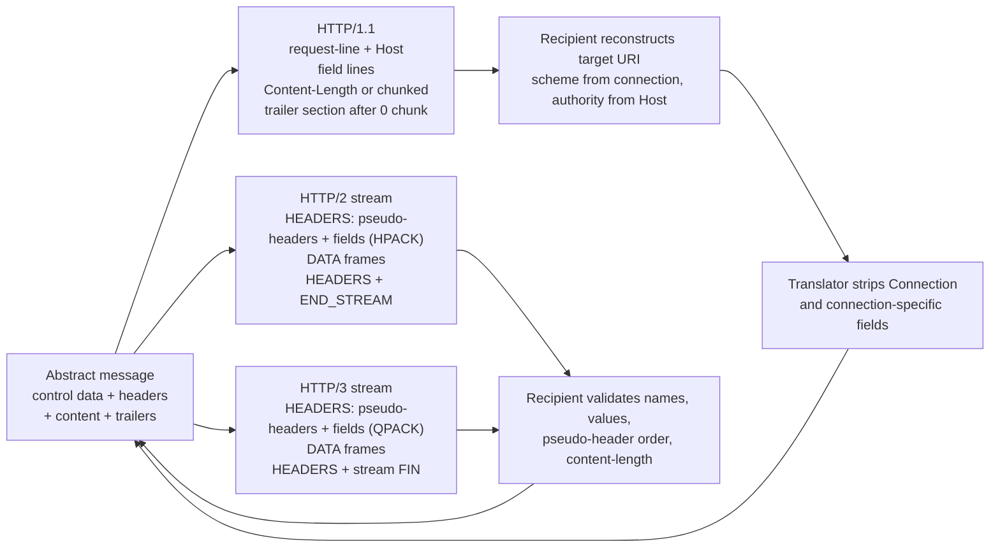

# The HTTP Message Abstraction: Control Data, Headers, Content, and Trailers (RFC 9110)

> [!summary] Claim
> An HTTP message is four parts - control data, a header table, a content stream, and a trailer table - and every HTTP version is only a serialization of those parts, so any byte that one version can carry but the abstraction cannot (a reason phrase, a `Connection` option, a CR in a field value, a duplicate `:path`) is exactly where translating intermediaries break.

Part of [HTTP Semantics and Wire Protocols](README.md) in [API Engineering](../README.md).

## TL;DR

- Mechanism: RFC 9110 Section 6 defines a message as control data, a headers lookup table, potentially unbounded content, and a trailers lookup table; HTTP/1.1, HTTP/2, and HTTP/3 each serialize those four parts with different framing.
- Contract rule: control data travels as the start line plus `Host` in HTTP/1.1 and as `:method`, `:scheme`, `:authority`, `:path`, or `:status` pseudo-header fields in HTTP/2 and HTTP/3 (RFC 9110 Section 6.2, RFC 9113 Section 8.3).
- The trap: hop-by-hop fields, the reason phrase, and framing fields such as `Content-Length` and `Transfer-Encoding` are not end-to-end semantics, and a version translator that copies them or skips field validation creates request smuggling.
- Portability fact: the lab round-trips one abstract exchange through h11 0.16.0, h2 4.4.1, and aioquic 1.7.2 framing with identical semantics on CPython 3.12.13, 3.13.18, 3.14.6, 3.14.10, 3.15.2, and 3.15.0b3; free-threaded 3.15.0b3t could not run because aioquic 1.7.2 failed to build there.
- When not to use it: do not model an API on fields the abstraction does not guarantee end to end, such as trailers (often discarded, RFC 9110 Section 6.5.1) or reason phrases (RFC 9112 Section 4).

## Mental model



The abstract message sits in the middle and is the only thing an application should see.
Each arrow out of it is a serializer: HTTP/1.1 writes control data as text on the first line and needs `Host` for the authority, while HTTP/2 and HTTP/3 write control data as pseudo-header fields at the front of a compressed HEADERS block.
Content follows as a length-delimited or chunked body in HTTP/1.1 and as DATA frames in HTTP/2 and HTTP/3, and trailers are either the chunked trailer section or a final HEADERS block that ends the stream.
The arrows back into the abstraction are where the work is: an HTTP/1.1 recipient must reconstruct the target URI from connection context, a translator must drop `Connection` and every field it names, and an HTTP/2 or HTTP/3 recipient must reject anything that the binary framing can carry but the abstraction forbids.

## How it works

### The four parts

RFC 9110 Section 6 states that a message consists of control data, a headers lookup table of name/value pairs, a potentially unbounded stream of content, and a trailers lookup table, and that this abstraction exists so "a message in one version can be relayed through other versions without changing its meaning."
The order is fixed on every wire: framing and control data, then the header section, then content, then an optional trailer section.

### Control data

Request control data is the method, the request target, and the protocol version; response control data is the status code, an optional reason phrase, and the protocol version (RFC 9110 Section 6.2).
In HTTP/1.1 it is the request-line or status-line; in HTTP/2 and HTTP/3 it is pseudo-header fields with a `:` prefix.
The target URI is never sent whole in HTTP/1.1 origin-form: the server reconstructs it, taking the scheme from its configuration or from whether the connection is secured, the authority from `Host`, and the path and query from the request-target (RFC 9112 Section 3.3).
With an absolute-form target, the server MUST ignore `Host` and use the authority in the target (RFC 9112 Section 3.2.2).
HTTP/2 carries all four components as `:method`, `:scheme`, `:authority`, and `:path`; all pseudo-headers come before regular fields, none may repeat, and a recipient MUST NOT use `Host` to determine the target URI when `:authority` is present (RFC 9113 Sections 8.3 and 8.3.1).
HTTP/3 uses the same pseudo-headers and adds that a request with an `http` or `https` scheme needs `:authority` or `Host`, which must match if both appear (RFC 9114 Section 4.3.1).
The protocol version is implicit in HTTP/2 and HTTP/3, and neither version has any place for a reason phrase (RFC 9113 Section 8.3.2, RFC 9114 Section 4.3.2).
That is why RFC 9112 Section 4 tells clients to ignore the reason phrase: it is "discarded when the message is forwarded via other versions of HTTP."

### Header and trailer tables

Field names are case-insensitive tokens (RFC 9110 Section 5.1).
Repeated field lines with one name combine into one value by joining with a comma in order, so the order of same-name lines is significant but the order across different names is not (RFC 9110 Sections 5.2 and 5.3).
`Set-Cookie` is the documented exception: it cannot be combined and recipients handle it as a special case (RFC 9110 Section 5.3).
`Cookie` in HTTP/2 and HTTP/3 may be split into crumbs for compression and MUST be rejoined with `"; "` before passing to an HTTP/1.1 or generic context (RFC 9113 Section 8.2.3, RFC 9114 Section 4.2.1).
Field values have no leading or trailing whitespace, and CR, LF, or NUL in a value is "invalid and dangerous": a recipient MUST reject the message or replace them with SP (RFC 9110 Section 5.5).
HTTP/2 and HTTP/3 are stricter on the wire: field names MUST be lowercase, and a message containing an uppercase name, a CR, LF, or NUL in a value, or a value with surrounding whitespace is malformed (RFC 9113 Sections 8.2 and 8.2.1, RFC 9114 Sections 4.2 and 10.3).
Trailers are processed and stored separately from headers, because decisions already made from the header section cannot be unmade; a recipient MUST NOT merge a trailer into the headers unless that field's definition allows it (RFC 9110 Section 6.5, RFC 9112 Section 7.1.2).

### Hop-by-hop versus end-to-end

`Connection` lists control options for the current connection only; an intermediary MUST remove every field named in `Connection`, then `Connection` itself, and SHOULD remove `Proxy-Connection`, `Keep-Alive`, `TE`, `Transfer-Encoding`, and `Upgrade` (RFC 9110 Section 7.6.1).
HTTP/2 and HTTP/3 have no `Connection` field at all; a message containing a connection-specific field is malformed, with one exception: `te: trailers` (RFC 9113 Section 8.2.2, RFC 9114 Section 4.2).
An intermediary converting HTTP/1.x to HTTP/2 or HTTP/3 MUST strip these fields itself or its peers will reject the messages.

### Content and framing

Content is the octet stream after framing is removed; for a chunked HTTP/1.1 body it excludes chunk sizes and the trailer section (RFC 9110 Section 6.4).
Whether a response has content at all depends on the request: responses to `HEAD` and all `1xx`, `204`, and `304` responses have none (RFC 9110 Section 6.4.1), so "a client MUST retain knowledge of the request when parsing" a response (RFC 9110 Section 6).
In HTTP/1.1, `Content-Length` delimits the body and a trailer section exists only inside the chunked coding (RFC 9112 Sections 6.3 and 7.1.2).
In HTTP/2, content is DATA frames, chunked coding is forbidden, and a `content-length` that does not equal the sum of DATA payloads makes the message malformed (RFC 9113 Sections 8.1 and 8.1.1); HTTP/3 has the same rule (RFC 9114 Section 4.1.2).
An HTTP/2 or HTTP/3 message is one HEADERS block, zero or more DATA frames, and an optional final HEADERS block carrying trailers that ends the stream; trailers MUST NOT contain pseudo-headers (RFC 9113 Section 8.1, RFC 9114 Sections 4.1 and 4.3).
HTTP/3 frames are `Type (i)`, `Length (i)`, payload, where `(i)` is a QUIC variable-length integer whose top two bits select a 1, 2, 4, or 8 byte encoding (RFC 9114 Section 7.1, RFC 9000 Section 16).

### What the libraries actually do

h11 0.16.0 validates every name and value against its field-name and field-value regexes when an event is constructed, so building an `h11.Request` with a CR or LF in a value raises `LocalProtocolError("Illegal header value ...")` (h11 0.16.0 h11/_headers.py, normalize_and_validate).
It keeps the raw name casing for the wire, exposes lowercased names on parsed events, and writes `Host` first (h11 0.16.0 h11/_writers.py, write_headers).
It refuses an HTTP/1.1 request with no `Host` or more than one (h11 0.16.0 h11/_events.py, Request.__init__).
It refuses trailers on a `Content-Length` body with `"Content-Length and trailers don't mix"` (h11 0.16.0 h11/_writers.py, ContentLengthWriter.send_eom).
It decides that a response to `HEAD`, a `204`, or a `304` has a zero-length body regardless of headers (h11 0.16.0 h11/_connection.py, _body_framing).
h2 4.4.1 normalizes outbound headers by lowercasing names, stripping surrounding whitespace, and silently dropping the fixed set `connection`, `proxy-connection`, `keep-alive`, `transfer-encoding`, `upgrade` (h2 4.4.1 src/h2/utilities.py, normalize_outbound_headers and _strip_connection_headers).
It does not drop fields that a `Connection` header named, and its outbound validation does not check value characters (h2 4.4.1 src/h2/utilities.py, validate_outbound_headers).
Inbound, it rejects uppercase names, CR, LF, NUL, surrounding whitespace, connection-specific fields, a `te` other than `trailers`, misordered or duplicate pseudo-headers, missing `:scheme` or `:path`, and mismatched `:authority` and `host` (h2 4.4.1 src/h2/utilities.py, validate_headers).
It rejoins split cookies with `"; "` and moves them to the end of the block (h2 4.4.1 src/h2/utilities.py, _combine_cookie_fields).
It raises `InvalidBodyLengthError` when DATA does not match `content-length` (h2 4.4.1 src/h2/stream.py, H2Stream._track_content_length).
A `ProtocolError` raised while receiving terminates the whole connection with `GOAWAY` (h2 4.4.1 src/h2/connection.py, H2Connection.receive_data), which is stricter than the stream error RFC 9113 Section 8.1.1 requires.
aioquic 1.7.2 implements the RFC 9113 Section 8.2.1 character rules for HTTP/3 and rejects connection-specific fields, but `validate_request_headers` only requires `:method` and `:authority` (aioquic 1.7.2 src/aioquic/h3/connection.py, validate_request_headers), so it accepts a request without `:scheme`, and then also without `:path` because its non-empty `:path` check in `validate_headers` runs only when `:scheme` is `http` or `https`; RFC 9114 Section 4.3.1 calls that request malformed.
It also rejects a `Host`-only request that RFC 9114 Section 4.3.1 allows.

## Numbers and limits

| Quantity | Value | Source |
|---|---|---|
| Field line, field value, and header section length | no predefined limit; a server that will not process one MUST answer with a `4xx` | RFC 9110 Section 5.4 |
| HTTP/2 connection preface | 24 octets, then a SETTINGS frame | RFC 9113 Section 3.4 |
| HTTP/2 frame header | 9 octets | RFC 9113 Section 4.1 |
| HTTP/2 `SETTINGS_MAX_FRAME_SIZE` initial value | 16,384 octets | RFC 9113 Section 6.5.2 |
| HTTP/2 initial stream and connection flow-control window | 65,535 octets | RFC 9113 Section 6.9.2 |
| HTTP/3 field section size accounting | uncompressed name + value bytes + 32 bytes per field | RFC 9114 Section 4.2.2 |
| QUIC variable-length integer | 1, 2, 4, or 8 bytes carrying 6, 14, 30, or 62 bits | RFC 9000 Section 16 |
| gRPC suggested default size limit for Response-Headers and Trailers | 8 KiB each (as of 2026-11, `master`) | gRPC `doc/PROTOCOL-HTTP2.md` |
| Lab exchange bytes, HTTP/1.1 | request 305 B, response 146 B | measured, see below |
| Lab exchange bytes, HTTP/2 | request 214 B, response 85 B | measured, see below |
| Lab exchange bytes, HTTP/3 | request 191 B, response 57 B | measured, see below |

The three measured rows serialize the test module's `REQUEST` (95 content bytes, 4 header lines, 1 trailer) and `RESPONSE` (9 content bytes, 2 header lines, 1 trailer).
They were printed by an inline `uv run --frozen python` script that loads the test module and prints `len(exchange.request_wire)` and `len(exchange.response_wire)` for each exchange function, on CPython 3.14.6, macOS 27.2 arm64 (Darwin 27.2.0); an independent re-run of the same script from `labs/` with `uv run --frozen python` printed the same six numbers (as of 2026-11).
The HTTP/2 counts exclude the preface and SETTINGS, which the lab exchanges before the stream; the HTTP/3 counts are frame bytes on one stream with no QUIC packet overhead and a QPACK encoder with no dynamic table.
They show compression of one cold exchange only and say nothing about throughput.

## Portability

| Dimension | Behavior | Evidence |
|---|---|---|
| CPython 3.12.13 | 37 passed | lab run, `UV_PROJECT_ENVIRONMENT=<scratch> uv run --frozen --python 3.12`; the matrix's 3.12.16 is not installed on this machine |
| CPython 3.13.18 | 37 passed | lab run, `uv run --frozen --python 3.13` with a scratch environment |
| CPython 3.14.6 and 3.14.10 | 37 passed on both; all five gate commands pass on 3.14.6, the workspace interpreter | lab run; 3.14.10 via `--python 3.14.10` with a scratch environment |
| CPython 3.15.2 and 3.15.0b3 | 37 passed on 3.15.2 with no workaround; 3.15.0b3 passes only with `PYTEST_DISABLE_PLUGIN_AUTOLOAD=1 -p pytest_asyncio.plugin` | lab run; on 3.15.0b3 the pinned `hypothesis` 6.170.14 fails to import (`No module named 'hypothesis._native'`), unrelated to this lab |
| CPython 3.15 free-threaded (3.15t) | not run: 3.15.2t is not installed here, and 3.15.0b3t cannot install the lab | `uv sync` fails: no `psycopg-binary` 3.3.8 wheel; a minimal install of the locked h11, h2, aioquic, and pylsqpack fails building aioquic 1.7.2, whose C extension is compiled with `-DPy_LIMITED_API=0x030B0000` and fails against the 3.15t headers (`call to undeclared function 'Py_IS_TYPE'`) |
| Debian 13 (Trixie), glibc 2.41, aarch64 | 37 passed on CPython 3.14.10 | lab run in `ghcr.io/astral-sh/uv:python3.14-trixie` (OrbStack on macOS), `uv run --frozen pytest <test path> -q` against a copy of `labs/` |
| Alpine, musl libc, aarch64 | 37 passed on CPython 3.14.10 | lab run in `ghcr.io/astral-sh/uv:python3.14-alpine`, same command; `platform.libc_ver()` reported `('musl', '1')` |
| h11 0.16.0 | validates names and values on send; requires `Host`; refuses trailers with `Content-Length` | lab tests and h11 0.16.0 source |
| h2 4.4.1 | sends CR or LF in values unscreened; receiver rejects and sends `GOAWAY` | `test_h2_sender_does_not_screen_values_but_receiver_tears_down_the_connection` |
| aioquic 1.7.2 | request validation omits the `:scheme` and `:path` requirement and demands `:authority` | `test_aioquic_1_7_2_request_pseudo_header_rules_differ_from_rfc_9114` |
| Uvicorn 0.54.0 | HTTP/1.1 parsing via h11 (`uvicorn/protocols/http/h11_impl.py`) or httptools (`httptools_impl.py`); other protocol modules not examined | installed source |
| Hypercorn 0.18.0 | HTTP/2 via h2 (`hypercorn/protocol/h2.py`), HTTP/3 via aioquic (`hypercorn/protocol/h3.py`); both paths pass request headers through `filter_pseudo_headers`, which drops pseudo-headers and puts `host` (taken from `:authority`, else from `host`) first (`hypercorn/utils.py`) | installed source |
| Granian 2.8.7 | HTTP/1.1 and HTTP/2 via the Rust `hyper` crate pinned `=1.12` with features `http1`, `http2`, `server`; its `Cargo.toml` lists no QUIC or HTTP/3 crate. HTTP/1.1 field handling measured with `granian --interface asgi --http 1` serving a three-line ASGI app that echoes `scope["headers"]`, probed over raw TCP sockets (CPython 3.14.6, macOS 27.2 arm64, as of 2026-11): NUL in a value, a bare CR in a value, a space before the colon, and an obs-fold continuation each got `400 Bad Request`; a bare LF inside a value got `200 OK` and was split into two fields (`x-a: v` and `injected: 1`); a request with no `Host` got `200 OK`; `Content-Length` plus `Transfer-Encoding: chunked` got `200 OK` with only `transfer-encoding` visible to the app; an uppercase name was lowercased. HTTP/2 field validation was not probed | granian `v2.8.7` `Cargo.toml`; run here |
| HTTP/1.1 | control data in start line plus `Host`; trailers only with chunked coding | RFC 9112 Sections 3, 4, 7.1.2 |
| HTTP/2 | pseudo-headers in HPACK HEADERS; lowercase names; no connection-specific fields | RFC 9113 Sections 8.2 and 8.3 |
| HTTP/3 over QUIC | same pseudo-headers in QPACK HEADERS; same field rules | RFC 9114 Sections 4.2 and 4.3 |

## Worked example

The lab encodes one abstract exchange with a real wire library per version and decodes it back on the peer role: [implementation](../labs/src/api_labs/f01_http_semantics_and_wire_protocols/message_abstraction.py), [test](../labs/tests/f01_http_semantics_and_wire_protocols/test_http_message_abstraction_rfc_9110.py).
HTTP/1.1 uses an h11 client and server, HTTP/2 uses a connected pair of h2 state machines, and HTTP/3 builds stream bytes with aioquic's `encode_frame` and pylsqpack and checks them with aioquic's own validators; no QUIC transport runs.

The translator rule from RFC 9110 Section 7.6.1, excerpt (verbatim from the implementation):

```python
def strip_connection_specific(
    headers: Iterable[Field], trailers: Iterable[Field]
) -> tuple[tuple[Field, ...], tuple[Field, ...]]:
    """Drop Connection, every header or trailer field it names, and the fixed hop-by-hop set.

    The connection options come from the header section and apply to both sections
    (RFC 9110 Section 7.6.1).
    """
    header_fields = tuple(headers)
    options = {
        option.strip().lower()
        for name, value in header_fields
        if name == b"connection"
        for option in value.split(b",")
        if option.strip()
    }
    dropped = CONNECTION_SPECIFIC | options
    return (
        tuple((name, value) for name, value in header_fields if name not in dropped),
        tuple((name, value) for name, value in trailers if name not in dropped),
    )
```

Mapping HTTP/2 or HTTP/3 pseudo-headers back to control data, excerpt (verbatim):

```python
def _request_from_block(
    block: tuple[Field, ...], content: bytes, trailers: tuple[Field, ...]
) -> HttpRequest:
    """Map HTTP/2 or HTTP/3 request pseudo-headers back to control data (RFC 9113 8.3.1)."""
    pseudo, regular = _split_pseudo(block)
    headers, end_to_end_trailers = _end_to_end(regular, trailers)
    return HttpRequest(
        method=_require(pseudo, b":method"),
        scheme=_require(pseudo, b":scheme"),
        authority=_require(pseudo, b":authority"),
        path=_require(pseudo, b":path"),
        headers=headers,
        content=content,
        trailers=end_to_end_trailers,
    )
```

The central test, excerpt (verbatim from the test module):

```python
@pytest.mark.unit
@pytest.mark.parametrize("version", list(EXCHANGES))
def test_one_abstract_exchange_has_identical_semantics_on_every_wire(version: str) -> None:
    exchange = EXCHANGES[version](REQUEST, RESPONSE)
    assert exchange.request.semantics() == REQUEST.semantics()
    assert exchange.response.semantics() == RESPONSE.semantics()
    assert exchange.request.trailers == REQUEST.trailers
    # Same-name field lines keep their relative order (RFC 9110 Section 5.3).
    assert [v for n, v in exchange.request.headers if n == b"x-trace"] == [b"a", b"b"]
```

The hop-by-hop test shows both halves of the translator problem: the lab's HTTP/1.1 parser drops `X-Hop` because `Connection` named it, while h2 on its own forwards it, excerpt (verbatim):

```python
@pytest.mark.unit
def test_connection_option_fields_are_removed_before_relaying_to_h2() -> None:
    wire = (
        b"GET /v1/items HTTP/1.1\r\n"
        b"Host: api.example.test\r\n"
        b"Connection: keep-alive, X-Hop\r\n"
        b"Keep-Alive: timeout=5\r\n"
        b"X-Hop: internal-token\r\n"
        b"Accept: */*\r\n\r\n"
    )
    request, _ = parse_h1_request(wire, secure=True)
    assert request.headers == ((b"accept", b"*/*"),)
    relayed = exchange_h2(request, HttpResponse(status=204))
    assert relayed.request.headers == ((b"accept", b"*/*"),)

    # h2 alone strips the fixed connection-specific set but forwards fields Connection named.
    client, server = h2_connected_pair()
    client.send_headers(
        1,
        [*CONTROL, (b"connection", b"x-hop"), (b"keep-alive", b"timeout=5"), (b"x-hop", b"t")],
        end_stream=True,
    )
    events = server.receive_data(client.data_to_send())
    received = next(e for e in events if isinstance(e, h2.events.RequestReceived))
    assert received.headers[4:] == [(b"x-hop", b"t")]
```

Captured on CPython 3.14.6, macOS 27.2 arm64, from `labs/`:

```text
$ uv run --frozen pytest tests/f01_http_semantics_and_wire_protocols/test_http_message_abstraction_rfc_9110.py -q
.....................................                                    [100%]
37 passed in 0.09s
```

Every test was checked by mutation: 22 deliberate breaks of the mechanism in an earlier pass (swapping `:authority` and `:path`, ignoring `Connection` options, dropping the CR/LF check, ignoring absolute-form, forgetting the request method when parsing a response, rejoining cookies with a comma, misreading QUIC varints, and others) each made at least one test fail.
Six of them first survived (tab and trailing whitespace in values, DATA after the trailer section, the `*` path, an absolute-form target with no path, and an HTTP/2 stream without `END_STREAM`), so the suite gained the assertions that now kill them.
A final pass of 15 further breaks (dropping the `Connection` option removal, the CR/LF/NUL check, the trailing-whitespace check, the `Set-Cookie` combine refusal, the status range check, or the `END_STREAM` check; joining cookies with a comma; sending `Content-Length` on `204`; framing trailers without chunked coding; accepting DATA or HEADERS after the trailer section; reading every QUIC varint as one byte; ignoring absolute-form; losing the `*` path; storing `host` in the table) was run with `uv run --frozen pytest <test path> -q -x` and every one was killed.

## Pitfalls

> [!warning] Downgrading HTTP/2 to HTTP/1.1 without checking `content-length`
> Trigger: a front end accepts an HTTP/2 request whose `content-length` disagrees with its DATA frames and forwards it as HTTP/1.1, where `Content-Length` now delimits the body.
> Symptom: request smuggling; in Netty `netty-codec-http2` before 4.1.60.Final, `Http2MultiplexHandler` did not validate `content-length` before `Http2StreamFrameToHttpObjectCodec` converted the stream to HTTP/1.1 objects (CVE-2021-21295, NVD), and the case of a single HEADERS frame with `END_STREAM` set was missed until 4.1.61.Final (CVE-2021-21409, NVD).
> James Kettle's "HTTP/2: The Sequel is Always Worse" (PortSwigger Research, 2021-08-05) reports the H2.CL desync on Netflix that was traced through Zuul to that Netty bug.
> Fix: treat a mismatch as malformed (RFC 9113 Section 8.1.1), as h2 4.4.1 does with `InvalidBodyLengthError`, and regenerate HTTP/1.1 framing from the content you actually received.

> [!warning] Trusting the HTTP/2 library to screen field values
> Trigger: an application or proxy builds HTTP/2 headers from user input and relies on the sender to reject CR or LF.
> Symptom: h2 4.4.1 sends `x-a: v\r\nInjected: 1` without complaint; only a validating receiver catches it, and a downgrading front end that skips validation turns the CRLF into a new HTTP/1.1 header line.
> Kettle's paper describes exactly this "H2.TE via Request Header Injection" against the Netlify CDN.
> Fix: validate at your own boundary with the RFC 9110 Section 5.5 and RFC 9113 Section 8.2.1 rules (the lab's `validate_field_line`), and enable inbound validation everywhere.

> [!warning] Forwarding fields that `Connection` named
> Trigger: an HTTP/1.1 to HTTP/2 translator relies on h2's outbound normalization to remove hop-by-hop fields.
> Symptom: h2 4.4.1 strips only its fixed set, so `Connection: X-Hop` plus `X-Hop: internal-token` reaches the origin as `x-hop: internal-token`; anything the client listed in `Connection` leaks end to end.
> Fix: implement RFC 9110 Section 7.6.1 yourself before re-serializing, as `strip_connection_specific` does.

> [!warning] Parsing a response without its request
> Trigger: a proxy, logger, or test harness parses HTTP/1.1 response bytes without knowing the request method.
> Symptom: a `HEAD` response with `Content-Length: 5` is complete with no body, but parsed as a `GET` response it waits forever for 5 bytes, and on a persistent connection the next response's head becomes this one's body.
> Fix: carry the request method into response parsing (RFC 9110 Section 6), as `parse_h1_response(..., request_method=...)` does.

> [!warning] Re-inserting user input into a forwarded request target
> Trigger: Apache HTTP Server 2.4.0 through 2.4.55 with `mod_proxy` and a `RewriteRule` or `ProxyPassMatch` that copies part of the request-target into the proxied target.
> Symptom: request splitting or smuggling, access-control bypass, and cache poisoning (CVE-2023-25690, NVD).
> Fix: upgrade to 2.4.56 or later, and never let un-validated input reach control data on the outbound side.

> [!warning] Treating `Host` as authoritative when the target says otherwise
> Trigger: a server routes on `Host` even when the request-target is in absolute-form, or an HTTP/2 server reads `host` when `:authority` is present.
> Symptom: routing and cache-key confusion between two parsers that disagree on the target URI.
> Fix: follow RFC 9112 Section 3.2.2 and RFC 9113 Section 8.3.1; the lab test `test_h1_target_uri_takes_scheme_from_connection_and_absolute_form_overrides_host` pins the behavior.

## Security and robustness

- Threat model: every intermediary that changes HTTP version is a parser pair, and request smuggling is a disagreement between those parsers about where one message ends or what its control data is (RFC 9112 Section 11.2).
- Response splitting is the same failure on the way out: RFC 9112 Section 11.1 recommends that only the core protocol library writes CR or LF into a header section, through an API that filters bad octets.
- OWASP API Security Top 10 2023 mapping (this note's judgment): parser disagreement between hops and leaked hop-by-hop fields are `API8:2023 Security Misconfiguration`, and unbounded header or trailer sections are `API4:2023 Unrestricted Resource Consumption`.
- Validate at the abstraction boundary, not per version: the lab's `HttpRequest` and `HttpResponse` refuse uppercase names, CR, LF, NUL, surrounding whitespace, connection-specific fields, `host`, and `content-length` in their tables, so an illegal message cannot be constructed and then serialized into any version.
- Reject, do not repair: RFC 9110 Section 5.5 allows replacing CR, LF, or NUL with SP, but two hops that choose differently (one rejects, one repairs) are a desync; rejecting is the only choice that composes.
- Lenient receivers exist in current servers: Granian 2.8.7 over HTTP/1.1 accepted a bare LF inside a field value and split it into two fields (measured, see the Portability table), so a front end that forwards a bare LF unchanged can inject a header into a Granian backend; the fix is to reject at the edge, as the lab's `validate_field_line` does.
- Strict receivers protect you only if they are on the path: h2 4.4.1 and aioquic 1.7.2 reject malformed fields on receipt, but a CDN or load balancer in front of them that does its own lenient parsing defeats that.
- Bound sizes explicitly: RFC 9110 Section 5.4 sets no limit, so the limit is whatever each hop configures, and RFC 9114 Section 4.2.2 notes that a message under one hop's limit is not guaranteed to be accepted by the next.
- Defense in depth: regenerate framing (`Content-Length`, `Transfer-Encoding`) from received content instead of copying it, synthesize `Host` from `:authority` when downgrading (RFC 9113 Section 8.3.1), and drop trailers you do not understand rather than merging them into headers (RFC 9110 Section 6.5.1).

## The principal's view

The architectural decision is where in the stack the canonical message lives.
Pick one internal representation, the four-part abstraction, and make every edge and service translate into it and out of it, instead of letting HTTP/1.1-shaped header maps leak through the codebase.
That lets the organization change edge protocols (HTTP/2 to the client, HTTP/1.1 to legacy backends, HTTP/3 at the CDN) without auditing every service, and it puts smuggling defenses in one reviewed translator instead of in each team's middleware.
The trade-off is that the canonical form throws information away on purpose: reason phrases, raw field casing, field order across names, and hop-by-hop fields are gone, so debugging tools that need the original bytes must capture them before translation.
Treat trailers as best effort in API contracts: RFC 9110 Section 6.5.1 says they are usually discarded when crossing versions, so a design that needs them end to end, as gRPC does with `grpc-status` in trailers (gRPC `doc/PROTOCOL-HTTP2.md`), also needs every hop to forward trailers, which constrains the proxies and load balancers a gRPC deployment can use.
Choose a different paradigm when the four-part model is the wrong shape: bidirectional message streams fit WebSockets or gRPC streaming better than request and response, and a single-hop internal RPC with no intermediaries may not need HTTP semantics at all.

## Interview questions

> [!question] L5: What are the four parts of an HTTP message in RFC 9110, and where does each live on an HTTP/1.1 wire?
>
> > [!success]- Answer
> > Control data, a header table, content, and a trailer table (RFC 9110 Section 6).
> > In HTTP/1.1, control data is the request-line or status-line plus `Host` for the authority.
> > Headers are the field lines up to the empty line, content is the body after removing `Content-Length` or chunked framing, and trailers are the field lines after the zero-size chunk.
> >
> > Follow-up: Where does each part live in HTTP/2?

> [!question] L5: Why does an HTTP/2 request carry `:scheme` when an HTTP/1.1 request in origin-form does not?
>
> > [!success]- Answer
> > HTTP/1.1 origin-form sends only path and query, and the server reconstructs the scheme from configuration or from whether the connection is secured (RFC 9112 Section 3.3).
> > HTTP/2 sends every target URI component explicitly as pseudo-headers, so a recipient does not depend on connection context (RFC 9113 Section 8.3.1).
> > This also lets one HTTP/2 connection carry requests for non-HTTP schemes through a gateway.
> >
> > Follow-up: What happens to the scheme when a TLS-terminating load balancer forwards plaintext HTTP/1.1 to the origin?

> [!question] L5: Can you combine two `Set-Cookie` field lines with a comma, and two `Cookie` lines?
>
> > [!success]- Answer
> > No for `Set-Cookie`: it does not use list syntax and RFC 9110 Section 5.3 names it as the exception that cannot be combined.
> > `Cookie` crumbs split by HTTP/2 or HTTP/3 MUST be rejoined with `"; "`, not `", "` (RFC 9113 Section 8.2.3).
> > Other list-based fields combine with `", "` in order.
> >
> > Follow-up: Why does the order of same-name field lines matter but the order of different names does not?

> [!question] L6: Predict the output: in the lab, `exchange_h2(HttpRequest(b"GET", b"https", b"a.test", b"/", headers=((b"cookie", b"a=b; c=d"), (b"accept", b"*/*"))), HttpResponse(204), split_outbound_cookies=True).request.headers` is evaluated; what is it, and does `semantics()` still equal the original?
>
> > [!success]- Answer
> > `((b"accept", b"*/*"), (b"cookie", b"a=b; c=d"))`.
> > The h2 client splits the cookie into two crumbs, and the h2 4.4.1 receiver rejoins them with `"; "` and appends the result after all other fields (`_combine_cookie_fields`).
> > `semantics()` is still equal because the field table compares per-name value lists and ignores order across names, which RFC 9110 Section 5.3 says is not significant.
> >
> > Follow-up: Which application bug would this reordering expose?

> [!question] L6: Your HTTP/1.1 to HTTP/2 proxy uses a library that strips `Connection`, `Keep-Alive`, and `Transfer-Encoding`; is that enough?
>
> > [!success]- Answer
> > No.
> > RFC 9110 Section 7.6.1 also requires removing every field named as a `Connection` option, and h2 4.4.1's normalization only strips a fixed list, so `Connection: X-Hop` with `X-Hop: secret` forwards `x-hop`.
> > `TE` must also be removed or reduced to `trailers` (RFC 9113 Section 8.2.2).
> > The fix is to parse `Connection` before re-serializing, as the lab's `strip_connection_specific` does.
> >
> > Follow-up: What security property does a leaked hop-by-hop header break?

> [!question] L6: Debug this API: behind an HTTP/2 CDN that downgrades to HTTP/1.1, the origin logs occasional requests no client sent, always on connections that also carried a request whose custom `x-note` header had an unusually long value; what is happening, and how do you prove it?
>
> > [!success]- Answer
> > The `x-note` value contains CR LF; HTTP/2's binary framing can carry it, the CDN does not validate values, and the downgrade writes it as a line break, so the tail becomes extra header lines or a second request.
> > RFC 9113 Section 8.2.1 says such a message is malformed and MUST NOT be forwarded.
> > Prove it by sending the bytes over HTTP/2 directly (h2 4.4.1's sender does not screen values, as the lab shows) and watching the origin's raw HTTP/1.1 input.
> > Fix the edge to reject, and validate field values at the application boundary too.
> >
> > Follow-up: Why is replacing CR and LF with SP more dangerous than rejecting when two hops are involved?

> [!question] L6: Why can't an HTTP/1.1 response parser be stateless?
>
> > [!success]- Answer
> > The body length of a response depends on the request: a response to `HEAD` has no content even with `Content-Length: 5` (RFC 9110 Section 6.4.1), and a `2xx` to `CONNECT` switches to a tunnel.
> > RFC 9110 Section 6 states that a client MUST retain knowledge of the request when parsing a response.
> > The lab's `test_h1_response_framing_depends_on_the_request_method` shows the same bytes are complete for `HEAD` and incomplete for `GET`.
> >
> > Follow-up: How does HTTP/2 avoid this class of bug?

> [!question] L7+: You are designing an API that streams a large export and wants a checksum at the end; should the checksum go in a trailer?
>
> > [!success]- Answer
> > Only if you control every hop.
> > RFC 9110 Section 6.5.1 says trailers can be discarded by intermediaries and that a server SHOULD NOT generate trailers it believes are necessary for the user agent.
> > HTTP/1.1 needs chunked coding to send them at all (RFC 9112 Section 7.1.2).
> > A robust design sends the checksum in content (a final record), as a separate resource, or as a header when the content can be buffered first, and treats a trailer as an optimization.
> >
> > Follow-up: gRPC puts `grpc-status` in trailers; what does that force on its deployments?

> [!question] L7+: Should your platform's internal request type preserve raw header order and casing?
>
> > [!success]- Answer
> > Not in the canonical type: RFC 9110 makes names case-insensitive and order across names not significant, HTTP/2 and HTTP/3 forbid uppercase, and keeping them invites code that depends on accidents of one wire.
> > Keep per-name value order, because that is semantic (RFC 9110 Section 5.3).
> > Capture raw bytes separately, at the edge, for forensics and signature schemes that need them.
> > The cost is that signature schemes over raw headers must canonicalize, and some debugging needs the separate capture.
> >
> > Follow-up: How would you migrate a codebase that reads headers through a case-sensitive dict?

> [!question] L7+: aioquic 1.7.2 accepts an HTTP/3 request with no `:scheme` or `:path`; what do you do about a library that is laxer than the RFC?
>
> > [!success]- Answer
> > Pin the behavior with a test (the lab's `test_aioquic_1_7_2_request_pseudo_header_rules_differ_from_rfc_9114`) so an upgrade that fixes or worsens it is visible.
> > Enforce the rule in your own mapping layer: the lab's `_request_from_block` raises `missing pseudo-header field :scheme`.
> > Report the gap upstream with the RFC 9114 Section 4.3.1 text.
> > Strict mapping in your own layer is the durable control because it holds regardless of which wire library is underneath.
> >
> > Follow-up: The same library rejects a `Host`-only request that RFC 9114 allows; is that a bug you must fix?

## Related

Prerequisites: none

Next: [[URI-Syntax-Resolution-and-Templates-RFC-6570]]

See also: [[HTTP-Evolution-HTTP1-HTTP2-HTTP3]], [[curl-in-Depth]], [[HTTP-1-1-Framing-Keep-Alive-and-Chunked-Encoding]], [[HTTP-2-Binary-Framing-and-Stream-State-Machine]], [[HTTP-3-Framing-and-QPACK-Header-Compression-RFC-9114]], [[HTTP-Request-Smuggling-CL-TE-and-Desync-Mechanics]], [[HPACK-Header-Compression-and-Dynamic-Table-Security]], [[Structured-Field-Values-for-HTTP-RFC-9651]], [[Protocol-Design-Over-HTTP-BCP-56-RFC-9205]], [[gRPC-and-Protocol-Buffers]], [[REST-APIs]]

- Lab: `labs/tests/f01_http_semantics_and_wire_protocols/test_http_message_abstraction_rfc_9110.py`

## Further reading

- [RFC 9110 HTTP Semantics](https://www.rfc-editor.org/rfc/rfc9110.html): Section 6 defines the message abstraction, Section 5 the field rules, and Section 7.6.1 the hop-by-hop contract.
- [RFC 9112 HTTP/1.1](https://www.rfc-editor.org/rfc/rfc9112.html): Section 3.3 shows how the target URI is reconstructed and Section 11 why lenient parsing becomes splitting and smuggling.
- [RFC 9113 HTTP/2](https://www.rfc-editor.org/rfc/rfc9113.html): Section 8 maps the abstraction onto frames and lists the field validity rules a translator must enforce.
- [RFC 9114 HTTP/3](https://www.rfc-editor.org/rfc/rfc9114.html): Section 4 repeats the mapping for QUIC streams and adds the `:authority` and `Host` consistency rule.
- [RFC 9000 QUIC](https://www.rfc-editor.org/rfc/rfc9000.html): Section 16 defines the variable-length integer every HTTP/3 frame header uses.
- [h2 4.4.1 src/h2/utilities.py](https://raw.githubusercontent.com/python-hyper/h2/v4.4.1/src/h2/utilities.py): the inbound and outbound header pipelines, readable in one sitting.
- [aioquic 1.7.2 src/aioquic/h3/connection.py](https://raw.githubusercontent.com/aiortc/aioquic/1.7.2/src/aioquic/h3/connection.py): HTTP/3 field validation, including the pseudo-header gap this note pins.
- [James Kettle, HTTP/2: The Sequel is Always Worse](https://portswigger.net/research/http2): the primary research on HTTP/2 downgrade desyncs, with the Netflix and Netlify cases.
- [gRPC over HTTP/2 protocol](https://raw.githubusercontent.com/grpc/grpc/master/doc/PROTOCOL-HTTP2.md): an API protocol that depends on trailers end to end.
