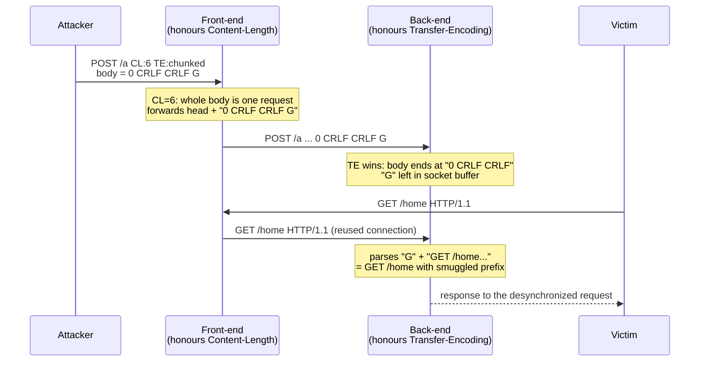

# HTTP Request Smuggling: CL.TE, TE.CL, and TE.TE Framing Desynchronization (RFC 9112)

> [!summary] Claim
> HTTP request smuggling exists because HTTP/1.1 carries two independent body-framing signals, `Content-Length` and `Transfer-Encoding`, so any two recipients in a chain that resolve an ambiguous message to different body boundaries under RFC 9112 Section 6.3 desynchronize, and the only safe recipient is one that rejects the ambiguous message outright (RFC 9112 Section 6.1) rather than guessing a boundary its upstream peer might compute differently.

Part of [HTTP Semantics and Wire Protocols](README.md) in [API Engineering](../README.md).

## TL;DR

A single HTTP/1.1 message can declare its body length two ways at once, with `Content-Length` and with `Transfer-Encoding: chunked`, and RFC 9112 Section 6.3 step 3 says `Transfer-Encoding` wins, but a front-end proxy and a back-end origin that disagree on which header to honour split the same TCP byte stream into different request boundaries.
The contract rule is that a server receiving both headers MAY reject the request or process it by `Transfer-Encoding` alone but MUST close the connection after responding (RFC 9112 Section 6.1), and an intermediary that forwards it MUST first remove `Content-Length` (RFC 9112 Section 6.3 step 3), so the only robust parser is a strict one.
The trap is that "accept and pick the spec-correct header" is not safe on its own: the bytes one recipient counted as body, the next recipient reads as the start of an attacker-controlled request that is prepended to the next victim's request on a reused connection.
The portability fact is that the pinned Python stack already diverges: `uvicorn 0.54.0` with `httptools` rejects a dual `Content-Length` plus `Transfer-Encoding` request with `400 Bad Request`, `gunicorn 26.2.0` (pure-Python parser) rejects it with `400`, but `h11 0.16.0` (and therefore `uvicorn --http h11` and `hypercorn 0.18.0`) accepts it, honours `Transfer-Encoding`, does not close the connection, and both servers answered the smuggled follow-on request (measured 2026-11, see Portability).
Do not rely on HTTP/1.1 upstream parsing agreement for security: the durable fix is HTTP/2 or HTTP/3 to the origin, where `DATA` frames carry explicit length prefixes and a `Transfer-Encoding` header is malformed by definition (RFC 9113 Section 8.2.2), per Kettle's 2025 "HTTP/1.1 must die".

## Mental model



The attack hinges on one fact: on a persistent connection the byte immediately after a message body is interpreted as the first octet of the next request-line (RFC 9112 Section 9.3).
The front-end frames the attacker's request with `Content-Length: 6`, so it forwards all six body octets `0\r\n\r\nG` as belonging to that request, then waits for the next request on the same upstream socket.
The back-end frames the same bytes with `Transfer-Encoding: chunked`, reads `0\r\n\r\n` as the terminating zero-length chunk, and leaves the trailing `G` in its receive buffer as the start of whatever request arrives next.
When the front-end reuses that upstream connection to forward an unrelated victim's `GET /home`, the back-end concatenates the smuggled `G` with the victim's bytes, so the victim's request is silently rewritten; the attacker has prepended content to someone else's request.

## How it works

### The two framing signals and the Section 6.3 cascade

An HTTP/1.1 message body has no binary length prefix; every recipient must compute the body length from headers using the eight-step precedence cascade in `(RFC 9112 Section 6.3)`.
The relevant steps are:

```text
Step 3. If a message is received with both a Transfer-Encoding and a
        Content-Length header field, the Transfer-Encoding overrides the
        Content-Length. Such a message might indicate an attempt to perform
        request smuggling ... and ought to be handled as an error. An
        intermediary that chooses to forward the message MUST first remove the
        received Content-Length field and process the Transfer-Encoding ...

Step 4. If a Transfer-Encoding header field is present and the chunked transfer
        coding ... is the final encoding, the message body length is determined
        by reading and decoding the chunked data ...

Step 6. If a valid Content-Length header field is present without
        Transfer-Encoding, its decimal value defines the expected message body
        length in octets.
```

`Transfer-Encoding` overriding `Content-Length` is a deliberate choice for backward compatibility: `(RFC 9112 Section 6.1)` explains that early senders emitted both (`chunked` for framing plus an estimated `Content-Length` for progress bars), "which is why Transfer-Encoding is defined as overriding Content-Length, as opposed to them being mutually incompatible."
The same section states the mandatory defence: "A server MAY reject a request that contains both Content-Length and Transfer-Encoding or process such a request in accordance with the Transfer-Encoding alone.
Regardless, the server MUST close the connection after responding to such a request to avoid the potential attacks."

### The three canonical desync classes

The names come from which header each hop trusts, front-end first (Kettle 2019, "HTTP Desync Attacks"):

- `CL.TE`: the front-end uses `Content-Length`, the back-end uses `Transfer-Encoding`.
  The attacker sets `Content-Length` to cover a body whose chunked framing terminates early, leaving a smuggled suffix.
- `TE.CL`: the front-end uses `Transfer-Encoding`, the back-end uses `Content-Length`.
  The attacker sends a chunk whose declared size extends past the `Content-Length` the back-end honours, so the back-end stops early and treats the chunk payload as a new request.
- `TE.TE`: both hops support `Transfer-Encoding` but one is fooled by an obfuscated header, so one hop reads `chunked` and the other does not.
  Kettle 2019 lists `Transfer-Encoding : chunked` (space before the colon), `Transfer-Encoding:[tab]chunked`, a leading-space ` Transfer-Encoding: chunked` line, a duplicate `Transfer-Encoding: x` line, and `Transfer-Encoding: xchunked`; the lab adds two variants that swap Kettle's tab for a `\x0b` vertical tab, before the token or before the colon.

The term and the technique predate the RFC: Linhart, Klein, Heled, and Orrin named "HTTP Request Smuggling" in a June 2005 Watchfire whitepaper, cited by `(RFC 9112 Section 11.2)` as `[Linhart]`.

### Wire bytes of a CL.TE payload

```text
Offset  Hex                                               ASCII
------  ------------------------------------------------  ----------------------------
0x0000  50 4f 53 54 20 2f 61 20 48 54 54 50 2f 31 2e 31   POST /a HTTP/1.1
0x0010  0d 0a 48 6f 73 74 3a 20 74 0d 0a                  CRLF Host: t CRLF
0x001b  43 6f 6e 74 65 6e 74 2d 4c 65 6e 67 74 68 3a 20   Content-Length:
0x002b  36 0d 0a                                          6 CRLF
0x002e  54 72 61 6e 73 66 65 72 2d 45 6e 63 6f 64 69 6e   Transfer-Encodin
0x003e  67 3a 20 63 68 75 6e 6b 65 64 0d 0a 0d 0a         g: chunked CRLF CRLF
0x004c  30 0d 0a 0d 0a 47                                 0 CRLF CRLF G
```

The body is exactly six octets (`30 0d 0a 0d 0a 47`), matching `Content-Length: 6`.
A `Content-Length` recipient consumes all six and the message ends at `G`.
A `chunked` recipient reads `0\r\n\r\n` (five octets) as the terminating chunk plus empty trailer section and stops, leaving `47` (`G`) unconsumed.
That one-octet disagreement is the entire vulnerability.

### How the pinned parsers resolve it

`h11 0.16.0` validates headers in `normalize_and_validate`, which keeps both `Content-Length` and a single `chunked` `Transfer-Encoding`, rejects a second `Transfer-Encoding` line with `error_status_hint=501`, and rejects any `Transfer-Encoding` value other than `chunked` with hint `501` `(h11 0.16.0 h11/_headers.py, normalize_and_validate)`.
It then frames the body in `_body_framing`, which implements the precedence cascade (its comment cites RFC 7230 Section 3.3.3, which RFC 9112 Section 6.3 replaced) and, for a request, returns `("chunked", ())` whenever `Transfer-Encoding` is present, so `Transfer-Encoding` beats `Content-Length` `(h11 0.16.0 h11/_connection.py, _body_framing)`.
Critically, `h11` does not close the connection on a dual-header request: `_keep_alive` only inspects the `Connection` header and the HTTP version `(h11 0.16.0 h11/_connection.py, _keep_alive)`, so the Section 6.1 "MUST close" requirement is left to the application or a front-end, which h11 issue #90 ("Transfer-Encoding and Content-Length", open as of 2026-11) has tracked since 2019 without a resolution.
`gunicorn 26.2.0` takes the strict branch: in `Message.set_body_reader`, if `chunked` is set and `content_length is not None` it raises `InvalidHeader("CONTENT-LENGTH")`, and it also rejects chunked over HTTP/1.0, stacked `chunked`, and any coding after `chunked` with `InvalidHeader`, and unknown codings with `UnsupportedTransferCoding` `(gunicorn 26.2.0 gunicorn/http/message.py, Message.set_body_reader)`.
`Worker.handle_error` maps `InvalidHeader` to `400 Bad Request` and `UnsupportedTransferCoding` to `501` `(gunicorn 26.2.0 gunicorn/workers/base.py, Worker.handle_error)`.
That is the pure-Python parser, which the `http_parser = "auto"` default uses when the optional `gunicorn_h1c` C extension is not installed, as in the lab environment `(gunicorn 26.2.0 gunicorn/config.py, HttpParser)`.
With `gunicorn_h1c 0.6.12` installed and `--http-parser fast`, the C extension rejects the same request itself: `pico_validate_header_framing` sets `InvalidHeader("Content-Length with Transfer-Encoding")` `(gunicorn_h1c 0.6.12 gunicorn_h1c/pico_utils.h, pico_validate_header_framing)`, and a loopback probe of the sync worker got `400 Bad Request` with `Connection: close` for both the CL.TE request alone and with the `ET /x` follow-on bytes (measured 2026-11, see Portability).
`uvicorn 0.54.0` with the default `httptools` parser rejects the dual-header request at the `llhttp` layer: `httptools 0.9.0` raises `HttpParserError("Transfer-Encoding can't be present with Content-Length")` (measured), which `HttpToolsProtocol.data_received` turns into `400 Bad Request` with `connection: close` `(uvicorn 0.54.0 uvicorn/protocols/http/httptools_impl.py, HttpToolsProtocol.data_received)`.

### The lab model

The lab models the recipient's framing decision directly, with no sockets.
`classify_framing` implements the Section 6.3 request cascade with a `strict` flag (reject dual framing and any `Transfer-Encoding` list other than exactly one `chunked`, the Section 6.1 defence) and a `prefer` policy (which header a lenient recipient trusts), and `forward_and_reparse` reproduces the front-end/back-end split by forwarding the front-end's view of message one to the back-end and reparsing it `(request_smuggling.py)`.
`Prefer.TE` is the conformant recipient: any `Transfer-Encoding` overrides `Content-Length` (step 3), and a request whose final coding is not `chunked` is rejected (step 4); `Prefer.CL` is a legacy parser that trusts `Content-Length` whenever it is present.
A message counts as ambiguous when both fields are present, whatever the `Transfer-Encoding` value, so `Content-Length: 4` with `Transfer-Encoding: xchunked` is ambiguous even though neither hop reads it as chunked.
`forward_and_reparse` separates the two ways the back-end can fail on the forwarded bytes: `starved` when the bytes stop before the body it framed ends (it waits for the next client write), and `rejected` when they are malformed, such as a non-hex chunk-size or garbage where the chunk-data CRLF belongs (it answers `400` and closes).

## Numbers and limits

| Quantity | Value | Source |
| --- | --- | --- |
| Framing precedence steps | 8 | `(RFC 9112 Section 6.3)` |
| Dual CL+TE handling | `Transfer-Encoding` overrides; MUST close connection after responding | `(RFC 9112 Section 6.1)` and `(RFC 9112 Section 6.3)` step 3 |
| Unknown transfer coding in a request | SHOULD respond `501 Not Implemented` | `(RFC 9112 Section 6.1)` |
| Non-chunked final coding on a request | `400 Bad Request` then close | `(RFC 9112 Section 6.3)` step 4 |
| Whitespace before field-line colon | server MUST reject with `400 Bad Request`; proxy MUST remove it | `(RFC 9112 Section 5.1)` |
| Duplicate `Content-Length` with equal values | MAY accept `42, 42` as `42` | `(RFC 9110 Section 8.6)` |
| `Content-Length` ABNF | `1*DIGIT` (no sign, no hex) | `(RFC 9110 Section 8.6)` |
| `Transfer-Encoding` in HTTP/2 | malformed message, stream error of type `PROTOCOL_ERROR` | `(RFC 9113 Section 8.2.2)` and `(RFC 9113 Section 8.1.1)` |
| `h11` max `Content-Length` digits | 20 | `(h11 0.16.0 h11/_headers.py, CONTENT_LENGTH_MAX_DIGITS)` |
| h11 dual-header request | accepts, `Transfer-Encoding` wins, connection reusable | measured, lab `test_h11_server_takes_te_and_leaves_trailing_bytes_without_closing`, h11 0.16.0, CPython 3.14.6, macOS 27.2 arm64 |
| CL.TE smuggled suffix for the lab payload | `b"G"` (1 octet) | measured, lab `test_cl_te_desync_leaves_smuggled_request_prefix` |
| Module test coverage | 98% (162 statements, 60 branches, 2 and 2 missed) | measured 2026-11, `uv run --frozen pytest <module> --cov=api_labs.f01_http_semantics_and_wire_protocols.request_smuggling`, CPython 3.14.6, macOS 27.2 arm64 |

## Portability

Every host CPython cell was run here on macOS 27.2 arm64 (2026-11), the container cells under OrbStack on the same machine (arm64 Linux); server cells are loopback probes that send the CL.TE payload alone and again with `ET /x HTTP/1.1\r\nHost: t\r\n\r\n` appended, with a 2 s read timeout; HTTP-version cells cite the specification.

| Target | Result | Evidence |
| --- | --- | --- |
| CPython 3.12.13 | 31 passed | `uv run --frozen --python 3.12.13`, full lock, this lab |
| CPython 3.13.18 | 31 passed | `uv run --frozen --python 3.13.18`, full lock, this lab |
| CPython 3.14.6 | 31 passed | workspace `.venv`, this lab |
| CPython 3.14.10 | 31 passed | `uv run --frozen --python 3.14.10`, full lock, this lab |
| CPython 3.15.2 | 31 passed | `uv run --frozen --python 3.15.2`, full lock, this lab |
| CPython 3.15.0b3t free-threaded (3.15.2t not installed here) | 31 passed with the GIL disabled (`sys._is_gil_enabled()` is `False`), isolated deps (`psycopg-binary 3.3.8` in the full lock has no 3.15t wheel) | `uv venv --python 3.15t` plus this module's pinned deps, this lab |
| CPython 3.12.16, Debian 13 Trixie (glibc 2.41) | 31 passed | `docker run` of `python:3.12-slim-trixie`, `pip install` of this module's pinned deps, source mounted read-only |
| CPython 3.14.10, Debian 13 Trixie (glibc 2.41) | 31 passed | `python:3.14-slim-trixie`, same method |
| CPython 3.15.2, Debian 13 Trixie (glibc 2.41) | 31 passed | `python:3.15-slim-trixie`, same method |
| CPython 3.14.10, Alpine 3.24 (musl) | 31 passed | `python:3.14-alpine`, same method |
| `h11 0.16.0` on dual CL+TE | accepts, honours `Transfer-Encoding`, leaves `b"G"` buffered, connection reusable (no close) | lab test; `(h11 0.16.0 h11/_connection.py, _keep_alive)`; h11 issue #90 |
| `uvicorn 0.54.0` `--http httptools` | `400 Bad Request` with `connection: close` on dual CL+TE | measured probe; `llhttp` rejects `Transfer-Encoding` with `Content-Length` |
| `uvicorn 0.54.0` `--http h11` | `200` for `POST /a` with an empty body, connection held open; with the follow-on bytes it answers a second `200` for the smuggled `GET /x` | measured probe |
| `hypercorn 0.18.0` (h11 backend) | same as `uvicorn --http h11`: `200` for `POST /a`, then `200` for the smuggled `GET /x` | measured probe; `(hypercorn 0.18.0 hypercorn/protocol/h11.py, H11Protocol._handle_events)` |
| `granian 2.8.7` | `200` with `connection: close`, then EOF; the smuggled `GET /x` is never answered | measured probe |
| `gunicorn 26.2.0` sync worker with `--http-parser fast` and `gunicorn_h1c 0.6.12` | `400 Bad Request` with `Connection: close` on dual CL+TE, alone and with the follow-on bytes | measured probe; `(gunicorn_h1c 0.6.12 gunicorn_h1c/pico_utils.h, pico_validate_header_framing)` |
| `gunicorn 26.2.0` sync worker, pure-Python parser | `400 Bad Request` with `Connection: close` on dual CL+TE | measured probe; `(gunicorn 26.2.0 gunicorn/http/message.py, Message.set_body_reader)` |
| HTTP/2 (RFC 9113) | `Transfer-Encoding` is malformed; `Content-Length` must equal the sum of `DATA` frame lengths | `(RFC 9113 Section 8.2.2)` and `(RFC 9113 Section 8.1.1)` |
| HTTP/3 over QUIC | `Transfer-Encoding` MUST NOT be used and makes the message malformed; `Content-Length` must equal the sum of `DATA` frame lengths; see [[HTTP-3-Framing-and-QPACK-Header-Compression-RFC-9114\|HTTP/3 framing]] | `(RFC 9114 Section 4.1)`, `(RFC 9114 Section 4.2)`, and `(RFC 9114 Section 4.1.2)` |

## Worked example

The [implementation](../labs/src/api_labs/f01_http_semantics_and_wire_protocols/request_smuggling.py) models the recipient's framing decision and the front-end/back-end split.
The [test](../labs/tests/f01_http_semantics_and_wire_protocols/test_http_request_smuggling_cl_te_and_desync_mechanics.py) proves the CL.TE and TE.CL desync, the strict-parser defence, the chunked-body checks (chunk-data terminator, chunk-size cap, trailers), and the real `h11` behavior.

`forward_and_reparse` is shown verbatim; it forwards the front-end's framing of message one and reparses it under the back-end's policy:

```python
def forward_and_reparse(
    raw: bytes,
    *,
    front: Prefer,
    back: Prefer,
) -> DesyncResult:
    """Forward the front-end's view of message one to the back-end and reparse it.

    The front-end parses the first request under its ``front`` policy and forwards
    exactly the bytes it considers that request (``head + body``). The back-end
    reparses those forwarded bytes under its ``back`` policy. If the back-end frames
    a shorter body, the remainder is a smuggled request prefix; if it frames a longer
    body, it starves waiting for bytes the front-end withheld; if it finds the bytes
    malformed, it rejects the request.
    """
    front_msg = parse_one_message(raw, prefer=front)
    forwarded = raw[: front_msg.end]
    try:
        back_msg = parse_one_message(forwarded, prefer=back)
    except NeedMoreData:
        # The back-end could not complete the body within the forwarded bytes:
        # it is starved, holding a partial request until the next client write.
        return DesyncResult(front_msg.body, b"", b"", starved=True, rejected=False)
    except ValueError:
        # The back-end parsed bytes it cannot accept: it answers 400 and closes.
        return DesyncResult(front_msg.body, b"", b"", starved=False, rejected=True)
    smuggled = forwarded[back_msg.end :]
    return DesyncResult(front_msg.body, back_msg.body, smuggled, starved=False, rejected=False)
```

The CL.TE test asserts the exact smuggled byte (simplified excerpt, assertions verbatim):

```python
CL_TE = (
    b"POST /a HTTP/1.1\r\n"
    b"Host: t\r\n"
    b"Content-Length: 6\r\n"
    b"Transfer-Encoding: chunked\r\n"
    b"\r\n"
    b"0\r\n\r\nG"
)


def test_cl_te_desync_leaves_smuggled_request_prefix() -> None:
    result = forward_and_reparse(CL_TE, front=Prefer.CL, back=Prefer.TE)
    assert result.front_body == b"0\r\n\r\nG"
    assert result.back_body == b"0\r\n\r\n"
    assert result.smuggled == b"G"
    assert result.starved is False
    assert result.rejected is False
```

Captured output (`uv run --frozen pytest ... -q`, CPython 3.14.6, macOS 27.2 arm64):

```text
...............................                                          [100%]
31 passed in 0.06s
```

Coverage for the module (`uv run --frozen pytest <module> -q -p no:cacheprovider --cov=api_labs.f01_http_semantics_and_wire_protocols.request_smuggling --cov-report=term-missing`, last lines):

```text
Name                                                                      Stmts   Miss Branch BrPart  Cover   Missing
---------------------------------------------------------------------------------------------------------------------
src/api_labs/f01_http_semantics_and_wire_protocols/request_smuggling.py     162      2     60      2    98%   141, 250
---------------------------------------------------------------------------------------------------------------------
TOTAL                                                                       162      2     60      2    98%
31 passed in 0.10s
```

## Pitfalls

> [!warning] Accepting the ambiguous message and "just picking Transfer-Encoding"
> Trigger: a parser follows RFC 9112 Section 6.3 step 3 (TE wins) but skips the Section 6.1 "MUST close the connection" requirement.
> Symptom: the connection stays open, the front-end reuses it, and the unconsumed suffix is prepended to the next request.
> Fix: reject the dual-header message with `400` and close, as `gunicorn 26.2.0` and `httptools` do; `h11 0.16.0` leaves the close to its server (h11 issue #90), and `uvicorn --http h11` and `hypercorn 0.18.0` keep the connection open, so a front-end in front of them must reject it.

> [!warning] CVE-2025-43859: h11 lenient chunked line terminators
> Trigger: `h11` before `0.16.0` did not validate the two octets after each chunk's data, so any two bytes were accepted where `\r\n` belongs (GHSA-vqfr-h8mv-ghfj).
> Symptom: paired with a buggy reverse proxy, the leniency enabled request smuggling; the advisory is `GHSA-vqfr-h8mv-ghfj`, published 2025-04-24.
> Fix: `h11 0.16.0` rejects the malformed body; "fixing either component is sufficient to mitigate this issue" (NVD `CVE-2025-43859`); the lab's `_read_chunked` makes the same check and a test feeds it the garbage-octet shape.

> [!warning] CVE-2024-1135 and CVE-2024-6827: Gunicorn Transfer-Encoding validation
> Trigger: `gunicorn` before `22.0.0` processed multiple conflicting `Transfer-Encoding` headers as chunked regardless of the final encoding (`CVE-2024-1135`, GHSA-w3h3-4rj7-4ph4), and `21.2.0` fell back to `Content-Length` on an unvalidated `Transfer-Encoding` value, enabling TE.CL smuggling (`CVE-2024-6827`, GHSA-hc5x-x2vx-497g, patched in `22.0.0`).
> Symptom: cache poisoning, security-control bypass, and access to restricted endpoints.
> Fix: upgrade; the pinned `gunicorn 26.2.0` rejects all of these in `Message.set_body_reader`.

> [!warning] CVE-2022-32215 and CVE-2019-18277: proxy-layer parsers
> Trigger: the `llhttp` parser in Node.js before `14.20.1`, `16.17.1`, and `18.9.1` mishandled multi-line `Transfer-Encoding` headers (`CVE-2022-32215`), and HAProxy before `2.0.6` in legacy mode failed to reject a `Transfer-Encoding` whose value lacked `chunked`, exploitable with `http-reuse always` (`CVE-2019-18277`).
> Symptom: a lenient edge or origin parser disagrees with its peer and a smuggled request slips through.
> Fix: patch the intermediary; smuggling is a property of the chain, not one component.

## Security and robustness

Request smuggling maps to OWASP API Security 2023 `API8:2023 Security Misconfiguration` (inconsistent parsing across a proxy chain) and amplifies `API1:2023 Broken Object Level Authorization` by letting an attacker prepend bytes to another user's authenticated request.
The threat model is a multi-hop chain (CDN, WAF, load balancer, origin) where any two hops parse framing differently; the attacker needs only one disagreement.
The defense in depth is layered:

- Normalize at the edge: have the front-end reject any request carrying both `Content-Length` and `Transfer-Encoding`, any `Transfer-Encoding` other than exactly one `chunked`, a field-name that is not a token `(RFC 9110 Section 5.1)`, whitespace before a colon `(RFC 9112 Section 5.1)`, obsolete line folding `(RFC 9112 Section 5.2)`, and bare `CR` `(RFC 9112 Section 2.2)`; the lab's `parse_request_head` and `classify_framing(strict=True)` reject each of these and every case in `te_obfuscations()`, but they are a model, not a complete HTTP/1.1 validator (for example they do not check the request-target or HTTP-version syntax).
- Close on ambiguity: honour the Section 6.1 "MUST close" rule so a partial smuggled suffix cannot survive into a reused connection.
- Do not reuse upstream connections if the origin parser cannot be trusted; connection reuse is what turns a desync into a cross-request attack.
- Prefer HTTP/2 or HTTP/3 upstream: `(RFC 9113 Section 8.2.2)` makes `Transfer-Encoding` malformed and `(RFC 9113 Section 8.1.1)` ties `Content-Length` to the measured `DATA` frame lengths, removing the dual-signal ambiguity, though HTTP/2 downgrade proxies reintroduce it as H2.CL and H2.TE (Kettle 2021, `CVE-2021-21295`).

The input-validation edge cases that matter: a `Content-Length` must match `1*DIGIT` with no `+`, no `0x`, and no leading/trailing junk `(RFC 9110 Section 8.6)`; duplicate `Content-Length` lines with differing values are an unrecoverable error `(RFC 9112 Section 6.3)` step 5; and a recipient MUST prevent integer conversion overflow when parsing a large hexadecimal chunk size `(RFC 9112 Section 7.1)`, which the lab does by capping the size at 16 hex digits.

## The principal's view

The staff-plus decision is to stop treating "RFC-correct HTTP/1.1 parsing" as a security boundary and move the trust boundary to the transport.
Kettle's 2025 "HTTP/1.1 must die" argues that "Upstream HTTP/1.1 is inherently insecure and regularly exposes millions of websites to hostile takeover" and that "HTTP/2+ solves this threat"; the organizational trade-off is that upstream HTTP/2 costs connection-pooling and operational familiarity, and many origins and sidecars still speak only HTTP/1.1.
The pragmatic middle path a principal chooses: terminate attacker-facing traffic at one hardened, strict parser (reject-and-close on any framing ambiguity), minimize the number of distinct HTTP parsers in the chain (each new parser is a new disagreement), disable upstream connection reuse where the origin parser is unaudited, and treat HTTP/2 downgrade proxies as a smuggling surface (H2.CL, H2.TE) rather than a mitigation.
Choose a different protocol when you can: gRPC over HTTP/2 or a message bus removes text framing entirely, and for internal service-to-service calls the length-prefixed binary framing of HTTP/2 is both faster and safer than chunked HTTP/1.1.
The point where a principal spends political capital is forcing a single front-door parser instead of letting every team wire its own proxy; the smuggling research record (PayPal in Kettle 2019, Netflix and Atlassian Jira in Kettle 2021, Akamai in Kettle 2025) is a history of chains with one too many parsers.

## Interview questions

> [!question] L5: Why does a message with both `Content-Length` and `Transfer-Encoding: chunked` create a security problem, even though RFC 9112 says which one wins?
>
> > [!success]- Answer
> > RFC 9112 Section 6.3 step 3 says `Transfer-Encoding` overrides `Content-Length`, so a single compliant parser is self-consistent.
> > The problem is a chain of two parsers: if the front-end honours `Content-Length` and the back-end honours `Transfer-Encoding`, they compute different body boundaries for the same bytes.
> > The bytes one counts as body, the other reads as the start of the next request, so an attacker can prepend content to a later victim's request on a reused connection.
> >
> > Follow-up: what does RFC 9112 Section 6.1 require a recipient to do after responding to such a message, and why?
> > It must close the connection, so no unconsumed suffix can bleed into a reused connection.

> [!question] L5: What is the difference between CL.TE and TE.CL?
>
> > [!success]- Answer
> > The names are front-end then back-end, naming which header each hop trusts.
> > CL.TE means the front-end uses `Content-Length` and the back-end uses `Transfer-Encoding`.
> > TE.CL means the front-end uses `Transfer-Encoding` and the back-end uses `Content-Length`.
> >
> > Follow-up: in TE.CL, why does the attacker make the chunk size larger than the `Content-Length`?
> > So the back-end stops reading at `Content-Length` mid-chunk and treats the remaining chunk payload as a fresh request.

> [!question] L5: Predict the output: the lab payload `CL_TE` is `b"POST /a HTTP/1.1\r\nHost: t\r\nContent-Length: 6\r\nTransfer-Encoding: chunked\r\n\r\n0\r\n\r\nG"`, and you call `forward_and_reparse(CL_TE, front=Prefer.CL, back=Prefer.TE)`; what is `result.smuggled`?
>
> > [!success]- Answer
> > `result.smuggled == b"G"`.
> > The front-end frames with `Content-Length: 6` and forwards all six body octets `0\r\n\r\nG`.
> > The back-end frames with `chunked`, reads `0\r\n\r\n` as the terminating chunk, and leaves the single trailing octet `G` as the smuggled prefix.
> >
> > Follow-up: what would `result.smuggled` be if both `front` and `back` were `Prefer.TE`?
> > Empty, `b""`, because both hops agree the body ends at `0\r\n\r\n` and there is no disagreement.

> [!question] L6: Debug this API: a FastAPI service runs under `uvicorn --http h11`, behind an nginx that forwards both `Content-Length` and `Transfer-Encoding` unchanged; occasionally a user sees another user's response. What is the framing bug and where is the fix?
>
> > [!success]- Answer
> > `h11 0.16.0` accepts a dual-header request, honours `Transfer-Encoding` (Section 6.3 step 3), but does not close the connection, so a chunked-terminated body leaves a smuggled suffix buffered (h11 issue #90).
> > If nginx frames with `Content-Length` and forwards the extra bytes, the h11 back-end reads them as the next request on a reused upstream connection, producing the cross-user response.
> > A loopback probe of `uvicorn 0.54.0 --http h11` confirms the mechanism: the CL.TE request followed by `ET /x` gets two `200` responses, the second for the smuggled `GET /x`.
> > The fix belongs at the front-end: nginx must reject or normalize the dual-header request and must not forward a `Content-Length` alongside `Transfer-Encoding`; switching uvicorn to `--http httptools`, which returns `400`, also closes the specific hole.
> >
> > Follow-up: why is "fix the back-end to also use Content-Length" the wrong instinct?
> > Because making both hops agree on `Content-Length` violates Section 6.3 step 3 and just moves the disagreement; the robust rule is reject-and-close on ambiguity, not pick-the-other-header.

> [!question] L6: You control the front-end parser. Give three concrete request shapes it must reject to prevent TE.TE smuggling, and cite the rule.
>
> > [!success]- Answer
> > A `Transfer-Encoding` header with whitespace before the colon, `Transfer-Encoding : chunked`, rejected by `(RFC 9112 Section 5.1)`.
> > A `Transfer-Encoding` value with an embedded control octet such as a vertical tab, `Transfer-Encoding: \x0bchunked`, which is invalid under the field-value grammar of `(RFC 9110 Section 5.5)` (the RFC lets recipients retain such octets, so rejecting is a front-end policy choice).
> > A request `Transfer-Encoding` whose final coding is not `chunked`, such as `xchunked` or `chunked` followed by a duplicate `Transfer-Encoding: x` line, which MUST get `400` and a close `(RFC 9112 Section 6.3)` step 4.
> >
> > Follow-up: why is lowercasing-and-stripping the value with a generic trimmer dangerous?
> > A trimmer that strips a vertical tab or other non-OWS whitespace can turn `\x0bchunked` into `chunked`, disagreeing with a stricter peer that rejects it; strip only SP and HTAB (OWS).

> [!question] L6: How do the pinned `uvicorn`, `h11`, and `gunicorn` releases differ on a dual `Content-Length` plus `Transfer-Encoding` request?
>
> > [!success]- Answer
> > `uvicorn 0.54.0` with `httptools` and `gunicorn 26.2.0` both reject it with `400 Bad Request`.
> > `h11 0.16.0` accepts it, honours `Transfer-Encoding`, and leaves the connection reusable, so the Section 6.1 close must be enforced elsewhere.
> > `hypercorn 0.18.0` uses `h11` and behaves the same as `h11`; `granian 2.8.7` answers once and sends `Connection: close`.
> >
> > Follow-up: which of these is spec-violating?
> > The two h11-based servers: Section 6.1 allows either reject or process-with-TE, but "Regardless, the server MUST close the connection after responding", and in the probe `uvicorn --http h11` and `hypercorn 0.18.0` kept it open and answered the smuggled `GET /x`.
> > `h11` itself is a sans-I/O library that leaves the close to its server, which is why such a stack pairs safely only with a rejecting front-end.

> [!question] L7+: Argue for or against the claim "upstream HTTP/1.1 is inherently insecure, migrate everything to upstream HTTP/2."
>
> > [!success]- Answer
> > For: HTTP/1.1's dual framing signals and text request boundaries mean minor parser bugs become takeover-grade; HTTP/2's binary `DATA` frames carry explicit lengths and forbid `Transfer-Encoding` `(RFC 9113 Section 8.2.2)`, removing the ambiguity, which is Kettle's 2025 position.
> > Against: HTTP/2 downgrade proxies reintroduce the problem as H2.CL and H2.TE (Kettle 2021, `CVE-2021-21295`), many origins and sidecars speak only HTTP/1.1, and migration costs connection-pool tuning and observability rework.
> > The synthesis: migrate attacker-facing and proxy-to-proxy hops to HTTP/2 where feasible, and for remaining HTTP/1.1 hops enforce a single strict reject-and-close parser and disable upstream reuse.
> >
> > Follow-up: why does HTTP/2 downgrade reintroduce smuggling?
> > Because the downgrade proxy re-serializes the HTTP/2 request into HTTP/1.1 and can emit a `Content-Length` or `Transfer-Encoding` that disagrees with how the origin frames the body.

> [!question] L7+: Where would you place the one authoritative HTTP parser in a CDN, WAF, load balancer, origin chain, and what invariant must hold across the other hops?
>
> > [!success]- Answer
> > Place the strict, reject-and-close parser at the first attacker-facing hop (the CDN or edge WAF), so an ambiguous or obfuscated message never reaches a parser that might disagree.
> > The invariant across downstream hops is that they receive only already-normalized, unambiguously framed messages, ideally over HTTP/2 so `Transfer-Encoding` is impossible and `Content-Length` is validated against `DATA` frame lengths `(RFC 9113 Section 8.1.1)`.
> > Minimize the number of distinct HTTP/1.1 parsers downstream, because each one is a new opportunity for disagreement.
> >
> > Follow-up: why is "every team runs its own sidecar proxy" a smuggling risk?
> > Each sidecar is another parser with its own leniencies, multiplying the pairwise disagreements an attacker can exploit.

## Related

Prerequisites: [[HTTP-1-1-Pipelining-and-Head-of-Line-Blocking]], [[HTTP-1-1-Framing-Keep-Alive-and-Chunked-Encoding]]

Next: [[HTTP-2-Binary-Framing-and-Stream-State-Machine]]

See also: [[HTTP-Message-Abstraction-RFC-9110]], [[HTTP-3-Framing-and-QPACK-Header-Compression-RFC-9114]], [[HTTP-Evolution-HTTP1-HTTP2-HTTP3]]

- Lab: `labs/tests/f01_http_semantics_and_wire_protocols/test_http_request_smuggling_cl_te_and_desync_mechanics.py`

## Further reading

- RFC 9112 Sections 6.1, 6.3, 7.1, and 11.2 (https://www.rfc-editor.org/rfc/rfc9112.html): the framing precedence cascade, the dual-header close requirement, chunked coding, and the request-smuggling security consideration.
- RFC 9110 Sections 8.6 and 5.5 (https://www.rfc-editor.org/rfc/rfc9110.html): the `Content-Length` ABNF, the comma-list exception, and field-value syntax that obfuscation violates.
- RFC 9113 Sections 8.1.1 and 8.2.2 (https://www.rfc-editor.org/rfc/rfc9113.html): why HTTP/2 framing removes the dual-signal ambiguity and forbids `Transfer-Encoding`.
- Linhart, Klein, Heled, Orrin, "HTTP Request Smuggling", Watchfire 2005 (https://www.cgisecurity.com/lib/HTTP-Request-Smuggling.pdf): the original description of the technique, cited by RFC 9112 Section 11.2.
- Kettle, "HTTP Desync Attacks: Request Smuggling Reborn", PortSwigger 2019 (https://portswigger.net/research/http-desync-attacks-request-smuggling-reborn): the CL.TE, TE.CL, and TE.TE taxonomy and the obfuscation variants.
- Kettle, "HTTP/2: The Sequel is Always Worse", PortSwigger 2021 (https://portswigger.net/research/http2): H2.CL and H2.TE downgrade desync, including `CVE-2021-21295`.
- Kettle, "HTTP/1.1 must die: the desync endgame", PortSwigger 2025 (https://portswigger.net/research/http1-must-die): the case for upstream HTTP/2 and the 0.CL class.
- h11 issue #90, "Transfer-Encoding and Content-Length" (https://github.com/python-hyper/h11/issues/90): why h11 accepts dual-header requests without closing.
- h11 advisory GHSA-vqfr-h8mv-ghfj / CVE-2025-43859 (https://github.com/python-hyper/h11/security/advisories/GHSA-vqfr-h8mv-ghfj): the chunked line-terminator leniency fixed in h11 0.16.0.
