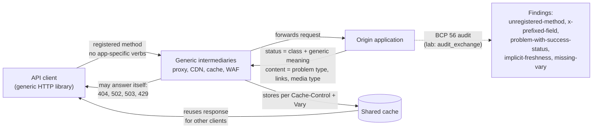

# Building Application Protocols with HTTP: BCP 56 Rules and Anti-Patterns (RFC 9205)

> [!summary] Claim
> An API built on HTTP inherits every generic component on the path (proxies, caches, CDNs, client libraries, browsers), so BCP 56 forbids it from redefining methods, status codes, and existing fields and tells it to put application meaning in resources, media types, links, and message content instead; every rule is mechanically checkable, and this note's lab checks them.

Part of [HTTP Semantics and Wire Protocols](README.md) in [API Engineering](../README.md).

## TL;DR

Mechanism: HTTP's value is its generic semantics, so a `404`, `GET`, or `Cache-Control` must mean the same thing to a CDN that has never heard of your API as it does to your client `(RFC 9205 Section 3.1)`.
Contract rule: applications "MUST NOT redefine, refine, or overlay the semantics of generic protocol elements", MUST use only registered methods and status codes, and should carry fine-grained errors in content such as `application/problem+json` rather than in a one-to-one status code map `(RFC 9205 Sections 3.1, 4.5, and 4.6)`.
The trap: status codes are often generated by components other than the application, so a client that reads `404` as "widget deleted" will act on a proxy's misroute; the lab reproduces this with an in-process gateway `(RFC 9205 Section 4.6)`.
Portability fact: the reason phrase does not exist in HTTP/2 or HTTP/3 (only `:status` is carried), ASGI has no field for it, and `httpx 0.28.1` synthesizes one locally, so no protocol may depend on it `(RFC 9113 Section 8.3.2)`.
When not to use it: if your protocol needs its own methods, a changed message model, or a dedicated port and scheme, it is a non-HTTP protocol and MUST NOT use HTTP's schemes, ports, ALPN IDs, or registries `(RFC 9205 Section 2.1)`.

## Mental model



A client's request crosses components the API author does not control, and each one acts only on the generic layer: the method decides whether a retry or cache is allowed, the status code class decides what the client and cache do, and `Cache-Control` plus `Vary` decide who else receives the response.
The return arrow from the intermediary is the important one: a proxy, captive portal, or overloaded edge can answer the client directly, so the status code alone never proves the application spoke `(RFC 9205 Section 4.6)`.
The origin therefore puts application meaning where generic software does not look, in the message content (problem `type` URIs, links) and in registered media types, and the dotted arrow is this note's lab, which records exchanges and flags every place where an application leaked its semantics into the generic layer.

## How it works

RFC 9205 is BCP 56, published June 2022, and obsoletes RFC 3205 `(RFC 9205 Abstract)`.
It applies when a specification uses port 80 or 443, the `http` or `https` scheme, an ALPN ID that generically identifies HTTP (`http/1.1`, `h2`, `h3`), or the HTTP IANA registries `(RFC 9205 Section 2)`.
Everything below is a consequence of one sentence: "applications that use HTTP MUST NOT redefine, refine, or overlay the semantics of generic protocol elements such as methods, status codes, or existing header fields" `(RFC 9205 Section 3.1)`.

### Rule 1: resources, not URL squatting

A standard that fixes paths such as `/app/v1` "usurps the server's authority over its own resources" `(RFC 9205 Section 3.2)`, and BCP 190 says specifications MUST NOT define a fixed prefix for their URI paths unless the scheme allows it, with registered well-known URIs as the exception `(RFC 8820 Section 2.3)`.
The replacements are a configured full URL, a registered well-known URI, or a server-supplied URI Template, followed by links from a discovery document `(RFC 9205 Section 4.4.1)`.
Single-deployment APIs may use a path prefix; the prohibition is on standards that many uncoordinated servers implement `(RFC 9205 Section 4.4)`.

### Rule 2: registered, generic methods only

Applications "MUST confine themselves to using registered HTTP methods", and new methods must be generic and registered with IETF Review `(RFC 9205 Section 4.5)`.
The IANA HTTP Method Registry holds 40 methods plus the reserved `*` (as of 2026-11; `*` is reserved by `(RFC 9110 Section 18.2)`), including `QUERY`, which now references RFC 10008; method names are case-sensitive tokens, so `get` is not `GET` and the lab flags it `(RFC 9110 Section 9.1)`.
`GET` content "has no generally defined semantics" and "might lead some implementations to reject the request and close the connection because of its potential as a request smuggling attack" `(RFC 9110 Section 9.3.1)`; RFC 9205 points query-heavy APIs at `POST` and notes that caching and linking are then lost `(RFC 9205 Section 4.5.1)`.
`OPTIONS` is a poor metadata channel because it cannot be linked to, is not cacheable, and costs an extra round trip; use a well-known URI or a linked metadata resource instead `(RFC 9205 Section 4.5.2)`.

### Rule 3: status codes carry the class, content carries the detail

A client "MUST understand the class of any status code ... and treat an unrecognized status code as being equivalent to the x00 status code of that class", and a status outside `100..599` SHOULD be processed as a `5xx` `(RFC 9110 Section 15)`.
That is why `499` is safe to receive (it degrades to `400`, the example RFC 9205 itself uses) yet wrong to emit: applications "MUST only use registered HTTP status codes" and "MUST NOT re-specify the semantics of HTTP status codes" `(RFC 9205 Section 4.6)`.
The lab's `fallback_status` implements the client side of this rule exactly.
RFC 9205 also warns that a one-to-one map from application errors to status codes exhausts the code space and pushes authors toward minting codes; the alternative is the most applicable code (generous use of `200`, `400`, `500`) plus detail in content `(RFC 9205 Section 4.6)`.
For that detail, Problem Details makes `type` the primary identifier that consumers MUST use, and requires that the advisory `status` member equal the real HTTP status "to assure that generic HTTP software that does not understand this format still behaves correctly" `(RFC 9457 Sections 3.1.1 and 3.1.2)`.
Reason phrases have "no function in HTTP", are not preserved, and do not exist in HTTP/2 `(RFC 9205 Section 4.6)`; on the HTTP/2 wire a response carries a single `:status` pseudo-header `(RFC 9113 Section 8.3.2)`, and HTTP/3 is identical `(RFC 9114 Section 4.3.2)`.

### Rule 4: fields are registered, short, and not `X-`

New header fields MUST be registered `(RFC 9205 Section 4.7)`, are RECOMMENDED to use Structured Fields (now RFC 9651, see [[Structured-Field-Values-for-HTTP-RFC-9651]]), and, when specific to one application, can carry an application identifier as a hyphen-separated prefix, for example `example-foo`, to avoid consuming generic names `(RFC 9205 Section 4.7)`.
Field names "ought not be prefixed with `X-`" `(RFC 9110 Section 16.3.2.1)` because an unstandardized name leaks into use, forcing a migration to the standard name that older implementations do not support `(RFC 6648 Section 3 and Appendix B)`; only `X-Content-Type-Options` and `X-Frame-Options` are registered `X-` names in the IANA field registry, both `permanent` (as of 2026-11).
New names SHOULD use only alphanumerics, `-`, and `.`, because CGI-style gateways map `-` to `_`: a received `Content_Length` arrives as `HTTP_CONTENT_LENGTH`, easily confused with the standard `CONTENT_LENGTH`, and a naive mapping can merge `Transfer_Encoding` with `Transfer-Encoding` into a smuggling vector `(RFC 9110 Sections 16.3.2.1 and 17.10)`.
The semantics of an existing field MUST NOT be redefined: an API cannot give `Location` a special meaning `(RFC 9205 Section 4.7)`.

### Rule 5: assume a cache is interposed

Even when an API "isn't designed to take advantage of caching, it needs to consider how caches will handle its responses" `(RFC 9205 Section 4.9)`.
A response without explicit freshness whose status is heuristically cacheable (`200`, `203`, `204`, `206`, `300`, `301`, `308`, `404`, `405`, `410`, `414`, `501`) may be reused with a heuristic lifetime `(RFC 9110 Section 15.1)`, and caches are encouraged to use at most a fraction of the time since `Last-Modified`, typically 10% `(RFC 9111 Section 4.2.2)`.
So the API either sets `max-age` or sends `no-store`; `no-cache` still allows storage and only forces revalidation `(RFC 9205 Section 4.9.1)`.
If a request field selects the response, every response from that resource must either be uncacheable or carry `Vary` naming that field `(RFC 9205 Section 4.9.4)`; caching is covered in depth in the caching folder.

### Rule 6: redirects, ordering, and browsers

`301` and `302` historically let a user agent change `POST` to `GET`, while `307` and `308` forbid any method change `(RFC 9205 Section 4.6.1, RFC 9110 Sections 15.4.2, 15.4.3, 15.4.8, and 15.4.9)`.
RFC 9205 encourages specifications to say that `301` and `302` change `POST` "(but no other method)" to `GET` `(RFC 9205 Section 4.6.1)`, and the lab shows `httpx 0.28.1` goes further: its `_redirect_method` rewrites every non-`HEAD` method on `302` (so `PUT` becomes `GET` and the body is dropped) but only `POST` on `301` `(httpx 0.28.1 httpx/_client.py, BaseClient._redirect_method)`.
`httpx` also drops `Authorization` when a redirect leaves the origin, except for a same-host `http` to `https` upgrade on default ports `(httpx 0.28.1 httpx/_client.py, BaseClient._redirect_headers)`.
Applications "MUST NOT make assumptions about the relationship between separate requests on a single transport connection", and the only reliable ordering is to send the second request after the first final response has begun `(RFC 9205 Section 4.11)`.
Every HTTP API is reachable by browsers, so it inherits CSRF and XSS exposure and should send an application-specific `Content-Type`, `X-Content-Type-Options: nosniff`, a restrictive `Content-Security-Policy`, and `Referrer-Policy` `(RFC 9205 Section 4.13)`.
HTTP/2 server push is hop-by-hop, unsupported by browsers' APIs, and not core semantics, so `103 Early Hints` is the suggested substitute `(RFC 9205 Section 4.15)`.
Backward-incompatible evolution uses a distinct link relation type, a distinct media type, or a distinct header field `(RFC 9205 Section 4.16)`; specifying a minimum HTTP version is NOT RECOMMENDED and specifications MUST NOT set a maximum one `(RFC 9205 Section 4.1)`.

## Numbers and limits

| Quantity | Value | Source |
|---|---|---|
| Registered HTTP methods | 40, plus reserved `*` | IANA HTTP Method Registry `methods.csv` (as of 2026-11) |
| Assigned status code entries | 64, of which `306` and `418` are `(Unused)` and reserved, leaving 62 usable (the lab's `REGISTERED_STATUS_CODES` equals this set; it keeps `510`, which the registry marks `OBSOLETED`) | IANA HTTP Status Code Registry `http-status-codes-1.csv` (as of 2026-11); `(RFC 9110 Sections 15.4.7 and 15.5.19)` |
| Temporary status registration | `104 Upload Resumption Supported`, expires 2026-11-13 | IANA HTTP Status Code Registry (as of 2026-11) |
| Field name registry rows | 260 (186 `permanent`, 4 `Permanent`, 23 `provisional`, 39 `obsoleted`, 8 `deprecated`) | IANA field-names.csv (as of 2026-11), counted with Python `csv` |
| Registered `X-` field names | 2 (`X-Content-Type-Options`, `X-Frame-Options`) | IANA field-names.csv (as of 2026-11) |
| Valid status code range | `100..599`; outside it, treat as `5xx` | `(RFC 9110 Section 15)` |
| Minimum URI length to support | 8000 octets (RECOMMENDED) | `(RFC 9110 Section 4.1)` |
| Typical heuristic freshness | 10% of time since `Last-Modified` | `(RFC 9111 Section 4.2.2)` |
| Example short freshness worth setting | 5 seconds | `(RFC 9205 Section 4.9.1)` |
| Reason phrase bytes on HTTP/2 and HTTP/3 | 0 (only `:status`) | `(RFC 9113 Section 8.3.2)`, `(RFC 9114 Section 4.3.2)`; lab `test_reason_phrase_exists_only_on_http_1_1_wire` |
| Lab size and runtime | 50 tests, `50 passed` in 0.07s to 0.12s across five consecutive warm runs (0.12s, 0.08s, 0.07s, 0.08s, 0.08s) | `uv run --frozen pytest tests/f01_http_semantics_and_wire_protocols/test_protocol_design_over_http_bcp_56_rfc_9205.py -q` in `labs/`, CPython 3.14.6, macOS 27.2 arm64 (`uname -r` `27.2.0`) |
| Lab mutation score | Verification pass: 30 of 30 killed (26 in `bcp56_audit.py`, 4 in a scratch copy of `httpx 0.28.1`), 7 survived before four tests were added.<br/>Finish pass: 16 more mutations of `bcp56_audit.py`, 5 survived (Vary identical-content shortcut, recorded request fields, field-name dedupe, recorded request content, recorded target), three tests added, 16 of 16 killed | `uv run --frozen pytest <module> -q` per mutation, CPython 3.14.6, macOS 27.2 arm64 |

## Portability

| Runtime, library, server, or protocol | Behavior that matters for BCP 56 | Evidence |
|---|---|---|
| CPython `3.12.13`, `3.13.18`, `3.14.10`, `3.15.2` | All 50 lab tests pass on each | Ran `UV_PROJECT_ENVIRONMENT=<scratch venv> uv run --frozen --python <v> pytest <module> -q` per version on macOS 27.2 arm64; `3.12.16` is not installed here and `uv python list --all-versions` offers no 3.12 newer than `3.12.13` (as of 2026-11-09), so `3.12.13` stands in |
| CPython `3.15.0b3t` free-threaded | All 50 lab tests pass with `PYTHON_GIL=0` (`sys._is_gil_enabled()` is `False`) | Ran on macOS 27.2 arm64; `3.15.2t` is not available here (`uv python list --all-versions` lists only `3.15.0b3+freethreaded`, as of 2026-11-09); `uv.lock` has no `cp315t` wheel for `psycopg-binary`, `aioquic`, `pylsqpack`, or `orjson`, so the env was synced with `--no-install-package` for those four and run with `-p no:hypothesispytest -p no:schemathesis`; without `PYTHON_GIL=0`, importing `brotli` re-enables the GIL (`sys._is_gil_enabled()` is `True`) |
| Debian 13 trixie and Alpine Linux 3.23 (musl), CPython `3.14.10` aarch64 | All 50 lab tests pass on each | Ran in `ghcr.io/astral-sh/uv:python3.14-trixie-slim` and `ghcr.io/astral-sh/uv:python3.14-alpine` under Docker 29.8.2 on macOS 27.2 arm64 with the lab copied to an executable tmpfs: `uv sync --frozen` then `uv run --frozen --no-sync pytest <module> -q` |
| `httpx 0.28.1` redirects | `302` turns any non-`HEAD` method into `GET`; `301` turns only `POST` into `GET`; `303` turns non-`HEAD` into `GET`; `307` and `308` keep method and body | Lab `test_httpx_redirect_method_rewriting`; `(httpx 0.28.1 httpx/_client.py, BaseClient._redirect_method)` and `_redirect_stream` |
| `httpx 0.28.1` credentials | Drops `Authorization` on cross-origin redirect and always drops `Cookie` from the copied headers | Lab `test_httpx_strips_authorization_on_cross_origin_redirect`; `(httpx 0.28.1 httpx/_client.py, BaseClient._redirect_headers)` |
| `httpx 0.28.1` reason phrase | Falls back to its own table via `codes.get_reason_phrase` when the transport supplies no `reason_phrase` extension | Lab `test_httpx_synthesizes_reason_phrase_the_server_never_sent`; `(httpx 0.28.1 httpx/_models.py, Response.reason_phrase)` |
| ASGI 3.0 `http.response.start` | Keys are `type`, `status`, `headers`, `trailers`; an application cannot set a reason phrase | ASGI HTTP and WebSocket spec version 2.5 (`asgiref` `specs/www.rst` on `main`, as of 2026-11) |
| `uvicorn 0.54.0` (`h11` backend) | Writes the reason from `http.HTTPStatus(status).phrase`, `b""` for codes the running CPython lacks, such as `499`; raw status lines `HTTP/1.1 404 Not Found`, `HTTP/1.1 422 Unprocessable Content`, `HTTP/1.1 499 ` | `(uvicorn 0.54.0 uvicorn/protocols/http/h11_impl.py, _get_status_phrase)` via the `STATUS_PHRASES` table; status lines read over a loopback socket from `uvicorn --http h11`, CPython 3.14.6, macOS 27.2 arm64 |
| `hypercorn 0.18.0` (`h11` backend) | Builds `h11.Response` without `reason`, so the wire has an empty reason phrase even for `200`: `HTTP/1.1 200 `, `HTTP/1.1 404 ` | `(hypercorn 0.18.0 hypercorn/protocol/h11.py, H11Protocol.stream_send)` and `(h11 0.16.0 h11/_events.py, _ResponseBase)` default `reason=b""`; status lines read over a loopback socket, CPython 3.14.6, macOS 27.2 arm64 |
| `granian 2.8.7` (HTTP/1) | Supplies its own reason phrase, using the older name for `422` and a literal placeholder for unknown codes: `HTTP/1.1 404 Not Found`, `HTTP/1.1 422 Unprocessable Entity`, `HTTP/1.1 499 <none>` | Status lines read over a loopback socket from `granian --interface asgi --http 1`, CPython 3.14.6, macOS 27.2 arm64; explained by the HTTP/1 encoder it builds on: granian 2.8.7 pins `hyper =1.12` (`Cargo.toml`), whose `(hyper 1.12.0 src/proto/h1/role.rs, Server::encode)` writes `canonical_reason().unwrap_or("<none>")` when no custom reason is set, and `(http 1.5.0 src/status.rs)` names `422` "Unprocessable Entity" and has no `499` entry; granian's own Rust sources were not read for any reason-phrase code |
| `h11 0.16.0` field names | Accepts `_` in field names (`token` grammar): a request with `Widget_Tenant: x` parses to field `widget_tenant` | `(h11 0.16.0 h11/_abnf.py, token)` and `field_name = token`; executed with `h11.Connection(h11.SERVER)` on CPython 3.14.6 |
| nginx | `underscores_in_headers off` and `ignore_invalid_headers on` by default, so a request field named `widget_tenant` is dropped before the origin | nginx `ngx_http_core_module` documentation (as of 2026-11) |
| HTTP/1.1 | Status line carries a reason phrase chosen by the sender, possibly empty | Lab `test_reason_phrase_exists_only_on_http_1_1_wire` with `h11 0.16.0`; the three server rows above show three different choices for the same ASGI status |
| HTTP/2 | Only `:status`; no reason phrase on the wire | `(RFC 9113 Section 8.3.2)`; lab with `h2 4.4.1` decodes `((b":status", b"404"), (b"content-length", b"0"))` |
| HTTP/3 over QUIC | Only `:status`; no reason phrase | `(RFC 9114 Section 4.3.2)`: "HTTP/3 does not define a way to carry the version or reason phrase that is included in an HTTP/1.1 status line" (text read at rfc-editor.org, 2026-11-09); not exercised in the lab |

## Worked example

The lab is an executable BCP 56 audit: [implementation](../labs/src/api_labs/f01_http_semantics_and_wire_protocols/bcp56_audit.py) and [test](../labs/tests/f01_http_semantics_and_wire_protocols/test_protocol_design_over_http_bcp_56_rfc_9205.py).
It records real exchanges from an in-process Starlette widget API through `httpx.ASGITransport`, then runs rule checks that each cite the RFC section they enforce.
The core rule engine, verbatim from `bcp56_audit.py`:

```python
def audit_exchange(exchange: Exchange) -> tuple[Finding, ...]:
    """Return every BCP 56 rule that *exchange* violates, in a stable order."""
    findings: list[Finding] = []
    if exchange.method not in REGISTERED_METHODS:
        detail = f"{exchange.method} is not in the HTTP Method Registry"
        findings.append(Finding("unregistered-method", "RFC 9205 Section 4.5", detail))
    if exchange.status not in REGISTERED_STATUS_CODES:
        detail = f"{exchange.status} is not a registered, usable status code"
        findings.append(Finding("unregistered-status", "RFC 9205 Section 4.6", detail))
    if exchange.method == "GET" and exchange.request_content:
        detail = f"GET carries {len(exchange.request_content)} bytes of content"
        findings.append(Finding("get-with-content", "RFC 9205 Section 4.5.1", detail))
    names = [name for name, _ in exchange.request_fields + exchange.response_fields]
    findings.extend(_field_name_findings(list(dict.fromkeys(names))))
    findings.extend(_problem_findings(exchange))
    findings.extend(_freshness_findings(exchange))
    return tuple(findings)
```

The client half is the status class fallback and an error classifier that only trusts a problem `type` it recognizes:

```python
def fallback_status(status: int, understood: frozenset[int]) -> int:
    """Map *status* to the semantics a generic client must apply (RFC 9110 Section 15)."""
    if not 100 <= status <= 599:
        return 500
    if status in understood:
        return status
    return status // 100 * 100


def classify_error(
    status: int,
    content_type: str | None,
    content: bytes,
    known_problem_types: frozenset[str],
    understood: frozenset[int],
) -> ErrorClass:
    """Attribute an error to the application only when its problem `type` proves it."""
    if _media_type(content_type) == PROBLEM_JSON:
        document = _json_object(content) or {}
        problem_type = document.get("type", "about:blank")
        if isinstance(problem_type, str) and problem_type in known_problem_types:
            return ErrorClass("application", problem_type, status)
    effective = fallback_status(status, understood)
    return ErrorClass("generic", f"http-{effective}", effective)
```

The test that reproduces the misattribution trap: the edge gateway only routes `/legacy`, so it answers `404` for widget `1`, which exists; the classifier refuses to treat that `404` as an application fact:

```python
@pytest.mark.unit
@pytest.mark.asyncio
async def test_intermediary_404_is_not_misattributed_to_the_application() -> None:
    app = build_app()
    async with client(app) as direct, client(PrefixGateway(app, prefix="/legacy")) as edge:
        from_app = await direct.get("/widgets/9")
        from_gateway = await edge.get("/widgets/1")
        existing = await direct.get("/widgets/1")
    assert (from_app.status_code, from_gateway.status_code, existing.status_code) == (404, 404, 200)
    app_class = classify_error(
        from_app.status_code,
        from_app.headers.get("content-type"),
        from_app.content,
        KNOWN_PROBLEMS,
        UNDERSTOOD,
    )
    gateway_class = classify_error(
        from_gateway.status_code,
        from_gateway.headers.get("content-type"),
        from_gateway.content,
        KNOWN_PROBLEMS,
        UNDERSTOOD,
    )
    assert (app_class.origin, app_class.kind) == ("application", WIDGET_NOT_FOUND)
    assert (gateway_class.origin, gateway_class.kind) == ("generic", "http-404")
```

Recording the three API routes and auditing them shows that the "legacy" route, which tunnels an error through `200`, trips three rules at once, and that even the conformant route's `404` lacks explicit freshness:

```python
@pytest.mark.unit
@pytest.mark.asyncio
async def test_recorded_api_routes_audit_as_expected() -> None:
    async with client(build_app()) as http:
        good = exchange_from_httpx(await http.get("/widgets/1"))
        missing = exchange_from_httpx(await http.get("/widgets/9"))
        legacy = exchange_from_httpx(await http.get("/legacy/widgets/9"))
    assert audit_exchange(good) == ()
    assert rules(missing) == ["implicit-freshness"]
    assert rules(legacy) == [
        "x-prefixed-field",
        "problem-with-success-status",
        "implicit-freshness",
    ]
```

Output of a one-off driver (not part of the lab) that records the same three routes through `httpx.ASGITransport` and prints each `audit_exchange` finding as `rule (section): detail`, captured on CPython 3.14.6, macOS 27.2 arm64; the test above asserts the same rule lists.

```text
200 /widgets/1
404 /widgets/9
  implicit-freshness (RFC 9205 Section 4.9.1): 404 has no explicit freshness; caches may apply a heuristic
200 /legacy/widgets/9
  x-prefixed-field (RFC 9110 Section 16.3.2.1): x-widget-count uses X-
  problem-with-success-status (RFC 9205 Section 4.6): problem details sent with status 200
  implicit-freshness (RFC 9205 Section 4.9.1): 200 has no explicit freshness; caches may apply a heuristic
```

Output captured from `uv run --frozen pytest tests/f01_http_semantics_and_wire_protocols/test_protocol_design_over_http_bcp_56_rfc_9205.py -q` in `labs/` on CPython 3.14.6, macOS 27.2 arm64:

```text
..................................................                       [100%]
50 passed in 0.08s
```

## Pitfalls

> [!warning] Status code as application signal
> Trigger: a client maps `404` to "resource deleted" or `503` to "tenant suspended".
> Symptom: during an edge misroute or maintenance page, clients purge state or show account errors for data that exists.
> Fix: errors carry a problem `type` URI that the client checks before acting, and unknown cases fall back to the status class `(RFC 9205 Section 4.6, RFC 9457 Section 3.1.1)`; the lab's `test_intermediary_404_is_not_misattributed_to_the_application` reproduces it.

> [!warning] Errors tunneled through `200 OK`
> Trigger: `{"error": ...}` or a problem document returned with `200` and no cache controls.
> Symptom: retries, circuit breakers, and monitoring see success, and because `200` is heuristically cacheable a shared cache may serve the error to other clients `(RFC 9110 Section 15.1)`.
> Fix: use the most applicable `4xx` or `5xx`, keep the problem `status` member equal to it `(RFC 9457 Section 3.1.2)`, and set `Cache-Control` explicitly.

> [!warning] Credentials follow redirects
> Trigger: a client library copies custom headers, including `Authorization`, onto a redirected request.
> Symptom: credentials leak to another host; libcurl 7.1 through 7.57.0 sent custom headers to the `Location` host (CVE-2018-1000007), Requests before 2.20.0 sent `Authorization` on a same-host `https` to `http` redirect (CVE-2018-18074), and curl before 7.83.0 leaked authentication or cookie data on redirects to the same host but another port (CVE-2022-27776).
> Fix: the API specification states which of its fields must be removed on redirect, though generic clients cannot be relied upon to know `(RFC 9205 Section 4.6.1)`; pin client versions whose redirect logic is origin-aware, as `httpx 0.28.1` is.

> [!warning] `302` silently turns `PUT` into `GET`
> Trigger: an API answers a `PUT` with `302` to move clients to a new endpoint.
> Symptom: `httpx 0.28.1` resends as `GET` without the body, so the update never happens and the client receives a `200` for a read.
> Fix: use `307` or `308` for any method that is not `POST`-to-`GET` safe `(RFC 9205 Section 4.6.1)`; the lab pins both behaviors.

> [!warning] Missing `Vary` on a negotiated response
> Trigger: the response depends on `Accept-Language`, an API version header, or a tenant header, but `Vary` does not name it.
> Symptom: a shared cache serves one client's variant to another; PortSwigger's "Practical Web Cache Poisoning" research (James Kettle, published 2018-08-09) showed unkeyed inputs being stored and served to other users, and reported that `Vary` was used only rudimentarily, with some CDNs ignoring it outright at the time.
> Fix: send `Vary` on every response from that resource, including the default one, or `no-store` `(RFC 9205 Section 4.9.4)`; the lab's `audit_vary` detects the omission from two recorded exchanges.

> [!warning] Underscore or `X-` field names
> Trigger: `X-Widget-Count` or `widget_tenant` in a public API.
> Symptom: nginx drops underscore names by default (`underscores_in_headers off` marks them invalid and `ignore_invalid_headers on` discards them), and an `X-` name becomes a permanent compatibility liability when it is standardized `(RFC 6648 Appendix B)`.
> Fix: an application-prefixed, registered name such as `Widget-Count`, using Structured Fields `(RFC 9205 Section 4.7, RFC 9110 Section 16.3.2.1)`.

## Security and robustness

Threat model: every HTTP API is reachable by browsers and by every intermediary on the path, so its attack surface includes CSRF, XSS through reflected content, and cache poisoning even if no browser client exists `(RFC 9205 Section 4.13)`.
OWASP API8:2023 Security Misconfiguration lists "security or cache control directives are not sent to clients", "unnecessary features are enabled (e.g. HTTP verbs ...)", discrepancies in how servers in the HTTP chain process requests, and error messages that include stack traces, which map to the `implicit-freshness`, `unregistered-method`, `get-with-content`, and problem-details rules here.
Ambient authority is the recurring root cause: cookies and TLS client certificates are scoped to an origin or a connection, not to a request, so RFC 9205 recommends a request-specific token to prove client intent `(RFC 9205 Sections 4.10 and 4.12)`.
Connection-scoped authentication also breaks HTTP's per-request statelessness; an application MUST NOT make assumptions about the relationship between requests sharing one connection, because an intermediary may multiplex them or send them to different origin servers `(RFC 9205 Section 4.11)`.
`GET` with content is a smuggling vector at intermediaries and is rejected or ignored by generic software, so treat it as invalid input rather than a feature `(RFC 9110 Section 9.3.1)`.
Problem details should not expose stack dumps or other implementation details, and the `status` member can disagree with the real status if an intermediary rewrote it; generic HTTP software uses the HTTP status code regardless `(RFC 9457 Sections 3.1.2 and 5)`.
New URI schemes look like a security boundary but are not: the same resources stay reachable via `https` and the URLs leak, and secure-context features treat the new scheme as insecure `(RFC 9205 Section 4.4.2)`.
Avoid compressing secrets alongside attacker-controlled content, since browsers let an attacker probe the compression oracle `(RFC 9205 Section 4.13)`; see [[HTTP-Compression-Gzip-Brotli-Zstandard-and-BREACH]].
Defense in depth: lint exchanges in CI with an audit like the lab's, enforce it at the gateway (reject unregistered methods and underscore names), and test client behavior against intermediary-generated errors.

## The principal's view

The decision is whether your protocol is an HTTP application or a non-HTTP protocol that borrows HTTP syntax, and RFC 9205 forces you to pick: the first gets every proxy, CDN, cache, client library, and browser for free in exchange for never overloading generic semantics; the second may change anything but MUST NOT use HTTP's schemes, ports, ALPN IDs, or registries `(RFC 9205 Section 2.1)`.
For a single-team internal API the rules on fixed paths and discovery documents can be relaxed, because one deployment controls the URL space; for a standard or a multi-vendor ecosystem they cannot, because clients and servers "will implement and evolve at different paces" `(RFC 9205 Section 1)`.
The organizational trade-off is that an error taxonomy in problem `type` URIs and a registered media type cost more design review up front than a status code table, but a status code table is unfixable once proxies and old clients depend on it, and it runs out of codes.
Choose gRPC when you own both ends and want generated stubs and streaming, accepting that its status lives in trailers ("Status must be sent in Trailers even if the status code is OK", gRPC `doc/PROTOCOL-HTTP2.md`, as of 2026-11) and generic HTTP caches see nothing useful; see [[HTTP-2-Binary-Framing-and-Stream-State-Machine]] for the framing it rides on.
Choose WebSockets or a message broker when the interaction is not request-response; choose HTTP with `103 Early Hints` or links rather than server push when you want prefetch `(RFC 9205 Section 4.15)`.
The governance move is to make the rules executable: an exchange audit in CI, a gateway policy, and a client contract test that injects gateway-generated `404`, `429`, and `503` responses.

## Interview questions

> [!question] L5: A client receives status `499` with an HTML body from your API's domain: what must it do, and why is it still wrong for your API to send `499`?
>
> > [!success]- Answer
> > The client must treat an unrecognized code as the `x00` of its class, so `499` is handled as `400 Bad Request` `(RFC 9110 Section 15)`.
> > Sending it is wrong because `499` is unassigned in the IANA registry, and RFC 9205 says applications MUST only use registered status codes `(RFC 9205 Section 4.6)`.
> > The HTML body is also a hint that a generic component, not your API, produced it.
> >
> > Follow-up: What should a client do with status `600`?

> [!question] L5: Your API returns `Cache-Control: no-cache` on account balances to keep them out of caches; is that correct?
>
> > [!success]- Answer
> > No: `no-cache` allows storage and only forbids reuse without revalidation `(RFC 9205 Section 4.9.1)`.
> > `no-store` is the directive that forbids storing the response `(RFC 9111 Section 5.2.2.5)`.
> > For responses that are safe to reuse, a short `max-age` is better than either.
> >
> > Follow-up: Which status codes become cacheable without any `Cache-Control` at all?

> [!question] L5: Why does RFC 9205 tell a standard not to fix the path `/app/v1`, and what does it offer instead?
>
> > [!success]- Answer
> > The URL space belongs to the server's authority; fixing paths in a standard squats on it and blocks other applications on the same origin `(RFC 9205 Section 3.2, RFC 8820 Section 2.3)`.
> > The alternatives are a configured full URL, a registered well-known URI, or a server-provided URI Template, followed by links `(RFC 9205 Section 4.4.1)`.
> >
> > Follow-up: When is a well-known URI the right choice rather than a discovery document?

> [!question] L6: Predict the output: with `httpx 0.28.1` and `follow_redirects=True`, a client sends `PUT /moved/302` with body `w=1`, and the target echoes the method and body, then it sends `PUT /moved/301`; what does the target see each time?
>
> > [!success]- Answer
> > For `302` the target sees `GET` with an empty body, because `_redirect_method` rewrites any non-`HEAD` method on `302` and `_redirect_stream` drops the body when the method changes.
> > For `301` the target sees `PUT` with `w=1`, because httpx only rewrites `POST` on `301` `(httpx 0.28.1 httpx/_client.py, BaseClient._redirect_method)`.
> > The lab asserts both cases in `test_httpx_redirect_method_rewriting`.
> >
> > Follow-up: Which status code should the API have used to move a `PUT` endpoint permanently?

> [!question] L6: Debug this API: after a CDN configuration change, mobile clients deleted thousands of cached widgets that still exist, and the client code is `if resp.status_code == 404: cache.delete(widget_id)`; what happened and how do you fix it?
>
> > [!success]- Answer
> > The CDN or gateway answered `404` itself for a route it no longer forwarded, and the client treated a generic status as an application fact `(RFC 9205 Section 4.6)`.
> > The fix is to have the origin send `application/problem+json` with a stable `type` URI for "widget not found", and to have clients act only on that `type`, falling back to generic `4xx` handling otherwise `(RFC 9457 Section 3.1.1)`.
> > The lab's `PrefixGateway` and `classify_error` reproduce exactly this.
> >
> > Follow-up: How would you test this in CI without a real CDN?

> [!question] L6: Your team wants `X-Tenant_Id` as a request header; what is wrong with that name under BCP 56 and RFC 9110?
>
> > [!success]- Answer
> > The `X-` prefix is discouraged because experimental names become permanent once deployed `(RFC 9110 Section 16.3.2.1, RFC 6648 Appendix B)`.
> > The underscore is discouraged because CGI-style gateways map `-` to `_` `(RFC 9110 Sections 16.3.2.1 and 17.10)`, and nginx drops underscore names by default (`underscores_in_headers off`).
> > New fields must be registered and should be application-prefixed and Structured Fields `(RFC 9205 Section 4.7)`.
> > If the tenant selects the response, `Vary: Tenant-Id` is required on every cacheable response `(RFC 9205 Section 4.9.4)`.
> >
> > Follow-up: Should a tenant identifier be a header at all, or part of the URL?

> [!question] L6: Why is a problem document with `"status": 409` sent in a `404` response a bug, and which value wins?
>
> > [!success]- Answer
> > Generators MUST use the same status code in the HTTP response as in the `status` member `(RFC 9457 Section 3.1.2)`.
> > Generic HTTP software uses the real status code, a disagreement may mean an intermediary rewrote it, and RFC 9457 says their relative precedence is not clear `(RFC 9457 Sections 3.1.2 and 5)`.
> > The lab flags it as `problem-status-mismatch`.
> >
> > Follow-up: Why might a consumer legitimately read the `status` member at all?

> [!question] L7+: You are writing a standard that many vendors will implement and many independent clients will consume; how do you design discovery, errors, and versioning so it can evolve for ten years?
>
> > [!success]- Answer
> > Discovery: a registered well-known URI returns a cacheable discovery document whose links point to resources, so deployments choose their own URLs `(RFC 9205 Section 4.4.1)`.
> > Errors: the most applicable registered status plus problem `type` URIs, with clients required to handle any status by class `(RFC 9205 Section 4.6)`.
> > Versioning: new link relations, new media types, or new header fields, never a fixed `/v2/` path in the standard, no minimum HTTP version (NOT RECOMMENDED), and never a maximum one (MUST NOT) `(RFC 9205 Sections 4.1 and 4.16)`.
> > Conformance: an executable audit of recorded exchanges, like this lab, shipped as part of the test suite.
> >
> > Follow-up: What breaks if a vendor puts its deployment behind a CDN that rewrites `5xx` pages?

> [!question] L7+: A team proposes a new method `SUBSCRIBE` and a dedicated status `290 Subscribed` for its event API over `https`; how do you respond?
>
> > [!success]- Answer
> > New methods and status codes must be generic, applicable to all resources, and registered with IETF Review; application-specific ones are forbidden `(RFC 9205 Sections 4.5 and 4.6)`.
> > If the team truly needs them, the protocol is non-HTTP and MUST NOT use HTTP's schemes, ports, ALPN IDs, or registries `(RFC 9205 Section 2.1)`.
> > Otherwise model the subscription as a resource created with `POST`, deliver events over SSE, WebSockets, or webhooks, and accept that intermediaries will not understand anything else.
> >
> > Follow-up: What does `httpx` or a CDN do today with an unregistered method?

> [!question] L7+: Two requests share one HTTP/2 connection, the first sets a session flag and the second relies on it: why does RFC 9205 forbid this design, and what is the safe pattern?
>
> > [!success]- Answer
> > Applications MUST NOT assume a relationship between requests on one connection, because intermediaries multiplex, reorder, and route requests to different origins `(RFC 9205 Section 4.11)`.
> > Order is guaranteed only by sending the second request after the first final response has begun.
> > State must live in a resource or a per-request token, not in the connection.
> >
> > Follow-up: How does TLS client certificate authentication interact with this rule?

## Related

Prerequisites: [[Range-Requests-Partial-Content-and-206-Semantics]]

Next: [[TLS-1-3-Handshake-Cipher-Suites-and-ALPN-RFC-9846]]

See also: [[API-Fundamentals]], [[REST-APIs]], [[HTTP-Message-Abstraction-RFC-9110]], [[Structured-Field-Values-for-HTTP-RFC-9651]], [[URI-Syntax-Resolution-and-Templates-RFC-6570]], [[Content-Negotiation-Media-Types-and-Charsets]], [[HTTP-Request-Smuggling-CL-TE-and-Desync-Mechanics]], [[HTTP-2-Binary-Framing-and-Stream-State-Machine]], [[HTTP-Compression-Gzip-Brotli-Zstandard-and-BREACH]], [[TLS-Session-Resumption-0-RTT-Early-Data-and-425-Too-Early]]

- Lab: `labs/tests/f01_http_semantics_and_wire_protocols/test_protocol_design_over_http_bcp_56_rfc_9205.py`

## Further reading

- [RFC 9205, Building Protocols with HTTP (BCP 56)](https://www.rfc-editor.org/rfc/rfc9205.html): the rules this note enforces.
- [RFC 9110, HTTP Semantics](https://www.rfc-editor.org/rfc/rfc9110.html): status code classes (Section 15), field name guidance (Section 16.3.2.1), and `GET` content (Section 9.3.1).
- [RFC 9111, HTTP Caching](https://www.rfc-editor.org/rfc/rfc9111.html): heuristic freshness and `no-store`, which decide who else sees your responses.
- [RFC 9457, Problem Details for HTTP APIs](https://www.rfc-editor.org/rfc/rfc9457.html): the content-level error channel BCP 56 points to.
- [RFC 8820, URI Design and Ownership (BCP 190)](https://www.rfc-editor.org/rfc/rfc8820.html): why standards must not fix URL paths.
- [RFC 6648, Deprecating the "X-" Prefix (BCP 178)](https://www.rfc-editor.org/rfc/rfc6648.html): the cost of experimental names that ship.
- [RFC 9113, HTTP/2](https://www.rfc-editor.org/rfc/rfc9113.html): Section 8.3.2 shows that only `:status` crosses the wire.
- [IANA HTTP Method, Status Code, and Field Name registries](https://www.iana.org/assignments/http-methods/): the lists the lab's registry snapshots come from.
- [httpx 0.28.1 `_client.py`](https://github.com/encode/httpx/blob/0.28.1/httpx/_client.py): the redirect method and header logic the lab pins.
