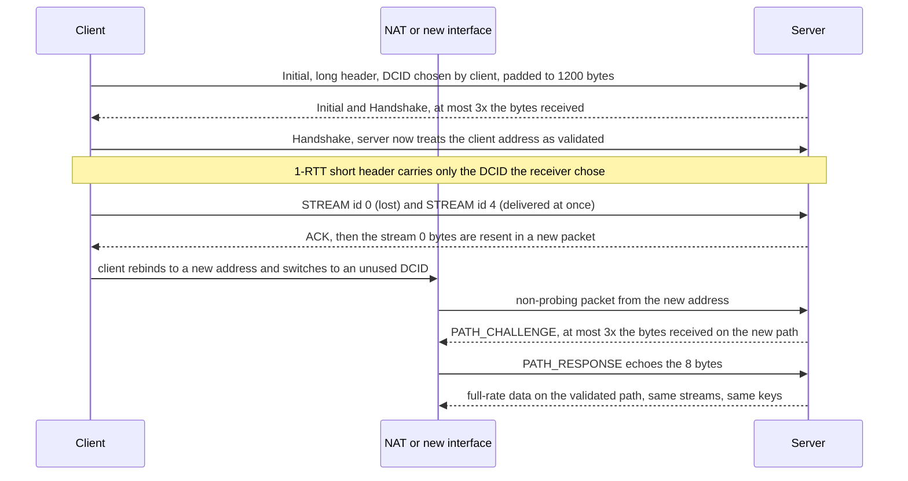

# QUIC Transport Internals: UDP Packets, Connection IDs, Independent Streams, and Migration (RFC 9000)

> [!summary] Claim
> QUIC names a connection by connection IDs instead of the UDP 4-tuple and orders bytes per stream instead of per connection, so a lost packet stalls only the streams it carried and a client can change address mid-connection, at the price of path validation, a 3x anti-amplification cap on unvalidated addresses, and a load-balancing tier that must route on connection IDs.

Part of [HTTP Semantics and Wire Protocols](README.md) in [API Engineering](../README.md).

## TL;DR

- Mechanism: QUIC v1 runs over UDP, encrypts almost every header bit, carries data in `STREAM` frames whose offsets are ordered per stream, and identifies the connection by a Destination Connection ID the receiver chose (RFC 9000 Section 5.1).
- Contract rule: a server that has not validated a client address MUST NOT send more than three times the bytes it received from it (RFC 9000 Section 8.1), and a migrating peer's new address MUST be validated with `PATH_CHALLENGE` and `PATH_RESPONSE` (RFC 9000 Section 9.3).
- Trap: a 5-tuple hashing L4 load balancer, or a server that multiplexes connections on one address and port with zero-length connection IDs, silently breaks migration and NAT rebinding (RFC 9000 Section 5.1, RFC 9308 Section 9).
- Portability fact: in the lab's server set, only Hypercorn 0.18.0 speaks QUIC (through aioquic 1.7.2); Uvicorn 0.54.0 and Granian 2.8.7 serve HTTP/1.1 and HTTP/2 only, and aioquic 1.7.2 cannot be installed on free-threaded CPython 3.15t here.
- When not to use it: low-loss east-west traffic inside a data center, networks that block UDP (3% to 5% of networks in the studies RFC 9308 Section 2 cites), or deployments that cannot route UDP by connection ID.

## Mental model



The client opens with an Initial packet whose long header names a client-chosen Destination Connection ID of at least 8 bytes and is padded to 1200 bytes, so the server's reply is bounded by 3x that size until the Handshake packet proves the client owns its address.
After the handshake, every packet uses the short header, which exposes only a Destination Connection ID that the receiver itself issued; nothing in it names the stream.
When the packet carrying stream 0 is lost, stream 4's bytes are still handed to the application, because ordering is enforced per stream, and stream 0's bytes come back in a new packet with a new packet number.
When the client's address changes, the server sees a non-probing packet from an unknown address that still carries a valid connection ID, switches its sending address, and fences the new path with the 3x limit until a `PATH_RESPONSE` echoes its `PATH_CHALLENGE`.

## How it works

### UDP datagrams, packets, and frames

A UDP datagram carries one or more QUIC packets (coalescing, RFC 9000 Section 12.2), and each packet carries frames.
Long header packets (Initial, 0-RTT, Handshake, Retry) are used before 1-RTT keys exist; the short header 1-RTT packet is used after (RFC 9000 Section 17.2 and Section 17.3).
The long header layout is `Header Form (1) = 1`, `Fixed Bit (1) = 1`, `Long Packet Type (2)`, `Type-Specific Bits (4)`, `Version (32)`, `Destination Connection ID Length (8)`, `Destination Connection ID (0..160)`, `Source Connection ID Length (8)`, `Source Connection ID (0..160)` (RFC 9000 Section 17.2, Figure 13).
The long packet types are `0x00` Initial, `0x01` 0-RTT, `0x02` Handshake, and `0x03` Retry (RFC 9000 Section 17.2, Table 5).
In QUIC v1 a connection ID length above 20 bytes MUST cause the packet to be dropped (RFC 9000 Section 17.2).
The 1-RTT short header is `Header Form (1) = 0`, `Fixed Bit (1) = 1`, `Spin Bit (1)`, `Reserved Bits (2)`, `Key Phase (1)`, `Packet Number Length (2)`, `Destination Connection ID (0..160)`, `Packet Number (8..32)` (RFC 9000 Section 17.3.1, Figure 19).
The short header has no connection ID length byte, so every receiver and every load balancer that parses it must already know the length it issued, either a fixed length or an encoding scheme in a fixed portion of the ID (RFC 9000 Section 5.1).
The header form bit, the connection ID fields, and the version are the version-independent invariants (RFC 8999 Section 5.1 and Section 5.2).
Header protection XORs the low 4 bits of a long header's first byte (`mask[0] & 0x0f`) and the low 5 bits of a short header's (`mask[0] & 0x1f`), plus the packet number (RFC 9001 Section 5.4.1).
The lab's `parse_header` therefore reads only what survives protection: the header form, fixed bit, v1 long packet type, version, and connection IDs; it applies the 20-byte cap and the v1 packet type table only to version 1, because the invariants allow connection IDs of up to 255 bytes (RFC 8999 Section 5.1).

### Variable-length integers

Stream IDs, offsets, lengths, and most frame fields use a varint whose two most significant bits give the base-2 logarithm of the length: `00` is 1 byte with 6 usable bits, `01` is 2 bytes with 14, `10` is 4 bytes with 30, and `11` is 8 bytes with 62 (RFC 9000 Section 16, Table 4).
The RFC's samples are `0xc2197c5eff14e88c` -> 151,288,809,941,952,652, `0x9d7f3e7d` -> 494,878,333, `0x7bbd` -> 15,293, and `0x25` -> 37, which `0x4025` also decodes to (RFC 9000 Appendix A.1).
Non-minimal encodings are legal except for the frame type (RFC 9000 Section 16), which is why a decoder that rejects `0x4025` in any other field is non-compliant.
The lab checks its encoder against these samples and against `encode_uint_var` (aioquic 1.7.2 src/aioquic/buffer.py, encode_uint_var).

### Streams and their identifiers

A stream ID is a 62-bit integer; bit `0x01` is the initiator (0 client, 1 server) and bit `0x02` the direction (0 bidirectional, 1 unidirectional), so `0x00` is client bidirectional, `0x01` server bidirectional, `0x02` client unidirectional, and `0x03` server unidirectional (RFC 9000 Section 2.1, Table 1).
Successive streams of one type step by 4, and using a higher ID implicitly opens all lower IDs of that type (RFC 9000 Section 2.1).
The peer caps how many it will accept: only stream IDs below `max_streams * 4 + first_stream_id_of_type` may be opened, and `max_streams` above 2^60 is a connection error (RFC 9000 Section 4.6).
aioquic derives the same bits in `stream_is_client_initiated` and `stream_is_unidirectional` (aioquic 1.7.2 src/aioquic/quic/connection.py, stream_is_client_initiated), and the lab confirms `get_next_available_stream_id` returns 0, 2, 1, and 3 for the four types after the handshake.
"QUIC does not provide any means of ensuring ordering between bytes on different streams" (RFC 9000 Section 2), which is the whole head-of-line story: a gap at offset 0 of stream 0 holds back later stream 0 bytes and nothing else.
Lost packets are never retransmitted whole; "the information that might be carried in frames is sent again in new frames" (RFC 9000 Section 13.3), and a packet number is never reused within a packet number space (RFC 9000 Section 12.3).
Loss is declared by packet threshold 3 or time threshold 9/8 of `max(smoothed_rtt, latest_rtt)` (RFC 9002 Section 6.1.1 and Section 6.1.2), constants aioquic keeps as `K_PACKET_THRESHOLD = 3` and `K_TIME_THRESHOLD = 9 / 8` (aioquic 1.7.2 src/aioquic/quic/recovery.py, K_PACKET_THRESHOLD and K_TIME_THRESHOLD).
The ordered-byte-stream contrast for TCP is the prerequisite note [[TCP-Head-of-Line-Blocking-Under-Packet-Loss]].

### Connection IDs instead of the 4-tuple

A TCP connection "is defined by a pair of sockets" (RFC 9293 Section 3.4.1), so a new client address is a new connection.
A QUIC connection owns a set of connection IDs, each chosen by the endpoint that will receive it, whose "primary function" is to keep packets reaching the right endpoint when lower-layer addressing changes (RFC 9000 Section 5.1).
During the handshake each side announces its ID in the long header's Source Connection ID, and the client's first Destination Connection ID is an unpredictable value of at least 8 bytes (RFC 9000 Section 7.2).
More IDs are issued with `NEW_CONNECTION_ID` and retired with `RETIRE_CONNECTION_ID`, bounded by `active_connection_id_limit`, which defaults to 2 and must be at least 2 (RFC 9000 Section 18.2).
aioquic demultiplexes by Destination Connection ID, not by address: `QuicServer.datagram_received` looks up `self._protocols.get(header.destination_cid, None)`, registers the client's first Destination Connection ID and the server's `host_cid`, and adds every later ID in `_connection_id_issued` (aioquic 1.7.2 src/aioquic/asyncio/server.py, QuicServer.datagram_received and QuicServer._connection_id_issued), and Hypercorn does the same with `self.connections.get(header.destination_cid)` (hypercorn 0.18.0 src/hypercorn/protocol/quic.py, QuicProtocol.handle).
A datagram whose Destination Connection ID matches no connection and is not a large enough Initial gets no protocol in `QuicServer` and is ignored; inside a connection, a packet whose Destination Connection ID matches none of its host IDs (except a client's Initial or 0-RTT) is dropped with the qlog trigger `unknown_connection_id` (aioquic 1.7.2 src/aioquic/quic/connection.py, QuicConnection.receive_datagram).
An endpoint MAY answer a packet it cannot associate with an active connection with a Stateless Reset, whose minimum size is 21 bytes (RFC 9000 Section 10.3); aioquic 1.7.2's `QuicServer` has no Stateless Reset code path (a case-insensitive grep for `reset` over src/aioquic/asyncio/server.py returns nothing, as of 2026-11).

### Address validation and the 3x limit

Before validating the client address a server "MUST NOT send more than three times as many bytes as the number of bytes they have received", counting every datagram attributed to the connection, even discarded ones (RFC 9000 Section 8.1).
The client therefore pads every datagram carrying Initial packets to at least 1200 bytes, and a server MUST discard an Initial in a smaller datagram (RFC 9000 Section 14.1).
aioquic caps the packet builder in `datagrams_to_send` with `builder.max_total_bytes = network_path.bytes_received * 3 - network_path.bytes_sent` on unvalidated paths, and its loss timers consult `QuicNetworkPath.can_send`, which returns `self.is_validated or (self.bytes_sent + size) <= 3 * self.bytes_received`, so a blocked server does not arm probes it cannot send (aioquic 1.7.2 src/aioquic/quic/connection.py, QuicConnection.datagrams_to_send, QuicNetworkPath.can_send, and QuicConnection._amplification_blocked_timers).
The lab measured it: with a self-signed P-256 certificate of 4717 to 4718 DER bytes (`QuicLab(padding_names=200)`) the server's first flight is exactly 3600 bytes for a 1200-byte client Initial, and the handshake completes only after the client's next datagram raises the budget.
A received Handshake packet validates the address (RFC 9000 Section 8.1), which aioquic marks with `network_path.is_validated = True` when it processes a Handshake-epoch packet (aioquic 1.7.2 src/aioquic/quic/connection.py, QuicConnection.receive_datagram).

### Migration and path validation

Only clients migrate in QUIC v1, apart from a client moving to a server's preferred address (RFC 9000 Section 9.6), and never before the handshake is confirmed (RFC 9000 Section 9); a `disable_active_migration` transport parameter forbids sending from a new local address to the address the peer used during the handshake (RFC 9000 Section 9 and Section 18.2).
`PATH_CHALLENGE`, `PATH_RESPONSE`, `NEW_CONNECTION_ID`, and `PADDING` are probing frames; a packet containing anything else is non-probing (RFC 9000 Section 9.1).
A non-probing packet from a new address means the peer migrated; the server MUST send subsequent packets there and MUST start path validation, and it moves only on the highest-numbered non-probing packet so reordering cannot drag it back (RFC 9000 Section 9.3).
`PATH_CHALLENGE` (type `0x1a`) carries 8 bytes of arbitrary data that the peer echoes in `PATH_RESPONSE` (RFC 9000 Section 19.17), and validation succeeds when the response arrives on any path (RFC 9000 Section 8.2.3).
The endpoint SHOULD abandon validation after three times the larger of the current PTO and the new path's PTO (RFC 9000 Section 8.2.4), and on failure MUST revert to the last validated address (RFC 9000 Section 9.3.2).
An endpoint MUST NOT reuse a connection ID when sending from more than one local address, though a server MAY keep the current ID when an unintentional NAT rebinding arrives with an unchanged one (RFC 9000 Section 9.5).
On confirming the new address the endpoint MUST reset its congestion controller and RTT estimator unless only the port changed (RFC 9000 Section 9.4).
aioquic implements the move in `receive_datagram`: for a server, a non-probing packet with `packet_number > space.largest_received_packet` on a non-active path is promoted to `self._network_paths[0]`, and `_write_application` then writes a `PATH_CHALLENGE` while that path is unvalidated (aioquic 1.7.2 src/aioquic/quic/connection.py, QuicConnection.receive_datagram and QuicConnection._write_application); the lab checks the packet number rule by delivering an older packet from the old address after a newer one from the new address.

## Numbers and limits

| Quantity | Value | Source |
|---|---|---|
| Stream ID range | 0 to 2^62-1, step 4 per type | RFC 9000 Section 2.1 |
| `max_streams` ceiling | 2^60 | RFC 9000 Section 4.6 |
| Varint sizes | 1, 2, 4, 8 bytes for 6, 14, 30, 62 bits | RFC 9000 Section 16, Table 4 |
| Connection ID length in v1 | 0 to 20 bytes | RFC 9000 Section 17.2 |
| Client's first Destination Connection ID | >= 8 bytes | RFC 9000 Section 7.2 |
| Datagram carrying an Initial | >= 1200 bytes; lab measured 1200 | RFC 9000 Section 14.1; lab |
| Anti-amplification factor | 3x bytes received | RFC 9000 Section 8.1 |
| Server first flight, 4717 to 4718 byte certificate | 3600 bytes, exactly 3 x 1200, lab | lab, see below |
| Server first flight, 305 to 307 byte certificate | 1200 bytes, below the cap, lab | lab, see below |
| First reply on a migrated, unvalidated path | 120 bytes for 40 received, lab | lab, see below |
| `PATH_CHALLENGE` data | 8 bytes | RFC 9000 Section 19.17 |
| Path validation abandon timer | 3 x max(current PTO, new-path PTO) | RFC 9000 Section 8.2.4 |
| `active_connection_id_limit` | default 2, minimum 2; aioquic advertises 8 | RFC 9000 Section 18.2; aioquic 1.7.2 connection.py, `_local_active_connection_id_limit` |
| Smallest Stateless Reset | 21 bytes | RFC 9000 Section 10.3 |
| Loss thresholds | 3 packets, 9/8 RTT, 1 ms granularity | RFC 9002 Section 6.1.1 and Section 6.1.2 |
| Initial RTT | 333 ms recommended; aioquic default `initial_rtt = 0.1` | RFC 9002 Section 6.2.2; aioquic 1.7.2 configuration.py |
| Initial congestion window | 10 x max_datagram_size, capped at max(14720, 2 x max_datagram_size); 12000 bytes at 1200 | RFC 9002 Section 7.2 |
| NAT keep-alive guidance | 30 s suggested on the public Internet | RFC 9308 Section 3.2 |
| UDP blocked | 3% to 5% of networks in the cited studies | RFC 9308 Section 2 |
| aioquic defaults | `connection_id_length = 8`, `idle_timeout = 60.0`, `max_datagram_size = SMALLEST_MAX_DATAGRAM_SIZE` (1200), `MAX_NETWORK_PATHS = 8`, `MAX_REMOTE_CHALLENGES = 32` | aioquic 1.7.2 configuration.py and connection.py |

The lab rows come from a fake network and fake clock, not a real NIC, run on CPython 3.14.6, macOS 27.2 arm64 (Darwin 27.2.0), aioquic 1.7.2, on 2026-11-09 UTC.
The exact amplification bounds (`== 3 * 1200`, `<= 3 * received`) are asserted by the tests; the 120-for-40 and certificate sizes come from a scratch script run five times from `labs/` with `uv run --frozen python`, which builds `QuicLab(padding_names=200)` and `QuicLab()`, counts `bytes_from` and `bytes_to` after one client and one server flush, and repeats the migrated-path step of `test_unvalidated_new_path_is_limited_until_path_response`.
The 3600, 1200, and 120-for-40 values were identical in all five runs; the certificate DER sizes vary by a byte or two per run because ECDSA signatures vary in length.

## Portability

| Dimension | Behavior | Proof |
|---|---|---|
| CPython 3.12.16 | 28 passed | lab, container `python:3.12-trixie` (Debian 13, glibc 2.41, aarch64), `uv run --frozen --python /usr/local/bin/python3.12`, run 2026-11-09 UTC |
| CPython 3.12.13 | 28 passed | lab, macOS 27.2 arm64, `UV_PROJECT_ENVIRONMENT=<scratch> uv run --frozen --python 3.12.13` in a separate environment |
| CPython 3.13.18 | 28 passed | lab, macOS 27.2 arm64, `/opt/homebrew/bin/python3.13` in a separate environment |
| CPython 3.14.6 and 3.14.10 | 28 passed on both | lab, macOS 27.2 arm64; the project `.venv` is 3.14.6; 3.14.10 is `/opt/homebrew/bin/python3.14` |
| CPython 3.15.2 | 28 passed | lab, macOS 27.2 arm64, `/opt/homebrew/bin/python3.15` |
| CPython 3.15.2t free-threaded | Not runnable. The locked set fails first: `uv run --frozen` reports ``psycopg-binary==3.3.8`` has no source distribution or wheel for the platform. `pip install aioquic==1.7.2` fails compiling `src/aioquic/_buffer.c` with `-DPy_LIMITED_API=0x030B0000` (`unknown type name 'PyObject_HEAD'`), and so does its dependency `pylsqpack` 1.0.0 | run: 3.15.2 free-threading build configured with `--disable-gil` from the python.org source tarball inside `python:3.15-trixie` (Linux aarch64, GCC 14.2.0); no macOS 3.15.2t build exists here (uv lists only 3.15.0b3t, which fails the same way, while 3.14.6t stops earlier with ``ValueError: `py_limited_api='cp311'` not supported``); cause: PEP 803 Motivation, "Extensions will fail to build for the Stable ABI on free-threaded Python" |
| Debian Trixie container | 28 passed | lab, `ghcr.io/astral-sh/uv:python3.14-trixie` (Debian 13, glibc 2.41, CPython 3.14.10, aarch64), `uv run --frozen` |
| Alpine musl container | 28 passed | lab, `ghcr.io/astral-sh/uv:python3.14-alpine` (Alpine 3.23.7, musl, CPython 3.14.10, aarch64), `uv run --frozen` |
| aioquic 1.7.2 | All transport mechanics in this note; only this release tested | lab; upstream tag file `connection.py` is byte-identical to the installed one |
| Uvicorn 0.54.0 | No QUIC or HTTP/3 code in the package; HTTP/2 only with the optional `zttp` protocol and `http2=True` | a case-insensitive grep for `quic` and `http3` over the installed `uvicorn/` returns nothing; uvicorn 0.54.0 uvicorn/config.py, HTTP_PROTOCOLS and Config.load |
| Hypercorn 0.18.0 | HTTP/3 over aioquic; demultiplexes by Destination Connection ID and tracks `ConnectionIdIssued` and `ConnectionIdRetired` | hypercorn 0.18.0 src/hypercorn/protocol/quic.py, QuicProtocol.handle and QuicProtocol._handle_events |
| Granian 2.8.7 | `HTTPModes` offers `auto`, `1`, and `2` only | granian 2.8.7 granian/constants.py, HTTPModes |
| HTTP/1.1 and HTTP/2 over TCP | No connection ID; a new address is a new connection, and loss stalls all multiplexed streams | RFC 9293 Section 3.4.1; [[TCP-Head-of-Line-Blocking-Under-Packet-Loss]] |
| HTTP/3 over QUIC | Inherits per-stream ordering and migration; HTTP/3 framing and QPACK are in [[HTTP-3-Framing-and-QPACK-Header-Compression-RFC-9114]] | RFC 9000 Section 2 and Section 9 |

## Worked example

The [implementation](../labs/src/api_labs/f01_http_semantics_and_wire_protocols/quic_transport.py) has a pure half (varints, stream IDs, header parsing) and a `QuicLab` class that joins an aioquic 1.7.2 client and server through a fake UDP network with a fake clock, so tests can drop datagrams, change the client address, and count bytes per address.
The [test](../labs/tests/f01_http_semantics_and_wire_protocols/test_quic_transport_streams_and_connection_migration_rfc_9000.py) has 28 unit tests and opens no sockets.

The varint encoder, an excerpt byte-identical to the lab file:

```python
def encode_varint(value: int) -> bytes:
    """Encode *value* in the shortest QUIC variable-length integer form (RFC 9000 Section 16)."""
    if value < 0 or value > VARINT_MAX:
        raise ValueError(f"varint out of range: {value}")
    if value <= 0x3F:
        return value.to_bytes(1, "big")
    if value <= 0x3FFF:
        return (value | 0x4000).to_bytes(2, "big")
    if value <= 0x3FFF_FFFF:
        return (value | 0x8000_0000).to_bytes(4, "big")
    return (value | 0xC000_0000_0000_0000).to_bytes(8, "big")
```

The fake network: the server is created from the first datagram's client-chosen Destination Connection ID, the way a real server's demultiplexer does it (excerpt, byte-identical to the lab file):

```python
    def client_send(self, *, drop: bool = False) -> list[bytes]:
        """Flush client datagrams; deliver them from ``client_addr`` unless *drop*."""
        sent = [data for data, _ in self.client.datagrams_to_send(self.now)]
        if drop:
            return sent
        for data in sent:
            if self._server is None:
                # Like a server's demultiplexer: the client-chosen DCID names the connection.
                header = parse_header(data, short_dcid_length=8)
                self._server = QuicConnection(
                    configuration=self._server_cfg,
                    original_destination_connection_id=header.dcid,
                )
            self.bytes_from[self.client_addr] += len(data)
            self._server.receive_datagram(data, self.client_addr, self.now)
        return sent
```

Loss on one stream does not block another (excerpt, byte-identical to the test file):

```python
@pytest.mark.unit
def test_lost_packet_on_one_stream_does_not_block_another_stream() -> None:
    lab = connected_lab()
    lab.client.send_stream_data(0, b"A" * 100, end_stream=True)
    lab.client_send(drop=True)
    lab.client.send_stream_data(4, b"B" * 100, end_stream=True)
    lab.client_send()

    before_recovery = drain_events(lab.server)
    assert stream_bytes(before_recovery, 4) == b"B" * 100
    assert stream_bytes(before_recovery, 0) == b""

    recovered: list[QuicEvent] = []
    for _ in range(100):
        lab.advance(0.01)
        lab.server_send()
        lab.client_send()
        recovered += drain_events(lab.server)
        if stream_bytes(recovered, 0):
            break
    assert stream_bytes(recovered, 0) == b"A" * 100
```

Moving the second write onto stream 0 (same bytes, `end_stream=True` only on the second write) shows the opposite case: the server receives the 133-byte datagram carrying the `B` bytes but delivers `b''` on stream 0 until the lost offset returns, which is head-of-line blocking inside one stream (scratch script, three runs, same machine).

Migration keeps the stream and rotates connection IDs in both directions (excerpt, byte-identical to the test file):

```python
@pytest.mark.unit
def test_migration_keeps_stream_state_and_rotates_connection_ids() -> None:
    lab = connected_lab()
    lab.client.send_stream_data(0, b"GET /a ")
    dcid_to_server_before = parse_header(lab.client_send()[0], short_dcid_length=8).dcid
    lab.server.send_stream_data(0, b"ack-1 ")
    dcid_to_client_before = parse_header(lab.server_send()[0][0], short_dcid_length=8).dcid
    lab.pump()
    drain_events(lab.server)
    drain_events(lab.client)

    lab.migrate_client(NEW_ADDR)
    lab.client.send_stream_data(0, b"POST /b", end_stream=True)
    after = parse_header(lab.client_send()[0], short_dcid_length=8)
    assert after.dcid != dcid_to_server_before
    assert stream_bytes(drain_events(lab.server), 0) == b"POST /b"
    assert lab.server.get_peer_address() == NEW_ADDR

    lab.server.send_stream_data(0, b"ack-2", end_stream=True)
    reply, addr = lab.server_send()[0]
    assert addr == NEW_ADDR
    assert parse_header(reply, short_dcid_length=8).dcid != dcid_to_client_before
    lab.pump()
    assert stream_bytes(drain_events(lab.client), 0) == b"ack-2"
```

Run from `labs/` on CPython 3.14.6, macOS 27.2 arm64, 2026-11-09 UTC:

```text
$ uv run --frozen pytest tests/f01_http_semantics_and_wire_protocols/test_quic_transport_streams_and_connection_migration_rfc_9000.py -q
............................                                             [100%]
28 passed in 0.15s
```

The mechanisms were checked by mutation: 21 deliberate breaks in total, each applied alone, run with `uv run --frozen pytest <test path> -q` from `labs/`, and reverted.
Eleven were breaks inside aioquic or the lab (wrong varint prefix, swapped stream ID bits, a fake network that never drops, no connection ID rotation on migration, a constant fixed bit, the 20-byte cap and v1 packet types applied to every version, an amplification factor of 4 inside aioquic, a `PATH_RESPONSE` that does not validate, a server that never promotes a new path, and a server that promotes on any packet number); aioquic was restored byte-identical to the upstream tag.
Ten more were applied to `quic_transport.py` in the final pass: a 7-bit varint mask, swapped 0-RTT and Handshake type names, `server_send` delivering to every address, `advance` never firing timers, no byte accounting in `server_send` or in `client_send`, a short header read one byte too long, the wrong server bit in `nth_stream_id`, `migrate_client` never rotating the connection ID, and `pump` stopping after one round.
Four of the eleven survived the original 21 tests, and two of the ten survived the 23 that followed; they are why `test_parse_header_applies_v1_rules_only_to_version_1`, `test_reordered_older_packet_from_old_address_does_not_move_the_path_back`, `test_parse_header_maps_v1_long_packet_types_per_rfc_9000_table_5`, and `test_fake_network_delivers_only_datagrams_addressed_to_the_client` exist, and all 21 are now killed.

## Pitfalls

> [!warning] Routing UDP by 5-tuple
> Trigger: an L4 load balancer or ECMP hash keyed on source IP and port in front of several QUIC servers, or servers issuing zero-length connection IDs.
> Symptom: after a NAT rebinding or a Wi-Fi to cellular switch, packets land on a server with no state for the connection ID and are dropped, so the client sees a stall until its idle timeout fires.
> Fix: issue non-zero-length connection IDs that encode a routable server identity and route on them; RFC 9000 Section 5.1 says multiplexing connections on the same local IP address and port with zero-length IDs "will cause failures in the presence of peer connection migration, NAT rebinding, and client port reuse", and RFC 9308 Section 9 "strongly" recommends non-zero-length IDs when clients may be behind a NAT.

> [!warning] Unbounded `PATH_RESPONSE` queue (CVE-2023-49295)
> Trigger: a peer floods `PATH_CHALLENGE` frames while collapsing the victim's congestion window with selective ACKs and skewing its RTT estimate.
> Symptom: the victim queues one `PATH_RESPONSE` per challenge, cannot send them, and runs out of memory; NVD records this for quic-go, patched in 0.37.7, 0.38.2, and 0.39.4.
> Fix: cap queued challenges per path; aioquic 1.7.2 drops challenges beyond `MAX_REMOTE_CHALLENGES = 32` in `_handle_path_challenge_frame`, with a comment that this is "technically not compliant with RFC 9000 but it's needed to avoid resource exhaustion attacks".

> [!warning] Unbounded `RETIRE_CONNECTION_ID` queue (CVE-2024-22189)
> Trigger: a peer sends many `NEW_CONNECTION_ID` frames that retire old IDs while starving the victim's sending with the same congestion window tricks.
> Symptom: memory exhaustion from pending `RETIRE_CONNECTION_ID` frames; NVD records this for quic-go before 0.42.0.
> Fix: bound pending retirements; aioquic 1.7.2 closes the connection with `CONNECTION_ID_LIMIT_ERROR` when `len(self._retire_connection_ids) > min(self._local_active_connection_id_limit * 4, MAX_PENDING_RETIRES)` with `MAX_PENDING_RETIRES = 100` (aioquic 1.7.2 src/aioquic/quic/connection.py, QuicConnection._handle_new_connection_id_frame).

> [!warning] Large certificate chains hit the 3x cap
> Trigger: a long RSA chain or a certificate with many SANs on a QUIC listener without address validation tokens.
> Symptom: the server's first flight stops at 3x the client's 1200 bytes; in the lab a 4.7 KB certificate made the server send exactly 3600 bytes and wait for another client datagram before the handshake could finish.
> Fix: keep the chain short and prefer ECDSA keys; measure the first flight in a lab like this one before shipping a new certificate.

> [!warning] Expecting migration to keep throughput
> Trigger: a client migrates mid-download and the service expects the old rate.
> Symptom: a throughput dip while path validation runs (at least one RTT, RFC 9308 Section 9) and while the congestion controller restarts from its initial window.
> Fix: budget for it; RFC 9000 Section 9.4 requires resetting congestion state on a new address unless only the port changed, and RFC 9002 Section 7.2 puts the restart at 12000 bytes for 1200-byte datagrams.

> [!warning] A ported congestion controller pins the window after loss stops
> Trigger: a QUIC stack ports a Linux CUBIC idle-time fix into its own congestion controller and measures idle time from the last packet sent while the congestion window is two packets.
> Symptom: Cloudflare's quiche tests on a 10 ms RTT path with 30% loss for the first 2 seconds, then none, failed to finish a 10 MB download in 10 seconds about 60% of the time (61% in the post's heading); the window stayed at 2700 bytes, two full-size packets, with 999 recovery transitions in about 6.7 seconds even though loss had stopped (Cloudflare, "When 'idle' isn't idle: how a Linux kernel optimization became a QUIC bug", published 2026-05-12).
> Fix: measure idle time from `max(last_ack_time, last_sent_time)`, which Cloudflare describes as a three-line change in quiche, and keep a lossy-then-clean regression test; Reno passed the same test, which isolated the bug to CUBIC.

> [!warning] No TCP fallback
> Trigger: shipping an HTTP/3-only client or endpoint.
> Symptom: total failure on the 3% to 5% of networks that block UDP (RFC 9308 Section 2).
> Fix: always keep HTTP/2 or HTTP/1.1 over TLS and TCP available and discover HTTP/3 opportunistically, see [[Alt-Svc-and-HTTP-Version-Negotiation]].

## Security and robustness

- Reflection and amplification: the 3x cap (RFC 9000 Section 8.1), client padding (RFC 9000 Section 14.1), and Retry tokens (RFC 9000 Section 8.1.2) bound what a spoofed source address can make a server emit; the lab asserts the cap both during the handshake and on a migrated path.
- Spoofed migration: an on-path attacker that forwards a copy of a packet from a spoofed address can make the server move first, but validation fails because the attacker cannot answer the encrypted `PATH_CHALLENGE`, and the next higher-numbered packet from the real address moves the server back (RFC 9000 Section 9.3.2); `test_spoofed_copy_migrates_until_higher_packet_from_real_address` reproduces exactly that sequence with aioquic.
- Request forgery: datagrams sent to a spoofed migration address carry a Destination Connection ID and ciphertext an attacker may influence, so sending only probing frames before validation limits control over the payload (RFC 9000 Section 21.5.4).
- Linkability: connection IDs MUST NOT carry anything an observer can correlate with other IDs of the same connection (RFC 9000 Section 5.1), and a new local address needs a new ID (RFC 9000 Section 9.5); a load-balancer ID scheme must therefore hide the server identity from observers, for example by encrypting it; RFC 9308 Section 11.1 discusses encoding routing information in the ID with QUIC-LB as its example.
- Header integrity: reserved bits are protected and a non-zero value after removing protection is a `PROTOCOL_VIOLATION` (RFC 9000 Section 17.2), so middleboxes cannot set them and endpoints must check only after decryption.
- Resource exhaustion maps to OWASP API4:2023 Unrestricted Resource Consumption: every per-peer queue (path challenges, retired IDs, network paths, streams) needs a hard bound, as in aioquic's `MAX_REMOTE_CHALLENGES`, `MAX_PENDING_RETIRES`, `MAX_NETWORK_PATHS`, and the `max_streams` limit (RFC 9000 Section 4.6).
- Defense in depth: QUIC's checks do not replace network ingress filtering; RFC 9000 Section 21.5.4 names BCP 38 as especially effective against spoofing-based attacks.

## The principal's view

The decision is not "turn on HTTP/3"; it is whether your edge can route UDP by connection ID, because that is what makes QUIC's two headline properties, per-stream loss isolation and migration, work in production.
If the load-balancing tier hashes 5-tuples, you pay QUIC's costs (UDP processing, encrypted headers that your network team can no longer inspect, a TCP fallback you must keep) and lose migration on every NAT rebinding.
The usual shape is to terminate QUIC at a CID-aware edge, keep HTTP/2 or HTTP/1.1 to the origins, and expose HTTP/3 through Alt-Svc so clients fall back cleanly.
QUIC wins where loss and mobility dominate: mobile clients, lossy last miles, and long-lived streaming connections where one lost packet should not freeze every request.
It loses where neither exists: inside a data center with near-zero loss and stable addresses, HTTP/2 over TCP is simpler to operate and to observe.
Streams are invisible to the network, so traffic that needs different network treatment belongs on separate connections, not separate streams (RFC 9308 Section 4.1).
The organizational trade-off is ownership: connection ID schemes, UDP rate limits, and amplification budgets now belong to the team that runs the edge, and the API team must test the fallback path as a first-class path.

## Interview questions

> [!question] L5: How do the two low bits of a QUIC stream ID work, and what is the ID of the third server-initiated unidirectional stream?
>
> > [!success]- Answer
> > Bit `0x01` is the initiator, 0 for the client and 1 for the server.
> > Bit `0x02` is the direction, 0 for bidirectional and 1 for unidirectional (RFC 9000 Section 2.1).
> > Streams of one type step by 4, so server unidirectional streams are 3, 7, 11, and the third is 11.
> >
> > Follow-up: What does a peer do if it receives a `STREAM` frame for ID 40 when it has seen only stream 0 of that type?

> [!question] L5: Predict the output: `encode_varint(15_293).hex()`, `decode_varint(bytes.fromhex("4025"))`, and `classify_stream_id(2)` from the lab module.
>
> > [!success]- Answer
> > `encode_varint(15_293).hex()` is `'7bbd'`, the 2-byte form with prefix `01`.
> > `decode_varint(bytes.fromhex("4025"))` is `(37, 2)`, because non-minimal encodings are legal outside the frame type (RFC 9000 Section 16).
> > `classify_stream_id(2)` is `StreamType(initiator='client', direction='uni')`.
> >
> > Follow-up: Why does the frame type field forbid the non-minimal form that every other field allows?

> [!question] L5: Why must a client pad its first Initial datagram to 1200 bytes?
>
> > [!success]- Answer
> > It proves the path carries datagrams of the minimum size in both directions.
> > It also gives the server a 3600-byte budget under the 3x anti-amplification rule, enough for a typical first flight (RFC 9000 Section 14.1 and Section 8.1).
> > A server MUST discard an Initial in a smaller datagram, which stops tiny spoofed packets from buying large replies.
> >
> > Follow-up: What happens to the handshake when the certificate chain does not fit in that budget?

> [!question] L6: If the packet carrying stream 0 is lost and the next packet carries stream 4, what does the application see, and when?
>
> > [!success]- Answer
> > Stream 4's bytes are delivered immediately, because QUIC orders bytes per stream only (RFC 9000 Section 2).
> > Later bytes on stream 0 wait for the gap at the lost offset.
> > The sender detects the loss by packet or time threshold (RFC 9002 Section 6.1) and resends the frame contents in a new packet with a new packet number (RFC 9000 Section 13.3).
> > The lab test shows stream 4 delivered while stream 0 is still empty, and stream 0 arriving intact after recovery.
> >
> > Follow-up: Where does head-of-line blocking come back in HTTP/3, and how does QPACK avoid it?

> [!question] L6: Walk through what the server does when a client's NAT rebinds from port 50000 to port 61000.
>
> > [!success]- Answer
> > The next non-probing packet arrives from a new address but carries a valid connection ID, so the server associates it with the connection (RFC 9000 Section 9.3).
> > If it is the highest-numbered non-probing packet so far, the server switches its sending address and starts path validation with a `PATH_CHALLENGE`.
> > Until the `PATH_RESPONSE` arrives the server sends at most 3x the bytes received from the new address.
> > Because only the port changed, the server MAY keep its congestion state (RFC 9000 Section 9.4), and it MAY keep the same connection ID because the change was not the client's choice (RFC 9000 Section 9.5).
> >
> > Follow-up: What does the server do if validation of the new address fails?

> [!question] L6: Debug this API: with four QUIC servers behind a cloud L4 load balancer in UDP mode with default session affinity, HTTP/3 uploads to `api.example.com` hang for 30 seconds and then fail after a phone switches from Wi-Fi to LTE, while HTTP/2 users reconnect and carry on; what is wrong?
>
> > [!success]- Answer
> > The L4 load balancer hashes the UDP 5-tuple, so after the address change the client's packets go to a server that has no state for that connection ID.
> > That server drops them as an unknown connection ID, or answers with a Stateless Reset if it implements one, so the client stalls until its idle or loss timers give up.
> > HTTP/2 users open a new TCP connection from the new address, and the balancer routes that new flow like any other, so they never depend on flow affinity surviving an address change.
> > Fix it by routing on the connection ID: issue IDs that encode the server, with encryption against linkability (RFC 9000 Section 5.1, RFC 9308 Section 11.1).
> > A stopgap is the `disable_active_migration` transport parameter plus fast reconnects, which gives up migration on purpose.
> >
> > Follow-up: Why does a fixed connection ID length matter to that load balancer?

> [!question] L7+: If an on-path attacker forwards a copy of a client packet from a spoofed address so that it arrives first, what happens, and which rules contain the damage?
>
> > [!success]- Answer
> > The server sees a non-probing packet from a new address and migrates to it; the real copy then arrives as a duplicate and is dropped (RFC 9000 Section 9.3.2).
> > The server's traffic to the spoofed address is limited to 3x what it received from there, and it is encrypted, so the attacker gets little amplification and cannot answer the `PATH_CHALLENGE`.
> > The client's next, higher-numbered packet from its real address triggers another migration, back to a path that is already validated, which abandons the spurious validation.
> > If validation simply fails, the server MUST revert to the last validated address.
> > The lab reproduces this with aioquic: the peer address flips to the attacker, stays there after the duplicate, and flips back on the next client packet with the stream intact.
> >
> > Follow-up: How would you detect this attack in production telemetry?

> [!question] L7+: Design the connection ID scheme for 2,000 QUIC servers behind ECMP routers that cannot keep per-flow state.
>
> > [!success]- Answer
> > Use a fixed connection ID length fleet-wide, or encode the length in a fixed portion of the ID, because short headers carry no length byte (RFC 9000 Section 5.1).
> > Encode a server identifier in the ID so any router or stateless forwarder can steer packets, and encrypt or obfuscate it because IDs MUST NOT be linkable by observers (RFC 9000 Section 5.1); RFC 9308 Section 11.1 points to QUIC-LB for this.
> > Issue several IDs per connection and let clients rotate them on migration (RFC 9000 Section 9.5), within the peer's `active_connection_id_limit`.
> > Plan for rolling key and identity changes, Stateless Reset for state lost on crashes (RFC 9000 Section 10.3), and a TCP fallback for UDP-blocked clients.
> > The trade-off is that the edge now owns a cryptographic routing scheme and its key rotation.
> >
> > Follow-up: What breaks if two servers can ever issue the same connection ID?

> [!question] L7+: Should your team move all internal service-to-service traffic from HTTP/2 to HTTP/3?
>
> > [!success]- Answer
> > Against, by default: inside a data center loss is rare and addresses are stable, so per-stream loss isolation and migration buy little.
> > The costs are real: UDP paths through existing load balancers, encrypted transport headers that weaken network observability, separate kernel tuning, and less mature server support in the lab's own stack, where only Hypercorn speaks QUIC.
> > For, in specific cases: long-lived streams across lossy WAN links, or clients that roam between networks.
> > If different traffic classes need different network treatment, they need separate connections anyway, because streams are invisible to the network (RFC 9308 Section 4.1).
> >
> > Follow-up: What measurement would change your answer?

## Related

Prerequisites: [[TCP-Head-of-Line-Blocking-Under-Packet-Loss]]

Next: [[HTTP-3-Framing-and-QPACK-Header-Compression-RFC-9114]]

See also: [[HTTP-Evolution-HTTP1-HTTP2-HTTP3]], [[HTTP-2-Binary-Framing-and-Stream-State-Machine]], [[HTTP-2-Flow-Control-and-Window-Update-Mechanics]], [[Alt-Svc-and-HTTP-Version-Negotiation]], [[TLS-1-3-Handshake-Cipher-Suites-and-ALPN-RFC-9846]], [[L4-vs-L7-Load-Balancing-for-HTTP-1-1-HTTP-2-and-gRPC]], [[Hypercorn-Internals-HTTP-2-HTTP-3-QUIC-and-AnyIO-Trio-Workers]], [[Load-Balancing]], [[Network-Diagnostics-and-DDoS]]

- Lab: `labs/tests/f01_http_semantics_and_wire_protocols/test_quic_transport_streams_and_connection_migration_rfc_9000.py`

## Further reading

- [RFC 9000](https://www.rfc-editor.org/rfc/rfc9000.html): QUIC v1 transport; Sections 2, 5, 8, 9, 12 to 17, and 21 are the mechanics in this note.
- [RFC 9001](https://www.rfc-editor.org/rfc/rfc9001.html): how TLS 1.3 keys QUIC packets and how header protection hides the packet number.
- [RFC 9002](https://www.rfc-editor.org/rfc/rfc9002.html): loss detection thresholds, PTO, and the congestion window a migrated path restarts from.
- [RFC 8999](https://www.rfc-editor.org/rfc/rfc8999.html): the version-independent invariants that middleboxes and load balancers may rely on.
- [RFC 9308](https://www.rfc-editor.org/rfc/rfc9308.html): operator-facing applicability guidance on fallback, keep-alives, migration, and connection ID design.
- [RFC 9293](https://www.rfc-editor.org/rfc/rfc9293.html): the TCP baseline, where a connection is a socket pair.
- [aioquic 1.7.2 connection.py](https://github.com/aiortc/aioquic/blob/1.7.2/src/aioquic/quic/connection.py): a readable sans-I/O implementation of path validation, migration, and amplification limits.
- [CVE-2023-49295](https://nvd.nist.gov/vuln/detail/CVE-2023-49295) and [CVE-2024-22189](https://nvd.nist.gov/vuln/detail/CVE-2024-22189): two quic-go memory exhaustion bugs that show why every per-peer queue needs a bound.
- [PEP 803](https://peps.python.org/pep-0803/): why a Stable ABI extension such as aioquic's cannot be built on free-threaded CPython yet.
- [Cloudflare, "When idle isn't idle"](https://blog.cloudflare.com/quic-death-spiral-fix/): an original postmortem of a QUIC congestion controller bug found by qlog traces and a lossy-then-clean test.
