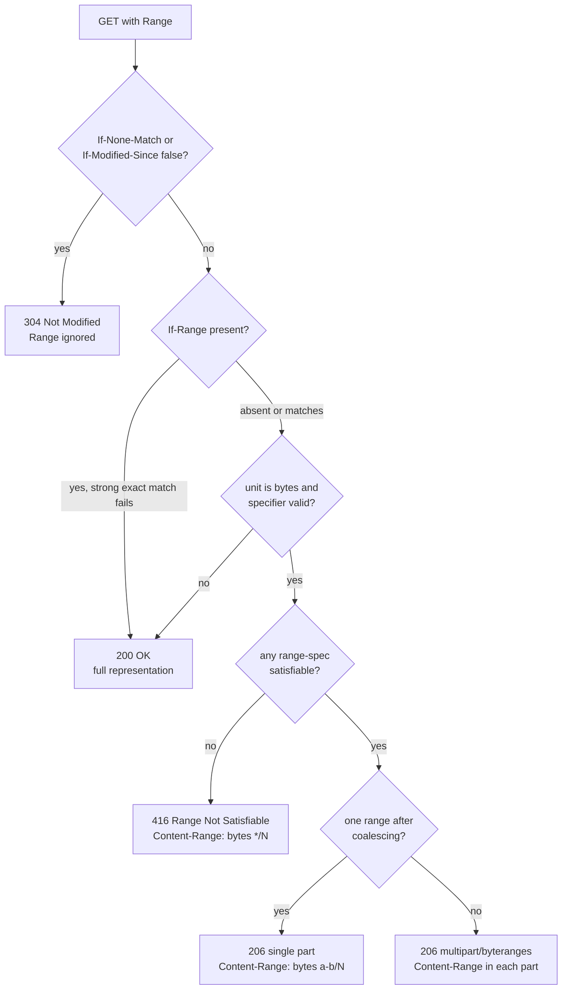

# Byte-Range Requests, 206 Partial Content, 416 Range Not Satisfiable, and If-Range (RFC 9110)

> [!summary] Claim
> A range request is a conditional transform of a `GET`: the server answers `206` with exactly the bytes asked for, `416` with `Content-Range: bytes */N` when nothing is satisfiable, or a full `200` when it chooses to ignore the `Range`, and only a strong-validator `If-Range` makes resuming safe against a representation that changed between requests.

Part of [HTTP Semantics and Wire Protocols](README.md) in [API Engineering](../README.md).

## TL;DR

- Mechanism: `Range: bytes=first-last` selects inclusive byte offsets of the selected representation; the server replies `206 Partial Content` with `Content-Range: bytes first-last/complete`, or `multipart/byteranges` for several ranges (RFC 9110 Section 14.2 and Section 15.3.7).
- Contract rule: a server MAY ignore `Range` and send `200`, MUST ignore it for methods other than `GET`, an origin server MUST ignore it for units it does not understand, and `416` with `Content-Range: bytes */N` is the SHOULD for a valid specifier with no satisfiable range, also permitted for an excessive number of small or overlapping ranges (RFC 9110 Section 14.2 and Section 15.5.17).
- Trap: resuming with `Range` but without `If-Range` splices the old prefix onto the new suffix when the file changed; `If-Range` with a strong `ETag` turns that case into a clean `200` restart (RFC 9110 Section 13.1.5).
- Portability: range semantics are version-independent, so HTTP/1.1, HTTP/2, and HTTP/3 behave the same; frameworks differ instead, for example Starlette 1.10.0 answers `400` where RFC 9110 says to ignore an unknown range unit.
- When not to use it: do not offer ranges on content that is generated per request, compressed on the fly, or lacks a strong validator; send `Accept-Ranges: none` or omit `Accept-Ranges` instead.

## Mental model



The request first passes the cache-validation preconditions, because a validated cache is cheaper than a partial response and a `304` wins over `Range` (RFC 9110 Section 13.2.2 steps 3 to 5).
`If-Range` is evaluated next, and a false result does not fail the request: it silently drops the `Range` and the client receives the whole current representation.
Only then is the `Range` value parsed; an unknown unit or an invalid specifier falls through to `200`, because ignoring `Range` is always a conforming answer.
In this lab a valid specifier with no satisfiable range is the one path to `416` (RFC 9110 Section 15.5.17 also allows `416` for an excessive number of small or overlapping ranges), and the `*/N` form tells the client the current length so it can stop retrying.
Satisfiable ranges are coalesced, and the number left decides between a single-part body and a `multipart/byteranges` body.

## How it works

### Request grammar

The field is `Range = ranges-specifier`, with `ranges-specifier = range-unit "=" range-set` and `range-set = 1#range-spec` (RFC 9110 Section 14.2 and Section 14.1.1).
A `range-spec` is an `int-range` (`first-pos "-" [ last-pos ]`), a `suffix-range` (`"-" suffix-length`), or an `other-range` that byte ranges never use (RFC 9110 Section 14.1.1 and Section 14.1.2).
Positions are inclusive zero-based octet offsets, so `bytes=0-499` is the first 500 bytes and `bytes=-500` is the last 500 (RFC 9110 Section 14.1.2).
The unit token is case-insensitive (RFC 9110 Section 14.1), the list syntax allows optional whitespace around commas and empty elements (RFC 9110 Section 5.6.1.2), and the specification's own example `bytes= 0-999, 4500-5499, -1000` puts a space after `=` (RFC 9110 Section 14.1.2), so `BYTES= 5-9 ,` is the same request as `bytes=5-9`; the lab parametrizes exactly that case.
Byte offsets count the bytes after any content coding, not the decoded bytes (RFC 9110 Section 14.1.2), which matters as soon as a compressor sits in the response path.

### Satisfiability and clamping

An `int-range` is invalid if `last-pos` is present and less than `first-pos` (RFC 9110 Section 14.1.1).
For a `GET`, an `int-range` is satisfiable if `first-pos` is below the current length, and a `suffix-range` is satisfiable if its length is non-zero (RFC 9110 Section 14.1.2).
A `last-pos` at or beyond the end is clamped to `length - 1`, and a `suffix-length` longer than the representation selects the whole representation (RFC 9110 Section 14.1.2).
So `bytes=30-999` on a 36-byte resource is `bytes 30-35/36`, `bytes=-0` is unsatisfiable, and `bytes=36-` is unsatisfiable; the lab asserts all three.
The specification also warns that the numerals are unbounded and that recipients "MUST anticipate potentially large decimal numerals and prevent parsing errors due to integer conversion overflows" (RFC 9110 Section 14.1.2).
In CPython that warning has a concrete shape: `int()` on a decimal string longer than `sys.get_int_max_str_digits()` (4300 by default) raises `ValueError`, which the lab asserts on every interpreter it ran.
The lab's `_clamped_int` and `_decimal_lt` compare digit strings by length and then lexically after stripping leading zeros, so a 5000-digit `last-pos` clamps to the end without ever calling `int()` on it.

### Response shapes

A single-part `206` carries `Content-Range: bytes first-last/complete-length` and a `Content-Length` equal to the enclosed octets, not the full length (RFC 9110 Section 15.3.7 and Section 15.3.7.1).
A multipart `206` carries `Content-Type: multipart/byteranges; boundary=...` and MUST NOT carry a top-level `Content-Range`; each body part has its own `Content-Range` and SHOULD repeat the representation `Content-Type` (RFC 9110 Section 15.3.7.2).
The body is RFC 2046 multipart framing, as the lab's renderer writes it:

```text
--RANGE_LAB_BOUNDARY\r\n
Content-Type: text/plain\r\n
Content-Range: bytes 0-2/36\r\n
\r\n
012\r\n
--RANGE_LAB_BOUNDARY\r\n
Content-Type: text/plain\r\n
Content-Range: bytes 10-12/36\r\n
\r\n
abc\r\n
--RANGE_LAB_BOUNDARY--\r\n
```

A server MUST NOT send a multipart response to a single-range request, MAY send a one-part multipart when several ranges coalesce to one, and MAY coalesce overlapping ranges or ranges separated by a gap smaller than the per-part overhead (RFC 9110 Section 15.3.7.2).
The same section says a multipart response SHOULD keep the parts in request order, minus unsatisfiable and coalesced ranges; the lab's `coalesce` sorts ascending, so `bytes=10-12,0-2` comes back as `0-2` then `10-12`, a deliberate deviation from that SHOULD.
A `206` MUST include `Date`, `Cache-Control`, `ETag`, `Expires`, `Content-Location`, and `Vary` if a `200` would have carried them (RFC 9110 Section 15.3.7).
A `416` SHOULD carry `Content-Range: bytes */complete-length` with the current length (RFC 9110 Section 14.4 and Section 15.5.17).
On the client side, a `Content-Range` whose `last-pos` is below `first-pos`, or whose `complete-length` is at most `last-pos`, is invalid and MUST NOT be recombined with stored data (RFC 9110 Section 14.4); the lab's `parse_content_range` enforces both rules.

### If-Range and safe recombination

`If-Range = entity-tag / HTTP-date`, distinguished by a `DQUOTE` within the first three characters (RFC 9110 Section 13.1.5).
An entity tag matches only under the strong comparison function, so `W/"v1"` never matches anything, not even `W/"v1"` (RFC 9110 Section 8.8.3.2 and Section 13.1.5).
An HTTP-date matches only if it is a strong validator and exactly equals `Last-Modified`; this is an exact match, unlike the "earlier than or equal to" rule of `If-Unmodified-Since` (RFC 9110 Section 13.1.5).
A `Last-Modified` date is implicitly weak unless the origin knows the representation did not change twice within that second, and the cache-side proxy for that knowledge is a `Date` at least one second after `Last-Modified` (RFC 9110 Section 8.8.2.2).
The lab applies that one-second rule on the server, comparing its own `Date` with `Last-Modified`, which is a conservative stand-in for the origin rule.
A client MAY combine partial responses only if they share the same strong validator (RFC 9110 Section 15.3.7.3), and a cache MAY do the same (RFC 9111 Section 3.4).

### What Starlette 1.10.0 does

Starlette 1.10.0 is the release pinned in `labs/pyproject.toml` (as of 2026-11), and every statement below was read in its source and, where a test is named, executed.
`FileResponse.__call__` takes the range path only when the response status is `200`, a `range` header exists, the method is `GET` or `HEAD`, and, when `If-Range` is present, `_should_use_range` accepts it (starlette 1.10.0 starlette/responses.py, FileResponse.__call__).
`_should_use_range` rejects values starting with `W/` and otherwise compares the raw string with the response's own `last-modified` or `etag` header; it applies no date-strength check (starlette 1.10.0 starlette/responses.py, FileResponse._should_use_range).
`_parse_range_header` raises `MalformedRangeHeader` (rendered as `400`) for a unit other than `bytes`, which breaks the origin-server MUST in RFC 9110 Section 14.2, and when `last-pos` is below `first-pos` (its exclusive `end` is at or below `start`), which Section 14.2 permits because a server MAY ignore or reject an invalid specifier, raises `RangeNotSatisfiable` (rendered as `416` with `Content-Range: bytes */size`) when any one start is past the end, even if other ranges are satisfiable, which is stricter than RFC 9110 Section 14.1.1 where one satisfiable range makes the whole set satisfiable, and returns an empty list, which means a full `200`, when the header has more than `max_ranges = 100` comma-separated parts (starlette 1.10.0 starlette/responses.py, FileResponse._parse_range_header).
Multiple ranges are sorted and then overlapping or adjacent ones are merged in one pass (the test is `start <= last_end` on exclusive ends, so `bytes=0-4,5-9` becomes one `(0, 10)` range), and `_handle_multiple_ranges` generates a `token_hex(13)` boundary, which is 26 hex characters (starlette 1.10.0 starlette/responses.py, FileResponse._handle_multiple_ranges).
`_parse_ranges` strips whitespace around each position and converts it with `int()`, which also accepts `_` separators and a leading `+`, so Starlette serves `bytes=0-1_0` and `bytes=0- 10` as `bytes 0-10/1024` and `bytes=+0-+5` as `bytes 0-5/1024` although the ABNF `DIGIT` rule allows none of them; the lab asserts all three (starlette 1.10.0 starlette/responses.py, FileResponse._parse_ranges).
Partial responses never use the `http.response.pathsend` extension: the code sets `send_pathsend = False` on both range paths (starlette 1.10.0 starlette/responses.py, FileResponse.__call__).
`GZipMiddleware` passes any `206` through untouched, because `IdentityResponder.send_with_compression` sets `partial_response` when the status is `206` (starlette 1.10.0 starlette/middleware/gzip.py, IdentityResponder.send_with_compression).

## Numbers and limits

| Quantity | Value | Source |
| --- | --- | --- |
| Typical `multipart/byteranges` overhead per part | about 80 bytes | RFC 9110 Section 15.3.7.2 |
| Lab overhead, 100 one-byte parts, 18-char boundary, `application/octet-stream` | 10168 body bytes for 100 payload bytes | measured, see command below |
| Starlette overhead, 100 one-byte parts, 26-char boundary | 10974 body bytes for 100 payload bytes (about 110x) | measured with `FileResponse.generate_multipart`, starlette 1.10.0 |
| Starlette `FileResponse.max_ranges` | 100; 101 parts -> full `200` | starlette 1.10.0 source; lab test |
| Starlette `FileResponse.chunk_size` | 65536 bytes (`64 * 1024`) | starlette 1.10.0 starlette/responses.py |
| Starlette multipart boundary | `token_hex(13)`, 26 hex chars, 104 random bits | starlette 1.10.0 source; lab regex assertion |
| This lab's `DEFAULT_MAX_RANGES` | 8; 9 parts -> full `200`, 8 parts -> `206` | lab tests |
| CPython `int()` decimal digit limit | 4300 digits by default; 5000 digits raises `ValueError` | lab test on CPython 3.12.13, 3.13.18, 3.14.6, 3.14.10, 3.15.2 |
| CVE-2011-3192 affected Apache httpd | 1.3.x, 2.0.x through 2.0.64, 2.2.x through 2.2.19 | NVD CVE-2011-3192 |
| CVE-2017-7529 affected nginx | 0.5.6 through 1.13.2; fixed in 1.13.3 and 1.12.1 | nginx-announce 2017/000200 |
| CVE-2025-62727 affected Starlette | 0.39.0 up to but excluding 0.49.1 | NVD CVE-2025-62727 |

The two overhead rows came from this command on macOS 27.2 (arm64, Darwin 27.2.0) with CPython 3.14.6 in the lab virtual environment; they are byte counts, not timings, so they do not depend on the machine:

```sh
cd labs && uv run --frozen python -c "
from api_labs.f01_http_semantics_and_wire_protocols.range_requests import ByteRange, render_multipart_byteranges
from starlette.responses import FileResponse
data=bytes(1024)
for n in (1,2,100):
    rs=[ByteRange(4*i,4*i) for i in range(n)]
    body=render_multipart_byteranges(data, rs, content_type='application/octet-stream', boundary='RANGE_LAB_BOUNDARY')
    print('lab', n, len(body), len(body)-n)
fr=FileResponse.__new__(FileResponse)
for n in (1,2,100):
    cl,_=fr.generate_multipart([(4*i,4*i+1) for i in range(n)], 'a'*26, 1024, 'application/octet-stream')
    print('starlette', n, cl, cl-n)
"
```

```text
lab 1 122 121
lab 2 220 218
lab 100 10168 10068
starlette 1 136 135
starlette 2 242 240
starlette 100 10974 10874
```

## Portability

| Dimension | Behavior | Evidence |
| --- | --- | --- |
| CPython 3.12 | 48 passed on 3.12.13 (macOS) and on 3.12.16 (Debian Trixie container) | `uv run --frozen --python 3.12 --isolated pytest` on macOS; container run below |
| CPython 3.13.18 | 48 passed | `uv run --frozen --python 3.13 --isolated pytest`, this lab |
| CPython 3.14.10 | 48 passed on macOS, in a Debian Trixie container, and in an Alpine container; also on the 3.14.6 lab virtual environment | `uv run --frozen --python 3.14.10 --isolated pytest`; container run below |
| CPython 3.15.2 | 48 passed | `uv run --frozen --python 3.15.2 --isolated pytest`, this lab |
| CPython 3.15.2t free-threaded | 48 passed, but only in a reduced environment: the full `uv run --frozen` sync fails because `psycopg-binary==3.3.8` has no free-threaded wheel, so the run installed only the packages the test imports at their locked versions | Trixie container run below; `sys._is_gil_enabled()` was `False` |
| Debian 13 Trixie (glibc 2.41) container | 48 passed on CPython 3.14.10 and 3.12.16 | container run below |
| Alpine 3.24 (musl) container | 48 passed on CPython 3.14.10 | container run below |
| `int()` digit limit | `ValueError` at 5000 digits on every CPython above | `test_huge_numerals_are_compared_without_int_conversion` |
| Starlette 1.10.0 | unknown unit and `last-pos < first-pos` -> `400`; `bytes=0-1,2000-3000` on 1024 bytes -> `416`; weak `If-Range` -> `200`; 101 ranges -> `200`; `bytes=0-1_0` and `bytes=+0-+5` -> `206` | lab tests `test_starlette_*` |
| Starlette 0.39.0 to 0.49.0 | quadratic `Range` parsing and merging | NVD CVE-2025-62727, GHSA-7f5h-v6xp-fcq8 |
| Uvicorn 0.54.0, Hypercorn 0.18.0, Granian 2.8.7 | all three relayed the lab app's `206`, multipart `206`, `416`, and `If-Range` fallback to `200` identically over HTTP/1.1 on a loopback socket; range logic lives in the application, so the server only relays status and headers | server check below |
| Servers with `http.response.pathsend` | Starlette never uses `pathsend` for a `206` | starlette 1.10.0 starlette/responses.py, FileResponse.__call__ |
| HTTP/2 | Hypercorn and Granian returned the same status, `Content-Range`, and body length over cleartext HTTP/2 with prior knowledge as over HTTP/1.1; Uvicorn speaks HTTP/1.1 only and closed the h2 connection | server check below; RFC 9113 Section 8 defines the mapping of HTTP semantics and does not mention `Range` |
| HTTP/3 over QUIC | identical range semantics by specification; not run here | RFC 9114 Section 1 ("a mapping of HTTP semantics over QUIC"), RFC 9110 Abstract ("aspects of the protocol that are shared by all versions") and Section 14 |

The container legs ran on macOS 27.2 (arm64) under OrbStack Docker 29.8.2 with linux/aarch64 images `python:3.14-slim-trixie`, `python:3.12-slim-trixie`, `python:3.14-alpine`, and `python:3.15-slim-trixie`.
Each container copied the `labs/` tree without `.venv`, ran `pip install uv` (uv 0.13.7), and then ran the lab test with the lab lockfile:

```sh
uv run --frozen --isolated --python 3.14 python -m pytest tests/f01_http_semantics_and_wire_protocols/test_range_requests_partial_content_and_206_semantics.py -q
```

```text
Debian GNU/Linux 13 (trixie), 3.14.10, ('glibc', '2.41'): 48 passed in 0.18s
Debian GNU/Linux 13 (trixie), 3.12.16, ('glibc', '2.41'): 48 passed in 0.16s
Alpine Linux v3.24, 3.14.10, ('musl', '1'): 48 passed in 0.22s
Debian GNU/Linux 13 (trixie), 3.15.2 free-threading build, GIL disabled: 48 passed in 0.24s
```

The last line used `uv run --no-project --python 3.15t --with starlette==1.10.0 --with httpx==0.28.1 --with httpcore==1.0.9 --with h11==0.16.0 --with anyio==4.16.0 --with idna==3.20 --with certifi==2026.10.23 --with sniffio==1.3.1 --with pytest==9.2.0 --with pytest-asyncio==1.4.1.post1 --with pluggy==1.7.0` with `PYTHONPATH=src`, because the full sync is impossible there.

The server check is not part of the lab; it spawns each server on an ephemeral loopback port and sends five requests.
`rangeapp_serve.py` exposes `RangeApp` over the `V1` representation of the test module, and `server_check.py` was run from `labs/` as `PYTHONPATH=<dir> uv run --frozen python server_check.py` on macOS 27.2 with CPython 3.14.6:

```python
# rangeapp_serve.py
from api_labs.f01_http_semantics_and_wire_protocols.range_requests import RangeApp, Representation

DATA = b"0123456789abcdefghijklmnopqrstuvwxyz"
V1 = Representation(DATA, "text/plain", '"v1"', "Sun, 08 Nov 2026 10:00:00 GMT", "Sun, 08 Nov 2026 10:00:05 GMT")
app = RangeApp({"/f": V1}, boundary="RANGE_LAB_BOUNDARY")
```

```python
# server_check.py
import socket, subprocess, sys, time
import httpx

def free_port():
    with socket.socket() as s:
        s.bind(("127.0.0.1", 0))
        return s.getsockname()[1]

SERVERS = {
    "uvicorn 0.54.0": lambda p: [sys.executable, "-m", "uvicorn", "rangeapp_serve:app", "--port", str(p), "--log-level", "warning"],
    "hypercorn 0.18.0": lambda p: [sys.executable, "-m", "hypercorn", "rangeapp_serve:app", "-b", f"127.0.0.1:{p}", "--log-level", "warning"],
    "granian 2.8.7": lambda p: [sys.executable, "-m", "granian", "--interface", "asgi", "--port", str(p), "--log-level", "warning", "rangeapp_serve:app"],
}
CASES = [("bytes=30-999", {}), ("bytes=0-2,10-12", {}), ("bytes=36-", {}), ("bytes=0-4", {"If-Range": '"v0"'}), ("bytes=0-4", {"If-Range": '"v1"'})]

def probe(client, p):
    out = []
    for rng, extra in CASES:
        r = client.get(f"http://127.0.0.1:{p}/f", headers={"Range": rng, **extra})
        out.append((r.http_version, r.status_code, r.headers.get("content-range"), len(r.content)))
    return out

for name, cmd in SERVERS.items():
    p = free_port()
    proc = subprocess.Popen(cmd(p))
    try:
        for _ in range(100):
            try:
                socket.create_connection(("127.0.0.1", p), 0.2).close()
                break
            except OSError:
                time.sleep(0.1)
        with httpx.Client() as c1:
            print(name, "h1", probe(c1, p))
        try:
            with httpx.Client(http1=False, http2=True) as c2:
                print(name, "h2c", probe(c2, p))
        except Exception as exc:
            print(name, "h2c", type(exc).__name__, str(exc)[:80])
    finally:
        proc.terminate()
        proc.wait(10)
```

```text
WARNING:  Invalid HTTP request received.
uvicorn 0.54.0 h1 [('HTTP/1.1', 206, 'bytes 30-35/36', 6), ('HTTP/1.1', 206, None, 194), ('HTTP/1.1', 416, 'bytes */36', 0), ('HTTP/1.1', 200, None, 36), ('HTTP/1.1', 206, 'bytes 0-4/36', 5)]
uvicorn 0.54.0 h2c ReadError [Errno 54] Connection reset by peer
hypercorn 0.18.0 h1 [('HTTP/1.1', 206, 'bytes 30-35/36', 6), ('HTTP/1.1', 206, None, 194), ('HTTP/1.1', 416, 'bytes */36', 0), ('HTTP/1.1', 200, None, 36), ('HTTP/1.1', 206, 'bytes 0-4/36', 5)]
hypercorn 0.18.0 h2c [('HTTP/2', 206, 'bytes 30-35/36', 6), ('HTTP/2', 206, None, 194), ('HTTP/2', 416, 'bytes */36', 0), ('HTTP/2', 200, None, 36), ('HTTP/2', 206, 'bytes 0-4/36', 5)]
granian 2.8.7 h1 [('HTTP/1.1', 206, 'bytes 30-35/36', 6), ('HTTP/1.1', 206, None, 194), ('HTTP/1.1', 416, 'bytes */36', 0), ('HTTP/1.1', 200, None, 36), ('HTTP/1.1', 206, 'bytes 0-4/36', 5)]
granian 2.8.7 h2c [('HTTP/2', 206, 'bytes 30-35/36', 6), ('HTTP/2', 206, None, 194), ('HTTP/2', 416, 'bytes */36', 0), ('HTTP/2', 200, None, 36), ('HTTP/2', 206, 'bytes 0-4/36', 5)]
```

The second request is the two-range multipart `206` (194 body bytes with no top-level `Content-Range`), and the last two requests are the stale and matching `If-Range` cases.

## Worked example

The [implementation](../labs/src/api_labs/f01_http_semantics_and_wire_protocols/range_requests.py) is a pure decision function, a raw ASGI app that serves in-memory representations, and a resuming client; the [test](../labs/tests/f01_http_semantics_and_wire_protocols/test_range_requests_partial_content_and_206_semantics.py) drives the app and Starlette's `FileResponse` in process through `httpx.ASGITransport`.

The decision and the `If-Range` evaluator, verbatim from lines 91 to 149 of `range_requests.py`:

```python
def evaluate_range(
    range_value: str, complete_length: int, *, max_ranges: int = DEFAULT_MAX_RANGES
) -> RangeDecision:
    """Decide 200, 206, or 416 for one ``Range`` field value on a GET (RFC 9110 Section 14.2)."""
    if complete_length < 0:
        raise ValueError("complete_length must be non-negative")
    unit, sep, range_set = range_value.partition("=")
    if not sep:
        return IgnoreRange("invalid ranges-specifier")
    if unit.lower() != "bytes":
        return IgnoreRange("unsupported range unit")
    if complete_length == 0:
        return IgnoreRange("zero-length representation")
    specs = [spec for spec in (part.strip(_OWS) for part in range_set.split(",")) if spec]
    if not specs:
        return IgnoreRange("invalid ranges-specifier")
    if len(specs) > max_ranges:
        return IgnoreRange("too many ranges")
    satisfiable: list[ByteRange] = []
    for spec in specs:
        first_s, dash, last_s = spec.partition("-")
        if not dash:
            return IgnoreRange("invalid ranges-specifier")
        if first_s:
            if not _DIGITS.fullmatch(first_s) or (last_s and not _DIGITS.fullmatch(last_s)):
                return IgnoreRange("invalid ranges-specifier")
            if last_s and _decimal_lt(last_s, first_s):
                return IgnoreRange("invalid ranges-specifier")
            first = _clamped_int(first_s, complete_length)
            if first >= complete_length:
                continue
            last = _clamped_int(last_s, complete_length - 1) if last_s else complete_length - 1
        else:
            if not _DIGITS.fullmatch(last_s):
                return IgnoreRange("invalid ranges-specifier")
            suffix = _clamped_int(last_s, complete_length)
            if suffix == 0:
                continue
            first, last = complete_length - suffix, complete_length - 1
        satisfiable.append(ByteRange(first, last))
    if not satisfiable:
        return Unsatisfiable(complete_length)
    return Satisfiable(coalesce(satisfiable))


def if_range_holds(
    if_range: str, *, etag: str | None, last_modified: str | None, date: str | None
) -> bool:
    """Evaluate ``If-Range`` (RFC 9110 Section 13.1.5): exact, strong, never weak."""
    value = if_range.strip(_OWS)
    if value.startswith(("W/", '"')):
        return etag is not None and not etag.startswith("W/") and value == etag
    if last_modified is None or date is None or value != last_modified:
        return False
    try:
        age = parsedate_to_datetime(date) - parsedate_to_datetime(last_modified)
    except (TypeError, ValueError):
        return False
    return age.total_seconds() >= 1
```

The resuming client, verbatim from lines 319 to 337; the `If-Range` header is the whole safety mechanism:

```python
async def resume_download(
    client: httpx.AsyncClient, url: str, *, partial: bytes, etag: str, use_if_range: bool = True
) -> ResumeResult:
    """Resume a download; with If-Range the result is never a splice of two versions."""
    request_headers = {"range": f"bytes={len(partial)}-"}
    if use_if_range:
        request_headers["if-range"] = etag
    resp = await client.get(url, headers=request_headers)
    if resp.status_code == 200:
        return ResumeResult(resp.content, resp.headers["etag"], resumed=False)
    if resp.status_code != 206:
        raise ValueError(f"cannot resume: status {resp.status_code}")
    cr = parse_content_range(resp.headers["content-range"])
    if cr.first != len(partial) or cr.complete_length is None or cr.last != cr.complete_length - 1:
        raise ValueError(f"unexpected Content-Range: {resp.headers['content-range']}")
    new_etag = resp.headers["etag"]
    if use_if_range and new_etag != etag:
        raise ValueError("206 carries a different strong validator; refusing to combine")
    return ResumeResult(partial + resp.content, new_etag, resumed=True)
```

The test that proves the splice, verbatim from lines 257 to 275 of the test module: `V1` is `0123456789abcdefghijklmnopqrstuvwxyz` with `ETag: "v1"` and `V2` is the same bytes reversed with `ETag: "v2"`.

```python
@pytest.mark.unit
@pytest.mark.asyncio
async def test_resume_with_if_range_never_splices_two_versions() -> None:
    store = {"/f": V1}
    async with _client(store) as client:
        prefix = (await client.get("/f", headers={"Range": "bytes=0-9"})).content
        same = await resume_download(client, "/f", partial=prefix, etag=V1.etag)
        assert same == type(same)(body=V1.data, etag='"v1"', resumed=True)

        store["/f"] = V2
        safe = await resume_download(client, "/f", partial=prefix, etag=V1.etag)
        assert safe == type(safe)(body=V2.data, etag='"v2"', resumed=False)

        naive = await resume_download(
            client, "/f", partial=prefix, etag=V1.etag, use_if_range=False
        )
        assert naive.resumed is True
        assert naive.body == V1.data[:10] + V2.data[10:]
        assert naive.body not in (V1.data, V2.data)
```

Captured on macOS 27.2 (arm64) with CPython 3.14.6, pytest 9.2.0, from `labs/`; the `-v` run is filtered to the `platform` line and result lines, with the absolute path shortened:

```text
$ uv run --frozen pytest tests/f01_http_semantics_and_wire_protocols/test_range_requests_partial_content_and_206_semantics.py -q
................................................                         [100%]
48 passed in 0.12s
$ uv run --frozen pytest tests/f01_http_semantics_and_wire_protocols/test_range_requests_partial_content_and_206_semantics.py -v -k "resume_with or gzip or huge"
platform darwin -- Python 3.14.6, pytest-9.2.0, pluggy-1.7.0 -- .venv/bin/python
tests/f01_http_semantics_and_wire_protocols/test_range_requests_partial_content_and_206_semantics.py::test_resume_with_if_range_never_splices_two_versions PASSED [ 33%]
tests/f01_http_semantics_and_wire_protocols/test_range_requests_partial_content_and_206_semantics.py::test_huge_numerals_are_compared_without_int_conversion PASSED [ 66%]
tests/f01_http_semantics_and_wire_protocols/test_range_requests_partial_content_and_206_semantics.py::test_starlette_gzip_200_and_identity_206_share_one_strong_etag PASSED [100%]
======================= 3 passed, 45 deselected in 0.06s =======================
```

## Pitfalls

> [!warning] Resuming without `If-Range` splices two versions
> Trigger: a download manager stores the first N bytes, the file is replaced, and it resumes with `Range: bytes=N-` alone.
> Symptom: the server correctly returns `206` for the new file, and the client writes old bytes `0..N-1` followed by new bytes `N..end`; the lab's naive client produces `0123456789` followed by the reversed tail, which equals neither version.
> Fix: send `If-Range` with the strong `ETag` from the first response, and refuse to combine any `206` whose `ETag` differs (RFC 9110 Section 13.1.5 and Section 15.3.7.3).

> [!warning] Overlapping ranges as a denial-of-service lever (CVE-2011-3192)
> Trigger: a `Range` header listing many overlapping ranges of a large file, exploited in the wild in August 2011 against Apache httpd (NVD CVE-2011-3192).
> Symptom: memory and CPU exhaustion in the byterange filter of Apache 1.3.x, 2.0.x through 2.0.64, and 2.2.x through 2.2.19.
> Fix: cap the number of ranges, coalesce overlaps before allocating, and ignore or reject egregious sets (RFC 9110 Section 14.2 and Section 17.15).

> [!warning] Integer overflow in range arithmetic leaks memory (CVE-2017-7529)
> Trigger: a crafted range that overflowed nginx's range filter arithmetic in nginx 0.5.6 through 1.13.2.
> Symptom: with standard modules, disclosure of the cache file header, which can contain a backend IP address, when the response came from cache (nginx-announce 2017/000200).
> Fix: upgrade to nginx 1.13.3 or 1.12.1; in your own parsers, never compute `first + length` or `length - suffix` in fixed-width integers without bounds checks, which is the RFC 9110 Section 14.1.2 warning about large numerals.

> [!warning] Quadratic range parsing in Starlette (CVE-2025-62727)
> Trigger: a crafted `Range` header against any `FileResponse` or `StaticFiles` endpoint in Starlette 0.39.0 to 0.49.0.
> Symptom: CPU exhaustion per request, from an `(\d*)-(\d*)` regular expression and a merge loop that scanned the whole result list per input range (GHSA-7f5h-v6xp-fcq8).
> Fix: upgrade to 0.49.1 or later; the fix commit replaced the regular expression with a `split` based `_parse_ranges` (Kludex/starlette commit 4ea6e22b).

> [!warning] One strong `ETag` shared by a gzip `200` and an identity `206`
> Trigger: Starlette 1.10.0 `GZipMiddleware` in front of `FileResponse` with a client that sends `Accept-Encoding: gzip`.
> Symptom: the `200` is gzip-coded and the `206` is identity-coded, both carrying the same `ETag`; the lab asserts this, so a client that resumes a truncated gzip transfer with `If-Range` gets identity bytes at a gzip-byte offset, and the strong validator says the splice is safe.
> Fix: give each content coding its own strong `ETag`, exclude range-served media types from on-the-fly compression, or precompress at rest so the bytes that are ranged are the bytes that are sent (RFC 9110 Section 14.1.2 and Section 8.8.3.3).

> [!warning] Expecting `416` and getting `200`
> Trigger: a client loops on `bytes=N-` until it sees `416`, treating that as "done".
> Symptom: servers that ignore `Range` answer `200` with the full body every time; RFC 9110 notes that many implementations do this and that clients cannot depend on receiving a `416` (RFC 9110 Section 15.5.17).
> Fix: decide completion from the known `complete-length` in `Content-Range`, and treat `200` as a restart.

## Security and robustness

Threat model: the attacker controls the `Range` and `If-Range` values completely and wants amplification (many small parts), CPU (pathological parsing), memory (materializing ranges), or disclosure (arithmetic that reads past the representation).
Amplification is the [OWASP API4:2023 Unrestricted Resource Consumption](https://owasp.org/API-Security/editions/2023/en/0xa4-unrestricted-resource-consumption/) risk: 100 one-byte ranges cost Starlette 10974 response bytes for 100 bytes of content in the measurement above, so cap parts (this lab uses 8) and coalesce gaps below the per-part overhead (RFC 9110 Section 15.3.7.2).
Parse in linear time with a fixed `[0-9]` character class rather than whatever `int()` accepts, because `int()` takes `_` separators, a leading `+`, and surrounding whitespace that the ABNF forbids, and compare positions without converting attacker-sized numerals.
Ignore rather than reject when in doubt: a `200` is always conforming (RFC 9110 Section 14.2), while a `400` for an unknown unit breaks the MUST that origin servers ignore units they do not understand.
Treat duplicate `Range` fields as one combined value; the lab's app joins them with `, ` and the result `bytes=0-1, bytes=5-6` is an invalid specifier that falls back to `200`.
Check that the multipart boundary does not occur in the enclosed bytes, or use a random boundary long enough to make collision negligible; the lab raises on collision and Starlette uses 104 random bits.
Bound the work per request independently of the range set, because the representation can be much larger than any one range and a server that reads the whole file to serve `bytes=-1` reintroduces the cost that ranges exist to avoid.
On the client side, validate every `Content-Range` before writing at an offset, and refuse to combine responses whose strong validators differ (RFC 9110 Section 14.4 and Section 15.3.7.3).

## The principal's view

The decision is not whether to support ranges but which resources earn them: static, immutable, or content-addressed objects with a strong `ETag` should support single ranges, and almost nothing should support many-part multipart responses.
Single ranges buy resumable downloads, media seeking, and parallel segmented fetches at the cost of one more code path to fuzz; multipart ranges buy little that two single-range requests over a multiplexed HTTP/2 or HTTP/3 connection do not, and they bring the amplification and parsing risks of CVE-2011-3192 and CVE-2025-62727.
Organizationally, put range handling in one layer, the object store, CDN, or a single file-serving component, and keep it out of application handlers and compression middleware so the validator and the bytes are produced together.
For dynamically generated data, prefer an application-level cursor or offset protocol with its own resource identifiers, such as pagination tokens or chunked upload sessions, over pretending the output is a stable byte sequence.
For bulk transfer between services that control both ends, a purpose-built protocol (object-store multipart APIs, rsync-style block checksums, or gRPC streaming with application offsets) usually gives better integrity guarantees than HTTP ranges plus `If-Range`.

## Interview questions

> [!question] L5: What are the three outcomes a server can choose for a `GET` with a valid `Range: bytes=0-99`, and when is each correct?
>
> > [!success]- Answer
> > `206 Partial Content` with `Content-Range: bytes 0-99/N` when the range is satisfiable and the server supports ranges for the resource.
> > `200 OK` with the full representation whenever the server chooses to ignore `Range`, which is always allowed.
> > `416 Range Not Satisfiable` with `Content-Range: bytes */N` when no range in a valid specifier is satisfiable, for example when the representation is empty for an `int-range`; RFC 9110 Section 15.5.17 also allows it for an excessive number of small or overlapping ranges.
> >
> > Follow-up: Why does RFC 9110 make ignoring `Range` always legal?

> [!question] L5: Predict the output: a 36-byte resource receives `Range: bytes=30-999`, then `bytes=-0`, then `bytes=100-200,0-1`.
>
> > [!success]- Answer
> > `bytes=30-999` -> `206` with `Content-Range: bytes 30-35/36`, because `last-pos` is clamped to `length - 1`.
> > `bytes=-0` -> `416` with `Content-Range: bytes */36`, because a zero suffix-length is never satisfiable.
> > `bytes=100-200,0-1` -> `206` with `Content-Range: bytes 0-1/36` as a single part, because only satisfiable ranges are served and one remains.
> >
> > Follow-up: What changes if the second request arrives with `If-Range` naming a stale `ETag`?

> [!question] L5: Why must a multipart `206` not carry a top-level `Content-Range`?
>
> > [!success]- Answer
> > A client that sees `Content-Range` in the header section treats the body as one single-part range.
> > With multipart content that would write boundary lines and part headers into the file at that offset.
> > RFC 9110 Section 15.3.7.2 therefore puts `Content-Range` only inside each body part.
> >
> > Follow-up: When may a server answer a two-range request with a single-part `206`?

> [!question] L6: Why is `If-Range` a separate field instead of using `If-Match` with `Range`?
>
> > [!success]- Answer
> > `If-Match` failing gives `412`, which forces a second request to fetch the new representation.
> > `If-Range` failing does not fail the request; it drops the `Range` and returns the full `200`, saving a round trip.
> > It also uses only strong, exact comparison, because recombining bytes needs byte-identical representations.
> >
> > Follow-up: Why can an HTTP-date in `If-Range` be weak even when it equals `Last-Modified` exactly?

> [!question] L6: Debug this API: users report corrupted resumed downloads from a Starlette service behind `GZipMiddleware`, yet every resume carries a matching `If-Range`.
>
> > [!success]- Answer
> > In Starlette 1.10.0 the gzip middleware compresses the `200` but passes the `206` through as identity, and both carry the same strong `ETag` from `FileResponse`.
> > A client that was cut off during the gzip `200` resumes at a gzip-byte offset and receives identity bytes from that offset, and the shared validator makes the splice look safe.
> > Fix it by giving each content coding its own `ETag`, excluding ranged media types from compression, or serving precompressed files whose ranged bytes are the sent bytes.
> >
> > Follow-up: Which RFC 9110 rule about content coding and byte offsets does the deployment violate in spirit?

> [!question] L6: How do you parse `Range` safely in a language with arbitrary-precision integers, and what is different in C?
>
> > [!success]- Answer
> > In CPython, `int()` on more than 4300 decimal digits raises `ValueError`, so a 5000-digit `last-pos` turns a legal request into an exception unless the parser compares digit strings or clamps by length first.
> > In C or Rust with fixed-width integers the same input overflows, which is the CVE-2017-7529 class of nginx bug.
> > In both, clamp positions to the representation length before arithmetic, and compare without conversion when the digit count exceeds the length's digit count.
> >
> > Follow-up: Which response should a 5000-digit `first-pos` produce?

> [!question] L7+: You run a CDN-fronted media service; would you support `multipart/byteranges` at the origin?
>
> > [!success]- Answer
> > Usually not: each part costs on the order of 80 to 110 bytes of framing, and many small parts are an amplification and CPU lever.
> > Clients that need several regions can issue several single-range requests multiplexed over HTTP/2 or HTTP/3 at little extra cost.
> > Answer multi-range requests with coalescing into one part or with a full `200`, both of which RFC 9110 permits, and cap the range count.
> >
> > Follow-up: What breaks for clients that only understand single-part responses?

> [!question] L7+: A storage team wants `Accept-Ranges: bytes` on every API response for consistency; what do you require first?
>
> > [!success]- Answer
> > A strong validator per representation, including per content coding, because ranges are only recombinable under the same strong validator.
> > A stable byte sequence for the lifetime of that validator, which excludes per-request generated JSON and on-the-fly compression.
> > A single layer that owns range parsing, with fuzzing and limits on part count and total work.
> > Otherwise the honest header is `Accept-Ranges: none` or no header at all.
> >
> > Follow-up: How do caches store and combine `206` responses under RFC 9111 Section 3.3 and Section 3.4?

## Related

Prerequisites: [[HTTP-Compression-Gzip-Brotli-Zstandard-and-BREACH]]

Next: [[Protocol-Design-Over-HTTP-BCP-56-RFC-9205]]

See also: [[curl-in-Depth]], [[HTTP-Message-Abstraction-RFC-9110]], [[HTTP-1-1-Framing-Keep-Alive-and-Chunked-Encoding]], [[Content-Negotiation-Media-Types-and-Charsets]]

- Lab: `labs/tests/f01_http_semantics_and_wire_protocols/test_range_requests_partial_content_and_206_semantics.py`

## Further reading

- [RFC 9110 Section 14](https://www.rfc-editor.org/rfc/rfc9110.html#section-14): the normative `Range`, `Accept-Ranges`, `Content-Range`, and `multipart/byteranges` definitions.
- [RFC 9110 Section 13.1.5](https://www.rfc-editor.org/rfc/rfc9110.html#section-13.1.5): `If-Range` evaluation, and why it uses exact strong comparison.
- [RFC 9110 Section 15.3.7](https://www.rfc-editor.org/rfc/rfc9110.html#section-15.3.7): `206` header requirements, multipart rules, and safe combining of parts.
- [RFC 9110 Section 17.15](https://www.rfc-editor.org/rfc/rfc9110.html#section-17.15): the specification's own denial-of-service warning about range sets.
- [RFC 9111 Section 3.3](https://www.rfc-editor.org/rfc/rfc9111.html#section-3.3): how caches store incomplete and `206` responses and when they may combine them.
- [Starlette 1.10.0 responses.py](https://github.com/Kludex/starlette/blob/1.10.0/starlette/responses.py): a compact, readable production range implementation to compare against the RFC.
- [GHSA-7f5h-v6xp-fcq8](https://github.com/Kludex/starlette/security/advisories/GHSA-7f5h-v6xp-fcq8): a 2025 quadratic-parsing advisory with a proof of concept and the fix.
- [NVD CVE-2011-3192](https://nvd.nist.gov/vuln/detail/CVE-2011-3192): the overlapping-ranges attack that made range limits standard practice.
- [nginx security advisory for CVE-2017-7529](http://mailman.nginx.org/pipermail/nginx-announce/2017/000200.html): an integer overflow in range arithmetic and its disclosure impact.
