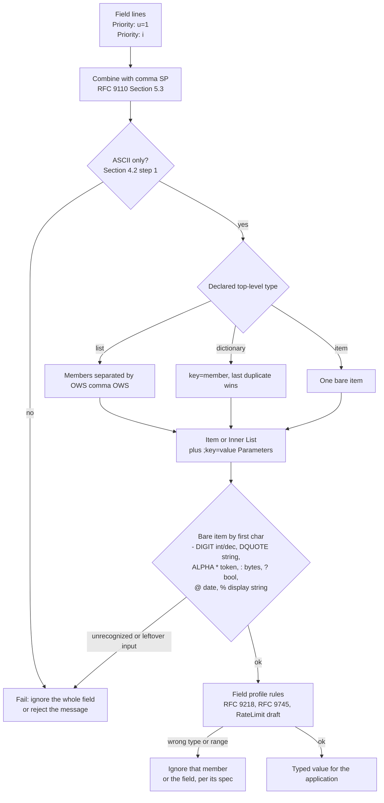

# Structured Field Values for HTTP: Lists, Dictionaries, Items, and Parameters (RFC 9651)

> [!summary] Claim
> RFC 9651 gives every new HTTP field one of three top-level types (List, Dictionary, Item) built from eight bare-item types with ordered Parameters, and pairs them with a step-by-step parser whose only error handling is to fail the whole field, so two conforming implementations can never disagree about what a field value means.

Part of [HTTP Semantics and Wire Protocols](README.md) in [API Engineering](../README.md).

## TL;DR

- Mechanism: a field definition declares its value as a List, Dictionary, or Item; members are Items or Inner Lists, every Item and Inner List carries ordered `;key=value` Parameters, and bare items are Integer, Decimal, String, Token, Byte Sequence, Boolean, Date, or Display String (RFC 9651 Section 3).
- Contract rule: the recipient first combines all field lines of that name with `, ` (RFC 9651 Section 4.2, RFC 9110 Section 5.3), then runs the parsing algorithm; any failure means the entire field is ignored or the message is treated as malformed, and field specifications may not loosen that (RFC 9651 Section 4.2).
- The trap: reading only the first field line (Starlette `request.headers["priority"]` does exactly that), treating Python `True` as the Integer `1`, or hand-rolling a "lenient" parser that a peer, proxy, or signature verifier parses differently.
- Portability fact: the lab parser and serializer pass all 2160 vectors of `httpwg/structured-field-tests` at commit `10781e4` on CPython `3.12.13`, `3.13.18`, `3.14.6`, `3.14.10`, `3.15.2`, and `3.15.0b3` free-threaded; none of the pinned Python servers and clients inspected here (Uvicorn, Hypercorn, Granian, h11, h2, aioquic, httpx, Starlette) parses Structured Fields for you (as of 2026-11).
- When not to use it: do not retrofit it onto existing fields (RFC 9651 Section 1 says it only applies to fields that opt in), do not put large or deeply nested documents in a field (use content), and do not use Display Strings where a String or Token would do (RFC 9651 Section 3.3.8).

## Mental model



Same-named field lines are joined with comma SP before anything else, because a List or Dictionary may legally be split across lines and the parser must see the whole value.
The joined bytes must be ASCII, and the declared top-level type (never guessed from the bytes) selects the List, Dictionary, or Item algorithm.
Every member is either an Item or a parenthesized Inner List, each followed by zero or more Parameters, and the first character of a bare item alone decides which of the eight type parsers runs.
Any syntax error, at any depth, or any character left over after the top-level value, discards the entire field; this is the generic layer.
Only after a successful generic parse does the field-specific profile apply its own type and range rules, which for `Priority` means a wrong-typed `u` falls back to its default rather than voiding the field.

## How it works

### Data model and nesting

There are exactly three top-level types and the nesting depth is fixed: a List or Dictionary contains Items or Inner Lists, an Inner List contains Items, and Parameters hang off Items and Inner Lists but their values are bare items that cannot carry Parameters themselves (RFC 9651 Sections 3, 3.1.2).
That bound is deliberate: Appendix A.1 of RFC 9651 rejects JSON partly because JSON nests to arbitrary depth, so memory commitment cannot be bounded, and because JSON has duplicate-member and large-number ambiguities.
Dictionaries and Parameters are ordered maps that implementations MUST expose by index and by key (RFC 9651 Sections 3.1.2, 3.2).
Keys match `( lcalpha / "*" ) *( lcalpha / DIGIT / "_" / "-" / "." / "*" )`, so uppercase keys fail parsing (RFC 9651 Section 4.2.3.3, Appendix C).

| Type | Wire form | Example | Section |
|---|---|---|---|
| Integer | `["-"] 1*15DIGIT` | `42` | 3.3.1, 4.2.4 |
| Decimal | `["-"] 1*12DIGIT "." 1*3DIGIT` | `4.5` | 3.3.2, 4.2.4 |
| String | DQUOTE, printable ASCII, only `\"` and `\\` escapes | `"hello world"` | 3.3.3, 4.2.5 |
| Token | `( ALPHA / "*" ) *( tchar / ":" / "/" )` | `foo123/456` | 3.3.4, 4.2.6 |
| Byte Sequence | base64 between colons | `:cHJldGVuZA==:` | 3.3.5, 4.2.7 |
| Boolean | `?1` or `?0` | `?1` | 3.3.6, 4.2.8 |
| Date | `@` then an Integer | `@1659578233` | 3.3.7, 4.2.9 |
| Display String | `%"` then percent-encoded UTF-8 with lowercase hex | `%"%c3%bcsers"` | 3.3.8, 4.2.10 |

`tchar` is the RFC 9110 token character set, `` !#$%&'*+-.^_`|~ `` plus DIGIT and ALPHA (RFC 9110 Section 5.6.2).
Date and Display String are new in RFC 9651; RFC 8941 (February 2021) had only the first six types (RFC 9651 Appendix D).

### Boolean true is elided

In Dictionary members and Parameters, a Boolean true value MUST be omitted on serialization, while parsers MUST accept both forms (RFC 9651 Sections 3.1.2, 3.2).
So `Priority: u=5, i` means urgency 5 and incremental true (RFC 9218 Section 4.2), and `a=?1` re-serializes as `a`.
This is why a Dictionary member with no `=` is not an error: the parser sets the value to Boolean true and then parses Parameters (RFC 9651 Section 4.2.2 step 2.3).

### The parsing algorithm

The top-level algorithm (RFC 9651 Section 4.2) converts the bytes to ASCII (failure fails parsing), discards leading SP, runs the List, Dictionary, or Item algorithm chosen by the field definition, discards trailing SP, and fails if any input remains.
Leading SP is discarded but leading HTAB is not, while separators between List and Dictionary members are `OWS` (`*( SP / HTAB )`, RFC 9110 Section 5.6.3); the community suite pins this: `1\t,\t42` parses as a List (`list.json`, "tab separated list") and a leading HTAB as in `\ta` fails (`token-generated.json`, "0x09 starting a token").
Lists and Dictionaries reject a trailing comma (Section 4.2.1 step 2.6, Section 4.2.2 step 2.10).
A duplicate Dictionary key or Parameter key overwrites the earlier value in place, so the last value wins but the member keeps its first position (Section 4.2.2 step 2.4, Section 4.2.3.2 step 2.7).
Inner List items are separated by one or more SP only; a comma or an HTAB inside parentheses fails (Section 4.2.1.2 steps 3.1 and 3.5).
Number parsing counts characters as it goes: an Integer fails past 15 digits, a Decimal fails if the integer part exceeds 12 digits when the `.` arrives, if the whole number exceeds 16 characters, if it ends in `.`, or if it has more than three fractional digits (Section 4.2.4).
A String fails on any backslash escape other than `\"` or `\\` and on any character outside `%x20-7E` (Section 4.2.5).
A Byte Sequence fails on characters outside `ALPHA / DIGIT / "+" / "/" / "="`, but parsers SHOULD NOT fail on missing `=` padding or non-zero pad bits (Section 4.2.7).
A Display String fails on uppercase hex in a `%xx` escape or on bytes that are not valid UTF-8 (Section 4.2.10).

### Field line combination is part of the contract

Parsers MUST combine all field lines with the same name in a section into one comma-separated value before parsing (RFC 9651 Section 4.2, citing RFC 9110 Section 5.2).
For Lists and Dictionaries, members split across lines reassemble correctly, which is why the RateLimit draft says its List "can be split over multiple" fields (draft-ietf-httpapi-ratelimit-headers-11 Sections 3 and 4).
A String split across lines silently gains the joining comma and whitespace inside it (a parser MAY instead fail it), and a Token, Integer, Decimal, or Byte Sequence split across lines fails (RFC 9651 Section 4.2).
On failure the entire field value MUST be ignored or the whole message MUST be treated as malformed; an intermediary that is not parsing the field need not strip it (RFC 9651 Section 4.2).

The Python stack hands you separate lines, not a combined value.
The ASGI spec requires that header "Duplicates are possible and must be preserved in the message as received" (ASGI HTTP connection scope, `headers`).
h11 keeps each line and strips surrounding OWS with its `header_field` pattern, built as `r"(?P<field_name>{field_name})" r":" r"{OWS}" r"(?P<field_value>{field_value})" r"{OWS}"` with `OWS = r"[ \t]*"` (h11 0.16.0 h11/_abnf.py, header_field) and compiled as `header_field_re` (h11 0.16.0 h11/_readers.py, header_field_re), and its `field_vchar` is `vchar_or_obs_text = r"[^\x00\s]"`, which admits obs-text and every control byte except NUL, HTAB, LF, VT, FF, and CR (h11 0.16.0 h11/_abnf.py, field_vchar).
Starlette `Headers.__getitem__` returns the first matching line only, while `Headers.getlist` returns all of them (starlette 1.10.0 starlette/datastructures.py, Headers.__getitem__ and Headers.getlist).
httpx `Headers.__getitem__` joins duplicates with `", "` (httpx 0.28.1 httpx/_models.py, Headers.__getitem__).
The lab proves all three behaviors.

### Serialization is canonical

Serialization emits exactly one SP after each top-level comma, one SP between Inner List items, no SP around `;` or `=`, elides Boolean true in Dictionaries and Parameters, and omits the field entirely when a List or Dictionary is empty (RFC 9651 Sections 4.1, 4.1.1, 4.1.1.1, 4.1.1.2, 4.1.2).
Decimals with more than three fractional digits are rounded half to even, and the 12-digit integer limit is checked after rounding, so `999999999999.9995` fails (RFC 9651 Section 4.1.5).
Strings, Tokens, and Keys are validated on the way out, so a correct serializer cannot emit CR, LF, or a byte the parser would reject (RFC 9651 Sections 4.1.1.3, 4.1.6, 4.1.7).
HTTP Message Signatures depend on this: the `sf` component parameter re-serializes a field strictly before it enters the signature base, turning `a=1,    b=2;x=1;y=2,   c=(a   b   c)` into `a=1, b=2;x=1;y=2, c=(a b c)` (RFC 9421 Section 2.1.1), and a single Dictionary member can be signed through the `key` parameter (RFC 9421 Section 2.1.2).

### Field profiles on top of the generic layer

`Priority` is a Dictionary; `u` is an Integer `0..7` defaulting to `3`, `i` is a Boolean defaulting to false, and unknown parameters, out-of-range values, or wrong types MUST be ignored (RFC 9218 Sections 4, 4.1, 4.2, 5).
`Deprecation` is an Item whose value MUST be a Date, for example `Deprecation: @1688169599` for 2023-06-30T23:59:59Z (RFC 9745 Section 2.1).
`RateLimit` is a List of Service Limit Items, each identifying a quota policy whose Item value Section 3 requires to be a String, with Integer `r` (required, non-negative), optional non-negative Integer `t`, and optional Byte Sequence `pk`, and malformed `RateLimit` fields MUST be ignored (draft-ietf-httpapi-ratelimit-headers-11 Sections 3, 4.1, 4.1.1 to 4.1.3, and 7; an Internet-Draft at revision 11 expiring 2026-11-24, as of 2026-11).
`Content-Digest` is a Dictionary of algorithm keys to Byte Sequences (RFC 9530 Section 2), and RFC 9651 Section 5 added a "Structured Type" column to the IANA field registry, listing for example `Priority` as Dictionary and `Cache-Status` and `Proxy-Status` as List.

## Numbers and limits

| Quantity | Value | Source |
|---|---|---|
| Integer range | `-999999999999999` to `999999999999999` (15 digits, "for IEEE 754 compatibility") | RFC 9651 Section 3.3.1 |
| Decimal precision | at most 12 integer digits and 3 fractional digits | RFC 9651 Section 3.3.2 |
| Date range parsers MUST support | `-62135596800` to `253402214400` seconds (years 1 to 9999) | RFC 9651 Section 3.3.7 |
| List members parsers MUST support | >= 1024 | RFC 9651 Section 3.1 |
| Inner List members | >= 256 | RFC 9651 Section 3.1.1 |
| Parameters per Item or Inner List, key length | >= 256 parameters, keys >= 64 characters | RFC 9651 Section 3.1.2 |
| Dictionary members, key length | >= 1024 members, keys >= 64 characters | RFC 9651 Section 3.2 |
| String, Token, Byte Sequence minimums | >= 1024 characters, >= 512 characters, >= 16384 octets | RFC 9651 Sections 3.3.3, 3.3.4, 3.3.5 |
| Nesting depth | fixed at 2 container levels (List or Dictionary, then Inner List) | RFC 9651 Section 3 |
| `Priority` urgency | `0..7`, default `3`; `7` reserved for background traffic | RFC 9218 Section 4.1 |
| h11 default incomplete-event limit (bounds an HTTP/1.1 header block) | `16 * 1024` bytes | h11 0.16.0 h11/_connection.py, `DEFAULT_MAX_INCOMPLETE_EVENT_SIZE`; Uvicorn passes `h11_max_incomplete_event_size` through (uvicorn 0.54.0 uvicorn/config.py, Config.__init__; uvicorn 0.54.0 uvicorn/protocols/http/h11_impl.py, H11Protocol.__init__) |
| Conformance of the lab implementation | 2160 of 2160 test records pass (24 files: 20 parse files plus 4 in `serialisation-tests`; each parse record is checked for parse result and canonical re-serialization) | measured 2026-11-08 and re-measured at verification (as of 2026-11) against `httpwg/structured-field-tests` commit `10781e4`, every CPython in the Portability table |
| Parse cost, 1024-member List of Integers (5032 bytes, `", ".join(str(n) for n in range(1024))`) | 1241 to 1289 us per parse (min to max over three runs of `timeit.repeat(number=200, repeat=7)`) | measured with `uv run --frozen python` from `labs/` on CPython 3.14.6, Apple M3 Pro, macOS 27.2 arm64 (Darwin 27.2.0) |
| Parse cost, 785-member Dictionary of Byte Sequences (16373 bytes, members `k{n}=:<base64 of n as 8 big-endian bytes>:`) | 1263 to 1323 us per parse | same machine and command |

The two parse-cost rows took about the same time even though one input is three times larger, which suggests that per-member work dominates in this pure-Python cursor parser; Byte Sequence content is located with one `str.find` and checked with one set comparison rather than walked character by character in Python.
They come from a one-off `timeit` script, not a lab test; treat them as orders of magnitude for one machine.

## Portability

| Dimension | Version | Behavior | Evidence |
|---|---|---|---|
| CPython | `3.12.13` | 91 passed; 2160 of 2160 suite records | lab, `UV_PROJECT_ENVIRONMENT=<tmp> uv run --frozen --python 3.12.13 pytest ...`; the matrix pin `3.12.16` is not available to uv on this machine |
| CPython | `3.13.18` | 91 passed; 2160 of 2160 | lab, same command with `--python 3.13.18` |
| CPython | `3.14.6` (workspace `.venv`) | 91 passed; 2160 of 2160 | lab, `uv run --frozen pytest ...` |
| CPython | `3.14.10` | 91 passed; 2160 of 2160 | lab, `--python 3.14.10` |
| CPython | `3.15.2` | 91 passed; 2160 of 2160 | lab, frozen workspace: `UV_PROJECT_ENVIRONMENT=<tmp> uv run --frozen --python /opt/homebrew/bin/python3.15 pytest ...` (the locked `hypothesis` 6.170.14 imports on 3.15.2) |
| CPython | `3.15.0b3` free-threaded (`Py_GIL_DISABLED=1`, `sys._is_gil_enabled()` is `False`) | 85 passed; 2160 of 2160 | lab via `PYTHONPATH=src uv run --no-project --python 3.15t` with the locked `pytest`, `pytest-asyncio`, `anyio`, `h11`, `httpx`, `httpcore`, `starlette`, `idna`, `certifi`; the frozen workspace cannot install because `psycopg-binary==3.3.8` has no wheel for 3.15t; the matrix pin `3.15.2t` is not available to uv here |
| Containers | Debian 13 Trixie (glibc 2.41) and Alpine Linux 3.24 (musl), both CPython `3.14.10` aarch64 | 85 passed; 2160 of 2160 on each | lab via `docker run` of `python:3.14-slim-trixie` and `python:3.14-alpine` with the locked `pytest`, `pytest-asyncio`, `anyio`, `h11`, `httpx`, `httpcore`, `starlette`, `idna`, `certifi` installed by `pip` and `PYTHONPATH=src` |
| Python language | all of the above | `bool` is a subclass of `int`, so a serializer must test `bool` first and a profile must use `type(v) is int` | lab mutations M1 and M5 |
| Starlette | `1.10.0` | `request.headers[name]` returns only the first field line; `getlist` returns all | lab, `test_starlette_getitem_sees_only_the_first_priority_field_line` |
| httpx | `0.28.1` | `Headers[name]` joins duplicates with `", "`, which matches RFC 9651 combination | lab, same test |
| h11 | `0.16.0` | delivers each field line separately, strips OWS including HTAB, passes obs-text such as `\xe9` | lab, `test_h11_delivers_separate_lines_and_obs_text_that_the_sf_parser_must_reject` |
| Uvicorn, Hypercorn | `0.54.0`, `0.18.0` | no Structured Field parsing; duplicate lines reach the app in `scope["headers"]` | ASGI spec (`headers`: duplicates "must be preserved"); not exercised by this lab; a grep of the pinned `uvicorn`, `hypercorn`, `h2`, `aioquic` Python sources found no RFC 9218 `Priority` field or urgency parsing (Hypercorn's HTTP/2 path uses the `priority` package for RFC 7540 stream priorities only, hypercorn 0.18.0 hypercorn/protocol/h2.py, H2Protocol) |
| Granian | `2.8.7` | no Structured Field parsing; `scope["headers"]` gets one pair per field line value | granian 2.8.7 src/asgi/utils.rs, build_scope_common (loops `for (key, value) in &$req.headers` over the hyper `HeaderMap`, which yields a key once per value); a grep of `src/` at tag `v2.8.7` found no `priority` or `structured`; not exercised by this lab |
| HTTP/1.1 | RFC 9112 | textual field lines, combined per RFC 9110 Section 5.3 | RFC 9651 Section 4.2 |
| HTTP/2, HTTP/3 | RFC 9113, RFC 9114 | the same algorithms apply to the field value as it is before header compression | RFC 9651 Section 4 names HTTP/2 before HPACK compression; HTTP/2 and HTTP/3 also carry hop-by-hop `PRIORITY_UPDATE` frames whose priority parameters use the same Dictionary encoding (RFC 9218 Sections 4 and 7) |
| Spec revision | RFC 8941 vs RFC 9651 | an RFC 9651 parser accepts every valid RFC 8941 field, but a field defined against RFC 8941 must not use Date or Display String | RFC 9651 Section 2.4 |

The 3.12.13, 3.13.18, 3.14.6, 3.14.10, and 3.15.2 rows were rerun on 2026-11-09 after six out-of-range and boundary `Deprecation` Date vectors were added; the free-threaded and container rows predate those vectors and so count six fewer.

## Worked example

The lab is a strict, dependency-free parser and serializer plus three field profiles: [implementation](../labs/src/api_labs/f01_http_semantics_and_wire_protocols/structured_fields.py) and [test](../labs/tests/f01_http_semantics_and_wire_protocols/test_structured_field_values_for_http_rfc_9651.py).
The parser walks an index over the string instead of re-slicing it, so each character is visited a constant number of times.
The RFC phrases every step as "input_string is modified to remove the parsed value", and a literal Python translation that re-slices the string copies the remainder at each step, which is quadratic in the worst case.

Top-level entry and field line combination (simplified excerpt; verbatim lines from `structured_fields.py`, other functions elided):

```python
def combine_field_lines(lines: Iterable[bytes]) -> bytes:
    """Join same-named field lines with comma SP (RFC 9110 Section 5.3, RFC 9651 Section 4.2)."""
    return b", ".join(lines)


def _start(data: bytes | str) -> _Cursor:
    """Section 4.2 steps 1-2: require ASCII, then discard leading SP (not HTAB)."""
    if isinstance(data, bytes):
        try:
            text = data.decode("ascii")
        except UnicodeDecodeError as exc:
            raise StructuredFieldError("field value is not ASCII") from exc
    elif data.isascii():
        text = data
    else:
        raise StructuredFieldError("field value is not ASCII")
    cur = _Cursor(text)
    cur.skip(" ")
    return cur


def _finish(cur: _Cursor) -> None:
    """Section 4.2 steps 6-7: discard trailing SP, then any leftover input is a failure."""
    cur.skip(" ")
    if not cur.at_end():
        raise StructuredFieldError(f"trailing characters at offset {cur.pos}")
```

Dictionary parsing with in-place duplicate overwrite (simplified excerpt; verbatim):

```python
def _parse_dictionary(cur: _Cursor) -> SfDictionary:
    dictionary: SfDictionary = {}
    while not cur.at_end():
        key = _parse_key(cur)
        member: Member
        if cur.peek() == "=":
            cur.take()
            member = _parse_item_or_inner_list(cur)
        else:
            member = Item(True, _parse_parameters(cur))
        # Section 4.2.2 step 2.4: overwrite in place; a Python dict keeps the first position.
        dictionary[key] = member
        cur.skip(_OWS)
        if cur.at_end():
            return dictionary
        if cur.take() != ",":
            raise StructuredFieldError(f"expected ',' at offset {cur.pos - 1}")
        cur.skip(_OWS)
        if cur.at_end():
            raise StructuredFieldError("trailing comma in dictionary")
    return dictionary
```

Byte Sequence leniency, the only place the RFC asks the parser to be tolerant (simplified excerpt; verbatim):

```python
def _parse_byte_sequence(cur: _Cursor) -> bytes:
    if cur.take() != ":":
        raise StructuredFieldError("expected ':'")
    end = cur.text.find(":", cur.pos)
    if end == -1:
        raise StructuredFieldError("byte sequence not closed")
    content = cur.text[cur.pos : end]
    cur.pos = end + 1
    if not set(content) <= _BASE64_CHARS:
        raise StructuredFieldError("character outside the base64 alphabet")
    # Section 4.2.7: SHOULD NOT fail on missing "=" padding or non-zero pad bits.
    unpadded = content.rstrip("=")
    padded = unpadded + "=" * (-len(unpadded) % 4)
    try:
        return base64.b64decode(padded, validate=True)
    except binascii.Error as exc:
        raise StructuredFieldError(f"invalid base64: {exc}") from exc
```

Serialization dispatch and Decimal rounding (simplified excerpt; verbatim):

```python
def _serialize_bare_item(value: BareItem) -> str:
    # bool is a subclass of int in Python, so it must be dispatched before int.
    if isinstance(value, bool):
        return "?1" if value else "?0"
    if isinstance(value, int):
        return _serialize_integer(value)
    if isinstance(value, Decimal):
        return _serialize_decimal(value)
    if isinstance(value, str):
        return _serialize_string(value)
    if isinstance(value, Token):
        return _serialize_token(value.value)
    if isinstance(value, bytes):
        return ":" + base64.b64encode(value).decode("ascii") + ":"
    if isinstance(value, Date):
        return "@" + _serialize_integer(value.seconds)
    return _serialize_display_string(value.value)


def _serialize_integer(value: int) -> str:
    if not -_MAX_INTEGER <= value <= _MAX_INTEGER:
        raise StructuredFieldError(f"integer out of range: {value}")
    return str(value)


def _serialize_decimal(value: Decimal) -> str:
    if not value.is_finite() or abs(value) >= _DECIMAL_LIMIT:
        raise StructuredFieldError(f"decimal out of range: {value}")
    rounded = value.quantize(_THOUSANDTH, rounding=ROUND_HALF_EVEN)
    if abs(rounded) >= _DECIMAL_LIMIT:
        raise StructuredFieldError(f"decimal exceeds 12 integer digits after rounding: {value}")
    integer_part, fraction = f"{abs(rounded):f}".split(".")
    sign = "-" if rounded < 0 else ""
    return f"{sign}{integer_part}.{fraction.rstrip('0') or '0'}"
```

The `Priority` profile: generic failure voids the field, a bad member falls back to its default (simplified excerpt; verbatim):

```python
def priority_from_field_lines(lines: Sequence[bytes]) -> Priority:
    """Interpret Priority: a Dictionary; bad parse -> defaults; bad member -> that default."""
    if not lines:
        return Priority()
    try:
        members = parse_dictionary(combine_field_lines(lines))
    except StructuredFieldError:
        return Priority()
    urgency, incremental = 3, False
    u = members.get("u")
    # type(...) is int rejects bool: u=?1 is a Boolean, not urgency 1 (RFC 9218 Section 4).
    if isinstance(u, Item) and type(u.value) is int and 0 <= u.value <= 7:
        urgency = u.value
    i = members.get("i")
    if isinstance(i, Item) and isinstance(i.value, bool):
        incremental = i.value
    return Priority(urgency, incremental)
```

The in-process ASGI test that shows a Starlette app disagreeing with RFC 9651 when an intermediary appends a second `Priority` line (simplified excerpt; verbatim from the test module):

```python
def _priority_probe_app() -> Starlette:
    async def probe(request: Request) -> JSONResponse:
        raw = [v for k, v in request.scope["headers"] if k == b"priority"]
        combined = priority_from_field_lines(raw)
        first_only = priority_from_field_lines([request.headers["priority"].encode("ascii")])
        return JSONResponse(
            {
                "starlette_getitem": request.headers["priority"],
                "starlette_getlist": request.headers.getlist("priority"),
                "first_line_urgency": first_only.urgency,
                "combined_urgency": combined.urgency,
            }
        )

    return Starlette(routes=[Route("/", probe)])


@pytest.mark.unit
@pytest.mark.asyncio
async def test_starlette_getitem_sees_only_the_first_priority_field_line() -> None:
    transport = httpx.ASGITransport(app=_priority_probe_app())
    async with httpx.AsyncClient(transport=transport, base_url="http://test") as client:
        response = await client.get("/", headers=[("priority", "u=1"), ("priority", "u=6")])
    assert response.json() == {
        "starlette_getitem": "u=1",
        "starlette_getlist": ["u=1", "u=6"],
        "first_line_urgency": 1,
        "combined_urgency": 6,
    }
    assert httpx.Headers([("priority", "u=1"), ("priority", "u=6")])["priority"] == "u=1, u=6"
```

The other tests cover RFC 9421 `sf` re-serialization, 34 hand-written conformance vectors (10 verbatim from `httpwg/structured-field-tests`, including HTAB inside an Inner List), Python `bool` versus Integer, Token versus String, duplicate keys, String and Token splitting across lines, h11 line delivery and obs-text, `Priority` type and range rules, Decimal half-even rounding, Integer and Date range, Byte Sequence padding and pad bits (including the `RateLimit-Policy` example `pk=:cHsdsRa894==:` from draft-ietf-httpapi-ratelimit-headers-11 Section 3.2, which has non-zero pad bits and re-serializes as `:cHsdsRa89w==:`), Display String encoding, `Deprecation` (a Date outside years 1 to 9999 is ignored rather than raised), `RateLimit`, serializer refusal of invalid keys, Tokens, and control characters, empty containers, and the RFC 9651 minimum sizes.

Captured run, command `uv run --frozen pytest tests/f01_http_semantics_and_wire_protocols/test_structured_field_values_for_http_rfc_9651.py -q` from `labs/`, CPython 3.14.6, `macOS-27.2-arm64-arm-64bit-Mach-O`:

```text
........................................................................ [ 79%]
...................                                                      [100%]
91 passed in 0.09s
```

## Pitfalls

> [!warning] Reading only the first field line
> Trigger: an app reads `request.headers["priority"]` in Starlette 1.10.0 while a CDN or proxy appends its own `Priority` line, which RFC 9110 Section 5.3 permits for list-based fields and RFC 9218 Section 4 notes overrides the client's end-to-end signal.
> Symptom: the app acts on `u=1` while every RFC 9651 parser downstream sees `u=1, u=6` and therefore urgency 6; the lab measures exactly this split.
> Fix: collect every line (`request.headers.getlist(name)` or `scope["headers"]`), join with `, `, then parse once.

> [!warning] Python `bool` is an `int`
> Trigger: a serializer checks `isinstance(v, int)` before `bool`, or a profile validates `u` with `isinstance(u, int)`.
> Symptom: `True` goes out as `1` instead of `?1`, and `Priority: u=?1` is accepted as urgency 1 although RFC 9218 Section 4 says a wrong-typed parameter MUST be ignored.
> Fix: dispatch on `bool` first and validate Integers with `type(v) is int`; lab mutations M1 and M5 show the tests catch both.

> [!warning] A serializer that escapes but does not validate
> Trigger: an encoder that only escapes `\` and `"` in Strings and passes every other byte through.
> Symptom: attacker-controlled input containing CR LF ends the header and starts a new one; CVE-2026-43966 (published 2026-06-08) is exactly this in `cow_http_struct_hd:escape_string/2` in Erlang `cowlib`, affecting versions from 2.9.0 onward, CWE-113, response splitting.
> Fix: implement RFC 9651 Section 4.1.6 step 2 literally, failing serialization on anything outside `%x20-7E`; in the lab's `test_serializer_refuses_values_the_parser_would_reject`, the `newline` case kills a mutation that skips String validation (M10) and the key cases kill one that skips key validation (M19), and `test_non_ascii_and_control_characters_fail_parsing` covers the parse side.

> [!warning] Hand-rolled base64 in a native parser
> Trigger: custom decoding of Byte Sequences from untrusted input in C or C++.
> Symptom: CVE-2019-11921 (published 2019-07-25) is an out-of-bounds write in Facebook Proxygen "due to improper handling of Base64 when parsing malformed binary content in Structured HTTP Headers", fixed in `v2019.07.22.00`, CWE-787, CVSS 3.0 base score 9.8.
> Fix: validate the alphabet first, then hand the content to a bounds-checked decoder; never trust padding to size a buffer.

> [!warning] Splitting a String or Token across field lines
> Trigger: a sender or an intermediary breaks one member across two lines.
> Symptom: a String gains a `, ` in the middle (`"foo` plus `bar"` parses as `foo, bar` in the lab; RFC 9651 Section 4.2 also lets a parser fail it) and a Token, Integer, Decimal, or Byte Sequence fails the whole field (RFC 9651 Section 4.2).
> Fix: only split at top-level member boundaries; the lab pins both outcomes.

> [!warning] Lenient parsing and signature differentials
> Trigger: a "helpful" parser accepts what RFC 9651 rejects, such as an unterminated String in `Signature-Input`.
> Symptom: RFC 9421 Section 7.5.3 describes an attacker injecting content into the signature base through a parser that does not enforce closing quotes.
> Fix: one fully conformant parser on both signer and verifier, tested against `httpwg/structured-field-tests` (RFC 9651 Appendix B points to it).

> [!warning] Upgrading the parser changes what is accepted
> Trigger: replacing an RFC 8941 library with an RFC 9651 one.
> Symptom: values with Dates or Display Strings in ignored extension parameters used to fail the whole field and now parse and get processed (RFC 9651 Section 2.4).
> Fix: treat the upgrade as a behavior change, and keep field-level validation of types for every member and parameter you consume.

## Security and robustness

Threat model: the field value is attacker-controlled bytes, often after an intermediary has appended its own lines, and the parse result drives scheduling (`Priority`), client back-off (`RateLimit`), integrity checks (`Content-Digest`), or signature bases (`Signature-Input`).
The generic parser must be total and strict: ASCII only and fail-whole-field on any error (RFC 9651 Sections 1.1, 4.2), with no recursion beyond the fixed two container levels (Section 3); the lab also keeps parsing linear in input length by walking an index rather than re-slicing the remaining input.
The pinned transports do not enforce the RFC 9651 character set for you: h11 0.16.0 admits obs-text and control bytes other than NUL and whitespace in field values (h11 0.16.0 h11/_abnf.py, field_vchar), which the lab confirms, so the ASCII check in RFC 9651 Section 4.2 step 1 is your boundary.

OWASP API Security Top 10 2023 mapping:
- API4:2023 Unrestricted Resource Consumption: RFC 9651 Section 6 notes most types have no maximum size; rely on the transport's header-block limit (h11 defaults to 16 KiB) and, if you set per-field limits, keep them at or above the RFC 9651 minimums so you do not reject conforming peers (Appendix B allows limits subject to those minimums).
- API8:2023 Security Misconfiguration: a gateway and an origin that disagree on duplicate-line handling, first-line versus combined, act on different values for the same request; this is the same class of parser differential as request smuggling, but at the field-value layer.
- API10:2023 Unsafe Consumption of APIs: clients that consume `RateLimit` from third parties must ignore malformed fields (draft-ietf-httpapi-ratelimit-headers-11 Section 7) and must not size sleeps or buffers from unvalidated Integers.
- API9:2023 Improper Inventory Management: `Deprecation` (RFC 9745) and similar fields only help if clients parse them; a client that rejects the RFC 9745 Date form because it expects an older ad hoc form will never see the signal.

Edge cases to test in any implementation: uppercase keys, trailing commas, leading HTAB, 16-digit Integers, 13-digit Decimal integer parts, four fractional digits, `\q` escapes, single quotes, uppercase `%XX` in Display Strings, invalid UTF-8 in Display Strings, base64 with spaces or `-` and `_`, duplicate keys, and empty top-level values (the lab covers each).
Display Strings can carry any Unicode scalar value, including NUL and unassigned code points, so filter or escape them before display (RFC 9651 Section 6).
Injection of extra field lines can change meaning without causing a parse failure (RFC 9651 Section 6), so a field that matters for authorization or integrity belongs inside a signature that covers it (RFC 9421 Section 2.1.1).

## The principal's view

The decision is whether a new header or trailer in your API platform is defined as an RFC 9651 Structured Field, and the answer for every new field should be yes, citing RFC 9651 rather than RFC 8941 so Date and Display String are available (RFC 9651 Section 2.4).
The organizational payoff is that one shared, conformance-tested parser library serves every service, gateway, and SDK, and field authors stop writing bespoke grammars that leave commas undelimited, the ambiguity RFC 9110 Section 16.3.2.2 warns about (its counter-example is `Location`, whose URIs can contain commas).
The cost is that you own that library in every language your fleet uses, and you must gate it in CI with `httpwg/structured-field-tests`; a "simple" regex parser in one SDK reintroduces the differentials the format was designed to eliminate.
Design fields for extension: prefer a Dictionary when you will add keys later, require recipients to ignore unknown keys and parameters (RFC 9651 Section 2.3), and consider grease parameters so partial parsers break in testing rather than in production.
Choose a different carrier when the data is large, nested beyond two levels, or naturally a document: put it in content with a media type (see [[Content-Negotiation-Media-Types-and-Charsets]]), or use a link to a resource.
Choose a different protocol feature when the value changes per hop rather than end to end: `Priority` has a hop-by-hop `PRIORITY_UPDATE` frame in HTTP/2 and HTTP/3 for that reason (RFC 9218 Sections 4 and 7).
In Python services, put the parser at the edge of the request pipeline (middleware or a dependency) that reads `scope["headers"]` directly, so no handler ever touches `request.headers[name]` for a structured field.

## Interview questions

> [!question] L5: What is the difference between `Priority: u=0` and `Priority: u="0"`, and what does a server do with each?
>
> > [!success]- Answer
> > `u=0` is an Integer and `u="0"` is a String, because the first character selects the bare-item type.
> > RFC 9218 Section 4 says priority parameters of an unexpected type MUST be ignored, so the second request gets the default urgency 3.
> > The field still parses; only that member is ignored.
> >
> > Follow-up: What urgency does `Priority: u=?1` produce in a Python implementation that validates with `isinstance(u, int)`, and why is that wrong?

> [!question] L5: Predict the output of `serialize_dictionary(parse_dictionary(b"a=1, b=2, a=3"))` in the lab.
>
> > [!success]- Answer
> > The result is `a=3, b=2`.
> > RFC 9651 Section 4.2.2 step 2.4 overwrites the existing key in place, so the last value wins but `a` keeps its first position.
> > A Python `dict` assignment has exactly those semantics; popping and re-inserting would move `a` to the end, which lab mutation M2 shows the test catches.
> >
> > Follow-up: Why is last-wins a security-relevant choice when a proxy and an origin parse the same field?

> [!question] L5: Why does a Dictionary member with no `=` not cause a parse error, and how is `a=?1` serialized?
>
> > [!success]- Answer
> > RFC 9651 Section 4.2.2 sets the member value to Boolean true when no `=` follows the key, then parses Parameters.
> > On serialization, Boolean true MUST be omitted in Dictionary members and Parameters (Sections 3.1.2 and 3.2), so `a=?1` becomes `a`.
> > `a=?0` keeps its value because only true is elided.
> >
> > Follow-up: Is `?1` elided when it is a top-level Item or a List member?

> [!question] L6: Debug this API: why does a FastAPI service on Starlette 1.10.0 that reads `request.headers["priority"]` log urgency 1 while the CDN's own scheduler, which also parses `Priority`, treats the same request as urgency 6?
>
> > [!success]- Answer
> > An intermediary appended a second `Priority: u=6` line, which RFC 9110 Section 5.3 allows for a list-based field.
> > RFC 9651 Section 4.2 requires combining all lines into `u=1, u=6` before parsing, and the Dictionary rule makes the last `u` win, so a conformant parser sees 6.
> > Starlette `Headers.__getitem__` returns only the first line, so the app sees 1; the lab's ASGI test reproduces this exactly.
> > Fix it by reading `request.headers.getlist("priority")` or `scope["headers"]`, joining with `, `, and parsing once.
> >
> > Follow-up: Would switching the client side to `httpx.Headers["priority"]` show the same discrepancy?

> [!question] L6: Why are Integers limited to 15 digits and Decimals to 12 integer and 3 fractional digits?
>
> > [!success]- Answer
> > RFC 9651 Section 3.3.1 states the Integer range is chosen "for IEEE 754 compatibility".
> > An IEEE 754 binary64 double represents every integer up to 2^53 = 9007199254740992 exactly, and every 15-digit integer is below that, so JavaScript and other double-only runtimes can hold any valid Integer without loss.
> > Decimals keep 12 plus 3 = 15 significant digits, which fits the same double-precision budget, although RFC 9651 Section 3.3.2 states the limits without giving a rationale; the serializer rounds half to even to three places, then rejects a result with 13 integer digits (Section 4.1.5).
> >
> > Follow-up: How would you carry a 64-bit identifier in a Structured Field?

> [!question] L6: A partner sends `RateLimit: "peruser";r=10;pk=:cHsdsRa894==:`.
> Do you accept the partition key, and what bytes does your serializer emit if you echo it?
>
> > [!success]- Answer
> > Accept it: RFC 9651 Section 4.2.7 says parsers SHOULD NOT fail on non-zero pad bits, and in the final quantum `94==` the character `4` (sextet `111000`) leaves its low four pad bits as `1000`.
> > It decodes to the bytes `707b1db116bcf7` (lab test), and re-serialization emits `:cHsdsRa89w==:` because the serializer SHOULD zero the pad bits (Section 4.1.8).
> > The value is the same but the wire bytes differ, which matters wherever bytes are compared, such as a cache key or a signature base without the `sf` parameter.
> >
> > Follow-up: Which RFC 9421 component parameter makes signer and verifier agree on those bytes?

> [!question] L6: What happens when a String member is split across two field lines, and when a Token member is?
>
> > [!success]- Answer
> > Combination joins lines with `, ` before parsing, so `"foo` and `bar"` become `"foo, bar"`, a valid String containing a comma the sender never wrote (RFC 9651 Section 4.2 also allows a parser to fail it).
> > A Token split as `abc` and `def` becomes `abc, def`, which fails an Item parse because input remains after the Token.
> > RFC 9651 Section 4.2 says both outcomes are outside the control of sender and parser, because an upstream intermediary may do the combining.
> >
> > Follow-up: Which top-level types are safe to split across lines, and at what boundary?

> [!question] L7+: Standardizing headers across 400 services, how do you choose the type of a new `Acme-Budget` field and what do you mandate about parsing?
>
> > [!success]- Answer
> > Define it as a Structured Field referencing RFC 9651, choosing Dictionary if keys will be added later, List if it is a sequence of peers like `RateLimit`, and Item only for a true singleton.
> > Require recipients to ignore unknown keys and parameters (RFC 9651 Section 2.3) and state field-specific constraints and their failure handling explicitly (Section 2).
> > Mandate one shared parser per language, gated in CI on `httpwg/structured-field-tests`, and ban first-line header access for structured fields in code review or lint.
> > Consider grease parameters so a partial parser fails in staging, and keep large or nested data in content instead.
> >
> > Follow-up: What breaks if one team's SDK still uses an RFC 8941 parser after you start sending Dates?

> [!question] L7+: Why did the authors reject JSON for header values, and when would you still put JSON in a header?
>
> > [!success]- Answer
> > RFC 9651 Appendix A.1 cites JSON's large-number and duplicate-member issues, Unicode strings by default, and unbounded nesting that makes memory commitment hard to bound.
> > It also notes that "if it looks like JSON, people will be tempted to use a JSON parser", which defeats any added constraints.
> > Structured Fields fix the depth at two container levels, restrict Strings to ASCII, bound numbers to IEEE 754-safe ranges, and define duplicate handling.
> > JSON in a header is defensible only for an existing field you do not control; for anything new, put JSON in content where media types and size limits already apply.
> >
> > Follow-up: How does fixed nesting depth change what a gateway can safely parse inline on its hot path?

> [!question] L7+: If your security team wants every service to sign `Content-Digest` and `Priority` with RFC 9421, what Structured Field decisions does that force?
>
> > [!success]- Answer
> > Signer and verifier must produce identical component values, so use the `sf` parameter to strictly re-serialize both Dictionaries, which collapses optional whitespace (RFC 9421 Section 2.1.1).
> > Both sides must combine multiple field lines into one Dictionary before serializing (same section), so first-line-only access breaks verification.
> > RFC 9421 Section 7.5.3 warns that a buggy parser of `Signature-Input` lets an attacker inject content into the signature base, so the parser is part of the trusted computing base and needs conformance tests.
> > Signing individual members with the `key` parameter (Section 2.1.2) lets intermediaries add members without invalidating the signature, which is a deliberate trade-off to review.
> >
> > Follow-up: RFC 9530 references RFC 8941, not RFC 9651; what does RFC 9651 Section 2.4 then say about using Dates in `Content-Digest` extensions?

## Related

Prerequisites: [[Alt-Svc-and-HTTP-Version-Negotiation]]

Next: [[Content-Negotiation-Media-Types-and-Charsets]]

See also: [[HTTP-Message-Abstraction-RFC-9110]], [[HTTP-2-Prioritization-and-Extensible-Priorities-RFC-9218]], [[HPACK-Header-Compression-and-Dynamic-Table-Security]], [[HTTP-3-Framing-and-QPACK-Header-Compression-RFC-9114]], [[HTTP-Request-Smuggling-CL-TE-and-Desync-Mechanics]], [[Protocol-Design-Over-HTTP-BCP-56-RFC-9205]], [[Design-Rate-Limiter]], [[Platform-Engineering-Paved-Roads-and-Deprecation]]

- Lab: `labs/tests/f01_http_semantics_and_wire_protocols/test_structured_field_values_for_http_rfc_9651.py`

## Further reading

- [RFC 9651: Structured Field Values for HTTP](https://www.rfc-editor.org/rfc/rfc9651.html) - the normative types and step-by-step parse and serialize algorithms; Appendix D lists the changes from RFC 8941.
- [RFC 8941](https://www.rfc-editor.org/rfc/rfc8941.html) - the obsoleted first edition, still referenced by fields such as RFC 9530, which limits them to six types.
- [RFC 9110 Sections 5.2, 5.3, and 16.3.2.2](https://www.rfc-editor.org/rfc/rfc9110.html) - field line combination and the advice to delimit commas in new field values.
- [RFC 9218: Extensible Prioritization Scheme for HTTP](https://www.rfc-editor.org/rfc/rfc9218.html) - the `Priority` Dictionary and the rule to ignore wrong-typed parameters.
- [RFC 9745: The Deprecation HTTP Response Header Field](https://www.rfc-editor.org/rfc/rfc9745.html) - an Item whose value MUST be an RFC 9651 Date.
- [RFC 9421: HTTP Message Signatures](https://www.rfc-editor.org/rfc/rfc9421.html) - strict re-serialization with `sf`, member signing with `key`, and the parser-differential warning in Section 7.5.3.
- [RFC 9530: Digest Fields](https://www.rfc-editor.org/rfc/rfc9530.html) - `Content-Digest` as a Dictionary of Byte Sequences.
- [draft-ietf-httpapi-ratelimit-headers-11](https://www.ietf.org/archive/id/draft-ietf-httpapi-ratelimit-headers-11.txt) - `RateLimit` and `RateLimit-Policy` as Lists of parameterized Strings; an Internet-Draft, not yet an RFC (as of 2026-11).
- [httpwg/structured-field-tests](https://github.com/httpwg/structured-field-tests) - the community conformance suite RFC 9651 Appendix B points to; the lab was checked against commit `10781e4`.
- [NVD CVE-2026-43966](https://nvd.nist.gov/vuln/detail/CVE-2026-43966) - CRLF injection through a Structured Field String encoder in `cowlib`.
- [NVD CVE-2019-11921](https://nvd.nist.gov/vuln/detail/CVE-2019-11921) - out-of-bounds write in Proxygen's Structured Header Byte Sequence parsing.
