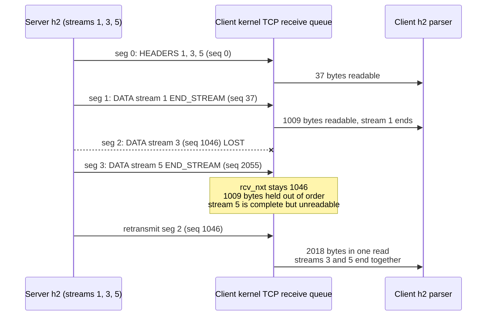

# Why HTTP/2 Suffers TCP Head-of-Line Blocking Under Packet Loss

> [!summary] Claim
> HTTP/2 multiplexes every stream onto one TCP byte stream, and TCP hands the application no byte that lies after a sequence gap, so one lost segment stalls every HTTP/2 stream whose bytes come after it until the retransmission arrives; QUIC moves ordering into each stream, so the same loss stalls only the streams whose data was in the lost packet.

Part of [HTTP Semantics and Wire Protocols](README.md) in [API Engineering](../README.md).

## TL;DR

- Mechanism: TCP is "a reliable, in-order, byte-stream service" (RFC 9293 Section 2.2), so the kernel keeps segments above a hole in its out-of-order queue and `recv()` returns nothing past the hole; HTTP/2 frames from all streams sit in that one stream, so all of them wait.
- Contract: RFC 9113 Section 1 says it plainly, "TCP head-of-line blocking is not addressed by this protocol", and Section 9.1 says clients SHOULD NOT open more than one HTTP/2 connection per host and port, which puts every stream behind the same hole.
- Trap: HTTP/2 cannot skip a hole even if TCP offered the bytes, because a frame header has a length, a type, flags, and a stream id but no byte offset; in the lab, `h2` reads three body bytes after a hole as a frame header claiming `6381921` octets.
- Portability: the effect is a property of TCP, not of a library; the lab reproduces it with `h2 4.4.1` and contrasts it with `aioquic 1.7.2` on CPython 3.12.13, 3.12.16, 3.13.18, 3.14.6, 3.14.10, and 3.15.2 (21 passed each), and in Debian 13 (trixie, glibc) and Alpine 3.23 (musl) containers; on 3.15.0b3 free-threaded `aioquic 1.7.2` does not compile, so the module cannot run there, and `3.15.2t` is not available to run.
- When not to use HTTP/3 as the fix: on low-loss data-center links where losses are rare, where UDP is blocked (RFC 9114 Section 3.1 says clients SHOULD fall back to TCP), or where one stream dominates the connection, because QUIC removes cross-stream blocking only, not the wait for a retransmission.

## Mental model



The server answers three requests on one HTTP/2 connection and each write becomes one TCP segment, which are the exact sizes the lab produces with `h2 4.4.1`.
Segment 2, which carries only stream 3, is lost.
Segment 3 carries all of stream 5 and arrives, but its sequence number is above `rcv_nxt`, so the kernel queues it and the application reads nothing.
Stream 5 has no data dependency on stream 3, yet it waits for stream 3's retransmission, and when that arrives one read returns both segments and both streams finish at the same instant.
Under QUIC the same layout loses only stream 3's packet, and the lab's `aioquic` run shows stream 5's counterpart finishing at the one-way delay while only the lost stream waits for recovery.

## How it works

### TCP delivers bytes, not frames

TCP numbers bytes, not messages, and in-window segments "are generally queued and processed in sequence number order" (RFC 9293 Section 3.10).
In the event-processing rules, "further processing is done in SEG.SEQ order" (RFC 9293 Section 3.10.7.4).
Linux implements this in `tcp_data_queue`: a segment whose `seq` equals `rcv_nxt` goes to `sk_receive_queue`, and any other in-window segment goes to `tcp_data_queue_ofo`, which inserts it into the red-black tree `tp->out_of_order_queue` (Linux v6.12 net/ipv4/tcp_input.c, tcp_data_queue, tcp_data_queue_ofo).
When a segment fills the hole, `tcp_ofo_queue` moves every now-contiguous queued segment to the receive queue at once, and if that empties the out-of-order queue, `tcp_data_queue` sets `ICSK_ACK_NOW` for an immediate ACK under the comment `RFC5681. 4.2. SHOULD send immediate ACK, when gap in queue is filled.` (Linux v6.12 net/ipv4/tcp_input.c, tcp_ofo_queue, tcp_data_queue).
The socket API only reads the receive queue, so bytes in the out-of-order queue are invisible to the process that owns them.

SACK does not change this.
It tells the sender which blocks above the hole arrived so it retransmits only the hole, but it is advisory and the receiver may still discard SACKed data (RFC 2018 Section 3, Section 8); nothing in it lets the receiver hand those blocks to the application.

The lab's `TcpReceiveBuffer` models exactly that contract, without windows or timers:

```python
    def receive(self, segment: Segment) -> bytes:
        """Accept *segment* and return the bytes that became readable by the application."""
        end = segment.seq + len(segment.payload)
        if end <= self.rcv_nxt:
            return b""  # duplicate of data already delivered
        if segment.seq > self.rcv_nxt:
            self._out_of_order[segment.seq] = segment.payload
            return b""
        readable = bytearray(segment.payload[self.rcv_nxt - segment.seq :])
        self.rcv_nxt = end
        while self.rcv_nxt in self._out_of_order:
            queued = self._out_of_order.pop(self.rcv_nxt)
            readable += queued
            self.rcv_nxt += len(queued)
        return bytes(readable)
```

### HTTP/2 puts every stream into that one byte stream

An HTTP/2 frame is a 9-octet header (24-bit `Length`, 8-bit `Type`, 8-bit `Flags`, 1 reserved bit, 31-bit `Stream Identifier`) and a payload (RFC 9113 Section 4.1); see [[HTTP-2-Binary-Framing-and-Stream-State-Machine]].
There is no sequence number or offset field.
A receiver finds frame N+1 only by reading frame N's `Length`, so it must see every byte in order.
`h2` does exactly that: `FrameBuffer.__next__` stops if fewer than 9 bytes are buffered, parses the header, stops again if fewer than `length + 9` bytes are buffered, and only then parses and removes the frame (h2 4.4.1 src/h2/frame_buffer.py, FrameBuffer.__next__).
`H2Connection.receive_data` appends the bytes it is given and iterates that buffer (h2 4.4.1 src/h2/connection.py, H2Connection.receive_data).
The lab shows what happens if you skip a hole: starting 500 bytes into a `DATA` frame of `b"a"` bytes, `h2` reads `0x616161` as the length of an unknown frame type, returns no events, and waits for 6,381,921 more octets; feeding that many raises `FrameTooLargeError: Received overlong frame: length 6381921, max 16384`.

Two more in-order dependencies sit above the framing.
HPACK's dynamic table is updated by each header block in connection order, which is why RFC 9204 Section 1 says HPACK over QUIC "would induce head-of-line blocking for field sections due to built-in assumptions of a total ordering across frames on all streams"; see [[HPACK-Header-Compression-and-Dynamic-Table-Security]].
TLS records over TCP are also processed in order: each record is one AEAD-protected unit whose nonce comes from an implicit per-direction record counter that increases by one per record (RFC 8446 Section 5.2, Section 5.3), so a record that spans the hole cannot be opened and the next record cannot be opened before it.
This follows from the RFC text; the lab does not model the TLS layer.

### The blast radius

RFC 9113 accepts the trade-off openly.
Section 1 lists the gains, fewer connections and "less competition with other flows", then adds "Note, however, that TCP head-of-line blocking is not addressed by this protocol" (RFC 9113 Section 1).
Section 9.1 asks clients not to open more than one connection per host and port pair, so a browser or `httpx` client sends every concurrent request to one origin through one TCP receive queue (RFC 9113 Section 9.1).
HTTP/1.1 clients spread requests over several connections, so one loss stalls only that connection's requests; see [[HTTP-1-1-Pipelining-and-Head-of-Line-Blocking]] for the application-layer version of the problem.

The lab's three-response run is the minimal proof.
After segments 0, 1, and 3 arrive, the `h2` client has ended stream 1 only, has seen no byte of stream 3 or stream 5, and the TCP model holds 1009 out-of-order bytes, which are all of stream 5's response.
When segment 2 arrives, `receive` returns `segments[2].payload + segments[3].payload` in one call, and streams 3 and 5 end in the same batch of `h2` events.

### How QUIC changes the ordering domain

A QUIC `STREAM` frame carries a Stream ID and an Offset, and "An endpoint uses the Stream ID and Offset fields in STREAM frames to place data in order" (RFC 9000 Section 2.2).
Each stream is still ordered: an endpoint MUST be able to deliver stream data "as an ordered byte stream" and must buffer out-of-order data up to the flow-control limit (RFC 9000 Section 2.2).
But the order is per stream, and "When a packet loss occurs, only streams with data in that packet are blocked waiting for a retransmission to be received, while other streams can continue making progress" (RFC 9000 Section 13).
The same paragraph states the limit: "when data from multiple streams is included in a single QUIC packet, loss of that packet blocks all those streams" (RFC 9000 Section 13).
HTTP/3 maps each request to its own client-initiated bidirectional stream, 0, then 4, 8, and so on (RFC 9114 Section 6.1), and relies on QUIC for "reliable, in-order, per-stream delivery" (RFC 9114 Section 1.2).

`aioquic` implements the per-stream receive side in `QuicStreamReceiver.handle_frame`: an in-order chunk that starts exactly at the read position (`pos == 0`, where `pos = frame.offset - self._buffer_start`) with an empty buffer is returned at once as `StreamDataReceived`; anything else is written into that stream's own `bytearray` at `frame.offset - self._buffer_start`, and `_pull_data` returns only the contiguous prefix (aioquic 1.7.2 src/aioquic/quic/stream.py, QuicStreamReceiver.handle_frame, QuicStreamReceiver._pull_data).
There is one such buffer per stream, so a hole in stream 4 cannot hold back stream 8.

### Recovery timing is similar; the scope is not

QUIC did not invent faster loss detection; it adopted TCP's.
RFC 9002 recommends a packet threshold of 3, "based on best practices for TCP loss detection", and a time threshold of `max(kTimeThreshold * max(smoothed_rtt, latest_rtt), kGranularity)` with `kTimeThreshold = 9/8` and `kGranularity = 1 ms`, noting that TCP's RACK uses about 5/4 (RFC 9002 Section 6.1.1, Section 6.1.2).
TCP fast retransmit fires on 3 duplicate ACKs (RFC 5681 Section 3.2).
When the lost packet is the last one in flight, neither side gets later acknowledgments, so recovery falls to a timer: the QUIC probe timeout `PTO = smoothed_rtt + max(4*rttvar, kGranularity) + max_ack_delay` (RFC 9002 Section 6.2.1), TCP's Tail Loss Probe at `2*SRTT` (RFC 8985 Section 7.2), or the RTO, which RFC 6298 Section 2 (rule 2.4) says SHOULD be at least 1 second and Linux floors at `TCP_RTO_MIN = HZ/5`, 200 ms (Linux v6.12 include/net/tcp.h).
The lab measures this in `aioquic` with a fake clock and a 25 ms one-way delay.
The ACK for the two delivered packets reaches the server at 51 ms (25 ms each way plus `aioquic`'s 1 ms ACK delay, `self._ack_delay = K_GRANULARITY` in aioquic 1.7.2 src/aioquic/quic/connection.py, QuicConnection.__init__), so `latest_rtt` is 51 ms and the updated `smoothed_rtt` is 50.125 ms; `QuicPacketRecovery._detect_loss` sets `loss_delay = 9/8 x max(51, 50.125) ms = 57.375 ms`, declares the packet lost at 57.375 ms, and the retransmission lands at 82.375 ms (aioquic 1.7.2 src/aioquic/quic/recovery.py, QuicPacketRecovery._detect_loss).
If the lost packet is the last one, it is recovered by the PTO, computed from the last ack-eliciting send time with `get_probe_timeout` (aioquic 1.7.2 src/aioquic/quic/recovery.py, QuicPacketRecovery.get_probe_timeout); with `smoothed_rtt` 50.125 ms, `rttvar` 10.796875 ms, and `max_ack_delay` 25 ms, the probe fires at 0 + 50.125 + 4 x 10.796875 + 25 = 118.3125 ms, and the retransmission lands at 143.313 ms.
`aioquic` declares the probed packet lost in `reschedule_data` without a congestion event, a choice its docstring states departs from RFC 9002 Section 6.2 (aioquic 1.7.2 src/aioquic/quic/recovery.py, QuicPacketRecovery.reschedule_data).
Either way only the stream in the lost packet pays it.

## Numbers and limits

| Quantity | Value | Source |
| --- | --- | --- |
| HTTP/2 frame header | 9 octets, no offset field | RFC 9113 Section 4.1 |
| HTTP/2 connections per host and port | SHOULD NOT exceed 1 | RFC 9113 Section 9.1 |
| Lab segment sizes: 3 response `HEADERS`, then 3 x 1000-byte bodies | 37, 1009, 1009, 1009 bytes | lab, `test_h2_segment_layout_puts_each_response_body_in_its_own_segment` |
| Bytes held unreadable after losing segment 2 | 1009 (all of stream 5) | lab, `test_one_lost_segment_stalls_every_later_http2_stream` |
| Bogus length `h2` reads 500 bytes into a `DATA` frame of `a` | `6381921` (`0x616161`) vs `max 16384` | lab, `test_http2_cannot_skip_a_gap_because_frames_carry_no_offset` |
| `aioquic`, 3 streams, no loss | 25 ms each | lab, 25 ms one-way |
| `aioquic`, packet of stream 4 lost, later packets acked | stream 4 82.375 ms; streams 0 and 8 25 ms | lab, time-threshold recovery |
| `aioquic`, last packet (stream 8) lost | stream 8 143.313 ms; others 25 ms | lab, PTO recovery |
| `aioquic`, one packet carrying 3 x 300-byte streams lost | all 3 at 156.25 ms | lab, PTO recovery |
| Model: 10 streams x 10 packets round-robin, first packet lost, recovery 57 ms | TCP: 10 of 10 streams at 82 ms; QUIC: 1 of 10 | lab model, `completion_times_ms` (command below) |
| Model: same layout, expected streams that wait on a retransmission at 1% / 2% / 8% independent loss | TCP 6.17 / 8.55 / 10.00; QUIC 0.96 / 1.83 / 5.66 | lab model, `stall_probability` |
| TCP fast retransmit trigger | 3 duplicate ACKs | RFC 5681 Section 3.2 |
| QUIC `kPacketThreshold`, `kTimeThreshold`, `kGranularity`, `kInitialRtt` | 3, 9/8, 1 ms, 333 ms | RFC 9002 Appendix A.2 |
| TCP TLP probe timeout | `2*SRTT`, or 1 s with no RTT sample | RFC 8985 Section 7.2 |
| Minimum RTO | SHOULD be >= 1 s | RFC 6298 Section 2 (2.4) |
| Linux `TCP_RTO_MIN`, `TCP_TIMEOUT_INIT` | `HZ/5` (200 ms), `1*HZ` (1 s) | Linux v6.12 include/net/tcp.h |
| Linux `tcp_rto_min_us` default | 200000 us | docs.kernel.org ip-sysctl (as of 2026-11) |
| `aioquic` default `max_ack_delay` | 25 ms | aioquic 1.7.2 src/aioquic/quic/recovery.py, QuicPacketRecovery.__init__ |
| SACK blocks per segment | at most 4, 3 with timestamps | RFC 2018 Section 3 |
| TCP retransmission rate, YouTube playbacks, p50 / p80 / p90 / p95 | 0% / 2% / 8% / 18% (averaged within 10 ms RTT buckets) | Langley et al., SIGCOMM 2017, Figure 10 caption (Google video playback data; the caption gives no collection date) |

The model rows are arithmetic, not timing: every packet leaves at t=0, arrives at 25 ms, and a lost packet arrives `recovery_ms` later, so the only variable is the ordering domain.
The 57 ms recovery matches the `aioquic` time-threshold run so that TCP and QUIC differ only in scope.
The `aioquic` rows are deterministic outputs of its own recovery code on a fake clock, not wall-clock measurements.
Command, run from `labs/` on macOS 27.2 arm64 (Darwin 27.2.0) with CPython 3.14.6 (the workspace `.venv`):

```sh
uv run --frozen python -c "
from api_labs.f01_http_semantics_and_wire_protocols.transport_hol import Transport, completion_times_ms, round_robin, stall_probability
owners = round_robin(10, 10)
for t in Transport:
    done = completion_times_ms(owners, frozenset({0}), transport=t, one_way_ms=25, recovery_ms=57)
    print(f'{t}: one lost packet (stream 0, first round) -> streams at 82 ms: {sum(v == 82 for v in done.values())} of 10')
for p in (0.01, 0.02, 0.08):
    tcp = sum(stall_probability(owners, s, p, transport=Transport.TCP) for s in range(10))
    quic = sum(stall_probability(owners, s, p, transport=Transport.QUIC) for s in range(10))
    print(f'loss {p:.0%}: expected streams waiting on a retransmission tcp={tcp:.2f} quic={quic:.2f}')
"
```

```text
tcp: one lost packet (stream 0, first round) -> streams at 82 ms: 10 of 10
quic: one lost packet (stream 0, first round) -> streams at 82 ms: 1 of 10
loss 1%: expected streams waiting on a retransmission tcp=6.17 quic=0.96
loss 2%: expected streams waiting on a retransmission tcp=8.55 quic=1.83
loss 8%: expected streams waiting on a retransmission tcp=10.00 quic=5.66
```

At 1% loss, a stream whose last packet is at position 91 to 100 of an interleaved burst is gated by 91 to 100 packets over TCP but by only its own 10 over QUIC.
Independent loss is an assumption; real losses are bursty, which makes QUIC's advantage smaller when one burst hits packets of many streams.

## Portability

| Dimension | Behavior | Evidence |
| --- | --- | --- |
| CPython `3.12.13` | 21 passed | lab, macOS 27.2 arm64, `uv run --frozen --python 3.12` |
| CPython `3.12.16` | 21 passed | lab, official `python:3.12-slim-trixie` image (Debian 13, aarch64), `uv run --frozen --python /usr/local/bin/python3.12` |
| CPython `3.13.18` | 21 passed | lab, `uv run --frozen --python 3.13` |
| CPython `3.14.6` and `3.14.10` | 21 passed on each | lab, workspace `.venv` and `uv run --frozen --python 3.14.10` |
| CPython `3.15.2` | 21 passed | lab, `uv run --frozen --python 3.15.2` |
| CPython `3.15.2t` free-threaded | Not run: `uv python install 3.15.2+freethreaded` reports "No download found" and the official container images ship no free-threaded build; the only free-threaded 3.15 here is `3.15.0b3`, where the locked workspace fails on `psycopg-binary==3.3.8` (no wheel), and a minimal venv fails to build `aioquic 1.7.2` (`call to undeclared function 'Py_IS_TYPE'`) | attempted here on 3.15.0b3t; nothing ran |
| Debian 13 (trixie, glibc 2.41), CPython `3.14.10` | 21 passed | lab, `ghcr.io/astral-sh/uv:python3.14-trixie` (aarch64, OrbStack on macOS 27.2), `uv run --frozen pytest` |
| Alpine 3.23 (musl), CPython `3.14.10` | 21 passed | lab, `ghcr.io/astral-sh/uv:python3.14-alpine` (aarch64, same host), `uv run --frozen pytest` |
| `h2 4.4.1` | Buffers until a full frame is present; no way to resume after a hole | lab; h2 4.4.1 src/h2/frame_buffer.py, FrameBuffer.__next__ |
| `aioquic 1.7.2` | Per-stream reassembly; loss of one stream's packet does not delay others; recovery by RFC 9002 thresholds | lab; aioquic 1.7.2 src/aioquic/quic/stream.py, src/aioquic/quic/recovery.py |
| Uvicorn 0.54.0 | HTTP/2 only with `http2=True` plus `http="zttp"` and the unpinned `zttp` package (otherwise `Config.load` raises `ValueError`); no HTTP/3 | source read (uvicorn 0.54.0 uvicorn/config.py, Config.load) |
| Hypercorn 0.18.0 | HTTP/2 via `h2`; HTTP/3 via `aioquic` on `quic_bind` UDP sockets | source read (hypercorn 0.18.0 hypercorn/config.py, Config.quic_bind; hypercorn/protocol/quic.py) |
| Granian 2.8.7 | `HTTPModes` is `auto`, `1`, `2`; no HTTP/3 mode | source read (granian 2.8.7 granian/constants.py, HTTPModes) |
| HTTP/1.1 | Per-connection HOL at both layers; loss on one connection does not touch the others | RFC 9113 Section 1 |
| HTTP/2 over TCP | One lost segment blocks every stream with bytes after it | RFC 9113 Section 1, lab |
| HTTP/3 over QUIC | One lost packet blocks only the streams in it; QPACK can still block a stream on the encoder stream | RFC 9000 Section 13, RFC 9204 Section 2.1.2, lab (QUIC streams without the HTTP/3 layer) |

The lab drives raw QUIC streams with ALPN `lab`, not HTTP/3 frames or QPACK, so it proves the transport property that HTTP/3 inherits, not HTTP/3 itself.

## Worked example

The [implementation](../labs/src/api_labs/f01_http_semantics_and_wire_protocols/transport_hol.py) has three parts: the `TcpReceiveBuffer` model shown above, real `h2` and `aioquic` connections in memory, and the arithmetic model behind the table.
The [test](../labs/tests/f01_http_semantics_and_wire_protocols/test_tcp_head_of_line_blocking_under_packet_loss.py) has 21 unit tests; no socket is opened, because loopback cannot drop a chosen packet without root privileges.

`QuicLab` runs a client and a server `QuicConnection` on a fake clock.
Datagrams wait in a heap for the one-way delay, and each side's own `get_timer()` and `handle_timer()` drive delayed ACKs, loss detection, and probe timeouts, so every retransmission time comes from `aioquic`.
Simplified excerpt (the event loop of `QuicLab._run_until`, verbatim, with the method signature and step budget omitted):

```python
            if self._pending and self._pending[0][0] <= self._next_timer():
                arrival, _, to_client, data = heapq.heappop(self._pending)
                self.now = arrival
                if to_client:
                    self.client.receive_datagram(data, _SERVER_ADDR, now=self.now)
                else:
                    self.server.receive_datagram(data, _CLIENT_ADDR, now=self.now)
            else:
                deadline = self._next_timer()
                if math.isinf(deadline):
                    raise RuntimeError("QUIC exchange stalled: nothing in flight, no timer armed")
                self.now = max(self.now, deadline)
                for conn in (self.client, self.server):
                    timer = conn.get_timer()
                    if timer is not None and timer <= self.now:
                        conn.handle_timer(now=self.now)
            self._emit_all()
```

The two tests that carry the claim, verbatim:

```python
def test_one_lost_segment_stalls_every_later_http2_stream() -> None:
    client, segments = h2_response_segments(BODIES)
    tcp = TcpReceiveBuffer()
    progress = EMPTY
    for index in (0, 1, 3):  # segment 2 (stream 3's body) is lost
        progress = feed_h2(client, tcp.receive(segments[index]), progress)

    assert progress.ended == {1}
    assert set(progress.body) == {1}
    # Stream 5's whole response sits in the receive buffer, but h2 never sees it.
    assert segments[3].streams == {5}
    assert tcp.buffered_out_of_order == len(segments[3].payload)
```

```python
def test_quic_loss_blocks_only_the_stream_in_the_lost_packet() -> None:
    lab = QuicLab()
    ids = lab.open_requests(3)
    delivery = lab.respond(
        dict(zip(ids, BODIES, strict=True)), packet_per_stream=True, drop=frozenset({1})
    )
    assert delivery.datagram_streams[1] == {4}
    assert delivery.completed_s[0] == 0.025
    assert delivery.completed_s[8] == 0.025  # sent after the lost packet, not blocked by it
    # The ACK for streams 0 and 8 arrives at 51 ms; RFC 9002 time threshold 9/8 x 51 ms = 57.375 ms
    # declares stream 4's packet lost; the retransmission lands 25 ms later.
    assert delivery.completed_s[4] == 0.082375
    assert dict(delivery.bodies) == dict(zip(ids, BODIES, strict=True))
```

Each test fails if its mechanism is removed: letting `TcpReceiveBuffer` deliver above the gap fails the stall test, and patching `aioquic`'s `K_TIME_THRESHOLD` from 9/8 to RACK's 5/4 moves stream 4 off 82.375 ms; an independent re-check ran nine such mutations (seven in the lab module, two patching `aioquic` constants), and the finishing pass ran eleven more in the lab module; every one failed at least one test, after one survivor (an exclusive `loss_rate` upper bound) led to the boundary test `test_stall_probability_accepts_both_loss_rate_bounds`.

Output captured from `labs/` on macOS 27.2 arm64 (Darwin 27.2.0), CPython 3.14.6, 2026-11-08:

```sh
uv run --frozen pytest tests/f01_http_semantics_and_wire_protocols/test_tcp_head_of_line_blocking_under_packet_loss.py -q
```

```text
.....................                                                    [100%]
21 passed in 0.12s
```

## Pitfalls

> [!warning] Assuming HTTP/2 streams are independent under loss
> Trigger: a mobile or long-haul client sends many concurrent API calls on one HTTP/2 connection, as RFC 9113 Section 9.1 asks.
> Symptom: unrelated endpoints show the same latency spike at the same moment, and a cheap `GET` waits as long as the response that lost a segment.
> Real case: Google's QUIC paper names this the "latency tax" on application frames "whose delivery must wait for retransmissions of previously lost TCP segments", and reports TCP retransmission rates of 2%, 8%, and 18% at the 80th, 90th, and 95th percentile of YouTube playbacks (Langley et al., SIGCOMM 2017, Section 2 and Figure 10).
> Fix: measure per-connection retransmissions (`ss -ti` prints `retrans:<tcpi_retrans>/<tcpi_total_retrans>` on Linux, iproute2 v6.12.0 misc/ss.c, tcp_stats_print) next to per-stream latency; if loss correlates with the spikes, offer HTTP/3 to those clients through `Alt-Svc` (see [[Alt-Svc-and-HTTP-Version-Negotiation]]).

> [!warning] Packing many streams into one QUIC packet
> Trigger: a QUIC sender writes several small responses and then builds packets once, so they share a packet.
> Symptom: losing that packet stalls all of them together, the HTTP/2 symptom on HTTP/3.
> Real case: the lab's packed run puts three 300-byte streams in one `aioquic` datagram; when it is lost, all three finish at 156.25 ms instead of 25 ms; RFC 9000 Section 13 warns about exactly this.
> Fix: RFC 9000 Section 13 advises including "as few streams as necessary in outgoing packets without losing transmission efficiency"; in `aioquic`, the number of streams per packet follows when you call `datagrams_to_send`.

> [!warning] Tail loss costs more than mid-stream loss
> Trigger: the lost segment or packet is the last of a response, so nothing after it can produce the duplicate ACKs or later acknowledgments that trigger fast recovery.
> Symptom: the response waits for a timer; in the lab, `aioquic` recovers a mid-flight loss at 82.375 ms but a tail loss at 143.313 ms, and on TCP without TLP the Linux RTO floor alone is 200 ms.
> Fix: keep TLP and RACK enabled on servers (RFC 8985), and do not tune `tcp_rto_min_us` or the route `rto_min` above the default 200000 us without a measured reason.

> [!warning] Expecting priorities to beat bytes already in the kernel
> Trigger: an HTTP/2 server writes large low-priority responses into the socket as fast as `send()` accepts them.
> Symptom: a high-priority response waits behind the queued bytes, and after a loss it also waits behind their retransmission, whatever the priority signal says; see [[HTTP-2-Prioritization-and-Extensible-Priorities-RFC-9218]].
> Fix: cap unsent bytes per socket with `TCP_NOTSENT_LOWAT` (the Linux `tcp_notsent_lowat` sysctl defaults to `UINT_MAX`, per docs.kernel.org ip-sysctl as of 2026-11), so scheduling happens in the server, not in the kernel queue; CPython exposes `socket.TCP_NOTSENT_LOWAT` (present on macOS with CPython 3.14.6, value `513`).

> [!warning] Middleboxes that pass some UDP and drop the rest
> Trigger: a firewall identifies QUIC by header bits and blocks only part of the traffic.
> Symptom: clients start on QUIC, then hit a black hole that the TCP fallback logic does not detect.
> Real case: in October 2016 a 1-bit change to gQUIC's public flags made one vendor's firewall pass initial packets and block later ones, which "defeated the TCP fallback logic"; Google reverted the change (Langley et al., SIGCOMM 2017, Section 7.5).
> Fix: race QUIC against TCP and fall back on failure (RFC 9114 Section 3.1 says clients SHOULD use TCP-based HTTP when QUIC cannot connect), and alert on HTTP/3 handshake success rate by network.

## Security and robustness

Out-of-order data costs the receiver memory it cannot hand to anyone.
Over TCP the kernel holds it, bounded by the receive buffer and window, and Linux prunes the out-of-order queue under memory pressure (Linux v6.12 net/ipv4/tcp_input.c, `tcp_prune_ofo_queue`, read at the tag).
`tcp_prune_ofo_queue` is called from `tcp_try_rmem_schedule` and, after collapsing fails, from `tcp_prune_queue`.
It discards from the highest sequence number downward, stops once the incoming segment would land last in the queue, and aims to free at least `sk_rcvbuf >> 3` (12.5 percent of the receive buffer), so the data nearest the hole survives and the hole can still be filled.
Over QUIC the user-space process holds it: RFC 9000 Section 2.2 requires buffering out-of-order stream data "up to the advertised flow control limit", so the per-stream and connection `MAX_STREAM_DATA` and `MAX_DATA` limits are the memory bound; see [[HTTP-2-Flow-Control-and-Window-Update-Mechanics]].
A peer that sends offsets far ahead of the read point forces the receiver to allocate up to those limits, which is OWASP API4:2023 Unrestricted Resource Consumption at the transport layer.
In `aioquic 1.7.2`, `handle_frame` fills a gap with `bytearray(gap)` zeros before copying, so an offset jump is paid for in memory at once (aioquic 1.7.2 src/aioquic/quic/stream.py, QuicStreamReceiver.handle_frame); the flow-control check in `QuicConnection._handle_stream_frame` runs before that (aioquic 1.7.2 src/aioquic/quic/connection.py, QuicConnection._handle_stream_frame).
Keep `max_stream_data` and `max_data` sized to what one request needs, not to the largest response you ever serve.

Head-of-line blocking also widens slow-read and stall attacks.
One HTTP/2 connection that stops reading, or that is on a path with induced loss, holds every stream it carries, so server-side per-stream timeouts must be measured from the server's view of progress, and connection-level idle and total timeouts must exist as well.
QPACK reintroduces bounded cross-stream blocking on purpose: a decoder advertises `SETTINGS_QPACK_BLOCKED_STREAMS`, the encoder MUST stay within it, and a decoder that meets more blocked streams than it promised MUST treat that as a connection error of type `QPACK_DECOMPRESSION_FAILED` (RFC 9204 Section 2.1.2); the default is zero, which forbids blocking (RFC 9204 Section 5).
See [[HTTP-3-Framing-and-QPACK-Header-Compression-RFC-9114]].

Edge cases to test in any stack that claims stream independence:
- loss of a packet that carries only one stream's data: other streams must complete at the one-way delay (this lab);
- loss of a packet that carries several streams: all of them wait, which is correct, not a bug (this lab);
- tail loss: recovery must come from a probe timeout, not from the idle timeout (this lab, 143.313 ms);
- every datagram lost: the exchange must fail by timeout, not spin (this lab raises `RuntimeError` when `aioquic` has no timer left).

## The principal's view

The decision is not "HTTP/2 or HTTP/3"; it is where in the request path you let one loss stall many requests, and whether that path loses packets often enough to matter.
Inside a data center, loss is rare and RTTs are sub-millisecond, so HTTP/2 or pooled HTTP/1.1 between proxy and origin is fine and the TCP stall is short.
On the client edge, especially mobile, loss and RTT are both higher, HTTP/2 puts every request on one connection, and the stall multiplies across streams; that is where HTTP/3 pays for itself.
The trade-off is ownership and visibility: QUIC runs in user space, so the edge team now owns congestion control, loss recovery, UDP socket tuning, and fallback, which the kernel used to own; packet captures are encrypted, so qlog-style tracing has to replace `tcpdump` (see [[tcpdump-and-tshark]]).
For Python fleets, the practical design is to terminate HTTP/3 at an edge proxy and keep the ASGI servers on HTTP/1.1 or HTTP/2 behind it, since among the pinned servers only Hypercorn speaks HTTP/3 and the latency benefit is on the lossy client hop anyway.
Choose something else when the workload is one large ordered stream (a file download or a single gRPC stream): it has nothing to be blocked behind, so QUIC buys little; and for strict-latency order entry, a dedicated TCP connection per flow avoids cross-flow blocking without changing transport (see [[Low-Latency TCP for Order Entry]]).

## Interview questions

> [!question] L5: Why does one lost TCP segment stall HTTP/2 streams whose own data arrived intact?
>
> > [!success]- Answer
> > TCP delivers a single ordered byte stream, so bytes above a sequence gap stay in the kernel's out-of-order queue and `recv()` returns nothing past the gap (RFC 9293 Section 2.2, Section 3.10).
> > HTTP/2 multiplexes all streams' frames into that one byte stream.
> > Every stream whose frames come after the gap therefore waits for the retransmission, even if its own bytes are already in the kernel.
> >
> > Follow-up: Which RFC 9113 sentence admits this, and which rule makes it worse?

> [!question] L5: What does QUIC change, and what does it keep?
>
> > [!success]- Answer
> > It keeps per-stream ordering: each stream is still an ordered byte stream (RFC 9000 Section 2.2).
> > It changes the ordering domain: each `STREAM` frame carries a stream id and offset, so a lost packet blocks only the streams whose data it carried (RFC 9000 Section 13).
> > It keeps TCP-style loss detection thresholds, so the lost stream still waits about one RTT or a probe timeout.
> >
> > Follow-up: When does a single QUIC packet loss block several streams?

> [!question] L5: Predict the output: in the lab, the server's three 1000-byte HTTP/2 responses are segments of 37, 1009, 1009, and 1009 bytes; segment 2 (stream 3) is lost and segments 0, 1, and 3 arrive; which streams have ended at the `h2` client, and how many bytes does the TCP model hold out of order?
>
> > [!success]- Answer
> > Only stream 1 has ended; streams 3 and 5 have no data events at all.
> > The model holds `1009` bytes out of order, which is segment 3, all of stream 5's response.
> > When segment 2 arrives, one `receive` call returns 2018 bytes and streams 3 and 5 end together.
> >
> > Follow-up: What would the same loss do over QUIC with one stream per packet?

> [!question] L6: Why can't an HTTP/2 implementation just ask the kernel for the bytes after the hole and parse them?
>
> > [!success]- Answer
> > An HTTP/2 frame header has length, type, flags, and stream id, but no offset (RFC 9113 Section 4.1), so after a hole the parser does not know where the next frame starts.
> > In the lab, starting 500 bytes into a `DATA` frame, `h2` reads `b"aaa"` as a length of `6381921` and waits; feeding that much raises `FrameTooLargeError`.
> > Even with frame boundaries, HPACK's dynamic table assumes header blocks are decoded in connection order (RFC 9204 Section 1), and TLS records are processed in order (RFC 8446 Section 5.3).
> >
> > Follow-up: Which of these three dependencies did HTTP/3 have to redesign, and how?

> [!question] L6: Debug this API: after moving a mobile app from HTTP/1.1 to HTTP/2, median latency improved but p99 got worse, and the p99 spikes hit all endpoints at the same second; what do you suspect and how do you confirm it?
>
> > [!success]- Answer
> > The app now sends every request on one TCP connection (RFC 9113 Section 9.1), so one lost segment stalls all in-flight requests at once, where before it stalled only one of several connections.
> > Confirm by joining per-request latency with per-connection TCP retransmission counters (`ss -ti` on the server, or the edge proxy's TCP stats) and checking that spikes line up with retransmissions and cluster by connection.
> > Check for tail losses and RTO-length stalls (about 200 ms or more on Linux) separately from fast-retransmit stalls (about one RTT).
> > Mitigate with HTTP/3 for lossy networks, smaller send buffers via `TCP_NOTSENT_LOWAT`, and per-request timeouts that do not all expire together.
> >
> > Follow-up: How would you show the effect is loss, not server-side queueing?

> [!question] L6: Why does a tail loss cost more than a mid-flight loss, on both TCP and QUIC?
>
> > [!success]- Answer
> > Fast recovery needs later packets to be acknowledged: 3 duplicate ACKs for TCP (RFC 5681 Section 3.2) or a later acknowledged packet for QUIC's packet and time thresholds (RFC 9002 Section 6.1).
> > A lost last packet has nothing after it, so recovery waits for a timer: QUIC's PTO (RFC 9002 Section 6.2.1), TCP's TLP at `2*SRTT` (RFC 8985 Section 7.2), or the RTO.
> > In the lab, `aioquic` recovers a mid-flight loss at 82.375 ms and a tail loss at 143.313 ms with a 25 ms one-way delay.
> >
> > Follow-up: Why does RFC 6298 recommend a 1 second minimum RTO, and why does Linux use 200 ms?

> [!question] L7+: Your company serves a public API to mobile clients over HTTP/2 at the edge and HTTP/1.1 to Python origins; would you adopt HTTP/3, and where?
>
> > [!success]- Answer
> > Only on the client edge, and only after measuring that loss-driven stalls are a real share of tail latency for the affected networks.
> > HTTP/3 removes cross-stream blocking on that lossy hop; inside the data center loss is rare, so the origin hop gains little and keeps the best-tested Python server path.
> > The cost is operational: user-space congestion control and loss recovery, UDP tuning and possible middlebox blocking, a TCP fallback path that must stay healthy, and encrypted transport headers that make packet-capture debugging harder.
> > I would roll it out behind `Alt-Svc` with per-network success and latency dashboards and a kill switch.
> >
> > Follow-up: What would make you keep HTTP/2 even at the edge?

> [!question] L7+: A team proposes opening 4 HTTP/2 connections per origin instead of 1 to reduce loss blast radius; how do you evaluate it?
>
> > [!success]- Answer
> > It works against RFC 9113 Section 9.1, which says clients SHOULD NOT open more than one connection per host and port, and it gives up the benefits RFC 9113 Section 1 lists: fewer flows competing and better use of capacity.
> > It does cut the blast radius of one loss to about a quarter of the in-flight streams, but it adds handshakes, memory, and four congestion controllers that compete with each other, and Google's paper reports that two TCP connections per video made loss detection slower because ACKs on one cannot help the other (Langley et al., SIGCOMM 2017, Section 6.5).
> > I would ask for measurements per network class and compare against HTTP/3, which isolates streams without extra connections.
> >
> > Follow-up: How would connection coalescing interact with this proposal?

> [!question] L7+: Does HTTP/3 eliminate head-of-line blocking?
>
> > [!success]- Answer
> > No; it eliminates blocking between streams whose data travels in different packets.
> > A lost packet still blocks every stream it carried (RFC 9000 Section 13), each stream is still ordered internally (RFC 9000 Section 2.2), and QPACK can block a request stream until a dynamic table insert arrives on the encoder stream, bounded by `SETTINGS_QPACK_BLOCKED_STREAMS` (RFC 9204 Section 2.1.2).
> > Connection-level flow control can also stall all streams if one stream consumes the shared window.
> >
> > Follow-up: What would you configure to keep QPACK blocking at zero, and what do you lose?

## Related

Prerequisites: [[HTTP-2-Prioritization-and-Extensible-Priorities-RFC-9218]]

Next: [[QUIC-Transport-Streams-and-Connection-Migration-RFC-9000]]

See also: [[HTTP-Evolution-HTTP1-HTTP2-HTTP3]], [[HTTP-2-Binary-Framing-and-Stream-State-Machine]], [[HTTP-2-Flow-Control-and-Window-Update-Mechanics]], [[HPACK-Header-Compression-and-Dynamic-Table-Security]], [[HTTP-1-1-Pipelining-and-Head-of-Line-Blocking]], [[HTTP-3-Framing-and-QPACK-Header-Compression-RFC-9114]], [[Alt-Svc-and-HTTP-Version-Negotiation]], [[Backpressure-and-Tail-Latency]], [[High-Performance-TCP-and-Networking]], [[Low-Latency TCP for Order Entry]], [[tcpdump-and-tshark]]

- Lab: `labs/tests/f01_http_semantics_and_wire_protocols/test_tcp_head_of_line_blocking_under_packet_loss.py`

## Further reading

- [RFC 9113 Section 1 and Section 9.1](https://www.rfc-editor.org/rfc/rfc9113.html#section-1): HTTP/2's own statement that TCP head-of-line blocking is out of scope, and the one-connection rule that maximizes it.
- [RFC 9293 Section 3.10](https://www.rfc-editor.org/rfc/rfc9293.html#section-3.10): TCP's in-order segment processing, the root of the stall.
- [RFC 9000 Section 2.2 and Section 13](https://www.rfc-editor.org/rfc/rfc9000.html#section-13): per-stream ordering and the precise limit of QUIC's head-of-line blocking avoidance.
- [RFC 9002 Section 6](https://www.rfc-editor.org/rfc/rfc9002.html#section-6): QUIC loss detection thresholds and the probe timeout that the lab exercises.
- [RFC 8985](https://www.rfc-editor.org/rfc/rfc8985.html): RACK and Tail Loss Probe, TCP's modern answer to slow tail recovery.
- [RFC 9204 Section 1 and Section 2.1.2](https://www.rfc-editor.org/rfc/rfc9204.html#section-2.1.2): why HPACK could not move to QUIC and how QPACK bounds blocked streams.
- [RFC 8446 Section 5.2 and Section 5.3](https://www.rfc-editor.org/rfc/rfc8446.html#section-5.2): why a TLS record cannot be opened across a TCP hole and why records are processed in order.
- [RFC 9308 Section 4](https://www.rfc-editor.org/rfc/rfc9308.html#section-4): guidance for application designers on mapping data to QUIC streams.
- [The QUIC Transport Protocol: Design and Internet-Scale Deployment](https://static.googleusercontent.com/media/research.google.com/en//pubs/archive/46403.pdf): Google's SIGCOMM 2017 paper with production retransmission data and the middlebox incident.
- [Linux v6.12 net/ipv4/tcp_input.c](https://raw.githubusercontent.com/torvalds/linux/v6.12/net/ipv4/tcp_input.c): `tcp_data_queue`, `tcp_data_queue_ofo`, `tcp_ofo_queue`, and `tcp_prune_ofo_queue`, the out-of-order queue and its pruning in code.
- [aioquic 1.7.2 src/aioquic/quic/stream.py](https://raw.githubusercontent.com/aiortc/aioquic/1.7.2/src/aioquic/quic/stream.py): a compact per-stream reassembly implementation.
