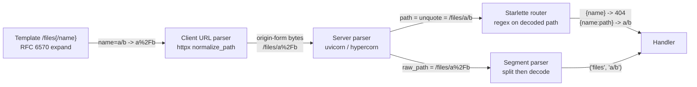

# URI Syntax, Percent-Encoding Normalization, and URI Templates (RFC 3986 and RFC 6570)

> [!summary] Claim
> A URI is split into components and segments before any percent-decoding, because `%2F` and `/` are different identifiers, and every layer that decodes before splitting (the ASGI `path`, a framework router, a template's `+` operator) creates a second, attacker-reachable name for the same resource.

Part of [HTTP Semantics and Wire Protocols](README.md) in [API Engineering](../README.md).

## TL;DR

- Mechanism: RFC 3986 parses a reference into five components with one regular expression, resolves relative references with a merge plus the `remove_dot_segments` loop, and treats `%XX` triplets as data octets that are decoded only after the component is separated.
- Contract rule: decoding an unreserved triplet (`%7E` -> `~`) never changes meaning, while decoding a reserved one (`%2F` -> `/`) always may, so normalizers decode only the 66 unreserved characters and uppercase the rest (RFC 3986 Sections 2.2, 2.3, and 6.2.2.2).
- Trap: ASGI servers hand the application a fully decoded `scope["path"]`, so Starlette routes `/files/a%2Fb` and `/files/a/b` identically and delivers `%2E%2E` as a literal `..` segment; only `scope["raw_path"]` still carries the distinction.
- Portability: the lab's 231 test cases pass unchanged on CPython 3.12.13, 3.12.16, 3.13.18, 3.14.6, 3.14.10, 3.15.2, and 3.15.2 free-threaded (the 3.12.16 and 3.15.2t legs in Linux containers with only the imported pins), on 3.15.0b3 and 3.15.0b3 free-threaded, and in Debian Trixie and Alpine containers; Uvicorn, Hypercorn, and Granian all decode `path` and keep the received bytes in `raw_path`; the behavior is identical for HTTP/1.1, HTTP/2 `:path`, and HTTP/3 `:path`.
- When not to use it: RFC 6570 templates are a URI construction language, not a router; matching URIs back against a template is explicitly weak (RFC 6570 Section 1.4), so route with explicit segment parsing and use templates only to build links.

## Mental model



A template encodes the reserved `/` in a value as `%2F`, so the URI that leaves the client has two segments, and the client parser removes only literal dot segments before serializing the origin-form target.
The server parser keeps those bytes in `raw_path` but also computes `path` by percent-decoding the whole string, which is the one step RFC 3986 Section 2.4 forbids before splitting.
The router matches its regular expressions against the decoded `path`, so the two-segment URI becomes a three-segment string, and the handler can only recover the original structure by re-parsing `raw_path` itself, splitting first and decoding second.

## How it works

### Components and the parse regex

A URI reference has five components: `scheme`, `authority`, `path`, `query`, and `fragment`; RFC 3986 Appendix B gives the regular expression `^(([^:/?#]+):)?(//([^/?#]*))?([^?#]*)(\?([^#]*))?(#(.*))?` that matches every string and extracts them as groups 2, 4, 5, 7, and 9.
The expression never fails, so parsing is not validation; an undefined component (the delimiter is absent) and an empty component (the delimiter is present) are different, and recomposition must preserve that difference (RFC 3986 Section 5.3).
`http://h/p?` and `http://h/p` are therefore different references, and RFC 3986 Section 6.2.3 states that `http://example.com/?` "cannot be assumed to be equivalent" to `http://example.com/`.

### Percent-encoding

A `pct-encoded` triplet is `"%" HEXDIG HEXDIG` and represents one octet; uppercase and lowercase hex digits are equivalent, and producers and normalizers should emit uppercase (RFC 3986 Section 2.1).
The 18 reserved characters split into `gen-delims` (`:/?#[]@`) and `sub-delims` (`!$&'()*+,;=`); "URIs that differ in the replacement of a reserved character with its corresponding percent-encoded octet are not equivalent" (RFC 3986 Section 2.2).
The unreserved set is `ALPHA / DIGIT / "-" / "." / "_" / "~"`, and URIs that differ only by encoding an unreserved character are equivalent (RFC 3986 Section 2.3).
When a URI is dereferenced, components "must be parsed and separated before the percent-encoded octets within those components can be safely decoded", and implementations "must not percent-encode or decode the same string more than once" (RFC 3986 Section 2.4).
Section 7.3 repeats the rule for servers, adds that security checks apply after decoding, and singles out `%00` as something to reject when raw data is not expected.
Non-ASCII text is encoded as UTF-8 first and then each octet is percent-encoded (RFC 6570 Section 1.6); RFC 3987 defines IRIs as the Unicode form that maps onto URIs this way.

### Reference resolution

RFC 3986 Section 5.2.2 resolves a reference `R` against a base `B`: a reference with a scheme or authority replaces everything from that component onward, an empty path inherits the base path and (if `R` has no query) the base query, and a relative path is merged and then passed through `remove_dot_segments`.
The merge (Section 5.2.3) appends the reference to everything up to the last `/` of the base path, with one special case: a base with an authority and an empty path yields `"/" + reference`.
`remove_dot_segments` (Section 5.2.4) is a two-buffer loop with rules A through E; rule C (`/../` or a trailing `/..`) pops the last output segment and leaves a `/`, which is why `/a/b/..` resolves to `/a/` and not `/a`.
Section 5.4 gives 23 normal and 19 abnormal examples against the base `http://a/b/c/d;p?q`; the lab asserts all 42.
The last abnormal example, `http:g`, is `http:g` for a strict parser and `http://a/b/c/g` for a non-strict parser that drops a scheme equal to the base scheme; RFC 3986 calls that a loophole kept for backward compatibility.
CPython's `urljoin` is non-strict: it sets `scheme = bscheme` when the reference has none and then treats a same-scheme reference as relative (CPython 3.14.6 Lib/urllib/parse.py, urljoin), and the lab measures that this is its only divergence from the 42 RFC rows.

### Normalization ladder

RFC 3986 Section 6.2 orders comparison from cheap to expensive: simple string comparison, syntax-based normalization (case, percent-encoding, dot segments), scheme-based normalization, and protocol-based normalization.
Case normalization lowercases the scheme and host and uppercases triplet hex digits; percent-encoding normalization decodes only unreserved octets; path segment normalization runs `remove_dot_segments` on absolute paths too (RFC 3986 Sections 6.2.2.1 through 6.2.2.3).
Because `%2E` is unreserved and "can be decoded at any time" (RFC 3986 Section 2.4), a normalizer that removes dot segments before decoding leaves `/a/%2E%2E/b` unchanged and lets the next decoder produce `/a/../b`; decoding unreserved octets first reaches the fixed point `/b`.
For `http` and `https`, RFC 9110 Section 4.2.3 adds the scheme-based rules: omit the default port, replace an empty path with `/` (except for `OPTIONS`), compare scheme and host case-insensitively, and leave every non-reserved character unencoded, so `http://example.com:80/~smith/home.html`, `http://EXAMPLE.com/%7Esmith/home.html`, and `http://EXAMPLE.com:/%7esmith/home.html` are equivalent.
RFC 9110 Section 7.7 forbids a proxy from modifying the `absolute-path` and `query` of a forwarded target except as the forwarding protocol requires, so normalization is a comparison tool and never a rewrite performed by intermediaries.

### The request target on the wire

HTTP/1.1 sends the `origin-form` (`absolute-path [ "?" query ]`) in the request line (RFC 9112 Section 3.2.1); HTTP/2 and HTTP/3 send the path and query parts of the target URI in the `:path` pseudo-header field, which RFC 9113 Section 8.3.1 defines with the `absolute-path` production and RFC 9114 Section 4.3.1 with the RFC 3986 `path-absolute` production, each optionally followed by `?` and `query`.
All three carry the percent-encoded bytes unchanged, so the decoding hazard is not a property of the HTTP version but of the server's ASGI mapping.
The ASGI HTTP connection scope defines `path` as the target "with percent-encoded sequences and UTF-8 byte sequences decoded into characters" and `raw_path` as the path "unmodified from the bytes that were received" (ASGI HTTP and WebSocket specification, connection scope).
Uvicorn computes `path = unquote(raw_path.decode("ascii"))` (uvicorn 0.54.0 uvicorn/protocols/http/h11_impl.py, H11Protocol.handle_events) and the same `urllib.parse.unquote` in its `httptools` backend (uvicorn 0.54.0 uvicorn/protocols/http/httptools_impl.py, HttpToolsProtocol.on_headers_complete).
Hypercorn shares one scope builder for HTTP/1.1, HTTP/2, and HTTP/3 and sets `"path": unquote(path.decode("ascii"))` (hypercorn 0.18.0 hypercorn/protocol/http_stream.py, HTTPStream.handle).
Granian builds the scope in Rust: `path` is `percent_encoding::percent_decode_str(raw_path).decode_utf8_lossy()` and `raw_path` is the bytes of `req.uri.path()` (granian 2.8.7 src/asgi/utils.rs, `build_scope_common`).
`urllib.parse.unquote` defaults to `errors='replace'` (CPython 3.14.6 Lib/urllib/parse.py, unquote), so every invalid UTF-8 octet becomes `U+FFFD` and `%FF` and `%FE` collapse into the same `path`.
The in-process `httpx.ASGITransport` used by the lab builds the same pair, `"path": request.url.path` (decoded by `unquote`) and `"raw_path"` from the encoded target (httpx 0.28.1 httpx/_transports/asgi.py, ASGITransport.handle_async_request).

### Client-side normalization in httpx

`httpx.URL` lowercases the scheme, lowercases and IDNA-encodes the host, removes dot segments, and percent-encodes characters outside per-component safe sets while passing existing `%XX` triplets through (httpx 0.28.1 httpx/_urlparse.py, urlparse, encode_host, and quote).
Its dot-segment step splits on `/` and pops on `..` (httpx 0.28.1 httpx/_urlparse.py, normalize_path), which differs from RFC 3986 Section 5.2.4 on a trailing dot segment: the lab measures `http://t/a/b/..` -> `/a` in httpx versus `/a/` per the RFC.
It does not decode `%2E%2E`, so an encoded dot segment reaches the server intact, where the ASGI decode turns it into a literal `..`.

### Starlette routing

`compile_path` turns `/files/{name}` into a regular expression, with `{name}` defaulting to `StringConvertor.regex = "[^/]+"` and `{name:path}` using `PathConvertor.regex = ".*"` (starlette 1.10.0 starlette/routing.py, compile_path, and starlette/convertors.py, StringConvertor and PathConvertor).
`Route.matches` applies that expression to `get_route_path(scope)`, which is the decoded `scope["path"]` minus `root_path` (starlette 1.10.0 starlette/_utils.py, get_route_path).
`Request.url` is also rebuilt from the decoded `path`, re-encoding only `?`, `#`, and `\` (starlette 1.10.0 starlette/datastructures.py, URL.__init__), so it cannot reproduce `%2F` either.
In the reverse direction, `url_path_for` substitutes parameters through `Convertor.to_string`, which for strings only asserts that the value contains no `/` and is not empty, and does not percent-encode (starlette 1.10.0 starlette/routing.py, replace_params, and starlette/convertors.py, StringConvertor.to_string); the lab shows `name="a?b"` produces `/seg/a?b`, whose path is `/seg/a` and whose query is `b`.

### URI Templates

RFC 6570 defines four levels: Level 1 is `{var}`, Level 2 adds `+` (reserved) and `#` (fragment), Level 3 adds multiple variables and the `.`, `/`, `;`, `?`, and `&` operators, and Level 4 adds the `:n` prefix and `*` explode modifiers (RFC 6570 Section 1.2).
Appendix A reduces every operator to five properties, which the lab encodes as one table:

| Operator | `first` | `sep` | `named` | `ifemp` | allowed unencoded |
|---|---|---|---|---|---|
| none | `""` | `,` | no | `""` | unreserved |
| `+` | `""` | `,` | no | `""` | unreserved, reserved, triplets |
| `#` | `#` | `,` | no | `""` | unreserved, reserved, triplets |
| `.` | `.` | `.` | no | `""` | unreserved |
| `/` | `/` | `/` | no | `""` | unreserved |
| `;` | `;` | `;` | yes | `""` | unreserved |
| `?` | `?` | `&` | yes | `=` | unreserved |
| `&` | `&` | `&` | yes | `=` | unreserved |

An undefined variable (null, an empty list, or a map with no defined values) contributes nothing, while an empty string is defined; that is why `{?x,y,empty}` ends in `&empty=` and `{;x,y,empty}` ends in `;empty` (RFC 6570 Sections 2.3 and 3.2.1).
A prefix `max-length` is `%x31-39 0*3DIGIT`, a positive integer below 10000, counted in Unicode characters rather than octets, and it does not apply to composite values (RFC 6570 Section 2.4.1).
Only `+` and `#` pass reserved characters and existing triplets; every other operator encodes `%` as `%25` (RFC 6570 Section 3.2.1), so with `name="../admin/keys"` the template `/v1/files{/name}` yields `/v1/files/..%2Fadmin%2Fkeys` while `/v1/files/{+name}` yields `/v1/files/../admin/keys`, which resolves to `/v1/admin/keys`.
The operator characters `=`, `,`, `!`, `@`, and `|` are reserved for future extensions (RFC 6570 Section 2.2).
On a malformed template RFC 6570 Section 3 says the processor SHOULD copy the unprocessed part to the result unexpanded (ceasing at an error outside an expression, continuing past an error inside one) and SHOULD indicate the location and type of the error; the lab deliberately raises `TemplateError` instead, so a broken template can never become a request target.

## Numbers and limits

| Quantity | Value | Source |
|---|---|---|
| Unreserved characters | 66 (52 letters, 10 digits, `-._~`) | (RFC 3986 Section 2.3) |
| Reserved characters | 18 (7 `gen-delims`, 11 `sub-delims`) | (RFC 3986 Section 2.2) |
| Resolution examples | 23 normal + 19 abnormal = 42 | (RFC 3986 Sections 5.4.1 and 5.4.2), all asserted in the lab |
| RFC 6570 Section 3.2 examples | 115 rows | all asserted in the lab |
| Template prefix `max-length` | 1 to 9999 characters | (RFC 6570 Section 2.4.1) |
| Minimum URI length senders and recipients should support | 8000 octets (RECOMMENDED) | (RFC 9110 Section 4.1) |
| Status for a target the server refuses as too long | `414 URI Too Long` | (RFC 9110 Section 15.5.15) |
| `httpx` maximum URL and component length | 65536 characters (`MAX_URL_LENGTH`) | (httpx 0.28.1 httpx/_urlparse.py, urlparse) |
| `h11` default buffer limit for an incomplete request head | 16384 bytes (`DEFAULT_MAX_INCOMPLETE_EVENT_SIZE = 16 * 1024`) | (h11 0.16.0 h11/_connection.py, DEFAULT_MAX_INCOMPLETE_EVENT_SIZE) |
| `normalize_uri("http://EXAMPLE.com:80/%7Esmith/./a/../home.html")` | 4.03 us per call | measured 2026-11-08: `uv run --frozen python <script>` from `labs/` (`min(timeit.repeat(fn, number=20000, repeat=5)) / 20000`), CPython 3.14.6, Apple M3 Pro, macOS 27.2 arm64 |
| `resolve("http://a/b/c/d;p?q", "../../g")` | 2.67 us per call | same run |
| `expand("/v1/users{/id}/orders{?status,limit}", {"id": "42", "status": "open", "limit": "10"})` | 4.10 us per call | same run |
| Plain `str ==` on two 35-character URIs, including the `lambda` call | 0.01 us per call | same run |

The measured rows come from one throwaway `timeit` script (not part of the lab, deleted after the run) on the machine above, and a second run agreed within 5%; they show that full normalization costs two to three orders of magnitude more than a plain string comparison, which matters for cache keys computed on every request and not at all for link generation.

## Portability

| Runtime, library, or protocol | Behavior | Evidence |
|---|---|---|
| CPython 3.12.13, 3.13.18, 3.14.6, 3.14.10, 3.15.2 with the frozen workspace | All 231 test cases pass, including the `urljoin` divergence set `{"http:g"}` | `uv run --frozen --python <v> pytest ...` with a per-version `UV_PROJECT_ENVIRONMENT`, `231 passed` on each, macOS 27.2 arm64 (re-run 2026-11-08) |
| CPython 3.15.0b3 and 3.15.0b3 free-threaded (`uv run --python 3.15.0b3` and `3.15.0b3+freethreaded`) | All 231 test cases pass with only the imported pins; with the frozen workspace, sync fails on 3.15.0b3t (no `psycopg-binary==3.3.8` wheel), and on 3.15.0b3 sync completes but pytest aborts loading the `hypothesis` plugin (`No module named 'hypothesis._native'`) because `hypothesis 6.170.14` ships `_native.abi3t-darwin.so` and this beta's `EXTENSION_SUFFIXES` lists only `.abi3t.so` (as of 2026-11) | `uv run --no-project --with` the pinned `httpx`, `httpcore`, `anyio`, `starlette`, `h11`, `idna`, `pytest`, `pytest-asyncio`, and `pytest-cov`; `sys._is_gil_enabled()` reported `False` on the `t` build |
| CPython 3.12.16 (Debian Trixie container) | All 231 test cases pass with the pinned `httpx`, `httpcore`, `anyio`, `starlette`, `h11`, `idna`, `pytest`, `pytest-asyncio`, and `pytest-cov` installed by `pip` | `docker run python:3.12-slim-trixie` (Python 3.12.16, linux/arm64), `231 passed` (2026-11-08); `uv 0.11.26` on the macOS host cannot provide 3.12.16 |
| CPython 3.15.2t free-threaded (Linux container) | All 231 test cases pass, `sys._is_gil_enabled()` reported `False` | `docker run ghcr.io/astral-sh/uv:python3.14-trixie` with `uv 0.13.7`, `uv venv --python 3.15.2+freethreaded` (3.15.2 free-threading build, linux/arm64), the same pins via `uv pip install`, `231 passed` (2026-11-08); no macOS free-threaded 3.15.2 build is available to `uv 0.11.26` |
| Debian Trixie (glibc) and Alpine 3.24 (musl) containers, linux/arm64 | All 231 test cases pass on CPython 3.14.10 | `docker run python:3.14-slim-trixie` and `python:3.14-alpine` with the pinned `httpx`, `httpcore`, `anyio`, `starlette`, `h11`, `idna`, `pytest`, `pytest-asyncio`, and `pytest-cov` installed by `pip`, `231 passed` on each (2026-11-08) |
| CPython `urllib.parse.urljoin` | Non-strict on same-scheme references: `http:g` -> `http://a/b/c/g` | lab test on every version above; (CPython 3.14.6 Lib/urllib/parse.py, urljoin) |
| CPython `urllib.parse.quote` | `safe='/'` by default, so `quote("../admin/keys")` is unchanged | lab test; (CPython 3.14.6 Lib/urllib/parse.py, quote) |
| `httpx 0.28.1` | Removes literal dot segments without keeping the trailing `/`; leaves `%2E%2E` and `%2F` encoded | lab test; (httpx 0.28.1 httpx/_urlparse.py, normalize_path) |
| `starlette 1.10.0` | Routes on decoded `path`; `{name}` returns `404 Not Found` for `a%2Fb`; `url_path_for` does not encode `?` | lab test through `httpx.ASGITransport` |
| `uvicorn 0.54.0` (`h11` and `httptools`) | `path = unquote(...)`, `raw_path` = received bytes | (uvicorn 0.54.0 uvicorn/protocols/http/h11_impl.py, H11Protocol.handle_events) and (uvicorn 0.54.0 uvicorn/protocols/http/httptools_impl.py, HttpToolsProtocol.on_headers_complete) |
| `hypercorn 0.18.0` | Same decode for HTTP/1.1, HTTP/2, and HTTP/3, from one `HTTPStream` | (hypercorn 0.18.0 hypercorn/protocol/http_stream.py, HTTPStream.handle) |
| `granian 2.8.7` | `path` percent-decoded with lossy UTF-8, `raw_path` = received bytes (hex case preserved) | (granian 2.8.7 src/asgi/utils.rs, `build_scope_common`) read from the PyPI sdist (sha256 `7e63163766d9...`), and a run: `granian --interface asgi` serving a scope-echo app, raw-socket `GET /a%2fb/%7e/c%20d?x=%2f` returned `path` `/a/b/~/c d` and `raw_path` `/a%2fb/%7e/c%20d`, CPython 3.14.6, macOS 27.2 arm64 (2026-11-08); `curl` rewrites `%7e` to `%7E` before sending, so use a raw socket |
| HTTP/1.1, HTTP/2, HTTP/3 | The request target carries the same path-and-query bytes; only the carrier differs (request line vs `:path`) | (RFC 9112 Section 3.2.1), (RFC 9113 Section 8.3.1), (RFC 9114 Section 4.3.1) |

## Worked example

The [implementation](../labs/src/api_labs/f01_http_semantics_and_wire_protocols/uri.py) is a strict RFC 3986 parser, resolver, and normalizer, a split-then-decode path segment parser, and an RFC 6570 Level 4 expander; the [test](../labs/tests/f01_http_semantics_and_wire_protocols/test_uri_syntax_resolution_and_templates_rfc_6570.py) asserts every RFC 3986 Section 5.4 row and every RFC 6570 Section 3.2 example, and drives Starlette through `httpx.ASGITransport` to show what the router and the handler actually receive.

Excerpt of `uri.py`, byte-identical to lines 58 to 82: the Section 5.2.4 loop, rule by rule.

```python
def remove_dot_segments(path: str) -> str:
    """Interpret "." and ".." segments with the two-buffer loop of RFC 3986 Section 5.2.4."""
    buffer = path
    output: list[str] = []
    while buffer:
        if buffer.startswith("../"):
            buffer = buffer[3:]
        elif buffer.startswith("./"):
            buffer = buffer[2:]
        elif buffer.startswith("/./"):
            buffer = "/" + buffer[3:]
        elif buffer == "/.":
            buffer = "/"
        elif buffer.startswith("/../") or buffer == "/..":
            buffer = "/" + buffer[4:]
            if output:
                output.pop()
        elif buffer in {".", ".."}:
            buffer = ""
        else:
            end = buffer.find("/", 1 if buffer.startswith("/") else 0)
            end = len(buffer) if end == -1 else end
            output.append(buffer[:end])
            buffer = buffer[end:]
    return "".join(output)
```

Excerpt of `uri.py`, byte-identical to lines 164 to 213: normalization decodes unreserved octets before removing dot segments, and the server-side parser splits before it decodes.

```python
def normalize_uri(uri: str) -> str:
    """Apply syntax-based normalization, plus scheme-based rules for http and https.

    Case and percent-encoding normalization run before dot-segment removal, so that an
    encoded `%2E%2E` segment is removed like a literal `..` (RFC 3986 Sections 2.4 and 6.2.2).
    """
    parts = parse_reference(uri)
    if parts.scheme is None:
        raise ValueError("only absolute URIs can be normalized")
    scheme = parts.scheme.lower()
    authority = parts.authority
    if authority is not None:
        authority = _normalize_authority(authority, scheme)
    path = remove_dot_segments(normalize_percent_encoding(parts.path))
    if scheme in DEFAULT_PORTS and authority is not None and not path:
        path = "/"
    query = None if parts.query is None else normalize_percent_encoding(parts.query)
    fragment = None if parts.fragment is None else normalize_percent_encoding(parts.fragment)
    return URIReference(scheme, authority, path, query, fragment).recompose()


def parse_path_segments(raw_path: bytes) -> tuple[str, ...]:
    """Split an origin-form path on "/" first, then strictly decode each segment.

    Splitting before decoding keeps `%2F` inside one segment (RFC 3986 Sections 2.4 and 7.3).
    Decoded dot segments, NUL, malformed triplets, and invalid UTF-8 raise `ValueError`.
    """
    text = raw_path.decode("ascii")
    if not text.startswith("/"):
        raise ValueError("origin-form path must start with '/'")
    segments: list[str] = []
    for raw in text[1:].split("/"):
        octets = bytearray()
        i = 0
        while i < len(raw):
            if raw[i] == "%":
                if not _is_triplet(raw, i):
                    raise ValueError(f"malformed percent-encoding in segment {raw!r}")
                octets.append(int(raw[i + 1 : i + 3], 16))
                i += 3
            else:
                octets.extend(raw[i].encode("ascii"))
                i += 1
        segment = octets.decode("utf-8")
        if segment in {".", ".."}:
            raise ValueError(f"dot segment {raw!r} after decoding")
        if "\x00" in segment:
            raise ValueError(f"NUL octet in segment {raw!r}")
        segments.append(segment)
    return tuple(segments)
```

Excerpt of `uri.py`, byte-identical to lines 234 to 246: the RFC 6570 Appendix A table as data.

```python
_OPERATORS: Mapping[str, _Operator] = {
    "": _Operator("", ",", named=False, ifemp="", allow_reserved=False),
    "+": _Operator("", ",", named=False, ifemp="", allow_reserved=True),
    "#": _Operator("#", ",", named=False, ifemp="", allow_reserved=True),
    ".": _Operator(".", ".", named=False, ifemp="", allow_reserved=False),
    "/": _Operator("/", "/", named=False, ifemp="", allow_reserved=False),
    ";": _Operator(";", ";", named=True, ifemp="", allow_reserved=False),
    "?": _Operator("?", "&", named=True, ifemp="=", allow_reserved=False),
    "&": _Operator("&", "&", named=True, ifemp="=", allow_reserved=False),
}
_FUTURE_OPERATORS = frozenset("=,!@|")
_VARCHAR = r"(?:[A-Za-z0-9_]|%[0-9A-Fa-f]{2})"
_VARSPEC = re.compile(rf"({_VARCHAR}(?:\.?{_VARCHAR})*)(?::([1-9][0-9]{{0,3}})|(\*))?")
```

Excerpt of the test, byte-identical to lines 220 to 249 and 402 to 425: the handler reports what Starlette decoded and what `raw_path` preserved.

```python
async def _echo(request: Request) -> JSONResponse:
    raw_path: bytes = request.scope["raw_path"]
    try:
        segments: list[str] | str = list(parse_path_segments(raw_path))
    except ValueError as exc:
        segments = f"rejected: {exc}"
    return JSONResponse(
        {
            "param": request.path_params["name"],
            "scope_path": request.scope["path"],
            "raw_path": raw_path.decode("ascii"),
            "segments": segments,
        }
    )


ECHO_APP = Starlette(
    routes=[
        Route("/seg/{name}", _echo, name="seg"),
        Route("/files/{name:path}", _echo, name="files"),
    ]
)


async def _get_json(path: str) -> tuple[int, dict[str, object]]:
    transport = httpx.ASGITransport(app=ECHO_APP)
    async with httpx.AsyncClient(transport=transport, base_url="http://test") as client:
        response = await client.get(path)
    body: dict[str, object] = response.json() if response.status_code == 200 else {}
    return response.status_code, body
```

```python
@pytest.mark.unit
@pytest.mark.asyncio
async def test_starlette_routes_on_decoded_path_so_encoded_slash_is_lost() -> None:
    status, _ = await _get_json("/seg/a%2Fb")
    assert status == 404

    _, encoded = await _get_json("/files/a%2Fb")
    _, literal = await _get_json("/files/a/b")
    assert encoded["param"] == literal["param"] == "a/b"
    assert encoded["scope_path"] == literal["scope_path"] == "/files/a/b"
    assert encoded["raw_path"] == "/files/a%2Fb"
    assert encoded["segments"] == ["files", "a/b"]
    assert literal["segments"] == ["files", "a", "b"]


@pytest.mark.unit
@pytest.mark.asyncio
async def test_encoded_dot_segment_survives_client_and_reaches_the_handler() -> None:
    assert httpx.URL("http://test/files/%2E%2E/secret").raw_path == b"/files/%2E%2E/secret"
    _, body = await _get_json("/files/%2E%2E/secret")
    assert body["param"] == "../secret"
    assert body["scope_path"] == "/files/../secret"
    assert body["segments"] == "rejected: dot segment '%2E%2E' after decoding"

```

Captured from `labs/` with `uv run --frozen pytest tests/f01_http_semantics_and_wire_protocols/test_uri_syntax_resolution_and_templates_rfc_6570.py -q` on CPython 3.14.6, macOS 27.2 arm64 (Apple M3 Pro):

```text
........................................................................ [ 31%]
........................................................................ [ 62%]
........................................................................ [ 93%]
...............                                                          [100%]
231 passed in 0.14s
```

Excerpt of the captured verbose run of three behavior tests (same interpreter and machine; the session header lines, which contain local paths, are omitted):

```text
collecting ... collected 3 items
tests/f01_http_semantics_and_wire_protocols/test_uri_syntax_resolution_and_templates_rfc_6570.py::test_starlette_routes_on_decoded_path_so_encoded_slash_is_lost PASSED [ 33%]
tests/f01_http_semantics_and_wire_protocols/test_uri_syntax_resolution_and_templates_rfc_6570.py::test_encoded_dot_segment_survives_client_and_reaches_the_handler PASSED [ 66%]
tests/f01_http_semantics_and_wire_protocols/test_uri_syntax_resolution_and_templates_rfc_6570.py::test_cpython_urljoin_differs_from_strict_rfc_3986_only_on_http_g PASSED [100%]
============================== 3 passed in 0.07s ===============================
```

## Pitfalls

> [!warning] Routing on the decoded path
> Trigger: an object-storage or file API exposes `/{bucket}/{key:path}` and clients send keys that contain `/` encoded as `%2F`.
> Symptom: `a%2Fb` and `a/b` reach the handler as the same `key`, and a `{key}` (non-path) route returns `404 Not Found` for any encoded slash, as the lab measures on Starlette 1.10.0.
> Fix: parse `scope["raw_path"]` by splitting on `/` and then decoding each segment, and reject or canonicalize `%2F` at the edge by policy rather than by accident.

> [!warning] Encoded dot segments survive client normalization
> Trigger: an attacker sends `/static/%2E%2E/secret`; the client or proxy removes only literal `..` segments.
> Symptom: the ASGI `path` contains `/static/../secret`, a `{name:path}` parameter is `../secret`, and any code that joins it to a directory escapes it.
> Precedent: Apache HTTP Server 2.4.49 shipped "a flaw ... in a change made to path normalization" that let a path traversal map URLs to files outside the directories configured by Alias-like directives and was exploited in the wild (CVE-2021-41773), and the 2.4.50 fix was incomplete (CVE-2021-42013); Starlette `StaticFiles` from 0.13.5 and before 0.27.0 used `os.path.commonprefix`, so `/static/../static1.txt` served a sibling file or directory whose name starts with the static directory's name (CVE-2023-29159, GHSA-v5gw-mw7f-84px).
> Fix: decode unreserved octets, then remove dot segments, then check containment with a path-aware function (`os.path.commonpath` on resolved paths), and reject decoded `.` and `..` segments outright in APIs that have no use for them.

> [!warning] Building links with `quote` or `url_path_for`
> Trigger: `f"/v1/files/{quote(name)}"` or `request.url_for("seg", name=name)` with user-controlled `name`.
> Symptom: `quote` keeps `/` by default and Starlette's `url_path_for` does not percent-encode at all, so `name="a?b"` turns path data into a query and `name="../x"` changes the target after resolution.
> Fix: build URIs with an encoder whose allowed set is the component's unreserved set (`quote(name, safe="")` or a Level 3 `{/name}` expression), and keep `{+var}` for values that are trusted URI fragments.

> [!warning] Lossy decoding of invalid UTF-8
> Trigger: a path segment carries octets that are not valid UTF-8, such as `%FF`.
> Symptom: `urllib.parse.unquote(errors="replace")` maps them to `U+FFFD`, so `%FF` and `%FE` become the same `path` and the same cache key or authorization subject, as the lab measures through `httpx.ASGITransport`, which decodes with the same `urllib.parse.unquote` that Uvicorn and Hypercorn call.
> Fix: decode strictly (`bytes.decode("utf-8")` without `errors="replace"`) and answer `400 Bad Request` on failure.

> [!warning] Parser differentials before the path
> Trigger: one component validates a URL with `urllib.parse` and another component fetches it.
> Symptom: CPython before 3.11.4 let a URL "that starts with blank characters" bypass blocklisting in `urllib.parse` (CVE-2023-24329), a parser differential of the kind that defeats URL allowlists used against server-side request forgery.
> Fix: parse once, pass the parsed components (not the string) to every later stage, and test the validator and the fetcher against the same corpus.

## Security and robustness

- Threat model: the path and query are attacker-controlled bytes that pass through a client normalizer, zero or more proxies, a server decoder, a router, and a handler; each layer that decodes or normalizes differently creates a second name for a resource, and an authorization check on one name can be bypassed through the other.
- OWASP API Security Top 10 2023: path confusion feeds API1:2023 Broken Object Level Authorization and API5:2023 Broken Function Level Authorization when an access rule keyed on `/admin/...` misses `/%61dmin/...` or `/x/../admin/...`, and template-built outbound URLs feed API7:2023 Server Side Request Forgery when a `{+var}` value can rewrite the authority or path.
- Enforce one canonical form at the edge: normalize per RFC 3986 Section 6.2.2 and RFC 9110 Section 4.2.3, reject what does not survive strict parsing (malformed triplets, `%00`, invalid UTF-8, decoded dot segments), and route on the result; RFC 9110 Section 7.7 means intermediaries forward the original bytes, so the origin must do this itself.
- Authorize on the same representation the handler uses; computing a policy decision from `scope["path"]` and a storage key from `raw_path` (or the reverse) reintroduces the differential.
- Bound the input: RFC 9110 Section 4.1 recommends supporting at least 8000 octets, and a server that refuses longer targets answers `414 URI Too Long` (RFC 9110 Section 15.5.15); `h11` already refuses an incomplete request head beyond 16384 bytes by default.
- Template inputs: RFC 6570 Section 4 places the risk in who supplies the template and who supplies values for expressions that allow reserved characters; treat `+` and `#` expansions of untrusted values as URI injection, and refuse templates from untrusted sources entirely.
- Defense in depth: a containment check on resolved filesystem paths still matters after URI normalization, because file systems assign meaning to characters and device names that the URI layer does not know about (RFC 3986 Section 7.3).

## The principal's view

The architectural decision is where the canonical form of a request target is computed and who is allowed to see anything else.
Pick one layer, usually the edge proxy or a single ASGI middleware, that normalizes per RFC 3986 and RFC 9110, rejects ambiguous input, and hands every later layer the same parsed segments; then forbid application code from reading `raw_path` or re-decoding paths on its own.
The organizational trade-off is compatibility: rejecting `%2F`, decoded dot segments, and invalid UTF-8 breaks a small number of legitimate clients (storage keys, legacy crawlers), and the team must publish that contract and accept the support load instead of quietly decoding.
For identifiers that legitimately contain `/` (object keys, file paths, nested resource names), stop putting them in path segments: put them in a query parameter or a request body, or encode them with an opaque base64url form, because Starlette, and therefore FastAPI, routes on the decoded `path` and not on `raw_path`.
Use RFC 6570 for hypermedia links and SDK generation, where it shines, and use explicit router patterns plus a strict segment parser for inbound matching, which RFC 6570 Section 1.4 itself recommends handing to regular expressions.
If the API is consumed mainly by generated clients, an RPC style with a fixed path and typed body (see [[Protocol-Design-Over-HTTP-BCP-56-RFC-9205]]) removes the whole class of path-encoding ambiguity at the cost of HTTP-level cacheability.

## Interview questions

> [!question] L5: Why are `http://h/a%2Fb` and `http://h/a/b` different URIs while `http://h/%7Euser` and `http://h/~user` are the same?
>
> > [!success]- Answer
> > `/` is a reserved `gen-delim`, and RFC 3986 Section 2.2 says replacing a reserved character with its triplet changes the URI.
> > `~` is unreserved, and Section 2.3 says encoding or decoding an unreserved character never changes meaning.
> > So the first pair has one segment versus two, and the second pair normalizes to the same string.
> >
> > Follow-up: What does a normalizer do with `%2f` lowercase?

> [!question] L5: Predict the output of `remove_dot_segments("/a/b/..")`, `httpx.URL("http://t/a/b/..").raw_path`, and `urljoin("http://a/b/c/d;p?q", "http:g")`.
>
> > [!success]- Answer
> > `remove_dot_segments` returns `/a/`, because rule C replaces the trailing `/..` with `/` and pops `/b`.
> > `httpx 0.28.1` returns `b"/a"`, because its `normalize_path` joins the remaining components without the trailing slash.
> > `urljoin` returns `http://a/b/c/g`, because CPython is a non-strict parser and treats a same-scheme reference as relative; a strict RFC 3986 parser returns `http:g`.
> >
> > Follow-up: Which of the three differences could change which route a server selects?

> [!question] L5: What does `{?x,y,empty}` expand to with `x=1024`, `y=768`, `empty=""`, and how does that differ from `{;x,y,empty}`?
>
> > [!success]- Answer
> > `?x=1024&y=768&empty=` for the form-style operator, whose `ifemp` is `=`.
> > `;x=1024;y=768;empty` for the path-parameter operator, whose `ifemp` is the empty string.
> > An undefined variable would vanish from both, because an empty string is defined and null is not (RFC 6570 Section 2.3).
> >
> > Follow-up: Is an empty list defined?

> [!question] L6: Debug this API: why does a Starlette file service at `/files/{name:path}` return `/etc/passwd` content for `GET /files/%2E%2E/%2E%2E/etc/passwd` when the WAF in front blocks `..`, and what is the fix?
>
> > [!success]- Answer
> > The WAF and `httpx`-style clients remove only literal `..` segments, and `%2E` is not decoded by them.
> > Uvicorn and Hypercorn set `scope["path"]` with `unquote`, so the router sees `/files/../../etc/passwd` and `name` is `../../etc/passwd`.
> > The handler then joined `name` to a base directory without a path-aware containment check.
> > Fix at the edge by decoding unreserved octets before dot removal and rejecting decoded dot segments, and fix in the handler by resolving the joined path and checking it with `os.path.commonpath`.
> >
> > Follow-up: Why does `os.path.commonprefix` not fix it (CVE-2023-29159)?

> [!question] L6: Why does RFC 3986 insist that components be separated before percent-decoding, and where does the ASGI scope violate that?
>
> > [!success]- Answer
> > Decoding first turns data octets into delimiters, so `%2F` becomes a segment boundary and `%3F` a query delimiter (RFC 3986 Sections 2.4 and 7.3).
> > ASGI `path` is the whole path decoded in one step, which keeps the query split but erases segment boundaries inside the path.
> > `raw_path` preserves the bytes, so a correct segment parser must split `raw_path` on `/` and decode each segment.
> >
> > Follow-up: Why does decoding twice also break identity?

> [!question] L6: What is the risk when a teammate uses `/files/{+id}` in an RFC 6570 template for SDK links because `{id}` "double-encodes"?
>
> > [!success]- Answer
> > `+` passes reserved characters and existing triplets, so an `id` of `../admin/keys` expands to `/files/../admin/keys` and resolves to `/admin/keys`.
> > `{id}` or `{/id}` encodes `/` as `%2F` and `%` as `%25`, which is the intended single encoding of raw data.
> > The "double-encoding" symptom means the caller passed an already encoded value, so the fix is to pass raw values, not to switch operators.
> >
> > Follow-up: When is `{+var}` the right choice?

> [!question] L6: Your CDN cache key and your origin's authorization layer disagree on whether `/%61dmin` equals `/admin`: which one is right, and what do you change?
>
> > [!success]- Answer
> > They are equivalent: `a` is unreserved, so syntax-based normalization decodes `%61` (RFC 3986 Section 6.2.2.2), and RFC 9110 Section 4.2.3 applies the same rule to `http(s)`.
> > Distinct resources SHOULD NOT be identified by URIs that are equivalent after normalization (RFC 9110 Section 4.2.3), so the origin must authorize the normalized form.
> > Change both layers to compute one canonical form, or reject non-canonical encodings at the edge.
> >
> > Follow-up: Would the answer change for `/%2Fadmin`?

> [!question] L7+: As the owner of the platform routing layer for 300 services, how do you design and roll out a URI canonicalization contract?
>
> > [!success]- Answer
> > Define a single canonical form: RFC 3986 syntax-based plus RFC 9110 scheme-based normalization, strict UTF-8, no decoded dot segments, no `%00`, and an explicit policy for `%2F` (reject by default).
> > Implement it once, at the edge or in a shared ASGI middleware, and give services parsed segments rather than strings.
> > Roll out in observe mode first: log every request whose raw target differs from its canonical form, per service, to size the breakage.
> > Move to reject mode per service behind a flag, with `400 Bad Request` and a machine-readable error, and offer a migration path (query parameter or opaque id) for services whose identifiers need `/`.
> > Add differential tests that run the same corpus through the edge, the framework, and the authorization layer.
> >
> > Follow-up: How do you handle a partner whose signed URLs include non-canonical encodings?

> [!question] L7+: When would you choose to stop putting resource identifiers in the path at all?
>
> > [!success]- Answer
> > When identifiers are user-controlled hierarchical strings (object keys, file paths), because every stack between the client and the handler decodes and normalizes paths differently.
> > Moving them to a query parameter keeps `/` as data under form encoding, and moving them into a body or an opaque base64url id removes URI semantics entirely.
> > The cost is weaker HTTP caching and less readable URLs, so keep path identifiers for opaque, server-minted ids and accept the trade-off for the rest.
> >
> > Follow-up: How does BCP 56 (RFC 9205) constrain an application that defines its own URL structure?

## Related

Prerequisites: [[HTTP-Message-Abstraction-RFC-9110]]

Next: [[HTTP-1-1-Framing-Keep-Alive-and-Chunked-Encoding]]

See also: [[REST-APIs]], [[02-Programming-Languages/Python/Python-Backend-Interview-Prep/05-REST-API-Design]], [[Protocol-Design-Over-HTTP-BCP-56-RFC-9205]], [[HTTP-Request-Smuggling-CL-TE-and-Desync-Mechanics]], [[HTTP-2-Binary-Framing-and-Stream-State-Machine]], [[owasp_top_10]], [[Chapter_43_High-Level_URL_and_HTTP_Handling_urllib_http]], [[curl-in-Depth]]

- Lab: `labs/tests/f01_http_semantics_and_wire_protocols/test_uri_syntax_resolution_and_templates_rfc_6570.py`

## Further reading

- [RFC 3986: URI Generic Syntax](https://www.rfc-editor.org/rfc/rfc3986.html) - Sections 2 (characters and percent-encoding), 5 (resolution and `remove_dot_segments`), 6 (the normalization ladder), and 7.3 (decode after splitting) are the whole mechanism.
- [RFC 6570: URI Template](https://www.rfc-editor.org/rfc/rfc6570.html) - Section 3.2 has the normative examples and Appendix A the one-table algorithm that every implementation should follow.
- [RFC 3987: Internationalized Resource Identifiers](https://www.rfc-editor.org/rfc/rfc3987.html) - Defines how Unicode identifiers map onto URIs through UTF-8 and percent-encoding.
- [RFC 9110: HTTP Semantics](https://www.rfc-editor.org/rfc/rfc9110.html) - Section 4 defines `http(s)` URIs, their normalization (4.2.3), and the 8000-octet recommendation (4.1); Section 7.7 forbids proxies from rewriting the path.
- [RFC 9112: HTTP/1.1](https://www.rfc-editor.org/rfc/rfc9112.html) - Section 3.2 defines the request-target forms, including `origin-form`.
- [RFC 9113: HTTP/2](https://www.rfc-editor.org/rfc/rfc9113.html) and [RFC 9114: HTTP/3](https://www.rfc-editor.org/rfc/rfc9114.html) - Sections 8.3.1 and 4.3.1 define `:path` as the path and query parts of the target URI.
- [ASGI HTTP and WebSocket specification](https://asgi.readthedocs.io/en/latest/specs/www.html) - Defines the decoded `path` and the raw `raw_path` that every Python server must populate.
- [Starlette advisory GHSA-v5gw-mw7f-84px (CVE-2023-29159)](https://github.com/encode/starlette/security/advisories/GHSA-v5gw-mw7f-84px) - A dot segment in the path plus a character-wise prefix check produced a directory traversal.
- [Apache HTTP Server 2.4 vulnerabilities](https://httpd.apache.org/security/vulnerabilities_24.html) - Primary record of CVE-2021-41773 and CVE-2021-42013, two path normalization flaws in consecutive releases.
- [NVD CVE-2023-24329](https://nvd.nist.gov/vuln/detail/CVE-2023-24329) - A `urllib.parse` differential that let leading blanks bypass URL blocklists.
