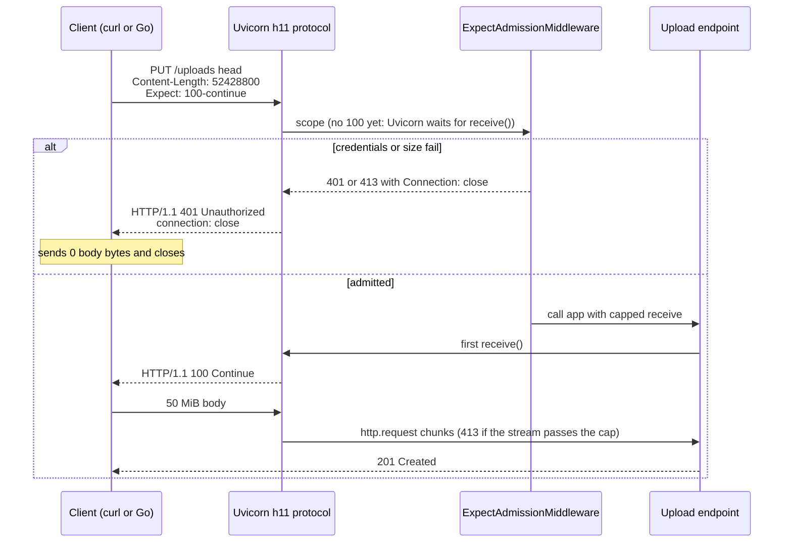

# Expect: 100-continue Mechanics: Rejecting Unauthorized or Oversized Uploads Before Body Transmission

> [!summary] Claim
> `Expect: 100-continue` saves a rejected upload's body only if the server decides from the header section before anything reads the body and marks the rejection `Connection: close`; in Python that means a pure ASGI check that runs before the first `receive()`, because Uvicorn writes `100 Continue` on that call, a FastAPI body parameter makes that call before any dependency runs, and Hypercorn writes `100` before the application runs at all.

Part of [TLS Connections and Intermediaries](README.md) in [API Engineering](../README.md).

## TL;DR

Mechanism: the client sends the request head with `Expect: 100-continue` and pauses; the origin MUST answer at once with either `100 (Continue)` or a final status it can determine from the method, target, and fields alone `(RFC 9110 Section 10.1.1)`.
Contract rule: answer `401`, `413`, or `417` before reading any body byte, and add `Connection: close`, because Go `net/http` sends the whole body after an early final response unless the response closes the connection `(go1.25.0 src/net/http/transport.go, persistConn.readResponse)`.
Trap: the expectation is advisory in both directions; clients may stop waiting (curl and Go's `DefaultTransport` wait 1 second by default, and a zero-valued Go `Transport` does not wait at all), some clients never wait (`httpcore 1.0.9`), and some servers invite the body before the application decides (Hypercorn `0.18.0`), so the size cap must also be enforced while streaming.
Portability: HTTP/1.1 only in practice; HTTP/2 and HTTP/3 can end a request stream early without losing the connection (`RST_STREAM` or `STOP_SENDING` with `NO_ERROR`), and the lab's 44 tests pass unchanged on CPython 3.12.13, 3.13.18, 3.14.6, 3.14.10, 3.15.2, and 3.14.6t free-threaded.
When not to use it: for large uploads at scale, do not stream bytes through the API tier at all; issue a presigned direct-to-storage URL or a resumable upload session after an authenticated, size-declared control request.

## Mental model



The client sends only the 91-byte head and waits.
Uvicorn builds the ASGI scope from the head and starts the application, but it writes `100 Continue` lazily, on the application's first `receive()`.
The middleware therefore gets a window in which it can see the method, path, and headers but no body; if the bearer token is missing or `Content-Length` exceeds the policy, it sends a complete `401` or `413` with `Connection: close` and returns without ever calling `receive()`.
The client reads a final status instead of `100`, knows the body is not wanted and that the connection will close, and sends zero body bytes.
If the request is admitted, the endpoint's first `receive()` triggers `100 Continue`, the body flows, and the middleware still counts bytes so a client that ignores the protocol cannot exceed the limit.

## How it works

### The wire exchange

A request that opts in carries the expectation in its header section `(RFC 9110 Section 10.1.1)`:

```text
PUT /up HTTP/1.1\r\n
host: uploads.example\r\n
content-length: 52428800\r\n
expect: 100-continue\r\n
\r\n
```

That is the exact head `h11 0.16.0` serializes in the lab: 91 bytes announcing 52,428,800 bytes of content.
The grammar is a list, `Expect = #expectation` with `expectation = token [ "=" ( token / quoted-string ) parameters ]`, the value is case-insensitive, and `100-continue` is the only expectation the specification defines `(RFC 9110 Section 10.1.1)`.
RFC 9110 restored the list form for compatibility with RFC 2616 `(RFC 9110 Appendix B.3)`.

The two possible immediate answers are an interim response, which ends at the blank line and carries no content `(RFC 9110 Section 15.2)`:

```text
HTTP/1.1 100 Continue\r\n
\r\n
```

or a complete final response; the lab's rejection is 97 bytes:

```text
HTTP/1.1 401 \r\n
www-authenticate: Bearer realm="uploads"\r\n
content-length: 0\r\n
connection: close\r\n
\r\n
```

The reason phrase is optional (`status-line = HTTP-version SP status-code SP [ reason-phrase ]`) `(RFC 9112 Section 4)`, which is why `h11` writes `HTTP/1.1 401 ` and `HTTP/1.1 100 ` with nothing after the final space while Uvicorn passes the phrase from `http.HTTPStatus` `(uvicorn 0.54.0 uvicorn/protocols/http/h11_impl.py, _get_status_phrase)`.
That makes the phrase depend on the interpreter: CPython 3.13 implemented the RFC 9110 status names, so Uvicorn's `413` reads `Content Too Large` on 3.13 and later but `Request Entity Too Large` on 3.12.13, which the lab hit on its 3.12 leg (Python `http` module documentation, `HTTPStatus`, "Changed in version 3.13").
A `401` MUST carry `WWW-Authenticate` with at least one challenge `(RFC 9110 Section 15.5.2)`.
`413 (Content Too Large)` lets the server terminate the request if the protocol version allows it, and otherwise close the connection `(RFC 9110 Section 15.5.14)`, and `417 (Expectation Failed)` says at least one inbound server could not meet the expectation `(RFC 9110 Section 15.5.18)`.

### What each party must do

Origin servers: on an HTTP/1.1 request with a complete head, a `100-continue` expectation, and content to follow, the origin MUST send either an immediate final status (if the head is enough to decide) or an immediate `100`, and MUST NOT wait for the content before sending `100` `(RFC 9110 Section 10.1.1)`.
A server that answers before reading the whole body SHOULD say whether it will close the connection or keep reading the body, pointing at the `close` option `(RFC 9110 Section 10.1.1)` `(RFC 9112 Section 9.6)`.
A server MUST ignore the expectation in an HTTP/1.0 request, and MUST NOT send any 1xx to an HTTP/1.0 client `(RFC 9110 Section 10.1.1)` `(RFC 9110 Section 15.2)`.
A server that sent `100` MUST eventually send a final status unless the connection closes `(RFC 9110 Section 10.1.1)`.

Clients: a client MUST NOT send the expectation without content, MUST send it if it intends to wait, is not required to wait for any particular time, and SHOULD NOT wait indefinitely because a `100` cannot pass through an HTTP/1.0 intermediary `(RFC 9110 Section 10.1.1)`.
After a `417` the client SHOULD repeat the request without the expectation `(RFC 9110 Section 10.1.1)`.
A client MUST be able to parse any number of 1xx responses before the final one `(RFC 9110 Section 15.2)`.

Proxies: a proxy MUST either answer with a final status from the head or forward the head toward the origin, MAY send its own `100` if it believes the next hop only speaks HTTP/1.0 `(RFC 9110 Section 10.1.1)`, and MUST forward 1xx responses unless it generated the expectation itself `(RFC 9110 Section 15.2)`.
`Upgrade` combined with `100-continue` requires the `100` before `101 (Switching Protocols)` `(RFC 9110 Section 7.8)`.

### Why the close decision is the whole optimization

HTTP/1.1 has no way to abort a message body and keep the connection: with `Content-Length: 52428800` declared, the next request on that connection starts exactly 52,428,800 bytes after the head.
An early final response therefore leaves both sides owing something.
Either the server reads and discards the announced body and keeps the connection (nginx's default), or it closes and the client must not send the body.
Go 1.25.0 makes this explicit: after an `Expect: 100-continue` request receives a final status with no `100`, `readResponse` closes `continueCh` (skip the body) only if `resp.Close || rc.treq.Request.Close`; otherwise it signals the write loop to send the body so the connection stays reusable `(go1.25.0 src/net/http/transport.go, persistConn.readResponse)`.
The lab reproduces both outcomes with `h11`: with `connection: close`, the server ends in `MUST_CLOSE` while the client is still in `SEND_BODY`, and a Go-style client sends 0 bytes; without it, the server is `DONE` but cannot call `start_next_cycle()` until it drains, and the same client sends all 52,428,800 bytes.
Closing has its own hazard: if the server fully closes while request bytes are still arriving, its TCP stack can answer with a reset that destroys the unread response at the client, so servers close in stages (half-close, keep reading, then close) `(RFC 9112 Section 9.6)`.
nginx exposes that as `lingering_close on` by default, reading and ignoring client data for up to `lingering_time 30s` `(nginx ngx_http_core_module documentation, lingering_close)` `(as of 2026-11)`.

### The source behind each Python layer

`h11 0.16.0` decides whether a client waits: `has_expect_100_continue` returns false for HTTP versions below `1.1`, then calls `get_comma_header`, which lowercases every `Expect` field line and splits it on commas, and looks for the member `100-continue` `(h11 0.16.0 h11/_headers.py, has_expect_100_continue)`.
`Connection._process_event` sets `client_is_waiting_for_100_continue` on such a `Request` and clears it on any `InformationalResponse`, any `Response`, or the first client `Data` or `EndOfMessage`, which `they_are_waiting_for_100_continue` exposes to servers `(h11 0.16.0 h11/_connection.py, Connection._process_event)`.
The flag is pure flow control; it does not change which state transitions are legal, so `h11` never sends `100` by itself.

Uvicorn `0.54.0` copies that flag into each `RequestResponseCycle` and writes the interim response only inside `receive()`, guarded by `self.waiting_for_100_continue and not self.transport.is_closing()` `(uvicorn 0.54.0 uvicorn/protocols/http/h11_impl.py, RequestResponseCycle.receive)`.
`send()` clears the flag on `http.response.start`, and after a complete response it calls `transport.close()` when `h11` reports `MUST_CLOSE` or keep-alive is off `(uvicorn 0.54.0 uvicorn/protocols/http/h11_impl.py, RequestResponseCycle.send)`.
When the response completed early without `close`, `H11Protocol.handle_events` keeps reading, drops `Data` while `our_state is h11.DONE`, and recycles the connection at `EndOfMessage` `(uvicorn 0.54.0 uvicorn/protocols/http/h11_impl.py, H11Protocol.handle_events)`.
The default `--http auto` selects `HttpToolsProtocol` whenever `httptools` is importable `(uvicorn 0.54.0 uvicorn/protocols/http/auto.py, AutoHTTPProtocol)`, and that parser sets `expect_100_continue` only when the whole value of an `Expect` field line equals `100-continue` case-insensitively, with no list parsing `(uvicorn 0.54.0 uvicorn/protocols/http/httptools_impl.py, HttpToolsProtocol.on_header)`; its `RequestResponseCycle.receive` has the same lazy write.
The lab drives both protocol classes over an in-memory transport: for `Expect: 100-continue, x-trace`, the `h11` path writes `HTTP/1.1 100 Continue` on the first `receive()` and the `httptools` path writes nothing before the final response.

Hypercorn `0.18.0` is eager: at the top of every `_handle_events` loop iteration it sends `h11.InformationalResponse(status_code=100, ...)` whenever `they_are_waiting_for_100_continue` is true, which happens on the iteration right after the `Request` event spawned the application task `(hypercorn 0.18.0 hypercorn/protocol/h11.py, H11Protocol._handle_events)`.
The lab captures `HTTP/1.1 100 \r\n\r\n` before the application task has executed a single line, followed by the application's `401`.
Hypercorn never drains: after a response completes while the request body is still unread, `_maybe_recycle` closes the connection, with or without `Connection: close` `(hypercorn 0.18.0 hypercorn/protocol/h11.py, H11Protocol._maybe_recycle)`.
The lab shows the same `401` without `close` closing the connection for a 50 MiB request and recycling it for a zero-length one; without the header, a Go client still starts sending into that closing connection.

FastAPI `0.162.0` reads the body before resolving dependencies: the per-route `app(request)` closure built by `get_request_handler` awaits `request.form()` or `request.body()` for any route with a body field, and only then calls `solve_dependencies` `(fastapi 0.162.0 fastapi/routing.py, get_request_handler)`.
An authentication dependency on a route with `Body`, `File`, or `Form` parameters therefore runs after Uvicorn has sent `100 Continue` and after the whole body has arrived; the lab shows `100 Continue` on the wire for a request with no credentials, then `401` once the body is in.

Starlette `1.10.0` builds its stack as `ServerErrorMiddleware`, then `RequestBodyLimitMiddleware` when `max_body_size` is set (default `None`, no limit), then user middleware, then `ExceptionMiddleware` `(starlette 1.10.0 starlette/applications.py, Starlette.build_middleware_stack)`.
That built-in limit covers the size half of admission: when the declared `Content-Length` exceeds `max_body_size`, `receive_with_limit` raises `413` before it calls the server's `receive()` `(starlette 1.10.0 starlette/middleware/body_limit.py, RequestBodyLimitResponder.receive_with_limit)`, so Uvicorn never writes `100`.
Its `413` carries no `Connection: close`, though, and the lab shows Uvicorn keeping that connection open in `h11` states `DONE` and `SEND_BODY`, so a Go client would still send the whole body for Uvicorn to drain; it also cannot reject on identity.
A body cap that raises from inside `receive()` must sit in the user-middleware slot; wrapped around the outside of the application, the exception passes through `ServerErrorMiddleware` first, which sends `500` and re-raises, and the lab observes the `413` lost to a `500`.

### HTTP/2 and HTTP/3 end the stream instead of the connection

HTTP/2 carries a `100` as a `HEADERS` frame without `END_STREAM`, and a `HEADERS` frame with `END_STREAM` and a 1xx status is malformed `(RFC 9113 Section 8.1)` `(RFC 9113 Section 8.8.5)`.
A server may send a complete response before the request is fully sent, then ask the client to stop with `RST_STREAM` carrying `NO_ERROR`; clients MUST NOT discard the response because of that reset `(RFC 9113 Section 8.1)`.
HTTP/3 does the same: the server may abort reading the request stream, send a complete response, and SHOULD use `H3_NO_ERROR` when asking the client to stop sending `(RFC 9114 Section 4.1)`; in QUIC, aborting reading is signalled with a `STOP_SENDING` frame `(RFC 9000 Section 3.5)`.
In the lab, an `h2 4.4.1` server answers a 50 MiB `PUT` with `401` plus `END_STREAM` and resets stream 1 with `NO_ERROR`; the client sees `ResponseReceived`, `StreamEnded`, and `StreamReset(error_code=0)`, `send_data` on stream 1 raises `StreamClosedError`, and stream 3 on the same connection works.
That is why everything curl calls `Expect` pointless for HTTP/2 and later `(everything curl, Expect 100-continue)`, and why nginx `1.31.8` skips the `100` entirely for HTTP/2 and HTTP/3 requests in `ngx_http_test_expect` `(nginx release-1.31.8 src/http/ngx_http_request_body.c, ngx_http_test_expect)`.

### How nginx orders the checks

In `ngx_http_core_find_config_phase`, nginx `1.31.8` compares the parsed `Content-Length` against `client_max_body_size` (default `1m`) as soon as the location is known, sets `r->expect_tested = 1` so no `100` is sent, discards the body, and finalizes with `413` `(nginx release-1.31.8 src/http/ngx_http_core_module.c, ngx_http_core_find_config_phase)`.
`ngx_http_special_response_handler` also sets `expect_tested = 1` before discarding the body for any error page, and drops keep-alive if discarding fails `(nginx release-1.31.8 src/http/ngx_http_special_response.c, ngx_http_special_response_handler)`.
`ngx_http_test_expect` sends the literal `HTTP/1.1 100 Continue\r\n\r\n` only when the whole `Expect` value equals `100-continue` case-insensitively; a list such as `100-continue, x-trace` gets no `100` `(nginx release-1.31.8 src/http/ngx_http_request_body.c, ngx_http_test_expect)`.

## Numbers and limits

| Quantity | Value | Source or measurement |
|---|---|---|
| Body bytes a waiting client sends for an unauthenticated 50 MiB `PUT` | `0` | Lab, `test_waiting_client_sends_zero_body_bytes_of_an_unauthenticated_50_mib_upload` |
| Body bytes the same upload sends with no `Expect` (write-then-read client) | `52428800` | Lab, `test_client_without_expect_sends_the_whole_50_mib_before_reading_the_401` |
| Body bytes a Go-style client sends after an early `401` without `Connection: close` | `52428800` (the server drains them to stay framed) | Lab, `test_early_401_without_connection_close_makes_a_go_style_client_send_everything` |
| Bytes in flight when a client stops waiting (model, 64 KiB writes) | `65536` | Lab, `test_client_that_stops_waiting_wastes_only_what_is_in_flight` |
| Lab request head and rejection sizes | `91` bytes and `97` bytes | `h11 0.16.0` serialization, CPython 3.14.6, macOS 27.2 arm64 |
| `100` interim response on the wire | `17` bytes (`h11`, no phrase), `25` bytes (Uvicorn, `Continue` phrase) | Same run |
| curl wait before sending the body anyway | `1000` ms (`CURLOPT_EXPECT_100_TIMEOUT_MS`, `--expect100-timeout`) | curl documentation `(as of 2026-11)` |
| curl automatic `Expect` threshold | `POST` known or suspected larger than 1 MB, and `PUT` | everything curl `(as of 2026-11)` |
| Go `DefaultTransport.ExpectContinueTimeout` | `1 * time.Second` | `(go1.25.0 src/net/http/transport.go, DefaultTransport)` |
| nginx `client_max_body_size` default | `1m` | nginx `ngx_http_core_module` documentation `(as of 2026-11)` |
| nginx `lingering_time` default | `30s` | Same |
| Uvicorn read pause threshold for buffered body | `65536` bytes (`HIGH_WATER_LIMIT`) | `(uvicorn 0.54.0 uvicorn/protocols/http/flow_control.py, HIGH_WATER_LIMIT)` |
| `h11` incomplete-event limit (head size) | `16 * 1024` bytes | `(h11 0.16.0 h11/_connection.py, DEFAULT_MAX_INCOMPLETE_EVENT_SIZE)` |
| `CVE-2025-32094` (Akamai, `OPTIONS` + `Expect` + obsolete line folding smuggling) | CVSS 3.1 `4.0` (MITRE CNA); affects Akamai Ghost before 2025-03-26 | NVD record `(as of 2026-11)` |
| Starlette `max_body_size` default | `None` (no limit) | `(starlette 1.10.0 starlette/applications.py, Starlette.__init__)` |
| Lab suite | `44 passed in 0.22s` | `uv run --frozen pytest <module> -q`, CPython 3.14.6, macOS 27.2 arm64 (`uname -r` 27.2.0) |

The byte counts are produced by deterministic in-memory `h11` state machines, not by sockets; they count request content bytes handed to the transport, not kernel buffering or TCP retransmission.

## Portability

| Runtime, library, or protocol | `100` decision point | Expect parsing | Evidence |
|---|---|---|---|
| CPython `3.12.13`, `3.13.18`, `3.14.6`, `3.14.10`, `3.15.2` | Lab behavior identical | Lab behavior identical | `44 passed` under each with `UV_PROJECT_ENVIRONMENT=<tmp venv> uv run --frozen --python <v>`, macOS 27.2 arm64; Uvicorn's `413` phrase differs on 3.12 (`http.HTTPStatus`), so the lab compares against `HTTPStatus(413).phrase`; the contract's `3.12.16` is not installed here, and `3.14.6` and `3.14.10` are the two installed 3.14 interpreters |
| CPython `3.14.6t` free-threaded (GIL disabled) | Identical | Identical | `44 passed`, `sys._is_gil_enabled()` is `False`; lock-pinned subset installed with `uv pip install -c <uv export>`, because `psycopg-binary 3.3.8` has no free-threaded wheel on PyPI and `orjson 3.13.0` has none and fails to build from source (`maturin` error) |
| CPython `3.15.0b3t` free-threaded | Identical for 41 tests (measured before the suite grew to 44; not rerun) | `httptools` cases not run | `41 passed, 2 deselected`; the PyPI `cp315-cp315t` wheel of `httptools 0.9.0` segfaults inside `HttpToolsProtocol.data_received` under this beta; `3.15.2t` is not installed here |
| `h11 0.16.0` | Never sends `100` itself; exposes `they_are_waiting_for_100_continue` | List member, case-insensitive, ignored for HTTP/1.0 | Lab `test_h11_flags_a_waiting_client_only_for_an_http11_100_continue_member` |
| Uvicorn `0.54.0` `--http h11` | First `receive()` | `h11` rules | Lab `test_uvicorn_writes_100_continue_on_the_apps_first_receive` |
| Uvicorn `0.54.0` `--http httptools` (the `auto` default when installed) | First `receive()` | Whole value must equal `100-continue` | Lab `test_uvicorn_parsers_disagree_on_an_expect_list` |
| Uvicorn `0.54.0` `--http zttp` (needs `zttp 0.0.35`, not in the lab lock) | First `receive()` | List member, case-insensitive, like `h11`; `y 100-continue` gets no `100` | `(uvicorn 0.54.0 uvicorn/protocols/http/zttp_impl.py, RequestResponseCycle.receive)`; raw-socket probe on 127.0.0.1 in a scratch venv, CPython 3.14.6, macOS 27.2 arm64, not part of the lab suite |
| Hypercorn `0.18.0` (HTTP/1.1) | Before the app runs; closes instead of draining an unread body | `h11` rules | Lab `test_hypercorn_sends_100_before_the_app_can_reject`, `test_hypercorn_closes_after_an_early_response_even_without_connection_close` |
| Granian `2.8.7` (`--interface asgi`) | First `receive()`; an app that rejects without calling it sends no `100` | Whole value must equal `100-continue`, case-insensitive; `100-continue, x-trace` gets no `100` | Raw-socket probe on 127.0.0.1 against `granian --interface asgi`, CPython 3.14.6, macOS 27.2 arm64; Rust source not read, not part of the lab suite |
| FastAPI `0.162.0` route with a body parameter | Before dependencies | Server's rules | Lab `test_fastapi_body_parameter_invites_the_body_before_the_auth_dependency_runs` |
| Starlette `1.10.0` `max_body_size` under Uvicorn | Declared oversize gets `413` and no `100`; connection kept open | Server's rules | Lab `test_starlette_max_body_size_answers_413_before_100_but_keeps_the_connection` |
| `httpx 0.28.1` / `httpcore 1.0.9` client | Never waits; writes the body, then reads, swallowing `WriteError` | Ignores `100` while reading | `(httpcore 1.0.9 httpcore/_async/http11.py, AsyncHTTP11Connection.handle_async_request)` |
| curl | Waits 1 s, then sends | Not applicable | curl documentation |
| Go `net/http` `go1.25.0` | Waits `ExpectContinueTimeout`; sends the body after a non-`close` early response | Not applicable | `(go1.25.0 src/net/http/transport.go, persistConn.readResponse)` |
| nginx `1.31.8` | Location phase; `413` and error pages never send `100` | Whole value must equal `100-continue` | `(nginx release-1.31.8 src/http/ngx_http_request_body.c, ngx_http_test_expect)` |
| HTTP/1.1 | Required | `(RFC 9110 Section 10.1.1)` | Spec and lab |
| HTTP/2 via `h2 4.4.1` | Optional; early response plus `RST_STREAM(NO_ERROR)` keeps the connection | Field passed through | Lab `test_h2_server_ends_the_upload_early_and_keeps_the_connection`; `(RFC 9113 Section 8.1)` |
| HTTP/3 | Optional; `STOP_SENDING` with `H3_NO_ERROR` | Field passed through | `(RFC 9114 Section 4.1)`; not run in the lab |

Container legs (Debian Trixie, Alpine musl) and CPython `3.12.16` and `3.15.2t` were not run because those environments are not installed on the authoring machine; HTTP/3 was not exercised and rests on RFC 9114 Section 4.1 alone.

## Worked example

The [implementation](../labs/src/api_labs/f02_tls_connections_and_intermediaries/expect_continue.py) has four layers: the pure decision `admit`, an `h11` server (`answer_head`, `UploadServer`) with an in-memory client (`simulate_upload`) that counts body bytes, a pure ASGI `ExpectAdmissionMiddleware` with a streaming cap, and in-process drivers that feed raw bytes to the real Uvicorn and Hypercorn HTTP/1.1 protocol classes over a recording transport.
The [test](../labs/tests/f02_tls_connections_and_intermediaries/test_100_continue_expect_header_and_large_upload_admission.py) has 44 `unit` tests; nothing binds a socket.

Full source of `expect_continue.py`:

```python
"""Expect: 100-continue upload admission before the body is sent (RFC 9110 Section 10.1.1)."""

from __future__ import annotations

import asyncio
import enum
from dataclasses import dataclass
from typing import TYPE_CHECKING, Any, Literal, cast

import h11
from hypercorn.app_wrappers import ASGIWrapper
from hypercorn.asyncio.task_group import TaskGroup
from hypercorn.asyncio.worker_context import WorkerContext
from hypercorn.config import Config as HypercornConfig
from hypercorn.events import Closed, RawData
from hypercorn.protocol.h11 import H11Protocol as HypercornH11Protocol
from hypercorn.typing import ConnectionState
from starlette.applications import Starlette
from starlette.middleware import Middleware
from starlette.responses import JSONResponse
from starlette.routing import Route
from uvicorn.config import Config as UvicornConfig
from uvicorn.protocols.http.h11_impl import H11Protocol as UvicornH11Protocol
from uvicorn.protocols.http.httptools_impl import HttpToolsProtocol
from uvicorn.server import ServerState

if TYPE_CHECKING:
    from collections.abc import Iterable, Sequence

    from hypercorn.events import Event as HypercornEvent
    from hypercorn.typing import ASGIFramework
    from starlette.requests import Request
    from starlette.types import ASGIApp, Message, Receive, Scope, Send

Header = tuple[bytes, bytes]
CONTINUE = 100
CLOSE: Header = (b"connection", b"close")
_SETTLE_ROUNDS = 50


@dataclass(frozen=True, slots=True)
class UploadPolicy:
    """What an upload endpoint can decide from the method, target, and header section alone."""

    max_content_length: int
    bearer_tokens: frozenset[bytes]
    realm: bytes = b"uploads"


@dataclass(frozen=True, slots=True)
class Verdict:
    """`100` admits the body; any other status is a final answer sent before the body."""

    status: int
    headers: tuple[Header, ...] = ()

    @property
    def admitted(self) -> bool:
        return self.status == CONTINUE


def expectations(headers: Iterable[Header]) -> list[bytes]:
    """Every `Expect` list member, lowercased, across all `Expect` field lines."""
    members: list[bytes] = []
    for name, value in headers:
        if name.lower() == b"expect":
            members.extend(m.strip().lower() for m in value.split(b",") if m.strip())
    return members


def admit(headers: Sequence[Header], policy: UploadPolicy) -> Verdict:
    """Decide an upload from its header section alone: expectation, then identity, then size."""
    if any(member != b"100-continue" for member in expectations(headers)):
        return Verdict(417)
    fields = {name.lower(): value for name, value in headers}
    scheme, _, token = fields.get(b"authorization", b"").partition(b" ")
    if scheme.lower() != b"bearer" or token not in policy.bearer_tokens:
        challenge = b'Bearer realm="' + policy.realm + b'"'
        return Verdict(401, ((b"www-authenticate", challenge),))
    declared = fields.get(b"content-length")
    if declared is not None and int(declared) > policy.max_content_length:
        return Verdict(413)
    return Verdict(CONTINUE)


def reject(conn: h11.Connection, verdict: Verdict, *, close: bool) -> bytes:
    """Send a complete final response; `close` says whether the unread body will be drained."""
    headers = [*verdict.headers, (b"content-length", b"0")]
    if close:
        headers.append(CLOSE)
    wire = conn.send(h11.Response(status_code=verdict.status, headers=headers))
    return wire + conn.send(h11.EndOfMessage())


def answer_head(
    conn: h11.Connection, request: h11.Request, policy: UploadPolicy, *, close_on_reject: bool
) -> tuple[Verdict, bytes]:
    """Answer a request head before reading any body byte: `100 Continue` or a final status."""
    verdict = admit(list(request.headers), policy)
    if not verdict.admitted:
        return verdict, reject(conn, verdict, close=close_on_reject)
    if conn.they_are_waiting_for_100_continue:
        return verdict, conn.send(h11.InformationalResponse(status_code=CONTINUE, headers=[]))
    return verdict, b""


class UploadServer:
    """One HTTP/1.1 upload endpoint on an h11 server connection, fed bytes by the caller."""

    def __init__(self, policy: UploadPolicy, *, close_on_reject: bool = True) -> None:
        self.conn = h11.Connection(h11.SERVER)
        self.policy = policy
        self.close_on_reject = close_on_reject
        self.verdict: Verdict | None = None
        self.body_bytes_received = 0

    @property
    def reusable(self) -> bool:
        return self.conn.our_state is h11.DONE and self.conn.their_state is h11.DONE

    def feed(self, data: bytes) -> bytes:
        """Process received bytes and return the bytes this server writes back."""
        if self.conn.our_state is h11.MUST_CLOSE:
            return b""  # closing: bytes still in flight are never read (the peer may see RST)
        if data:  # h11 reads b"" as end of stream, and a Content-Length EndOfMessage is b""
            self.conn.receive_data(data)
        out = bytearray()
        while self.conn.our_state is not h11.MUST_CLOSE:
            event = self.conn.next_event()
            if event is h11.NEED_DATA or event is h11.PAUSED:
                break
            if isinstance(event, h11.Request):
                self.verdict, wire = answer_head(
                    self.conn, event, self.policy, close_on_reject=self.close_on_reject
                )
                out += wire
            elif isinstance(event, h11.Data):
                self.body_bytes_received += len(event.data)
                over = self.body_bytes_received > self.policy.max_content_length
                if over and self.conn.our_state is h11.SEND_RESPONSE:
                    out += reject(self.conn, Verdict(413), close=True)  # streamed past the cap
            elif isinstance(event, h11.EndOfMessage) and self.conn.our_state is h11.SEND_RESPONSE:
                done = h11.Response(status_code=201, headers=[(b"content-length", b"0")])
                out += self.conn.send(done) + self.conn.send(h11.EndOfMessage())
        return bytes(out)


class ClientMode(enum.Enum):
    """How the uploading client uses `Expect`."""

    NO_EXPECT = "writes the whole body, then reads (httpcore 1.0.9)"
    EXPECT_WAIT = "waits for 100 or a final status before the body (curl, Go net/http)"
    EXPECT_NO_WAIT = "sends Expect but streams at once (a waiter whose timeout fired)"


@dataclass(frozen=True, slots=True)
class UploadTrace:
    """What crossed the wire in one simulated HTTP/1.1 upload."""

    interim_statuses: tuple[int, ...]
    final_status: int
    body_bytes_sent: int
    server_reusable: bool


def simulate_upload(
    server: UploadServer,
    *,
    body_size: int,
    headers: Sequence[Header],
    mode: ClientMode,
    chunked: bool = False,
    chunk_size: int = 64 * 1024,
) -> UploadTrace:
    """Upload `body_size` bytes from an h11 client to `server` in memory; count body bytes sent.

    A client that sees a final response stops sending only if it says `Connection: close`;
    otherwise it sends the rest so the connection stays framed, as Go 1.25.0 net/http does.
    """
    client = h11.Connection(h11.CLIENT)
    if chunked:
        framing = (b"transfer-encoding", b"chunked")
    else:
        framing = (b"content-length", str(body_size).encode("ascii"))
    request_headers = [(b"host", b"uploads.example"), framing, *headers]
    if mode is not ClientMode.NO_EXPECT:
        request_headers.append((b"expect", b"100-continue"))
    head = client.send(h11.Request(method="PUT", target="/up", headers=request_headers))
    to_client = bytearray(server.feed(head))
    interim: list[int] = []
    final: h11.Response | None = None

    def read() -> None:
        nonlocal final
        if to_client:
            client.receive_data(bytes(to_client))
            to_client.clear()
        while final is None and (event := client.next_event()) is not h11.NEED_DATA:
            if isinstance(event, h11.InformationalResponse):
                interim.append(event.status_code)
            elif isinstance(event, h11.Response):
                final = event

    if mode is ClientMode.EXPECT_WAIT:
        read()
    sent = 0
    chunk = b"\0" * chunk_size
    while sent < body_size and not (final is not None and _closes(final)):
        piece = chunk[: min(chunk_size, body_size - sent)]
        wire = client.send(h11.Data(data=piece))
        sent += len(piece)
        to_client += server.feed(wire)
        if mode is not ClientMode.NO_EXPECT:
            read()
    if sent == body_size:
        to_client += server.feed(client.send(h11.EndOfMessage()))
    read()
    if final is None:
        raise RuntimeError("server never sent a final response")
    return UploadTrace(tuple(interim), final.status_code, sent, server.reusable)


def _closes(response: h11.Response) -> bool:
    return any(n == b"connection" and b"close" in v.lower() for n, v in response.headers)


class BodyTooLargeError(Exception):
    """Raised inside `receive()` once a streamed body passes the policy limit."""


async def _send_reject(send: Send, status: int, headers: Iterable[Header]) -> None:
    start_headers = [*headers, (b"content-length", b"0"), CLOSE]
    await send({"type": "http.response.start", "status": status, "headers": start_headers})
    await send({"type": "http.response.body", "body": b""})


class ExpectAdmissionMiddleware:
    """Pure ASGI admission: reject before the first `receive()`, then cap the streamed body."""

    def __init__(self, app: ASGIApp, policy: UploadPolicy) -> None:
        self.app = app
        self.policy = policy

    async def __call__(self, scope: Scope, receive: Receive, send: Send) -> None:
        if scope["type"] != "http":
            await self.app(scope, receive, send)
            return
        verdict = admit(cast("list[Header]", scope["headers"]), self.policy)
        if not verdict.admitted:
            await _send_reject(send, verdict.status, verdict.headers)
            return
        received = 0
        started = False

        async def capped_receive() -> Message:
            nonlocal received
            message = await receive()
            if message["type"] == "http.request":
                received += len(message.get("body", b""))
                if received > self.policy.max_content_length:
                    raise BodyTooLargeError
            return message

        async def tracking_send(message: Message) -> None:
            nonlocal started
            started = started or message["type"] == "http.response.start"
            await send(message)

        try:
            await self.app(scope, capped_receive, tracking_send)
        except BodyTooLargeError:
            if started:
                raise
            await _send_reject(send, 413, ())


async def _store_upload(request: Request) -> JSONResponse:
    body = await request.body()
    return JSONResponse({"received": len(body)}, status_code=201)


def make_upload_app(policy: UploadPolicy) -> Starlette:
    """`PUT /uploads`, guarded inside Starlette's `ServerErrorMiddleware` so a 413 beats a 500."""
    return Starlette(
        routes=[Route("/uploads", _store_upload, methods=["PUT"])],
        middleware=[Middleware(ExpectAdmissionMiddleware, policy=policy)],
    )


@dataclass(frozen=True, slots=True)
class ServerWire:
    """Bytes a real ASGI server's HTTP/1.1 protocol wrote, split at the end of the request head."""

    after_head: bytes
    total: bytes
    closed: bool  # the server closed the connection itself; the driver's hang-up is not counted


class _RecordingTransport(asyncio.Transport):
    """In-memory transport: records writes, never touches a socket."""

    def __init__(self) -> None:
        super().__init__()
        self.written = bytearray()
        self.closed = False

    def write(self, data: bytes | bytearray | memoryview[Any]) -> None:
        self.written += data

    def close(self) -> None:
        self.closed = True

    def is_closing(self) -> bool:
        return self.closed

    def get_extra_info(self, name: str, default: Any = None) -> Any:
        return default

    def pause_reading(self) -> None:
        return None

    def resume_reading(self) -> None:
        return None


async def _settle() -> None:
    for _ in range(_SETTLE_ROUNDS):
        await asyncio.sleep(0)


async def drive_uvicorn(
    app: ASGIApp,
    head: bytes,
    body: bytes = b"",
    *,
    http: Literal["h11", "httptools"] = "h11",
) -> ServerWire:
    """Feed one request to a Uvicorn HTTP/1.1 protocol in process; `body` follows the head."""
    config = UvicornConfig(app=app, http=http, lifespan="off", log_config=None)
    config.proxy_headers = False
    protocol_class = UvicornH11Protocol if http == "h11" else HttpToolsProtocol
    protocol = protocol_class(config, ServerState(), {}, _loop=asyncio.get_running_loop())
    transport = _RecordingTransport()
    protocol.connection_made(transport)
    protocol.data_received(head)
    await _settle()
    after_head = bytes(transport.written)
    if body and not transport.closed:
        protocol.data_received(body)
        await _settle()
    closed = transport.closed  # the server's own close, before the driver hangs up
    if not closed:
        protocol.connection_lost(None)
        await _settle()
    return ServerWire(after_head, bytes(transport.written), closed)


async def drive_hypercorn(app: ASGIApp, head: bytes) -> ServerWire:
    """Feed one request head to Hypercorn's h11 protocol in process and let the app answer."""
    written = bytearray()
    closed = False

    async def send(event: HypercornEvent) -> None:
        nonlocal closed
        if isinstance(event, RawData):
            written.extend(event.data)
        closed = closed or isinstance(event, Closed)

    config = HypercornConfig()
    config.include_date_header = False
    config.include_server_header = False
    async with TaskGroup(asyncio.get_running_loop()) as task_group:
        protocol = HypercornH11Protocol(
            ASGIWrapper(cast("ASGIFramework", app)),
            config,
            WorkerContext(None),
            task_group,
            ConnectionState({}),
            False,  # ssl
            None,
            None,
            send,
        )
        await protocol.handle(RawData(data=head))
        after_head = bytes(written)  # captured before the app task has run at all
        await _settle()
        if not closed:
            await protocol.handle(Closed())
    return ServerWire(after_head, bytes(written), closed)
```

The central tests, as a simplified excerpt of the test module:

```python
@pytest.mark.unit
def test_waiting_client_sends_zero_body_bytes_of_an_unauthenticated_50_mib_upload() -> None:
    trace = simulate_upload(
        UploadServer(POLICY), body_size=FIFTY_MIB, headers=[], mode=ClientMode.EXPECT_WAIT
    )
    assert trace.interim_statuses == ()
    assert trace.final_status == 401
    assert trace.body_bytes_sent == 0


@pytest.mark.unit
def test_early_401_without_connection_close_makes_a_go_style_client_send_everything() -> None:
    server = UploadServer(POLICY, close_on_reject=False)
    trace = simulate_upload(server, body_size=FIFTY_MIB, headers=[], mode=ClientMode.EXPECT_WAIT)
    assert (trace.final_status, trace.body_bytes_sent) == (401, FIFTY_MIB)
    assert server.body_bytes_received == FIFTY_MIB  # the server drained it to stay in sync
    assert trace.server_reusable


@pytest.mark.unit
@pytest.mark.asyncio
async def test_fastapi_body_parameter_invites_the_body_before_the_auth_dependency_runs() -> None:
    head = upload_head(b"Content-Type: application/octet-stream", b"Expect: 100-continue", length=4)
    wire = await drive_uvicorn(make_fastapi_upload_app(), head, body=b"data")
    assert wire.after_head == CONTINUE_WIRE  # body invited although credentials are missing
    assert wire.total.startswith(CONTINUE_WIRE + b"HTTP/1.1 401 Unauthorized\r\n")


@pytest.mark.unit
@pytest.mark.asyncio
async def test_hypercorn_sends_100_before_the_app_can_reject() -> None:
    app = ExpectAdmissionMiddleware(reject_without_reading, POLICY)
    wire = await drive_hypercorn(app, upload_head(b"Expect: 100-continue"))
    assert wire.after_head == b"HTTP/1.1 100 \r\n\r\n"
    assert wire.total.startswith(wire.after_head + b"HTTP/1.1 401 \r\n")
    assert wire.closed
```

Captured on CPython 3.14.6, macOS 27.2 arm64, from `labs/`:

```text
$ uv run --frozen pytest tests/f02_tls_connections_and_intermediaries/test_100_continue_expect_header_and_large_upload_admission.py -q
............................................                             [100%]
44 passed in 0.22s
```

The five byte-count tests, from the same machine with `pytest -v -k "zero_body_bytes or whole_50_mib or go_style or in_flight"`:

```text
tests/f02_tls_connections_and_intermediaries/test_100_continue_expect_header_and_large_upload_admission.py::test_waiting_client_sends_zero_body_bytes_of_an_unauthenticated_50_mib_upload PASSED [ 20%]
tests/f02_tls_connections_and_intermediaries/test_100_continue_expect_header_and_large_upload_admission.py::test_waiting_client_sends_zero_body_bytes_of_an_oversized_authenticated_upload PASSED [ 40%]
tests/f02_tls_connections_and_intermediaries/test_100_continue_expect_header_and_large_upload_admission.py::test_client_without_expect_sends_the_whole_50_mib_before_reading_the_401 PASSED [ 60%]
tests/f02_tls_connections_and_intermediaries/test_100_continue_expect_header_and_large_upload_admission.py::test_client_that_stops_waiting_wastes_only_what_is_in_flight PASSED [ 80%]
tests/f02_tls_connections_and_intermediaries/test_100_continue_expect_header_and_large_upload_admission.py::test_early_401_without_connection_close_makes_a_go_style_client_send_everything PASSED [100%]
======================= 5 passed, 39 deselected in 0.15s =======================
```

The mechanism was checked by mutation: 25 deliberate breaks of `expect_continue.py` plus dropping `RST_STREAM` from the `h2` test (sending `100` before deciding, checking size before identity, dropping `Connection: close` from either rejection path, removing either streaming cap, awaiting `receive()` before admission, off-by-one limits, a client that ignores `close`, and a driver that miscounts who closed the connection) each made at least one test fail, and the restored module passes.
One break in the finishing pass survived (reading and buffering bytes after the server has decided to close), so `test_server_reads_nothing_after_it_has_decided_to_close` now asserts that the late bytes are never buffered in `h11`.
The independent rerun found that the Uvicorn driver used to report its own hang-up as a server close, which made `wire.closed` vacuous; it now records the server's close only, and a Starlette `max_body_size` case proves the flag can be `False`.

## Pitfalls

> [!warning] A FastAPI body parameter sends `100 Continue` before your auth dependency runs
> Trigger: a route declares `Body`, `File`, `Form`, or a Pydantic body model, and authentication lives in `Depends(...)`.
> Symptom: anonymous clients that use `Expect` get `100 Continue` and upload the whole body before receiving `401`; access logs show the `401` only after full upload time.
> Fix: authenticate and size-check in a pure ASGI middleware (or at the edge) that answers before the first `receive()`; `get_request_handler` reads the body before `solve_dependencies` `(fastapi 0.162.0 fastapi/routing.py, get_request_handler)`.

> [!warning] Hypercorn invites the body before the application runs
> Trigger: serving HTTP/1.1 uploads with Hypercorn `0.18.0`.
> Symptom: middleware rejections arrive after `HTTP/1.1 100`, so waiting clients have already started sending.
> Fix: put admission in a front proxy (nginx answers `413` without `100`), or serve upload routes with Uvicorn; `H11Protocol._handle_events` sends `100` whenever `h11` reports a waiting client `(hypercorn 0.18.0 hypercorn/protocol/h11.py, H11Protocol._handle_events)`.

> [!warning] An early rejection without `Connection: close` saves nothing for Go clients
> Trigger: returning `401` or `413` from the head but leaving the connection persistent.
> Symptom: bandwidth graphs show full-size uploads for rejected requests, and the server spends CPU draining them.
> Fix: add `Connection: close` to every pre-body rejection; Go 1.25.0 skips the body only when `resp.Close` is set `(go1.25.0 src/net/http/transport.go, persistConn.readResponse)`, and RFC 9110 asks the server to signal its intent `(RFC 9110 Section 10.1.1)`.

> [!warning] Front and back ends disagree about what `Expect` means
> Trigger: a multi-tier HTTP/1.1 path where one hop parses `Expect` as a list and another compares the whole value (here, `h11` versus `httptools` and nginx), or a front end that forwards the head and then forgets the client still owes a body after the back end answers early.
> Symptom: request smuggling; James Kettle reports 0.CL and CL.0 desyncs triggered by plain and obfuscated `Expect` headers (`Expect: y 100-continue`) on T-Mobile, GitLab, Netlify, and Akamai targets ("HTTP/1.1 must die", PortSwigger Research, 2025-08-06), and `CVE-2025-32094` records an Akamai smuggling bug from `OPTIONS` with `Expect: 100-continue` and obsolete line folding (NVD).
> Fix: normalize or reject unusual `Expect` values at the edge (the lab answers `417` to any member other than `100-continue`), and use HTTP/2 or HTTP/3 between proxies and origins so message length is never inferred.

> [!warning] Treating the declared length as the limit
> Trigger: checking `Content-Length` in the head and trusting the stream afterwards.
> Symptom: chunked uploads (no `Content-Length`) and clients that stop waiting push arbitrarily large bodies into memory or disk.
> Fix: also count bytes as they arrive and answer `413` with `Connection: close` once the count passes the limit; the lab's chunked upload is cut at 17 x 64 KiB = 1,114,112 bytes against a 1 MiB cap, and the ASGI cap stops pulling from the client at the same point.

> [!warning] A body cap installed outside Starlette's error handler turns `413` into `500`
> Trigger: wrapping a Starlette or FastAPI application from the outside with a middleware whose `receive()` raises.
> Symptom: oversized streamed uploads get `500 Internal Server Error` and an error log entry instead of `413`.
> Fix: install the middleware with `middleware=[Middleware(...)]` so it runs inside `ServerErrorMiddleware` `(starlette 1.10.0 starlette/applications.py, Starlette.build_middleware_stack)`, answer the limit without raising, or use Starlette's own `max_body_size`, which is installed inside `ServerErrorMiddleware` (but sends its `413` without `Connection: close`).

> [!warning] Closing immediately after the rejection can erase it
> Trigger: a server that fully closes the socket right after writing `413` while the client is still sending.
> Symptom: clients report `connection reset by peer` instead of the status code.
> Fix: half-close and keep reading for a bounded time before the full close, as RFC 9112 describes and nginx's `lingering_close` implements `(RFC 9112 Section 9.6)`.
> Measured on real loopback sockets (Uvicorn `0.54.0` and Granian `2.8.7`, CPython 3.14.6, macOS 27.2 arm64): a client that kept sending a 50 MiB body after a `413` with `Connection: close` got `BrokenPipeError` on `send` and `ConnectionResetError` on a later `recv`, so the server side produces a reset.
> An eager client that never waited still read the `413` status line in both runs, so whether the status is erased depends on timing and the client's TCP stack.

## Security and robustness

Threat model: an anonymous or low-privilege client can make the server pay for bandwidth, buffering, temporary storage, and parser time before any authorization decision; OWASP lists a missing "Maximum upload file size" as a cause of API4:2023 Unrestricted Resource Consumption (OWASP API Security Top 10 2023, API4).
Pre-body admission is the cheapest place to stop that cost, but it is an optimization layered on top of hard limits, never the limit itself, because the client controls whether it waits.
Order the checks so they leak nothing: the lab returns `417` for unknown expectations, `401` before `413`, so an anonymous client cannot probe the size policy, and it answers `401` with a `WWW-Authenticate` challenge as RFC 9110 requires.
Validate framing before policy: `h11` rejects conflicting `Content-Length` values with `RemoteProtocolError` and `error_status_hint == 400` before any application code runs, and a policy layer that parses `Content-Length` itself must reject anything that is not a single non-negative decimal integer.
Defense in depth for uploads: an edge limit (nginx `client_max_body_size`), the ASGI pre-body check, a streaming byte counter, a per-request read timeout so a client cannot hold a slot by sending slowly, and storage quotas behind all of them.
Treat `Expect` as a smuggling-relevant field at every proxy: either implement it fully (forward the head, relay the `100` or the early final response, and remember the client may still owe a body) or terminate it at the edge and speak HTTP/2 upstream.

## The principal's view

The architectural decision is where large request bodies are allowed to land.
Streaming multi-megabyte uploads through an API tier couples API capacity to client bandwidth: each slow upload holds a worker connection, and a pre-body rejection only helps clients that implement `Expect` and servers that honor it, which this note shows is a minority of the Python stack by default.
For anything beyond a few megabytes, the stronger design is a small authenticated control request (`POST /uploads` with declared size and checksum) that returns a presigned object-storage URL or a resumable upload session; the API tier then never sees the bytes, and storage enforces the size.
Keep `Expect` handling for the cases that remain: the edge proxy should answer `401` and `413` before the body, Python services should use pure ASGI admission rather than framework dependencies for upload routes, and internal hops should be HTTP/2, where early termination is per stream and needs no `Expect` at all.
The organizational trade-off is ownership: limits split across the CDN, the proxy, and the service drift apart, so define one upload policy (maximum size, accepted content types, authentication) and generate each layer's configuration from it.
Choose a different protocol when uploads are core to the product: resumable uploads survive network failure, which `100-continue` never addresses, and gRPC client streaming or HTTP/2 both give per-stream cancellation without proxy-level framing ambiguity.

## Interview questions

> [!question] L5: What exactly must an HTTP/1.1 origin do when it receives a complete head with `Expect: 100-continue` and a `Content-Length`?
>
> > [!success]- Answer
> > It must answer immediately, before reading the body.
> > If the method, target, and fields already determine a final status, such as `401` or `413`, it sends that.
> > Otherwise it sends `100 Continue` and must not wait for the content first (RFC 9110 Section 10.1.1).
> > If it sends `100`, it must later send a final status unless the connection closes.
> >
> > Follow-up: What changes if the request line says `HTTP/1.0`?

> [!question] L5: Why does RFC 9110 allow a client to send the body without receiving `100 Continue`?
>
> > [!success]- Answer
> > A `100` cannot pass through an HTTP/1.0 intermediary, and many servers never send one, so a client that waited forever could hang.
> > The specification therefore says the client need not wait for any specific time and should not wait indefinitely.
> > curl and Go's `DefaultTransport` both wait one second by default and then send the body anyway.
> > The consequence is that the server must still enforce its limits on the streamed body.
> >
> > Follow-up: What should a client do after receiving `417 Expectation Failed`?

> [!question] L6: Predict the output: under Uvicorn 0.54.0 with `--http h11`, a FastAPI route `PUT /uploads` takes `payload: Annotated[bytes, Body(media_type="application/octet-stream")]` and has `dependencies=[Depends(require_bearer)]`, and a client sends a head with `Expect: 100-continue`, `Content-Length: 4`, and no `Authorization`, waits, then sends `data`; what are the first bytes Uvicorn writes, and what is the final status?
>
> > [!success]- Answer
> > The first bytes are `HTTP/1.1 100 Continue\r\n\r\n`, written as soon as FastAPI awaits `request.body()`.
> > FastAPI reads the body before it resolves dependencies, so the body is invited even though credentials are missing.
> > After `data` arrives, `require_bearer` raises and the final status is `401 Unauthorized`.
> > The lab asserts exactly this sequence.
> >
> > Follow-up: How do you change the application so the first bytes are the `401` instead?

> [!question] L6: Your service answers unauthenticated uploads with `401` before reading the body, yet bandwidth graphs still show full-size uploads from a Go client; why?
>
> > [!success]- Answer
> > The `401` does not carry `Connection: close`.
> > Go's transport, seeing a final status without `100`, sends the body anyway so the persistent connection stays correctly framed, and skips it only when the response closes the connection.
> > The server then drains the body to reach the next request boundary.
> > Add `Connection: close` to pre-body rejections, accepting a new TCP and TLS handshake for that client's next request.
> >
> > Follow-up: When would you prefer draining over closing?

> [!question] L6: Debug this API: a Hypercorn 0.18.0 service rejects uploads over 10 MiB from `Content-Length` in an ASGI middleware that never calls `receive()`, yet curl uploads of 2 GiB still transfer for seconds before the `413` appears; what is happening, and what do you change?
>
> > [!success]- Answer
> > Hypercorn's HTTP/1.1 protocol sends `100` as soon as `h11` reports a waiting client, before the application task runs.
> > curl sees `100` and starts the body, so the middleware's `413` arrives after the transfer has begun.
> > Move the size and authentication check to a front proxy that answers before `100`, such as nginx with `client_max_body_size`, or serve the route with Uvicorn, which writes `100` only on the first `receive()`.
> > Keep the streaming cap in the application either way.
> >
> > Follow-up: How would you write a regression test for this without opening sockets?

> [!question] L6: Why must an upload service count body bytes even after it checked `Content-Length` against the limit?
>
> > [!success]- Answer
> > A chunked request has no `Content-Length`, so the head-time check cannot see its size.
> > A client may also send the body without waiting for the `100`.
> > Counting received bytes and answering `413` with `Connection: close` at the limit bounds memory and storage regardless of client behavior.
> > The lab stops a chunked 4 MiB upload after 1,114,112 bytes against a 1 MiB cap.
> >
> > Follow-up: What else, besides size, does a slow client let an attacker consume?

> [!question] L7+: How do HTTP/2 and HTTP/3 make `Expect: 100-continue` largely unnecessary, and what remains of it?
>
> > [!success]- Answer
> > Both frame each request on its own stream, so the server can send a complete early response and then cancel only that stream.
> > In HTTP/2 that is `RST_STREAM` with `NO_ERROR` after the response's `END_STREAM` (RFC 9113 Section 8.1); in HTTP/3 it is `STOP_SENDING` with `H3_NO_ERROR` (RFC 9114 Section 4.1).
> > The connection survives, so there is no drain-or-close dilemma.
> > What remains is the round trip a client may still choose to spend waiting for `100` before sending a large body, which only saves the bytes already in flight.
> >
> > Follow-up: What happens to those in-flight `DATA` frames under HTTP/2 flow control?

> [!question] L7+: Why is `Expect` a request smuggling risk in multi-tier proxies, and how would you design the edge to remove it?
>
> > [!success]- Answer
> > `Expect` splits one request into a head and a body that the back end may or may not accept, and an early final response leaves the front end needing to remember whether the client still owes the body.
> > Proxies that forget, or that parse `Expect` differently from the back end, desynchronize the connection; Kettle's 2025 research shows 0.CL and CL.0 desyncs from plain and obfuscated `Expect` values, and `CVE-2025-32094` is one recorded case.
> > Terminate `Expect` at the edge, normalize or reject non-standard values with `417`, and speak HTTP/2 to origins so lengths are framed and never inferred.
> >
> > Follow-up: Which parsers in the Python stack accept `Expect: 100-continue, x-trace` as a 100-continue expectation?

> [!question] L7+: An executive asks for 5 GB video uploads to an existing FastAPI fleet; what architecture do you propose, and where does `100-continue` fit?
>
> > [!success]- Answer
> > Keep the bytes off the API tier: an authenticated control call declares size, type, and checksum, and returns a presigned object-storage URL or a resumable upload session.
> > Storage enforces size and checksum, and a completion event or callback finalizes the record.
> > `100-continue` stays as an edge optimization for any remaining direct uploads, with pre-body rejections at the proxy and pure ASGI admission in services.
> > The trade-off is more moving parts (URL expiry, orphaned objects, eventual completion), in exchange for API capacity that no longer scales with client bandwidth.
> >
> > Follow-up: How do you authorize the completion step so a client cannot finalize someone else's object?

## Related

Prerequisites: [[Forwarded-Header-RFC-7239-and-X-Forwarded-For-Spoofing]]

Next: [[103-Early-Hints-and-Informational-Responses]]

See also: [[curl-in-Depth]], [[HTTP-Message-Abstraction-RFC-9110]], [[HTTP-1-1-Framing-Keep-Alive-and-Chunked-Encoding]], [[HTTP-1-1-Pipelining-and-Head-of-Line-Blocking]], [[HTTP-Request-Smuggling-CL-TE-and-Desync-Mechanics]], [[HTTP-Desync-and-Header-Normalization-Across-Multi-Tier-Proxies]], [[HTTP-2-Binary-Framing-and-Stream-State-Machine]], [[HTTP-2-Flow-Control-and-Window-Update-Mechanics]], [[HTTP-3-Framing-and-QPACK-Header-Compression-RFC-9114]], [[Hop-by-Hop-vs-End-to-End-Headers-and-Connection-Header-Abuse]], [[Keep-Alive-Timeout-Races-Between-Reverse-Proxies-and-Origins]], [[TCP-Connection-Lifecycle-Keep-Alive-and-TIME-WAIT]], [[Pure-ASGI-Middleware-Onion-Architecture-and-Send-Receive-Wrapping]], [[Starlette-Request-Internals-Stream-Consumption-and-Body-Caching]], [[Multipart-Form-Streaming-and-Upload-Memory-Bounds]], [[Presigned-Object-Storage-URLs-and-Direct-to-Storage-Uploads]], [[Resumable-HTTP-Uploads-IETF-Draft-and-Tus-Protocol]], [[End-to-End-Backpressure-TCP-Windows-ASGI-Send-Await-and-Bounded-Queues]], [[OWASP-API-Security-Top-10-2023-Complete-Threat-Model]]

- Lab: `labs/tests/f02_tls_connections_and_intermediaries/test_100_continue_expect_header_and_large_upload_admission.py`

## Further reading

- [RFC 9110 Section 10.1.1](https://www.rfc-editor.org/rfc/rfc9110.html#name-expect): the normative client, server, and proxy requirements for `Expect: 100-continue`.
- [RFC 9110 Section 15.2](https://www.rfc-editor.org/rfc/rfc9110.html#name-informational-1xx): interim response rules, including forwarding by proxies and the HTTP/1.0 ban.
- [RFC 9112 Section 9.6](https://www.rfc-editor.org/rfc/rfc9112.html#name-tear-down): the `close` option and staged closing that avoids the TCP reset problem.
- [RFC 9113 Section 8.1](https://www.rfc-editor.org/rfc/rfc9113.html#name-http-message-framing): early complete responses and `RST_STREAM` with `NO_ERROR` in HTTP/2.
- [RFC 9114 Section 4.1](https://www.rfc-editor.org/rfc/rfc9114.html#name-http-message-framing): the HTTP/3 equivalent with `H3_NO_ERROR`.
- [Go net/http transport.go at go1.25.0](https://raw.githubusercontent.com/golang/go/go1.25.0/src/net/http/transport.go): `ExpectContinueTimeout` and the send-body-unless-close rule in `persistConn.readResponse`.
- [nginx ngx_http_request_body.c at release-1.31.8](https://raw.githubusercontent.com/nginx/nginx/release-1.31.8/src/http/ngx_http_request_body.c): `ngx_http_test_expect` and body discarding in a production proxy.
- [HTTP/1.1 must die: the desync endgame](https://portswigger.net/research/http1-must-die): James Kettle's 2025 research on `Expect`-based desync attacks.
- [CVE-2025-32094](https://services.nvd.nist.gov/rest/json/cves/2.0?cveId=CVE-2025-32094): NVD record of an `Expect`-related smuggling bug in Akamai's platform.
