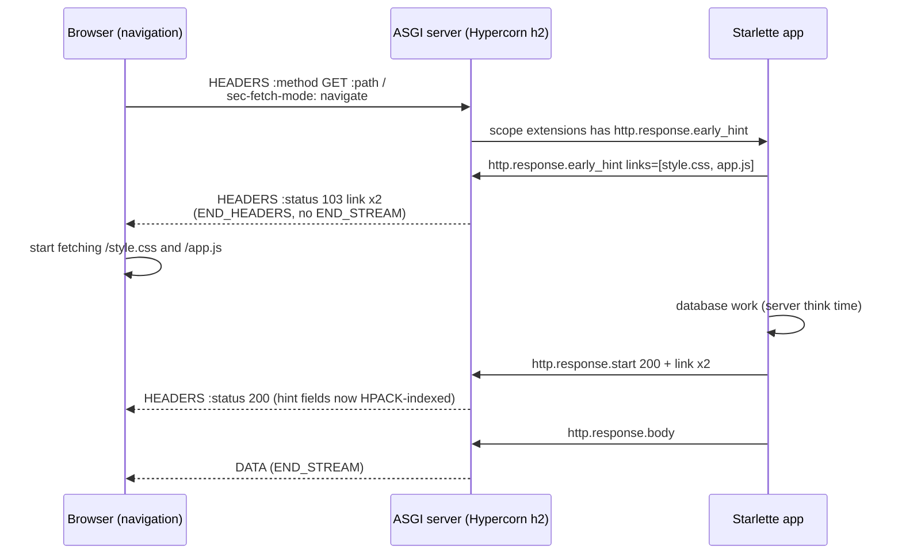

# Informational 1xx Responses and 103 Early Hints for Link Preloading (RFC 8297 and RFC 9110)

> [!summary] Claim
> A `103 Early Hints` response lets a server ship `Link: rel=preload` fields while the final response is still being computed, but it is only a hint on the same request, it is safe only where the client's parser handles interim responses (HTTP/2 and HTTP/3 in practice), and an HTTP/1.1 client that mistakes it for the final response, such as CPython `http.client` and `urllib3 2.8.0`, hands each later response to the wrong request on that connection.

Part of [TLS Connections and Intermediaries](README.md) in [API Engineering](../README.md).

## TL;DR

Mechanism: a 1xx response is a header section with no content that precedes the final response to the same request `(RFC 9110 Section 15.2)`, and `103` carries fields "likely" to appear in the final response so a browser can start fetching `rel=preload` targets during server think time `(RFC 8297 Section 2)`.
Contract rule: hints never replace or alter the final response's fields, so the final response must repeat every `Link` it wants honored, and a server MUST NOT send any 1xx to an HTTP/1.0 client `(RFC 8297 Section 2)` `(RFC 9110 Section 15.2)`.
Trap: on HTTP/1.1, a client that treats `103` as final reads an empty body, then gives the real `200 OK` to the next request on the connection; the lab shows CPython `http.client` returning `103` for `GET /` and the `/` page for `GET /second`.
Portability: Hypercorn `0.18.0` advertises the ASGI `http.response.early_hint` extension only on HTTP/2 and HTTP/3, Uvicorn `0.54.0` only on its optional `zttp` HTTP/2 protocol, Granian `2.8.7` on neither HTTP/1.1 nor HTTP/2, and an app that sends the message without checking the scope gets `500` from all three servers on HTTP/1.1.
When not to use it: skip `103` when the final response is ready almost immediately, when the request is not a top-level navigation, when the hinted resources are not cacheable, or when your edge or clients speak HTTP/1.1 and you cannot prove every parser handles interim responses.

## Mental model



The browser sends a navigation request, and Hypercorn puts `http.response.early_hint` into `scope["extensions"]` because the connection is HTTP/2.
The app emits the hint message before `http.response.start`, and the server turns it into a `HEADERS` frame whose `:status` is `103`, without `END_STREAM`, because the stream must still carry the final response.
The browser starts preloading while the app does its slow work, so the subresource fetches overlap the think time instead of following the HTML.
When the final `200` arrives it repeats the `Link` fields; the 103 already placed them in the HPACK dynamic table, so the repeat costs a few index bytes, and the final response remains authoritative.
On HTTP/1.1 the same app gets no extension from Hypercorn, Uvicorn, or Granian, so Starlette's `send_early_hints` is a no-op and only the final response is sent.

## How it works

### The 1xx class and what a client must do

A 1xx response is interim: it reports connection status or request progress before the final response `(RFC 9110 Section 15.2)`.
It "is terminated by the end of the header section; it cannot contain content or trailers" `(RFC 9110 Section 15.2)`, and a server MUST NOT send `Content-Length` in one `(RFC 9110 Section 8.6)`.
A client "MUST be able to parse one or more 1xx responses received prior to a final response, even if the client does not expect one", and a user agent MAY ignore unexpected ones `(RFC 9110 Section 15.2)`.
A proxy MUST forward 1xx responses unless it requested them itself, for example a `100 (Continue)` it caused by adding `Expect: 100-continue` `(RFC 9110 Section 15.2)`; see [[100-Continue-Expect-Header-and-Large-Upload-Admission]] for that case.
Because HTTP/1.0 defined no 1xx codes, a server MUST NOT send one to an HTTP/1.0 client `(RFC 9110 Section 15.2)`.
`101 (Switching Protocols)` is the 1xx after which the connection stops speaking HTTP/1.1, and the server MUST generate an `Upgrade` field naming the new protocol `(RFC 9110 Section 15.2.2)`.

### 103 Early Hints semantics

`103` "indicates to the client that the server is likely to send a final response with the header fields included in the informational response" `(RFC 8297 Section 2)`.
Evaluation of the hint fields "MUST NOT affect how the final response is processed", and a client MUST NOT treat them as metadata of the `103` itself `(RFC 8297 Section 2)`.
A server MAY send several `103` responses, each adding fields, and need not repeat earlier ones; a server MAY hint only some fields, and a client SHOULD NOT read a missing field as a prediction that the final response will lack it `(RFC 8297 Section 2)`.
RFC 8297 is an Experimental RFC from December 2017, and its text and normative references still cite RFC 7231 and RFC 7540, which RFC 9110 and RFC 9113 replaced.
The useful payload is a `Link` field `(RFC 8288 Section 3)` with `rel=preload`; Chrome documents support for `preload` and `preconnect` only, and only for navigation requests (Chrome for Developers, Early Hints, as of 2026-11).
The HTML Standard handles "only the first early hint response served during the navigation", discards it if a cross-origin redirect follows, and enforces a `Content-Security-Policy` field sent in the `103` while processing the hint (HTML Standard Section 4.2.4.5, as of 2026-11).

### HTTP/1.1 wire bytes

The status line is `HTTP-version SP status-code SP [ reason-phrase ]`, and the space before the optional reason phrase is mandatory even when the phrase is absent `(RFC 9112 Section 4)`.
`h11 0.16.0` writes `b"HTTP/1.1 %s %s\r\n" % (status_bytes, response.reason)`, and the event's `reason` defaults to empty, so it emits `HTTP/1.1 103 \r\n` `(h11 0.16.0 h11/_writers.py, write_any_response)`, and the lab's 103 head is:

```text
HTTP/1.1 103 \r\n
link: </style.css>; rel=preload; as=style\r\n
link: </app.js>; rel=preload; as=script\r\n
\r\n
HTTP/1.1 200 OK\r\n
...
```

A 1xx response "is always terminated by the first empty line after the header fields, regardless of the header fields present" `(RFC 9112 Section 6.3)`.
HTTP/1.1 has no request identifier, so a client associates each response with "the first outstanding request that has not yet received a final (non-1xx) response" `(RFC 9112 Section 9.2)`.
That sentence is the whole hazard: a parser that counts a `103` as final advances its request queue one response early.
In `h11 0.16.0` the server state machine allows `InformationalResponse` only in `SEND_RESPONSE`, so a 1xx after the final `Response` raises `LocalProtocolError("can't handle event type InformationalResponse when role=SERVER and state=SEND_BODY")` `(h11 0.16.0 h11/_state.py, ConnectionState._fire_event_triggered_transitions)`, and `101` without a client `Upgrade` proposal raises "Received server _SWITCH_UPGRADE event without a pending proposal" `(h11 0.16.0 h11/_state.py, ConnectionState.process_event)`.
`h11` does not check the peer's version before writing a 1xx; the lab shows it emitting `HTTP/1.1 103` to an `HTTP/1.0` request, so the RFC 9110 MUST NOT has to be enforced by the code above it (`should_send_early_hints` in the lab).

### HTTP/2 and HTTP/3 framing

In HTTP/2, "a server MAY send any number of interim responses before the HEADERS frame containing a final response", each a `HEADERS` frame plus optional `CONTINUATION` frames, and a `HEADERS` frame with `END_STREAM` that carries an informational status is malformed `(RFC 9113 Section 8.1)`.
`:status` is mandatory in interim responses too `(RFC 9113 Section 8.3.2)`, and HTTP/2 does not support `101` `(RFC 9113 Section 8.6)`.
Framing is independent of the header block, which is why RFC 8297 judges HTTP/2 clients "less likely to suffer from incorrect framing" `(RFC 8297 Section 3)`.
`h2 4.4.1` routes a server's 1xx block to the `SEND_INFORMATIONAL_HEADERS` input, raises `ProtocolError("Cannot set END_STREAM on informational responses.")` if `end_stream=True` `(h2 4.4.1 h2/stream.py, H2Stream.send_headers)`, and raises "Information response after final response" once final headers were sent `(h2 4.4.1 h2/stream.py, H2StreamStateMachine.send_informational_response)`.
The client side emits `InformationalResponseReceived` `(h2 4.4.1 h2/stream.py, H2StreamStateMachine.recv_informational_response)`.
`h2` classifies a block as informational when `:status` starts with `1` `(h2 4.4.1 h2/utilities.py, is_informational_response)` and does not reject `101`; the lab sends and receives `:status 101` on an HTTP/2 stream without error.
In HTTP/3 a server sends zero or more interim responses on the request stream before the final one `(RFC 9114 Section 4.1)`, HTTP/3 does not support `101` `(RFC 9114 Section 4.5)`, and `aioquic 1.7.2` raises `MessageError("Pseudo-header b':status' cannot be 101")` `(aioquic 1.7.2 aioquic/h3/connection.py, validate_response_headers)`.

### The ASGI extension

The ASGI `http.response.early_hint` extension is advertised as `scope["extensions"]["http.response.early_hint"] = {}`; the message has `links`, an iterable of byte-string `Link` values, and "can be sent at any time (and multiple times) before the Response Start message"; a server may ignore it, "for example if the HTTP/1.1 protocol is used" (ASGI Extensions, Early Hints, as of 2026-11).
`starlette 1.10.0` `Request.send_early_hints(link, /, *additional_links)` sends the message only if the scope advertises the extension `(starlette 1.10.0 starlette/requests.py, Request.send_early_hints)`.
`BaseHTTPMiddleware` forwards an early-hint message while waiting for `http.response.start` `(starlette 1.10.0 starlette/middleware/base.py, BaseHTTPMiddleware.__call__.call_next)`, and `GZipMiddleware` passes it through unchanged `(starlette 1.10.0 starlette/middleware/gzip.py, IdentityResponder.send_with_compression)`; the lab confirms both.
`hypercorn 0.18.0` sets `EARLY_HINTS_VERSIONS = {"2", "3"}`, advertises the extension only for those versions, and converts the message to an `InformationalResponse` with status `103` only while the stream is still in `ASGIHTTPState.REQUEST` `(hypercorn 0.18.0 hypercorn/protocol/http_stream.py, HTTPStream.app_send)`; on HTTP/1.1 an unadvertised early-hint message falls through to `raise UnexpectedMessageError` and the client sees `500`.
`uvicorn 0.54.0` advertises the extension only in its `zttp` HTTP/2 protocol and writes `send_informational(103, ...)` `(uvicorn 0.54.0 uvicorn/protocols/http/zttp_h2_impl.py, RequestResponseCycle.send)`; the `h11` and `httptools` protocols build a scope with no `extensions` key, and the `h11` `RequestResponseCycle.send` raises `RuntimeError` for any first message other than `http.response.start` `(uvicorn 0.54.0 uvicorn/protocols/http/h11_impl.py, RequestResponseCycle.send)`.
`granian 2.8.7` puts only `http.response.pathsend` and `websocket.http.response` in `scope["extensions"]` on both HTTP/1.1 and HTTP/2, and answers an unguarded early-hint message with `500` on both; the lab shows this through the embedded server `granian.server.embed.Server` on loopback, and the Rust source at tag `v2.8.7` agrees: the shared scope builder sets only those two `extensions` keys `(granian v2.8.7 src/asgi/utils.rs, ASGI_EXTENSIONS)`, and the outbound message matcher has arms for `http.response.start`, `http.response.body`, `http.response.pathsend`, and the WebSocket types, with every other `type` falling to the unsupported-message error `(granian v2.8.7 src/asgi/io.rs, adapt_message_type)`.

### Clients that hide or mis-handle the 103

`httpcore 1.0.9` HTTP/1.1 loops in `_receive_response_headers` until an `h11.Response` or a `101`, discarding every other 1xx `(httpcore 1.0.9 httpcore/_async/http11.py, AsyncHTTP11Connection._receive_response_headers)`, and its HTTP/2 path never queues `InformationalResponseReceived` `(httpcore 1.0.9 httpcore/_async/http2.py, AsyncHTTP2Connection._receive_events)`, so `httpx 0.28.1` users cannot see hints at all.
CPython `http.client` `HTTPResponse.begin` skips only status `100` ("read until we get a non-100 response") and then sets `length = 0` for any 1xx, so a `103` becomes the returned response with an empty body (`Lib/http/client.py`, `HTTPResponse.begin`, read in CPython 3.12.13, 3.13.18, 3.14.10, and 3.15.2).
`urllib3 2.8.0` `HTTPConnection.getresponse` calls `super().getresponse()` and wraps the result `(urllib3 2.8.0 urllib3/connection.py, HTTPConnection.getresponse)`, so it inherits the same behavior; the lab shows `status == 103`, and a `requests 2.34.2` `Session` on a loopback keep-alive socket returns `103` with `b""` for `GET /` and the `/` page for `GET /second`.
Go `net/http` at `go1.25.0` skips every 1xx except `101`, reports them through `httptrace.ClientTrace.Got1xxResponse`, and bounds the total header bytes of ignored 1xx responses plus the final response by the response header limit `(go1.25.0 src/net/http/transport.go, persistConn.readResponse)`.

## Numbers and limits

| Parameter | Value | Source or measurement context |
|---|---|---|
| 1xx responses a client must accept before the final one | "one or more"; no upper bound in the RFC | `(RFC 9110 Section 15.2)` |
| HTTP/1.1 103 head for two preload links | `101` bytes | `h11_serve` in the lab, CPython `3.14.6`, macOS `27.2` arm64, `uv run --frozen python <script>` printing `wire.index(b"HTTP/1.1 200")` and each frame's 3-octet length |
| HTTP/2 `HEADERS` payload for the same 103 | `61` bytes, flags `0x4` (`END_HEADERS`) | Same run, `h2 4.4.1` and `hpack 4.2.0` defaults |
| HTTP/2 final `HEADERS` repeating the links | `12` bytes after the 103, `67` bytes without it | Same run; the 103 seeds the HPACK dynamic table |
| CPython `http.client` interim responses before `HTTPException` | `100` (`_MAXINTERIMRESPONSES`) in 3.12.16, 3.13.18, 3.14.10, 3.15.2; no cap in 3.12.13, 3.14.6, 3.15.0b3 | Read `Lib/http/client.py` and `getattr(http.client, "_MAXINTERIMRESPONSES")` per interpreter, and `Lib/http/client.py` at tag `v3.12.16`; fix tracked in CPython `gh-150743` (closed 2026-06-28), 3.12 backport PR 152527 merged 2026-08-04 |
| CPython header lines after `100 Continue` | Bounded since `CVE-2021-3737` fixes (3.6.14, 3.7.11, 3.8.11, 3.9.6, 3.10.0) | python-security `urllib-100-continue-loop` page |
| Go `net/http` 1xx count limit | None at `go1.25.0`; total header bytes bounded unless `Got1xxResponse` consumes them | `(go1.25.0 src/net/http/transport.go, persistConn.readResponse)` |
| nginx forwarding of upstream `103` | Off unless `early_hints` is set; directive since `1.29.0` (2025-06-24 blog) | nginx `ngx_http_core_module` docs, as of 2026-11 |
| Hints the HTML Standard processes per navigation | `1` (the first) | HTML Standard Section 4.2.4.5, as of 2026-11 |
| Lab suite runtime | `39 passed in 0.63s` (30 unit, 9 socket) | `uv run --frozen pytest <module> -q`, CPython `3.14.6`, macOS `27.2` arm64 (Darwin `27.2.0`) |

The byte counts are deterministic for these inputs; they are not a latency benchmark, and this lab does not measure page-load improvement.
Page-load gain is not measured here: Chrome for Developers reports improvements to Largest Contentful Paint "from several hundred milliseconds, as observed by Shopify and by Cloudflare, and up to a second faster" in a WebPageTest comparison, and says Early Hints are not useful if the server can send the final response right away (Chrome for Developers, Early Hints, updated 2026-07-10).
Treat those as vendor-reported ranges for particular sites, not as an expected gain for yours.

## Portability

| Runtime, library, or protocol | Behavior | Evidence |
|---|---|---|
| CPython `3.12.13`, `3.13.18`, `3.14.6`, `3.14.10`, `3.15.2` on macOS | All 39 lab tests pass; `http.client` returns `103` as final in every one | `uv run --frozen --python <v> pytest <module> -q` with a separate `UV_PROJECT_ENVIRONMENT` per version, macOS `27.2` arm64 |
| CPython `3.15.0b3t` and `3.14.6t` free-threaded (`sys._is_gil_enabled()` is `False`) | All 39 pass | Not through `uv run`: the full sync fails (`psycopg-binary 3.3.8` has no wheel for the platform; `orjson 3.13.0` and `pylsqpack 1.0.0` fail to build), so a venv with the 27 lock-pinned packages this module imports plus the project `--no-deps` ran it |
| CPython `3.12.16` | All 39 pass; `_MAXINTERIMRESPONSES` is `100` | Container `ghcr.io/astral-sh/uv:python3.12-trixie` (Debian 13.7, aarch64 under OrbStack, Linux `7.2.12`), `UV_PYTHON=3.12 uv sync --frozen`, then `uv run --frozen pytest <module> -q` |
| CPython `3.15.2t` free-threaded (`sys._is_gil_enabled()` is `False`) | All 39 pass | Container `ghcr.io/astral-sh/uv:python3.15-trixie` with `uv python install 3.15.2t`; a full `uv sync` fails on `psycopg-binary 3.3.8` (no wheel), so a venv of the lock-pinned wheels from `uv export` minus `psycopg-binary`, `orjson`, `pylsqpack`, `aioquic`, `brotli`, `gevent`, `geventhttpclient`, `grpcio`, `lupa`, `psutil`, `pywin32`, and `pyyaml` (none imported by the module) plus the project `--no-deps` ran `python -m pytest <module> -q` |
| Debian 13.7 (Trixie, glibc 2.41) and Alpine 3.23.7 (musl), CPython `3.14.10` | All 39 pass on both | Containers `ghcr.io/astral-sh/uv:python3.14-trixie` and `ghcr.io/astral-sh/uv:python3.14-alpine`, `uv sync --frozen` then `uv run --frozen pytest <module> -q -p no:cacheprovider --no-cov`, aarch64 under OrbStack |
| `h11 0.16.0` | Parses and emits 1xx; rejects 1xx after final and unproposed `101`; does not block 1xx to HTTP/1.0 | Lab tests; `(h11 0.16.0 h11/_state.py, ConnectionState.process_event)` |
| `h2 4.4.1` | Rejects `END_STREAM` on 1xx and 1xx after final; accepts `101` | Lab tests; `(h2 4.4.1 h2/stream.py, H2Stream.send_headers)` |
| `aioquic 1.7.2` (HTTP/3) | Rejects `:status 101` | `(aioquic 1.7.2 aioquic/h3/connection.py, validate_response_headers)`; not exercised in the lab |
| `httpcore 1.0.9` and `httpx 0.28.1` | Discard 103, expose only final fields | Lab test with `httpcore.MockBackend`; HTTP/2 path from source only |
| `urllib3 2.8.0` and `requests 2.34.2` | Return `103` as final; the next request on the connection gets the previous `200` | Lab tests: `urllib3` over the socket double, `requests.Session` over a loopback socket |
| `starlette 1.10.0` | `send_early_hints` no-op without the extension; middleware forwards the message | Lab tests |
| Hypercorn `0.18.0` HTTP/1.1 | No extension, no 103; unguarded message -> `500` | Socket lab tests on `127.0.0.1:0` |
| Hypercorn `0.18.0` HTTP/2 (h2c prior knowledge) | Sends `103` with links before `200` | Socket lab test |
| Hypercorn `0.18.0` HTTP/3 | Advertised by source (`EARLY_HINTS_VERSIONS = {"2", "3"}`) | `(hypercorn 0.18.0 hypercorn/protocol/http_stream.py, HTTPStream.app_send)` read in the pinned wheel; not run, because the lab has no QUIC client |
| Uvicorn `0.54.0` `h11` | No `extensions` key; unguarded message -> `500` | Socket lab tests |
| Uvicorn `0.54.0` `zttp` HTTP/2 | Advertises and sends `103` | `(uvicorn 0.54.0 uvicorn/protocols/http/zttp_h2_impl.py, RequestResponseCycle.send)` read in the pinned wheel; not run, because `zttp` is not in the lock |
| Granian `2.8.7` HTTP/1.1 and HTTP/2 (h2c) | No `http.response.early_hint` extension, no 103; unguarded message -> `500` on both | Socket lab tests with `granian.server.embed.Server`, `Interfaces.ASGINL`; Rust source read at `v2.8.7` (`src/asgi/utils.rs`, `src/asgi/io.rs`); HTTP/3 not offered by Granian's `HTTPModes` (`auto`, `1`, `2`) |
| `httpx.ASGITransport` | Scope has no `extensions`; hints are a no-op | Lab test; `(httpx 0.28.1 httpx/_transports/asgi.py, ASGITransport.handle_async_request)` |

Legs not run: Hypercorn HTTP/3 and Uvicorn `zttp` HTTP/2 behavior (source only, as stated in their rows), and x86_64 (every run here was arm64).

## Worked example

The [implementation](../labs/src/api_labs/f02_tls_connections_and_intermediaries/early_hints.py) holds the send policy, an `h11` server and client, a segment-faithful socket double for `http.client`, an `h2` server and frame splitter, and a Starlette app that hints through the ASGI extension.
The [test](../labs/tests/f02_tls_connections_and_intermediaries/test_103_early_hints_and_informational_responses.py) pins the wire bytes and frame flags, the misparse in `http.client`, `urllib3`, and `requests`, how `httpcore` hides hints, and what Hypercorn, Uvicorn, and Granian really put on a loopback socket.

Full source of `early_hints.py`:

```python
"""103 Early Hints and informational 1xx responses (RFC 8297, RFC 9110 Section 15.2).

Server and client halves for HTTP/1.1 (h11), HTTP/2 (h2), the stdlib http.client
parser, and an ASGI app that uses the ``http.response.early_hint`` extension.
"""

from __future__ import annotations

import io
from dataclasses import dataclass, field
from typing import TYPE_CHECKING

import h2.config
import h2.connection
import h2.events
import h11
from starlette.applications import Starlette
from starlette.responses import HTMLResponse
from starlette.routing import Route

if TYPE_CHECKING:
    from collections.abc import Sequence

    from starlette.requests import Request
    from starlette.types import ASGIApp, Message, Scope

EARLY_HINTS = 103
PRELOAD_LINKS: tuple[str, ...] = (
    "</style.css>; rel=preload; as=style",
    "</app.js>; rel=preload; as=script",
)
PAGE = b"<!doctype html><title>ok</title>"


def should_send_early_hints(
    http_version: str, sec_fetch_mode: str | None, *, allow_http11: bool = False
) -> bool:
    """Decide whether a 103 is worth sending and safe to send on this hop.

    - HTTP/1.0 never: a server MUST NOT send 1xx to an HTTP/1.0 client (RFC 9110 Section 15.2).
    - HTTP/1.1 only when the operator knows the clients parse 1xx (RFC 8297 Section 3).
    - Only navigations: browsers act on hints for the top-level document only.
    """
    if sec_fetch_mode != "navigate":
        return False
    if http_version in {"2", "3"}:
        return True
    return http_version == "1.1" and allow_http11


# --- HTTP/1.1 with h11 -------------------------------------------------------------------------


def _h11_send(conn: h11.Connection, event: h11.Event) -> bytes:
    data = conn.send(event)
    return data if data is not None else b""


def h11_serve(request: bytes, links: Sequence[str], *, allow_http11: bool = True) -> bytes:
    """Parse one request and return the server's wire bytes: optional 103, then 200 OK."""
    conn = h11.Connection(h11.SERVER)
    conn.receive_data(request)
    event = conn.next_event()
    if not isinstance(event, h11.Request):
        raise TypeError(f"expected a complete request head, got {event!r}")
    version = event.http_version.decode("ascii")
    mode = next((v.decode() for k, v in event.headers if k == b"sec-fetch-mode"), None)
    out = bytearray()
    if links and should_send_early_hints(version, mode, allow_http11=allow_http11):
        hints = [("link", link) for link in links]
        out += _h11_send(conn, h11.InformationalResponse(status_code=EARLY_HINTS, headers=hints))
    final = [("content-type", "text/html"), ("content-length", str(len(PAGE)))]
    final += [("link", link) for link in links]
    out += _h11_send(conn, h11.Response(status_code=200, headers=final, reason=b"OK"))
    out += _h11_send(conn, h11.Data(data=PAGE))
    out += _h11_send(conn, h11.EndOfMessage())
    return bytes(out)


@dataclass
class ParsedResponse:
    """What a client saw: every interim response in order, then the final one."""

    interim: list[tuple[int, list[tuple[str, str]]]] = field(default_factory=lambda: [])
    status: int = 0
    headers: list[tuple[str, str]] = field(default_factory=lambda: [])
    body: bytes = b""


def _decoded(headers: Sequence[tuple[bytes, bytes]]) -> list[tuple[str, str]]:
    return [(k.decode("latin-1"), v.decode("latin-1")) for k, v in headers]


def h11_client_parse(wire: bytes) -> ParsedResponse:
    """Feed server bytes to an h11 client that sent one GET and collect its events."""
    conn = h11.Connection(h11.CLIENT)
    _h11_send(conn, h11.Request(method="GET", target="/", headers=[("host", "example.test")]))
    _h11_send(conn, h11.EndOfMessage())
    conn.receive_data(wire)
    parsed = ParsedResponse()
    while True:
        event = conn.next_event()
        if isinstance(event, h11.InformationalResponse):
            parsed.interim.append((event.status_code, _decoded(event.headers)))
        elif isinstance(event, h11.Response):
            parsed.status, parsed.headers = event.status_code, _decoded(event.headers)
        elif isinstance(event, h11.Data):
            parsed.body += event.data
        elif isinstance(event, h11.EndOfMessage):
            return parsed
        else:
            raise RuntimeError(f"incomplete response, h11 returned {event!r}")


# --- HTTP/1.1 with the stdlib parser ------------------------------------------------------------


class _SegmentReader(io.RawIOBase):
    """Raw reader over a shared queue of TCP segments: one read never crosses a segment."""

    def __init__(self, segments: list[bytes]) -> None:
        self._segments = segments

    def readable(self) -> bool:
        return True

    def readinto(self, buffer: memoryview) -> int:  # type: ignore[override]
        if not self._segments:
            return 0
        head = self._segments[0]
        n = min(len(buffer), len(head))
        buffer[:n] = head[:n]
        if n == len(head):
            self._segments.pop(0)
        else:
            self._segments[0] = head[n:]
        return n


class ReplaySocket:
    """Socket double for ``http.client``: records what is sent, replays segments in order.

    Like ``socket.makefile``, each call returns a new buffered reader over the same stream,
    so a response object that closes its reader does not lose bytes still in later segments.
    """

    def __init__(self, segments: Sequence[bytes]) -> None:
        self._segments = list(segments)
        self.sent = bytearray()

    def sendall(self, data: bytes) -> None:
        self.sent += data

    def settimeout(self, timeout: float | None) -> None:
        del timeout

    def makefile(self, mode: str, buffering: int = -1) -> io.BufferedReader:
        del mode, buffering
        return io.BufferedReader(_SegmentReader(self._segments))


# --- HTTP/2 with h2 -----------------------------------------------------------------------------

REQUEST_HEADERS: list[tuple[str, str]] = [
    (":method", "GET"),
    (":scheme", "https"),
    (":authority", "example.test"),
    (":path", "/"),
    ("sec-fetch-mode", "navigate"),
]


def h2_pair() -> tuple[h2.connection.H2Connection, h2.connection.H2Connection]:
    """A connected client and server with stream 1 open and the request fully sent."""
    client = h2.connection.H2Connection(h2.config.H2Configuration(client_side=True))
    server = h2.connection.H2Connection(h2.config.H2Configuration(client_side=False))
    client.initiate_connection()
    server.initiate_connection()
    client.send_headers(1, REQUEST_HEADERS, end_stream=True)
    server.receive_data(client.data_to_send())
    client.receive_data(server.data_to_send())
    return client, server


def h2_serve_with_hints(server: h2.connection.H2Connection, links: Sequence[str]) -> bytes:
    """Server side: one HEADERS frame for 103, one for 200, then DATA with END_STREAM."""
    server.send_headers(1, [(":status", str(EARLY_HINTS)), *(("link", link) for link in links)])
    final = [(":status", "200"), ("content-type", "text/html")]
    server.send_headers(1, final + [("link", link) for link in links])
    server.send_data(1, PAGE, end_stream=True)
    return server.data_to_send()


def h2_frames(wire: bytes) -> list[tuple[int, int, int]]:
    """Split HTTP/2 bytes into (type, flags, stream id) per 9-octet frame header (RFC 9113 4.1)."""
    frames: list[tuple[int, int, int]] = []
    offset = 0
    while offset < len(wire):
        length = int.from_bytes(wire[offset : offset + 3], "big")
        frame_type, flags = wire[offset + 3], wire[offset + 4]
        stream_id = int.from_bytes(wire[offset + 5 : offset + 9], "big") & 0x7FFFFFFF
        frames.append((frame_type, flags, stream_id))
        offset += 9 + length
    return frames


def h2_client_parse(events: Sequence[h2.events.Event]) -> ParsedResponse:
    """Fold h2 client events for stream 1 into a ParsedResponse."""
    parsed = ParsedResponse()
    for event in events:
        if isinstance(event, h2.events.InformationalResponseReceived) and event.headers:
            headers = _decoded(event.headers)
            status = int(dict(headers)[":status"])
            parsed.interim.append((status, [(k, v) for k, v in headers if k[0] != ":"]))
        elif isinstance(event, h2.events.ResponseReceived) and event.headers:
            headers = _decoded(event.headers)
            parsed.status = int(dict(headers)[":status"])
            parsed.headers = [(k, v) for k, v in headers if k[0] != ":"]
        elif isinstance(event, h2.events.DataReceived) and event.data:
            parsed.body += event.data
    return parsed


# --- ASGI: the http.response.early_hint extension -----------------------------------------------


async def homepage(request: Request) -> HTMLResponse:
    """Send hints first (a no-op unless the server advertises the extension), then the page."""
    mode = request.headers.get("sec-fetch-mode")
    if should_send_early_hints(request.scope["http_version"], mode):
        await request.send_early_hints(PRELOAD_LINKS[0], *PRELOAD_LINKS[1:])
    # The final response repeats the links: hints never replace final fields (RFC 8297 Section 2).
    return HTMLResponse(PAGE, headers={"link": ", ".join(PRELOAD_LINKS)})


def build_app() -> Starlette:
    return Starlette(routes=[Route("/", homepage)])


async def drive_asgi(
    app: ASGIApp,
    *,
    http_version: str,
    advertise: bool,
    extra_headers: Sequence[tuple[bytes, bytes]] = (),
) -> list[Message]:
    """Call the app once like a server would and return every message it sent, in order."""
    scope: Scope = {
        "type": "http",
        "asgi": {"version": "3.0"},
        "http_version": http_version,
        "method": "GET",
        "scheme": "https",
        "path": "/",
        "raw_path": b"/",
        "root_path": "",
        "query_string": b"",
        "headers": [(b"host", b"example.test"), (b"sec-fetch-mode", b"navigate"), *extra_headers],
        "client": ("192.0.2.1", 50000),
        "server": ("example.test", 443),
        "extensions": {"http.response.early_hint": {}} if advertise else {},
    }
    sent: list[Message] = []

    async def receive() -> Message:
        return {"type": "http.request", "body": b"", "more_body": False}

    async def send(message: Message) -> None:
        sent.append(message)

    await app(scope, receive, send)
    return sent
```

The core of the desync proof, a verbatim slice of the test module:

```python
def _stdlib_pair(segments: list[bytes]) -> tuple[bytes, int, bytes, int, bytes]:
    conn = http.client.HTTPConnection("example.test")
    replay = ReplaySocket(segments)
    conn.sock = cast("socket.socket", replay)
    conn.request("GET", "/")
    first = conn.getresponse()
    first_status, first_body = first.status, first.read()
    conn.request("GET", "/second")
    second = conn.getresponse()
    return bytes(replay.sent), first_status, first_body, second.status, second.read()


@pytest.mark.unit
def test_http_client_takes_103_as_final_and_hands_the_200_to_the_next_request() -> None:
    wire = h11_serve(NAV_GET, PRELOAD_LINKS)
    # The 103 and the 200 arrive in separate TCP reads, as they do when the origin is slow.
    sent, s1, b1, s2, b2 = _stdlib_pair([wire[: len(HINT_BLOCK)], wire[len(HINT_BLOCK) :], SECOND])
    assert sent.count(b"GET ") == 2
    assert (s1, b1) == (103, b"")
    assert (s2, b2) == (200, PAGE)


@pytest.mark.unit
def test_http_client_loses_the_real_response_when_103_and_200_share_a_read() -> None:
    _, s1, b1, s2, b2 = _stdlib_pair([h11_serve(NAV_GET, PRELOAD_LINKS), SECOND])
    assert (s1, b1) == (103, b"")
    assert (s2, b2) == (200, b"second!")
```

Captured run from `labs/` (CPython `3.14.6`, macOS `27.2` arm64):

```text
$ uv run --frozen pytest tests/f02_tls_connections_and_intermediaries/test_103_early_hints_and_informational_responses.py -q
.......................................                                  [100%]
39 passed in 0.63s
```

Each of 9 mutations made at least one test fail, and the restored files were byte-identical to the originals: the gate accepting HTTP/1.0, the HTTP/2 client keeping pseudo-headers in interim fields, the ASGI homepage dropping `Link` from the final response, the socket double not recording sent bytes, an HTTP/2 server that omits the 103 and sends an extra `DATA` frame, the homepage sending the hint without the gate, and three flipped expectations (the `requests` shift-by-one, the unguarded `500` on HTTP/1.1, and the Granian `500` on h2c).

## Pitfalls

> [!warning] An HTTP/1.1 client that treats `103` as the final response
> - **Trigger**: an origin sends `103` over HTTP/1.1 to a Python service using `http.client`, `urllib3`, or `requests`, for example a BFF or server-side renderer calling the origin on a keep-alive connection.
> - **Symptom**: the first call returns status `103` with an empty body; the next call on the connection receives the previous request's `200 OK` and body when the two arrived in separate reads, or loses the real response when they arrived in one read (both lab-proven), a variant of the misframing RFC 8297 warns about, where a client folds later responses on the connection into the first and may disclose them across origins `(RFC 8297 Section 3)`.
> - **Fix**: send `103` only on HTTP/2 or HTTP/3, or only to clients you control, and gate it on `Sec-Fetch-Mode: navigate`; internal clients should be `httpx`, which discards 1xx.

> [!warning] Sending the ASGI hint message without checking the scope
> - **Trigger**: an app or middleware calls `await send({"type": "http.response.early_hint", ...})` directly.
> - **Symptom**: on HTTP/1.1, Hypercorn `0.18.0` raises `UnexpectedMessageError` and Uvicorn `0.54.0` `h11` raises `RuntimeError("Expected ASGI message 'http.response.start', ...")`, and Granian `2.8.7` also answers `500`, on HTTP/2 as well, so every page becomes `500` (lab-proven for all three).
> - **Fix**: check `"http.response.early_hint" in scope.get("extensions", {})`, or use Starlette's `Request.send_early_hints`, which does.

> [!warning] Sending a 1xx to an HTTP/1.0 client because the parser library allowed it
> - **Trigger**: a hand-written server on `h11` emits `InformationalResponse` whenever it has hints.
> - **Symptom**: an HTTP/1.0 client sees two status lines; `h11 0.16.0` does not refuse, as the lab shows, while RFC 9110 says the server MUST NOT `(RFC 9110 Section 15.2)`.
> - **Fix**: enforce the version rule in your own gate before calling `send`.

> [!warning] Hints that are never repeated in the final response
> - **Trigger**: the team moves `Link: rel=preload` from the final response into the `103` only.
> - **Symptom**: clients that drop 1xx (`httpcore`, Go `net/http` by default, most proxies without opt-in) never see the links; the lab shows `httpcore` exposing only `content-length`.
> - **Fix**: keep the final response complete; RFC 8297 Section 2 says hints "do not replace the header fields on the final response".

> [!warning] An edge proxy that silently drops the origin's 103
> - **Trigger**: nginx `1.29.0` or later in front of the origin without `early_hints`, or an older nginx.
> - **Symptom**: no hints reach browsers, with no error anywhere; the nginx documentation lists no default for `early_hints` and the nginx blog says proxying Early Hints is disabled by default.
> - **Fix**: configure the documented pattern `map $http_sec_fetch_mode $early_hints { navigate $http2$http3; }` and `early_hints $early_hints;`, which limits forwarding to HTTP/2 and HTTP/3 navigations.

> [!warning] Preloading uncacheable resources or redirecting cross-origin
> - **Trigger**: hinting a resource sent with `Cache-Control: no-store`, or answering the navigation with a cross-origin redirect.
> - **Symptom**: Chrome documents a double fetch for uncacheable resources and drops hinted resources after a cross-origin redirect; the HTML Standard also discards the hint in that case (Section 4.2.4.5).
> - **Fix**: hint only cacheable, same-site, immutable assets, and do not hint on responses that may redirect.

## Security and robustness

Threat model: the origin is trusted to produce hints, but hints are emitted before the final status is known, they traverse every intermediary that forwards 1xx, and HTTP/1.1 clients and proxies of unknown quality may parse them.

- **Response misassociation (`OWASP API8:2023 Security Misconfiguration`)**: a client that counts `103` as final shifts every later response by one, and RFC 8297 Section 3 names cross-origin information disclosure when the connection carries several origins, for example a forward proxy pool; restrict hints to HTTP/2 and HTTP/3, where framing does not depend on the status code.
- **Pre-authorization disclosure**: a `103` is sent before the app decides the final status, so hints computed from the URL alone can reveal asset paths for a page that ends in `401` or `404`; generate hints only from data that is public for every caller of the route.
- **Intermediary trust**: a proxy MUST forward 1xx unless it generated them `(RFC 9110 Section 15.2)`, and nginx passes upstream `103` "as is, without interpretation" when enabled, so an edge that forwards an upstream it does not fully trust lets that upstream make browsers `preconnect` or preload arbitrary origins; filter `Link` targets at the edge to an allowlist.
- **Policy fields in the 103**: the HTML Standard enforces a `Content-Security-Policy` sent in the `103` while processing the hint, so a hint CSP weaker than the final CSP widens what the hint phase may load; keep them identical.
- **Interim floods (`OWASP API4:2023 Unrestricted Resource Consumption`)**: a hostile or broken upstream can stream 1xx responses forever; `CVE-2021-3737` hung CPython clients on `100 Continue`, CPython `gh-150743` caps interim responses at `100` in 3.12.16, 3.13.18, 3.14.10, and 3.15.2 (absent in 3.12.13, 3.14.6, 3.15.0b3), and Go bounds total header bytes; a proxy or client you write should cap both count and bytes and keep a total deadline, not only a read timeout.
- **State machine misuse**: reject a 1xx after a final response, `END_STREAM` on an HTTP/2 1xx, and `101` on HTTP/2 or HTTP/3 `(RFC 9113 Section 8.6)` `(RFC 9114 Section 4.5)`; `h11` and `h2` enforce the first, `h2` enforces the second, `aioquic` enforces the third for HTTP/3, and `h2 4.4.1` does not enforce it for HTTP/2.

## The principal's view

The decision is not "turn on Early Hints" but where hints are generated and which hops may carry them.
Generate them at the tier that knows the page's static dependencies without doing the slow work (a CDN from cached headers, or the app before its database call), forward them only over HTTP/2 or HTTP/3 to navigations, and keep the final response complete so every client that drops 1xx behaves exactly as before.
The organizational cost is that 1xx support becomes a fleet-wide parser requirement: every proxy, BFF, and internal client between the origin and the browser has to handle interim responses, so the platform team needs an inventory and a chain test, and the safest policy is that hints are added at the edge, never relied on by internal callers.
The trade-off versus HTTP/2 server push, which RFC 8297 compares directly, is one extra round trip in the worst case in exchange for respecting the browser cache and allowing cross-origin `preconnect`; versus inlining `<link rel=preload>` in early HTML bytes, it wins only when the server cannot flush HTML before the slow work.
Choose something else when think time is near zero (the final response already carries `Link`), for API traffic consumed by programs (no client acts on hints, and some misparse them), and when the edge speaks only HTTP/1.1 to clients you do not control.

## Interview questions

> [!question] L5: What is a 1xx response, and what must every HTTP client do with one it did not expect?
>
> > [!success]- Answer
> > A 1xx is an interim response: a status line and header section with no content or trailers, sent before the final response to the same request `(RFC 9110 Section 15.2)`.
> > A client MUST be able to parse one or more of them before the final response even if it did not ask for them, and a user agent MAY ignore them.
> > A proxy MUST forward them unless it caused them, and a server MUST NOT send them to an HTTP/1.0 client.
> >
> > Follow-up: Why is `101` different from every other 1xx on HTTP/1.1?

> [!question] L5: Why must the final response repeat the `Link` fields that were already sent in a `103`?
>
> > [!success]- Answer
> > Hint fields "do not replace the header fields on the final response", and evaluating them MUST NOT change how the final response is processed `(RFC 8297 Section 2)`.
> > Many clients drop 1xx entirely; the lab shows `httpcore` exposing only the final response's fields.
> > On HTTP/2 the repeat is cheap because the 103 already put the values in the HPACK dynamic table (`12` versus `67` bytes in the lab).
> >
> > Follow-up: Is it a protocol error if the final response omits a hinted link?

> [!question] L6: Predict the output: the lab's `_stdlib_pair` sends `GET /` then `GET /second` over one `http.client.HTTPConnection`; the server answers `/` with `103` then `200` (page) in two separate reads, then answers `/second` with `200` and body `second!`.
>
> > [!success]- Answer
> > The first `getresponse()` returns status `103` with body `b""`, because `HTTPResponse.begin` skips only `100` and treats every 1xx as zero-length.
> > The second `getresponse()` returns `200` with the `/` page body, because the real response to the first request is the next message on the connection.
> > The `second!` body is never read.
> > If the `103` and `200` arrive in one read, the first response's buffered reader swallows the `200` and closes, so the second call returns `second!` and the page is lost.
> >
> > Follow-up: Which part of RFC 9112 does this client violate?

> [!question] L6: Debug this API: after enabling Early Hints on the origin, a server-side rendering service that calls the origin with `requests` over keep-alive intermittently renders the wrong page for a URL, and logs show some origin calls returning status `103`; what is happening and what do you change?
>
> > [!success]- Answer
> > `requests` sits on `urllib3`, whose `getresponse` inherits CPython `http.client`, which returns the `103` as the final response with an empty body.
> > The connection's next response is the real `200` for the previous URL, so responses shift by one under keep-alive, a variant of the HTTP/1.1 misframing RFC 8297 Section 3 warns about; the lab reproduces it with a `requests 2.34.2` `Session` on a loopback socket.
> > Stop sending `103` on that hop (gate on `Sec-Fetch-Mode: navigate` and HTTP/2 or HTTP/3), and move the service to `httpx`, which discards 1xx.
> > Add a regression test that replays `103` plus `200` in separate reads, as the lab does.
> >
> > Follow-up: Why did the bug appear intermittently rather than on every request?

> [!question] L6: Your Starlette app works under Hypercorn with HTTP/2 but returns `500` for every page when run under Uvicorn; the only change was a middleware that sends `http.response.early_hint`; why?
>
> > [!success]- Answer
> > ASGI servers advertise support with `scope["extensions"]["http.response.early_hint"]`, and Uvicorn `0.54.0` `h11` does not, so its `send` raises `RuntimeError` when the first message is not `http.response.start`.
> > Hypercorn `0.18.0` would also fail on HTTP/1.1, because it advertises only for HTTP/2 and HTTP/3 and raises `UnexpectedMessageError` otherwise.
> > The middleware must check the scope, or use `Request.send_early_hints`, which does.
> >
> > Follow-up: What should a pure ASGI middleware do with an early-hint message it does not understand?

> [!question] L6: How is a `103` framed in HTTP/2, and what makes it malformed?
>
> > [!success]- Answer
> > It is a `HEADERS` frame (plus optional `CONTINUATION`) carrying `:status 103`, sent before the final `HEADERS` on the same stream `(RFC 9113 Section 8.1)`.
> > It must not carry `END_STREAM`, since the stream must still carry the final response; with that flag it is malformed, and `h2 4.4.1` refuses to send it.
> > A 1xx after the final `HEADERS` is also invalid, and `h2` raises `ProtocolError`.
> > The lab's frame split is `(HEADERS, END_HEADERS)`, `(HEADERS, END_HEADERS)`, `(DATA, END_STREAM)`.
> >
> > Follow-up: Which 1xx status is not allowed in HTTP/2 at all, and does `h2 4.4.1` enforce that?

> [!question] L7+: You own the edge for a large site; product wants Early Hints everywhere; what policy do you ship, and why?
>
> > [!success]- Answer
> > Hint only top-level navigations (`Sec-Fetch-Mode: navigate`) over HTTP/2 and HTTP/3, the nginx-documented pattern, because the HTML Standard and Chrome act only on navigations and HTTP/1.1 parsers are the risk.
> > Generate hints from public, cacheable, same-site assets, keep the final response complete, keep hint and final CSP identical, and allowlist `Link` targets for any upstream whose hints you forward.
> > Measure with real-user monitoring per route and remove hints where think time is near zero.
> > Require every internal hop to either strip or correctly parse 1xx, verified by a chain test.
> >
> > Follow-up: How would you roll this out safely if part of your client population is on HTTP/1.1 proxies you do not control?

> [!question] L7+: Compare Early Hints with HTTP/2 server push and with flushing `<link rel=preload>` early in the HTML.
>
> > [!success]- Answer
> > Push sends bytes for resources the server is authoritative for regardless of the client's cache, while a hint lets the client decide and can name other origins, at the cost of up to one extra round trip `(RFC 8297 Section 1)`.
> > Flushing HTML early gives the same benefit with no 1xx support required, but only if the server can commit to a status and headers before the slow work; Early Hints exist for when it cannot.
> > Hints are also safer to deploy incrementally because a client that ignores them loses nothing.
> >
> > Follow-up: Which of the three can be generated by a CDN from a stale cached response, and what does RFC 8297 say happens when the origin's own 103 arrives later?

> [!question] L7+: Design a client or proxy that is robust to a hostile upstream sending 1xx responses.
>
> > [!success]- Answer
> > Parse 1xx as non-final and associate the final response with the oldest outstanding request `(RFC 9112 Section 9.2)`.
> > Cap both the number of interim responses and their total header bytes, as CPython 3.12.16, 3.13.18, 3.14.10, and 3.15.2 (`100` responses) and Go (`maxHeaderResponseSize` across 1xx and final) do, and apply a total deadline, because a stream that keeps sending never trips a read timeout (`CVE-2021-3737`, `gh-150743`).
> > Reject 1xx after a final response, `END_STREAM` on HTTP/2 1xx, and `101` on HTTP/2 and HTTP/3.
> > Forward 1xx downstream only on hops whose clients are known to parse them, and drop hints you would not trust from that upstream.
> >
> > Follow-up: Should a proxy that caps interim responses fail the request or strip the excess 1xx and continue?

## Related

Prerequisites: [[100-Continue-Expect-Header-and-Large-Upload-Admission]]

Next: [[HTTP-Trailers-Streaming-Checksums-and-gRPC-Status]]

See also: [[HTTP-Message-Abstraction-RFC-9110]], [[HTTP-1-1-Framing-Keep-Alive-and-Chunked-Encoding]], [[HTTP-2-Binary-Framing-and-Stream-State-Machine]], [[HPACK-Header-Compression-and-Dynamic-Table-Security]], [[HTTP-3-Framing-and-QPACK-Header-Compression-RFC-9114]], [[HTTP-Request-Smuggling-CL-TE-and-Desync-Mechanics]], [[Richardson-Maturity-Model-HATEOAS-and-Web-Linking-RFC-8288]], [[ASGI-3-0-Callable-Contract-Scope-Receive-and-Send]], [[Pure-ASGI-Middleware-Onion-Architecture-and-Send-Receive-Wrapping]], [[Hypercorn-Internals-HTTP-2-HTTP-3-QUIC-and-AnyIO-Trio-Workers]], [[Uvicorn-Internals-Server-Lifecycle-Protocols-and-Flow-Control]], [[Hop-by-Hop-vs-End-to-End-Headers-and-Connection-Header-Abuse]], [[CSRF-in-Cookie-Authenticated-APIs-SameSite-Double-Submit-and-Fetch-Metadata]]

- Lab: `labs/tests/f02_tls_connections_and_intermediaries/test_103_early_hints_and_informational_responses.py`

## Further reading

- [RFC 8297](https://www.rfc-editor.org/rfc/rfc8297.html): defines `103 Early Hints`; Section 3 is the HTTP/1.1 misparse and cross-origin disclosure warning.
- [RFC 9110 Section 15.2](https://www.rfc-editor.org/rfc/rfc9110.html#section-15.2): the 1xx class rules for clients, proxies, and HTTP/1.0.
- [RFC 9112](https://www.rfc-editor.org/rfc/rfc9112.html): Section 6.3 for 1xx framing and Section 9.2 for response-to-request association on HTTP/1.1.
- [RFC 9113 Section 8.1](https://www.rfc-editor.org/rfc/rfc9113.html#section-8.1): interim responses as `HEADERS` frames and the `END_STREAM` rule.
- [RFC 9114 Section 4.1](https://www.rfc-editor.org/rfc/rfc9114.html#section-4.1): interim responses in HTTP/3.
- [RFC 8288](https://www.rfc-editor.org/rfc/rfc8288.html): the `Link` field syntax every hint uses.
- [HTML Standard Section 4.2.4.5](https://html.spec.whatwg.org/multipage/semantics.html#early-hints): how browsers process early hints, first-hint-only, CSP, and redirects.
- [ASGI Extensions: Early Hints](https://asgi.readthedocs.io/en/latest/extensions.html): the `http.response.early_hint` scope key and message.
- [nginx `early_hints` directive](https://nginx.org/en/docs/http/ngx_http_core_module.html#early_hints): the documented forwarding condition for HTTP/2 and HTTP/3 navigations.
- [Go `net/http` transport.go at go1.25.0](https://raw.githubusercontent.com/golang/go/go1.25.0/src/net/http/transport.go): `persistConn.readResponse`, a production client's 1xx handling and limits.
- [Chrome for Developers, Early Hints](https://developer.chrome.com/docs/web-platform/early-hints): which hint types and requests Chrome acts on, the double-fetch rule, and the vendor-reported LCP range.
- [CPython gh-150743](https://github.com/python/cpython/issues/150743): the 2026 fix that bounds interim responses read by `http.client`.
