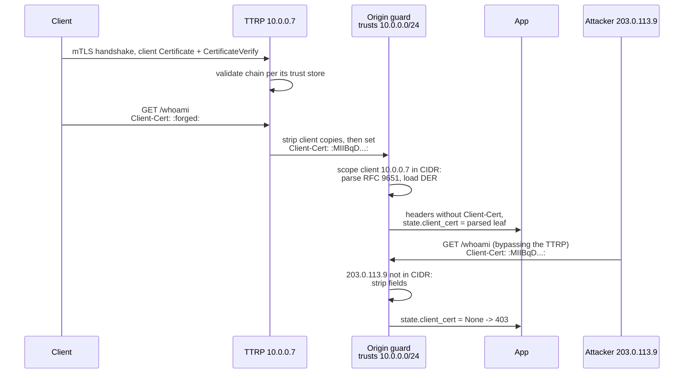

# Propagating mTLS Identity Behind Terminating Proxies with the Client-Cert Header (RFC 9440)

> [!summary] Claim
> `Client-Cert` turns a TLS-layer proof into an HTTP header that any peer can type, so it is exactly as trustworthy as the origin's check that the header came from the terminating proxy: the proxy must strip every client copy before setting its own `(RFC 9440 Section 2.4)`, and the origin must accept it only from the proxy's transport address, which on Uvicorn 0.54.0 an in-app middleware cannot see once `--proxy-headers` has rewritten `scope["client"]`.

Part of [TLS Connections and Intermediaries](README.md) in [API Engineering](../README.md).

## TL;DR

Mechanism: the TLS terminating reverse proxy (TTRP) validates the client certificate in its own handshake and forwards the DER leaf as an RFC 9651 Byte Sequence in `Client-Cert` (`:` + padded base64 + `:`), optionally with the rest of the chain as a List of Byte Sequences in `Client-Cert-Chain` `(RFC 9440 Section 2.1)` `(RFC 9440 Section 2.3)`.
Contract rule: the TTRP MUST remove or overwrite every incoming `Client-Cert` and `Client-Cert-Chain`, and the origin MUST accept them only from a trusted TTRP `(RFC 9440 Section 2.4)` `(RFC 9440 Section 4)`; the RFC warns that skipping this does not "fail safe", because legitimate traffic keeps working while forgery works too.
Trap: the trust check must use the transport peer address, and Uvicorn 0.54.0 wraps the app in `ProxyHeadersMiddleware` by default, so an in-app guard sees the `X-Forwarded-For` client instead: with `--forwarded-allow-ips '*'` an attacker who reaches the origin directly is believed, and with the proxy CIDR every legitimate certificate is stripped; the lab reproduces both.
Portability: none of Uvicorn 0.54.0, Hypercorn 0.18.0, Granian 2.8.7, Starlette 1.10.0, or FastAPI 0.162.0 parses `Client-Cert` (no match in their installed sources), nginx emits URL-encoded PEM rather than a Byte Sequence, Envoy uses its own `x-forwarded-client-cert`, and the 72-test lab passes on CPython 3.12.13 through 3.15.2, on 3.15.0b3 free-threaded, and in Debian Trixie and Alpine musl containers (as of 2026-11).
When not to use it: if the origin can terminate mTLS itself, or the proxy can pass TLS through, do that; if the origin cannot be made reachable only from the proxy, sign the proxy-to-origin hop or run mTLS on it, because a network ACL is the whole security model of this header.

## Mental model



The first two arrows are the only cryptographic proof in the picture: possession of the private key is checked by `CertificateVerify` on the client-to-TTRP connection, and nothing after that arrow can re-check it, because a header carries the certificate but not the key.
The third and fourth arrows are the sanitize-then-set rule: whatever the client typed as `Client-Cert` is gone before the TTRP writes its own value, so the field the origin receives describes the handshake, not the request.
The guard's self-arrow is the origin half of the contract, and the attacker arrows show why it exists: the leaf certificate is public (servers log it, the attacker may have captured it), so replaying it in a header is trivial unless the origin refuses the field from every address that is not the TTRP.
The app never sees a raw `Client-Cert` header in either branch; it reads one parsed object, which removes the second, easier-to-forget place a developer might parse the header.

## How it works

### Wire format: a Byte Sequence, and a List of them

RFC 9440 encodes each certificate as an RFC 8941 Byte Sequence whose bytes are the DER certificate, which "in effect" means base64 without line breaks, delimited by colons `(RFC 9440 Section 2.1)`; RFC 9651 obsoletes RFC 8941, and its list of changes touches neither Byte Sequences nor Lists `(RFC 9651 Appendix D)`.
The serializer appends `:`, the base64 of the bytes "padded with `=`", and `:` `(RFC 9651 Section 4.1.8)`; a List joins members with `,` and one SP `(RFC 9651 Section 4.1.1)`.
Because a PEM body is already base64, the RFC's shortcut is to replace the `-----BEGIN CERTIFICATE-----` and `-----END CERTIFICATE-----` lines with `:` and delete line breaks `(RFC 9440 Section 2.1)`; the lab proves the shortcut and the DER serializer produce the same 574 bytes for the RFC's own example leaf, and its `pem_to_byte_sequence` accepts exactly one `CERTIFICATE` block, because applied blindly to a combined cert-and-key file the shortcut would put the private key into a request header.

```text
Client-Cert: :MIIBqDCCAU6gAwIBAgIBBzAKBggqhkjOPQQDAjA6MRsw...VoU4hBVZ1yhk=:
             ^ Byte Sequence of the 428-byte DER leaf (Appendix A, Figure 2)
Client-Cert-Chain: :MIIB5jCC...uu2KGMg==:, :MIICBjCC...rGfLQPWDc:
                   ^ intermediate (490 bytes)  ^ root (522 bytes), TLS order
```

`Client-Cert` is request-only and a singleton: it "MUST NOT have a list of values or occur multiple times in a request" `(RFC 9440 Section 2.2)`.
`Client-Cert-Chain` is request-only, MUST NOT appear without `Client-Cert`, excludes the leaf, keeps the TLS `certificate_list` order, MAY omit the root if the origin has it, and MAY be split over several field lines `(RFC 9440 Section 2.3)`.
Splitting works because recipients combine repeated field lines into one value separated by a comma `(RFC 9110 Section 5.2)`, using comma SP for consistency `(RFC 9110 Section 5.3)`, and a List parser reads the combined value; it does not work inside a member, because "Tokens, Integers, Decimals, and Byte Sequences cannot be split across multiple field lines because the inserted commas will cause parsing to fail" `(RFC 9651 Section 4.2)`.

### Parsing strictly

RFC 9651 parsing is intentionally strict: "the only error handling defined is to fail the entire operation altogether" `(RFC 9651 Section 1.1)`, and on failure the recipient either ignores the whole field or treats the message as malformed `(RFC 9651 Section 4.2)`.
The Byte Sequence algorithm requires a leading `:`, a closing `:`, only `ALPHA`, `DIGIT`, `+`, `/`, and `=` in between, and then base64-decodes "synthesizing padding if necessary"; parsers SHOULD NOT fail on missing padding or non-zero pad bits, yet MUST fail on characters outside the alphabet and on line feeds `(RFC 9651 Section 4.2.7)`.
The lab implements that with `binascii.a2b_base64(..., strict_mode=True)` after appending the missing `=`, which on every interpreter in the matrix rejects non-alphabet bytes, `=` before data (`Q=Q=`), and data after padding (`QQ==QQ==`), and accepts non-zero pad bits (`QR==` decodes to `b"A"`); a mutation that removed the separate alphabet check survived, so the check was deleted as redundant.
Only SP is discarded before and after the value `(RFC 9651 Section 4.2)`, so a leading or trailing tab fails; a mutation that stripped all whitespace survived the first draft of the tests and is now killed by the `leading-tab` and `trailing-tab` cases.

```python
def _parse_byte_sequence(text: str, pos: int) -> tuple[bytes, int]:
    """RFC 9651 Section 4.2.7, starting at text[pos] == ":"; returns (bytes, next position)."""
    if pos >= len(text) or text[pos] != ":":
        raise ClientCertError("not a Byte Sequence")
    end = text.find(":", pos + 1)
    if end == -1:
        raise ClientCertError("Byte Sequence has no closing ':'")
    content = text[pos + 1 : end]
    padded = content + "=" * (-len(content) % 4)  # synthesize missing padding
    try:
        # strict_mode rejects characters outside the alphabet, line feeds, and misplaced "=",
        # yet accepts non-zero pad bits, matching RFC 9651 Section 4.2.7 steps 6 and 7.
        return binascii.a2b_base64(padded, strict_mode=True), end + 1
    except binascii.Error as exc:
        raise ClientCertError(f"base64 decoding failed: {exc}") from exc
```

Two field-specific constraints sit on top: `Client-Cert` is an Item, so `:a:, :b:` fails on trailing characters and two field lines fail the singleton rule, and every `Client-Cert-Chain` member must be a bare Byte Sequence, so an Inner List or a Token fails.
RFC 9651 allows Parameters on any Item and discourages treating an unknown parameter as an error `(RFC 9651 Section 2.3)`; RFC 9440 defines none, and the lab fails closed on any `;` rather than ship a partial parameter parser, a deliberate trade-off that a production parser using a complete RFC 9651 library should not copy.
Parsers MUST support Byte Sequences of at least 16384 decoded octets and Lists of at least 1024 members `(RFC 9651 Section 3.3.5)` `(RFC 9651 Section 3.1)`; the lab round-trips both minimums.

### The TTRP half: sanitize, then set

For each request on a mutually authenticated connection, the TTRP places the client certificate in `Client-Cert`, the validation chain in `Client-Cert-Chain` if configured, and "Any occurrence of the Client-Cert or Client-Cert-Chain header fields in the original incoming request MUST be removed or overwritten"; it MAY instead reject such a request with `400` `(RFC 9440 Section 2.4)`.
On a connection where client authentication was not negotiated, the TTRP MUST remove every occurrence before dispatching `(RFC 9440 Section 2.4)`.
Field names are case-insensitive `(RFC 9110 Section 5.1)`, so stripping compares lowercased names; the lab's `ttrp_forward_headers` drops `Client-Cert` and `CLIENT-CERT-CHAIN` alike, and a case-sensitive mutation was killed by that test.
Forward proxies and other intermediaries MUST NOT add or modify the fields, and clients MUST NOT send them `(RFC 9440 Section 2.4)`; an intermediary that does not know RFC 9440 will still forward them, because "A proxy MUST forward unrecognized header fields" unless configured otherwise `(RFC 9110 Section 5.1)`.

### The origin half: trust by transport peer, then parse once

"backend servers MUST only accept the Client-Cert and Client-Cert-Chain header fields from a trusted TTRP (or other proxy in a trusted path from the TTRP)", and both producing and consuming SHOULD be opt-in configuration `(RFC 9440 Section 4)`.
The RFC leaves the mechanism open: an authenticated TTRP-to-origin connection, HTTP Message Signatures, or a private network in which only the TTRP can reach the origin `(RFC 9440 Section 4)`.
The lab's `ClientCertGuard` implements the network variant: it trusts the fields only when `scope["client"][0]` is an IP literal inside a configured CIDR, parses them, loads each DER with `cryptography`'s `x509.load_der_x509_certificate` and forces the lazily parsed extensions (on cryptography 50.0.2 a leaf whose `KeyUsage` value is retagged still loads, and only `.extensions` raises; a mutation that skipped the access was killed), removes the raw headers from the child scope, and stores the result in the shared `scope["state"]["client_cert"]`, which Starlette exposes as `request.state.client_cert` `(starlette 1.10.0 starlette/requests.py, HTTPConnection.state)`.
The state dict is shared rather than copied so outer middleware still sees what inner layers store, while the header list is a new object so the parent scope keeps its original headers.
A malformed field from the trusted proxy returns `400`, or for a WebSocket a `websocket.close` before accept, which the server must turn into HTTP `403` (asgiref `specs/www.rst`, `websocket.close`), instead of being ignored: both are allowed by RFC 9651 Section 4.2, and the loud choice turns a proxy bug into an alert instead of a silent wave of anonymous requests.
Access decisions are then expressed as response content or `403` `(RFC 9440 Section 2.4)`, and a response selected by `Client-Cert` MUST be `Cache-Control: no-store` or carry `Vary: Client-Cert`; a TTRP that sees `Client-Cert` or `Client-Cert-Chain` in `Vary` SHOULD rewrite it to `Vary: *` `(RFC 9440 Section 2.4)`.

```python
class ClientCertGuard:
    """ASGI middleware that must see the transport peer, so it wraps every middleware that
    rewrites `scope["client"]`; under Uvicorn that means `--no-proxy-headers` and adding
    `ProxyHeadersMiddleware` inside this guard, because Uvicorn installs it outermost.
    """

    def __init__(self, app: ASGIApp, trusted_proxies: Iterable[str]) -> None:
        self.app = app
        self.networks = parse_networks(trusted_proxies)

    async def __call__(self, scope: Scope, receive: Receive, send: Send) -> None:
        if scope["type"] not in ("http", "websocket"):
            await self.app(scope, receive, send)
            return
        headers: list[Header] = list(scope["headers"])
        forwarded: ForwardedClientCert | None = None
        if peer_is_trusted(scope.get("client"), self.networks):
            try:
                forwarded = extract_client_cert(headers)
            except ClientCertError as exc:
                if scope["type"] == "websocket":
                    # Before accept, ASGI servers turn this close into an HTTP 403 response.
                    await send({"type": "websocket.close", "code": 1008})
                    return
                await PlainTextResponse(f"bad Client-Cert: {exc}", status_code=400)(
                    scope, receive, send
                )
                return
        # Share the per-request state dict (outer middleware reads it after the app returns),
        # but give the app a header list without the raw fields.
        state = scope.setdefault("state", {})
        state[STATE_KEY] = forwarded
        child = dict(scope)
        child["headers"] = strip_client_cert_fields(headers)
        await self.app(child, receive, send)
```

### Why the guard's position decides everything on Uvicorn

`Config.load()` wraps the loaded app in `ProxyHeadersMiddleware` whenever `proxy_headers` is true, its default, after any other wrapping, so it is always the outermost layer `(uvicorn 0.54.0 uvicorn/config.py, Config.load)`.
The trusted hosts default to `$FORWARDED_ALLOW_IPS` or `127.0.0.1,::1` `(uvicorn 0.54.0 uvicorn/config.py, Config.__init__)`; for a trusted peer the middleware replaces `scope["client"]` with the rightmost untrusted `X-Forwarded-For` entry, or the leftmost entry when all are trusted or the setting is `*` `(uvicorn 0.54.0 uvicorn/middleware/proxy_headers.py, _TrustedHosts.get_trusted_client_address)`.
The original transport peer is not kept anywhere in the scope, so a guard inside the app has two failure modes, both reproduced in the lab: with `*`, an attacker sending `X-Forwarded-For: 10.0.0.7` directly to the origin becomes the proxy and its forged `Client-Cert` is accepted; with the proxy CIDR, the TTRP's own `X-Forwarded-For` moves `scope["client"]` to the end client and every real certificate is stripped.
The lab pins the default with `Config(app).load()`: `loaded_app` is a `ProxyHeadersMiddleware` whose `.app` is the guard, and with `proxy_headers=False` it is the guard itself.
The fix is to run Uvicorn with `--no-proxy-headers` and compose `ClientCertGuard(ProxyHeadersMiddleware(app, ...))` in the application, so the guard reads the socket peer first; Hypercorn 0.18.0's `ProxyFixMiddleware` is opt-in and also overwrites `scope["client"]`, from `X-Forwarded-For` in the default `legacy` mode or from `Forwarded` in `modern` mode, so the same ordering rule applies `(hypercorn 0.18.0 src/hypercorn/middleware/proxy_fix.py, ProxyFixMiddleware.__call__)`, as does Granian 2.8.7's opt-in `wrap_asgi_with_proxy_headers` `(granian 2.8.7 granian/utils/proxies.py, wrap_asgi_with_proxy_headers)`.

### What real proxies emit

nginx exposes `$ssl_client_escaped_cert`, "the client certificate in the PEM format (urlencoded)" since 1.13.5, and deprecates the tab-folded `$ssl_client_cert` (nginx ngx_http_ssl_module documentation, as of 2026-11); neither is a Byte Sequence, and the variable table of core nginx 1.31.8 has no other certificate variable that is `(nginx 1.31.8 src/http/modules/ngx_http_ssl_module.c, ngx_http_ssl_vars)`, so an RFC 9440 origin behind core nginx needs an adapter (third-party modules are out of scope here).
`proxy_set_header` "Allows redefining or appending fields", and a field whose value is the empty string "will not be passed" (nginx ngx_http_proxy_module documentation, as of 2026-11).
On the HTTP/1.x upstream path, the request builder skips every incoming field whose name is in the `proxy_set_header` hash and skips a configured field whose value evaluates to zero length, so `proxy_set_header Client-Cert $var` drops the client's copy even when `$var` is empty `(nginx 1.31.8 src/http/modules/ngx_http_proxy_module.c, ngx_http_proxy_create_request)`; only a field name missing from `proxy_set_header` is passed through, which is the failure mode the origin guard exists for.
`ssl_verify_client optional_no_ca` "requests the client certificate but does not require it to be signed by a trusted CA certificate", which breaks the RFC 9440 precondition that the TTRP validated the certificate (nginx ngx_http_ssl_module documentation, as of 2026-11).
Envoy's `x-forwarded-client-cert` is a different, multi-hop format with `By`, `Hash`, `Cert`, `Chain`, `Subject`, `URI`, `DNS`, and `Issuer` keys; its `Chain` includes the leaf and "is not the validated chain", and `forward_client_cert_details` defaults to `SANITIZE`, while `ALWAYS_FORWARD_ONLY` forwards the header "regardless of whether the client connection is mTLS" (Envoy HTTP connection manager documentation, as of 2026-11).
RFC 9440 rejected a `Forwarded` parameter precisely because multi-hop syntax makes sanitizing "considerably more difficult and error-prone" `(RFC 9440 Appendix B.2)`, and it passes the whole certificate because applications such as RFC 8705 certificate-bound access tokens use all of it `(RFC 9440 Appendix B.3)`.

## Numbers and limits

| Quantity | Value | Source |
|---|---|---|
| Byte Sequence size a parser MUST support | >= 16384 octets after decoding | `(RFC 9651 Section 3.3.5)`; lab round trip |
| List members a parser MUST support | >= 1024 | `(RFC 9651 Section 3.1)`; lab round trip |
| `Client-Cert` value length for an n-byte DER | `2 + 4 * ceil(n / 3)` | `(RFC 9651 Section 4.1.8)`; lab |
| RFC 9440 Appendix A leaf | 428-byte DER -> 574-byte value | measured |
| Appendix A chain (intermediate + root) | 490 + 522-byte DER -> 1358-byte value | measured |
| RSA-4096 chain (leaf, intermediate, root; SAN, EKU, key identifiers) | 1644 + 1514 + 1507-byte DER -> 2194-byte `Client-Cert` and 4038-byte `Client-Cert-Chain` | measured, cryptography 50.0.2 |
| h11 0.16.0 incomplete-head buffer | 16384 bytes; at 16385 buffered and incomplete, `RemoteProtocolError` with `error_status_hint` `431` | `(h11 0.16.0 h11/_connection.py, Connection.next_event)`; measured |
| h11 0.16.0, 40049-byte head in one `receive_data` | accepted; the cap applies only while the head is incomplete | measured |
| Uvicorn 0.54.0 `--forwarded-allow-ips` default | `127.0.0.1,::1` (or `$FORWARDED_ALLOW_IPS`) | `(uvicorn 0.54.0 uvicorn/config.py, Config.__init__)` |
| Too-large header response | `431` (RFC 6585), proxies should advertise a smaller limit to leave room | `(RFC 9440 Section 3.2)` |
| Lab module | 72 tests in 0.09 to 0.20 s per environment on warm runs, up to 0.61 s on the first run in a fresh venv | `pytest -q`, macOS 27.2 arm64 and linux/arm64 containers, see Portability |

The measured rows come from the lab on macOS 27.2 arm64 with CPython 3.14.6; the size relations are exact arithmetic, and the h11 boundary was rechecked on every interpreter in the matrix.
For a deployment, the budget is the sum of every certificate's DER times 4/3 plus 2 per certificate and 2 per separator; an ECDSA P-256 chain like the RFC's stays near 2 KB, while an RSA-4096 chain with three-attribute names, SAN, and EKU measured about 1.5 KB of DER and 2.2 KB of field value per certificate, 6232 bytes for all three (cryptography 50.0.2 builder on CPython 3.14.6, macOS 27.2 arm64; longer names and more extensions grow it).
With HPACK or QPACK, distinct certificates per client also defeat header compression, and an origin may need a larger dynamic table or the TTRP may send the field as a literal `(RFC 9440 Section 3.1)`.

## Portability

| Runtime, library, or protocol | Behavior | Evidence |
|---|---|---|
| CPython 3.12.13 + OpenSSL 3.5.7 | 72 passed; 3.12.16 is not installed on this machine | lab, `UV_PROJECT_ENVIRONMENT=<job tmp venv> uv run --frozen --python 3.12.13` |
| CPython 3.13.18 + OpenSSL 3.5.9 | 72 passed | lab, `--python 3.13.18` |
| CPython 3.14.6 + OpenSSL 3.5.7 | 72 passed (workspace `.venv`) | `uv run --frozen pytest ...` |
| CPython 3.14.10 + OpenSSL 4.1.0 | 72 passed | lab, `--python 3.14.10` |
| CPython 3.15.2 + OpenSSL 4.1.0 | 72 passed | lab, `--python 3.15.2` |
| CPython 3.15t free-threaded | 72 passed on 3.15.0b3t (`sys._is_gil_enabled()` False) in a minimal venv pinned to the lock's versions; 3.15.2t is not installed and `uv sync --frozen` fails on `psycopg-binary==3.3.8` | lab, `uv pip install -r <uv export subset>`, `PYTHONPATH=src` |
| Debian 13 Trixie, glibc 2.41, CPython 3.14.10 + OpenSSL 3.5.7 | 72 passed | `python:3.14-slim-trixie` linux/arm64 container, same pinned subset |
| Alpine 3.24, musl, CPython 3.14.10 + OpenSSL 3.5.9 | 72 passed | `python:3.14-alpine` linux/arm64 container, same pinned subset |
| `binascii.a2b_base64(strict_mode=True)` | same accept and reject set on all six interpreters; only the messages for `Q=Q=` and `QQ====` changed after 3.12 | probe script on 3.12.13, 3.13.18, 3.14.6, 3.14.10, 3.15.2, 3.15.0b3t; lab parametrized test asserts the exception type only |
| Uvicorn 0.54.0 | no `Client-Cert` handling; `ProxyHeadersMiddleware` on by default and outermost | installed source search; `(uvicorn 0.54.0 uvicorn/config.py, Config.load)`; lab |
| Hypercorn 0.18.0 | no `Client-Cert` handling; `ProxyFixMiddleware` opt-in, rewrites `scope["client"]` | `(hypercorn 0.18.0 src/hypercorn/middleware/proxy_fix.py, ProxyFixMiddleware.__call__)` |
| Granian 2.8.7 | no `Client-Cert` handling and no proxy-header option in `granian/cli.py`; opt-in `wrap_asgi_with_proxy_headers` rewrites `scope["client"]` from `X-Forwarded-For` | installed source search; `(granian 2.8.7 granian/utils/proxies.py, wrap_asgi_with_proxy_headers)`; the compiled core has no `x-forwarded` string; Rust source not read |
| Starlette 1.10.0, FastAPI 0.162.0 | no `Client-Cert` handling; `request.state` reads `scope["state"]` | installed source search; `(starlette 1.10.0 starlette/requests.py, HTTPConnection.state)` |
| httpx 0.28.1 `ASGITransport` | lowercases header names; default `client` is `("127.0.0.1", 123)`, which a `127.0.0.0/8` trust list would treat as the proxy | `(httpx 0.28.1 httpx/_transports/asgi.py, ASGITransport)` |
| nginx | `$ssl_client_escaped_cert` (URL-encoded PEM, 1.13.5+), not RFC 9440 | nginx documentation (as of 2026-11) |
| Envoy | `x-forwarded-client-cert`, default `SANITIZE` | Envoy documentation (as of 2026-11) |
| HTTP/1.1 | reactive client auth via renegotiation or post-handshake auth is possible, and only the last certificate is forwarded | `(RFC 9440 Section 1.2)` |
| HTTP/2, HTTP/3 | no post-handshake client auth, so the certificate is fixed per connection; field compression and advertised header limits need headroom | `(RFC 9440 Section 1.2)` for HTTP/2, `(RFC 9001 Section 4.4)` for QUIC, `(RFC 9440 Section 3.1)`, `(RFC 9440 Section 3.2)` |

## Worked example

The [implementation](../labs/src/api_labs/f02_tls_connections_and_intermediaries/client_cert_header.py) holds the RFC 9651 serializer and parser, the TTRP `ttrp_forward_headers`, and the origin `ClientCertGuard`; the [test](../labs/tests/f02_tls_connections_and_intermediaries/test_client_cert_header_and_tls_terminating_proxies_rfc_9440.py) has 72 `unit` cases that use the three certificates and two header values of RFC 9440 Appendix A as fixed test vectors, drive Starlette through `httpx.ASGITransport` with a chosen peer address, and feed raw bytes into an h11 server connection.

The ordering hazard, verbatim from the test, with Uvicorn's real middleware:

```python
def uvicorn_proxy_headers(app: ASGIApp, trusted_hosts: str = "*") -> ASGIApp:
    """Uvicorn 0.54.0 ProxyHeadersMiddleware, as `--forwarded-allow-ips` configures it."""
    wrapped = ProxyHeadersMiddleware(cast("ASGI3Application", app), trusted_hosts=trusted_hosts)
    return cast("ASGIApp", wrapped)


@pytest.mark.unit
@pytest.mark.asyncio
async def test_guard_inside_proxy_headers_middleware_trusts_spoofed_xff() -> None:
    # Uvicorn wraps the app in ProxyHeadersMiddleware outermost; with "*" it rewrites
    # scope["client"] from X-Forwarded-For, so an inner guard sees an attacker-chosen IP.
    spoof = {"x-forwarded-for": "10.0.0.7", "client-cert": unfold(FIGURE_2).decode()}
    inner = uvicorn_proxy_headers(ClientCertGuard(ORIGIN, PROXY_CIDRS))
    async with client(inner, OUTSIDE_PEER) as c:
        r = await c.get("/whoami", headers=spoof)
    assert (r.status_code, r.json()["subject"]) == (200, "CN=BC")
    outer = ClientCertGuard(uvicorn_proxy_headers(ORIGIN), PROXY_CIDRS)
    async with client(outer, OUTSIDE_PEER) as c:
        r = await c.get("/whoami", headers=spoof)
    assert r.status_code == 403
```

Run from `labs/` on CPython 3.14.6, macOS 27.2 arm64:

```text
$ uv run --frozen pytest tests/f02_tls_connections_and_intermediaries/test_client_cert_header_and_tls_terminating_proxies_rfc_9440.py -q
........................................................................ [100%]
72 passed in 0.11s
```

A selection in verbose mode (`-v -k ...`, test path prefix trimmed from each line):

```text
test_leaf_serializes_to_rfc9440_figure_2 PASSED [ 14%]
test_forged_certificate_from_outside_peer_is_stripped PASSED [ 28%]
test_guard_inside_proxy_headers_middleware_trusts_spoofed_xff PASSED [ 42%]
test_guard_inside_restricted_proxy_headers_strips_the_real_certificate PASSED [ 57%]
test_uvicorn_installs_proxy_headers_outermost_by_default PASSED [ 71%]
test_h11_rejects_only_incomplete_heads_over_16384_bytes PASSED [ 85%]
test_h11_accepts_a_40k_head_delivered_in_one_read PASSED [100%]
======================= 7 passed, 65 deselected in 0.09s =======================
```

## Pitfalls

> [!warning] The proxy forgot one listener
> Trigger: the TTRP strips the fields on its TLS listener, but a plain-HTTP or alternate listener forwards requests to the same backend.
> Symptom: anyone can send `Client-Cert` over HTTP and be authenticated; CVE-2026-46579 is this bug in the OpenShift Router, whose HTTP frontend did not remove `X-SSL-Client-*` headers when a Route allowed insecure edge termination, letting attackers "impersonate client certificate identities" `(NVD CVE-2026-46579)`.
> Fix: sanitize on every listener and every route, and test it from outside; RFC 9440 makes the non-mTLS case explicit `(RFC 9440 Section 2.4)`.

> [!warning] Passing through instead of overwriting
> Trigger: a proxy that sets certificate headers only when a client certificate exists and otherwise leaves client copies alone.
> Symptom: unauthenticated clients choose their own identity; CVE-2010-1575 was the Cisco CSS 11500, which "does not delete client-supplied ClientCert-* headers" `(NVD CVE-2010-1575)`.
> Fix: strip unconditionally, then set; the lab's `ttrp_forward_headers` has no code path that keeps an incoming copy.

> [!warning] `Connection` deletes the proxy's own header
> Trigger: an HTTP/1.1 client lists the proxy-added field in `Connection`, and the proxy honors it as hop-by-hop after adding it.
> Symptom: Traefik before 2.11.9 and 3.1.3 let clients remove `X-Forwarded-Tls-Client-Cert` and `X-Forwarded-Tls-Client-Cert-Info` this way (CVE-2024-45410), and frameworks that map `-` to `_` then let a client-supplied variant through `(GHSA-62c8-mh53-4cqv)`.
> Fix: process `Connection` before adding identity fields, and never normalize field names at the origin; see [[Hop-by-Hop-vs-End-to-End-Headers-and-Connection-Header-Abuse]].

> [!warning] Guard placed inside the proxy-headers middleware
> Trigger: an ASGI middleware checks `scope["client"]` against the proxy CIDR on Uvicorn with default `--proxy-headers`.
> Symptom: with `--forwarded-allow-ips '*'` a direct attacker with `X-Forwarded-For: <proxy IP>` is trusted; with the proxy CIDR every legitimate request is `403`; both are lab tests.
> Fix: `--no-proxy-headers`, then compose the guard outside `ProxyHeadersMiddleware` in the app.

> [!warning] Forwarding a certificate the proxy did not verify
> Trigger: nginx `ssl_verify_client optional_no_ca`, or Envoy `ALWAYS_FORWARD_ONLY`, in front of an origin that trusts the header.
> Symptom: a self-signed certificate is presented to the origin as if a CA had validated it, or a client-supplied XFCC header passes untouched (nginx and Envoy documentation, as of 2026-11).
> Fix: validate at the TTRP (`ssl_verify_client on` on nginx), keep Envoy on `SANITIZE` or `SANITIZE_SET` rather than a forwarding mode, or have the origin verify the chain against its own anchors and treat the header as untrusted input.

> [!warning] Resumed sessions without the certificate
> Trigger: a TLS stack that does not keep client certificate information across session resumption.
> Symptom: the same client is authenticated on its first connection and anonymous on the next.
> Fix: implementations unable to provide consistent values SHOULD disable resumption for client-certificate connections or omit the field from the start `(RFC 9440 Section 3.3)`; see [[TLS-Session-Resumption-0-RTT-Early-Data-and-425-Too-Early]].

> [!warning] Cached responses leak across identities
> Trigger: an access-controlled response without `no-store` or `Vary: Client-Cert`.
> Symptom: a shared cache serves one client's data to another.
> Fix: the RFC 9440 Section 2.4 caching rule; the lab app sets `Cache-Control: no-store` and the test asserts it.

## Security and robustness

Threat model: the attacker can send arbitrary HTTP to the TTRP and, through a misconfigured firewall, peering link, or sidecar port, possibly to the origin; the attacker cannot complete an mTLS handshake with a key they do not hold, but can obtain any leaf certificate, since certificates are public.
This is OWASP API2:2023 Broken Authentication when the origin trusts an attacker-supplied identity, and API8:2023 Security Misconfiguration when the cause is a listener or trust list that should not exist (OWASP API Security Top 10 2023).
Defense in depth, in order of strength: authenticate the TTRP-to-origin hop itself (mTLS or HTTP Message Signatures over the fields) `(RFC 9440 Section 4)`; restrict origin ingress to the TTRP at the network layer; keep the origin's own guard on the transport peer; and keep the TTRP's strip-then-set rule.
Input validation: parse with the RFC 9651 algorithm, not with `split(",")` or a PEM regex; reject duplicates of the singleton, chains without a leaf, non-ASCII bytes, and bodies that do not load as DER; decide explicitly whether a malformed field means `400` or "absent", because RFC 9651 Section 4.2 permits both and the lab chooses `400`.
Boundary enforcement: trust lists come from strict CIDR parsing (`ipaddress.ip_network(strict=True)` rejects `10.0.0.7/24`), non-IP peers such as a UNIX socket path are untrusted, and an IPv4-mapped IPv6 peer (`::ffff:10.0.0.7`, what a dual-stack `::` listener reports for an IPv4 proxy) is unwrapped before the CIDR check, because without that every real certificate is stripped; peers that send a malformed field from outside the CIDR get the plain `403`, never the parser's `400`, so outsiders cannot probe the parser.
Size: a forged multi-megabyte `Client-Cert` costs the attacker nothing, so header limits belong at the TTRP and origin; h11's cap only applies while the head is incomplete, so do not rely on it as the only limit.
The header proves the TTRP saw a certificate, not that the request came from the key holder; RFC 8705 certificate-bound tokens, which use the whole forwarded certificate `(RFC 9440 Appendix B.3)`, and SPIFFE authorization still need the guard to be correct, because both read the same forwarded certificate.

## The principal's view

The architectural decision is where the trust boundary sits: terminating mTLS at an edge proxy centralizes certificate validation, revocation, and cipher policy in one fleet, at the price of turning the proxy-to-origin network into part of the authentication system.
That price is organizational as much as technical: the team that owns the firewall rules, the ingress controller, and the origin framework must agree on one rule (strip at the edge, accept by peer at the origin), and every new listener, sidecar port, or debug route is a chance to break it silently, since the failure is invisible in normal traffic.
Choose RFC 9440 over vendor headers so that origins can share one parser and one test suite across nginx, Envoy, and cloud load balancers, and so that the format is a strict, testable Structured Field rather than URL-encoded PEM or a multi-hop key-value list.
Choose TLS pass-through or origin-terminated mTLS when the origin can afford the handshake and needs the key proof itself, for example for RFC 8705 certificate-bound access tokens under a zero-trust policy that does not trust the network.
Choose a service mesh identity (SPIFFE IDs on mTLS between every hop) when there are many hops, because RFC 9440 deliberately conveys only the original client's certificate and says nothing about the proxies in between `(RFC 9440 Section 1)`.
Choose bearer tokens or DPoP-style proof instead of client certificates for browser and mobile clients, where certificate provisioning is the hard part.

## Interview questions

> [!question] L5: What exactly does a `Client-Cert` header value look like, and how do you build it from a PEM file?
>
> > [!success]- Answer
> > It is an RFC 9651 Byte Sequence: `:`, the standard padded base64 of the DER certificate, and `:`.
> > From PEM, replace the BEGIN and END armor lines with `:` and delete the line breaks, because the PEM body is already base64 of the DER.
> > The RFC 9440 Appendix A leaf is 428 DER bytes and produces a 574-byte value.
> >
> > Follow-up: Why can a long `Client-Cert-Chain` be split across two field lines but a single certificate cannot?

> [!question] L5: Which two rules make RFC 9440 secure, and which party owns each?
>
> > [!success]- Answer
> > The TTRP must remove or overwrite every client-supplied `Client-Cert` and `Client-Cert-Chain`, including on connections without client authentication.
> > The origin must accept the fields only from a trusted TTRP, for example by checking the transport peer address or authenticating the hop.
> > Either rule alone fails: without the first, clients forge through the proxy; without the second, clients bypass the proxy.
> >
> > Follow-up: Why does RFC 9440 say neglecting this "does not fail safe"?

> [!question] L5: Predict the output: the parser receives `Client-Cert: :QQ:`, `Client-Cert: :QR==:`, `Client-Cert: :Q-_=:`, and `Client-Cert: :QQ==:, :QQ==:`.
>
> > [!success]- Answer
> > `:QQ:` decodes to `b"A"`, because RFC 9651 parsers synthesize missing padding.
> > `:QR==:` also decodes to `b"A"`, because parsers SHOULD NOT fail on non-zero pad bits.
> > `:Q-_=:` fails, because `-` and `_` are base64url characters outside the alphabet.
> > `:QQ==:, :QQ==:` fails, because `Client-Cert` is a single Item and the List tail is trailing data.
> >
> > Follow-up: What does RFC 9651 Section 4.2 let the recipient do after a parse failure, and which choice would you make?

> [!question] L6: Debug this API: after setting Uvicorn's `--forwarded-allow-ips 10.0.0.0/24` to stop XFF spoofing, every mTLS client behind the proxy gets `403` from a middleware that trusts `Client-Cert` only from `10.0.0.0/24`.
>
> > [!success]- Answer
> > Uvicorn installs `ProxyHeadersMiddleware` outermost, and for a trusted peer it replaces `scope["client"]` with the client from `X-Forwarded-For`.
> > The guard therefore sees the end client's address, which is outside the proxy CIDR, and strips the genuine certificate.
> > Run with `--no-proxy-headers` and compose `ClientCertGuard(ProxyHeadersMiddleware(app, ...))` so the guard reads the socket peer first.
> > The lab reproduces both this failure and the opposite one with `*`.
> >
> > Follow-up: Which value of `--forwarded-allow-ips` turns this from an outage into an authentication bypass, and why?

> [!question] L6: Why is the leaf certificate in `Client-Cert` not a credential on its own, and what does that imply for replay?
>
> > [!success]- Answer
> > A certificate is public; the credential is the private key, proven by `CertificateVerify` in the client-to-TTRP handshake.
> > The header carries only the certificate, so anyone who reaches the origin with it can replay it; the only defense is that the origin refuses the field from non-TTRP peers.
> > This is why the RFC requires the trust check and suggests authenticating the TTRP-to-origin hop.
> >
> > Follow-up: How does RFC 8705 certificate-bound token validation depend on this header being trustworthy?

> [!question] L6: A shared cache sits behind your TTRP; what must responses that depend on `Client-Cert` carry, and what does the TTRP do with them?
>
> > [!success]- Answer
> > They MUST be uncacheable, for example `Cache-Control: no-store`, or carry `Vary: Client-Cert` so they are reused only for the same certificate.
> > A TTRP that sees `Client-Cert` or `Client-Cert-Chain` in `Vary` SHOULD rewrite it to `Vary: *`, because the user agent never sends that field and must not cache the response.
> > Distinct certificates per client also make `Vary: Client-Cert` a near-zero hit-rate key.
> >
> > Follow-up: What breaks if the cache sits in front of the TTRP instead?

> [!question] L6: Your TTRP sends a 3 KB `Client-Cert-Chain` over HTTP/2 to the origin, multiplexing many clients on one connection; what costs do you expect and how do you mitigate them?
>
> > [!success]- Answer
> > Each distinct value either evicts other entries from the HPACK dynamic table or is sent as a literal, so compression efficiency drops sharply.
> > Mitigate by enlarging the origin's dynamic table, sending the field as a literal so it never enters the table, or omitting the chain when the origin only needs the leaf.
> > The TTRP should also advertise a smaller header limit to its own clients to leave room for the added bytes, or origins will answer `431`.
> >
> > Follow-up: Why would sending the chain at all be unnecessary if the TTRP validated it?

> [!question] L7+: Design identity propagation for a platform with an edge TTRP, an internal API gateway, and 200 Python services; when is RFC 9440 the right tool and when is it not?
>
> > [!success]- Answer
> > RFC 9440 fits the edge-to-first-origin hop: it conveys only the original client's certificate, in a strict format every service can parse with one shared library and test suite.
> > It does not describe intermediate hops, so between the gateway and services use mesh mTLS with workload identities and either re-emit an RFC 9440 field from a trusted hop or translate it into a signed internal token.
> > The invariant to enforce platform-wide is strip-at-ingress and accept-by-authenticated-peer; make it a shared middleware with mutation-tested cases, and make bypass of the TTRP impossible at the network layer.
> > Revocation and validation stay centralized at the TTRP, which is the main benefit; the main risk is any new listener that forgets to strip.
> >
> > Follow-up: How would you detect in production that some path reaches a service without passing through the TTRP?

> [!question] L7+: The RFC lists network topology, mTLS on the hop, and HTTP Message Signatures as ways to trust the TTRP; compare them for a multi-tenant Kubernetes cluster.
>
> > [!success]- Answer
> > Network topology (NetworkPolicy plus a peer-CIDR guard) is cheapest but brittle: pod IPs are reused, sidecars and debug ports open new paths, and proxy-header middleware can hide the real peer.
> > mTLS on the hop proves the peer is the TTRP by key, independent of addresses, at the cost of a second PKI and certificate rotation for the proxy fleet.
> > HTTP Message Signatures bind the `Client-Cert` value to the request even across further intermediaries, at the cost of key distribution and a signature check on every request.
> > For multi-tenant clusters prefer hop mTLS with workload identity, keeping the CIDR guard as defense in depth.
> >
> > Follow-up: What does each option do when an attacker controls a pod in the same namespace as the origin?

## Related

Prerequisites: [[Mutual-TLS-mTLS-Handshake-and-SPIFFE-Identity]]

Next: [[TCP-Connection-Lifecycle-Keep-Alive-and-TIME-WAIT]]

See also: [[API-Authentication-and-Authorization]], [[02-Programming-Languages/Python/Python-Backend-Interview-Prep/07-Auth-and-Security]], [[Structured-Field-Values-for-HTTP-RFC-9651]], [[Forwarded-Header-RFC-7239-and-X-Forwarded-For-Spoofing]], [[Hop-by-Hop-vs-End-to-End-Headers-and-Connection-Header-Abuse]], [[TLS-Session-Resumption-0-RTT-Early-Data-and-425-Too-Early]], [[HPACK-Header-Compression-and-Dynamic-Table-Security]], [[X509-Certificates-Chain-Validation-SAN-and-OCSP-Stapling]], [[Caching-Authenticated-and-Multi-Tenant-API-Responses]]

- Lab: `labs/tests/f02_tls_connections_and_intermediaries/test_client_cert_header_and_tls_terminating_proxies_rfc_9440.py`

## Further reading

- [RFC 9440, Client-Cert HTTP Header Field](https://www.rfc-editor.org/rfc/rfc9440.html): Section 2.4 processing rules, Section 4 trust requirement, Section 3 deployment limits, and Appendix A test vectors.
- [RFC 9651, Structured Field Values for HTTP](https://www.rfc-editor.org/rfc/rfc9651.html): the Byte Sequence and List algorithms (Sections 4.1.8, 4.2.1, 4.2.7) and the strict-failure rule (Section 4.2).
- [RFC 9110, HTTP Semantics](https://www.rfc-editor.org/rfc/rfc9110.html): case-insensitive field names and field-line combination (Sections 5.1 to 5.3).
- [RFC 8705, OAuth 2.0 Mutual-TLS](https://www.rfc-editor.org/rfc/rfc8705.html): the main consumer of the whole forwarded certificate.
- [RFC 7239, Forwarded](https://www.rfc-editor.org/rfc/rfc7239.html): the multi-hop alternative RFC 9440 Appendix B.2 explains not using.
- [Uvicorn 0.54.0 `proxy_headers.py`](https://github.com/Kludex/uvicorn/blob/0.54.0/uvicorn/middleware/proxy_headers.py): how `scope["client"]` is rewritten, the root of the ordering hazard.
- [NVD CVE-2026-46579](https://nvd.nist.gov/vuln/detail/CVE-2026-46579): a 2026 instance of an unsanitized listener for client certificate headers.
- [GHSA-62c8-mh53-4cqv](https://github.com/advisories/GHSA-62c8-mh53-4cqv): Traefik's `Connection`-header removal of client certificate headers (CVE-2024-45410).
