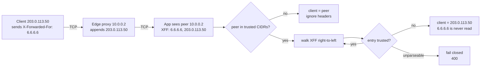

# Proxy Identity Propagation: RFC 7239 Forwarded vs X-Forwarded-For Right-to-Left Trusted Hop Parsing

> [!summary] Claim
> The client writes every byte of `X-Forwarded-For` and `Forwarded` that it sends, so the only trustworthy client address is the rightmost entry not appended by a proxy you operate, found by peeling trusted hops right-to-left starting from the TCP peer.

Part of [TLS Connections and Intermediaries](README.md) in [API Engineering](../README.md).

## TL;DR

- Mechanism: each proxy appends the address of the node it received the request from to the right of the list (RFC 7239 Section 4, nginx `$proxy_add_x_forwarded_for`), so entries are ordered client-first and only the right end is written by your infrastructure.
- Contract rule: trust the header only if the TCP peer is a trusted proxy, then walk right-to-left over trusted CIDRs and stop at the first untrusted entry; everything left of it is attacker-controlled (RFC 7239 Section 8.1).
- Trap: `X-Forwarded-For[0]`, Uvicorn and Granian with `forwarded_allow_ips="*"`, and, on a directly reachable origin, Hypercorn's and Werkzeug's peer-blind hop counts all hand the client a free choice of identity; the lab shows a leftmost-keyed limiter answering `200` to ten of ten spoofed requests where the right-to-left key answers `429` from the fourth.
- Portability: the lab passes identically on CPython 3.12.16, 3.13.18, 3.14.10, 3.15.2, and 3.15.2 free-threaded (Debian Trixie), on Alpine musl for the four non-free-threaded versions, and on 3.14.6 on macOS; Uvicorn 0.54.0 and Granian 2.8.7 read only `X-Forwarded-For`, and Hypercorn 0.18.0 `modern` mode is the only one of the three that reads `Forwarded`.
- When not to use it: when the edge is an L4 load balancer or a CDN you do not control, use PROXY protocol or the vendor's signed client-address header instead, and never use any forwarded address as an authentication factor.

## Mental model



The client sends a forged `X-Forwarded-For: 6.6.6.6`, and the edge proxy, which only knows the TCP source address, appends `203.0.113.50` to the right of it.
The application cannot tell who wrote which entry from the bytes alone, so it first checks the one fact the network guarantees, the TCP peer address, against its list of trusted proxy CIDRs.
If the peer is untrusted the request did not come through your proxy and every forwarding header is client-written, so the peer address is the client.
If the peer is trusted, the application walks the list from the right, skipping entries that are themselves trusted proxies, and stops at the first untrusted address, which is the last address any of your proxies actually observed on a socket.
Entries further left, here `6.6.6.6`, were supplied by that untrusted party and are never consulted; an entry that does not parse as an address stops the walk and the request is rejected rather than guessed at.

## How it works

`Forwarded` is a list header: `Forwarded = 1#forwarded-element`, each element is `[ forwarded-pair ] *( ";" [ forwarded-pair ] )`, and each pair is `token "=" value` where `value = token / quoted-string` (RFC 7239 Section 4).
Parameter names are case-insensitive and each parameter MUST NOT occur more than once per element (RFC 7239 Section 4).
The four registered parameters are `by` (the proxy's user-agent facing interface), `for` (the node that made the request to the proxy), `host` (the `Host` the proxy received), and `proto` (the scheme used) (RFC 7239 Section 5).
A `for` or `by` value is a `node`: an IPv4 address, a bracketed IPv6 address, the literal `unknown`, or an obfuscated identifier starting with `_`, optionally followed by `:` and a port or an `_`-prefixed obfuscated port (RFC 7239 Section 6).
Because `:` and `[` are not `tchar`, any IPv6 address or any node with a port MUST be a `quoted-string`, for example `For="[2001:db8:cafe::17]:4711"` (RFC 7239 Sections 4 and 6).
On the wire the RFC's own multi-proxy example after two hops is `Forwarded: for=192.0.2.43, for=198.51.100.17;by=203.0.113.60;proto=http;host=example.com` (RFC 7239 Section 7.5).

The ordering rule is what makes right-to-left parsing sound: the first element was added by the first proxy and each subsequent element by each subsequent proxy (RFC 7239 Section 4), and the last proxy is not in the `for` list at all because it is the transport-layer peer (RFC 7239 Section 5.2).
A proxy may append to the last existing `Forwarded` field line after a comma or add a new field line at the end (RFC 7239 Section 4), and a recipient may combine field lines of the same name in order with `", "`, while a proxy MUST NOT reorder them (RFC 9110 Section 5.3).
So `for=192.0.2.43, for="[2001:db8:cafe::17]", for=unknown` on one line and the same elements split across two lines are equivalent (RFC 7239 Section 7.1).
Empty list elements such as `a, , b` must be tolerated and do not count (RFC 9110 Section 5.6.1.2), and a quoted-string may contain commas and semicolons and `\`-escaped octets that a recipient MUST unescape (RFC 9110 Section 5.6.4).

`X-Forwarded-For` has no RFC; RFC 7239 Section 1 calls it non-standard and Section 7.4 describes its de facto form, a comma list of addresses in which IPv6 may be neither quoted nor bracketed, translated as `X-Forwarded-For: 192.0.2.43, 2001:db8:cafe::17` -> `Forwarded: for=192.0.2.43, for="[2001:db8:cafe::17]"`.
nginx's `$proxy_add_x_forwarded_for` is "the X-Forwarded-For client request header field with the `$remote_addr` variable appended to it, separated by a comma" (nginx `ngx_http_proxy_module` documentation), which is exactly the append that lets an attacker pre-seed the left side.
nginx's own consumer, `real_ip_recursive on`, replaces a trusted peer address with "the last non-trusted address sent in the request header field" (nginx `ngx_http_realip_module` documentation), which is the right-to-left rule.

The security consequence is stated in the RFC: `Forwarded` "cannot be relied upon to be correct, as it may be modified ... by every node on the way to the server, including the client making the request", and even with whitelisted proxies "the chain of IP addresses listed before the request came to the proxy cannot be trusted" (RFC 7239 Section 8.1).

The Python servers implement this in three different ways.
Uvicorn wraps the app in `ProxyHeadersMiddleware` when `proxy_headers=True` (the default) with `forwarded_allow_ips` defaulting to `$FORWARDED_ALLOW_IPS` or `"127.0.0.1,::1"` (uvicorn 0.54.0 uvicorn/config.py, Config.__init__ and Config.load).
It acts only if the peer is trusted, joins all `x-forwarded-for` field lines with `", "`, walks them `reversed`, strips a port with `_parse_host_port`, and returns the first untrusted host; if every entry is trusted, or if `trusted_hosts` is `"*"`, it returns the leftmost entry (uvicorn 0.54.0 uvicorn/middleware/proxy_headers.py, _TrustedHosts.get_trusted_client_address).
Granian's `wrap_asgi_with_proxy_headers` has the same shape, including the leftmost return for `"*"`, but does not split a port off the entry (granian 2.8.7 granian/utils/proxies.py, _Forwarders.get_client_host).
Hypercorn's `ProxyFixMiddleware` never looks at the peer: it splits every matching header on `b","` without regard to quoting and takes `values[-trusted_hops]`, and in `mode="modern"` it then splits that element on `";"` and matches `part.startswith("for=")` without lowercasing the name, stripping OWS before it, or unquoting the value, only calling `.strip()` on what follows `for=` (hypercorn 0.18.0 src/hypercorn/middleware/proxy_fix.py, _get_trusted_value and ProxyFixMiddleware.__call__).
In `modern` mode a request with no `Forwarded` field falls through to the `X-Forwarded-For` branch (same file, ProxyFixMiddleware.__call__).
Werkzeug's WSGI `ProxyFix` uses the same peer-blind count-from-the-right model with `x_for=1` and `x_proto=1` by default (werkzeug 3.1.9 src/werkzeug/middleware/proxy_fix.py, ProxyFix._get_real_value; lab `test_werkzeug_proxy_fix_trusts_hop_count_not_peer_address`).
Starlette ships no proxy middleware; `Request.client` is whatever `scope["client"]` holds after the server's middleware ran (starlette 1.10.0 starlette/requests.py, HTTPConnection.client).

## Numbers and limits

| Quantity | Value | Source |
|---|---|---|
| `Forwarded` published | June 2014, Standards Track | RFC 7239 front matter |
| `node-port` grammar | `1*5DIGIT`, so `99999` is syntactically valid although no TCP port exceeds `65535` | RFC 7239 Section 6 |
| Uvicorn default trust list | `"127.0.0.1,::1"` unless `$FORWARDED_ALLOW_IPS` is set | uvicorn 0.54.0 uvicorn/config.py, Config.__init__ |
| Uvicorn trust-check cache | `functools.lru_cache(maxsize=4096)`, hosts longer than 253 characters bypass it | uvicorn 0.54.0 uvicorn/middleware/proxy_headers.py, _TrustedHosts |
| Hypercorn defaults | `mode="legacy"`, `trusted_hops=1` | hypercorn 0.18.0 src/hypercorn/middleware/proxy_fix.py, ProxyFixMiddleware.__init__ |
| Werkzeug defaults | `x_for=1`, `x_proto=1`, `x_host=0`, `x_port=0`, `x_prefix=0` | werkzeug 3.1.9 src/werkzeug/middleware/proxy_fix.py, ProxyFix.__init__ |
| Lab hop cap | `MAX_HOPS = 32` list elements per request, then `ForwardingHeaderError` | lab `forwarded_identity.py` (a design choice, not a standard) |
| Spoofed requests admitted, limit 3, 10 rotating spoofs | leftmost key: 10 of 10 `200`; right-to-left key: 3 `200` then 7 `429` | lab, CPython 3.14.6, macOS 27.2, Apple M3 Pro |
| `client_from_xff`, 3 hops | best 5.4 us, median 5.5 us per call (7 x 2000 calls) | ad hoc `timeit.repeat` script over the lab functions, one IPv4 header line whose leftmost entry is untrusted and the rest inside `10.0.0.0/8`, so every hop is walked; `uv run --frozen python bench.py` from `labs/`, CPython 3.14.6, macOS 27.2 (`uname -r` `27.2.0`), arm64 Apple M3 Pro, 2026-11-09 |
| `client_from_forwarded`, 3 hops | best 9.7 us, median 9.8 us per call | same run |
| `client_from_xff`, 32 hops | best 44.6 us, median 45.7 us per call | same run |
| `client_from_forwarded`, 32 hops | best 85.7 us, median 87.1 us per call | same run; a second run was within 4% on every row |

The cost is linear in hop count and is pure-Python character scanning; the cap bounds it under 0.1 ms per request on this machine (about 87 us for 32 `Forwarded` elements), which is why a hop cap is a robustness control rather than a performance one.

## Portability

| Leg | Result | Evidence |
|---|---|---|
| CPython 3.12.16 | 43 passed | `python:3.12-trixie` and `python:3.12-alpine` containers: `python -m venv`, `pip install` of the lab's pinned versions of the packages the module imports plus their locked dependencies, then `PYTHONPATH=src python -m pytest <test path> -q`; aarch64 (OrbStack on macOS 27.2), 2026-11-09 |
| CPython 3.13.18 | 43 passed | same, `python:3.13-trixie` and `python:3.13-alpine` |
| CPython 3.14.10 | 43 passed | same, `python:3.14-trixie` and `python:3.14-alpine` |
| CPython 3.14.6 | 43 passed | workspace `.venv` via `uv run --frozen pytest <test path> -q`, macOS 27.2 arm64 |
| CPython 3.15.2 | 43 passed | same, `python:3.15-trixie` and `python:3.15-alpine` |
| CPython 3.15.2t (free-threaded) | 43 passed; `sys._is_gil_enabled()` is `False` at start and after importing Granian, Hypercorn, slowapi, Uvicorn, and Werkzeug | `ghcr.io/astral-sh/uv:python3.15-trixie`, `uv venv --python 3.15.2+freethreaded` (`Python 3.15.2 free-threading build`), `PYTHON_GIL=0`, same pinned `uv pip install`; the full-workspace `uv sync --frozen` was not attempted, only the module's imports are installed |
| Debian Trixie (glibc 2.41) and Alpine 3.24 (musl) | 43 passed on each of the versions above (Alpine for 3.12.16, 3.13.18, 3.14.10, and 3.15.2 only; no free-threaded Alpine image) | `/etc/os-release` read inside each container; the pinned `pip install` succeeded on Alpine and the module imports Granian, Hypercorn, and Uvicorn there; aarch64 only, x86_64 not run |
| Uvicorn 0.54.0 | reads `X-Forwarded-For` only, peer-gated, port stripped, `"*"` -> leftmost | lab tests `test_uvicorn_*` |
| Hypercorn 0.18.0 | peer-blind hop count; `modern` misses `For=` and keeps quotes | lab tests `test_hypercorn_*` |
| Werkzeug 3.1.9 | peer-blind `x_for` hop count | lab test `test_werkzeug_*` (WSGI callable driven in-process) |
| Granian 2.8.7 | peer-gated, port kept in host string, `"*"` -> leftmost | lab test `test_granian_*` (in-process wrapper, no Rust server started) |
| HTTP/1.1 | field names are `token`, so `X_Forwarded_For` is a legal distinct name and h11 delivers it | lab test `test_h11_*`, (h11 0.16.0 h11/_abnf.py, field_name) |
| HTTP/2 | same field semantics; a field name containing uppercase `0x41-0x5a` is malformed, but `_` (`0x5f`) is not in the prohibited ranges, so underscore names still pass | lab test `test_h2_rejects_uppercase_field_names_but_delivers_underscore_names` (h2 4.4.1, `ProtocolError: Received uppercase header name` for `X-Forwarded-For`, `RequestReceived` with `x_forwarded_for` intact); (RFC 9113 Section 8.2.1); (h2 4.4.1 h2/utilities.py, `_reject_illegal_characters`, which rejects only `0x41-0x5a` in a name); no socket or TLS leg |
| HTTP/3 | same field semantics as HTTP/2: a request with uppercase field names is malformed (RFC 9114 Section 4.2) | spec only: (RFC 9114 Section 4.2), text re-read at rfc-editor.org on 2026-11-09; no QUIC leg was run |

## Worked example

The [implementation](../labs/src/api_labs/f02_tls_connections_and_intermediaries/forwarded_identity.py) has a quote-aware RFC 7239 parser, an `X-Forwarded-For` parser, and one resolver shared by both; the [test](../labs/tests/f02_tls_connections_and_intermediaries/test_forwarded_header_rfc_7239_and_x_forwarded_for_spoofing.py) drives a Starlette rate-limited login through `httpx.ASGITransport` with the transport peer set to the edge proxy address.

The resolver, verbatim from the lab:

```python
def resolve_client(
    peer: IPAddress, hops: Sequence[IPAddress | None], trusted: TrustedProxies
) -> ClientResolution:
    """Peel trusted proxies right-to-left from `hops + [peer]`; `None` marks an unparseable hop.

    Headers are evidence only if the TCP peer itself is a trusted proxy.
    Every entry left of the first untrusted hop was written by an untrusted party and is ignored.
    """
    if peer not in trusted:
        return ClientResolution(peer, 0, "peer-untrusted")
    for peeled, hop in enumerate(reversed(hops), start=1):
        if hop is None:
            return ClientResolution(None, peeled, "invalid-hop")
        if hop not in trusted:
            return ClientResolution(hop, peeled, "first-untrusted-hop")
    return ClientResolution(hops[0] if hops else peer, len(hops), "all-trusted")
```

The rate-limit key and the two tests that contrast it with the leftmost key, verbatim from the test module:

```python
def _right_to_left_key(request: Request) -> str | None:
    try:
        resolved = client_from_xff(IP(_peer(request)), request.scope["headers"], TRUSTED)
    except ForwardingHeaderError:
        return None
    return None if resolved.client is None else str(resolved.client)
```

```python
@pytest.mark.unit
@pytest.mark.asyncio
async def test_leftmost_xff_rate_limit_is_bypassed_by_rotating_spoofed_entries() -> None:
    statuses = await _statuses(_app(_naive_key), EDGE, SPOOFS)
    assert statuses == [200] * 10


@pytest.mark.unit
@pytest.mark.asyncio
async def test_right_to_left_rate_limit_holds_against_rotating_spoofed_entries() -> None:
    statuses = await _statuses(_app(_right_to_left_key), EDGE, SPOOFS)
    assert statuses == [200, 200, 200] + [429] * 7
```

Each request carries `X-Forwarded-For: 198.18.0.N` from the attacker, after which `proxy_append_xff` appends the attacker's real `203.0.113.50`, as nginx would.
Run from `labs/` with CPython 3.14.6 on macOS 27.2 (Apple M3 Pro):

```text
$ uv run --frozen pytest tests/f02_tls_connections_and_intermediaries/test_forwarded_header_rfc_7239_and_x_forwarded_for_spoofing.py -q -p no:cacheprovider
.............................................                            [100%]
45 passed in 0.21s
```

```text
$ uv run --frozen pytest tests/f02_tls_connections_and_intermediaries/test_forwarded_header_rfc_7239_and_x_forwarded_for_spoofing.py -v --no-header -p no:cacheprovider -k "rate_limit or wildcard"
============================= test session starts ==============================
collecting ... collected 43 items / 38 deselected / 5 selected

tests/f02_tls_connections_and_intermediaries/test_forwarded_header_rfc_7239_and_x_forwarded_for_spoofing.py::test_leftmost_xff_rate_limit_is_bypassed_by_rotating_spoofed_entries PASSED [ 20%]
tests/f02_tls_connections_and_intermediaries/test_forwarded_header_rfc_7239_and_x_forwarded_for_spoofing.py::test_right_to_left_rate_limit_holds_against_rotating_spoofed_entries PASSED [ 40%]
tests/f02_tls_connections_and_intermediaries/test_forwarded_header_rfc_7239_and_x_forwarded_for_spoofing.py::test_uvicorn_proxy_headers_cidr_holds_but_wildcard_trusts_leftmost PASSED [ 60%]
tests/f02_tls_connections_and_intermediaries/test_forwarded_header_rfc_7239_and_x_forwarded_for_spoofing.py::test_uvicorn_strips_the_port_and_wildcard_returns_the_leftmost_entry PASSED [ 80%]
tests/f02_tls_connections_and_intermediaries/test_forwarded_header_rfc_7239_and_x_forwarded_for_spoofing.py::test_granian_keeps_the_port_in_the_host_and_wildcard_trusts_leftmost PASSED [100%]

======================= 5 passed, 38 deselected in 0.11s =======================
```

The lab was mutation-checked by applying 20 breaks one at a time and rerunning the module (the independent fact-check run), and every one turned at least one test red: walking left-to-right (5 failures), dropping the peer check, skipping an invalid hop, splitting commas inside quotes, case-sensitive parameter names, reading only the first field line, removing or off-by-one on the hop cap, returning the peer when all hops are trusted, prepending instead of appending, skipping quoted-pair unescaping, accepting 6-digit ports, keeping an IPv4 port in `X-Forwarded-For`, reading `by=` instead of `for=`, allowing repeated parameters, unbracketed IPv6 translation, a rightmost naive key, and reconfiguring the Uvicorn, Werkzeug, and Hypercorn characterization tests.
The finishing pass reran five more, each restored afterwards: dropping the peer-trust gate in `resolve_client` (1 failure), walking hops left-to-right (5), removing the HTTP/2 server's inbound validation (1), failing open on an unparseable hop (1), and raising `MAX_HOPS` from 32 to 33, which first survived because the cap test was written relative to the constant, so `assert MAX_HOPS == 32` was added and the constant change, `>` to `>=`, and `> MAX_HOPS + 1` each now fail one test.

## Pitfalls

> [!warning] Leftmost entry used as the client
> Trigger: `request.headers["x-forwarded-for"].split(",")[0]`, or a library that "trusts" the header unconditionally.
> Symptom: per-IP rate limits, lockouts, and audit logs key on a value the attacker chooses per request; Litestar 2.17.0 `RateLimitMiddleware` trusted `X-Forwarded-For` unconditionally when building its cache key and was assigned CVE-2025-59152 (GHSA-hm36-ffrh-c77c, published 2025-10-06, CVSS 3.1 7.5 `AV:N/AC:L/PR:N/UI:N/S:U/C:N/I:N/A:H`, CWE-807), patched in 2.18.0.
> Fix: resolve the client once, in server middleware, right-to-left against trusted CIDRs; Litestar 2.25.0 defaults `RateLimitConfig.identifier_for_request` to `get_remote_address`, which reads only `request.client` (litestar 2.25.0 litestar/middleware/rate_limit.py, RateLimitConfig.identifier_for_request and get_remote_address).

> [!warning] `forwarded_allow_ips="*"` on a reachable origin
> Trigger: setting Uvicorn `--forwarded-allow-ips '*'` or Granian's `"*"` to make proxy headers "just work".
> Symptom: both return `x_forwarded_for_hosts[0]`, the leftmost, client-written entry; the lab shows ten spoofed requests all admitted through Uvicorn with `"*"` and seven rejected with `"10.0.0.0/8"`.
> Fix: list the proxy CIDRs; `"*"` is only defensible when the origin socket is unreachable except through a proxy that overwrites rather than appends the header.

> [!warning] Peer-blind hop counting
> Trigger: Hypercorn `ProxyFixMiddleware(trusted_hops=1)` or Werkzeug `ProxyFix(x_for=1)` on an origin that is also reachable directly.
> Symptom: a direct client sending `X-Forwarded-For: 198.51.100.7` becomes `198.51.100.7`, because nothing checks that the peer is a proxy (lab `test_hypercorn_proxy_fix_trusts_hop_count_not_peer_address` and `test_werkzeug_proxy_fix_trusts_hop_count_not_peer_address`).
> Fix: enforce reachability at the network layer, or use a peer-gated resolver; a hop count is only correct if the topology never changes.

> [!warning] Reading one field line of a multi-line header
> Trigger: Starlette `request.headers["x-forwarded-for"]`, which returns only the first matching field line (starlette 1.10.0 starlette/datastructures.py, Headers.__getitem__).
> Symptom: when an intermediary adds a new field line instead of appending, as RFC 7239 Section 4 permits for `Forwarded`, "the rightmost entry" is the rightmost of the client's own line.
> Fix: use `request.headers.getlist(...)` or iterate `scope["headers"]` and join in order, as Uvicorn does.

> [!warning] Underscore look-alike header names
> Trigger: slowapi 0.1.10 `get_ipaddr` checks `"X_FORWARDED_FOR" in request.headers` (slowapi 0.1.10 slowapi/util.py, get_ipaddr).
> Symptom: the real `X-Forwarded-For` is never read, but a client-sent `X_Forwarded_For: 6.6.6.6`, a legal HTTP/1.1 field name that h11 delivers, becomes the limiter key (lab `test_slowapi_*` and `test_h11_*`).
> Fix: use `get_remote_address` behind a peer-gated proxy middleware.
> An nginx edge drops such names by default, because `underscores_in_headers off` marks them invalid and `ignore_invalid_headers on` ignores them (nginx `ngx_http_core_module` documentation), so the hole is open only on a directly reachable origin or a proxy configured otherwise.

> [!warning] Hypercorn `modern` mode and RFC 7239 syntax
> Trigger: `ProxyFixMiddleware(mode="modern")` with `For="[2001:db8:cafe::17]:4711"`, the RFC 7239 Section 4 example.
> Symptom: the capitalized parameter is ignored and `client` stays the proxy; with lowercase `for=` the client becomes the string `'"[2001:db8:cafe::17]:4711"'`, quotes and port included.
> Fix: lowercase parameter names, unquote, and parse the `node` grammar, as the lab parser does.

## Security and robustness

Threat model: the attacker controls everything in the request it sends, including any number of `Forwarded`, `X-Forwarded-For`, and look-alike field lines, and may be able to reach the origin directly; you control the proxies and the network policy.
The identity derived from these headers feeds the rate limiting that `API4:2023 Unrestricted Resource Consumption` prescribes and the brute-force protection that `API2:2023 Broken Authentication` prescribes (OWASP API Security Top 10 2023), plus audit logs and geo or allowlist decisions; see [[Unrestricted-Resource-Consumption-API4-2023-Payload-Depth-and-Limit-Guards]] and [[Credential-Stuffing-Brute-Force-Defense-and-Account-Lockout-Traps]].
Boundary enforcement: resolve the client exactly once, at the outermost application middleware, write it into `scope["client"]`, and never re-derive it from headers deeper in the stack.
Edge hygiene: the first proxy you own should overwrite, not append, client-supplied forwarding headers when it has no trusted upstream, which removes the attacker's entries before they can confuse any downstream consumer.
Input validation: cap the number of list elements, reject malformed quoted-strings and unparseable nodes, and fail closed with `400` rather than falling back to a value that might be attacker-chosen.
Never authenticate on an address: a forwarded address is at best a proxy's observation, and between proxies it is only as good as the transport (RFC 7239 Section 8.1); use mTLS identity propagated with [[Client-Cert-Header-and-TLS-Terminating-Proxies-RFC-9440]] for that.
Privacy: `for` and `by` SHOULD default to obfuscated identifiers (RFC 7239 Section 8.3), the header should never be copied into responses, and `TRACE` should not be allowed where `Forwarded` is used because it would appear in the response body (RFC 7239 Section 8.2); redact it in logs per [[Structured-Log-Redaction-and-Preventing-PII-and-Token-Leaks]].

## The principal's view

The decision is not which header to parse but where the trust boundary lives and who owns its configuration.
A staff-plus engineer makes the edge the single writer of client identity: the edge overwrites inbound forwarding headers, internal proxies append, and every service sits behind a shared, peer-gated middleware fed from one platform-owned list of proxy CIDRs.
The organizational trade-off is coupling: application teams must not hand-roll `X-Forwarded-For` parsing, and the platform team must version the CIDR list with the infrastructure, because a new load balancer subnet silently turns every client into "all-trusted" or into the proxy itself.
Prefer `Forwarded` internally when you control every hop, because it binds `for`, `proto`, and `host` per hop in one element, which `X-Forwarded-*` cannot (RFC 7239 Section 1), but expect to keep emitting `X-Forwarded-For` for consumers such as Uvicorn and Granian that read nothing else.
Choose a different mechanism when the edge is L4: PROXY protocol carries the address outside HTTP, and nginx can take the client address from it with `real_ip_header proxy_protocol` (nginx `ngx_http_realip_module` documentation).
When the edge is a third-party CDN, trust only its documented client-address header, and only from its published egress ranges.

## Interview questions

> [!question] L5: Why is the leftmost `X-Forwarded-For` entry not the client IP you should rate-limit on?
>
> > [!success]- Answer
> > Proxies append to the right, so the leftmost entry is whatever the client put there before the first proxy appended the real socket address.
> > The client can rotate it per request and land in a fresh rate-limit bucket each time.
> > The lab shows ten of ten spoofed requests admitted with a limit of three.
> >
> > Follow-up: What does the first proxy you operate append, and why is that value trustworthy?

> [!question] L5: How do you write an IPv6 client with a port in `Forwarded`, and why?
>
> > [!success]- Answer
> > `for="[2001:db8:cafe::17]:4711"`.
> > `:` and `[` are not `tchar`, so the value must be a quoted-string, and IPv6 is always bracketed (RFC 7239 Sections 6 and 6.1).
> > `X-Forwarded-For` by contrast often carries bare unbracketed IPv6 (RFC 7239 Section 7.4).
> >
> > Follow-up: How would a parser that splits on `:` misread `2001:db8::1` in `X-Forwarded-For`?

> [!question] L6: Predict the output.
> Uvicorn 0.54.0 `ProxyHeadersMiddleware(app, trusted_hosts="*")`, peer `10.0.0.2`, header `X-Forwarded-For: 6.6.6.6, 198.51.100.7`.
> What is `scope["client"]`?
>
> > [!success]- Answer
> > `("6.6.6.6", 0)`.
> > With `always_trust`, `get_trusted_client_address` returns `_parse_host_port(x_forwarded_for_hosts[0])`, the leftmost entry.
> > With `"10.0.0.0/8"` the same request yields `("198.51.100.7", 0)`; both are asserted in lab `test_uvicorn_strips_the_port_and_wildcard_returns_the_leftmost_entry`.
> >
> > Follow-up: What does it return if every entry is inside the trusted CIDRs, and is that safe?

> [!question] L6: Debug this API.
> A FastAPI service runs `uvicorn --forwarded-allow-ips '*'` behind nginx with `proxy_set_header X-Forwarded-For $proxy_add_x_forwarded_for`, and uses slowapi `Limiter(key_func=get_ipaddr)`.
> The login limit of 5 per minute never triggers, yet nginx logs show one attacker address.
> What is happening?
>
> > [!success]- Answer
> > `get_ipaddr` tests for a header named `X_FORWARDED_FOR`, which nginx drops by default, so it falls through to `request.client.host`.
> > `request.client.host` was rewritten by Uvicorn, and with `"*"` Uvicorn returns the leftmost `X-Forwarded-For` entry, which the attacker rotates per request.
> > Fix: set `forwarded_allow_ips` to the nginx CIDR so Uvicorn peels right-to-left, switch to `get_remote_address`, and add a test that pins the transport peer and asserts `429` under rotating spoofs.
> >
> > Follow-up: How would that test catch someone later reverting `forwarded_allow_ips` to `"*"`?

> [!question] L6: Why must right-to-left parsing start by checking the TCP peer?
>
> > [!success]- Answer
> > If the peer is not a trusted proxy, the request did not traverse your proxies and every forwarding entry, including the rightmost, is client-written.
> > Hypercorn's `trusted_hops` and Werkzeug's `x_for` skip this check, so a direct client becomes whoever it claims to be.
> > Peer gating turns a topology assumption into a checked fact.
> >
> > Follow-up: When is a fixed hop count acceptable anyway?

> [!question] L6: Repeated field lines.
> Two field lines arrive, `X-Forwarded-For: 6.6.6.6` then `X-Forwarded-For: 203.0.113.50`.
> What do Starlette `request.headers[...]` and Uvicorn see?
>
> > [!success]- Answer
> > Starlette `Headers.__getitem__` returns the first matching line only, `6.6.6.6`.
> > Uvicorn collects all `x-forwarded-for` lines and joins them with `", "` before walking, so it sees both, in order.
> > RFC 9110 Section 5.3 makes the combined order significant and forbids proxies from reordering.
> >
> > Follow-up: Which RFC 7239 rule allows a proxy to add a new line rather than append?

> [!question] L7: Migrating to Forwarded.
> You are migrating an estate from `X-Forwarded-For` to `Forwarded`.
> What breaks, and how do you sequence it?
>
> > [!success]- Answer
> > Uvicorn 0.54.0 and Granian 2.8.7 ignore `Forwarded`, so services would silently fall back to the proxy address; emit both during the transition.
> > Translation is only safe for `X-Forwarded-For` alone; with `X-Forwarded-By` also present the per-hop pairing is unknowable (RFC 7239 Section 7.4).
> > Ship one shared parser that reads `Forwarded` first and `X-Forwarded-For` second under the same trust list, then flip the edge, then remove the legacy header.
> >
> > Follow-up: If the two headers disagree on the client for one request, which do you believe?

> [!question] L7: Who should own the trusted-proxy CIDR list, and what failure modes does each choice create?
>
> > [!success]- Answer
> > If each service owns it, lists drift and a new LB subnet makes some services key everyone on the proxy address, which is a self-inflicted outage on rate limits.
> > If the platform owns it as versioned config shipped with the infrastructure, a single change can widen trust too far for everyone.
> > Prefer platform ownership with tests that pin the resolved client for each ingress path, and alerts on the share of requests resolved as `all-trusted` or `invalid-hop`.
> >
> > Follow-up: What signal tells you the edge started appending instead of overwriting?

> [!question] L7: When should you not use forwarding headers at all?
>
> > [!success]- Answer
> > When the edge is L4 and never parses HTTP, PROXY protocol carries the address in the transport instead.
> > When the decision is authentication, because RFC 7239 Section 8.1 says the header cannot be relied upon and links between proxies may be unprotected; use mTLS identity.
> > When privacy policy requires obfuscated `for` values, address-based controls must move to the edge that still sees the socket.
> >
> > Follow-up: How does RFC 9440 change what the origin can trust about the client?

## Related

Prerequisites: [[Hop-by-Hop-vs-End-to-End-Headers-and-Connection-Header-Abuse]]

Next: [[100-Continue-Expect-Header-and-Large-Upload-Admission]]

See also: [[02-Programming-Languages/Python/Python-Backend-Interview-Prep/07-Auth-and-Security]], [[Client-Cert-Header-and-TLS-Terminating-Proxies-RFC-9440]], [[Rate-Limiting-Algorithms-Token-Bucket-Leaky-Bucket-and-Sliding-Window]], [[Credential-Stuffing-Brute-Force-Defense-and-Account-Lockout-Traps]], [[HTTP-Desync-and-Header-Normalization-Across-Multi-Tier-Proxies]], [[Pure-ASGI-Middleware-Onion-Architecture-and-Send-Receive-Wrapping]], [[In-Process-Testing-of-ASGI-Apps-with-HTTPX-ASGITransport]], [[Uvicorn-Internals-Server-Lifecycle-Protocols-and-Flow-Control]], [[Hypercorn-Internals-HTTP-2-HTTP-3-QUIC-and-AnyIO-Trio-Workers]], [[Granian-Internals-Rust-Tokio-Hyper-Engine-and-RSGI-vs-ASGI]], [[NGINX-Architecture]]

- Lab: `labs/tests/f02_tls_connections_and_intermediaries/test_forwarded_header_rfc_7239_and_x_forwarded_for_spoofing.py`

## Further reading

- RFC 7239, Forwarded HTTP Extension: the grammar, the append-order rule, and Section 8.1 on why the header cannot be trusted.
- RFC 9110 Sections 5.3 and 5.6: field-line combination order, list parsing, and quoted-string unescaping that any correct parser needs.
- RFC 9113 Section 8.2.1 and RFC 9114 Section 4.2: field-name validity on HTTP/2 and HTTP/3.
- uvicorn 0.54.0 `uvicorn/middleware/proxy_headers.py`: a compact peer-gated right-to-left implementation and its `"*"` escape hatch.
- hypercorn 0.18.0 `src/hypercorn/middleware/proxy_fix.py`: the hop-count model and its `modern` mode parser.
- granian 2.8.7 `granian/utils/proxies.py`: the same model as Uvicorn without port parsing.
- GHSA-hm36-ffrh-c77c (CVE-2025-59152): a 2025 rate-limit bypass caused by trusting `X-Forwarded-For` unconditionally.
- nginx `ngx_http_realip_module` and `ngx_http_proxy_module` documentation: `real_ip_recursive` and `$proxy_add_x_forwarded_for`, the producer and consumer halves of the rule.
