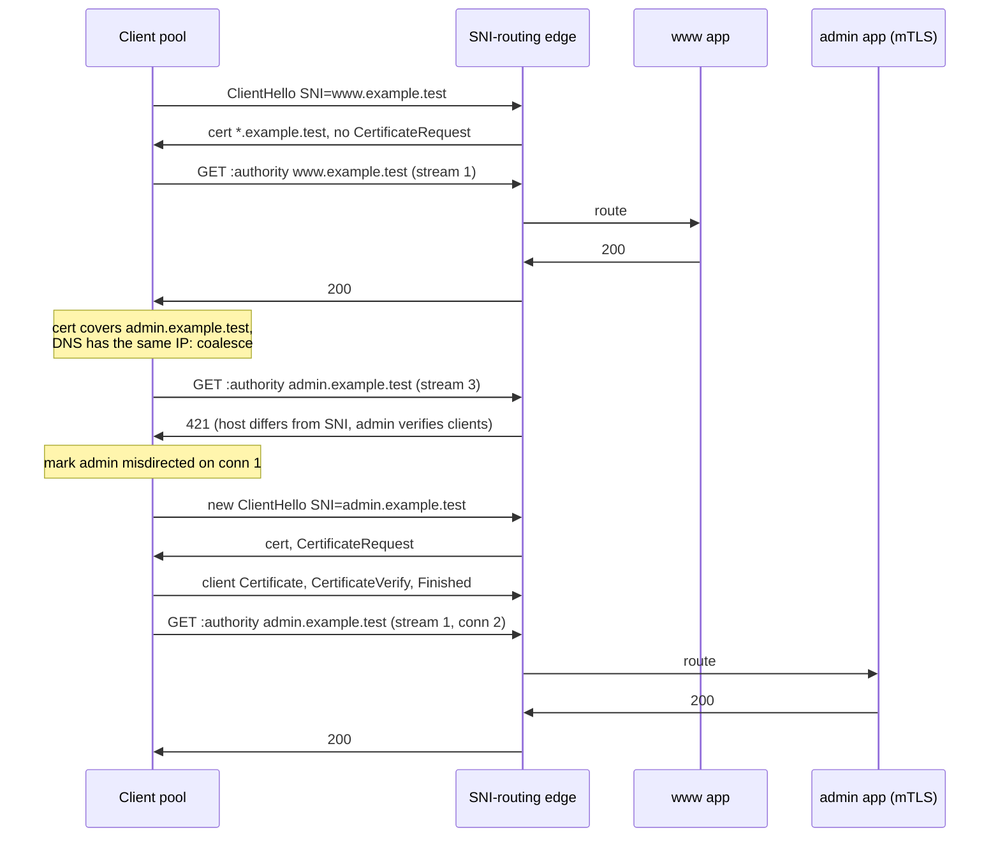

# HTTP/2 and HTTP/3 Connection Coalescing Across Wildcard Certificates and 421 Misdirected Request

> [!summary] Claim
> An HTTP/2 or HTTP/3 client may send a request for `api.example.com` down a connection it opened for `www.example.com` whenever the certificate also verifies for `api` and (in practice) DNS points at the same address, so any server that decides security per SNI, such as a client-certificate requirement, must compare the request's `:authority` with the SNI and answer `421 Misdirected Request`, or it is serving the coalesced request under the wrong connection's policy.

Part of [TLS Connections and Intermediaries](README.md) in [API Engineering](../README.md).

## TL;DR

Mechanism: a connection is reusable for every origin it is authoritative for, which for `https` means the server certificate passes every check a new connection to that host would run, and in practice a DNS query that returns the connected IP `(RFC 9113 Section 9.1.1)` `(RFC 9110 Section 4.3.3)`; one wildcard or multi-SAN certificate therefore turns one TCP+TLS connection into a shared pipe for many hosts.
Contract rule: an origin server MUST reject a request whose connection context is wrong for its target URI, `421` is how it says so, a client MAY retry it on a different connection even for non-idempotent methods, and a proxy MUST NOT generate it `(RFC 9110 Section 7.4)` `(RFC 9110 Section 15.5.20)`.
Trap: SNI is read once, in the ClientHello, so a front end that picks the client-certificate policy by SNI but routes requests by `:authority` lets a coalesced request reach an mTLS host without a certificate (Caddy CVE-2018-21246, Traefik CVE-2022-23632), and HTTP/2 forbids repairing that with post-handshake authentication `(RFC 9113 Section 9.2.3)`.
Portability: the lab passes 58 of 58 on CPython 3.12.13, 3.13.18, 3.14.6, 3.14.10, 3.15.2, and 3.15.0b3 free-threaded; httpcore 1.0.9 never coalesces (it pools by exact scheme, host, and port), h2 4.4.1 and aioquic 1.7.2 have no `ORIGIN` support, and on CPython an `sni_callback` that swaps in a `CERT_REQUIRED` context does not make OpenSSL request a client certificate.
When not to use it: do not share one certificate across hosts with different TLS-layer policy (client authentication, TLS versions, trust anchors) unless the front end enforces the SNI-to-host check; give such hosts their own certificate and IP, or keep the policy at the HTTP layer where every request carries it.

## Mental model



The first three exchanges are an ordinary connection to `www`: the edge pre-reads the SNI, selects the `www` TLS context, and that context does not request a client certificate.
The note over the client is the coalescing decision `(RFC 9110 Section 4.3.3)`: the certificate verifies for `admin`, DNS returns the connected address, so the second request rides stream 3 of the same connection.
The edge sees `:authority` `admin.example.test` on a connection whose SNI was `www.example.test`, the target host requires a verified client certificate, and the handshake that would have required one never happened, so it answers `421`, the behavior of nginx's `ngx_http_set_virtual_server` `(nginx 1.31.8 src/http/ngx_http_request.c, ngx_http_set_virtual_server)`.
The client stops treating that connection as authoritative for `admin`, opens a connection whose SNI is `admin`, presents its certificate in that handshake, and gets `200`; the `admin` app runs exactly once.

## How it works

### When a connection is authoritative for a second origin

RFC 9113 makes reuse a client option: a connection "MAY be reused for requests with multiple different URI authority components" as long as the server is authoritative, and for `https` "the certificate presented by the server MUST satisfy any checks that the client would perform when forming a new TLS connection for the host in the URI" `(RFC 9113 Section 9.1.1)`.
RFC 9110 adds the practice the HTTP/2 text leaves implicit: in HTTP/2 and HTTP/3 a client attributes authority when the origin's host matches a host in the certificate and "the client believes that it could open a connection to that host", which in practice means "a DNS query to check that the origin's host contains the same server IP address as the established connection", a restriction an `ORIGIN` frame can remove `(RFC 9110 Section 4.3.3)`.
The lab's `can_coalesce` is that rule in five checks: not closed by `GOAWAY` and not already marked misdirected, same port, inside the Origin Set when one exists, certificate verification for the new host, and DNS overlap unless the Origin Set vouches for it.
Port is part of the origin, and RFC 9110 explicitly warns that an attacker can move a connection meant for one port to another, so the server must check the target URI even after TLS `(RFC 9110 Section 4.3.3)`; the lab refuses to coalesce `:8443` onto a `:443` connection.

### Wildcard and multi-SAN matching

A wildcard DNS-ID is valid only if it has exactly one `*`, the `*` is the whole left-most label, and it then matches exactly one label; otherwise the presented identifier "is invalid and MUST be ignored" `(RFC 9525 Section 6.3)`.
Comparison is label by label with case-insensitive ASCII, and U-labels are converted to A-labels first `(RFC 9525 Section 6.3)`.
So `*.example.test` covers `admin.example.test` but neither `example.test` nor `a.b.example.test`, and `w*.example.test` covers nothing.
The lab's `dns_id_matches` is a reference matcher that encodes those rules (the pool does not call it), and a parametrized test checks it agrees with `cryptography` 50.0.2's server verifier (`PolicyBuilder().store(...).time(...).build_server_verifier(DNSName(host))`), which is also what the pool calls, because RFC 9113 asks for the full check, chain and validity included, not just a name match.
RFC 9525 names the cost directly: the names in one certificate are "the set of names that could be affected by a compromise of any other server named in the set" `(RFC 9525 Section 7.5)`; coalescing extends that blast radius from key compromise to request routing.

### SNI, `:authority`, and why the edge must compare them

SNI is a single `host_name` in the ClientHello's `server_name` extension (`ServerNameList`, `name_type` 0, `HostName<1..2^16-1>`) `(RFC 6066 Section 3)`, carried in the first `TLSPlaintext` record `(RFC 9846 Section 5.1)` as part of `ClientHello` `(RFC 9846 Section 4.2.2)`.
RFC 6066 already required the check this note is about: "application server implementations that rely upon these names being the same MUST check to make sure the client did not present a different name in the application protocol" `(RFC 6066 Section 11.1)`.
In HTTP/2 the request names its target in `:authority`, a recipient MUST NOT use `Host` to determine the target when `:authority` is present, and a client MUST NOT send a `Host` that differs from it `(RFC 9113 Section 8.3.1)`.
Once a request is parsed, "an origin server MUST reject a request if any scheme-specific requirements for the target URI are not met", unless the connection is from a trusted gateway `(RFC 9110 Section 7.4)`.

Two production front ends implement the check differently:

- nginx 1.31.8 compares the SNI with the request host in `ngx_http_set_virtual_server`; on a mismatch it looks up the server block for the host (the default server when none matches) and, only if that block has `ssl_verify_client` enabled (`sscf->verify`), logs "client attempted to request the server name different from the one that was negotiated" and finishes the request with `NGX_HTTP_MISDIRECTED_REQUEST` `(nginx 1.31.8 src/http/ngx_http_request.c, ngx_http_set_virtual_server)`; a mismatch to a host without client verification is served.
- Apache httpd 2.4.69 answers `400` when SNI was sent but the request has no host, and otherwise asks `ssl_check_vhost_sni_policy` whether the SNI vhost and the `Host` vhost are compatible, returning `HTTP_MISDIRECTED_REQUEST` if not `(httpd 2.4.69 modules/ssl/ssl_engine_kernel.c, ssl_hook_ReadReq)`; the check runs on the initial non-proxy request even when no SNI was sent, comparing the handshake's default vhost with the `Host` vhost.
  `SSLVHostSNIPolicy` is a global directive that accepts `secure`, `strict`, `authonly`, and `insecure` `(httpd 2.4.69 modules/ssl/ssl_engine_config.c, ssl_cmd_SSLVHostSNIPolicy)`, with `secure` the default `(httpd 2.4.69 modules/ssl/ssl_engine_config.c, ssl_config_global_create)`.
  `strict` requires the same vhost, `insecure` allows everything, and `secure` and `authonly` compare a per-vhost policy hash `(httpd 2.4.69 modules/ssl/ssl_engine_kernel.c, ssl_check_vhost_sni_policy)`; that hash covers client-verification settings (verify mode and depth, CA, CRL, OCSP) for both, and for `secure` also the protocols, ciphers, and certificate and key files `(httpd 2.4.69 modules/ssl/ssl_engine_init.c, create_sni_policy_hash)`.

The lab's `Edge` with `SniPolicy.MATCH_SNI_FOR_MTLS` follows the nginx rule; `SniPolicy.AUTHORITY_ONLY` routes by `:authority` alone and reproduces the vulnerability class.

### Why the client certificate cannot be requested later

Client authentication in TLS is decided in the handshake that the SNI selected.
HTTP/2 servers MUST NOT send a post-handshake TLS 1.3 `CertificateRequest`, clients MUST treat one as `PROTOCOL_ERROR`, and this holds even if the client offered the `post_handshake_auth` TLS extension `(RFC 9113 Section 9.2.3)`; over TLS 1.2 a deployment MUST disable renegotiation, and any renegotiation an endpoint does use MUST occur before the connection preface `(RFC 9113 Section 9.2.1)`.
So a server that receives an `admin` request on a `www` connection has exactly three options: serve it without the client certificate (the bug), close the connection, or answer `421` so the client opens a connection whose handshake can carry the certificate.
The lab measures the timing on real OpenSSL handshakes over memory BIOs: a client without a certificate completes `do_handshake()` against the `admin` context and learns `TLSV13_ALERT_CERTIFICATE_REQUIRED` on its first read, while the server reports `PEER_DID_NOT_RETURN_A_CERTIFICATE`; the TLS 1.3 timing itself belongs to [[Mutual-TLS-mTLS-Handshake-and-SPIFFE-Identity]].

### Choosing the TLS context by SNI in Python

The lab's edge pre-reads the ClientHello with `peek_sni` and only then wraps the server `SSLObject` with that host's context, which is how SNI-routing proxies work.
The obvious alternative, an `sni_callback` that assigns `sslobj.context = mtls_context`, fails silently on CPython: the setter calls `SSL_set_SSL_CTX` and `SSL_set_msg_callback` and nothing else `(cpython v3.14.6 Modules/_ssl.c, _ssl__SSLSocket_context_set_impl)`, and nginx's own servername callback documents why that is not enough: "SSL_set_SSL_CTX() only changes certs as of 1.0.0d", after which nginx calls `SSL_set_verify` and `SSL_set_verify_depth` itself `(nginx 1.31.8 src/http/ngx_http_request.c, ngx_http_ssl_servername)`.
The lab proves the consequence on every interpreter in the matrix: with the callback swap, a certificate-less client completes a handshake to `admin.example.test` and the server never asked for a certificate.

### The `ORIGIN` frame and the Origin Set

`ORIGIN` is HTTP/2 frame type `0xc`, sent on stream 0, valid only on `h2` (ignored on `h2c`), whose payload is zero or more `Origin-Entry` fields of a 16-bit `Origin-Len` and an ASCII origin serialization; unparseable entries are ignored, wildcards are not supported, and flags `0x1`, `0x2`, `0x4`, and `0x8` make the whole frame ignorable `(RFC 8336 Section 2.1)` `(RFC 8336 Section 2.2)`.
On the wire, `encode_origin_frame(["https://api.example.test"])` is 35 bytes: the 9-byte frame header `00 00 1a 0c 00 00 00 00 00` (length 26, type `0x0c`, flags 0, stream 0), then `00 18` and the 24 ASCII bytes.
The first `ORIGIN` initializes the connection's Origin Set to the initial origin (`https`, the SNI lowercased, the remote port) plus the listed origins; from then on a client "MUST NOT consider a connection to be authoritative for an origin not present in the Origin Set", the certificate check still applies, and the client MAY skip DNS `(RFC 8336 Section 2.3)` `(RFC 8336 Section 2.4)`.
A `421` interacts with the set: the client MUST remove the request's origin from it `(RFC 8336 Section 2.3)`.
Because `ORIGIN` lists names, sending it with a wildcard certificate "effectively disables any origins that are not explicitly listed" for clients that understand it `(RFC 8336 Section 2.2)`, which is the server's tool for keeping an mTLS host off a shared connection without relying on `421` round trips.
The origin serialization omits the default port `(RFC 6454 Section 6.2)`.
HTTP/3 defines the same frame type `0x0c` and payload on the server's control stream, without flags `(RFC 9412 Section 2)` `(RFC 9412 Section 2.1)`.

In h2 4.4.1 an `ORIGIN` frame reaches the application as `UnknownFrameReceived` carrying a hyperframe `ExtensionFrame`, because unknown types MUST be ignored `(h2 4.4.1 h2/connection.py, H2Connection._receive_unknown_frame)`; the lab parses it there.
Building the frame with hyperframe does not work as expected: `ExtensionFrame.serialize` writes `self.body_len`, which `Frame.__init__` sets to 0 and only `ExtensionFrame.parse_body` sets to the body length, so a frame constructed in code is emitted with length 0 and its body is then misparsed as the next frame header `(hyperframe 6.1.0 hyperframe/frame.py, ExtensionFrame.serialize)`; the lab packs the header by hand and pins the quirk with a test.

### HTTP/3 differences

An HTTP/3 connection MAY be reused for multiple authorities, clients MUST validate the certificate for the new origin per RFC 9110 Section 4.3.4, which "implies that clients will need to retain the server certificate", and an unacceptable certificate means the connection MUST NOT be reused `(RFC 9114 Section 3.3)`.
RFC 9114 adds that clients SHOULD NOT open more than one HTTP/3 connection to a given IP address and UDP port with the same configuration, and repeats `421` as the server's opt-out `(RFC 9114 Section 3.3)`.
QUIC also forbids it: "A server MUST NOT use post-handshake client authentication" `(RFC 9001 Section 4.4)`, so the mTLS reasoning above carries over; see [[Mutual-TLS-mTLS-Handshake-and-SPIFFE-Identity]].
aioquic 1.7.2 defines no `ORIGIN` member in its HTTP/3 `FrameType` enum `(aioquic 1.7.2 aioquic/h3/connection.py, FrameType)`; the lab does not run HTTP/3.

### What changed from RFC 7540

RFC 7540 defined `421` and called it cacheable by default `(RFC 7540 Section 9.1.2)`; RFC 9110 moved it into HTTP semantics and dropped heuristic cacheability "since the response is specific to the connection (not the target resource)" `(RFC 9110 Appendix B.3)`.
A cache that still stores `421` under the target URI can replay a connection-specific refusal to clients on correct connections.

### The Python stack

httpx 0.28.1 sits on httpcore 1.0.9, whose `AsyncHTTPConnection.can_handle_request` and `AsyncHTTP2Connection.can_handle_request` both return `origin == self._origin`, and `Origin.__eq__` compares scheme, host, and port `(httpcore 1.0.9 httpcore/_async/connection.py, AsyncHTTPConnection.can_handle_request)` `(httpcore 1.0.9 httpcore/_models.py, Origin.__eq__)`; Python clients built on it never coalesce, so they never trigger coalescing `421`s, and no `421` retry logic exists in httpx or httpcore (a source search of both found `421` only in the `codes` enum).
Hypercorn 0.18.0's `server_names` check maps `:authority` to `host` in `filter_pseudo_headers` and compares it with the configured list by exact string (port included), answering `404`, not `421`, and never consulting SNI `(hypercorn 0.18.0 hypercorn/utils.py, valid_server_name)` `(hypercorn 0.18.0 hypercorn/protocol/http_stream.py, HTTPStream.handle)`.
The ASGI TLS extension 0.3 (2026-09-15) carries only `spec_version` and `client_cert_chain` `(asgiref 3.13.0 specs/tls.rst, TLS Connection Scope)`, and its version history says 0.3 added `spec_version` and removed all fields except `client_cert_chain` `(asgiref 3.13.0 specs/tls.rst, Version History)`, so an ASGI application cannot see the SNI and cannot implement the SNI-to-host check itself; it belongs in the TLS terminator.

## Numbers and limits

| Quantity | Value | Source |
|---|---|---|
| `ORIGIN` frame type | `0x0c` in HTTP/2 and HTTP/3 | `(RFC 8336 Section 2.1)`, `(RFC 9412 Section 2.1)` |
| `Origin-Len` | 16-bit, so at most 65535 bytes per entry | `(RFC 8336 Section 2.1)` |
| Origin Set size | no limit in the spec; clients "can monitor their state commitment and close the connection if it is too high" | `(RFC 8336 Section 4)` |
| HTTP/2 frame payload | 16384 bytes until the peer raises `SETTINGS_MAX_FRAME_SIZE` (up to 2^24-1) | `(RFC 9113 Section 4.2)`, `(RFC 9113 Section 6.5.2)` |
| Wildcards per DNS-ID | one, as the whole left-most label, matching one label | `(RFC 9525 Section 6.3)` |
| SNI `HostName` | 1 to 2^16-1 bytes, one name per `name_type` | `(RFC 6066 Section 3)` |
| Example `ORIGIN` frame | 35 bytes for one 24-byte origin (9 header + 2 + 24) | lab `test_origin_frame_wire_layout` |
| Cost of a coalescing `421` | one wasted request on the old connection, then one new TCP+TLS handshake and the replayed request | lab trace below |
| Retries the lab pool makes | at most one, and only on a connection opened for that origin; a second `421` is returned | lab `test_421_on_a_dedicated_connection_is_returned_not_retried`, `test_421_retry_goes_to_a_fresh_connection_not_another_coalesced_one` |
| Lab module runtime | 58 tests in 0.17 to 0.31 s per run (three runs per interpreter; a first run in a new venv took up to 0.63 s) | `pytest -q` on each interpreter in the Portability table, macOS 27.2 arm64 (Darwin 27.2.0), Apple M3 Pro, measured 2026-11-09 |

No latency numbers are given: the lab runs TLS and HTTP/2 in memory, so it measures decisions and byte layouts, not network round trips.

## Portability

| Runtime, library, or protocol | Behavior | Evidence |
|---|---|---|
| CPython 3.12.13, OpenSSL 3.5.7 | 58 passed (3.12.16 is not installed here; 3.12.13 stands in) | lab via `UV_PROJECT_ENVIRONMENT=<tmp venv> uv run --frozen --python 3.12.13` |
| CPython 3.13.18, OpenSSL 3.5.9 | 58 passed | lab, `--python 3.13.18` |
| CPython 3.14.6, OpenSSL 3.5.7 | 58 passed (workspace `.venv`) | `uv run --frozen pytest ...` |
| CPython 3.14.10, OpenSSL 4.1.0 | 58 passed; the asserted reasons `TLSV13_ALERT_CERTIFICATE_REQUIRED`, `PEER_DID_NOT_RETURN_A_CERTIFICATE`, and `CERTIFICATE_VERIFY_FAILED` are unchanged | lab, `--python 3.14.10` |
| CPython 3.15.2, OpenSSL 4.1.0 | 58 passed | lab, `--python 3.15.2` |
| CPython 3.15t free-threaded | 58 passed on 3.15.0b3 free-threaded (OpenSSL 3.5.7, `sys._is_gil_enabled()` False after importing the lab) in a minimal venv of 26 packages at their `uv export --frozen` versions; 3.15.2t is not installed here and the full lock fails on `psycopg-binary==3.3.8` (no wheel) | `uv venv --python 3.15t`, `uv pip install -r <26 pinned lines>`, `PYTHONPATH=src python -m pytest ... -q` |
| Debian Trixie and Alpine musl containers | 58 passed in `python:3.14-slim-trixie` (Debian 13, CPython 3.14.10, OpenSSL 3.5.7) and `python:3.14-alpine` (Alpine 3.24, CPython 3.14.10, OpenSSL 3.5.9), both aarch64, full lock | `docker run` with the lab copied in, `uv run --frozen pytest ... -q` (2026-11-09) |
| CPython `sni_callback` context swap | does not enable client-certificate requests on any interpreter above | lab `test_cpython_sni_callback_context_switch_does_not_request_a_client_cert`; `(cpython v3.14.6 Modules/_ssl.c, _ssl__SSLSocket_context_set_impl)` |
| httpx 0.28.1 / httpcore 1.0.9 | no coalescing, no `421` retry | lab `test_httpcore_never_coalesces_across_hosts`; source above |
| h2 4.4.1 / hyperframe 6.1.0 | `ORIGIN` surfaces as `UnknownFrameReceived`; hand-built `ExtensionFrame` serializes length 0 | lab tests |
| Hypercorn 0.18.0 | `server_names` exact match on `host` (from `:authority`), `404`, no SNI check | lab `test_hypercorn_server_names_is_an_exact_match_on_the_authority` |
| Uvicorn 0.54.0 | HTTP/2 only with `http2=True` and `http="zttp"`, which needs the separate `zttp` package; it is not in the lock, so no Uvicorn HTTP/2 leg was run | `(uvicorn 0.54.0 uvicorn/config.py, Config.load)`; `zttp` absent from the installed packages |
| Granian 2.8.7 | one certificate and one client-authentication policy per listener (a single rustls `ServerConfig` built `with_single_cert`), no SNI-based context selection, and no `421` anywhere in its Rust source, so there is no per-host TLS policy for a coalesced request to bypass; source read, not exercised in the lab | `(granian 2.8.7 src/workers.rs, WorkerConfig::tls_cfg)` |
| nginx 1.31.8 | `421` on SNI/host mismatch only when the target server block verifies clients | `(nginx 1.31.8 src/http/ngx_http_request.c, ngx_http_set_virtual_server)` |
| Apache httpd 2.4.69 | `421` when `SSLVHostSNIPolicy` (default `secure`) finds the vhosts incompatible | `(httpd 2.4.69 modules/ssl/ssl_engine_kernel.c, ssl_hook_ReadReq)` |
| HTTP/1.1 | no coalescing: authority only over a connection "specifically to that URI origin's host" | `(RFC 9110 Section 4.3.3)` |
| HTTP/2 | coalescing allowed; `ORIGIN` optional; no post-handshake client auth | `(RFC 9113 Section 9.1.1)`, `(RFC 9113 Section 9.2.3)` |
| HTTP/3 over QUIC | coalescing allowed with retained certificate; `ORIGIN` via RFC 9412; no post-handshake client auth; aioquic 1.7.2 has no `ORIGIN`; not run in the lab | `(RFC 9114 Section 3.3)`; `(RFC 9001 Section 4.4)`; `(aioquic 1.7.2 aioquic/h3/connection.py, FrameType)` |

## Worked example

The [implementation](../labs/src/api_labs/f02_tls_connections_and_intermediaries/connection_coalescing.py) has a private PKI with keys derived from fixed integers, a ClientHello SNI reader, a real OpenSSL handshake over `ssl.MemoryBIO`, an `ORIGIN` encoder and parser, an SNI-routing `Edge` that calls per-host Starlette apps through `httpx.ASGITransport`, and a `CoalescingPool` that speaks HTTP/2 through real `h2` state machines; the [test](../labs/tests/f02_tls_connections_and_intermediaries/test_http_2_connection_coalescing_and_421_misdirected_request.py) has 58 `unit` tests and opens no sockets.
HTTP/2 frames travel as plaintext bytes in memory: TLS establishes the session facts (SNI, ALPN, server certificate, whether a client certificate was verified), and the frames are not encrypted with those keys.
Both sides split bodies into frames no larger than the peer's frame size and flow-control windows, so 20000-byte and 70000-byte bodies round-trip; `GOAWAY` retires a connection.
IP-literal origins are rejected, because they never carry SNI `(RFC 6066 Section 3)` and every decision here is keyed on the handshake's host.

Wildcard matching, verbatim:

```python
def dns_id_matches(presented: str, reference: str) -> bool:
    """Match a certificate DNS-ID against a host: label by label, ASCII case-insensitive.

    A `*` is honored only as the whole left-most label and matches exactly one label; any
    other use makes the presented identifier invalid, so it matches nothing.
    """
    if not (presented.isascii() and reference.isascii()):
        return False  # U-labels must be converted to A-labels before matching
    p_labels = presented.lower().split(".")
    r_labels = reference.lower().split(".")
    if "" in p_labels or "" in r_labels:
        return False
    if "*" in presented:
        if presented.count("*") != 1 or p_labels[0] != "*":
            return False
        return len(p_labels) == len(r_labels) and p_labels[1:] == r_labels[1:]
    return p_labels == r_labels
```

The edge's decision, verbatim:

```python
    async def respond(
        self, tls: TlsSession, method: str, authority: str, path: str, body: bytes
    ) -> tuple[int, bytes]:
        host = authority.partition(":")[0].lower()
        vhost = self.vhosts.get(host)
        if vhost is None:
            status, payload = 421, b"no origin configured for this host\n"
        elif (
            self.policy is SniPolicy.MATCH_SNI_FOR_MTLS
            and vhost.require_client_cert
            and host != tls.sni
        ):
            status, payload = 421, b"connection was negotiated for another host\n"
        else:
            transport = httpx.ASGITransport(app=vhost.app)
            async with httpx.AsyncClient(
                transport=transport, base_url=f"https://{authority}"
            ) as client:
                response = await client.request(method, path, content=body)
            status, payload = response.status_code, response.content
        self.log.append((tls.sni, authority, status))
        return status, payload
```

The pool's coalescing rule and its `421` loop, verbatim:

```python
    def can_coalesce(self, conn: ClientConnection, origin: Origin) -> bool:
        if conn.closed or origin in conn.misdirected or origin.port != conn.peer[1]:
            return False
        if conn.origin_set is not None and origin not in conn.origin_set:
            return False  # RFC 8336 Section 2.4: MUST NOT consider it authoritative
        if not server_cert_valid_for(conn.tls.server_cert, self.anchors, origin.host, at=self.at):
            return False  # the certificate check is required with or without ORIGIN
        if conn.origin_set is not None:
            return True  # clients MAY skip DNS for origins in the Origin Set
        return not self.require_dns_overlap or conn.peer[0] in self.network.dns.get(origin.host, ())
```

```python
    def _dedicated(self, origin: Origin) -> ClientConnection | None:
        """An open connection whose handshake was made for *origin* itself."""
        for conn in self.connections:
            if conn.opened_for == origin and not conn.closed and origin not in conn.misdirected:
                return conn
        return None

    def _find(self, origin: Origin) -> ClientConnection | None:
        if conn := self._dedicated(origin):  # a connection negotiated for this host first
            return conn
        for conn in self.connections:
            if self.can_coalesce(conn, origin):
                return conn
        return None
```

```python
    async def request(self, method: str, url: str, *, body: bytes = b"") -> PoolResponse:
        origin = Origin.from_url(url)
        if origin.scheme != "https":
            raise ValueError("this pool only speaks h2 over TLS")
        parts = urlsplit(url)
        path = (parts.path or "/") + (f"?{parts.query}" if parts.query else "")
        attempts: list[Attempt] = []
        conn = self._find(origin) or await self._open(origin)
        while True:
            coalesced = conn.opened_for != origin
            status, payload = await self._exchange(conn, method, origin, path, body)
            attempts.append(Attempt(origin.serialize(), conn.conn_id, coalesced, status))
            if status != 421:
                break
            conn.misdirected.add(origin)  # do not coalesce this origin here again
            if conn.origin_set is not None:
                conn.origin_set.discard(origin)  # RFC 8336 Section 2.3: MUST remove it
            if not coalesced:
                break  # already on a connection negotiated for this host: give up
            # Retry once, and only where the handshake was made for this origin.
            conn = self._dedicated(origin) or await self._open(origin)
        return PoolResponse(status, payload, tuple(attempts))
```

The `ORIGIN` encoder, verbatim:

```python
def encode_origin_frame(origins: Iterable[str], *, flags: int = 0, stream_id: int = 0) -> bytes:
    """An HTTP/2 ORIGIN frame: 9-byte frame header, then Origin-Len (16) + ASCII-Origin.

    The header is packed by hand: hyperframe 6.1.0 `ExtensionFrame.serialize` writes
    `body_len`, which only `parse_body` sets, so a frame built in code goes out as length 0.
    """
    body = b"".join(struct.pack("!H", len(o)) + o.encode("ascii") for o in origins)
    header = len(body).to_bytes(3) + bytes([ORIGIN_FRAME_TYPE, flags])
    return header + (stream_id & 0x7FFFFFFF).to_bytes(4) + body
```

The central test, verbatim:

```python
@pytest.mark.unit
@pytest.mark.asyncio
async def test_mtls_host_on_a_coalesced_connection_gets_421_then_succeeds_fresh(lab: Lab) -> None:
    edge = lab.edge()
    pool = lab.pool(edge)
    await pool.request("GET", "https://www.example.test/")
    response = await pool.request("GET", "https://admin.example.test/keys")
    assert (response.status, response.body) == (200, b"admin: GET /keys\n")
    assert [(a.conn_id, a.coalesced, a.status) for a in response.attempts] == [
        (1, True, 421),
        (2, False, 200),
    ]
    assert pool.connections[1].tls.sni == "admin.example.test"
    assert pool.connections[1].tls.client_cert_verified
    assert lab.apps["admin"].calls == ["GET /keys 0"]  # the 421 never reached the app
    assert edge.log[-2:] == [
        ("www.example.test", "admin.example.test", 421),
        ("admin.example.test", "admin.example.test", 200),
    ]
```

The CPython `sni_callback` pin, verbatim:

```python
@pytest.mark.unit
def test_cpython_sni_callback_context_switch_does_not_request_a_client_cert(lab: Lab) -> None:
    plain = server_context(lab.server_files, client_ca_pem=None)
    mtls = server_context(lab.server_files, client_ca_pem=CA.cert_pem())

    def switch(obj: ssl.SSLObject, name: str | None, ctx: ssl.SSLContext) -> None:
        if name == "admin.example.test":
            obj.context = mtls  # SSL_set_SSL_CTX: certificate swapped, verify mode is not

    plain.sni_callback = switch
    no_cert = client_context(CA.cert_pem())
    session = tls_handshake(no_cert, lambda _sni: plain, "admin.example.test")
    assert session.sni == "admin.example.test"
    assert not session.client_cert_verified  # no CertificateRequest was ever sent
```

Captured on CPython 3.14.6 (OpenSSL 3.5.7), macOS 27.2 arm64, from `labs/` on 2026-11-09 (session header lines and the test file path elided as `...`):

```text
$ uv run --frozen pytest tests/f02_tls_connections_and_intermediaries/test_http_2_connection_coalescing_and_421_misdirected_request.py -v -p no:cacheprovider -k "coalesces_when or 421_then or authority_only or sni_callback or preread"
platform darwin -- Python 3.14.6, pytest-9.2.0, pluggy-1.7.0
...::test_cpython_sni_callback_context_switch_does_not_request_a_client_cert PASSED [ 20%]
...::test_context_chosen_from_preread_sni_enforces_the_client_cert PASSED [ 40%]
...::test_second_host_coalesces_when_cert_and_dns_overlap PASSED [ 60%]
...::test_mtls_host_on_a_coalesced_connection_gets_421_then_succeeds_fresh PASSED [ 80%]
...::test_authority_only_edge_serves_the_mtls_host_without_a_client_cert PASSED [100%]
======================= 5 passed, 53 deselected in 0.10s =======================

$ uv run --frozen pytest tests/f02_tls_connections_and_intermediaries/test_http_2_connection_coalescing_and_421_misdirected_request.py -q
..........................................................               [100%]
58 passed in 0.18s
```

A one-off trace script (not part of the lab; it drives the same classes) printed, for three requests under each policy:

```text
policy=match-sni-for-mtls
  GET https://www.example.test/          conn=1 sni=www.example.test     client_cert=False -> 200
  GET https://admin.example.test/keys    conn=1 sni=www.example.test     client_cert=False -> 421
  GET https://admin.example.test/keys    conn=2 sni=admin.example.test   client_cert=True  -> 200
  GET https://admin.example.test/keys    conn=2 sni=admin.example.test   client_cert=True  -> 200
policy=authority-only
  GET https://www.example.test/          conn=1 sni=www.example.test     client_cert=False -> 200
  GET https://admin.example.test/keys    conn=1 sni=www.example.test     client_cert=False -> 200
  GET https://admin.example.test/keys    conn=1 sni=www.example.test     client_cert=False -> 200
```

The second request appears twice under the first policy because it took two attempts; under `authority-only` the `admin` app answered twice on a connection that never verified a client certificate.

## Pitfalls

> [!warning] mTLS decided by SNI, routing decided by `Host`
> Trigger: one certificate covers a public host and a host that requires client certificates, and the proxy routes by `Host` or `:authority`.
> Symptom: a browser or HTTP/2 client that already holds a connection to the public host sends requests for the protected host on it and is served without a certificate; an attacker can do the same deliberately with any HTTP/1.1 client by sending a different `Host` than SNI.
> Fix: compare SNI with the target host for every host whose TLS policy differs and answer `421`, as nginx does for `ssl_verify_client` server blocks; Caddy before 0.10.13 "mishandles TLS client authentication, as demonstrated by an authentication bypass caused by the lack of the StrictHostMatching mode" `(NVD CVE-2018-21246)`.

> [!warning] TLS options chosen for one name, request routed to another
> Trigger: a router whose host rule does not match the exact form the client used, or CNAME flattening.
> Symptom: Traefik before 2.6.1 "skips the router transport layer security (TLS) configuration when the host header is a fully qualified domain name (FQDN)" and falls back to the default TLS configuration `(NVD CVE-2022-23632)`.
> Fix: upgrade, and test SNI/host mismatches (trailing dot, case, port, CNAME) as part of any per-host TLS policy.

> [!warning] Client reuses a connection whose TLS settings no longer match
> Trigger: a client pool keyed on host and port but not on the TLS configuration (client certificate, CA bundle, verification flags).
> Symptom: libcurl "would reuse a previously created connection even when a TLS or SSHrelated option had been changed that should have prohibited reuse" (NVD's spacing) `(NVD CVE-2022-27782)`; the server sees the old identity.
> Fix: include every security-relevant TLS parameter in the pool key; for coalescing, run the full certificate verification for the new host (`server_cert_valid_for` in the lab), not just a SAN string match.

> [!warning] Swapping the `SSLContext` in a CPython `sni_callback`
> Trigger: implementing per-host client authentication by assigning `sslobj.context` in `sni_callback`.
> Symptom: the certificate changes but no `CertificateRequest` is sent, so the protected host silently accepts anonymous clients; the lab reproduces it on every interpreter in the matrix.
> Fix: select the context before wrapping (pre-read SNI, as the lab's `peek_sni` does), use `CERT_OPTIONAL` on the base context and enforce per host after the handshake, or terminate TLS in a proxy that calls `SSL_set_verify`.

> [!warning] Retrying `421` forever, or never
> Trigger: a client that retries `421` on the same pool decision, or a server that answers `421` on a connection whose SNI already equals the host.
> Symptom: a loop (a lab mutation that also retries a `421` received on a dedicated connection hangs the suite until killed), a retry onto a second coalesced connection that earns a second `421`, or a hard failure where one retry on a fresh connection would have succeeded.
> Fix: on `421`, mark the origin misdirected for that connection, remove it from the Origin Set, retry once on a connection whose handshake was made for that origin (existing or new), and surface a second `421`; key that decision on the origin the connection was opened for, not on the SNI, which is absent for IP literals.

> [!warning] Caching `421`
> Trigger: a cache or CDN configuration copied from the RFC 7540 era, which called `421` cacheable by default.
> Symptom: a connection-specific refusal is served to clients on correct connections.
> Fix: RFC 9110 dropped heuristic cacheability for `421` `(RFC 9110 Appendix B.3)`; send `Cache-Control: no-store` on it if any cache in the path might store it.

## Security and robustness

Threat model: the attacker controls a client (or a web page that makes the victim's browser issue requests) and wants a request for host B processed under the TLS context negotiated for host A.
That maps to OWASP API2:2023 Broken Authentication when B's authentication is a client certificate, and to API8:2023 Security Misconfiguration when it is a TLS version or cipher policy.
RFC 8336 warns that clients that skip DNS for `ORIGIN`-listed origins let an attacker with a valid certificate pull traffic onto their connection without being on path, and suggests requiring Certificate Transparency proof or fresh OCSP before skipping DNS `(RFC 8336 Section 4)`.
Defense in depth for servers:

- Treat SNI and `:authority` as two inputs that must agree for every host whose TLS policy differs, and log mismatches; RFC 6066 makes the check mandatory for servers that rely on them being equal `(RFC 6066 Section 11.1)`.
- Give hosts with different client-authentication policy different certificates, so clients cannot coalesce them at all; this is the only control that does not depend on every proxy hop being correct.
- Send `ORIGIN` listing only the hosts that may share the connection; clients that implement it then never coalesce the others `(RFC 8336 Section 2.2)`.
- Behind a terminating proxy, the application cannot verify the agreement itself (ASGI TLS 0.3 has no SNI field), so forward the verified client identity explicitly and strip any client-supplied copy ([[Client-Cert-Header-and-TLS-Terminating-Proxies-RFC-9440]]).
- Answer unknown hosts with `421` rather than routing them to a default server: RFC 9110 lists "a target URI that does not match an origin for which the server has been configured" as a `421` case `(RFC 9110 Section 15.5.20)`.

Input edge cases the lab covers: uppercase SNI and `:authority` (lowercased), wildcard and path entries in `ORIGIN` (ignored), reserved flags and non-zero stream on `ORIGIN` (frame ignored), truncated `Origin-Entry` (rest dropped, a lab policy the RFC does not specify), non-default ports (not coalesced), and a ClientHello without SNI (default context, which never requests client certificates).

## The principal's view

The decision is where TLS-layer policy lives.
If any host behind a shared certificate needs a different TLS posture, the organization has implicitly made every proxy, CDN, and load balancer in the path responsible for an SNI-to-host check that most teams do not know exists, and a single hop that routes by `Host` turns the stronger policy into a suggestion.
Two designs are robust: separate certificates (and ideally addresses) per trust boundary, which forfeits coalescing for those hosts but makes the bypass impossible, or authentication at the HTTP layer (tokens, possibly bound to a certificate per RFC 8705), which every request carries regardless of connection.
Coalescing itself is a performance feature whose benefit is fewer handshakes and one congestion window for many hosts; that benefit is real for browsers loading many subdomains and small for service-to-service clients that hold one long-lived connection per host, and httpx 0.28.1 does not implement it at all.
Budget for `421`s when consolidating certificates or moving hosts behind a shared edge: every coalesced request to an incompatible host costs a wasted request and a new handshake, and clients that do not retry `421` (httpx 0.28.1 on httpcore 1.0.9, for one) surface it as an error.
Choose a different protocol when the deployment cannot guarantee the check: HTTP/1.1 never coalesces `(RFC 9110 Section 4.3.3)`, at the cost of more connections.

## Interview questions

> [!question] L5: What two conditions must hold before an HTTP/2 client sends a request for `api.example.com` on a connection opened for `www.example.com`?
>
> > [!success]- Answer
> > The server certificate must pass every check a new connection to `api.example.com` would run, including the name match and chain validation (RFC 9113 Section 9.1.1).
> > In practice the client also checks that DNS for `api.example.com` returns the address of the existing connection (RFC 9110 Section 4.3.3).
> > The port must match too, because the port is part of the origin.
> >
> > Follow-up: What removes the DNS condition?

> [!question] L5: Which hosts does a certificate with the single SAN `*.example.com` cover: `example.com`, `api.example.com`, `a.b.example.com`, `API.Example.COM`?
>
> > [!success]- Answer
> > Only `api.example.com` and `API.Example.COM`.
> > The wildcard must be the whole left-most label and matches exactly one label, and comparison is case-insensitive ASCII (RFC 9525 Section 6.3).
> >
> > Follow-up: Why does a partial wildcard like `w*.example.com` match nothing at all?

> [!question] L5: What does `421 Misdirected Request` mean, and may a client retry a `POST` that got one?
>
> > [!success]- Answer
> > The server is unable or unwilling to produce an authoritative response for the target URI on this connection (RFC 9110 Section 15.5.20).
> > The client MAY retry over a different connection whether or not the method is idempotent, because the request was not processed.
> > The lab shows the `POST` executing exactly once after the retry.
> >
> > Follow-up: Why must a proxy never generate `421`?

> [!question] L6: Predict the output: in the lab, a pool requests `https://www.example.test/` and then `https://admin.example.test/keys` against an edge using `SniPolicy.MATCH_SNI_FOR_MTLS`; what are the `(conn_id, coalesced, status)` attempts of the second request, and how many times does the admin app run?
>
> > [!success]- Answer
> > `[(1, True, 421), (2, False, 200)]`.
> > The first attempt rides the `www` connection because the wildcard certificate and DNS allow it; the edge sees `:authority` differ from the SNI on a host that requires client certificates and answers `421`.
> > The retry opens connection 2 with SNI `admin.example.test`, the handshake requests and verifies the client certificate, and the app runs once (`["GET /keys 0"]`).
> >
> > Follow-up: What do the attempts look like under `SniPolicy.AUTHORITY_ONLY`?

> [!question] L6: Why can't an HTTP/2 server just ask for the client certificate when the `admin` request arrives on the `www` connection?
>
> > [!success]- Answer
> > HTTP/2 servers MUST NOT send a post-handshake TLS 1.3 `CertificateRequest`, even if the client offered `post_handshake_auth`, and TLS 1.2 renegotiation is forbidden after the preface (RFC 9113 Sections 9.2.3 and 9.2.1).
> > Client authentication is fixed by the handshake that SNI selected, so the server's only correct options are `421` or closing the connection.
> >
> > Follow-up: How does HTTP/1.1 differ here?

> [!question] L6: Debug this API: an internal admin service requires mTLS via nginx `ssl_verify_client on` in its own `server` block and shares a wildcard certificate with the public site, yet auditors report admin requests from browsers without client certificates succeeding through a CDN in front of nginx; where do you look?
>
> > [!success]- Answer
> > nginx itself answers `421` on an SNI/host mismatch to a server block that verifies clients, so look for a hop that terminates TLS before nginx: the CDN negotiates TLS with the browser, coalesces or routes by `Host`, and opens its own connection to nginx with the SNI it chooses.
> > Check what SNI and client certificate the CDN presents upstream, whether it forwards the browser's certificate at all, and whether it routes by `Host` without its own SNI check.
> > Fix by enforcing client authentication at the CDN edge, giving the admin host its own certificate so browsers cannot coalesce it, or moving admin authentication to the HTTP layer.
> >
> > Follow-up: Which header would you use to forward a client certificate from the CDN, and what must nginx do with a client-supplied copy?

> [!question] L6: What does the `ORIGIN` frame change, and what happens to it when the server answers `421`?
>
> > [!success]- Answer
> > The first `ORIGIN` initializes the connection's Origin Set to the SNI origin plus the listed origins, the client must not treat any other origin as authoritative on that connection, and it may skip DNS for listed ones; the certificate check still applies (RFC 8336 Sections 2.3 and 2.4).
> > On a `421` the client MUST remove the request's origin from the set.
> > Wildcards are not allowed in entries, so `ORIGIN` with a wildcard certificate disables coalescing for unlisted hosts.
> >
> > Follow-up: Why must a client ignore `ORIGIN` frames from a configured proxy?

> [!question] L7+: Your company wants to consolidate 200 subdomains onto one wildcard certificate and one anycast edge to cut handshake costs, and ten of those subdomains use mTLS or a stricter TLS policy; what do you require before approving it?
>
> > [!success]- Answer
> > Either keep the ten on separate certificates (they cannot be coalesced, so no edge bug can bypass them), or require every TLS-terminating hop to enforce an SNI-to-host check and prove it with a mismatch test in CI.
> > Send `ORIGIN` frames listing only the shareable hosts, and plan for `421` traffic and for non-browser clients that do not retry it.
> > Ask what the coalescing win is for the actual clients; httpx does not coalesce, so for clients like it the benefit is zero and it accrues mainly to browsers.
> >
> > Follow-up: How would you detect in production that a hop is routing by `Host` without the SNI check?

> [!question] L7+: Why did RFC 9110 stop treating `421` as heuristically cacheable, and what breaks if a cache ignores that?
>
> > [!success]- Answer
> > RFC 7540 called `421` cacheable by default, but the response describes the connection, not the resource, so RFC 9110 removed heuristic cacheability (RFC 9110 Appendix B.3).
> > A cache that stores it keyed by URI serves a refusal meant for a coalesced connection to clients that arrived correctly, turning a routing hint into an outage.
> >
> > Follow-up: Which other status codes describe the connection rather than the resource?

## Related

Prerequisites: [[Outbound-Connection-Pools-Limits-and-DNS-TTL-Staleness]], [[X509-Certificates-Chain-Validation-SAN-and-OCSP-Stapling]], [[TLS-1-3-Handshake-Cipher-Suites-and-ALPN-RFC-9846]]

Next: [[Hop-by-Hop-vs-End-to-End-Headers-and-Connection-Header-Abuse]]

See also: [[HTTP-Evolution-HTTP1-HTTP2-HTTP3]], [[Mutual-TLS-mTLS-Handshake-and-SPIFFE-Identity]], [[Client-Cert-Header-and-TLS-Terminating-Proxies-RFC-9440]], [[Alt-Svc-and-HTTP-Version-Negotiation]], [[HTTP-2-Binary-Framing-and-Stream-State-Machine]], [[HTTP-3-Framing-and-QPACK-Header-Compression-RFC-9114]]

- Lab: `labs/tests/f02_tls_connections_and_intermediaries/test_http_2_connection_coalescing_and_421_misdirected_request.py`

## Further reading

- RFC 9113 Sections 9.1.1 and 9.2.3: the HTTP/2 connection reuse rule and the ban on post-handshake client authentication.
- RFC 9110 Sections 4.3.3, 7.4, and 15.5.20: how clients attribute authority, when servers must reject misdirected requests, and the `421` definition.
- RFC 9114 Section 3.3: HTTP/3 connection reuse, certificate retention, and one connection per IP and port.
- RFC 8336: the HTTP/2 `ORIGIN` frame, the Origin Set, and the security cost of skipping DNS.
- RFC 9412: the `ORIGIN` frame on the HTTP/3 control stream.
- RFC 9525 Section 6.3 and 7.5: wildcard matching rules and why a multi-name certificate is only as strong as its weakest server.
- RFC 6066 Sections 3 and 11.1: SNI's wire format and the requirement that servers check it against the application-layer name.
- nginx `src/http/ngx_http_request.c` at `release-1.31.8`, `ngx_http_set_virtual_server` and `ngx_http_ssl_servername`: a production SNI/host check and the `SSL_set_SSL_CTX` caveat.
- Apache httpd `modules/ssl/ssl_engine_kernel.c` at `2.4.69`, `ssl_hook_ReadReq`: the `SSLVHostSNIPolicy` model of compatible vhosts.
- NVD CVE-2018-21246 (Caddy) and CVE-2022-23632 (Traefik): TLS policy bypasses through SNI and host disagreement.
