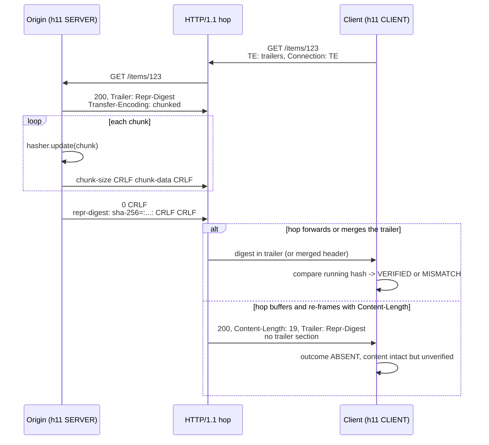

# HTTP Trailer Fields: Streaming Digest Integrity (RFC 9530) and Trailers-Only Responses

> [!summary] Claim
> A trailer section lets a sender put metadata that only exists after the last content byte, such as a running `Repr-Digest` checksum or a gRPC `grpc-status`, at the end of the message, but any intermediary may discard it, so every trailer you depend on needs a defined behavior for when it never arrives.

Part of [TLS Connections and Intermediaries](README.md) in [API Engineering](../README.md).

## TL;DR

Mechanism: HTTP/1.1 carries trailers after the `0` chunk of `Transfer-Encoding: chunked` `(RFC 9112 Section 7.1.2)`, while HTTP/2 and HTTP/3 carry them in a final `HEADERS` frame that ends the stream `(RFC 9113 Section 8.1)` `(RFC 9114 Section 4.1)`.
Contract: a sender must not generate a trailer field unless that field's definition permits it, a recipient must not merge one into the header section unless the definition says how, and `Content-Digest` and `Repr-Digest` both explicitly allow trailer use and merging `(RFC 9110 Section 6.5.1)` `(RFC 9530 Sections 2 and 3)`.
Trap: "in most cases, the trailers are simply discarded" by version-translating intermediaries `(RFC 9110 Section 6.5.1)`, and the Python stack proves it: `httpx 0.28.1` and `httpcore 1.0.9` drop trailers on every path, and Uvicorn and Hypercorn drop them silently unless the request carried `TE: trailers`.
Portability: no pinned Python ASGI server offers the `http.response.trailers` extension on HTTP/1.1 (Hypercorn `0.18.0` on HTTP/2 and HTTP/3 only, Uvicorn `0.54.0` only on its `zttp` HTTP/2 path, Granian `2.8.7` on no path), so HTTP/1.1 trailers in this stack exist only if you drive `h11` yourself; the lab behaves identically on CPython 3.12.13, 3.13.18, 3.14.6, 3.14.10, and 3.15.2.
When not to use it: if the receiver must have the value (authentication, authorization, a status the client cannot synthesize), or the content can be buffered cheaply, put it in the header section, because `(RFC 9110 Section 6.5.1)` says a server SHOULD NOT generate trailer fields it believes are necessary for the user agent to receive.

## Mental model



The origin updates a SHA-256 state with each chunk as it leaves, so the checksum costs one hash pass and no buffering, and it announces the field with `Trailer: Repr-Digest` so the client can prepare a running hash before content arrives `(RFC 9110 Section 6.6.2)`.
The client hashes each chunk on arrival but must not hand the content to a parser until the trailer has been checked, because "eager processing of content before the trailer section prevents digest validation" `(RFC 9530 Section 6.4)`.
The middle hop is the failure domain: a hop that removes the chunked coding "MAY selectively retain or discard the received trailer fields" `(RFC 9112 Section 7.1.2)`, so the same bytes can arrive verified, merged into the header section, or with the trailer gone and only the stale `Trailer` header left as a hint of what was lost `(RFC 9110 Section 6.6.2)`.

## How it works

### The trailer section contract in RFC 9110

A trailer section is only possible "when supported by the version of HTTP in use and enabled by an explicit framing mechanism" `(RFC 9110 Section 6.5.1)`.
Fields that describe framing, routing, authentication, request modifiers, response controls, or content format cannot be evaluated after the content, and a sender MUST NOT generate a trailer field unless the field's definition permits it `(RFC 9110 Section 6.5.1)`.
Trailer fields "ought to be processed and stored separately from the fields in the header section" because routing and processing choices made on the header section "cannot be unmade by the later discovery of trailer fields" `(RFC 9110 Section 6.5)`.
A recipient MUST NOT merge a trailer field into the header section unless it understands the field and the definition "explicitly permits and defines how trailer field values can be safely merged" `(RFC 9110 Section 6.5.1)`.
Repeated trailer field lines with one name combine like header lines, as list members in received order `(RFC 9110 Section 6.5.2)` `(RFC 9110 Section 5.3)`.
The `TE` request field with the `trailers` member says the client will not discard trailer fields `(RFC 9110 Section 10.1.4)`, and for a request from an intermediary it implies that all downstream clients are willing to accept them `(RFC 9110 Section 6.5.1)`; in HTTP/1.1 its sender must also list `TE` in `Connection` because it is hop-by-hop `(RFC 9110 Section 10.1.4)`.
The `Trailer` response header is only a hint: "there is no guarantee that a sender of Trailer will always follow through by sending the named fields" `(RFC 9110 Section 6.6.2)`.

### Wire layout per HTTP version

In HTTP/1.1 the trailer section is `trailer-section = *( field-line CRLF )` `(RFC 9112 Section 7.1.2)`, and `chunked-body = *chunk last-chunk trailer-section CRLF` places it after the `last-chunk` and before the final `CRLF` `(RFC 9112 Section 7.1)`.
The lab origin streams the three chunks of RFC 9530 Figure 30 and `h11 0.16.0` emits these content bytes after the header section, asserted byte for byte in `test_origin_streams_repr_digest_trailer_like_rfc_9530_figure_30` and rendered here with a line break after each `CRLF`:

```text
8\r\n{"hello"\r\n
8\r\n: "world\r\n
3\r\n"}\n\r\n
0\r\n
repr-digest: sha-256=:RK/0qy18MlBSVnWgjwz6lZEWjP/lF5HF9bvEF8FabDg=:\r\n
\r\n
```

`h11` writes the trailer through `ChunkedWriter.send_eom`, which emits `0\r\n` and then the `EndOfMessage.headers` as field lines `(h11 0.16.0 h11/_writers.py, ChunkedWriter.send_eom)`.
It refuses trailers under any other framing: `ContentLengthWriter.send_eom` raises `LocalProtocolError("Content-Length and trailers don't mix")` and `Http10Writer.send_eom` raises `LocalProtocolError("can't send trailers to HTTP/1.0 client")` `(h11 0.16.0 h11/_writers.py, ContentLengthWriter.send_eom)` `(h11 0.16.0 h11/_writers.py, Http10Writer.send_eom)`.
On receive, `ChunkedReader.__call__` sets `_reading_trailer` after the zero-size chunk and returns the lines as `EndOfMessage(headers=...)`, separate from the `Response` headers `(h11 0.16.0 h11/_readers.py, ChunkedReader.__call__)`.
`h11` does not filter forbidden trailer names; an `XX FIXME` comment directly above the `EndOfMessage` class says "the list of forbidden fields is long and vague" `(h11 0.16.0 h11/_events.py, EndOfMessage)`, so that check is the application's job (see [[HTTP-1-1-Framing-Keep-Alive-and-Chunked-Encoding]]).
HTTP/1.1 also requires the client not to send `chunked` in `TE` and treats `TE: trailers` as the promise to keep trailers `(RFC 9112 Section 7.4)`.

In HTTP/2 a message is one `HEADERS` block, zero or more `DATA` frames, and optionally one more `HEADERS` block for the trailer section; that final block must carry `END_STREAM`, must not contain pseudo-header fields, and a `HEADERS` frame without `END_STREAM` after the final response is malformed `(RFC 9113 Section 8.1)`.
The only connection-specific header HTTP/2 allows is `TE`, and its value must be exactly `trailers` `(RFC 9113 Section 8.2.2)`.
`h2 4.4.1` enforces both directions: `H2Stream.send_headers` raises `ProtocolError("Trailers must have END_STREAM set.")` for a second block without `END_STREAM` `(h2 4.4.1 h2/stream.py, H2Stream.send_headers)`, `H2Stream.receive_headers` raises `ProtocolError("Trailers must have END_STREAM set")` (no final period) for inbound trailers `(h2 4.4.1 h2/stream.py, H2Stream.receive_headers)`, and `_check_pseudo_header_field_acceptability` raises `Received pseudo-header in trailer` `(h2 4.4.1 h2/utilities.py, _check_pseudo_header_field_acceptability)`.
`H2StreamStateMachine.response_received` turns the first inbound block into `ResponseReceived` and the second into `TrailersReceived` `(h2 4.4.1 h2/stream.py, H2StreamStateMachine.response_received)`.
HTTP/3 uses the same shape with a single trailing `HEADERS` frame, forbids `Transfer-Encoding`, and treats a `HEADERS` or `DATA` frame after the trailing `HEADERS` frame as `H3_FRAME_UNEXPECTED` `(RFC 9114 Section 4.1)`; see [[HTTP-3-Framing-and-QPACK-Header-Compression-RFC-9114]].

### Digest fields: what exactly gets hashed (RFC 9530)

`Content-Digest` is computed over "the actual message content" `(RFC 9530 Section 2)`, and `Repr-Digest` over "the entire selected representation data" `(RFC 9530 Section 3)`.
Both are Structured Field Dictionaries whose keys name an algorithm from the IANA registry and whose values are Byte Sequences, for example `sha-256=:RK/0qy18MlBSVnWgjwz6lZEWjP/lF5HF9bvEF8FabDg=:` for the 19 bytes `{"hello": "world"}` plus `LF` `(RFC 9530 Appendix B.1)`.
The registry marks `sha-256` and `sha-512` as `Active` and `md5`, `sha`, `unixsum`, `unixcksum`, `adler`, and `crc32c` as `Deprecated`, which MUST NOT be used in a potentially adversarial setting `(RFC 9530 Sections 5 and 7.2)`.
The two fields differ exactly when content and representation differ: for a `206` covering bytes `10-18`, `Content-Digest` hashes `"world"}` plus `LF` (`jjcgBDWN...`) while `Repr-Digest` still hashes all 19 bytes `(RFC 9530 Appendix B.3)`; for `HEAD`, `Content-Digest` is the hash of the empty string (`47DEQpj8...`) `(RFC 9530 Appendix B.2)`.
Content coding is part of the representation, so a `Content-Encoding: br` response has a different `Repr-Digest` from the identity form `(RFC 9530 Appendix B.4)` `(RFC 9110 Section 8.4)`; do not reuse the B.4 sample bytes, because reported erratum 8890 shows they are not valid Brotli and do not hash to the printed `d435Qo+n...` value (SHA-256 of the printed bytes is `MklYnI/S...`, re-computed here) (as of 2026-11).
Transfer coding is not, so the chunked trailer form in Figure 30 carries the same value as the unchunked Figure 12 `(RFC 9530 Appendix B.11)`.
Both fields "can be sent in a trailer section" and "MAY be merged into the header section" `(RFC 9530 Sections 2 and 3)`, which is why the lab proxy's merge allowlist is exactly `{repr-digest, content-digest}`.
`Want-Repr-Digest` and `Want-Content-Digest` carry integer preferences from `0` (not acceptable) to `10` and are only hints `(RFC 9530 Section 4)`.

Parsing follows RFC 9651: combine all lines of the field in one section into one value, and if parsing fails the whole field MUST be ignored or the message treated as malformed `(RFC 9651 Section 4.2)`.
In a Dictionary a duplicate key overwrites the earlier one, so `sha-256=:A:, sha-256=:B:` means `B` `(RFC 9651 Section 4.2.2)`.
A Byte Sequence may omit `=` padding but must fail on characters outside the base64 alphabet `(RFC 9651 Section 4.2.7)`, and parsers MUST support at least 16384 decoded octets `(RFC 9651 Section 3.3.5)`; see [[Structured-Field-Values-for-HTTP-RFC-9651]].

### Trailers-Only responses in gRPC

gRPC defines `Response -> (Response-Headers *Length-Prefixed-Message Trailers) / Trailers-Only`, where `Trailers-Only -> HTTP-Status Content-Type Trailers` is delivered in a single HTTP/2 `HEADERS` block and "is permitted for calls that produce an immediate error" `(grpc v1.85.1 doc/PROTOCOL-HTTP2.md, Responses)`.
The status "must be sent in Trailers even if the status code is OK", and clients send `te: trailers` partly "to detect incompatible proxies" `(grpc v1.85.1 doc/PROTOCOL-HTTP2.md, Requests and Responses)`.
`grpc-message` is UTF-8 then percent-encoded, and a decoder of an invalid value "MUST NOT error or throw away the message" `(grpc v1.85.1 doc/PROTOCOL-HTTP2.md, Responses)`.
When `grpc-status` is missing, typically because an intermediary answered with its own error page, implementations "must synthesize a Status & Status-Message" `(grpc v1.85.1 doc/PROTOCOL-HTTP2.md, Responses)`, and the mapping table says `503`, `502`, `504`, and `429` map to `UNAVAILABLE`, `404` to `UNIMPLEMENTED`, `401` to `UNAUTHENTICATED`, `403` to `PERMISSION_DENIED`, `400` to `INTERNAL`, and everything else, including `200`, to `UNKNOWN` `(grpc v1.85.1 doc/http-grpc-status-mapping.md)`.
An `RST_STREAM` maps to `INTERNAL` except `REFUSED_STREAM` -> `UNAVAILABLE`, `CANCEL` -> `CANCELLED` when sent by a server, `ENHANCE_YOUR_CALM` -> `RESOURCE_EXHAUSTED`, `INADEQUATE_SECURITY` -> `PERMISSION_DENIED`, and `STREAM_CLOSED`, which has no mapping because there is no open stream to propagate to `(grpc v1.85.1 doc/PROTOCOL-HTTP2.md, Errors)`; the lab maps every unlisted code, `STREAM_CLOSED` included, to `INTERNAL`.
gRPC-Web, built for transports that cannot pass trailers, moves them into the body as a final length-prefixed message whose flag byte has the MSB set (`0x80` uncompressed) `(grpc v1.85.1 doc/PROTOCOL-WEB.md)`.
On the wire the lab's Trailers-Only error is one `HEADERS` frame with flags `0x5` (`END_STREAM | END_HEADERS`) and no `DATA` frame; see [[gRPC-Over-HTTP-2-Framing-Length-Prefixed-Messages-and-Trailers]] for the message framing and [[gRPC-Status-Codes-and-Google-RPC-Status-Rich-Error-Payloads]] for the code space.

### What the pinned Python stack does with trailers

The ASGI `http.response.trailers` extension works like this: the server advertises it in `scope["extensions"]`, the app sets `trailers: True` in `http.response.start`, sends its body, then sends one or more `http.response.trailers` messages, and "the ASGI server will only send the trailing headers in case the client has sent the `TE: trailers` header" `(asgiref 3.13.0 docs/extensions.rst, HTTP Trailers)`.
Hypercorn adds the extension only when `event.http_version in TRAILERS_VERSIONS`, which is `{"2", "3"}` `(hypercorn 0.18.0 hypercorn/protocol/http_stream.py, HTTPStream.handle)`, and in `HTTPStream.app_send` it sends trailers only if a request header equals exactly `(b"te", b"trailers")`; a trailers message sent before any `http.response.start` becomes a `200` response whose headers are the trailers `(hypercorn 0.18.0 hypercorn/protocol/http_stream.py, HTTPStream.app_send)`, but on HTTP/2 that is not a gRPC Trailers-Only on the wire: `H2Protocol.stream_send` sends the `Response` as a `HEADERS` frame without `END_STREAM`, and the following `EndBody` ends the stream through `H2Connection.end_stream`, which sends a separate empty `DATA` frame with `END_STREAM` `(hypercorn 0.18.0 hypercorn/protocol/h2.py, H2Protocol.stream_send)` `(hypercorn 0.18.0 hypercorn/protocol/h2.py, H2Protocol._send_data)` `(h2 4.4.1 h2/connection.py, H2Connection.end_stream)`.
Run for real (a throwaway probe that is not part of the lab: `hypercorn.asyncio.serve` on `127.0.0.1` with HTTP/2 prior knowledge, a raw `hyperframe` client logging frames, CPython 3.14.6, macOS 27.2 arm64): an app that sends `http.response.start` with `trailers: True`, a body, then `http.response.trailers` produced `HEADERS` (no `END_STREAM`), `DATA`, `HEADERS` (`END_HEADERS | END_STREAM`) with the trailer when the request had `te: trailers`, and `HEADERS`, `DATA`, then an empty `DATA` with `END_STREAM` and no trailer when it did not.
A trailers-first app (no `http.response.start`) with `te: trailers` produced `HEADERS` (status `200`, `grpc-status: 5` in the header block, no `END_STREAM`) followed by an empty `DATA` frame with `END_STREAM`.
The same app without `te: trailers` produced a lone empty `DATA` frame with `END_STREAM` and no `HEADERS` at all, because `_send_closed` then calls `config.log.access` with `self.response` unset and Hypercorn logged `AttributeError: 'HTTPStream' object has no attribute 'response'`.
Granian `2.8.7` advertises only `http.response.pathsend` and `websocket.http.response` in `scope["extensions"]` `(granian 2.8.7 src/asgi/utils.rs, scope_set! "extensions")`, and `adapt_message_type` has no `http.response.trailers` arm, so that message falls to the `_ => error_message!()` branch `(granian 2.8.7 src/asgi/io.rs, adapt_message_type)`; the string `trailer` does not occur anywhere in the `v2.8.7` source tree.
Run for real (installed `granian 2.8.7`, `--interface asgi --http 1`, a raw socket sending `TE: trailers`, same machine): the scope extensions were `['http.response.pathsend', 'websocket.http.response']`, `send` of `http.response.trailers` raised `RuntimeError: Unsupported ASGI message`, and the wire response was `Content-Length: 2` with the body `hi` and a dangling `trailer: x-t` header.
Uvicorn advertises the extension only in its HTTP/2 path `(uvicorn 0.54.0 uvicorn/protocols/http/zttp_h2_impl.py, ZttpH2Protocol.handle_request)`, and `RequestResponseCycle.send` drops every trailer when no request `te` value equals `trailers` after `lower().strip()`, and raises on pseudo-headers in trailers `(uvicorn 0.54.0 uvicorn/protocols/http/zttp_h2_impl.py, RequestResponseCycle.send)`; its `h11_impl.py`, `httptools_impl.py`, and `zttp_impl.py` contain no trailer handling, and `zttp` itself is not installed in the lab environment.
Run for real (installed `uvicorn 0.54.0`, `http='h11'`, a raw socket sending `TE: trailers`, same machine): `scope["extensions"]` was empty, `send` of `http.response.trailers` after the body raised `RuntimeError: Unexpected ASGI message 'http.response.trailers' sent, after response already completed.`, and the wire response was chunked `hi` then `0\r\n\r\n` with a dangling `trailer: x-t` header and no trailer section; the `zttp` HTTP/2 path was not run.
Starlette's `TestClient` advertises the extension and exposes received trailers as `response.extensions["http.response.trailers"]` `(starlette 1.10.0 starlette/testclient.py, _TestClientTransport.handle_request)`.
`GZipMiddleware` forwards `http.response.trailers` messages untouched while compressing the body `(starlette 1.10.0 starlette/middleware/gzip.py, IdentityResponder.send_with_compression)`, so a digest computed inside it describes bytes that never reach the wire.
`httpx.ASGITransport` builds a scope with no `extensions` key and its `send` callable handles only `http.response.start` and `http.response.body`, silently ignoring trailers `(httpx 0.28.1 httpx/_transports/asgi.py, ASGITransport.handle_async_request)`.
Over the network `httpcore` also loses them: `_receive_response_body` stops at `h11.EndOfMessage` without reading its headers `(httpcore 1.0.9 httpcore/_async/http11.py, AsyncHTTP11Connection._receive_response_body)`, and `_receive_events` routes only `ResponseReceived`, `DataReceived`, `StreamEnded`, and `StreamReset` to streams, never `TrailersReceived` `(httpcore 1.0.9 httpcore/_async/http2.py, AsyncHTTP2Connection._receive_events)`.
CPython's client reads trailer lines and throws them away; the comment says "we shouldn't have any trailers!" `(CPython 3.14.6 Lib/http/client.py, HTTPResponse._read_and_discard_trailer)`.

## Numbers and limits

| Quantity | Value | Source or measurement |
|---|---|---|
| Figure 30 response through the lab origin, 19 content bytes in 3 chunks | `207` wire bytes, of which `74` are `0\r\n` + trailer section + final `CRLF` | measured, `labs/` `serve_streaming_response`, CPython 3.14.6, macOS 27.2 arm64 |
| `repr-digest` trailer field line, `sha-256` | `69` bytes including `CRLF` | measured, same machine |
| `repr-digest` trailer field line, `sha-512` | `113` bytes including `CRLF` | measured, same machine |
| gRPC Trailers-Only error (`NOT_FOUND`, `grpc-message: item not found`) | `57` bytes: one `HEADERS` frame, `48`-byte field block, flags `0x5` | measured with `h2 4.4.1`, first response on a fresh connection (HPACK state matters) |
| gRPC normal unary response (`b"ok"`, `grpc-status: 0`) | `60` bytes: `HEADERS` (14, flags `0x4`), `DATA` (7), `HEADERS` (12, flags `0x5`) | measured with `h2 4.4.1`, same conditions |
| SHA-256 throughput, 64 MiB buffer | `2.91` to `3.12` GB/s | measured, `hashlib.new("sha256", bytes(64 * 1024 * 1024)).digest()`, best of 5 timings per invocation, 3 invocations under `uv run --frozen python`, CPython 3.14.6, macOS 27.2 (Darwin 27.2.0) arm64 |
| SHA-512 throughput, 64 MiB buffer | `1.72` to `1.83` GB/s | measured, same method; a verifier running both in parallel pays both |
| Byte Sequence size a parser must accept | `>= 16384` decoded octets | `(RFC 9651 Section 3.3.5)` |
| `Want-*-Digest` preference range | `0` (not acceptable) to `10` | `(RFC 9530 Section 4)` |
| Suggested client limit for `Response-Headers`, `Trailers`, `Trailers-Only` | `8 KiB` each | `(grpc v1.85.1 doc/PROTOCOL-HTTP2.md, Responses)` (as of 2026-11) |
| CPython `http.client` maximum trailer line | `_MAXLINE = 65536` bytes, else `LineTooLong("trailer line")` | `(CPython 3.14.6 Lib/http/client.py, HTTPResponse._read_and_discard_trailer)` |
| HTTP versions on which Hypercorn offers ASGI trailers | `"2"`, `"3"` | `(hypercorn 0.18.0 hypercorn/protocol/http_stream.py, TRAILERS_VERSIONS)` (as of 2026-11) |

## Portability

| Dimension | Behavior | Proof |
|---|---|---|
| CPython 3.12.13 | all 56 lab tests pass (3.12.16 is not installed here) | `uv run --frozen --python 3.12.13 pytest ...` (this lab) |
| CPython 3.13.18 | all 56 pass | `uv run --frozen --python 3.13.18 pytest ...` (this lab) |
| CPython 3.14.6 and 3.14.10 | all 56 pass | workspace interpreter and `--python 3.14.10` (this lab) |
| CPython 3.15.2 | all 56 pass | `--python 3.15.2` (this lab) |
| CPython 3.15.2t free-threaded | not run | only `3.15.0b3+freethreaded` and `3.14.6+freethreaded` are installed here, and `uv sync` fails on both: `psycopg-binary==3.3.8` has no wheel for the free-threaded platform |
| Debian Trixie and Alpine musl containers | not run | the lab was only executed on macOS 27.2 arm64; the lab uses only pure-Python `h11` and `h2` plus `hashlib`, but that is not proof |
| CPython base64 excess padding | `b64decode(..., validate=True)` rejects `...FabDg==` on all of 3.12-3.15; the message changed from `Excess data after padding` (3.12.13) to `Excess padding not allowed` (3.13.18 onward); default mode accepts it on all | probe run under each interpreter; the lab matches on its own message to stay version-independent |
| HTTP/1.1 | trailers only after `chunked`; `h11` rejects them with `Content-Length` or for HTTP/1.0 peers | `(RFC 9112 Section 7.1.2)`, `test_h11_cannot_send_trailers_with_content_length_or_to_http_1_0` |
| HTTP/2 | trailing `HEADERS` with `END_STREAM`, no pseudo-headers, `TE` only `trailers` | `(RFC 9113 Sections 8.1 and 8.2.2)`, `test_h2_refuses_trailers_without_end_stream_and_pseudo_headers_in_trailers` |
| HTTP/3 | single trailing `HEADERS` frame; nothing may follow it | `(RFC 9114 Section 4.1)`; not exercised in this lab |
| Hypercorn 0.18.0 | trailers on HTTP/2 and HTTP/3 only; exact `te: trailers` match; trailers-first message -> `200` whose headers are the trailers, sent on HTTP/2 as `HEADERS` plus an empty `END_STREAM` `DATA` frame, not a single-block Trailers-Only; without `te: trailers` that message yields a lone empty `DATA` frame and an `AttributeError` in the access log | executed on HTTP/2 prior knowledge over loopback with a raw frame logger (see How it works), plus source `(hypercorn 0.18.0 hypercorn/protocol/http_stream.py, HTTPStream.app_send)`, `(hypercorn 0.18.0 hypercorn/protocol/h2.py, H2Protocol.stream_send)`; HTTP/1.1 and HTTP/3 not executed |
| Uvicorn 0.54.0 | trailers only on `zttp` HTTP/2; dropped without `TE: trailers`; none on `h11`, `httptools`; on `h11` the extension is absent and a trailers message raises `RuntimeError` | `h11` path executed (see How it works); `zttp` and `httptools` paths from source only `(uvicorn 0.54.0 uvicorn/protocols/http/zttp_h2_impl.py, RequestResponseCycle.send)` |
| Granian 2.8.7 | no ASGI trailers on any HTTP version: the extension is not advertised and an `http.response.trailers` message is rejected as unsupported (`RuntimeError: Unsupported ASGI message`) | HTTP/1.1 executed (see How it works), plus source at tag `v2.8.7` `(granian 2.8.7 src/asgi/utils.rs, scope_set! "extensions")`, `(granian 2.8.7 src/asgi/io.rs, adapt_message_type)`; Granian HTTP/2 not executed |
| `httpx 0.28.1` / `httpcore 1.0.9` | trailers never surface, in-process or over the network | `test_httpx_asgi_transport_silently_discards_trailers_messages`; source cited above |
| Starlette 1.10.0 `TestClient` | receives trailers in `response.extensions` | `test_starlette_testclient_receives_a_streamed_content_digest_trailer` |

## Worked example

The [implementation](../labs/src/api_labs/f02_tls_connections_and_intermediaries/trailer_digest.py) has an `h11` origin that streams a `Repr-Digest` trailer, a verifying client, a buffering HTTP/1.1 proxy that drops or merges trailers, an ASGI `ContentDigestMiddleware`, and an in-memory `h2` gRPC client and server that resolve `grpc-status`; the [test](../labs/tests/f02_tls_connections_and_intermediaries/test_http_trailers_streaming_checksums_and_grpc_status.py) exercises each.

The origin hashes each chunk as it sends it and writes the digest into `EndOfMessage`:

```python
def serve_streaming_response(
    conn: h11.Connection,
    chunks: Iterable[bytes],
    *,
    content_type: bytes = b"application/json",
    algorithm: str = "sha-256",
) -> bytes:
    """Stream a ``200`` response and put the running ``Repr-Digest`` in the trailer section.

    The checksum is updated per chunk, so the origin never buffers the representation.
    """
    hasher = StreamingDigest(algorithm)
    headers = [(b"content-type", content_type), (b"trailer", b"Repr-Digest")]
    wire = [_send(conn, h11.Response(status_code=200, headers=headers))]
    for chunk in chunks:
        hasher.update(chunk)
        wire.append(_send(conn, h11.Data(data=chunk)))
    wire.append(_send(conn, h11.EndOfMessage(headers=[(b"repr-digest", hasher.field_value())])))
    return b"".join(wire)
```

The verifier treats an unparseable field as absent and picks the strongest algorithm it supports, so a forged weak digest cannot override a correct strong one:

```python
def _check_digest(raw_value: bytes | None, running: Mapping[str, StreamingDigest]) -> DigestOutcome:
    if raw_value is None:
        return DigestOutcome.ABSENT
    try:
        claimed = parse_digest_field(raw_value)
    except ValueError:
        return DigestOutcome.ABSENT  # RFC 9651 Section 4.2: a field that fails parsing is ignored
    for name in HASHERS:  # strongest supported algorithm first
        if name in claimed:
            ok = hmac.compare_digest(claimed[name], running[name].digest())
            return DigestOutcome.VERIFIED if ok else DigestOutcome.MISMATCH
    return DigestOutcome.UNSUPPORTED
```

The gRPC Trailers-Only error is a single `HEADERS` block with `END_STREAM`:

```python
def reply_trailers_only(
    server: h2.connection.H2Connection, stream_id: int, code: GrpcCode, message: str
) -> None:
    """Immediate error: one HEADERS frame with END_STREAM holding status and trailers."""
    server.send_headers(
        stream_id,
        [
            (":status", "200"),
            ("content-type", "application/grpc"),
            ("grpc-status", str(int(code))),
            ("grpc-message", quote(message.encode("utf-8"), safe=_GRPC_MESSAGE_SAFE)),
        ],
        end_stream=True,
    )
```

Run from `labs/` on CPython 3.14.6, macOS 27.2 (Darwin 27.2.0, arm64), `uv 0.11.26`:

```text
$ uv run --frozen pytest tests/f02_tls_connections_and_intermediaries/test_http_trailers_streaming_checksums_and_grpc_status.py -q
........................................................                 [100%]
56 passed in 0.11s
```

What the tests show, in the order they run: the streamed hash reproduces the RFC 9530 sample values; the parser keeps the last duplicate key and synthesizes missing padding; the origin bytes match Figure 30; one flipped byte (`world` -> `wOrld`) turns the outcome into `MISMATCH` and `verified_body()` raises `IntegrityError`; the buffering proxy delivers an intact body with `Content-Length: 19`, no trailer, and outcome `ABSENT`; the merging proxy moves `repr-digest` into the header section but drops `x-origin-cost`; a correct `sha-512` beats a wrong `sha-256`, and a wrong `sha-512` fails even with a correct `sha-256`; two `repr-digest` trailer lines combine and the later `sha-256` key wins; Trailers-Only produces exactly `ResponseReceived` then `StreamEnded`; a `503` HTML page from a proxy becomes `UNAVAILABLE`, and every row of the HTTP mapping table is checked; `ContentDigestMiddleware` sends the digest exactly once, on the final trailers message only, and offers trailers only when `TE` lists `trailers` case-insensitively; the `grpc-message` on the wire is UTF-8 then percent-encoded (`caf%C3%A9 100%25`); and `ContentDigestMiddleware` placed inside `GZipMiddleware` emits a digest of the uncompressed bytes while the wire carries gzip, while placed outside it matches.

## Pitfalls

> [!warning] An intermediary drops the trailer and nobody notices
> Trigger: a proxy, CDN, or HTTP/1.0 hop buffers a chunked response and re-frames it with `Content-Length`, which `(RFC 9110 Section 6.5.1)` describes as the usual case.
> Symptom: the body arrives intact and the `Trailer: Repr-Digest` header still names the field, but the field itself never comes, so a verifier that only checks "if a digest is present" passes everything.
> Fix: decide per API whether `ABSENT` is acceptable; if integrity is required, fail closed on `ABSENT` the way the lab's `verified_body()` does, or move the digest to the header section and buffer.

> [!warning] gRPC behind a proxy that does not pass trailers
> Trigger: an HTTP/1.1-only or trailer-dropping load balancer sits between a gRPC client and server.
> Symptom: successful calls arrive with `:status 200`, the messages, and no `grpc-status`, and the client synthesizes `UNKNOWN` `(grpc v1.85.1 doc/http-grpc-status-mapping.md)`; this is why clients send `te: trailers` "to detect incompatible proxies" `(grpc v1.85.1 doc/PROTOCOL-HTTP2.md, Requests)`.
> Fix: run HTTP/2 end to end with trailer support, or use gRPC-Web, which encodes trailers in the body `(grpc v1.85.1 doc/PROTOCOL-WEB.md)`.

> [!warning] A trailer parser that skips the trailer section enables request smuggling
> Trigger: `aiohttp` before `3.12.14` running its pure-Python parser (no C extensions, or `AIOHTTP_NO_EXTENSIONS` set) did not parse trailer sections of a request `(GHSA-9548-qrrj-x5pj)` `(CVE-2025-53643)`.
> Symptom: an attacker "may be able to execute a request smuggling attack to bypass certain firewalls or proxy protections" `(CVE-2025-53643)`.
> Fix: upgrade to `3.12.14`; in general, a parser must consume the trailer section by the same grammar as its front proxy, or the two disagree on where the next request begins (see [[HTTP-Request-Smuggling-CL-TE-and-Desync-Mechanics]]).

> [!warning] Unbounded HTTP/2 field blocks, trailers included
> Trigger: HTTP/2 header and trailer sections are field blocks that may span any number of `CONTINUATION` frames, and many implementations did not limit them `(CERT VU#421644)`.
> Symptom: an attacker streams `CONTINUATION` frames that the server keeps decoding, or keeps appending to the header list until it crashes out of memory `(CERT VU#421644)`.
> Fix: cap total field-block size for trailers exactly as for headers; gRPC suggests `8 KiB` for `Trailers` `(grpc v1.85.1 doc/PROTOCOL-HTTP2.md, Responses)`.

> [!warning] The digest is computed before the last content transformation
> Trigger: an app computes `Repr-Digest` or `Content-Digest` over its own body, and a later layer such as Starlette `GZipMiddleware` compresses it and forwards the trailer untouched `(starlette 1.10.0 starlette/middleware/gzip.py, IdentityResponder.send_with_compression)`.
> Symptom: every response fails verification against the bytes on the wire; a client that decodes gzip first (as `httpx` does) appears to verify, hiding the bug from tests that use it.
> Fix: compute digests in the outermost layer, after every content coding, which is what `test_digest_inside_gzip_middleware_goes_stale_and_outside_matches` proves.

> [!warning] Copying the RFC's own trailer example
> Trigger: RFC 9530 Figure 30 shows the trailer value `sha-256=:RK/0qy18MlBSVnWgjwz6lZEWjP/lF5HF9bvEF8FabDg==:` with two `=` characters (also in Figures 19, 20, and 32), and the figure ends without the final `CRLF` that `(RFC 9112 Section 7.1)` requires after the trailer section.
> Symptom: a strict Byte Sequence parser rejects the 45-character value, so per `(RFC 9651 Section 4.2)` the whole field is ignored and the lab verifier reports `ABSENT`; a lenient `base64.b64decode` without `validate=True` accepts it on every tested CPython.
> Fix: generate test vectors with your own serializer and test parser strictness explicitly; as of 2026-11 the RFC 9530 errata page lists no entry for the double padding (it lists errata 8158, 8273, and 8890, which concern other text).

## Security and robustness

Integrity fields detect corruption, not attackers: "an on-path malicious actor can either remove a digest value entirely or substitute it with a new digest value", so pair them with TLS or HTTP Message Signatures when the threat is adversarial `(RFC 9530 Section 6.1)`.
A signature that covers the digest but not representation metadata such as `Content-Type` and `Content-Encoding` still lets an attacker force validation failures `(RFC 9530 Section 6.3)`.
Algorithm agility does not prevent downgrade, and "a receiver that depends on a digest for security will be vulnerable to attacks on the weakest algorithm it is willing to accept" `(RFC 9530 Section 6.6)`, so accept only `Active` algorithms and check the strongest one present, as the lab does.
Validation costs CPU per algorithm and per byte, and limiting it reopens downgrade `(RFC 9530 Section 6.7)`; the lab verifier hashes with both `sha-256` and `sha-512` because it learns the algorithm only from the trailer, which on the measured machine costs about 2.6x to 2.8x a single SHA-256 pass (`1/2.91 + 1/1.83` against `1/2.91`, and `1/3.11 + 1/1.72` against `1/3.11`, seconds per GB).
Duplicate dictionary keys are last-wins `(RFC 9651 Section 4.2.2)`, so an attacker able to append a field line can override an earlier digest; signatures must cover the combined field value.
Never trust a trailer for an authorization or routing decision: those choices were made on the header section and "cannot be unmade" `(RFC 9110 Section 6.5)`, and a trailer that a front proxy did not inspect is an unfiltered input (OWASP API8:2023 Security Misconfiguration lists "discrepancies in the way incoming requests are processed by servers in the HTTP server chain").
Bound trailer size and count like headers, compare digests with `hmac.compare_digest`, and withhold content from downstream parsers until verification completes `(RFC 9530 Section 6.4)`.
For gRPC, treat an unparseable or out-of-range `grpc-status` as absent and synthesize a status rather than crashing; the lab maps `99`, `OK`, and `-1` to a synthesized `UNKNOWN`, which is a lab policy built on the spec's rule that clients must synthesize a status when it is missing.

## The principal's view

The decision is not "trailers or not" but "who must receive this value, and what happens when it is gone".
Trailers are the right tool when the value is produced by streaming itself (a checksum, a row count, a final status) and its loss degrades gracefully: the client can retry, re-fetch with a header digest, or synthesize a status.
They are the wrong tool for anything a client cannot live without on today's Internet, because the Python client stack alone (`httpx`, `httpcore`, `http.client`) never surfaces them, and many CDNs and HTTP/1.1 hops discard them as `(RFC 9110 Section 6.5.1)` predicts.
gRPC accepted that trade deliberately: it owns both ends and requires HTTP/2 end to end, and when that is impossible it ships gRPC-Web instead of hoping trailers survive.
For a public REST API, the robust pattern is a header `Repr-Digest` on buffered or stored objects (where the server knows the hash before sending), trailers only for streams the server cannot buffer, and an explicit, documented client behavior for `ABSENT`.
The organizational cost is testing: trailer loss is a property of the deployed path, so an in-process test that passes proves nothing about the CDN, and a canary that fetches through the real edge and asserts the digest arrives is the only proof.
Choose a different mechanism when the payload is a file: object stores and upload protocols that send a checksum before or after the transfer on a separate request avoid every intermediary problem described here.

## Interview questions

> [!question] L5: Why can a server send `Repr-Digest` as a trailer but not `Content-Length`?
>
> > [!success]- Answer
> > `Content-Length` is framing, and framing must be known before the body is parsed, so `(RFC 9110 Section 6.5.1)` excludes it from trailers.
> > `Repr-Digest` is only checked after the content is complete, and RFC 9530 Section 3 explicitly allows it in a trailer section.
> > A sender must not put any field in a trailer unless that field's definition permits it.
> >
> > Follow-up: What does `h11 0.16.0` do if you try to send a trailer on a response that declared `Content-Length`?

> [!question] L5: What is the difference between `Content-Digest` and `Repr-Digest` for a `206 Partial Content` response?
>
> > [!success]- Answer
> > `Content-Digest` hashes the bytes in this message, so only the requested range.
> > `Repr-Digest` hashes the whole selected representation, so it equals the value for a full `200`.
> > RFC 9530 Appendix B.3 shows both for bytes `10-18` of the 19-byte example.
> >
> > Follow-up: Which one changes when the server switches from identity to `Content-Encoding: br`?

> [!question] L5: Predict the output: the lab's buffering proxy re-frames the Figure 30 response with `merge_trailers=False`, and the client runs `fetch_and_verify`; what are `body`, `outcome`, and `announced_trailers`?
>
> > [!success]- Answer
> > `body` is the full 19 bytes `{"hello": "world"}` plus `LF`, because the proxy only removes framing.
> > `outcome` is `DigestOutcome.ABSENT`, because the trailer section was discarded.
> > `announced_trailers` is still `(b"repr-digest",)`, because the proxy forwarded the `Trailer` header, which RFC 9110 Section 6.6.2 calls a hint of what was lost.
> >
> > Follow-up: What changes if `merge_trailers=True`, and why is the proxy allowed to merge this field but not `x-origin-cost`?

> [!question] L6: Why does a verifying client in the lab hash content with both SHA-256 and SHA-512 at once?
>
> > [!success]- Answer
> > The algorithm key lives in the trailer, which arrives after the content.
> > To verify without buffering, the client must keep running hashes for every algorithm it accepts.
> > The cost is one pass per algorithm; on the measured machine SHA-512 ran at 1.72 to 1.83 GB/s against 2.91 to 3.12 GB/s for SHA-256.
> > `Want-Repr-Digest` lets the client tell the server which algorithm to use, but it is only a hint (RFC 9530 Section 4).
> >
> > Follow-up: How would you bound this cost without opening a downgrade attack?

> [!question] L6: What is a gRPC Trailers-Only response on the wire, and when does a server use it?
>
> > [!success]- Answer
> > It is a single HTTP/2 `HEADERS` block with `END_STREAM` that carries `:status 200`, `content-type`, `grpc-status`, and optionally `grpc-message`.
> > There is no `DATA` frame and no second `HEADERS` block.
> > The gRPC spec permits it for calls that produce an immediate error, such as `NOT_FOUND` before any message is sent.
> > In `h2 4.4.1` the client sees `ResponseReceived` with `stream_ended` set, not `TrailersReceived`.
> >
> > Follow-up: Hypercorn turns a trailers-first ASGI message into a `200`; why is that still not a single-block Trailers-Only on HTTP/2?

> [!question] L6: Debug this API: a FastAPI service streams NDJSON and adds a `Content-Digest` trailer; in staging behind Uvicorn every client reports no digest, but the unit tests with `httpx.AsyncClient(transport=ASGITransport(...))` never caught it.
> What is happening?
>
> > [!success]- Answer
> > `httpx.ASGITransport` in `0.28.1` offers no `http.response.trailers` extension and ignores trailer messages, so the tests never exercised the trailer path at all.
> > Uvicorn `0.54.0` offers the extension only on its `zttp` HTTP/2 path, so on HTTP/1.1 the app's trailers have nowhere to go: run here on the `h11` path, the extension was absent and sending `http.response.trailers` raised `RuntimeError`, leaving a dangling `Trailer` header on the wire.
> > Even on HTTP/2, Uvicorn drops trailers when the request lacks `TE: trailers`.
> > Fix the test by driving the app with a harness that advertises the extension (Starlette `TestClient` does), check `scope["extensions"]` and `TE` in the app, and fall back to a buffered header digest when either is missing.
> >
> > Follow-up: Which order of `GZipMiddleware` and the digest middleware produces a correct digest?

> [!question] L7+: Your gRPC fleet sees a spike of `UNKNOWN` status on calls that the server logs as successful; what is your hypothesis tree?
>
> > [!success]- Answer
> > `UNKNOWN` with `:status 200` is exactly what clients synthesize when `grpc-status` never arrives.
> > First suspect a path change that drops trailers: a new load balancer, an HTTP/1.1 hop, or a proxy config that buffers responses.
> > Second, a server that ends the stream with `RST_STREAM` or closes early would map to `INTERNAL` or `UNAVAILABLE` instead, so the specific code narrows the cause.
> > Confirm by capturing frames at each hop and checking for the final `HEADERS` frame with `END_STREAM`.
> >
> > Follow-up: How would you make this failure detectable before rollout rather than after?

> [!question] L7+: Should a public object-download API send `Repr-Digest` in a trailer or a header?
>
> > [!success]- Answer
> > For stored objects the server can compute or store the checksum before sending, so the header section is better: it survives every intermediary and lets the client verify a resumed or ranged download.
> > Trailers fit generated streams where the checksum does not exist until the end and buffering is too costly.
> > A trailer digest needs a documented client policy for `ABSENT`, because CDNs and HTTP/1.1 hops may drop it and RFC 9110 Section 6.5.1 says not to rely on trailers the client needs.
> > If authenticity matters, either choice needs a signature or TLS end to end, because a digest alone does not stop substitution.
> >
> > Follow-up: How does `Repr-Digest` help a client that reassembles an object from several `Range` requests?

> [!question] L7+: An internal standard says "always merge trailers into headers at the edge"; what do you object to?
>
> > [!success]- Answer
> > RFC 9110 Section 6.5.1 forbids merging unless the field definition permits it and defines how, so a blanket merge violates the spec for most fields.
> > Merging a trailer after routing or authorization decisions were made lets late metadata masquerade as early metadata, which is a filter bypass.
> > The safe version is an allowlist of mergeable fields, such as `Content-Digest` and `Repr-Digest`, with everything else dropped.
> > Merging also requires buffering the whole response at the edge, which changes latency and memory for streams.
> >
> > Follow-up: What would you log so that dropped trailers are visible in production?

## Related

Prerequisites: [[103-Early-Hints-and-Informational-Responses]]

Next: [[HTTP-Caching-Architecture-Private-Shared-and-Gateway-Caches]]

See also: [[gRPC-and-Protocol-Buffers]], [[HTTP-1-1-Framing-Keep-Alive-and-Chunked-Encoding]], [[HTTP-2-Binary-Framing-and-Stream-State-Machine]], [[HTTP-3-Framing-and-QPACK-Header-Compression-RFC-9114]], [[Structured-Field-Values-for-HTTP-RFC-9651]], [[Range-Requests-Partial-Content-and-206-Semantics]], [[HTTP-Compression-Gzip-Brotli-Zstandard-and-BREACH]], [[Hop-by-Hop-vs-End-to-End-Headers-and-Connection-Header-Abuse]], [[HTTP-Request-Smuggling-CL-TE-and-Desync-Mechanics]], [[gRPC-Over-HTTP-2-Framing-Length-Prefixed-Messages-and-Trailers]], [[gRPC-Status-Codes-and-Google-RPC-Status-Rich-Error-Payloads]], [[Pure-ASGI-Middleware-Onion-Architecture-and-Send-Receive-Wrapping]], [[In-Process-Testing-of-ASGI-Apps-with-HTTPX-ASGITransport]]

- Lab: `labs/tests/f02_tls_connections_and_intermediaries/test_http_trailers_streaming_checksums_and_grpc_status.py`

## Further reading

- [RFC 9530 Digest Fields](https://www.rfc-editor.org/rfc/rfc9530.html): defines `Content-Digest`, `Repr-Digest`, and the preference fields; Section 6.4 and Appendix B.11 cover trailer use.
- [RFC 9530 errata](https://www.rfc-editor.org/errata/rfc9530): check before copying any example value from the RFC.
- [RFC 9110 HTTP Semantics, Section 6.5](https://www.rfc-editor.org/rfc/rfc9110.html#section-6.5): the trailer contract, merging rule, and `TE: trailers` meaning.
- [RFC 9112 HTTP/1.1, Section 7.1.2](https://www.rfc-editor.org/rfc/rfc9112.html#section-7.1.2): the chunked trailer section grammar and what a de-chunking recipient may do.
- [RFC 9113 HTTP/2, Section 8.1](https://www.rfc-editor.org/rfc/rfc9113.html#section-8.1): trailers as the final `HEADERS` block with `END_STREAM`.
- [RFC 9114 HTTP/3, Section 4.1](https://www.rfc-editor.org/rfc/rfc9114.html#section-4.1): the same rule over QUIC streams.
- [RFC 9651 Structured Field Values](https://www.rfc-editor.org/rfc/rfc9651.html): the Dictionary and Byte Sequence parsing algorithms the digest fields depend on.
- [gRPC over HTTP2 (v1.85.1)](https://github.com/grpc/grpc/blob/v1.85.1/doc/PROTOCOL-HTTP2.md): the `Trailers-Only` grammar and the `RST_STREAM` mapping.
- [HTTP to gRPC status mapping (v1.85.1)](https://github.com/grpc/grpc/blob/v1.85.1/doc/http-grpc-status-mapping.md): what clients synthesize when trailers never arrive.
- [gRPC-Web protocol (v1.85.1)](https://github.com/grpc/grpc/blob/v1.85.1/doc/PROTOCOL-WEB.md): how gRPC carries trailers in the body when the transport cannot.
- [ASGI HTTP Trailers extension (asgiref 3.13.0)](https://github.com/django/asgiref/blob/3.13.0/docs/extensions.rst): the server and app contract for `http.response.trailers`.
- [GHSA-9548-qrrj-x5pj / CVE-2025-53643](https://github.com/advisories/GHSA-9548-qrrj-x5pj): a real smuggling bug caused by not parsing trailer sections.
- [CERT VU#421644](https://kb.cert.org/vuls/id/421644): the HTTP/2 `CONTINUATION` flood that applies to header and trailer field blocks alike.
