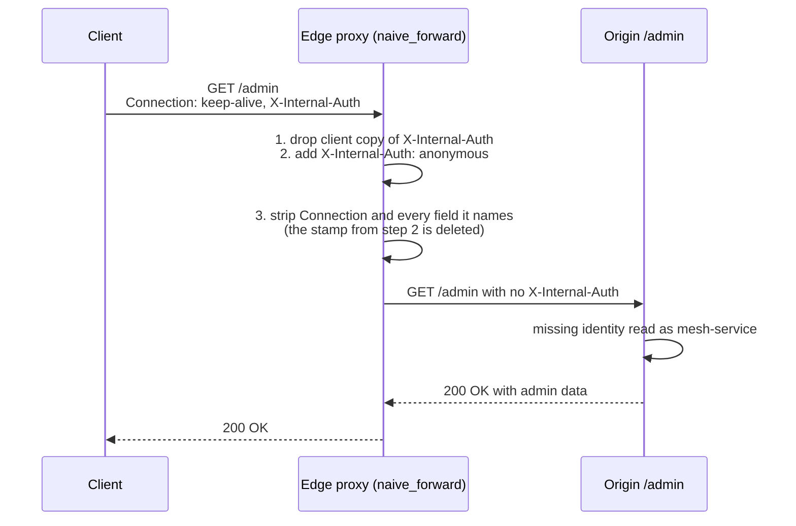

# Hop-by-Hop vs End-to-End Headers and the Connection Header Stripping Vulnerability (RFC 9110)

> [!summary] Claim
> `Connection` lets the sender of a message name any field as hop-by-hop, and a compliant intermediary must delete every named field before forwarding `(RFC 9110 Section 7.6.1)`, so a proxy that adds a security header and only then applies that rule lets any client delete the header with `Connection: keep-alive, X-Internal-Auth`.

Part of [TLS Connections and Intermediaries](README.md) in [API Engineering](../README.md).

## TL;DR

Mechanism: each `connection-option` token in `Connection` names a field that belongs to the current hop only, and an intermediary must remove those fields, then `Connection` itself, before forwarding `(RFC 9110 Section 7.6.1)`.
Contract rule: the client controls the `Connection` list, so an edge must strip the client's hop-by-hop fields first and add its own assertions (`X-Internal-Auth`, `X-Forwarded-*`) after, never before.
Trap: stamping before stripping, or a front tier that relays `Connection` verbatim to a compliant inner proxy, lets a client delete the stamp, and an origin that treats a missing stamp as "internal caller" grants elevated access (`CVE-2022-31813` in Apache httpd `<= 2.4.53`, `CVE-2024-45410` in Traefik `< 2.11.9` and `>= 3.0.0-beta3, < 3.1.3`).
Portability: HTTP/2 and HTTP/3 forbid `Connection` and the connection-specific fields outright `(RFC 9113 Section 8.2.2)` `(RFC 9114 Section 4.2)`, but `h2 4.4.1` outbound normalization deletes `connection` without deleting the fields it names, so an HTTP/1.1 to HTTP/2 gateway must do the 7.6.1 stripping itself.
When not to rely on it: never make an authorization decision from the presence or absence of a proxy-added header alone; authenticate the edge-to-origin hop (mTLS or a signed assertion) and fail closed when the assertion is missing.

## Mental model



The client sends one ordinary-looking request whose `Connection` value lists `X-Internal-Auth` as a connection option.
The edge is careful about spoofing: it deletes any client-supplied `X-Internal-Auth` and adds its own `X-Internal-Auth: anonymous`.
It then runs a correct implementation of the 7.6.1 stripping rule, but over the already-stamped header list, so the rule deletes the edge's own assertion.
The origin receives a request with no identity at all, and because it was written to treat "no edge identity" as "a mesh-internal service calling me directly", it serves `200 OK` to an anonymous internet client.
Every step is locally defensible; the vulnerability is the order of steps 2 and 3 plus the origin's fail-open default.

## How it works

### The Connection field grammar

`Connection` is a comma-separated list of tokens `(RFC 9110 Section 7.6.1)`:

```text
Connection        = #connection-option
connection-option = token
```

Options are case-insensitive `(RFC 9110 Section 7.6.1)`.
`token` is `1*tchar`, where `tchar` is `ALPHA`, `DIGIT`, or one of ``!#$%&'*+-.^_`|~`` `(RFC 9110 Section 5.6.2)`.
A recipient must parse and ignore a reasonable number of empty list elements, so `Connection: , close,` is valid and means `close` `(RFC 9110 Section 5.6.1.2)`.
Multiple `Connection` field lines combine into one list `(RFC 9110 Section 5.2)` `(RFC 9110 Section 5.3)`, so a parser that reads only the first or only the last line sees a different option set than one that merges them.

### What an intermediary must do

The normative text has three parts `(RFC 9110 Section 7.6.1)`:

1. Intermediaries MUST parse a received `Connection` field before forwarding, remove every header or trailer field whose name equals a connection option, and then remove `Connection` itself (or replace it with their own options).
2. Intermediaries SHOULD also remove or replace fields known to require removal whether or not they are listed; the RFC's list "includes but is not limited to" `Proxy-Connection`, `Keep-Alive`, `TE`, `Transfer-Encoding`, and `Upgrade`.
3. A sender MUST NOT send a connection option that corresponds to a field intended for all recipients; the RFC's example is `Cache-Control`.

Senders of `Upgrade` and `TE` must list them in `Connection` `(RFC 9110 Section 7.8)` `(RFC 9110 Section 10.1.4)`, which is how older intermediaries that do not know those fields still drop them.
A proxy MUST forward unrecognized fields unless they are listed in `Connection` or the proxy is configured to block or transform them `(RFC 9110 Section 5.1)`.
That sentence is the whole attack surface: the hop-by-hop list is the only place where the protocol lets the sender ask an intermediary to delete a field it did not add.

### Persistence uses the same field

HTTP/1.1 decides persistence from `Connection` in the most recently received message: a `close` option ends the connection after the current response, otherwise HTTP/1.1 persists `(RFC 9112 Section 9.3)`.
`keep-alive` is an HTTP/1.0 compatibility option, and RFC 9112 says clients "are encouraged not to send" `Proxy-Connection` because proxies deployed in multiple layers made it unworkable `(RFC 9112 Appendix C.2.2)`.
So `Connection: keep-alive, X-Internal-Auth` reads to an endpoint as "persist this connection", which is exactly why it does not look suspicious in a log.
`h11 0.16.0` checks only for the `close` token when computing persistence (and treats any HTTP/1.0 message as non-persistent, ignoring `keep-alive`) and passes every field, including `connection` and the fields it names, to the application in `Request.headers` `(h11 0.16.0 h11/_connection.py, _keep_alive)`; the lab proves both: the server reaches `DONE` for `keep-alive, X-Internal-Auth` and `MUST_CLOSE` for `close, X-Internal-Auth`, and the nominated field is still present.

### Endpoints do not strip; intermediaries do

Stripping is an intermediary duty.
`uvicorn 0.54.0` copies all request fields into the ASGI scope (`self.headers = [(key.lower(), value) for key, value in event.headers]`) `(uvicorn 0.54.0 uvicorn/protocols/http/h11_impl.py, H11Protocol.handle_events)` and reads `Connection` only to detect `upgrade` `(uvicorn 0.54.0 uvicorn/protocols/http/h11_impl.py, H11Protocol._get_upgrade)`.
`hypercorn 0.18.0` passes `list(request.headers)` (or `request.headers.raw_items()` with `h11_pass_raw_headers`) into the scope unfiltered and also reads `Connection` only for WebSocket upgrade `(hypercorn 0.18.0 hypercorn/protocol/h11.py, H11Protocol._create_stream)`.
`httpx 0.28.1` `ASGITransport` builds the scope as `[(k.lower(), v) for (k, v) in request.headers.raw]` `(httpx 0.28.1 httpx/_transports/asgi.py, ASGITransport.handle_async_request)`.
The lab's direct-to-origin test shows a Starlette app answers `403` to `x-internal-auth: anonymous` sent with `connection: keep-alive, X-Internal-Auth`, and lists both `connection` and `x-internal-auth` among the fields it received when the identity is `billing`, so any stripping you see in production happened in a proxy.

### How real proxies implement the rule

Go's `net/http/httputil.ReverseProxy` at `go1.25.0` deletes every field named in `Connection`, then a static list of nine RFC 2616 era names (`Connection`, `Proxy-Connection`, `Keep-Alive`, `Proxy-Authenticate`, `Proxy-Authorization`, `Te`, `Trailer`, `Transfer-Encoding`, `Upgrade`) `(go1.25.0 src/net/http/httputil/reverseproxy.go, removeHopByHopHeaders)`.
`ServeHTTP` calls the legacy `Director` hook before `removeHopByHopHeaders(outreq.Header)` `(go1.25.0 src/net/http/httputil/reverseproxy.go, ReverseProxy.ServeHTTP)`.
The `ReverseProxy` type documentation states the consequence directly, "Hop-by-hop headers are removed from the request after Director returns, which can remove headers added by Director", and tells users to use a `Rewrite` function instead `(go1.25.0 src/net/http/httputil/reverseproxy.go, ReverseProxy)`.
The `Rewrite` hook runs after stripping and after `Forwarded`, `X-Forwarded-For`, `X-Forwarded-Host`, and `X-Forwarded-Proto` are deleted, which is the strip-then-stamp order this note's `hardened_forward` uses.
`werkzeug 3.1.9` takes the opposite trade-off: `remove_hop_by_hop_headers` filters a static set of eight names and ignores `Connection` options entirely `(werkzeug 3.1.9 werkzeug/http.py, remove_hop_by_hop_headers)`, and `ProxyMiddleware` filters with the same set through `is_hop_by_hop_header` and then forces `Connection: close` upstream `(werkzeug 3.1.9 werkzeug/middleware/http_proxy.py, ProxyMiddleware.proxy_to)`.
That proxy cannot be tricked into deleting a field, but it forwards fields a client marked hop-by-hop, which violates the MUST in 7.6.1.

### HTTP/2 and HTTP/3 remove the mechanism

HTTP/2 does not use `Connection`; an endpoint MUST NOT generate `Connection`, `Proxy-Connection`, `Keep-Alive`, `Transfer-Encoding`, or `Upgrade`, and a message containing them is malformed `(RFC 9113 Section 8.2.2)`.
`TE` may appear in an HTTP/2 request only with the value `trailers` `(RFC 9113 Section 8.2.2)`.
A malformed request MUST be treated as a stream error of type `PROTOCOL_ERROR`, and an intermediary MUST NOT forward it `(RFC 9113 Section 8.1.1)`.
HTTP/3 has the same rule with `H3_MESSAGE_ERROR` `(RFC 9114 Section 4.2)` `(RFC 9114 Section 4.1.2)`.
Both specifications require an intermediary converting HTTP/1.x to remove connection-specific fields "as discussed in Section 7.6.1", which includes the fields `Connection` names, not just `Connection` itself.

In `h2 4.4.1`, `CONNECTION_HEADERS` is the five-name set, `_reject_connection_header` raises `ProtocolError` on any of them, and `_reject_te` raises for any `te` value other than `trailers` (compared case-insensitively) `(h2 4.4.1 h2/utilities.py, _reject_connection_header)` `(h2 4.4.1 h2/utilities.py, _reject_te)`.
With the default `normalize_outbound_headers=True`, `H2Stream._build_headers_frames` calls `normalize_outbound_headers`, which lowercases names, strips surrounding whitespace, and then runs `_strip_connection_headers`, which drops the five names but never parses the `connection` value `(h2 4.4.1 h2/stream.py, H2Stream._build_headers_frames)` `(h2 4.4.1 h2/utilities.py, normalize_outbound_headers)` `(h2 4.4.1 h2/utilities.py, _strip_connection_headers)`.
The lab sends `connection: keep-alive, x-internal-auth` plus `x-internal-auth: anonymous` through an `h2` client and server: the server's `RequestReceived` has `x-internal-auth` and no `connection`.
`httpcore 1.0.9` relies on that normalization: `AsyncHTTP2Connection._send_request_headers` removes only `host` and `transfer-encoding` before calling `send_headers` `(httpcore 1.0.9 httpcore/_async/http2.py, AsyncHTTP2Connection._send_request_headers)`, while `httpx 0.28.1` adds `Connection: keep-alive` to every request by default `(httpx 0.28.1 httpx/_client.py, BaseClient.headers)`.
When the receiving `h2` server sees a connection-specific field, `H2Connection.receive_data` calls `_terminate_connection(e.error_code)` and re-raises, so the lab observes a `GOAWAY` with error code `1` (`PROTOCOL_ERROR`) for the whole connection, stricter than the stream error the RFC requires `(h2 4.4.1 h2/connection.py, H2Connection.receive_data)`.
`aioquic 1.7.2` lists six connection-specific names including `te`, permits `te: trailers` in requests, and raises `MessageError` otherwise `(aioquic 1.7.2 aioquic/h3/connection.py, validate_headers)`.

## Numbers and limits

| Parameter | Value | Source or measurement context |
|---|---|---|
| Fields RFC 9110 names for removal regardless of `Connection` | `5` named examples, "not limited to" (`Proxy-Connection`, `Keep-Alive`, `TE`, `Transfer-Encoding`, `Upgrade`), plus `Connection` itself | `(RFC 9110 Section 7.6.1)` |
| `h2` forbidden connection-specific names | `5`; `te` handled separately (only `trailers`) | `CONNECTION_HEADERS` `(h2 4.4.1 h2/utilities.py, CONNECTION_HEADERS)` `(as of 2026-11)` |
| `aioquic` HTTP/3 forbidden names | `6` (adds `te`, allowed only as `trailers` in requests) | `CONNECTION_SPECIFIC_HEADERS` `(aioquic 1.7.2 aioquic/h3/connection.py, CONNECTION_SPECIFIC_HEADERS)` `(as of 2026-11)` |
| Go `ReverseProxy` static hop-by-hop list | `9` names, applied after `Connection` options | `hopHeaders` `(go1.25.0 src/net/http/httputil/reverseproxy.go, hopHeaders)` |
| `werkzeug` static hop-by-hop list | `8` names; `Connection` options ignored | `_hop_by_hop_headers` `(werkzeug 3.1.9 werkzeug/http.py, _hop_by_hop_headers)` `(as of 2026-11)` |
| `gunicorn` WSGI response hop list | `10` names in total: eight hop-by-hop names (spelled `trailers`, not the field name `Trailer`) plus `server` and `date`, dropped from application response headers | `hop_headers` `(gunicorn 26.2.0 gunicorn/util.py, hop_headers)` `(as of 2026-11)` |
| `httpx` default request `Connection` | `keep-alive` on every request | `(httpx 0.28.1 httpx/_client.py, BaseClient.headers)` `(as of 2026-11)` |
| `CVE-2022-31813` (Apache httpd `mod_proxy`) | Affects `<= 2.4.53`; fixed in `2.4.54` (2022-06-08); NVD CVSS 3.1 `9.8`; Apache rates it `low`; CWE-348 from the Apache CNA, CWE-345 from NVD | NVD record and httpd vulnerabilities page `(as of 2026-11)` |
| `CVE-2024-45410` (Traefik) | Fixed in `2.11.9` and `3.1.3`; NVD record carries CVSS 3.1 `9.8` (GitHub CNA) and `7.5` (NVD); the live GitHub advisory now lists CVSS 3.1 `7.5` and CVSS 4.0 `9.3` | NVD record and `GHSA-62c8-mh53-4cqv` `(as of 2026-11)` |
| `strip_hop_by_hop` cost, 20 fields, one nominated | `2.44 us` median per call | `timeit.repeat(number=10_000, repeat=7)` via `uv run --frozen python` in `labs/` over `Connection: keep-alive, X-Trace-Hop`, `X-Trace-Hop`, and 18 `X-Field-<i>` fields; CPython `3.14.6`, macOS `27.2` arm64 (`Darwin 27.2.0`); three runs gave `2.44`, `2.44`, `2.38` |
| `hardened_forward` cost, same 20 fields | `4.71 us` median per call | Same command and machine; three runs gave `4.71`, `4.84`, `4.69` |
| Lab suite runtime | `28 passed in 0.10s` | `uv run --frozen pytest <module> -q`, CPython `3.14.6`, macOS `27.2` arm64 |

The two latency figures are medians of seven repeats on one laptop and only show that correct stripping is cheap relative to a network hop; they are not a benchmark of any proxy.

## Portability

| Runtime, library, or protocol | `Connection` options honored | Nominated fields | Evidence |
|---|---|---|---|
| CPython `3.12.13`, `3.13.18`, `3.14.6`, `3.14.10`, `3.15.2` | Lab behavior identical | Lab behavior identical | `28 passed` under each, run with `uv run --frozen --python <v>` on macOS `27.2` arm64 |
| CPython `3.15.2t` and `3.12.16` (contract matrix) | Not run | Not run | Neither interpreter is offered by `uv python list --all-versions` on this machine (as of 2026-11), so the legs were not run |
| CPython `3.15.0b3t` and `3.14.6t` free-threaded | Not run | Not run | `uv run --frozen` fails because `psycopg-binary 3.3.8` has no free-threaded wheel, and with it excluded `pylsqpack 1.0.0` (an `aioquic 1.7.2` dependency) fails to compile (`Py_IS_TYPE` undeclared) |
| Debian GNU/Linux 13 (trixie) aarch64, CPython `3.14.10` | Lab behavior identical | Lab behavior identical | `28 passed in 0.25s` in `ghcr.io/astral-sh/uv:python3.14-trixie-slim` via `docker run` (OrbStack) with `uv run --frozen pytest <module> -q` |
| Alpine Linux `3.23.7` (musl libc) aarch64, CPython `3.14.10` | Lab behavior identical | Lab behavior identical | `28 passed in 0.33s` in `ghcr.io/astral-sh/uv:python3.14-alpine`, same command |
| `h11 0.16.0` (endpoint) | Only `close` affects persistence | Delivered to the application | Lab test `test_h11_endpoint_keeps_nominated_fields_and_only_close_ends_reuse`; `(h11 0.16.0 h11/_connection.py, _keep_alive)` |
| Uvicorn `0.54.0` (endpoint) | Reads `Connection` only for `upgrade` | Delivered to the ASGI scope | `(uvicorn 0.54.0 uvicorn/protocols/http/h11_impl.py, H11Protocol._get_upgrade)` |
| Hypercorn `0.18.0` (endpoint) | Reads `Connection` only for WebSocket upgrade | Delivered to the ASGI scope | `(hypercorn 0.18.0 hypercorn/protocol/h11.py, H11Protocol._create_stream)` |
| Granian `2.8.7` (endpoint, HTTP/1) | Reads `Connection` only for the WebSocket upgrade check; persistence is decided by `hyper 1.12.0`, where any `close` line wins over a later `keep-alive` | Delivered to the ASGI scope | One-off run `granian --interface asgi --http 1 --workers 1 --no-ws` on CPython `3.14.6`, macOS `27.2`: `keep-alive, X-Internal-Auth` left the connection open, `close, X-Internal-Auth` answered `connection: close` and closed it, and the scope held `connection` and `x-internal-auth`; `(granian 2.8.7 src/asgi/utils.rs, build_scope_common)` `(granian 2.8.7 src/ws.rs, is_upgrade_request)` `(granian 2.8.7 src/utils.rs, header_contains_value)` (scans every `Connection` line) `(hyper 1.12.0 src/proto/h1/role.rs, Server::parse)` |
| Starlette `1.10.0` with `httpx 0.28.1` `ASGITransport` | No stripping | Delivered | Lab test `test_asgi_endpoints_do_not_strip_nominated_fields` |
| `werkzeug 3.1.9` `ProxyMiddleware` | Ignored (static list) | Forwarded, violating 7.6.1 | Lab test `test_werkzeug_static_list_ignores_connection_nominations` |
| Go `ReverseProxy` `go1.25.0` | Honored, then static list | Deleted; `Director` additions can be deleted, `Rewrite` additions survive | `(go1.25.0 src/net/http/httputil/reverseproxy.go, ReverseProxy.ServeHTTP)` |
| HTTP/1.1 | Defined by `(RFC 9110 Section 7.6.1)` | Must be removed by intermediaries | Spec |
| HTTP/2 via `h2 4.4.1` | `Connection` forbidden; default normalization drops it | Not removed by normalization | Lab tests `test_h2_normalization_drops_connection_but_forwards_the_nominated_field` and `test_h2_rejects_connection_field_on_send_and_answers_receipt_with_goaway`; `(RFC 9113 Section 8.2.2)` |
| HTTP/3 via `aioquic 1.7.2` | `Connection` forbidden (`MessageError`) | Not applicable; converter must strip | Lab test `test_aioquic_h3_treats_connection_specific_fields_as_malformed`; `(RFC 9114 Section 4.2)` |

The Granian run is a one-off probe script, not a case in the lab suite, because it needs a listening socket; the lab suite stays in-process.

## Worked example

The [implementation](../labs/src/api_labs/f02_tls_connections_and_intermediaries/hop_by_hop.py) contains a 7.6.1 stripping function, the vulnerable and hardened edge policies, a front tier that relays `Connection` verbatim, a Starlette origin with a fail-open or fail-closed `/admin`, and a Starlette reverse proxy that forwards through `httpx.ASGITransport`.
The [test](../labs/tests/f02_tls_connections_and_intermediaries/test_hop_by_hop_vs_end_to_end_headers_and_connection_header_abuse.py) drives the attack end to end in process and pins how `h11`, `h2`, `aioquic`, and `werkzeug` treat the same fields.

Full source of `hop_by_hop.py`:

```python
"""Hop-by-hop header stripping and the Connection header abuse (RFC 9110 Section 7.6.1)."""

from __future__ import annotations

from typing import TYPE_CHECKING

import httpx
from starlette.applications import Starlette
from starlette.responses import JSONResponse, Response
from starlette.routing import Route

if TYPE_CHECKING:
    from collections.abc import Callable, Iterable, Sequence

    from starlette.requests import Request
    from starlette.types import ASGIApp

Header = tuple[str, str]

_TOKEN_CHARS = frozenset(
    "!#$%&'*+-.^_`|~0123456789abcdefghijklmnopqrstuvwxyzABCDEFGHIJKLMNOPQRSTUVWXYZ"
)

# Connection itself plus the fields RFC 9110 Section 7.6.1 says intermediaries SHOULD remove
# whether or not they are listed as connection options.
KNOWN_HOP_BY_HOP: frozenset[str] = frozenset(
    {"connection", "proxy-connection", "keep-alive", "te", "transfer-encoding", "upgrade"}
)

# Fields only the edge may assert; a client-supplied copy is a spoof.
EDGE_ASSERTED: frozenset[str] = frozenset({"x-internal-auth"})

# End-to-end fields that a sender MUST NOT list as connection options (RFC 9110 Section 7.6.1).
# The hardened edge refuses such a request instead of silently deleting the field.
NEVER_CONNECTION_OPTIONS: frozenset[str] = frozenset(
    {"host", "content-length", "authorization", "cookie"}
)


class ConnectionOptionError(ValueError):
    """A Connection header field the edge refuses to honor; the edge answers 400."""


def connection_options(headers: Iterable[Header]) -> frozenset[str]:
    """Return the lowercased connection-option tokens from every Connection field line."""
    options: set[str] = set()
    for name, value in headers:
        if name.lower() != "connection":
            continue
        for element in value.split(","):
            option = element.strip(" \t").lower()
            if not option:
                continue  # empty list elements are ignored (RFC 9110 Section 5.6.1.2)
            if not set(option) <= _TOKEN_CHARS:
                raise ConnectionOptionError(f"connection-option is not a token: {option!r}")
            options.add(option)
    return frozenset(options)


def strip_hop_by_hop(headers: Sequence[Header]) -> list[Header]:
    """Remove Connection, every field it nominates, and the known hop-by-hop fields."""
    drop = KNOWN_HOP_BY_HOP | connection_options(headers)
    return [(name, value) for name, value in headers if name.lower() not in drop]


def naive_forward(headers: Sequence[Header], identity: str) -> list[Header]:
    """Vulnerable edge: drops spoofed identity, stamps its own, and only then strips."""
    cleaned = [(n, v) for n, v in headers if n.lower() not in EDGE_ASSERTED]
    stamped = [*cleaned, ("x-internal-auth", identity)]
    return strip_hop_by_hop(stamped)  # the client's Connection list now covers the stamp


def hardened_forward(headers: Sequence[Header], identity: str) -> list[Header]:
    """Safe edge: refuse end-to-end options, strip the client hop, then stamp last."""
    refused = connection_options(headers) & NEVER_CONNECTION_OPTIONS
    if refused:
        raise ConnectionOptionError(f"end-to-end fields listed in Connection: {sorted(refused)}")
    stripped = [(n, v) for n, v in strip_hop_by_hop(headers) if n.lower() not in EDGE_ASSERTED]
    return [*stripped, ("x-internal-auth", identity)]


def relay_connection_verbatim(headers: Sequence[Header], identity: str) -> list[Header]:
    """Non-compliant front tier: stamps identity and forwards the client's Connection as is."""
    cleaned = [(n, v) for n, v in headers if n.lower() not in EDGE_ASSERTED]
    return [*cleaned, ("x-internal-auth", identity)]


def build_backend(*, fail_closed: bool) -> Starlette:
    """Origin that authorizes `/admin` from the edge-asserted `X-Internal-Auth` field."""

    async def admin(request: Request) -> Response:
        identity = request.headers.get("x-internal-auth")
        if identity is None:
            if fail_closed:
                return JSONResponse({"error": "missing edge identity"}, status_code=401)
            identity = "mesh-service"  # fail-open: absence is read as an internal caller
        if identity == "anonymous":
            return JSONResponse({"error": "forbidden"}, status_code=403)
        seen = [name.decode("latin-1") for name, _ in request.headers.raw]
        return JSONResponse({"identity": identity, "seen": seen})

    return Starlette(routes=[Route("/admin", admin)])


def build_edge_proxy(
    upstream: ASGIApp, policy: Callable[[Sequence[Header]], list[Header]]
) -> Starlette:
    """ASGI reverse proxy that rewrites request headers with *policy* and forwards GETs."""

    async def forward(request: Request) -> Response:
        inbound = [
            (name.decode("latin-1"), value.decode("latin-1"))
            for name, value in request.headers.raw
            if name != b"host"
        ]
        try:
            outbound = policy(inbound)
        except ConnectionOptionError as exc:
            body = {"error": str(exc)}
            return JSONResponse(body, status_code=400, headers={"Connection": "close"})
        transport = httpx.ASGITransport(app=upstream)
        async with httpx.AsyncClient(transport=transport, base_url="http://upstream") as client:
            upstream_response = await client.get(request.url.path, headers=outbound)
        return Response(
            content=upstream_response.content,
            status_code=upstream_response.status_code,
            media_type=upstream_response.headers.get("content-type"),
        )

    return Starlette(routes=[Route("/{path:path}", forward)])
```

The two tests that carry the argument, as a simplified excerpt of the test module (imports and the other 26 cases omitted):

```python
ATTACK = {"Connection": "keep-alive, X-Internal-Auth"}


@pytest.mark.unit
@pytest.mark.asyncio
async def test_naive_edge_and_fail_open_backend_escalate_to_service_role() -> None:
    proxy = build_edge_proxy(
        build_backend(fail_closed=False), partial(naive_forward, identity="anonymous")
    )
    transport = httpx.ASGITransport(app=proxy)
    async with httpx.AsyncClient(transport=transport, base_url="http://test") as client:
        baseline = await client.get("/admin")
        attacked = await client.get("/admin", headers=ATTACK)
    assert baseline.status_code == 403
    assert attacked.status_code == 200
    assert attacked.json()["identity"] == "mesh-service"
    assert "x-internal-auth" not in attacked.json()["seen"]


@pytest.mark.unit
@pytest.mark.asyncio
async def test_two_compliant_looking_hops_lose_the_stamp_when_the_front_relays_connection() -> None:
    backend = build_backend(fail_closed=False)
    inner = build_edge_proxy(backend, strip_hop_by_hop)
    leaky = build_edge_proxy(inner, partial(relay_connection_verbatim, identity="anonymous"))
    safe = build_edge_proxy(inner, partial(hardened_forward, identity="anonymous"))
    results: list[int] = []
    for front in (leaky, safe):
        transport = httpx.ASGITransport(app=front)
        async with httpx.AsyncClient(transport=transport, base_url="http://test") as client:
            results.append((await client.get("/admin", headers=ATTACK)).status_code)
    assert results == [200, 403]
```

The first test is the single-proxy ordering bug: the same anonymous client gets `403` without the attack and `200` with it.
The second is the multi-tier variant Davison described, where the front tier stamps and relays `Connection` and an inner tier that implements 7.6.1 correctly deletes the stamp; replacing the front with `hardened_forward` turns the same request back into `403`.

Mutation checks run for this note, each applied to one file, the module rerun with `uv run --frozen pytest <module> -q` in `labs/`, then restored byte for byte:

| Mutation | Result |
|---|---|
| `strip_hop_by_hop` ignores `Connection` nominations | Killed, many tests fail |
| `connection_options` stops after the first `Connection` line | Killed by the merge test |
| `hardened_forward` stops deleting client copies of `X-Internal-Auth` | Killed by the strip-first test |
| Token set loses `~` | Survived at first; now killed by `test_connection_options_accepts_every_tchar_and_rejects_delimiters` |
| Edge answers `502` instead of `400` | Killed |
| `KNOWN_HOP_BY_HOP` loses `proxy-connection` | Killed |
| `hardened_forward` puts the stamp before the stripped fields | Killed |
| Fail-open default identity becomes `anonymous` | Killed |
| `naive_forward` skips the strip | Killed |
| Origin answers `200` to `anonymous` | Killed |
| `h2` `_strip_connection_headers` yields every field | Killed |
| `h11` `_keep_alive` ignores `close` | Killed (the `close` case) |
| `werkzeug` static set loses `keep-alive` | Killed |
| `h2` `receive_data` terminates with error code `0` | Killed |

Fourteen mutations ran and all are killed after the token-set test was added.

Captured output from `uv run --frozen pytest tests/f02_tls_connections_and_intermediaries/test_hop_by_hop_vs_end_to_end_headers_and_connection_header_abuse.py -q` in `labs/`, CPython `3.14.6`, macOS `27.2` arm64 (`Darwin 27.2.0`), run after the mutations were restored:

```text
............................                                             [100%]
28 passed in 0.10s
```

## Pitfalls

> [!warning] Proxy adds `X-Forwarded-*` and then honors the client's `Connection` list (`CVE-2022-31813`, Apache httpd `mod_proxy`)
> - **Trigger**: A client sends `Connection: close, X-Forwarded-For` (or another `X-Forwarded-*` name) to Apache httpd `2.4.53` or earlier acting as a reverse proxy.
> - **Symptom**: httpd "may not send the X-Forwarded-* headers to the origin server based on client side Connection header hop-by-hop mechanism", which "may be used to bypass IP based authentication on the origin server/application" (NVD `CVE-2022-31813`; CWE-348 from the Apache CNA, CWE-345 from NVD); the origin falls back to the socket peer, which is the proxy's internal address.
> - **Fix**: Upgrade to httpd `2.4.54` (released 2022-06-08); in your own proxies, strip the client hop before adding any forwarding or identity field.

> [!warning] Edge-added fields deletable via `Connection` (`CVE-2024-45410`, Traefik)
> - **Trigger**: `Connection: close, X-Forwarded-Host` on HTTP/1.1 to Traefik before `2.11.9` or `3.1.3`.
> - **Symptom**: The advisory lists `X-Forwarded-Host`, `X-Forwarded-Port`, `X-Forwarded-Proto`, `X-Forwarded-Server`, `X-Real-Ip`, `X-Forwarded-Tls-Client-Cert`, and `X-Forwarded-Tls-Client-Cert-Info` as removable, and notes that frameworks mapping `-` to `_` (it names Django) can let the client also supply a replacement value (`GHSA-62c8-mh53-4cqv`).
> - **Fix**: Upgrade Traefik; at the origin, never trust an edge field whose absence changes an authorization decision, and if your framework maps field names to CGI-style variables, see `(RFC 9110 Section 17.10)` for why the mapping must be unambiguous.

> [!warning] Go `ReverseProxy.Director` additions are deleted by the client's `Connection` list
> - **Trigger**: Setting a trust or identity header inside `Director`.
> - **Symptom**: `ServeHTTP` runs `removeHopByHopHeaders` after `Director` returns, so `Connection: close, X-Internal-Auth` deletes the value `Director` just set, exactly as the type documentation warns `(go1.25.0 src/net/http/httputil/reverseproxy.go, ReverseProxy)`.
> - **Fix**: Use `Rewrite` (it runs after stripping and after client `Forwarded` and `X-Forwarded-*` fields are deleted), and treat the presence of `Director` in a security-relevant proxy as a review flag.

> [!warning] A front tier relays `Connection` to an inner proxy
> - **Trigger**: A cache or load balancer that adds an internal header and copies the client's `Connection` value into the backend request, such as the Varnish `vcl_pipe` WebSocket recipe Davison tested on Varnish `6.3`, in front of a proxy that implements 7.6.1.
> - **Symptom**: The inner proxy correctly deletes the outer tier's header; Davison's Varnish log shows `connection: keep-alive, xxx` reaching the next hop while `xxx` was added in `vcl_recv`.
> - **Fix**: Every tier consumes `Connection` and emits only its own options; test the whole chain, because each tier passes its own unit tests (lab: `test_two_compliant_looking_hops_lose_the_stamp_when_the_front_relays_connection`).

> [!warning] HTTP/1.1 to HTTP/2 conversion that relies on `h2` normalization
> - **Trigger**: A gateway reads HTTP/1.1, passes the field list to `h2 4.4.1` with default `normalize_outbound_headers=True`, and assumes the library made it compliant.
> - **Symptom**: `connection` disappears, but every field it named is forwarded on the HTTP/2 hop, contrary to `(RFC 9113 Section 8.2.2)`, which requires removal "as discussed in Section 7.6.1".
> - **Fix**: Apply `strip_hop_by_hop` (or equivalent) before handing fields to the HTTP/2 encoder; do not disable outbound validation to "make it work".

> [!warning] Upgrade detection that reads only one `Connection` line
> - **Trigger**: A request with two `Connection` field lines, one carrying `upgrade`.
> - **Symptom**: `uvicorn 0.54.0` `_get_upgrade` and `hypercorn 0.18.0` `_create_stream` overwrite their stored `Connection` value per line, so only the last line counts, while a merging intermediary sees the union; the two disagree on whether the request is an upgrade.
> - **Fix**: Normalize to a single `Connection` line at the edge; this is a parser-differential smell rather than a known exploit.

## Security and robustness

Threat model: an unauthenticated internet client controls every byte of the request, including `Connection`, and cannot reach the origin directly; the edge is the only party allowed to assert identity, client IP, scheme, and client certificate to the origin.
The attack converts "the edge always adds field F" into "the origin sometimes sees no F", so it is dangerous exactly when the origin's code path for "F missing" is more permissive than its path for "F present with a low-privilege value".

- **`OWASP API5:2023 Broken Function Level Authorization`**: a fail-open default such as "no `X-Internal-Auth` means a mesh service" turns header deletion into access to admin functions; the lab shows `403` becoming `200` for the same anonymous caller.
- **`OWASP API2:2023 Broken Authentication`**: deleting `X-Forwarded-Tls-Client-Cert` or a client-certificate field can downgrade an mTLS-backed identity to whatever the origin assumes when it is absent (see [[Client-Cert-Header-and-TLS-Terminating-Proxies-RFC-9440]]).
- **`OWASP API8:2023 Security Misconfiguration`**: front tiers that relay `Connection`, `Director`-style hooks, and gateways that trust a library's HTTP/2 normalization are configuration-level causes.

Defense in depth, in the order a request meets it:
1. At the edge, consume `Connection`: delete it, every field it names, and the known hop-by-hop set, before any other header logic `(RFC 9110 Section 7.6.1)`.
2. Delete every client-supplied copy of an edge-asserted field, then set the edge's value last, as an overwrite, not an append.
3. Refuse with `400 Bad Request` and `Connection: close` when `Connection` names a field that is end-to-end by definition (`Host`, `Content-Length`, `Authorization`, `Cookie`); a sender MUST NOT send those as options `(RFC 9110 Section 7.6.1)`, and silently deleting `Content-Length` or `Host` at one hop is a framing or routing change, not a no-op.
4. Reject non-token options; `connection_options` raises on `x-a b`, and a lenient splitter at one tier and a strict one at another is a parser differential.
5. At the origin, fail closed: a missing edge assertion is `401`, never an implied privileged caller (lab: `test_fail_closed_backend_turns_the_stripped_identity_into_401`).
6. Make the assertion unforgeable and non-removable in a way the origin can check, for example mTLS between edge and origin (see [[Mutual-TLS-mTLS-Handshake-and-SPIFFE-Identity]]) or a signed token the origin verifies, so absence and forgery are both detectable.
7. Speak HTTP/2 or HTTP/3 on internal hops, where `Connection` cannot exist, and strip correctly at the one HTTP/1.1 to HTTP/2 conversion point.
8. Regression-test the chain with Davison's probe: send `Connection: close, <name>` for each field the edge adds and assert the origin still sees it.

## The principal's view

The decision is where identity and provenance are asserted and how the origin learns them, not how to parse `Connection`.
A header added by the edge is an in-band claim on a channel the client also writes to, and the hop-by-hop mechanism is a standardized way for the client to edit that channel, so any design that authorizes on "header present" is one parser bug away from failing.
The staff-plus answer has three parts: one edge component owns all request header rewriting with a single strip-then-assert function and a chain-level test; origins fail closed and verify the assertion cryptographically or through the transport (mTLS identity, SPIFFE); internal hops run HTTP/2 so the field cannot exist past the edge.
The organizational cost is real: platform teams must own a shared edge library or gateway policy that application teams cannot bypass, and every new proxy tier (CDN, WAF, service mesh ingress, a team's own Python proxy) has to be added to the chain test, which slows down teams that want to deploy their own gateways.
The trade-off of refusing end-to-end connection options with `400` is a small compatibility risk with odd clients in exchange for removing a class of silent field deletion; measure the reject rate in shadow mode before enforcing.
Choose a different design when you cannot control every tier, for example a third-party CDN that may relay `Connection`: then do not carry trust in headers at all, and authenticate the CDN to the origin (mTLS or the CDN's signed request feature) and the user to the origin (bearer token verified at the origin).

## Interview questions

> [!question] L5: What is the difference between a hop-by-hop field and an end-to-end field, and how does a recipient know which is which?
>
> > [!success]- Answer
> > An end-to-end field is meant for every recipient on the chain and a proxy must forward it, while a hop-by-hop field is meant only for the immediate recipient on the current connection.
> > HTTP/1.1 marks a field as hop-by-hop by listing its name as a token in `Connection` `(RFC 9110 Section 7.6.1)`.
> > Intermediaries must remove the listed fields and `Connection` itself before forwarding, and should also remove `Proxy-Connection`, `Keep-Alive`, `TE`, `Transfer-Encoding`, and `Upgrade` even if unlisted.
> > A proxy must forward unrecognized fields unless they are listed in `Connection` `(RFC 9110 Section 5.1)`.
> >
> > Follow-up: Why does a sender of `TE` have to list `TE` in `Connection`?

> [!question] L5: Does `Connection: keep-alive, X-Internal-Auth` keep an HTTP/1.1 connection open, and does the server application see `X-Internal-Auth`?
>
> > [!success]- Answer
> > Yes to both when there is no intermediary.
> > HTTP/1.1 persists unless a `close` option is present `(RFC 9112 Section 9.3)`, and `h11 0.16.0` only looks for `close` `(h11 0.16.0 h11/_connection.py, _keep_alive)`, so the lab server reaches `DONE` and can start the next cycle.
> > Endpoints do not strip, so `h11`, Uvicorn, Hypercorn, and Starlette deliver `x-internal-auth` to the application.
> > Only an intermediary removes it.
> >
> > Follow-up: What changes if the value is `close, X-Internal-Auth`?

> [!question] L6: Predict the output: `naive_forward([("Accept", "*/*"), ("Connection", "keep-alive, X-Internal-Auth")], "anonymous")` from the lab.
>
> > [!success]- Answer
> > It returns `[("Accept", "*/*")]`.
> > `naive_forward` first drops client copies of `x-internal-auth` (none), appends `("x-internal-auth", "anonymous")`, and then calls `strip_hop_by_hop` on the stamped list.
> > `strip_hop_by_hop` removes `Connection`, the static `keep-alive` entry, and the nominated `x-internal-auth`, which is now the edge's own stamp.
> > `hardened_forward` on the same input returns `[("Accept", "*/*"), ("x-internal-auth", "anonymous")]` because it strips before stamping.
> >
> > Follow-up: What does `hardened_forward` return if the client also sends `X-Internal-Auth: admin` without listing it in `Connection`?

> [!question] L6: Debug this API: behind the edge, `GET /admin` from an anonymous user normally returns `403`, but a bug bounty report shows `200` with `"identity": "mesh-service"` when the request carries `Connection: keep-alive, X-Internal-Auth`; where is the bug and what do you change?
>
> > [!success]- Answer
> > The edge adds `X-Internal-Auth` and then applies `Connection` stripping over the stamped list, so the client deletes the edge's assertion.
> > The origin compounds it by mapping a missing `X-Internal-Auth` to an internal service identity.
> > Fix the edge to strip the client hop first and stamp last (Go: move logic from `Director` to `Rewrite`), and fix the origin to return `401` when the assertion is missing.
> > Add a chain test that sends `Connection: close, <field>` for every field the edge adds.
> >
> > Follow-up: The edge is already strip-then-stamp, yet the bug reproduces; what tier would you look at next?

> [!question] L6: Why is `werkzeug` `ProxyMiddleware` not vulnerable to this attack, and why is it still non-compliant?
>
> > [!success]- Answer
> > `remove_hop_by_hop_headers` filters a static set of eight names and never reads `Connection` options `(werkzeug 3.1.9 werkzeug/http.py, remove_hop_by_hop_headers)`, so a client cannot make it delete a field.
> > That same choice means it forwards fields the client marked hop-by-hop, which violates the MUST in `(RFC 9110 Section 7.6.1)`.
> > The lab pins this: `Connection: close, X-Internal-Auth` plus `X-Internal-Auth: edge` leaves `X-Internal-Auth` in place.
> > Being safe here depends on what the next hop does with those forwarded fields.
> >
> > Follow-up: Construct a chain where this under-stripping causes a problem at the next hop.

> [!question] L6: What happens when an HTTP/1.1 request with `Connection: keep-alive, x-internal-auth` is converted to HTTP/2 with `h2 4.4.1` defaults, and what happens if normalization is turned off?
>
> > [!success]- Answer
> > With defaults, `_strip_connection_headers` drops `connection` but not the fields it names, so the HTTP/2 server receives `x-internal-auth` (lab-proven).
> > With `normalize_outbound_headers=False`, `send_headers` raises `ProtocolError: Connection-specific header field present`.
> > If the peer sends it anyway, the `h2` server raises on `receive_data` and emits `GOAWAY` with `PROTOCOL_ERROR`, closing the whole connection, where the RFC requires at least a stream error `(RFC 9113 Section 8.1.1)`.
> > The converter must do 7.6.1 stripping itself `(RFC 9113 Section 8.2.2)`.
> >
> > Follow-up: Which single field may appear in an HTTP/2 request despite being hop-by-hop in HTTP/1.1, and with what value?

> [!question] L7+: Two tiers each pass their own conformance tests, yet the origin loses the edge identity; how does that happen, and what organizational control prevents it?
>
> > [!success]- Answer
> > The front tier adds the identity and relays the client's `Connection` value instead of consuming it, and the inner tier implements 7.6.1 correctly and deletes the named field.
> > Neither tier is wrong in isolation from the perspective of its own tests, so only a chain-level test catches it (lab: `200` with a relaying front tier, `403` with a hardened one).
> > The control is ownership: one team owns the ordered list of tiers and a chain test that probes every edge-added field with `Connection: close, <field>`, and adding a tier requires adding it to that test.
> > The origin must also fail closed so a missed tier causes `401`, not escalation.
> >
> > Follow-up: How would you run that probe continuously in production without generating false security alerts?

> [!question] L7+: Should an edge reject `Connection: close, Authorization` with `400` or just delete `Authorization` as the RFC says, and why?
>
> > [!success]- Answer
> > Reject.
> > The RFC requires intermediaries to remove listed fields, but it also says a sender MUST NOT list a field intended for all recipients `(RFC 9110 Section 7.6.1)`, so the request is already non-conforming.
> > Deleting `Authorization`, `Cookie`, `Host`, or `Content-Length` at one hop changes authentication, routing, or framing for the next hop, which is a parser differential waiting to happen.
> > The cost is rejecting a rare broken client; ship it in log-only mode first and measure.
> >
> > Follow-up: Which fields would you not put on the reject list, and why?

> [!question] L7+: When should an architecture stop carrying trust in edge-added headers altogether?
>
> > [!success]- Answer
> > When you do not control every tier between client and origin, such as a third-party CDN or WAF, or when the origin is reachable by paths that bypass the edge.
> > In those cases a header's presence proves nothing about who added it, and its absence can be engineered with `Connection`.
> > Replace it with transport identity (mTLS between edge and origin, SPIFFE IDs) or an assertion the origin verifies cryptographically, and authorize the end user with a token the origin validates itself.
> > The trade-off is key and certificate management and some per-request verification cost at the origin.
> >
> > Follow-up: How does HTTP/2 between edge and origin change, and not change, this analysis?

## Related

Prerequisites: [[HTTP-2-Connection-Coalescing-and-421-Misdirected-Request]]

Next: [[Forwarded-Header-RFC-7239-and-X-Forwarded-For-Spoofing]]

See also: [[HTTP-Message-Abstraction-RFC-9110]], [[HTTP-1-1-Framing-Keep-Alive-and-Chunked-Encoding]], [[HTTP-Request-Smuggling-CL-TE-and-Desync-Mechanics]], [[HTTP-2-Binary-Framing-and-Stream-State-Machine]], [[HTTP-3-Framing-and-QPACK-Header-Compression-RFC-9114]], [[Client-Cert-Header-and-TLS-Terminating-Proxies-RFC-9440]], [[Mutual-TLS-mTLS-Handshake-and-SPIFFE-Identity]], [[Keep-Alive-Timeout-Races-Between-Reverse-Proxies-and-Origins]], [[HTTP-Desync-and-Header-Normalization-Across-Multi-Tier-Proxies]], [[Where-Authorization-Lives-Gateway-Middleware-vs-Domain-and-Query-Layer]], [[OWASP-API-Security-Top-10-2023-Complete-Threat-Model]]

- Lab: `labs/tests/f02_tls_connections_and_intermediaries/test_hop_by_hop_vs_end_to_end_headers_and_connection_header_abuse.py`

## Further reading

- [RFC 9110: HTTP Semantics](https://www.rfc-editor.org/rfc/rfc9110.html) - Section 7.6.1 defines `Connection`, the intermediary stripping duty, and the ban on listing end-to-end fields; Sections 5.1, 5.6.1.2, 5.6.2, and 17.10 cover forwarding of unknown fields, list parsing, tokens, and field-name mapping risks.
- [RFC 9112: HTTP/1.1](https://www.rfc-editor.org/rfc/rfc9112.html) - Section 9.3 ties persistence to the `close` option, and Appendix C.2.2 explains why `Keep-Alive` and `Proxy-Connection` are legacy.
- [RFC 9113: HTTP/2](https://www.rfc-editor.org/rfc/rfc9113.html) - Section 8.2.2 forbids connection-specific fields and requires converters to strip per 7.6.1; Section 8.1.1 defines malformed-message handling.
- [RFC 9114: HTTP/3](https://www.rfc-editor.org/rfc/rfc9114.html) - Section 4.2 applies the same prohibition with `H3_MESSAGE_ERROR`.
- [Apache httpd 2.4 vulnerabilities, CVE-2022-31813](https://httpd.apache.org/security/vulnerabilities_24.html) - Vendor record of `mod_proxy` dropping `X-Forwarded-*` via the hop-by-hop mechanism, fixed in 2.4.54.
- [GHSA-62c8-mh53-4cqv / CVE-2024-45410](https://github.com/traefik/traefik/security/advisories/GHSA-62c8-mh53-4cqv) - Traefik advisory listing every edge-added field a client could remove and the underscore-mapping escalation.
- [Go `net/http/httputil/reverseproxy.go` at go1.25.0](https://github.com/golang/go/blob/go1.25.0/src/net/http/httputil/reverseproxy.go) - Reference strip implementation and the documented `Director` versus `Rewrite` ordering hazard.
- [Nathan Davison, "Abusing HTTP hop-by-hop request headers" (2019-10-31)](https://nathandavison.com/blog/abusing-http-hop-by-hop-request-headers) - Original research describing the technique, the multi-tier variant, and a probe method.
- [Granian 2.8.7 `src/asgi/utils.rs` and `src/ws.rs`](https://github.com/emmett-framework/granian/blob/v2.8.7/src/asgi/utils.rs) - Shows the ASGI scope is built from every request field and that `Connection` is read only for the WebSocket upgrade check.
- [hyper 1.12.0 `src/proto/h1/role.rs`](https://github.com/hyperium/hyper/blob/v1.12.0/src/proto/h1/role.rs) - The HTTP/1 request parser Granian sits on, where a `close` option on any `Connection` line disables persistence.
