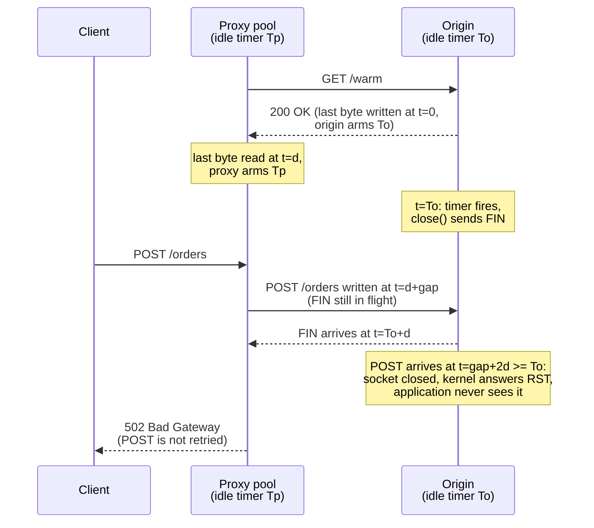

# The Keep-Alive Timeout Race Condition: Why Origin Idle Timeouts Must Exceed Proxy Idle Timeouts

> [!summary] Claim
> An HTTP/1.1 origin that closes an idle pooled connection gives the proxy no warning but a bare `FIN`, so any request the proxy writes during the last round trip before that `FIN` arrives is silently dropped and surfaces as `502 Bad Gateway` on `POST`; the window is empty only when the origin idle timeout is at least the proxy idle timeout plus one round trip.

Part of [TLS Connections and Intermediaries](README.md) in [API Engineering](../README.md).

## TL;DR

Mechanism: the proxy pool and the origin each run an independent idle timer on the same TCP connection, and HTTP/1.1 lets either side close an idle connection at any time with no in-band notice `(RFC 9112 Section 9.5)`, so a request can cross the origin's `FIN` on the wire and never be read.
Contract rule: the side that reuses connections (the proxy's upstream pool) must give up first, so set origin idle >= proxy idle + one RTT plus timer slack; nginx (`keepalive_timeout 60s` upstream default, with upstream keepalive on by default since 1.29.7) or an AWS ALB (`60` s idle default) in front of uvicorn (`--timeout-keep-alive 5` default) violates it out of the box.
Trap: equal timeouts still race, because the origin's timer starts when it writes the last response byte and the proxy's starts one one-way delay later when it reads it; the losing window is the gap interval `[origin_idle - RTT, min(origin_idle, proxy_idle))`.
Portability: HTTP/2 `GOAWAY` with a last-stream-id `(RFC 9113 Section 6.8)` and HTTP/3 `GOAWAY` `(RFC 9114 Section 5.2)` tell the client exactly which requests were not processed, so the race becomes a safe retry; HTTP/1.1 has no equivalent, and a proxy MUST NOT automatically retry non-idempotent requests `(RFC 9110 Section 9.2.2)`.
When not to use it: do not stretch an internet-facing origin's idle timeout to "fix" this, because the rule binds each pooled hop, not the public edge; and do not reach for `proxy_next_upstream non_idempotent`, which trades rare `502`s for duplicate side effects.

## Mental model



Read the arrows by timestamp.
The origin arms its idle timer when it finishes writing the last response (`t = 0`), and the proxy arms its own timer when that byte arrives one one-way delay `d` later, so the two timers are offset by `d` before either one fires.
When the origin timer fires at `To`, the `FIN` needs another `d` to reach the proxy, so the proxy still believes the connection is idle until `To + d`.
A request dispatched at proxy-local idle gap `gap` reaches the origin at `gap + 2d`; if that is at or after `To` while the proxy dispatched before the `FIN` arrived (`gap < To`), the bytes land on a closed socket, the origin kernel answers with `RST`, and the proxy reads `EOF` or `ECONNRESET` instead of a status line.
The proxy cannot tell whether the origin processed the request, so for `POST` it must answer `502 Bad Gateway` `(RFC 9110 Section 15.6.3)` rather than retry.

## How it works

### What the specification allows

RFC 9112 makes HTTP/1.1 connections persistent by default and lets a client keep sending until it sends or receives a `close` connection option `(RFC 9112 Section 9.3)`.
It places no requirement on idle timeouts: "The use of persistent connections places no requirements on the length (or existence) of this timeout for either the client or the server" `(RFC 9112 Section 9.5)`.
The same section names this race directly: "a client might have started to send a new request at the same time that the server has decided to close the "idle" connection" `(RFC 9112 Section 9.5)`.
It asks the closing side to "issue a graceful close" and asks implementations to "constantly monitor open connections for a received closure signal" `(RFC 9112 Section 9.5)`, but a graceful close of an idle HTTP/1.1 connection is still just a TCP `FIN`: the `Connection: close` option can only ride on a message `(RFC 9112 Section 9.6)`, and an idle connection has no message left to carry it.
Recovery is pushed to the client: "Implementations ought to anticipate the need to recover from asynchronous close events" and the retry conditions are those of `(RFC 9110 Section 9.2.2)` `(RFC 9112 Section 9.3.1)`.

RFC 9110 defines `PUT`, `DELETE`, and the safe methods (`GET`, `HEAD`, `OPTIONS`, `TRACE`) as idempotent and says they "can be repeated automatically if a communication failure occurs before the client is able to read the server's response" `(RFC 9110 Section 9.2.2)`.
For everything else the rule on intermediaries is absolute: "A proxy MUST NOT automatically retry non-idempotent requests" `(RFC 9110 Section 9.2.2)`.
The same section even describes the tempting heuristic, a client that retries `POST` "if the underlying transport connection closed before any part of a response is received, particularly if an idle persistent connection was used", and calls it "a riskier approach" `(RFC 9110 Section 9.2.2)`.

The `Keep-Alive` header does not rescue HTTP/1.1.
RFC 2068 defined it with the comment "HTTP/1.1 does not define any parameters" `(RFC 2068 Section 19.7.1.1)`, and RFC 9112 mentions it only as HTTP/1.0 compatibility history `(RFC 9112 Appendix C.2.2)`; a `timeout=` hint is a convention some clients read (Node.js `http.Agent` subtracts `agentKeepAliveTimeoutBuffer`, default `1000` ms, from a server-provided `keep-alive: timeout=...` hint, per the Node.js v26.13.0 `http` documentation, as of 2026-11), not a protocol guarantee.

### The timing derivation

Let `To` be the origin idle timeout, `Tp` the proxy pool idle timeout, `d` the one-way delay, and `gap` the idle time the proxy measures before it reuses the connection.
The proxy evicts the connection itself when `gap >= Tp` (`PROXY_EXPIRED`), sees the `FIN` before dispatch when `gap >= To` (`STALE_DETECTED`, assuming it watches idle sockets), and wins the race when the request reaches the origin before its timer fires, `gap + 2d < To` (`REUSED`).
Everything left loses (`RACE_LOST`): `To - 2d <= gap < min(To, Tp)`.
For any real path (`d > 0`) the window is empty exactly when `Tp <= To - 2d`, which is the rule `To >= Tp + RTT`; the degenerate `d = 0` has no window at all (`test_rule_is_exactly_an_empty_window_for_positive_delay` checks both on a grid).
Two consequences follow that intuition misses: equal timeouts (`To = Tp`) still leave a one-RTT window, and a proxy timeout far above the origin's (nginx `60s` over uvicorn `5`) leaves the same one-RTT window just below `To`, not a wide one, because gaps past `To` are caught by the `FIN`.
The lab encodes this exactly in integer microseconds (`classify_reuse`, `race_window`, `is_race_free` in `keep_alive_race.py`) and checks the closed form against a brute-force sweep of every gap from `0` to `2999` us.

The model is deliberately optimistic for the proxy: real origins arm the timer after the last write is queued to the transport, kernels delay `ACK`s, timers fire late under load, and a pool may not notice a `FIN` until its next poll.
Each of those widens the window, so production margins are seconds, not one RTT: AWS asks that the application idle timeout be "larger than the idle timeout configured for the load balancer" (AWS ALB documentation, `edit-load-balancer-attributes`, as of 2026-11).

### Probability per reuse

With Poisson arrivals at rate `r` on one pooled connection, idle gaps are exponential and `P(lose) = exp(-r * lo) - exp(-r * hi)` for the window `[lo, hi)` (`poisson_race_probability` in the lab, cross-checked against `100,000` seeded samples within `5%`).
For a narrow window this is about `r * RTT * exp(-r * To)`, which peaks at `r = 1 / To` (the lab asserts `0.2` req/s beats `0.05`, `0.1`, `0.5`, and `1.0` for `To = 5` s): busy connections never idle long enough to reach the window, and quiet ones mostly idle past `To` and hit the `FIN` first.
The worst-hit endpoints are therefore moderate-traffic ones, which is why the symptom looks like rare, unreproducible `502`s rather than a load-dependent failure.

### The wire view

The losing interleaving on one TCP connection, origin on the left, proxy on the right:

```text
t (from origin's last write)   origin -> proxy           proxy -> origin
0                              last response byte
To                             FIN (close(), idle timer)
d + gap   (gap < To)                                     POST /orders ... (74 bytes in the lab)
To + d                         FIN reaches proxy
gap + 2d  (>= To)              RST (socket already closed, data unread)
proxy read                     EOF or ECONNRESET, no status line
```

The proxy's `write()` succeeds because a received `FIN` only half-closes the connection; the lab proves this on loopback: after the peer closes, `send()` returns the full length and the next `recv()` returns `b""` (`test_loopback_write_after_peer_close_succeeds_and_reads_eof`, CPython 3.14.6, macOS 27.2 arm64).
The same test shows the pre-dispatch check a pool can run: `poll()` reports the idle socket readable and `recv(1, MSG_PEEK)` returns `b""`.

### Source: what the Python servers do when the idle timer fires

uvicorn arms the timer in `on_response_complete` with `self.loop.call_later(self.timeout_keep_alive, self.timeout_keep_alive_handler)` and cancels it in `data_received` via `_unset_keepalive_if_required` `(uvicorn 0.54.0 uvicorn/protocols/http/h11_impl.py, H11Protocol.on_response_complete)`.
`timeout_keep_alive_handler` sends `h11.ConnectionClosed()` and calls `self.transport.close()`, with no response bytes and no header `(uvicorn 0.54.0 uvicorn/protocols/http/h11_impl.py, H11Protocol.timeout_keep_alive_handler)`; the httptools backend's handler only calls `self.transport.close()` `(uvicorn 0.54.0 uvicorn/protocols/http/httptools_impl.py, HttpToolsProtocol.timeout_keep_alive_handler)`.
The default is `timeout_keep_alive: int = 5` `(uvicorn 0.54.0 uvicorn/config.py, Config.__init__)`, exposed as `--timeout-keep-alive` with `type=int` `(uvicorn 0.54.0 uvicorn/main.py, main)`.
uvicorn's graceful `shutdown()` closes connections whose cycle is complete immediately, the same bare close at deploy time `(uvicorn 0.54.0 uvicorn/protocols/http/h11_impl.py, H11Protocol.shutdown)`.
Hypercorn waits `keep_alive_timeout` (default `5 * SECONDS`) in `_idle_timeout` and then calls `_initiate_server_close` `(hypercorn 0.18.0 hypercorn/asyncio/tcp_server.py, TCPServer._idle_timeout)` `(hypercorn 0.18.0 hypercorn/config.py, Config)`.
Gunicorn's `keepalive` setting defaults to `2` seconds, and its own help text says "When Gunicorn is deployed behind a load balancer, it often makes sense to set this to a higher value" and that the `sync` worker "does not support persistent connections and will ignore this option" `(gunicorn 26.2.0 gunicorn/config.py, Keepalive)`.
Granian's `HTTP1Settings` has `keep_alive: bool = True`, `header_read_timeout: int = 30_000` (milliseconds), and no keep-alive timeout field `(granian 2.8.7 granian/http.py, HTTP1Settings)`.
Measured against the Rust engine, not read from its source: an idle HTTP/1.1 keep-alive connection gets a bare `FIN` with no response bytes after `header_read_timeout`, `30.004` s at the default and `4.001` s with `--http1-header-read-timeout 4000` (`granian --interface asgi`, one run each, CPython 3.14.6, macOS 27.2 arm64), and `test_granian_closes_idle_http1_connection_at_header_read_timeout` asserts it at `1000` ms.

### Source: what h11 and httpcore do on the proxy side

In `h11 0.16.0` the `SERVER` entry of the transition table, which the proxy's client-side `Connection` uses to track the origin, accepts `ConnectionClosed` only in `IDLE`, `DONE`, `MUST_CLOSE`, or `CLOSED` `(h11 0.16.0 h11/_state.py, EVENT_TRIGGERED_TRANSITIONS)`.
An `EOF` while the server is in `SEND_RESPONSE` makes `ConnectionState._fire_event_triggered_transitions` raise `LocalProtocolError` `(h11 0.16.0 h11/_state.py, ConnectionState._fire_event_triggered_transitions)`, which `next_event` re-raises as `RemoteProtocolError` `(h11 0.16.0 h11/_connection.py, Connection.next_event)`.
The lab drives real `h11.Connection` objects through the losing interleaving and captures `can't handle event type ConnectionClosed when role=SERVER and state=SEND_RESPONSE`.
If the `FIN` is processed first, h11 moves the proxy side to `MUST_CLOSE` and the server side to `CLOSED`, and `send()` of a new `Request` on that connection raises `LocalProtocolError` (`test_h11_refuses_to_reuse_a_connection_once_the_fin_is_processed`).
httpcore wraps that case as `RemoteProtocolError("Server disconnected without sending a response.")` `(httpcore 1.0.9 httpcore/_async/http11.py, AsyncHTTP11Connection._receive_event)`.
Its `has_expired()` treats an `IDLE` connection whose socket is readable as server-disconnected, which closes the `STALE_DETECTED` case `(httpcore 1.0.9 httpcore/_async/http11.py, AsyncHTTP11Connection.has_expired)`, but nothing can close the in-flight window, and its connection-level `retries` only cover `ConnectError` and `ConnectTimeout` `(httpcore 1.0.9 httpcore/_async/connection.py, AsyncHTTPConnection._connect)`.

### Why HTTP/2 and HTTP/3 make it recoverable

RFC 9113 states the same race and fixes it: "There is an inherent race condition between an endpoint starting new streams and the remote peer sending a GOAWAY frame", so `GOAWAY` carries the last stream that "was or might be processed" `(RFC 9113 Section 6.8)`.
Streams above that id "can be safely retried using a new connection" `(RFC 9113 Section 6.8)`, and a `RST_STREAM` with `REFUSED_STREAM` marks a stream closed before any processing; such requests "have not failed; clients MAY automatically retry them, even those with non-idempotent methods" `(RFC 9113 Section 8.7)`.
HTTP/3 uses `GOAWAY` the same way `(RFC 9114 Section 5.2)`, and its idle timeout is negotiated in the QUIC handshake, so a client "SHOULD" open a new connection when approaching it `(RFC 9114 Section 5.1)`.
RFC 9113 also notes that middleboxes "silently discard connection bindings" on idle connections and offers `PING` as a safe liveness probe `(RFC 9113 Section 8.7)`.

## Numbers and limits

| Parameter | Value | Source or measurement context |
|---|---|---|
| uvicorn `timeout_keep_alive` default | `5` s, integer seconds only | `(uvicorn 0.54.0 uvicorn/config.py, Config.__init__)`; asserted by `test_python_server_idle_defaults_are_below_common_proxy_defaults` |
| Hypercorn `keep_alive_timeout` default | `5` s; `keep_alive_max_requests = 1000` | `(hypercorn 0.18.0 hypercorn/config.py, Config)`; timeout asserted in the lab |
| Gunicorn `keepalive` default | `2` s | `(gunicorn 26.2.0 gunicorn/config.py, Keepalive)` |
| Granian HTTP/1 idle close | `header_read_timeout` `30_000` ms default; measured `30.004` s | `(granian 2.8.7 granian/http.py, HTTP1Settings)`; `granian --interface asgi`, CPython 3.14.6, macOS 27.2 arm64, 2026-11-09 |
| Node.js `server.keepAliveTimeout` | `5000` ms, plus `server.keepAliveTimeoutBuffer` `1000` ms (added v24.6.0, v22.19.0) | Node.js v26.13.0 `http` documentation (as of 2026-11); its `http.createServer()` options list says `65000`, but v26.13.0 `lib/_http_server.js` sets `5_000` and a live `node` v26.13.0 `http.createServer()` reports `5000` and `1000` |
| nginx upstream `keepalive_timeout` | `60s` (directive since 1.15.3) | nginx `ngx_http_upstream_module` documentation (as of 2026-11) |
| nginx upstream `keepalive` | `32 local`, enabled by default since 1.29.7; `keepalive_requests 1000`; `keepalive_time 1h` | nginx `ngx_http_upstream_module` documentation (as of 2026-11) |
| AWS ALB `idle_timeout.timeout_seconds` | `60` s default, range `1` to `4000` s | AWS ALB `edit-load-balancer-attributes` (as of 2026-11) |
| AWS ALB `client_keep_alive.seconds` | `3600` s default, range `60` to `604800` s | AWS ALB `edit-load-balancer-attributes` (as of 2026-11) |
| Envoy `HttpProtocolOptions.idle_timeout` | `1 hour` default | Envoy `config.core.v3.HttpProtocolOptions` documentation (as of 2026-11) |
| Width of the losing window | exactly one RTT (`1000` us for `d = 500` us) when `Tp > To - RTT` and `To - RTT >= 0` | Lab model, `test_default_nginx_over_uvicorn_has_a_one_rtt_race_window` |
| Loss probability per reuse, nginx `60s` over uvicorn `5`, `d = 500` us | `3.89e-05` at `0.05` req/s, `7.36e-05` at `0.2` req/s, `6.74e-06` at `1.0` req/s | Computed by `poisson_race_probability` (a model, not a traffic measurement) and asserted in `test_poisson_probability_matches_formula_and_seeded_sampling`, CPython 3.14.6, macOS 27.2 arm64 |
| Request bytes the proxy writes successfully into the lost race | `74` bytes (`54`-byte head plus a `20`-byte JSON body) | `replay_lost_race`, asserted in `test_h11_proxy_gets_eof_instead_of_a_response_when_request_crosses_fin`, h11 0.16.0, CPython 3.14.6 |
| uvicorn idle close with `timeout_keep_alive=1` | `EOF` measured `1.0007` to `1.0021` s after the response (five connections, `time.monotonic()`); the test asserts `0.9` to `3.0` s | uvicorn 0.54.0 `http="h11"` on `127.0.0.1`, CPython 3.14.6, macOS 27.2 arm64 (`Darwin 27.2.0`), 2026-11-09 |

## Portability

| Runtime, server, or protocol | Idle close signal | Lost-race outcome | Verification |
|---|---|---|---|
| CPython `3.12.13`, `3.13.18`, `3.14.6`, `3.14.10`, `3.15.2` with h11 0.16.0 and uvicorn 0.54.0 | Bare `FIN` | Proxy reads `EOF`, application never sees the `POST` | `26 passed` under each interpreter via `uv run --frozen --python <v>` with a separate `UV_PROJECT_ENVIRONMENT` per version, macOS 27.2 arm64; `3.12.16` was not available here, `3.12.13` ran instead |
| CPython `3.15.0b3` | - | Not run | Collection failed: `ModuleNotFoundError: No module named 'hypothesis._native'` from the workspace's `hypothesis` plugin |
| CPython `3.14.6t`, `3.15.0b3t`, and `3.15.2t` free-threaded | - | Not run | `3.14.6t` and `3.15.0b3t`: `psycopg-binary==3.3.8` has no wheel for the platform; `3.15.2t`: no interpreter available to `uv` |
| uvicorn 0.54.0, `h11` backend | `ConnectionClosed` then `transport.close()`, no header | `FIN`, then `RST` on late data | Lab socket test (`http="h11"`) and source |
| uvicorn 0.54.0, `httptools` backend | `transport.close()` | Same | Source only `(uvicorn 0.54.0 uvicorn/protocols/http/httptools_impl.py, HttpToolsProtocol.timeout_keep_alive_handler)` |
| Hypercorn 0.18.0 | `_initiate_server_close` after `keep_alive_timeout` | Same for HTTP/1.1 | Default asserted in the lab; close path from source |
| Granian 2.8.7 | Bare `FIN` after `header_read_timeout` (no keep-alive timeout setting) | Same | Lab socket test with `header_read_timeout=1_000` (embedded `granian.server.embed.Server`, `ASGINL`); default asserted in the lab |
| Proxy pool on httpcore 1.0.9 (httpx 0.28.1) | Detects a received `FIN` on idle sockets via `is_readable` | `RemoteProtocolError("Server disconnected without sending a response.")`, never retried | Source `(httpcore 1.0.9 httpcore/_async/http11.py, AsyncHTTP11Connection.has_expired)` |
| HTTP/1.1 | None defined for idle connections | Unknowable whether processed; `POST` -> `502` | `(RFC 9112 Section 9.5)`, `(RFC 9110 Section 9.2.2)` |
| HTTP/2 | `GOAWAY` with last-stream-id, `REFUSED_STREAM` | Unprocessed streams safely retried, any method | `(RFC 9113 Section 6.8)`, `(RFC 9113 Section 8.7)` |
| HTTP/3 over QUIC | Negotiated QUIC idle timeout, `GOAWAY` | Requests at or above the `GOAWAY` id are rejected and retryable | `(RFC 9114 Section 5.1)`, `(RFC 9114 Section 5.2)` |

## Worked example

The [implementation](../labs/src/api_labs/f02_tls_connections_and_intermediaries/keep_alive_race.py) models the two timers in integer microseconds, replays the interleaving through real `h11` state machines, and applies the RFC 9110 retry rule; the [test](../labs/tests/f02_tls_connections_and_intermediaries/test_keep_alive_timeout_races_between_reverse_proxies_and_origins.py) also runs a real uvicorn on `127.0.0.1:0`.

The core of the model, verbatim from `keep_alive_race.py`:

```python
def classify_reuse(t: Timeouts, idle_gap_us: int) -> Outcome:
    """Classify a reuse attempt `idle_gap_us` after the proxy read the last response.

    Time 0 is when the origin wrote the last response byte and armed its idle
    timer. The proxy reads that byte at d and arms its own timer then, so the
    two timers are offset by one one-way delay d. The proxy dispatches at
    d + gap; the request reaches the origin at gap + 2d. The origin FIN leaves
    at origin_idle and reaches the proxy at origin_idle + d.
    """
    if idle_gap_us < 0:
        raise ValueError("idle gap must be non-negative")
    if idle_gap_us >= t.proxy_idle_us:
        return Outcome.PROXY_EXPIRED
    if idle_gap_us >= t.origin_idle_us:
        return Outcome.STALE_DETECTED
    if idle_gap_us + t.rtt_us < t.origin_idle_us:
        return Outcome.REUSED
    # A tie (arrival exactly when the origin timer fires) counts as lost:
    # the origin's close and the arriving bytes are not ordered by anything.
    return Outcome.RACE_LOST


def race_window(t: Timeouts) -> tuple[int, int] | None:
    """Return the half-open gap interval [lo, hi) that loses the race, or None."""
    lo = max(0, t.origin_idle_us - t.rtt_us)
    hi = min(t.origin_idle_us, t.proxy_idle_us)
    return (lo, hi) if lo < hi else None


def is_race_free(t: Timeouts) -> bool:
    """The rule: origin idle >= proxy idle + one round trip closes the window."""
    return t.origin_idle_us >= t.proxy_idle_us + t.rtt_us
```

The retry policy the proxy applies once the race is lost, also verbatim:

```python
def proxy_response(
    method: str, outcome: Outcome, *, retry_non_idempotent: bool = False
) -> ProxyResult:
    """Status the client sees, applying RFC 9110 Section 9.2.2 retry rules.

    A proxy MUST NOT automatically retry non-idempotent requests, so a lost
    race on `POST` surfaces as `502 Bad Gateway`. `retry_non_idempotent`
    models an override such as nginx `proxy_next_upstream non_idempotent`.
    """
    if outcome is not Outcome.RACE_LOST:
        return ProxyResult(status=200, upstream_attempts=1)
    if method.upper() in IDEMPOTENT_METHODS or retry_non_idempotent:
        return ProxyResult(status=200, upstream_attempts=2)
    return ProxyResult(status=502, upstream_attempts=1)
```

The defaults case, verbatim from the test module:

```python
# nginx upstream `keepalive_timeout` default (60s) in front of uvicorn's default (5s).
NGINX_IN_FRONT_OF_UVICORN = Timeouts(
    proxy_idle_us=60 * SECOND_US, origin_idle_us=5 * SECOND_US, one_way_delay_us=500
)


@pytest.mark.unit
def test_default_nginx_over_uvicorn_has_a_one_rtt_race_window() -> None:
    t = NGINX_IN_FRONT_OF_UVICORN
    assert race_window(t) == (5 * SECOND_US - 1_000, 5 * SECOND_US)
    assert not is_race_free(t)
    assert classify_reuse(t, 5 * SECOND_US - 1_001) is Outcome.REUSED
    assert classify_reuse(t, 5 * SECOND_US - 1_000) is Outcome.RACE_LOST
    assert classify_reuse(t, 5 * SECOND_US - 1) is Outcome.RACE_LOST
    assert classify_reuse(t, 5 * SECOND_US) is Outcome.STALE_DETECTED
    assert classify_reuse(t, 60 * SECOND_US) is Outcome.PROXY_EXPIRED
```

The end-to-end test starts uvicorn with `timeout_keep_alive=1`, completes one `GET`, confirms the response carries neither `Connection` nor `Keep-Alive`, waits for the `FIN`, then writes a `POST` and asserts that no response arrives and that the ASGI app was called only for the `GET`.

Captured with CPython 3.14.6 on macOS 27.2 arm64 (`Darwin 27.2.0`), from `labs/`:

```text
$ uv run --frozen pytest tests/f02_tls_connections_and_intermediaries/test_keep_alive_timeout_races_between_reverse_proxies_and_origins.py -q
..........................                                              [100%]
26 passed in 2.31s
```

Fourteen mutations in the fact-check pass (ignoring the delay, dropping the RTT margin from the rule, using one-way delay in the window, retrying every method, counting `POST` as idempotent, a linear probability, counting the tie as reused, swapping the eviction checks, not counting the body bytes, never delivering the `FIN`, skipping the send on a stale connection, ignoring the proxy timeout in the window, a `5` s uvicorn timeout, a `4` s Granian `header_read_timeout`) each made at least one test fail.
The finish pass added tests for every idempotent method, the zero clamp on the window start, and input validation after finding that dropping `DELETE` from the idempotent set, removing the clamp, and removing the timeout validation survived; it then ran twelve more mutations, all killed.

## Pitfalls

> [!warning] Default server timeouts behind a 60-second balancer
> Trigger: uvicorn (`5` s), Hypercorn (`5` s), Gunicorn (`2` s, non-`sync` workers), Granian (`30` s `header_read_timeout`), or Node.js (`5000` ms) behind an AWS ALB (`60` s) or nginx upstream keepalive (`60s`).
> Symptom: rare `502 Bad Gateway` on `POST` with nothing in the application log; AWS lists "The target closed the connection with a TCP RST or a TCP FIN while the load balancer had an outstanding request to the target" and says to "Check whether the keep-alive duration of the target is shorter than the idle timeout value of the load balancer" (AWS ALB troubleshooting, HTTP 502, as of 2026-11).
> Fix: raise the origin timeout above the balancer's with seconds of margin, for example `uvicorn --timeout-keep-alive 75` behind a `60` s ALB, or lower the proxy's pool idle timeout below the origin's.

> [!warning] Equal timeouts look safe and are not
> Trigger: setting both sides to `60` s "to match".
> Symptom: the same one-RTT window remains, because the origin's timer starts one one-way delay earlier than the proxy's (`test_equal_timeouts_still_race`).
> Fix: make the origin strictly longer by at least RTT plus timer slack; uvicorn's `--timeout-keep-alive` is `type=int`, so the smallest step is a full second.

> [!warning] Deploys reopen the race
> Trigger: rolling restarts; uvicorn's `shutdown()` closes every connection whose response is complete with no signal `(uvicorn 0.54.0 uvicorn/protocols/http/h11_impl.py, H11Protocol.shutdown)`.
> Symptom: a burst of `502`s at every deploy even with correct idle timeouts.
> Fix: deregister from the balancer and wait out its pool idle time before sending `SIGTERM` (see [[Graceful-Shutdown-SIGTERM-Drain-Windows-and-Kubernetes-PreStop-Hooks]]), or speak HTTP/2 upstream so shutdown sends `GOAWAY`.

> [!warning] "Fixing" 502s by retrying POST
> Trigger: nginx `proxy_next_upstream ... non_idempotent`; nginx documents that "normally, requests with a non-idempotent method (POST, LOCK, PATCH) are not passed to the next server if a request has been sent to an upstream server (1.9.13); enabling this option explicitly allows retrying such requests" (nginx `ngx_http_proxy_module`, as of 2026-11).
> Symptom: duplicate orders or payments when the failure was not this race but an origin that processed the request and then died before responding; the proxy cannot tell the two apart over HTTP/1.1.
> Fix: leave the RFC 9110 rule in place and make retries safe at the application layer with an idempotency key (see [[Idempotency-Key-Header-Specification-and-State-Machine-Draft-08]]).

> [!warning] Middleboxes that drop idle state without any FIN
> Trigger: a NAT, firewall, or connection-tracking table with an idle timeout shorter than both endpoints'.
> Symptom: no `FIN` ever arrives, so the proxy's stale check passes and the reused request hangs until a read timeout, often reported as `504 Gateway Timeout` rather than `502`; RFC 9113 notes that middleboxes "silently discard connection bindings" `(RFC 9113 Section 8.7)`.
> Fix: keep both endpoint idle timeouts below the middlebox's, or use HTTP/2 `PING` liveness checks where the hop supports them.

No CVE or first-party incident postmortem for this race was fetched for this note; the primary sources above are the RFCs and vendor documentation that describe it.

## Security and robustness

Raising the origin idle timeout has a cost: each idle connection holds a file descriptor, a protocol object, and buffers, so an origin reachable directly from the internet with a `75` s idle timeout is cheaper to exhaust with idle connections, which is the OWASP API Security Top 10 2023 risk `API4:2023 Unrestricted Resource Consumption`.
Apply the long timeout only on the listener the proxy uses, enforce that with network policy so only the proxy can reach it, and cap total connections (nginx's `keepalive` count bounds idle cached connections per worker but, as its documentation notes, not the total it opens).
Retries are an amplification surface: a proxy that retries idempotent requests after a lost race doubles origin work for those requests, and stacked retry layers multiply it (see [[Retry-Budgets-and-Preventing-Cascading-Retry-Amplification-Storms]]).
An idempotent method is a promise about intended effect only `(RFC 9110 Section 9.2.2)`; a `PUT` handler with a non-idempotent side effect, such as sending an email, turns the proxy's legitimate retry into a duplicate.
Treat `502` rates per upstream connection age as a signal: a spike just below the origin's idle timeout is this race, while a flat rate points to crashes or framing errors (see [[HTTP-Request-Smuggling-CL-TE-and-Desync-Mechanics]] for the framing case).

## The principal's view

The decision is to make idle timeouts an owned, ordered contract across every pooled hop rather than a per-team default.
For each hop, the side that reuses connections must time out first: client pool < edge listener, edge upstream pool < service listener, service outbound pool < dependency listener, each with an explicit margin of seconds.
Encode it as a configuration lint in CI that reads balancer, proxy, and server settings together, because the failure is a property of a pair of configs owned by different teams, and neither config is wrong in isolation.
The organizational trade-off is coupling: a platform team that changes a balancer timeout now owes every service behind it a change, so publish the platform's pool timeouts as a versioned contract instead of letting each service guess.
Prefer HTTP/2 between proxy and origin where both sides support it, because `GOAWAY` and `REFUSED_STREAM` turn this race from data loss into a safe retry `(RFC 9113 Section 8.7)`, and nginx accepts `proxy_http_version 2` for upstreams since 1.29.4 (nginx `ngx_http_proxy_module`, as of 2026-11); the cost is HTTP/2's own operational surface (flow control, `SETTINGS`, concurrent-stream limits) and less mature HTTP/2 support in some Python servers.
Independently of transport, give non-idempotent APIs idempotency keys, because no timeout ordering covers an origin that crashes mid-request.
Choose a different design entirely, such as an asynchronous `202 Accepted` job API, when a duplicate or lost write is unacceptable and the client cannot retry safely.

## Interview questions

> [!question] L5: Why does a reverse proxy return `502 Bad Gateway` for a `POST` that the origin never saw?
>
> > [!success]- Answer
> > The origin's idle timer closed the pooled connection with a bare `FIN`, and the proxy wrote the `POST` before that `FIN` reached it.
> > The bytes arrived at a closed socket, so the origin kernel answered with `RST` and the application never read them.
> > The proxy read `EOF` instead of a status line and cannot know whether the request was processed, so `RFC 9110 Section 9.2.2` forbids it from retrying a `POST` and it answers `502`.
> >
> > Follow-up: Why would the same failure on a `GET` usually be invisible to the client?

> [!question] L5: An AWS ALB has the default `60` s idle timeout and the targets run uvicorn with defaults; what do you change and to what?
>
> > [!success]- Answer
> > uvicorn's `--timeout-keep-alive` defaults to `5` s, which is shorter than the ALB's `60` s, the exact case AWS's `502` troubleshooting entry describes.
> > Raise it above the ALB's with margin, for example `--timeout-keep-alive 75`.
> > Equal values are not enough, because the origin's timer starts one one-way delay before the balancer's.
> >
> > Follow-up: What new risk does a `75` s idle timeout create if the target is also reachable directly from the internet?

> [!question] L6: Predict the output: with `proxy_idle_us=60 * SECOND_US`, `origin_idle_us=5 * SECOND_US`, and `one_way_delay_us=500`, what do `classify_reuse` return for gaps of `4_998_999`, `4_999_000`, `5_000_000`, and `60_000_000` microseconds?
>
> > [!success]- Answer
> > `REUSED`, `RACE_LOST`, `STALE_DETECTED`, `PROXY_EXPIRED`.
> > The request reaches the origin at `gap + 2d`, so `4_998_999 + 1_000 < 5_000_000` wins, while `4_999_000 + 1_000 = 5_000_000` ties with the origin timer and is counted as lost.
> > At `5_000_000` the proxy dispatches exactly when the `FIN` arrives, so it sees the close first, and at `60_000_000` the proxy's own timer evicted the connection.
> >
> > Follow-up: How wide is the losing window, and does it grow if the proxy timeout rises to `3600` s?

> [!question] L6: Why do equal idle timeouts on proxy and origin still race, and what is the minimum safe margin?
>
> > [!success]- Answer
> > The origin arms its timer when it writes the last response byte, and the proxy arms its timer when it reads that byte one one-way delay later.
> > The proxy also needs one more one-way delay to learn about the `FIN`, while its request needs one one-way delay to reach the origin.
> > Losing gaps are `[To - RTT, min(To, Tp))`, which is empty only when `To >= Tp + RTT`; real margins add timer slack and are measured in seconds.
> >
> > Follow-up: Which real-world effects make the window wider than the one-RTT model predicts?

> [!question] L6: Debug this API: an internal service sees about one `502` per `20,000` `POST`s through nginx, none for `GET`, nothing in the app logs, and the rate is highest on the moderately busy endpoints, not the busiest; the upstream block has `keepalive 32;` and the app runs `uvicorn` with default settings.
>
> > [!success]- Answer
> > nginx's upstream `keepalive_timeout` defaults to `60s`, while uvicorn's `--timeout-keep-alive` defaults to `5` s, so the origin closes pooled connections first.
> > `GET`s hit the same race, but nginx's default `proxy_next_upstream error timeout` allows passing them to the next server, while a non-idempotent `POST` is not passed on once it has been sent to an upstream server (since 1.9.13).
> > Moderate traffic is worst because the loss probability per reuse peaks near one request per origin idle interval; very busy connections never idle that long.
> > Fix by setting `--timeout-keep-alive` above `60` or `keepalive_timeout` in the upstream block below uvicorn's, and confirm with `502` counts bucketed by upstream connection idle time.
> >
> > Follow-up: Which nginx log variables or upstream status fields would you use to prove the `502`s come from reused connections?

> [!question] L6: How does httpcore 1.0.9 avoid reusing a connection the server already closed, and why can it not avoid this race completely?
>
> > [!success]- Answer
> > `AsyncHTTP11Connection.has_expired()` treats an `IDLE` connection whose socket is readable as server-disconnected, because the only valid pending read on an idle connection is the `EOF`.
> > That catches every case where the `FIN` arrived before dispatch.
> > It cannot catch a `FIN` still in flight, and when the read then returns `b""` in `SEND_RESPONSE` it raises `RemoteProtocolError("Server disconnected without sending a response.")` without retrying, since `retries` covers only `ConnectError` and `ConnectTimeout`.
> >
> > Follow-up: Would you add an automatic retry for this error in an internal httpx client, and for which methods?

> [!question] L7+: Why is HTTP/2 between proxy and origin a structural fix for this race rather than a tuning fix?
>
> > [!success]- Answer
> > RFC 9113 Section 6.8 gives the closing side a `GOAWAY` frame carrying the highest stream id it might have processed, and Section 8.7 adds `REFUSED_STREAM` for streams it guarantees were untouched.
> > Requests above that id provably were not processed, so the client may retry them on a new connection even for `POST`.
> > HTTP/1.1 has no in-band way to say that on an idle connection, so ordering timeouts only shrinks the probability while HTTP/2 converts the outcome into a safe retry.
> >
> > Follow-up: What happens if the origin closes an HTTP/2 connection without sending `GOAWAY` first?

> [!question] L7+: Design the timeout policy for client -> CDN -> regional ALB -> Envoy sidecar -> Python service -> database proxy, and say who owns it.
>
> > [!success]- Answer
> > On every pooled hop the reusing side must expire first, so each listener's idle timeout exceeds the upstream pool idle timeout pointing at it by a margin of seconds.
> > Publish the platform-owned values (CDN and ALB pools, Envoy's `idle_timeout`, which defaults to one hour) as a versioned contract and lint every service's server config against it in CI.
> > Use HTTP/2 or gRPC on hops that support it so `GOAWAY` covers deploys and idle closes, and require idempotency keys on non-idempotent APIs because no ordering covers mid-request crashes.
> >
> > Follow-up: How would you roll out a reduction of the ALB idle timeout without a spike of `502`s?

> [!question] L7+: A team proposes turning on `proxy_next_upstream non_idempotent` because the `502`s are "always the keep-alive race"; how do you respond?
>
> > [!success]- Answer
> > Over HTTP/1.1 the proxy cannot distinguish a request that crossed a `FIN` from one the origin processed before crashing or being killed, because both look like `EOF` before any response.
> > Retrying converts the first into success and the second into a duplicate side effect, which is why RFC 9110 Section 9.2.2 says a proxy MUST NOT automatically retry non-idempotent requests.
> > Fix the timeout ordering, drain before shutdown, and add idempotency keys so the application, which can tell, decides whether a retry is safe.
> >
> > Follow-up: What evidence would show what share of the `502`s actually comes from reused idle connections?

## Related

Prerequisites: [[TCP-Connection-Lifecycle-Keep-Alive-and-TIME-WAIT]], [[HTTP-1-1-Framing-Keep-Alive-and-Chunked-Encoding]]

Next: [[Outbound-Connection-Pools-Limits-and-DNS-TTL-Staleness]]

See also: [[HTTP-Retries-and-Timeouts-with-curl]], [[Proxy-and-Application-Timeout-and-Retry-Interaction-Hazards]], [[Timeout-Taxonomy-Connect-Read-Write-Pool-and-Deadline-Propagation]], [[Graceful-Shutdown-SIGTERM-Drain-Windows-and-Kubernetes-PreStop-Hooks]], [[Uvicorn-Internals-Server-Lifecycle-Protocols-and-Flow-Control]], [[HTTP-2-Binary-Framing-and-Stream-State-Machine]], [[Idempotency-Key-Header-Specification-and-State-Machine-Draft-08]], [[Hop-by-Hop-vs-End-to-End-Headers-and-Connection-Header-Abuse]], [[Envoy-Proxy-Internals-Listeners-Filter-Chains-HCM-and-Clusters]]

- Lab: `labs/tests/f02_tls_connections_and_intermediaries/test_keep_alive_timeout_races_between_reverse_proxies_and_origins.py`

## Further reading

- [RFC 9112: HTTP/1.1](https://www.rfc-editor.org/rfc/rfc9112.html) - Section 9.5 names this exact race and places no requirement on idle timeouts; Section 9.3.1 delegates recovery to the RFC 9110 retry rules.
- [RFC 9110: HTTP Semantics](https://www.rfc-editor.org/rfc/rfc9110.html) - Section 9.2.2 defines idempotent methods and says a proxy MUST NOT automatically retry non-idempotent requests; Section 15.6.3 defines `502 Bad Gateway`.
- [RFC 9113: HTTP/2](https://www.rfc-editor.org/rfc/rfc9113.html) - Section 6.8 `GOAWAY` and Section 8.7 `REFUSED_STREAM` are the protocol-level fix for this race.
- [RFC 9114: HTTP/3](https://www.rfc-editor.org/rfc/rfc9114.html) - Sections 5.1 and 5.2 cover negotiated QUIC idle timeouts and `GOAWAY` shutdown.
- [uvicorn 0.54.0 `h11_impl.py`](https://github.com/encode/uvicorn/blob/0.54.0/uvicorn/protocols/http/h11_impl.py) - `on_response_complete` and `timeout_keep_alive_handler` show where the origin's idle timer is armed and how it closes.
- [httpcore 1.0.9 `http11.py`](https://github.com/encode/httpcore/blob/1.0.9/httpcore/_async/http11.py) - `has_expired` and `_receive_event` show what a Python proxy-side pool can and cannot detect.
- [AWS ALB connection idle timeout](https://docs.aws.amazon.com/elasticloadbalancing/latest/application/edit-load-balancer-attributes.html) - Vendor statement of the rule and the `60` s default.
- [nginx upstream module](https://nginx.org/en/docs/http/ngx_http_upstream_module.html) - `keepalive`, `keepalive_timeout`, and `keepalive_requests` defaults for the proxy side of the pair.
