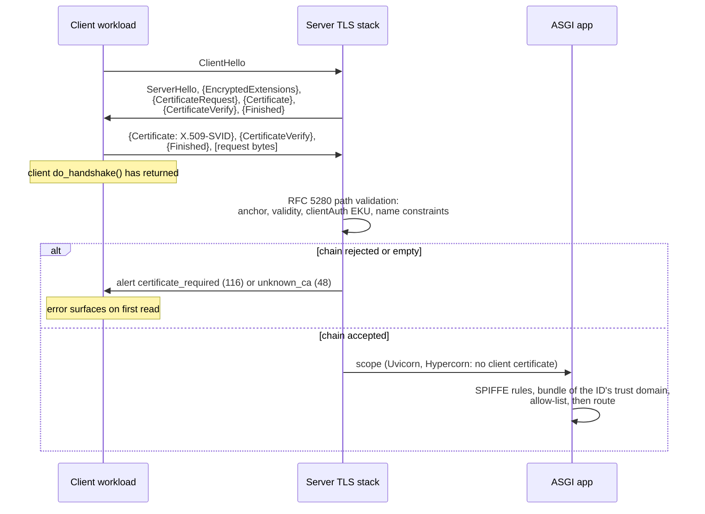

# Mutual TLS (mTLS) Client Authentication, Certificate Pinning, and SPIFFE SVID URI Identities

> [!summary] Claim
> A mutual TLS handshake proves only that the client holds a key some anchor in your trust store certified, so the identity an API should authorize is the single URI SAN of an X.509-SVID checked against the bundle of that ID's own trust domain, and on Python servers that check is yours to write: Uvicorn 0.54.0 and Hypercorn 0.18.0 verify the client certificate but hand the ASGI app nothing, and under TLS 1.3 a rejected client finds out only when it first reads.

Part of [TLS Connections and Intermediaries](README.md) in [API Engineering](../README.md).

## TL;DR

Mechanism: the server sends `CertificateRequest` after `EncryptedExtensions`, the client answers with `Certificate`, `CertificateVerify` (a signature over the transcript), and `Finished`, and the server then runs RFC 5280 path validation, which in OpenSSL also enforces the `id-kp-clientAuth` purpose and URI name constraints `(RFC 9846 Section 4.4.2)` `(RFC 9846 Section 4.5.1)` `(RFC 9846 Section 4.5.2)`.
Contract rule: an X.509-SVID carries exactly one URI SAN, `cA` false, no `keyCertSign` or `cRLSign`, and a SPIFFE ID with a non-root path, and validators MUST reject anything else `(X509-SVID Section 5.2)`; the ID itself is `spiffe://<trust-domain>/<path>` with lowercase `[a-z0-9.-_]` trust domains, no query, fragment, port, userinfo, or dot segments, and implementations MUST support IDs up to 2048 bytes and SHOULD NOT generate longer ones `(SPIFFE-ID Section 2)` `(SPIFFE-ID Section 2.3)`.
Trap: in TLS 1.3 the server checks the client certificate after the client's `do_handshake()` has already returned, so a client without an acceptable certificate sends its request and then gets `certificate_required` (`116`) or `unknown_ca` (`48`) on its first read, while in TLS 1.2 the same failure happens inside the handshake; the lab measures both on every interpreter.
Portability: all 77 lab tests pass on CPython 3.12.13, 3.12.16, 3.13.18, 3.14.6, 3.14.10, 3.15.2, and 3.15.0b3 free-threaded, on macOS, Debian Trixie, and Alpine musl, but Debian's OpenSSL compresses Certificate messages (RFC 8879) so byte-exact flight sizes differ there, OpenSSL 4.1.0 renamed `SSLV3_ALERT_*` reasons to `TLS_ALERT_*`, `create_default_context()` adds `VERIFY_X509_STRICT` only from 3.13, and no Python server checked here implements the ASGI TLS extension (as of 2026-11).
When not to use it: do not use mTLS alone for per-user or per-route authorization, browser clients, or HTTP/2 and HTTP/3 step-up authentication (post-handshake auth is forbidden there `(RFC 8740 Section 3)` `(RFC 9001 Section 4.4)`); use OAuth tokens bound to the certificate `(RFC 8705 Section 3)` or a terminating proxy that forwards identity ([[Client-Cert-Header-and-TLS-Terminating-Proxies-RFC-9440]]).

## Mental model



The second arrow is one server flight: the `CertificateRequest` is encrypted under the server handshake keys and MUST follow `EncryptedExtensions` `(RFC 9846 Section 4.4.2)`.
The third arrow is the client's whole authentication block plus, because the client's handshake is complete, the first application bytes; the note over the client marks the moment CPython's `do_handshake()` returns.
The self-arrow is where OpenSSL decides, after it has the client's `Finished`, so the outcome reaches the client as an alert it reads later, which is exactly the uncertainty RFC 9846 warns about: a client cannot know whether the server considers it authenticated unless the application layer tells it `(RFC 9846 Appendix F.1.2)`.
The last two arrows are the gap this note is about: the TLS stack accepted some certificate, but the authorization decision (which workload, from which trust domain) has to be made by code that can see the certificate, and the Python servers measured here do not pass it on.

## How it works

### The client authentication block on the wire

A server that authenticates with a certificate MAY request one from the client with `CertificateRequest` `(RFC 9846 Section 4.4.2)`; the structures below are a simplified excerpt of RFC 9846 Sections 4.4.2, 4.5.1, and 4.5.2 (X.509 case only, comments added):

```text
struct {
    opaque certificate_request_context<0..2^8-1>;   /* zero length in the main handshake */
    Extension extensions<0..2^16-1>;                /* signature_algorithms MUST be present */
} CertificateRequest;

struct {
    opaque certificate_request_context<0..2^8-1>;   /* echoed from the request */
    CertificateEntry certificate_list<0..2^24-1>;   /* leaf first; empty = no certificate */
} Certificate;

struct {
    opaque cert_data<1..2^24-1>;                    /* one DER X.509 certificate */
    Extension extensions<0..2^16-1>;
} CertificateEntry;

struct {
    SignatureScheme algorithm;
    opaque signature<0..2^16-1>;
} CertificateVerify;
```

The client MUST answer a `CertificateRequest` with a `Certificate` message, an empty `certificate_list` if it has nothing suitable, and MUST send `Finished` either way `(RFC 9846 Section 4.5.1)`.
`CertificateVerify` signs 64 bytes of `0x20`, the context string `"TLS 1.3, client CertificateVerify"`, a `0x00` separator, and `Transcript-Hash(Handshake Context, Certificate)`, which is what proves possession of the private key and binds it to this handshake `(RFC 9846 Section 4.5.2)`.
The CA hint lives in the optional `certificate_authorities` extension of `CertificateRequest` `(RFC 9846 Section 4.3.4)`; CPython's `_ssl.c` never calls `SSL_CTX_set_client_CA_list` or `SSL_CTX_set0_CA_list` (no match in `cpython v3.14.6 Modules/_ssl.c`), and the plaintext TLS record headers show the consequence: the server's `CertificateRequest` travels in its own record, 70 bytes on OpenSSL 3.5.7 and 96 bytes on 4.1.0, the same length with one or three trusted client CAs and absent under `CERT_NONE`, so a CPython server names none of its anchors in `certificate_authorities` (measured from record lengths on CPython 3.14.6 and 3.15.2, macOS 27.2 arm64; the records were not decrypted).
An empty client `Certificate` lets the server either continue unauthenticated or abort with `certificate_required`, and an unacceptable chain lets it continue unauthenticated or abort `(RFC 9846 Section 4.5.1.3)`; with certificates, the end-entity key MUST be usable for signing, so `digitalSignature` MUST be set if Key Usage is present `(RFC 9846 Section 4.5.1.2)`.

### Why a TLS 1.3 rejection arrives late

In TLS 1.3 the client sends its authentication block as its last flight and may then send application data, while the server's verdict comes after it processes that flight.
The lab drives a real OpenSSL client and server through `ssl.MemoryBIO` pairs: against a `CERT_REQUIRED` server, a client with no certificate sees `do_handshake()` return, writes a request, and gets `SSLError` reason `TLSV13_ALERT_CERTIFICATE_REQUIRED` from its first `read()`, while the server raised `PEER_DID_NOT_RETURN_A_CERTIFICATE` and decrypted zero application bytes.
Capped at TLS 1.2, the same client fails inside `do_handshake()` with `SSLV3_ALERT_HANDSHAKE_FAILURE` (`TLS_ALERT_HANDSHAKE_FAILURE` on OpenSSL 4.1.0): RFC 5246 lets a server answer an empty client `Certificate` with a fatal `handshake_failure` alert `(RFC 5246 Section 7.4.6)`, and in TLS 1.2 that alert arrives while the client is still waiting for the server's `Finished`.
The consequence for clients: in TLS 1.3 an mTLS failure looks like a read error after a successful connect, so connection pools and retry logic that treat "connected" as "authenticated" misclassify it.

### CPython's `verify_mode` on the server side

`_set_verify_mode` maps `CERT_NONE` to `SSL_VERIFY_NONE`, `CERT_OPTIONAL` to `SSL_VERIFY_PEER`, and `CERT_REQUIRED` to `SSL_VERIFY_PEER | SSL_VERIFY_FAIL_IF_NO_PEER_CERT` `(cpython v3.14.6 Modules/_ssl.c, _set_verify_mode)`.
On a server, `CERT_NONE` sends no `CertificateRequest` at all; `CERT_OPTIONAL` requests a certificate but "any verification error immediately aborts the TLS handshake" `(cpython v3.14.6 Doc/library/ssl.rst, CERT_OPTIONAL)`, which the lab confirms: an anonymous client is admitted with `getpeercert()` returning `None`, and a client presenting an untrusted certificate is cut off with `unknown_ca`.
`getpeercert()` returns `None` when the peer sent no certificate and an empty `dict` when the context's verify mode lacks `SSL_VERIFY_PEER`, even though the certificate arrived, because `_ssl__SSLSocket_getpeercert_impl` only decodes it when `SSL_CTX_get_verify_mode` has `SSL_VERIFY_PEER` set `(cpython v3.14.6 Modules/_ssl.c, _ssl__SSLSocket_getpeercert_impl)`; `getpeercert(binary_form=True)` still returns the DER.
Subject alternative names are decoded by `_get_peer_alt_names`, which labels a `GEN_URI` entry `"URI"`, so a verified SVID appears as `('URI', 'spiffe://prod.example/ns/default/sa/orders')` inside `subjectAltName` `(cpython v3.14.6 Modules/_ssl.c, _get_peer_alt_names)`.
`getpeercert()` is only the leaf; the full verified chain is `SSLSocket.get_verified_chain()`, added in 3.13, which with verification disabled "acts the same as" `get_unverified_chain()` and so returns whatever the peer sent `(cpython v3.14.6 Doc/library/ssl.rst, SSLSocket.get_verified_chain)`.

### What OpenSSL path validation does and does not decide

OpenSSL rejected the lab's bad client certificates with distinct `X509_V_ERR_*` codes, the same numbers on OpenSSL 3.5.7, 3.5.9, and 4.1.0 `(OpenSSL 3.5.7 include/openssl/x509_vfy.h.in, X509_V_ERR_INVALID_PURPOSE)` `(OpenSSL 4.1.0 include/openssl/x509_vfy.h.in, X509_V_ERR_INVALID_PURPOSE)`:

| Client certificate | Server `verify_code` and message | Alert the client reads |
|---|---|---|
| Issued by a CA not in the store | `20` `unable to get local issuer certificate` | `unknown_ca` (`48`) |
| Expired | `10` `certificate has expired` | `certificate_expired` (`45`) |
| EKU `serverAuth` only | `26` `unsuitable certificate purpose` | `unsupported_certificate` (`43`) |
| URI outside the CA's URI name constraint | `47` `permitted subtree violation` | `certificate_unknown` (`46`) |
| No AKID, under `VERIFY_X509_STRICT` | `85` `Missing Authority Key Identifier` | (strict contexts only) |

Two of those rows matter for SPIFFE.
OpenSSL enforces the client-auth purpose, which is exactly the check whose absence was Envoy's CVE-2022-21657 ("does not restrict the set of certificates it accepts from the peer ... to only those certificates that contain the necessary extendedKeyUsage") `(NVD CVE-2022-21657)`.
OpenSSL also enforces URI name constraints, where a constraint names a host and a URI without a host must be rejected `(RFC 5280 Section 4.2.1.10)`, so a CA constrained to `prod.example` cannot sign `spiffe://evil.example/...` in the lab; X509-SVID makes such constraints optional only because support "in the wild" is uneven `(X509-SVID Section 4.2)`.
What path validation cannot decide is SPIFFE semantics: OpenSSL accepts a leaf with two URI SANs and `getpeercert()` lists both, and with one merged trust store it accepts a leaf for `spiffe://prod.example/...` signed by the federated `partner.example` CA, which the lab demonstrates.
X509-SVID requires the validator to ensure "the signing authority was authorized to issue it" `(X509-SVID Section 5.2)`, and SPIFFE scopes every authority's assertions to its own trust domain `(SPIFFE-ID Section 4.1.2)`.

### SPIFFE IDs and X.509-SVID leaf rules

A SPIFFE ID is an RFC 3986 URI with scheme `spiffe`, a non-empty trust domain as the authority, and an optional path, with no query or fragment `(SPIFFE-ID Section 2)`.
The trust domain must be lowercase `[a-z0-9.-_]`, without userinfo, port, or percent-encoding, which admits dotted IPv4 but excludes IPv6 `(SPIFFE-ID Section 2.1)`; path segments must be non-empty `[a-zA-Z0-9.-_]`, never `.` or `..`, with no trailing `/` and no percent-encoding `(SPIFFE-ID Section 2.2)`.
Implementations MUST support 2048-byte IDs and SHOULD NOT generate longer ones, and the trust domain is capped at 255 bytes `(SPIFFE-ID Section 2.3)`.
Section 2.4 calls the scheme and trust domain case-insensitive while Section 2.1 requires the trust domain be lowercase `(SPIFFE-ID Section 2.4)`; the lab resolves the tension by accepting only the canonical form, so authorization is a byte comparison and `SPIFFE://` is rejected, at the cost of refusing IDs a lenient peer might emit.
The ID is placed in the certificate as the single `uniformResourceIdentifier` SAN, any other SAN types are allowed, and two URI SANs MUST be rejected `(X509-SVID Section 2)`; RFC 5280 requires the URI be absolute and says the scheme and host are case-insensitive `(RFC 5280 Section 4.2.1.6)`.
Leaf SVIDs MUST have a non-root path, an empty Subject requires the SAN be critical `(X509-SVID Section 3.1)`, leaves MUST set `digitalSignature` and MUST NOT set `keyCertSign` or `cRLSign` `(X509-SVID Section 4.3)`, and when an EKU is present both `id-kp-serverAuth` and `id-kp-clientAuth` MUST be set `(X509-SVID Section 4.4)`.
The lab's `verify_svid_chain` picks the bundle by the leaf's claimed trust domain, verifies the chain (leaf, then any intermediates) with `cryptography`'s client verifier, and returns a `VerifiedSvid` holding the chain the verifier built, anchor last (`PolicyBuilder().store(...).time(...).build_client_verifier()`, `cryptography 50.0.2 cryptography/hazmat/bindings/_rust/x509.pyi, PolicyBuilder`), which enforces validity and the issuer in the lab; `leaf_svid_id` runs first and already rejects a leaf with no `digitalSignature` or with an EKU that lacks `serverAuth` or `clientAuth`.

### Pinning: key pins versus certificate thumbprints

An RFC 7469 pin is `base64(SHA-256(DER SubjectPublicKeyInfo))`, chosen over whole-certificate hashes "to enable operators to generate new certificates containing old public keys" `(RFC 7469 Section 2.4)`.
Validation passes when any SPKI in the validated chain intersects the pin set, so pinning an intermediate or root works `(RFC 7469 Section 2.6)`; the word validated carries the security, because CA certificates are public and a forger can append the pinned CA to any chain it presents, which is why the lab's `chain_matches_pins` accepts only a `VerifiedSvid`, and a backup pin for an offline key is mandatory precisely because a pin with no spare locks you out on key loss `(RFC 7469 Section 4.3)`.
RFC 8705 binds an OAuth access token to one certificate with `cnf` `x5t#S256`, the unpadded base64url SHA-256 of the whole DER certificate `(RFC 8705 Section 3.1)`, and a resource server MUST compare it with the certificate from its own TLS layer and reject a mismatch with `401` and `invalid_token` `(RFC 8705 Section 3)`.
The two hashes behave oppositely under rotation, which the lab pins: re-issuing a certificate for the same key keeps the SPKI pin and changes `x5t#S256`, so certificate-bound tokens are invalidated by every renewal `(RFC 8705 Section 6.3)`, while a key rotation changes both.
For pure proof of possession, RFC 8705 even lets the resource server skip chain validation of the client certificate `(RFC 8705 Section 6.2)`, which CPython cannot express: `CERT_OPTIONAL` still aborts on an unverifiable certificate.

### Python servers, the ASGI TLS extension, and the missing hand-off

Uvicorn 0.54.0 builds a plain `ssl.SSLContext(ssl_version)` and sets `verify_mode` from `--ssl-cert-reqs` and the anchors from `--ssl-ca-certs` `(uvicorn 0.54.0 uvicorn/config.py, create_ssl_context)`; Hypercorn 0.18.0 starts from `create_default_context(Purpose.CLIENT_AUTH)` and applies `ca_certs`, `verify_mode`, and `verify_flags` `(hypercorn 0.18.0 src/hypercorn/config.py, Config.create_ssl_context)`.
The ASGI TLS extension 0.3 defines `scope["extensions"]["tls"]["client_cert_chain"]` as PEM strings, leaf first, and since 0.3 carries no verification result `(asgiref specs/tls.rst, TLS Connection Scope)`.
Neither server's Python source contains a `"tls"` extension or a `client_cert_chain` key (searched in the installed 0.54.0 and 0.18.0 packages): Uvicorn's h11 HTTP scope has no `extensions` key `(uvicorn 0.54.0 uvicorn/protocols/http/h11_impl.py, H11Protocol.handle_events)`, Hypercorn's advertises only `http.response.trailers`, `http.response.push`, and `http.response.early_hint` `(hypercorn 0.18.0 src/hypercorn/protocol/http_stream.py, HTTPStream.handle)`, and the lab's live Uvicorn test receives `[]` when it lists the scope's extensions over an mTLS connection.
Granian 2.8.7's Rust scope builder sets only `http.response.pathsend` and `websocket.http.response` `(granian 2.8.7 src/asgi/utils.rs, build_scope_common)`, and the compiled extension contains no `client_cert_chain` string.
Granian 2.8.7 takes `--ssl-ca`, `--ssl-crl`, and `--ssl-client-verify`, but `build_ssl_context` logs a warning and sets `client_verify = False` when verification is requested without a CA `(granian 2.8.7 granian/server/common.py, AbstractServer.build_ssl_context)`, and with no CA the Rust listener is built `with_no_client_auth()` `(granian 2.8.7 src/workers.rs, WorkerConfig::tls_cfg)`.
On the client side, httpx 0.28.1 deprecates `cert=` in favor of passing an `ssl.SSLContext` with `load_cert_chain()` already applied as `verify=` `(httpx 0.28.1 httpx/_config.py, create_ssl_context)`.
OpenSSL builds the client's chain from the client's own trust store: when the client trusts its issuing CA (common when one CA signs both sides), the CA certificate rides along in `Certificate`, and the lab measures exactly `len(ca_der) + 5` extra bytes, the 3-byte `cert_data` length plus 2-byte empty `extensions`.

## Numbers and limits

| Quantity | Value | Source |
|---|---|---|
| SPIFFE ID length | MUST support 2048 bytes; trust domain <= 255 bytes | `(SPIFFE-ID Section 2.3)`; lab boundary test |
| URI SANs per X.509-SVID | exactly 1 | `(X509-SVID Section 2)` |
| `certificate_request_context` | 0..255 bytes, zero length in the main handshake | `(RFC 9846 Section 4.4.2)` |
| `cert_data` / `certificate_list` | 1..2^24-1 / 0..2^24-1 bytes | `(RFC 9846 Section 4.5.1)` |
| `CertificateVerify` signed prefix | 64 x `0x20` + 33-byte context string + `0x00` | `(RFC 9846 Section 4.5.2)` |
| Alerts | `handshake_failure` 40, `unsupported_certificate` 43, `certificate_expired` 45, `certificate_unknown` 46, `unknown_ca` 48, `certificate_required` 116 | `(RFC 9846 Appendix B.2)` |
| RFC 7469 pin / RFC 8705 thumbprint | 44 base64 chars with `=` / 43 base64url chars without | lab encoding test |
| Client second flight, TLS 1.3, no certificate | 110 bytes: a 6-byte `change_cipher_spec` record, a 30-byte record holding the empty `Certificate`, and a 74-byte `Finished` record | measured |
| Same with an Ed25519-key leaf | leaf DER length + 209 bytes exactly (625 to 627 for 416 to 418-byte leaves) | measured |
| Same with a 463 to 465-byte ECDSA P-256 leaf | 678 to 682 bytes (ECDSA DER signatures vary) | measured |
| Client trusts its issuing CA | `+ len(ca_der) + 5` bytes (CA auto-chained; 380 for the lab's 375-byte client CA) | measured; lab test |
| Server `CertificateRequest` record | 70 bytes (OpenSSL 3.5.7), 96 bytes (4.1.0), independent of the number of trusted client CAs | measured |
| Same chained-CA flight on Debian Trixie, OpenSSL 3.5.7, default options | 588 bytes lean and 791 to 796 chained, a delta of 203 to 208 instead of 380, because the client's `Certificate` is sent as an RFC 8879 `CompressedCertificate`; with `SSL_OP_NO_TX_CERTIFICATE_COMPRESSION` set the same run gives 626, 1007, and 381, and Alpine musl gives 626, 1006, and 380 with no option | measured, Docker `python:3.14-trixie` and `python:3.14-alpine`, CPython 3.14.10 on Linux aarch64; `(RFC 8879 Section 3)`, `(OpenSSL 3.5.7 include/openssl/ssl.h.in, SSL_OP_NO_TX_CERTIFICATE_COMPRESSION)` |
| Lab module runtime | 77 tests in 0.56 to 0.69 s, one run per interpreter below; earlier cold runs took up to 1.8 s | `pytest -q`, every interpreter below |

Measured rows come from a one-off script over the lab's `run_memory_handshake` and a raw `MemoryBIO` loop that splits each flight into its plaintext record headers, on macOS 27.2 arm64 (`uname -r` 27.2.0), with ten leaves per key type issued by the lab's client CA, which the client does not trust; it ran on CPython 3.12.13 (OpenSSL 3.5.7), 3.13.18 (3.5.9), 3.14.6 (3.5.7), 3.14.10 (4.1.0), 3.15.2 (4.1.0), and 3.15.0b3 free-threaded (3.5.7), and the 110-byte and DER-plus-209 relations held on every interpreter, while absolute sizes moved by 1 to 2 bytes with the ECDSA signatures inside the certificates.
The size rows above hold where Certificate messages are not compressed (macOS, Alpine, and Debian with `SSL_OP_NO_TX_CERTIFICATE_COMPRESSION`); the Debian row shows the default there, which is why the lab's size test sets that option.
The 516 bytes a 417-byte Ed25519-key certificate adds to the client flight (626 - 110) are the certificate, its 5-byte `CertificateEntry` framing, and a 72-byte Ed25519 `CertificateVerify` (494 bytes), plus 22 bytes for the separate record OpenSSL puts the `CertificateVerify` in (5-byte header, 1 inner content-type byte, 16-byte AEAD tag): the record headers read `[(20, 1), (23, 447), (23, 89), (23, 69)]`, and 89 = 72 + 1 + 16.

## Portability

| Runtime, library, or protocol | Behavior | Evidence |
|---|---|---|
| CPython 3.12.13 + OpenSSL 3.5.7 | 77 passed; `create_default_context()` has no `VERIFY_X509_STRICT`, so Hypercorn accepts a leaf without AKID; 3.12.16 is covered by the two container rows below | lab, `UV_PROJECT_ENVIRONMENT=<job venv> uv run --frozen --python 3.12.13`; `(cpython v3.12.13 Lib/ssl.py, create_default_context)` |
| CPython 3.13.18 + OpenSSL 3.5.9 | 77 passed; strict and partial-chain flags on by default | lab, `--python 3.13`; `(cpython v3.13.18 Doc/whatsnew/3.13.rst, ssl)` |
| CPython 3.14.6 + OpenSSL 3.5.7 | 77 passed (workspace `.venv`) | `uv run --frozen pytest ...` |
| CPython 3.14.10 + OpenSSL 4.1.0 | 77 passed; alert reasons are `TLS_ALERT_*` | lab, `--python 3.14.10` |
| CPython 3.15.2 + OpenSSL 4.1.0 | 77 passed | lab, `--python 3.15.2` |
| CPython 3.15t free-threaded | 77 passed on 3.15.0b3t (OpenSSL 3.5.7, `sys._is_gil_enabled()` False) in a minimal venv of cryptography, starlette, httpx, uvicorn, hypercorn, granian, pytest, and pytest-asyncio constrained by `uv export --frozen`; 3.15.2t is not installed and the full lock fails on `psycopg-binary==3.3.8` (drafter's report) | `uv venv --python 3.15.0b3+freethreaded`, then `PYTHONPATH=src <venv>/bin/python -m pytest <test> -q` |
| Debian Trixie containers (glibc 2.41, Linux aarch64, OpenSSL 3.5.7) | 77 passed on CPython 3.12.16, 3.13.18, 3.14.10, and 3.15.2 (GIL on); Debian's OpenSSL negotiates RFC 8879 certificate compression, so the lab's byte-exact auto-chain test needs `SSL_OP_NO_TX_CERTIFICATE_COMPRESSION` and fails without it (killed mutation) | lab, `docker run` of `python:<v>-trixie` with `pip install` of the lock's versions, `PYTHONPATH=src python -m pytest <test> -q`; `(RFC 8879 Section 3)` |
| Alpine 3.24 musl containers (musl libc, Linux aarch64, OpenSSL 3.5.9) | 77 passed on CPython 3.12.16 and 3.14.10; no certificate compression, sizes equal macOS | lab, same command on `python:<v>-alpine` |
| Container legs not run | `3.15.2t` free-threaded (the official image and uv offer only 3.15.0b3t, covered above) and Alpine on 3.13 and 3.15 | none |
| OpenSSL 3.5.x vs 4.1.0 | all 11 `SSL_R_SSLV3_ALERT_*` reasons became `SSL_R_TLS_ALERT_*` with the same codes, for example `HANDSHAKE_FAILURE` (1040) and `CERTIFICATE_EXPIRED` (1045); `TLSV13_ALERT_CERTIFICATE_REQUIRED` and `TLSV1_ALERT_UNKNOWN_CA` unchanged; `X509_V_ERR_*` numbers unchanged | `(OpenSSL 3.5.7 crypto/err/openssl.txt)`, `(OpenSSL 4.1.0 crypto/err/openssl.txt)`; lab parametrized test |
| `SSLSocket.get_verified_chain()` | 3.13 and later only | `(cpython v3.14.6 Doc/library/ssl.rst, SSLSocket.get_verified_chain)` |
| Uvicorn 0.54.0 | mTLS via `ssl_cert_reqs` + `ssl_ca_certs`; plain `SSLContext`, so no `VERIFY_X509_STRICT`; no client certificate in the ASGI scope | lab unit and `socket` tests; `(uvicorn 0.54.0 uvicorn/config.py, create_ssl_context)` |
| Hypercorn 0.18.0 | mTLS via `ca_certs` + `verify_mode`; strict flags from `create_default_context` on 3.13+; no client certificate in the ASGI scope | lab unit test; `(hypercorn 0.18.0 src/hypercorn/config.py, Config.create_ssl_context)`; `(hypercorn 0.18.0 src/hypercorn/protocol/http_stream.py, HTTPStream.handle)` |
| Granian 2.8.7 | `ssl_client_verify=True` without `ssl_ca` is downgraded to no verification with a warning; no `tls` extension in the ASGI scope | lab unit test; `(granian 2.8.7 granian/server/common.py, AbstractServer.build_ssl_context)`; `(granian 2.8.7 src/asgi/utils.rs, build_scope_common)` |
| HTTP/1.1 over TLS 1.3 | post-handshake client auth allowed when the client sent `post_handshake_auth` | `(RFC 9846 Section 4.7.2)`; CPython `SSLContext.post_handshake_auth`, not exercised |
| HTTP/2 | servers MUST NOT send post-handshake `CertificateRequest`, even if offered | `(RFC 8740 Section 3)` |
| HTTP/3 over QUIC | client auth only in the handshake; post-handshake auth MUST NOT be used | `(RFC 9001 Section 4.4)` |

## Worked example

The [implementation](../labs/src/api_labs/f02_tls_connections_and_intermediaries/mtls_spiffe.py) is a typed SPIFFE ID parser, X.509-SVID leaf and chain validator, pin and thumbprint helpers, a private PKI whose keys derive from fixed seeds (the ECDSA signatures still differ per run, so certificate bytes do, while every test outcome is fixed), a `MemoryBIO` handshake driver, and an ASGI middleware; the [test](../labs/tests/f02_tls_connections_and_intermediaries/test_mutual_tls_mtls_handshake_and_spiffe_identity.py) has 77 cases, 76 `unit` and one `socket` that runs a real Uvicorn on `127.0.0.1:0`.

SPIFFE ID parsing, verbatim:

```python
def parse_spiffe_id(uri: str) -> SpiffeId:
    """Parse *uri* strictly; only the canonical lowercase form is accepted."""
    if len(uri.encode("utf-8")) > MAX_SPIFFE_ID_BYTES:
        raise SpiffeIdError(f"longer than {MAX_SPIFFE_ID_BYTES} bytes")
    if not uri.startswith(_PREFIX):
        raise SpiffeIdError("scheme must be 'spiffe' followed by '://'")
    rest = uri[len(_PREFIX) :]
    if "?" in rest or "#" in rest:
        raise SpiffeIdError("query and fragment are not allowed")
    authority, slash, tail = rest.partition("/")
    if not authority:
        raise SpiffeIdError("trust domain is empty")
    if "@" in authority or ":" in authority:
        raise SpiffeIdError("userinfo and port are not allowed")
    if len(authority) > MAX_TRUST_DOMAIN_BYTES:
        raise SpiffeIdError(f"trust domain longer than {MAX_TRUST_DOMAIN_BYTES} bytes")
    if bad := set(authority) - _TRUST_DOMAIN_CHARS:
        raise SpiffeIdError(f"trust domain characters not in [a-z0-9.-_]: {sorted(bad)}")
    path = slash + tail
    for segment in path.split("/")[1:]:
        if segment == "":
            raise SpiffeIdError("empty path segment or trailing '/'")
        if segment in {".", ".."}:
            raise SpiffeIdError("relative path segments are not allowed")
        if bad := set(segment) - _SEGMENT_CHARS:
            raise SpiffeIdError(f"path characters not in [a-zA-Z0-9.-_]: {sorted(bad)}")
    return SpiffeId(authority, path)
```

Leaf rules, per-trust-domain chain verification, and the pin check that only accepts a verified chain, verbatim:

```python
def leaf_svid_id(cert: x509.Certificate) -> SpiffeId:
    """Apply the X509-SVID leaf rules (Sections 2 and 5.2) and return the SPIFFE ID."""
    try:
        extensions = cert.extensions  # parsed lazily; malformed DER raises here
        san = extensions.get_extension_for_class(x509.SubjectAlternativeName).value
        uris = san.get_values_for_type(x509.UniformResourceIdentifier)
    except x509.ExtensionNotFound:
        raise SvidError("no subjectAltName extension") from None
    except (x509.DuplicateExtension, x509.UnsupportedGeneralNameType) as exc:
        raise SvidError(f"malformed extensions: {exc}") from exc
    if len(uris) != 1:
        raise SvidError(f"an X.509-SVID has exactly one URI SAN, found {len(uris)}")
    try:
        basic = extensions.get_extension_for_class(x509.BasicConstraints).value
    except x509.ExtensionNotFound:
        basic = None  # RFC 5280 Section 4.2.1.9: cA defaults to FALSE
    if basic is not None and basic.ca:
        raise SvidError("cA is true: signing certificates must not authenticate")
    try:
        usage = extensions.get_extension_for_class(x509.KeyUsage).value
    except x509.ExtensionNotFound:
        usage = None
    if usage is None or not usage.digital_signature:
        raise SvidError("digitalSignature is not set on a leaf")
    if usage.key_cert_sign:
        raise SvidError("keyCertSign is set on a leaf")
    if usage.crl_sign:
        raise SvidError("cRLSign is set on a leaf")
    try:
        purposes = set(extensions.get_extension_for_class(x509.ExtendedKeyUsage).value)
    except x509.ExtensionNotFound:
        purposes = None
    if purposes is not None and not set(_BOTH_EKU) <= purposes:
        raise SvidError("an EKU on a leaf must include both serverAuth and clientAuth")
    try:
        spiffe_id = parse_spiffe_id(uris[0])
    except SpiffeIdError as exc:
        raise SvidError(f"URI SAN is not a SPIFFE ID: {exc}") from exc
    if not spiffe_id.path:
        raise SvidError("a leaf SPIFFE ID must have a non-root path")
    return spiffe_id


@dataclass(frozen=True, slots=True)
class VerifiedSvid:
    """A SPIFFE ID plus the chain the verifier built, leaf first and trust anchor last."""

    spiffe_id: SpiffeId
    chain: tuple[x509.Certificate, ...]


def verify_svid_chain(
    chain: Sequence[x509.Certificate],
    bundles: Mapping[str, Sequence[x509.Certificate]],
    *,
    at: dt.datetime,
) -> VerifiedSvid:
    """Verify *chain* (leaf first) against the bundle of the leaf's own trust domain only.

    Picking the bundle by the claimed trust domain is what makes the issuer authorized for
    that name (X509-SVID Section 5.2); one merged trust store would let any federated CA
    mint IDs in every trust domain.
    """
    if not chain:
        raise SvidError("no client certificate")
    leaf, *intermediates = chain
    spiffe_id = leaf_svid_id(leaf)
    anchors = bundles.get(spiffe_id.trust_domain)
    if not anchors:
        raise SvidError(f"no trust bundle for trust domain {spiffe_id.trust_domain!r}")
    verifier = PolicyBuilder().store(Store(list(anchors))).time(at).build_client_verifier()
    try:
        verified = verifier.verify(leaf, intermediates)
    except VerificationError as exc:
        raise SvidError(f"chain does not verify against {spiffe_id.trust_domain!r}") from exc
    return VerifiedSvid(spiffe_id, tuple(verified.chain))
```

```python
def chain_matches_pins(verified: VerifiedSvid, pins: Iterable[str]) -> bool:
    """RFC 7469 Section 2.6: pass when any SPKI of the *validated* chain is pinned.

    It takes a `VerifiedSvid`, not a presented chain: CA certificates are public, so a
    forger can append the pinned CA to any chain it sends.
    """
    wanted = frozenset(pins)
    return any(spki_sha256_pin(cert) in wanted for cert in verified.chain)
```

The ASGI middleware, verbatim; it re-verifies because ASGI TLS 0.3 does not say whether the server verified the chain:

```python
class SpiffeAuthMiddleware:
    """Authorize each connection scope by the SPIFFE ID of its verified client certificate.

    It re-verifies `scope["extensions"]["tls"]["client_cert_chain"]` instead of trusting the
    server, because ASGI TLS 0.3 does not say whether that chain was verified; an absent
    extension fails closed. The ID is published as `request.state.spiffe_id`.
    """

    def __init__(
        self,
        app: ASGIApp,
        *,
        bundles: Mapping[str, Sequence[x509.Certificate]],
        allowed: Iterable[str],
        clock: Callable[[], dt.datetime],
    ) -> None:
        self.app = app
        self.bundles = bundles
        self.allowed = frozenset(allowed)
        self.clock = clock

    async def __call__(self, scope: Scope, receive: Receive, send: Send) -> None:
        if scope["type"] == "lifespan":
            await self.app(scope, receive, send)
            return
        try:
            pems = _client_cert_chain(scope)
            chain = [x509.load_pem_x509_certificate(pem.encode("ascii")) for pem in pems]
            spiffe_id = verify_svid_chain(chain, self.bundles, at=self.clock()).spiffe_id
        except ValueError:  # SvidError, a non-ASCII or unparseable PEM, a malformed scope
            await self._deny(scope, receive, send, "client certificate rejected")
            return
        if str(spiffe_id) not in self.allowed:
            await self._deny(scope, receive, send, "caller not allowed")
            return
        scope.setdefault("state", {})["spiffe_id"] = str(spiffe_id)
        await self.app(scope, receive, send)

    @staticmethod
    async def _deny(scope: Scope, receive: Receive, send: Send, detail: str) -> None:
        if scope["type"] == "websocket":
            await send({"type": "websocket.close", "code": 1008})  # policy violation
            return
        # 403, not 401: RFC 9110 Section 15.5.2 requires WWW-Authenticate on 401 and no HTTP
        # auth scheme names a TLS client certificate.
        await JSONResponse({"detail": detail}, status_code=403)(scope, receive, send)
```

Tests that pin the TLS 1.3 versus TLS 1.2 timing, verbatim:

```python
@pytest.mark.unit
def test_tls13_rejection_reaches_the_client_only_at_first_read(files: Path) -> None:
    outcome = run_memory_handshake(client_ctx(files), server_ctx(files), "localhost")
    assert outcome.client_handshake_ok  # do_handshake() returned: the client thinks it is in
    assert outcome.server_error == "PEER_DID_NOT_RETURN_A_CERTIFICATE"
    assert outcome.client_error == "TLSV13_ALERT_CERTIFICATE_REQUIRED"  # alert 116
    assert outcome.client_error_phase == "first_read"
    assert outcome.server_received == b""  # the request bytes were sent but never decrypted


@pytest.mark.unit
def test_tls12_rejection_fails_inside_the_client_handshake(files: Path) -> None:
    outcome = run_memory_handshake(client_ctx(files, tls12=True), server_ctx(files), "localhost")
    assert not outcome.client_handshake_ok
    assert outcome.server_error == "PEER_DID_NOT_RETURN_A_CERTIFICATE"
    assert (outcome.client_error, outcome.client_error_phase) == (
        ALERT + "HANDSHAKE_FAILURE",
        "handshake",
    )
```

The test that pins the merged-store forgery, verbatim (it sits earlier in the module):

```python
@pytest.mark.unit
def test_federated_ca_cannot_mint_ids_for_another_trust_domain(files: Path) -> None:
    forged = issue_leaf(PARTNER_CA, 3201, uris=[ORDERS])
    with pytest.raises(SvidError, match=r"does not verify against 'prod\.example'"):
        verify_svid_chain([forged.cert], BUNDLES, at=NOW)
    # One merged OpenSSL trust store accepts the same forgery during the handshake.
    merged = server_ctx(files, trust=(PROD_CA, PARTNER_CA))
    outcome = run_memory_handshake(client_ctx(files, forged), merged, "localhost")
    assert outcome.server_error is None
    assert uri_sans_from_peercert(outcome.peer_dict) == (ORDERS,)
```

The live Uvicorn test, verbatim:

```python
@pytest.mark.socket
@pytest.mark.asyncio
async def test_uvicorn_verifies_client_certs_but_never_forwards_them(files: Path) -> None:
    cert_path, key_path = write_identity(files, SERVER)
    ca_path = files / "ca.pem"
    ca_path.write_text(PROD_CA.cert_pem())
    results: dict[str, object] = {}
    for name, app in (("probe", scope_probe), ("protected", protected_app())):
        config = uvicorn.Config(
            app,
            host="127.0.0.1",
            port=0,
            ssl_certfile=cert_path,
            ssl_keyfile=key_path,
            ssl_cert_reqs=ssl.CERT_REQUIRED,
            ssl_ca_certs=str(ca_path),
            http="h11",
            lifespan="off",
            log_level="critical",
        )
        server = uvicorn.Server(config)
        task = asyncio.create_task(server.serve())
        try:
            async with asyncio.timeout(10):
                while not server.started:
                    if task.done():
                        task.result()  # re-raise the startup error
                        pytest.fail("uvicorn exited before starting")
                    await asyncio.sleep(0.01)
            port = server.servers[0].sockets[0].getsockname()[1]
            url = f"https://127.0.0.1:{port}/whoami"
            async with httpx.AsyncClient(verify=client_ctx(files, CLIENT)) as client:
                response = await client.get(url)
                results[name] = (response.status_code, response.text)
            if name == "probe":
                async with httpx.AsyncClient(verify=client_ctx(files)) as anonymous:
                    with pytest.raises(httpx.HTTPError) as excinfo:
                        await anonymous.get(url)
                    results["anonymous"] = type(excinfo.value).__name__
        finally:
            server.should_exit = True
            await task
    assert results["probe"] == (200, "[]")  # no "tls" extension in the scope
    assert results["protected"] == (403, '{"detail":"client certificate rejected"}')
    assert results["anonymous"] in {"ReadError", "RemoteProtocolError", "ConnectError"}
```

Captured run, from `labs/`, CPython 3.14.6 with OpenSSL 3.5.7, macOS 27.2 arm64:

```text
$ uv run --frozen pytest tests/f02_tls_connections_and_intermediaries/test_mutual_tls_mtls_handshake_and_spiffe_identity.py -q
........................................................................ [ 90%]
........                                                                 [100%]
80 passed in 0.60s
```

The matrix and container runs below used the earlier 77-test module, before the leaf rules gained the `digitalSignature` and two-purpose EKU checks (four new leaf cases, and the `serverAuth`-only case moved from the chain-verifier test into them); the 80-test module was re-run only in the 3.14.6 workspace venv above.

Captured matrix, same machine, one job-local venv per interpreter (`UV_PROJECT_ENVIRONMENT=<venv> uv run --frozen --python <v> pytest <test> -q -p no:cacheprovider`; the free-threaded line ran as `PYTHONPATH=src <venv>/bin/python -m pytest <test> -q -p no:cacheprovider` in the minimal venv described under Portability):

```text
3.12.13 OpenSSL 3.5.7 9 Jun 2026
77 passed in 0.61s
3.13.18 OpenSSL 3.5.9 29 Sep 2026
77 passed in 0.65s
3.14.10 OpenSSL 4.1.0 23 Oct 2026
77 passed in 0.69s
3.15.2 OpenSSL 4.1.0 23 Oct 2026
77 passed in 0.59s
3.15.0b3 OpenSSL 3.5.7 9 Jun 2026 gil False
77 passed in 0.56s
```

Captured container runs, same Apple silicon host through OrbStack Docker 29.8.2 (Linux aarch64), after the size test set `SSL_OP_NO_TX_CERTIFICATE_COMPRESSION`; each container copies `labs/src` and `labs/tests` read-only from a mount, runs `pip install` of the versions pinned in `uv.lock` (`uv export --frozen`), then `PYTHONPATH=src python -m pytest <test> -q -p no:cacheprovider`:

```text
python:3.12-trixie  3.12.16 OpenSSL 3.5.7 9 Jun 2026  Debian GNU/Linux 13 (trixie), glibc 2.41
77 passed in 0.59s
python:3.13-trixie  3.13.18 OpenSSL 3.5.7 9 Jun 2026  Debian GNU/Linux 13 (trixie), glibc 2.41
77 passed in 0.58s
python:3.14-trixie  3.14.10 OpenSSL 3.5.7 9 Jun 2026  Debian GNU/Linux 13 (trixie), glibc 2.41
77 passed in 0.57s
python:3.15-trixie  3.15.2 OpenSSL 3.5.7 9 Jun 2026  Debian GNU/Linux 13 (trixie), glibc 2.41
77 passed in 0.59s
python:3.12-alpine  3.12.16 OpenSSL 3.5.9 29 Sep 2026  Alpine Linux v3.24, musl
77 passed in 0.62s
python:3.14-alpine  3.14.10 OpenSSL 3.5.9 29 Sep 2026  Alpine Linux v3.24, musl
77 passed in 0.59s
```

Before the option was added, the same Debian run failed one test: `assert (794 - 587) == (375 + 5)` in `test_client_auto_chains_its_trusted_issuer_into_the_certificate_message`.

## Pitfalls

> [!warning] TLS 1.3 mTLS failures look like read errors after a good connect
> Trigger: a client without an acceptable certificate connects to a `CERT_REQUIRED` server over TLS 1.3.
> Symptom: `do_handshake()` returns, the request is written, and the first read raises `TLSV13_ALERT_CERTIFICATE_REQUIRED` or `TLSV1_ALERT_UNKNOWN_CA`; the lab's live Uvicorn run surfaces it from httpx as an `httpx.HTTPError` subclass (`ReadError`, `RemoteProtocolError`, or `ConnectError` accepted by the test), so dashboards file it under network flakiness.
> Fix: classify TLS alerts received on the first read as authentication failures, never retry them blindly, and alert on certificate expiry before it happens; RFC 9846 says the client cannot otherwise know the server's verdict `(RFC 9846 Appendix F.1.2)`.

> [!warning] `CERT_OPTIONAL` is not "accept anything and decide later"
> Trigger: a server sets `CERT_OPTIONAL` to make client certificates soft, or to accept self-signed ones for RFC 8705 proof of possession.
> Symptom: anonymous clients get in, but any presented certificate that fails path validation aborts the handshake with `unknown_ca`, measured in the lab `(cpython v3.14.6 Doc/library/ssl.rst, CERT_OPTIONAL)`.
> Fix: anchor every client CA you accept, or terminate at a proxy that can accept unverified certificates and pass them on per [[Client-Cert-Header-and-TLS-Terminating-Proxies-RFC-9440]].

> [!warning] `getpeercert()` returns `{}` and the SAN check silently passes
> Trigger: code with `verify_mode = CERT_NONE` reads `getpeercert().get("subjectAltName", ())`.
> Symptom: the peer's certificate arrived, but the dict is empty, so a loop over SANs finds nothing and code that treats "no URI" as "no restriction" fails open `(cpython v3.14.6 Modules/_ssl.c, _ssl__SSLSocket_getpeercert_impl)`.
> Fix: distinguish `None` (no certificate) from `{}` (not verified) and refuse both, as `uri_sans_from_peercert` does, or parse `getpeercert(binary_form=True)` after verifying it yourself.

> [!warning] One merged trust store lets a federated CA impersonate your workloads
> Trigger: a server loads its own trust domain's CA and a partner's CA into one `SSLContext`, then authorizes on the URI SAN.
> Symptom: the partner CA signs `spiffe://prod.example/ns/default/sa/orders`, OpenSSL accepts the chain, and the app sees a valid-looking local identity; the lab reproduces it.
> Fix: verify against the bundle of the ID's own trust domain (`verify_svid_chain`), or URI-constrain each foreign CA to its trust domain if every validator in the path supports URI name constraints `(X509-SVID Section 4.2)` `(X509-SVID Section 5.2)`.

> [!warning] Pin checks over the presented chain accept forgeries
> Trigger: code computes SPKI pins over the certificates the peer sent (`client_cert_chain`, or a chain parsed from a header) and accepts when the pinned CA appears.
> Symptom: a leaf from any CA passes once the attacker appends the public pinned CA certificate; the lab shows the presented chain "matching" while verification rejects it.
> Fix: pin only over the chain your verifier built (`VerifiedSvid.chain`, or `get_verified_chain()` on 3.13+ with `CERT_REQUIRED`, since with verification disabled it returns the unverified chain `(cpython v3.14.6 Doc/library/ssl.rst, SSLSocket.get_verified_chain)`), as RFC 7469 requires `(RFC 7469 Section 2.6)`.

> [!warning] Uvicorn and Hypercorn verify the client but tell the app nothing
> Trigger: `uvicorn --ssl-cert-reqs 2 --ssl-ca-certs ca.pem` (or Hypercorn `verify_mode`) and an app that wants the caller's SPIFFE ID.
> Symptom: the scope has no `extensions` entry for TLS, so the app can authenticate "some certificate from this CA" but cannot authorize which workload; the lab's live test sees `[]` for the scope's extensions and the middleware answers `403`.
> Fix: authorize at a terminating proxy or sidecar that matches SPIFFE IDs, forward identity per RFC 9440 behind a trusted hop, or use a server that implements ASGI TLS `client_cert_chain`; never trust a client-supplied header for it ([[Forwarded-Header-RFC-7239-and-X-Forwarded-For-Spoofing]]).

> [!warning] Granian's `--ssl-client-verify` without `--ssl-ca` fails open
> Trigger: Granian 2.8.7 started with `ssl_client_verify=True` and no `ssl_ca`.
> Symptom: one warning, "SSL client verification requires a CA certificate, ignoring", and the server accepts any TLS client `(granian 2.8.7 granian/server/common.py, AbstractServer.build_ssl_context)`, because without a CA the rustls config is built `with_no_client_auth()` `(granian 2.8.7 src/workers.rs, WorkerConfig::tls_cfg)`; the lab asserts the resulting `ssl_ctx` tuple has verification off.
> Fix: treat that warning as fatal in deployment checks, and probe every mTLS listener with a certificate-less client in CI.

> [!warning] `load_default_certs()` turns every public CA into a client-auth anchor
> Trigger: a server context calls `load_default_certs(Purpose.CLIENT_AUTH)` "to be safe".
> Symptom: on non-Windows platforms `load_default_certs` ignores `purpose` and calls `set_default_verify_paths()` `(cpython v3.14.6 Lib/ssl.py, SSLContext.load_default_certs)`, so any certificate a public CA issued with `clientAuth` would pass path validation, the spoofing RFC 8705 warns about `(RFC 8705 Section 7.4)`; this follows from the source and was not exercised in the lab.
> Fix: load only your private client CAs with `load_verify_locations`, and test that a certificate from an unrelated CA is refused.

> [!warning] Matching on `SSLError.reason` strings breaks on OpenSSL 4
> Trigger: error handling that compares `exc.reason == "SSLV3_ALERT_CERTIFICATE_EXPIRED"`.
> Symptom: after a runtime upgrade to OpenSSL 4.1.0 the reason is `TLS_ALERT_CERTIFICATE_EXPIRED`, the branch stops matching, and failures fall through to a generic path; the lab's alert test switches prefix on `ssl.OPENSSL_VERSION_INFO`.
> Fix: on the server use `SSLCertVerificationError.verify_code` (stable `X509_V_ERR_*` numbers, `10` for expiry), and on the client match both spellings or the alert family.

> [!warning] Unauthenticated bytes on a closed client-auth socket (CVE-2023-40217)
> Trigger: CPython before 3.8.18, 3.9.18, 3.10.13, or 3.11.5 serving TLS with client authentication, where a socket receives data and is closed quickly.
> Symptom: the `SSLSocket` skips the handshake but buffered plaintext stays readable and "will not be authenticated if the server-side TLS peer is expecting client certificate authentication" `(NVD CVE-2023-40217)`.
> Fix: run CPython at or after the fixed releases NVD lists, and never read from a socket whose handshake you did not see complete.

> [!warning] A URI SAN matched as a DNS name (CVE-2022-21656)
> Trigger: a validator that compares SAN values without their types.
> Symptom: Envoy's `default_validator.cc` let "an rfc822Name or uniformResourceIndicator ... be authenticated as a domain name", bypassing name constraints `(NVD CVE-2022-21656)`.
> Fix: select SANs by type (`get_values_for_type(x509.UniformResourceIdentifier)` or the `"URI"` tag in `getpeercert()`), and match SPIFFE IDs only against URI SANs.

> [!warning] Byte-exact handshake size assertions break under certificate compression
> Trigger: a test or capacity calculation assumes the client `Certificate` message is `len(der) + framing`, and runs on a distribution whose OpenSSL is built with zlib or zstd, such as Debian Trixie (as of 2026-11).
> Symptom: the client flight is 38 bytes smaller with a lean leaf (588 against 626) and about 216 bytes smaller with a chained CA (791 against 1007) than the formula says, measured above, because both ends negotiated `compress_certificate` and sent a `CompressedCertificate` `(RFC 8879 Section 3)`; the same test passes on macOS and Alpine.
> Fix: assert sizes only with `SSL_OP_NO_TX_CERTIFICATE_COMPRESSION` (bit 32, `(OpenSSL 3.5.7 include/openssl/ssl.h.in, SSL_OP_NO_TX_CERTIFICATE_COMPRESSION)`, no named constant in CPython 3.14), and size handshake buffers from the compressed worst case on every platform you ship.

## Security and robustness

Threat model: an attacker on the network, a compromised workload with its own valid SVID, a compromised or overreaching federated CA, and an intermediary that can inject headers.
Authentication versus authorization: mTLS authenticates a key under an anchor, but OWASP API2:2023 counts a microservice that "other microservices can access ... without authentication" as broken authentication, and an mTLS service that admits every workload in the trust domain is one step from that `(OWASP API2:2023)`; authorize per SPIFFE ID with an allow-list per route or service, as the middleware does.
Input validation: parse SPIFFE IDs strictly (no percent-decoding, no case folding, no dot segments), reject SVIDs with more than one URI SAN, and select SANs by type; each of these rules has a lab test and a mutation that breaks it.
Trust boundary: bind the bundle to the trust domain, keep foreign bundles separate, and treat SPIFFE assertions from another trust domain as that domain's claims, not yours `(SPIFFE-ID Section 4.1.4)`.
Fail closed: the middleware denies when the server omits the TLS extension, when the extension has the wrong shape, when a PEM does not parse or carries duplicate extensions, and when the chain does not verify, always with `403` and never a `500` a client could trigger at will; it answers `403` without `WWW-Authenticate`, because `401` requires a challenge `(RFC 9110 Section 15.5.2)` and no HTTP scheme names a TLS client certificate, except that RFC 8705 token-binding mismatches are `401` `invalid_token` by specification `(RFC 8705 Section 3)`.
Revocation and lifetime: SVIDs are meant to be short-lived because an assertion holds "for the lifetime of the SVID" and revoking it means waiting for expiry `(SPIFFE-ID Section 4.1.1)`; short lifetimes replace CRL and OCSP plumbing for workload identity (see [[X509-Certificates-Chain-Validation-SAN-and-OCSP-Stapling]] for the revocation mechanics).
Pinning: pin keys, not certificates, keep a backup pin, and prefer pinning your private root or intermediate over leaves, or rotation becomes an outage `(RFC 7469 Section 4.3)`.
Defense in depth: verify at the TLS layer (cheap, rejects strangers before any HTTP parsing), re-verify and authorize at the application layer (the only place that knows the route), and bind tokens to the certificate where a token is also in play.

## The principal's view

The architectural decision is who owns workload identity: a mesh or sidecar (Envoy with SPIRE-issued SVIDs) that terminates mTLS and enforces SPIFFE ID policy outside the process, or the service itself terminating mTLS and authorizing in middleware.
The sidecar wins on rotation, consistency, and polyglot fleets, since every service gets the same verifier, short-lived certificates, and a central policy, at the cost of a hop, an extra failure domain, and identity that reaches the app only as a forwarded header that must be trusted by network position ([[Client-Cert-Header-and-TLS-Terminating-Proxies-RFC-9440]]).
In-process termination keeps identity end to end and lets authorization see the real certificate, but in Python today it means owning certificate reload, re-verification, and a server that can expose the certificate, which none of Uvicorn 0.54.0, Hypercorn 0.18.0, or Granian 2.8.7 does through ASGI (as of 2026-11).
The organizational trade-off is that SPIFFE trust domains become the unit of blast radius: one trust domain per environment and federation by explicit bundle exchange keeps a compromised staging CA from touching production, but every federation adds a bundle that someone must rotate and audit.
Choose something else when the caller is a person (OAuth or OIDC with user tokens), when step-up authentication per request is needed (tokens, since HTTP/2 and HTTP/3 forbid post-handshake auth), or when the network path terminates TLS in a place you do not control; choose certificate-bound tokens (RFC 8705) when both a token's claims and proof of possession matter.

## Interview questions

> [!question] L5: A CPython server uses `CERT_OPTIONAL` and a client presents a certificate from a CA the server does not trust; what happens?
>
> > [!success]- Answer
> > The handshake aborts: `CERT_OPTIONAL` only makes the certificate optional, and any certificate that is sent is verified.
> > The server raises `CERTIFICATE_VERIFY_FAILED` with verify code `20`, and the client reads an `unknown_ca` alert.
> > Only a client that sends no certificate is admitted, and then `getpeercert()` returns `None`.
> >
> > Follow-up: How would you accept unverified client certificates for RFC 8705 proof of possession in Python, and what would you give up?

> [!question] L5: Why must an X.509-SVID contain exactly one URI SAN, and what must a validator do with two?
>
> > [!success]- Answer
> > The SVID carries exactly one SPIFFE ID, and multiple IDs make auditing and authorization ambiguous: which one did the policy match?
> > Validators MUST reject an SVID with more than one URI SAN; DNS and other SAN types are allowed alongside it.
> > OpenSSL does not enforce this, so the application or proxy that reads the ID must.
> >
> > Follow-up: Which other leaf checks does X509-SVID Section 5.2 require beyond the URI count?

> [!question] L5: Predict the output: a TLS 1.3 client with no certificate calls `do_handshake()` against a `CERT_REQUIRED` CPython server, then `write(b"GET ...")`, then `read(1)`; and the same client capped at TLS 1.2?
>
> > [!success]- Answer
> > Under TLS 1.3, `do_handshake()` returns, `write` succeeds, and `read(1)` raises `SSLError` with reason `TLSV13_ALERT_CERTIFICATE_REQUIRED`; the server decrypted none of the request.
> > Under TLS 1.2, `do_handshake()` itself raises with `SSLV3_ALERT_HANDSHAKE_FAILURE`, spelled `TLS_ALERT_HANDSHAKE_FAILURE` on OpenSSL 4.1.0.
> > The difference is that the TLS 1.3 client has finished its handshake before the server validates the client's flight.
> >
> > Follow-up: What should an HTTP client library report for the TLS 1.3 case, and should it retry?

> [!question] L6: A team pins the SHA-256 of their service's leaf certificate in clients; what breaks, and what should they pin instead?
>
> > [!success]- Answer
> > Every renewal changes the certificate hash, so each rotation is an outage until all clients ship new pins.
> > RFC 7469 pins the SPKI hash instead, which survives re-issuance with the same key, and requires a backup pin for an offline key.
> > Pinning a private intermediate or root SPKI is more robust still, since leaves can rotate keys freely under it.
> >
> > Follow-up: Why does RFC 8705 deliberately bind tokens to the whole certificate rather than the key, and what does that cost at renewal?

> [!question] L6: Debug this API: Uvicorn runs with `--ssl-cert-reqs 2 --ssl-ca-certs ca.pem`, clients connect fine with their SVIDs, but the authorization middleware returns `403` for everyone; the middleware reads `scope["extensions"]["tls"]["client_cert_chain"]`.
>
> > [!success]- Answer
> > Uvicorn 0.54.0 verifies the client certificate at the TLS layer but does not implement the ASGI TLS extension, so the scope has no `tls` entry and the middleware correctly fails closed.
> > The handshake proves the client holds some certificate from `ca.pem`; it does not tell the app which workload it is.
> > Fix it by authorizing at a sidecar or terminating proxy that forwards identity over a trusted hop (RFC 9440), or by running a server that fills `client_cert_chain`, and keep the fail-closed default.
> >
> > Follow-up: Why must the middleware re-verify `client_cert_chain` even on a server that does provide it?

> [!question] L6: Your service trusts both `prod.example` and a partner's `partner.example` CA for federation; why is one `SSLContext` with both CAs not enough?
>
> > [!success]- Answer
> > OpenSSL accepts any chain to any loaded anchor, so the partner CA can sign `spiffe://prod.example/...` and pass path validation.
> > SPIFFE scopes each authority to its own trust domain, and X509-SVID requires checking the issuer was authorized for the ID.
> > Select the bundle by the leaf's claimed trust domain and verify against only that bundle, or URI-constrain each CA if every validator supports it.
> >
> > Follow-up: What breaks if some validators on the path do not support URI name constraints?

> [!question] L6: Why can an HTTP/2 or HTTP/3 server not request a client certificate only for `/admin`?
>
> > [!success]- Answer
> > Per-route certificates need post-handshake authentication, and RFC 8740 forbids HTTP/2 servers from sending post-handshake `CertificateRequest`, even if the client offered `post_handshake_auth`.
> > QUIC forbids it outright because multiplexing prevents correlating the request with the event that triggered it (RFC 9001 Section 4.4).
> > Use a separate hostname or port that always requires mTLS, or use tokens for step-up.
> >
> > Follow-up: How does RFC 8705 suggest separating mTLS and non-mTLS resources?

> [!question] L7: Design workload identity for 400 Python services across three environments and one partner, and defend where mTLS terminates.
>
> > [!success]- Answer
> > One SPIFFE trust domain per environment, short-lived SVIDs from a SPIRE-like issuer, and federation with the partner by explicit bundle exchange, never a merged anchor set.
> > Terminate mTLS in a sidecar or node proxy that enforces SPIFFE ID allow-lists per destination, because Python ASGI servers do not expose the client certificate and the fleet needs one verifier and one rotation path.
> > Forward the verified ID to the app over a hop the app trusts by network position (RFC 9440), and keep in-process re-verification for the few services that must hold identity end to end.
> > Name the trade-offs: an extra hop and failure domain, and the forwarded header becoming a security boundary that must be stripped at every ingress.
> >
> > Follow-up: How do you roll a trust domain's root CA without a fleet-wide outage?

> [!question] L7: After an upgrade from OpenSSL 3.5 to 4.1, your mTLS client's "certificate expired, page the owner" path stops firing; what happened and how do you make error classification durable?
>
> > [!success]- Answer
> > OpenSSL 4.1.0 renamed reason symbols: `SSLV3_ALERT_CERTIFICATE_EXPIRED` became `TLS_ALERT_CERTIFICATE_EXPIRED` with the same numeric code, so string matching on `SSLError.reason` silently missed.
> > Servers should classify by `SSLCertVerificationError.verify_code`, whose `X509_V_ERR_*` numbers did not change, and clients should match on the alert family or both spellings.
> > Pin the classification in a test matrix that runs against every OpenSSL major you ship, as this lab does.
> >
> > Follow-up: Which other OpenSSL-dependent behaviors would you put in the same matrix?

## Related

Prerequisites: [[X509-Certificates-Chain-Validation-SAN-and-OCSP-Stapling]], [[TLS-1-3-Handshake-Cipher-Suites-and-ALPN-RFC-9846]]

Next: [[Client-Cert-Header-and-TLS-Terminating-Proxies-RFC-9440]]

See also: [[API-Authentication-and-Authorization]], [[02-Programming-Languages/Python/Python-Backend-Interview-Prep/07-Auth-and-Security]], [[TLS-Session-Resumption-0-RTT-Early-Data-and-425-Too-Early]], [[Forwarded-Header-RFC-7239-and-X-Forwarded-For-Spoofing]], [[HTTP-2-Connection-Coalescing-and-421-Misdirected-Request]]

- Lab: `labs/tests/f02_tls_connections_and_intermediaries/test_mutual_tls_mtls_handshake_and_spiffe_identity.py`

## Further reading

- [RFC 9846, TLS 1.3](https://www.rfc-editor.org/rfc/rfc9846.html): Sections 4.4.2, 4.5.1 to 4.5.2, and 4.7.2 define the client authentication messages and post-handshake auth; Appendix F.1.2 states what the client cannot know.
- [SPIFFE-ID](https://github.com/spiffe/spiffe/blob/5d15e3ee8782e205048d1f206fbf944e075f7bae/standards/SPIFFE-ID.md): the identity grammar, length limits, and the trust-domain scoping of assertions.
- [X509-SVID](https://github.com/spiffe/spiffe/blob/5d15e3ee8782e205048d1f206fbf944e075f7bae/standards/X509-SVID.md): the one-URI-SAN rule, leaf and signing certificate constraints, and leaf validation.
- [RFC 8705, OAuth 2.0 Mutual-TLS](https://www.rfc-editor.org/rfc/rfc8705.html): certificate-bound tokens with `x5t#S256` and the resource server's obligations.
- [RFC 7469, Public Key Pinning](https://www.rfc-editor.org/rfc/rfc7469.html): why pins hash the SPKI and why backup pins are mandatory.
- [RFC 5280, X.509 PKIX profile](https://www.rfc-editor.org/rfc/rfc5280.html): URI SAN syntax (Section 4.2.1.6) and URI name constraints (Section 4.2.1.10).
- [RFC 8879, TLS Certificate Compression](https://www.rfc-editor.org/rfc/rfc8879.html): Section 3 defines `compress_certificate` for both directions, which is why Debian's flight sizes differ.
- [RFC 8740, TLS 1.3 with HTTP/2](https://www.rfc-editor.org/rfc/rfc8740.html): the ban on post-handshake client authentication in HTTP/2.
- [ASGI TLS extension](https://github.com/django/asgiref/blob/03dcd190a363be6e501b2819803e70495200551c/specs/tls.rst): the `client_cert_chain` contract an ASGI server would need to implement.
- [CPython `Modules/_ssl.c` at v3.14.6](https://github.com/python/cpython/blob/v3.14.6/Modules/_ssl.c): `_set_verify_mode`, `getpeercert`, and SAN decoding, the ground truth for Python's mTLS behavior.
