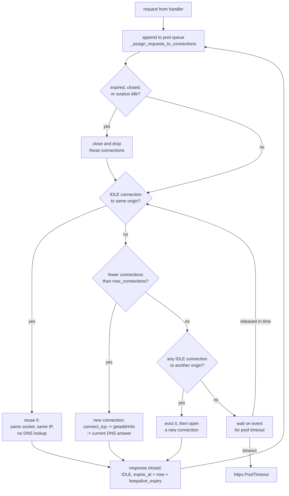

# Outbound HTTP Connection Pooling in httpx and httpcore: Pool Limits, Idle Expiry, and DNS Caching

> [!summary] Claim
> An httpx client resolves DNS only when its httpcore pool opens a new connection, `max_connections` bounds only that one pool, and `keepalive_expiry` bounds only idle time, so a client created per request defeats every limit while a shared, busy client keeps sending to an address its DNS record stopped naming long ago.

Part of [TLS Connections and Intermediaries](README.md) in [API Engineering](../README.md).

## TL;DR

Mechanism: `httpx.AsyncClient` owns one `httpcore.AsyncConnectionPool`; a request reuses an `IDLE` connection to the same origin, opens a new one while the pool holds fewer than `max_connections`, or waits up to the `pool` timeout and raises `httpx.PoolTimeout`.
Contract rule: create one client per process (in the ASGI lifespan), close it at shutdown, and close every streamed response, because the pool frees a connection only when the response stream is closed.
Trap: `keepalive_expiry` (default `5.0` s) resets on every use and httpcore 1.0.9 has no maximum connection age, so a connection that never sits idle for 5 s pins the IP it resolved at connect time past any DNS TTL; in the lab, 21 requests over 80 s all reached the old address on one connection.
Portability: the pool logic is pure Python and behaved identically on CPython `3.12.16`, `3.13.18`, `3.14.10`, and `3.15.2` (Debian trixie containers) and `3.12.13`, `3.14.6`, and `3.15.2` on macOS, and on Alpine musl with `3.14.10`; httpcore 1.0.9 also counts busy connections against `max_keepalive_connections` (fixed upstream in PR #1000, unreleased as of 2026-11).
When not to use it: do not lower `keepalive_expiry` to chase DNS changes, which buys nothing on busy connections and costs a TCP and TLS handshake on quiet ones; bound connection age instead, or let the server send `Connection: close` after N requests.

## Mental model



Every arrival and every response close runs the same assignment pass, so the pool has no background reaper: expiry and surplus checks happen only when traffic moves.
The pass first discards connections that are closed, expired, or surplus idle, then serves the queue in order: reuse, open, evict-and-open, or leave the request waiting.
Only the `N` and `V` branches touch DNS, because resolution lives inside `connect_tcp`; the `U` branch, which is what a busy client takes almost every time, sends bytes to whatever address the socket was opened to.
The `W` branch is the only place `max_connections` is felt, and its timer is the `pool` component of `httpx.Timeout`, independent of connect and read.
The loop from `D` back to `Q` is why an unclosed response is a leak: the connection stays `ACTIVE` and the queue is never re-run on its behalf.

## How it works

### What HTTP asks of a client pool

RFC 9112 makes the limit advice, not a number: "A client ought to limit the number of simultaneous open connections that it maintains to a given server" and the specification "does not mandate a particular maximum number of connections" `(RFC 9112 Section 9.4)`.
The same section explains the cost on both sides: "each connection consumes server resources", and a server "might reject traffic that it deems abusive or characteristic of a denial-of-service attack, such as an excessive number of open connections from a single client" `(RFC 9112 Section 9.4)`.
An HTTP/1.1 connection carries one request at a time without pipelining, so pool size equals request concurrency per origin; httpcore treats an HTTP/1.1 connection as available only in the `IDLE` state `(httpcore 1.0.9 httpcore/_async/http11.py, AsyncHTTP11Connection.is_available)`.
HTTP/2 inverts that: "Clients SHOULD NOT open more than one HTTP/2 connection to a given host and port pair" `(RFC 9113 Section 9.1)`, so one socket, and one resolved address, carries all concurrency.

### The pool in httpcore 1.0.9

`AsyncConnectionPool.handle_async_request` appends an `AsyncPoolRequest` to `self._requests`, runs `_assign_requests_to_connections`, then awaits `pool_request.wait_for_connection(timeout=timeout)` where `timeout` is `request.extensions.get("timeout", {}).get("pool", None)` `(httpcore 1.0.9 httpcore/_async/connection_pool.py, AsyncConnectionPool.handle_async_request)`.
On asyncio the wait is an `anyio.Event` inside `anyio.fail_after(timeout)` (on trio, a `trio.Event` inside `trio.fail_after`), and `TimeoutError` is mapped to `PoolTimeout` `(httpcore 1.0.9 httpcore/_synchronization.py, AsyncEvent.wait)`; httpx maps `httpcore.PoolTimeout` to `httpx.PoolTimeout`, a subclass of `httpx.TimeoutException` `(httpx 0.28.1 httpx/_transports/default.py, _load_httpcore_exceptions)`.
`_assign_requests_to_connections` first removes closed connections, closes those whose `has_expired()` is true, and closes idle ones over the keep-alive limit; then for each queued request it takes the first connection where `can_handle_request(origin)` and `is_available()`, else creates one if `len(self._connections) < self._max_connections`, else, if any connection is idle, closes the first idle one and creates one, and otherwise leaves the request queued `(httpcore 1.0.9 httpcore/_async/connection_pool.py, AsyncConnectionPool._assign_requests_to_connections)`.
`len(self._connections)` counts connections to every origin, so `max_connections` is a pool-wide budget, not per host, and the evict-and-create branch lets traffic to one host close idle connections to another.
`__init__` maps `None` to `sys.maxsize` for both limits, then clamps `max_keepalive_connections` to `min(max_connections, max_keepalive_connections)` `(httpcore 1.0.9 httpcore/_async/connection_pool.py, AsyncConnectionPool.__init__)`.
A connection returns to the pool only through `PoolByteStream.aclose`, which removes the request from `_requests` and reruns the assignment pass `(httpcore 1.0.9 httpcore/_async/connection_pool.py, PoolByteStream.aclose)`; `client.get()` reads and closes the body for you, while a `client.stream()` or `send(..., stream=True)` response that is never closed holds its connection forever.

The surplus-idle test in 1.0.9 is `connection.is_idle() and len([connection.is_idle() for connection in self._connections]) > self._max_keepalive_connections`, which measures the length of a list of booleans, that is, the total connection count `(httpcore 1.0.9 httpcore/_async/connection_pool.py, AsyncConnectionPool._assign_requests_to_connections)`.
Encode merged the one-line fix to `sum(connection.is_idle() for connection in self._connections)` on 2025-10-13 as PR #1000, whose description says idle connections "were dropped from the pool even when max_keepalive_connections limit has not been reached"; the upstream `CHANGELOG.md` lists it under `Unreleased`, and `1.0.9` (2025-04-24) is still the latest release (as of 2026-11).
The lab reproduces it: with `max_keepalive_connections=1`, two requests in flight and one idle connection, the pool closes the idle one, and the next request opens a fourth connection; applying the PR #1000 line in memory makes that test fail.

### Idle expiry, and why there is no lifetime

When a response finishes and both h11 sides are `DONE`, `_response_closed` sets the state to `IDLE`, calls `start_next_cycle()`, and, when `keepalive_expiry` is not `None`, sets `self._expire_at = now + self._keepalive_expiry` with `now = time.monotonic()`; any other end state closes the connection `(httpcore 1.0.9 httpcore/_async/http11.py, AsyncHTTP11Connection._response_closed)`.
`handle_async_request` sets `self._expire_at = None` the moment the connection becomes `ACTIVE` again, and `has_expired()` returns `now > self._expire_at` or "idle but readable", the server-close case `(httpcore 1.0.9 httpcore/_async/http11.py, AsyncHTTP11Connection.has_expired)`.
Nothing records when the connection was opened, so the only clocks are idle time and the server's own decisions; a connection used at least every `keepalive_expiry` seconds lives until the server closes it.
A server `Connection: close` ends that: h11 moves the server side to `MUST_CLOSE`, `_response_closed` sees the cycle is not `DONE`/`DONE`, and closes the socket, so the next request opens and resolves afresh.
Hypercorn does this by default, appending `connection: close` once `keep_alive_requests >= keep_alive_max_requests` `(hypercorn 0.18.0 hypercorn/protocol/h11.py, H11Protocol.stream_send)`, default `1000` `(hypercorn 0.18.0 hypercorn/config.py, Config)`.

### Where DNS happens

`AsyncHTTPConnection._connect` builds `kwargs` with `"host": self._origin.host.decode("ascii")`, the port, `local_address`, `"timeout": timeout` (from `timeouts.get("connect", None)`), and `socket_options`, and calls `self._network_backend.connect_tcp(**kwargs)` once per new connection, with optional retries on `ConnectError` and `ConnectTimeout` (backoff `0`, `0.5`, `1`, `2`, `4` s and doubling, from `RETRIES_BACKOFF_FACTOR = 0.5`) `(httpcore 1.0.9 httpcore/_async/connection.py, AsyncHTTPConnection._connect)`.
The default `AnyIOBackend.connect_tcp` calls `anyio.connect_tcp(remote_host=host, remote_port=port, local_host=local_address)` `(httpcore 1.0.9 httpcore/_backends/anyio.py, AnyIOBackend.connect_tcp)`, which calls `getaddrinfo`, orders the answers so that an IPv6 address comes first and, when both families are present, an IPv4 address second, and races them with `happy_eyeballs_delay=0.25` `(anyio 4.16.0 src/anyio/_core/_sockets.py, connect_tcp)`, the "250 milliseconds" RFC 8305 recommends as a default Connection Attempt Delay `(RFC 8305 Section 5)`, although anyio's docstring names the older RFC 6555 and anyio does not interleave the remaining addresses by family.
On asyncio, `getaddrinfo` ends in `self.run_in_executor(None, getaddr_func, ...)` with `socket.getaddrinfo` `(CPython 3.14.6 Lib/asyncio/base_events.py, BaseEventLoop.getaddrinfo)`, so every new connection costs a thread-pool hop into the platform resolver, and no layer of httpx, httpcore, or anyio caches the answer.
Whatever caching exists is below Python (the OS stub resolver, a local caching daemon, or the recursive resolver), and its contract is the TTL: "the time interval that the resource record may be cached before the source of the information should again be consulted" `(RFC 1035 Section 3.2.1)`.
That contract is softer than it reads: "The TTL specifies a maximum time to live, not a mandatory time to live" `(RFC 2181 Section 8)`, and serve-stale lets a recursive resolver answer with expired data, setting a TTL "with a RECOMMENDED value of 30 seconds" `(RFC 8767 Section 4)`.
Staleness therefore composes: address age = resolver cache residue + connection age, and only the second term is under the client's control.
Managed endpoints assume clients re-resolve: Elastic Load Balancing "scales your load balancer and updates the DNS entry", and "The DNS entry also specifies the time-to-live (TTL) of 60 seconds" (AWS ELB "How Elastic Load Balancing works", as of 2026-11).

### Lifespan ownership in Starlette and FastAPI

`Starlette(lifespan=...)` accepts an async context manager factory and hands it to the router `(starlette 1.10.0 starlette/applications.py, Starlette.__init__)`; opening the client in that context and closing it on exit gives one pool per worker process with a defined shutdown.
httpx's own guidance is that without a client "HTTPX has to establish a new connection for every single request" and that the context-manager form ensures "connections are properly cleaned up" (httpx documentation, Clients, as of 2026-11).
When a client is built with `transport=`, `AsyncClient._init_transport` returns that transport unchanged and the client's `limits=` argument is ignored `(httpx 0.28.1 httpx/_client.py, AsyncClient._init_transport)`; each proxy mount gets its own `AsyncHTTPTransport` built with the same `limits` `(httpx 0.28.1 httpx/_client.py, AsyncClient._init_proxy_transport)`, so a client with mounts has several independent budgets.

## Numbers and limits

| Parameter | Value | Source or measurement context |
|---|---|---|
| httpx `max_connections` default | `100` | `DEFAULT_LIMITS` `(httpx 0.28.1 httpx/_config.py)`, used only when `limits=` is omitted; a bare `httpx.Limits()` means `None` (no limit) for both counts `(httpx 0.28.1 httpx/_config.py, Limits.__init__)`; asserted by `test_httpx_default_limits_and_timeouts` |
| httpx `max_keepalive_connections` default | `20` | Same; httpx documentation, Resource Limits (as of 2026-11) |
| httpx `keepalive_expiry` default | `5.0` s | `Limits.__init__` `(httpx 0.28.1 httpx/_config.py)`; asserted in the lab |
| httpx timeout default, including `pool` | `5.0` s each | `DEFAULT_TIMEOUT_CONFIG = Timeout(timeout=5.0)` `(httpx 0.28.1 httpx/_config.py)`; asserted in the lab |
| httpcore `AsyncConnectionPool` own defaults | `max_connections=10`, `max_keepalive_connections=None`, `keepalive_expiry=None`, `retries=0` | `(httpcore 1.0.9 httpcore/_async/connection_pool.py, AsyncConnectionPool.__init__)`; httpx always passes its own values |
| Connect retry backoff | `0`, `0.5`, `1`, `2`, `4` s, doubling | `RETRIES_BACKOFF_FACTOR = 0.5` `(httpcore 1.0.9 httpcore/_async/connection.py, exponential_backoff)` |
| anyio Happy Eyeballs delay | `0.25` s | `(anyio 4.16.0 src/anyio/_core/_sockets.py, connect_tcp)`; RFC 8305 Section 5 recommends 250 ms |
| ELB DNS record TTL | `60` s | AWS ELB documentation (as of 2026-11) |
| Serve-stale answer TTL | `30` s recommended; stale data cap suggested at `604,800` s (7 days) | `(RFC 8767 Section 4)` |
| DNS TTL range | `0` to `2147483647` s | `(RFC 2181 Section 8)` |
| Hypercorn `keep_alive_max_requests` | `1000` | `(hypercorn 0.18.0 hypercorn/config.py, Config)` |
| Burst of 5 on `max_connections=2`, `pool=0.05` s, responses held | 2 served, 3 `httpx.PoolTimeout`, 2 connections opened | `test_burst_beyond_max_connections_raises_pool_timeout`, CPython 3.14.6, macOS 27.2 arm64 |
| Same burst, 5 per-request clients each limited to 2 | 0 timeouts, 5 connections open at once | `test_per_request_clients_ignore_the_limit_under_the_same_burst`, same machine |
| Busy shared client, 4 s gaps, record changed at `t=0`, TTL `60` s | 21 requests over 80 s, 1 connection, 1 DNS query, all to the old address | `test_busy_connection_pins_old_address_past_dns_ttl`, same machine |
| 10 inbound requests through a Starlette gateway | 1 upstream connection with a lifespan client, 10 with per-request clients | `test_gateway_lifespan_client_vs_per_request_client`, same machine |
| Whole lab module | `15 passed in 0.29s` (five runs: `0.32`, `0.41`, `0.32`, `0.34`, `0.29` s) | `uv run --frozen pytest ... -q` from `labs/`, CPython 3.14.6, macOS 27.2 arm64 (`Darwin 27.2.0`), finish run 2026-11-09 |

The lab times are in-process with an in-memory socket; they measure the pool logic, not network latency.

## Portability

| Runtime, library, or protocol | Behavior | Verification |
|---|---|---|
| CPython `3.12.13`, `3.13.18`, `3.14.6`, `3.14.10`, `3.15.2` on macOS | Identical: `15 passed` on each, with httpcore `1.0.9`, httpx `0.28.1`, anyio `4.16.0`, h11 `0.16.0` in every environment | `uv run --frozen --python <v> pytest <lab> -q` with a separate `UV_PROJECT_ENVIRONMENT` per version, macOS 27.2 arm64; `3.12.16` is not installed under `uv` here, so `3.12.13` ran on macOS |
| CPython `3.12.16`, `3.13.18`, `3.14.10`, `3.15.2` on Debian 13 (trixie), glibc 2.41, aarch64 | `15 passed` on each (`0.29`, `0.26`, `0.26`, `0.25` s) | `docker run` of the `python:<v>-trixie` images, lab source mounted read-only, a fresh venv with only the eight pinned packages the lab imports (`httpx==0.28.1`, `httpcore==1.0.9`, `anyio==4.16.0`, `h11==0.16.0`, `starlette==1.10.0`, `pytest==9.2.0`, `pytest-asyncio==1.4.1.post1`, `asgi-lifespan==2.1.0`) installed with `pip`, not the full `uv.lock`; 2026-11-09 |
| CPython `3.14.10` on Alpine Linux (musl libc, aarch64) | `15 passed in 0.30s` | Same procedure with `python:3.14-alpine`; the other versions were not run on Alpine |
| CPython `3.15.0b3` (what `--python 3.15` resolves to here) | Not run | Collection error `ModuleNotFoundError: No module named 'hypothesis._native'` from the workspace `hypothesis` plugin |
| CPython `3.15.2t` free-threaded (also `3.15.0b3t`, `3.14.6t`) | Not run | No `3.15.2t` interpreter is available to `uv`, and no `python:3.15t-trixie` image tag exists; `psycopg-binary==3.3.8` has no wheel for `3.15.0b3t` or `3.14.6t`, so the full workspace does not install there |
| httpcore 1.0.9 (pinned) | Surplus-idle check counts all connections | `test_httpcore_1_0_9_counts_busy_connections_against_max_keepalive`; fails with the PR #1000 line applied |
| httpcore after PR #1000 (unreleased as of 2026-11) | Counts only idle connections | PR #1000 diff and upstream `CHANGELOG.md`; exercised by applying the PR #1000 line in memory, which fails the 1.0.9 test |
| httpcore2 2.16.0 (pydantic fork, installed transitively) | Counts idle connections not reserved by an in-flight request | Source `(httpcore2 2.16.0 httpcore2/_async/connection_pool.py, AsyncConnectionPool._assign_requests_to_connections)`; not run |
| HTTP/1.1 via httpx | One request per connection; pool size = concurrency per origin | `(RFC 9112 Section 9.4)`; `AsyncHTTP11Connection.is_available` returns true only when `IDLE`; lab |
| HTTP/2 via httpx `http2=True` | One multiplexed connection per origin carries all requests, and idle expiry is armed only when no stream remains, so all traffic pins one address | `(RFC 9113 Section 9.1)`; `(httpcore 1.0.9 httpcore/_async/http2.py, AsyncHTTP2Connection._response_closed)`; not exercised in the lab |
| HTTP/3 over QUIC | Not available in httpx 0.28.1 or httpcore 1.0.9 | No HTTP/3 or QUIC code in the installed packages (grep of both); not run |
| Upstream Hypercorn 0.18.0 | Sends `connection: close` after `1000` requests, forcing reconnect and re-resolve | Source `(hypercorn 0.18.0 hypercorn/protocol/h11.py, H11Protocol.stream_send)`; mechanism proven by the lab's `max_requests_per_connection` origin |
| Upstream Uvicorn 0.54.0 | `limit_max_requests` terminates the whole process, not one connection | `(uvicorn 0.54.0 uvicorn/server.py, Server.on_tick)` |
| Upstream Granian 2.8.7 | `HTTP1Settings` has no per-connection request cap | `(granian 2.8.7 granian/http.py, HTTP1Settings)`; engine behavior not read |

## Worked example

The [implementation](../labs/src/api_labs/f02_tls_connections_and_intermediaries/outbound_pool.py) puts an in-memory `httpcore.AsyncNetworkBackend` under a stock `httpx.AsyncHTTPTransport`, so every reuse, queue, timeout, and eviction decision is made by the pinned httpcore code; only the socket (an `h11` server state machine that answers with the address it was "connected" to) and the resolver (a TTL-honoring cache on a manual clock) are simulated.
The [test](../labs/tests/f02_tls_connections_and_intermediaries/test_outbound_connection_pools_limits_and_dns_ttl_staleness.py) installs the same manual clock as the `time` module that `httpcore._async.http11` reads, so DNS TTLs, keep-alive expiry, and connection lifetime move together and nothing sleeps.

The injection seam, verbatim from `outbound_pool.py`:

```python
class BackendTransport(httpx.AsyncHTTPTransport):
    """A stock httpx transport whose httpcore pool uses an injected backend.

    httpx 0.28.1 builds `httpcore.AsyncConnectionPool` from `limits` in
    `AsyncHTTPTransport.__init__` but exposes no `network_backend` argument,
    so the pool is rebuilt with the same limits and the lab backend.
    """

    def __init__(self, backend: httpcore.AsyncNetworkBackend, limits: httpx.Limits) -> None:
        super().__init__(limits=limits)
        self._pool = httpcore.AsyncConnectionPool(
            max_connections=limits.max_connections,
            max_keepalive_connections=limits.max_keepalive_connections,
            keepalive_expiry=limits.keepalive_expiry,
            network_backend=backend,
        )
```

The client-side fix httpcore lacks, a transport that retires its pool after a fixed age and closes the old one only when its in-flight responses are closed, verbatim from `MaxLifetimeTransport`:

```python
    def _generation(self) -> _Generation:
        if self._clock() - self._current.born >= self._max_lifetime:
            self._current.retired = True
            self._retired.append(self._current)
            self._current = _Generation(self._factory(), self._clock())
        return self._current

    async def _release(self, gen: _Generation) -> None:
        gen.in_flight -= 1
        if gen.retired and gen.in_flight == 0:
            self._retired.remove(gen)
            await gen.transport.aclose()
```

The burst case, verbatim from the test module:

```python
@pytest.mark.unit
@pytest.mark.asyncio
async def test_burst_beyond_max_connections_raises_pool_timeout(
    backend: RecordingBackend,
) -> None:
    gate = backend.hold("/slow")
    limits = httpx.Limits(max_connections=2)
    bodies: list[str] = []
    errors: list[type[BaseException]] = []
    three_timed_out = anyio.Event()

    async with make_client(backend, limits, pool_timeout=0.05) as client:

        async def one() -> None:
            try:
                bodies.append((await client.get("/slow")).text)
            except httpx.HTTPError as exc:
                errors.append(type(exc))
                if len(errors) == 3:
                    three_timed_out.set()

        async def release() -> None:
            with anyio.fail_after(WAIT):  # a broken mechanism fails instead of hanging
                await three_timed_out.wait()  # the 3 queued requests gave up first
            gate.set()

        async with anyio.create_task_group() as tg:
            tg.start_soon(release)
            for _ in range(5):
                tg.start_soon(one)
    assert bodies == [OLD, OLD]
    assert errors == [httpx.PoolTimeout] * 3
    assert backend.connects == 2
    assert backend.peak_open == 2
```

The staleness case, verbatim:

```python
@pytest.mark.unit
@pytest.mark.asyncio
async def test_busy_connection_pins_old_address_past_dns_ttl(
    clock: ManualClock, dns: FakeDNS, backend: RecordingBackend
) -> None:
    async with make_client(backend, httpx.Limits()) as client:
        served = [(await client.get("/v1/price")).text]
        dns.publish(HOST, NEW, ttl=TTL)
        for _ in range(20):  # one request every 4 s: never idle past keepalive_expiry=5.0
            clock.advance(4.0)
            served.append((await client.get("/v1/price")).text)
    assert clock.now == 80.0  # 20 s past the 60 s TTL of the first answer
    assert served == [OLD] * 21
    assert backend.connects == 1
    assert dns.upstream_queries == 1
```

Captured with CPython 3.14.6 on macOS 27.2 arm64 (`Darwin 27.2.0`), from `labs/`:

```text
$ uv run --frozen pytest tests/f02_tls_connections_and_intermediaries/test_outbound_connection_pools_limits_and_dns_ttl_staleness.py -q
...............                                                          [100%]
15 passed in 0.29s
```

In the independent check, eight mutations each made at least one test fail: ignoring the DNS TTL, ignoring the response gate, sending `Connection: close` one request late, rotating in `MaxLifetimeTransport` one tick late, never reporting a drained response, never closing an idle retired pool at rotation, dropping `max_keepalive_connections` on the way into httpcore, and applying the upstream PR #1000 fix to httpcore in memory.
The idle-retired-pool mutation survived the drafted suite and is caught only by `test_max_lifetime_transport_closes_an_idle_retired_pool_at_rotation`, added during the check.
The finish pass repeated eight more, each applied to `outbound_pool.py`, run on the module, and restored with `cmp` verified: ignoring the DNS TTL (4 failed), removing the idle-retired reap (1 failed, the test above), `>=` -> `>` in the lifetime check (2 failed), a drained response that never reports close (2 failed), dropping `max_connections` on the way into httpcore (1 failed), never sending `Connection: close` (1 failed), a gateway that ignores its lifespan client (1 failed), and not passing `keepalive_expiry` to the pool (1 failed).

## Pitfalls

> [!warning] A client per request
> Trigger: `async with httpx.AsyncClient() as client:` inside a handler, or a helper that builds a client per call.
> Symptom: one TCP (and TLS) handshake per request, no `PoolTimeout` ever, and connection count tracking request concurrency without bound; the lab's gateway opened 10 upstream connections for 10 inbound requests, and five per-request clients limited to `max_connections=2` held 5 connections at once.
> Fix: one client per process created in the lifespan and closed on shutdown, which also stops leaving one `TIME_WAIT` entry per request on whichever side closes first (see [[TCP-Connection-Lifecycle-Keep-Alive-and-TIME-WAIT]]).

> [!warning] Clients that are never closed
> Trigger: `client = httpx.AsyncClient()` without `aclose()`, typical when the per-request pattern is written without `async with`.
> Symptom: every pool keeps its idle connection open; the lab ends with 5 open connections after 5 such calls, and with real sockets they stay open at least until garbage collection reclaims them.
> Fix: `async with`, or a lifespan-owned client whose `aclose()` runs at shutdown.

> [!warning] Streamed responses that are never closed
> Trigger: `await client.send(request, stream=True)` or `client.stream(...)` without `aclose()` on an error path.
> Symptom: the connection stays `ACTIVE`, because only `PoolByteStream.aclose` releases it; after `max_connections` such leaks every request waits the full `pool` timeout and raises `httpx.PoolTimeout`, which looks like an overloaded upstream.
> Fix: `async with client.stream(...) as response:`; alert on `PoolTimeout` as a leak signal before treating it as a capacity problem.

> [!warning] Passing `limits=` together with `transport=`
> Trigger: `httpx.AsyncClient(transport=my_transport, limits=httpx.Limits(max_connections=500))`.
> Symptom: the limits are silently ignored, because `_init_transport` returns the given transport untouched `(httpx 0.28.1 httpx/_client.py, AsyncClient._init_transport)`.
> Fix: pass `limits=` to the `AsyncHTTPTransport` constructor.

> [!warning] Busy connections outlive DNS
> Trigger: a blue/green cutover or load-balancer scaling that changes DNS while a shared client keeps sending more often than every `keepalive_expiry` seconds.
> Symptom: traffic keeps reaching the old address for as long as the old endpoint keeps the connection open; the lab sent 21 requests over 80 s to an address whose record had expired at 60 s.
> Fix: bound connection age (a lifetime-rotating transport such as the lab's `MaxLifetimeTransport`), have the server send `Connection: close` after N requests, or keep the old endpoint serving until connections drain.

> [!warning] `max_keepalive_connections` closes idle connections early on httpcore 1.0.9
> Trigger: a pool with many in-flight requests and a small `max_keepalive_connections`.
> Symptom: idle connections are closed whenever total connections exceed the limit, so bursty traffic pays repeated handshakes; reported and fixed upstream in encode/httpcore PR #1000, unreleased as of 2026-11.
> Fix: set `max_keepalive_connections` close to `max_connections` on 1.0.9, and remove the workaround when a release includes the fix.

> [!warning] One pool-wide budget for several dependencies
> Trigger: one client calling a fast service and a slow one, sized by `max_connections`.
> Symptom: the slow dependency holds every connection, requests to the fast one hit `PoolTimeout`, and the evict-and-create branch churns idle connections across hosts.
> Fix: one client per dependency, each with its own limits, which is a bulkhead (see [[Bulkhead-Isolation-and-Per-Dependency-Resource-Partitioning]]).

Historical report: encode/httpx issue #1171 (opened 2020-08-11, reproduced on httpx 0.13.3) described `PoolTimeout` when `asyncio.gather()` ran more tasks than `max_connections`; the maintainer confirmed a pool bug, reported the original example fixed in httpx 0.21 by the httpcore rework (2021-12-16), and later verified that encode/httpcore PR #880 resolved a recurring variant (2024-02-12), so it shows how a pool defect presents as an upstream timeout.
No CVE or vendor postmortem specific to httpx pool exhaustion or DNS pinning was fetched for this note.

## Security and robustness

A bounded shared pool is backpressure: `max_connections` plus a short `pool` timeout turns an upstream brownout into fast local `PoolTimeout` errors instead of unbounded open sockets, which is the client side of `API4:2023 Unrestricted Resource Consumption`, whose OWASP criteria include "Maximum number of file descriptors" and "Execution timeouts".
Per-request clients remove that bound; under a retry storm or a slow dependency they convert inbound concurrency directly into outbound sockets and file descriptors (see [[Retry-Budgets-and-Preventing-Cascading-Retry-Amplification-Storms]]).
SSRF defenses that resolve a user-supplied host, check the address, and then call `client.get(url)` have a time-of-check gap, because httpcore resolves again inside `connect_tcp`; a short-TTL record can answer differently the second time.
Bind the check to the connection instead, for example by connecting to the validated IP and sending the original `Host` and SNI, and follow OWASP `API7:2023 Server Side Request Forgery` guidance to allow-list origins, schemes, and ports and to disable redirections.
A pooled connection is reused only for an equal `Origin` (scheme, host, port) `(httpcore 1.0.9 httpcore/_async/connection.py, AsyncHTTPConnection.can_handle_request)`, so per-tenant credentials on one client do not cross origins, but they do share sockets within one origin; isolate clients when tenants must not share connections, as with mTLS client certificates (see [[Mutual-TLS-mTLS-Handshake-and-SPIFFE-Identity]]).
Alert on three signals together: `PoolTimeout` rate (leak or saturation), new-connection rate per request (per-request clients or keep-alive churn), and requests per remote address after a DNS change (pinning).

## The principal's view

The decision is who owns outbound connection policy: make the HTTP client a platform-provided, lifespan-scoped resource per dependency, not something each handler constructs.
That gives one place to set `max_connections` from the dependency's real capacity, a `pool` timeout that matches the caller's latency budget (see [[Timeout-Taxonomy-Connect-Read-Write-Pool-and-Deadline-Propagation]]), and a maximum connection age agreed with the team that runs the endpoint's DNS.
The organizational trade-off is coupling: a shared client factory is a dependency every service takes, and a bad default ships everywhere at once, so version it and test it like a library rather than copying snippets.
Connection age is a contract between client and endpoint owners: endpoint teams that move traffic by DNS must publish how long old addresses stay serving, and client teams must keep connection age below that, either with a lifetime-rotating transport or by relying on a server-side request cap like Hypercorn's `keep_alive_max_requests`.
Prefer server-side or proxy-side control when you own both ends: a service mesh sidecar or an Envoy egress cluster with active health checks and endpoint discovery rebalances without trusting every client's DNS behavior (see [[Envoy-Proxy-Internals-Listeners-Filter-Chains-HCM-and-Clusters]]).
Choose HTTP/2 to a dependency when per-connection overhead dominates, knowing it concentrates every request on one address and makes the age bound more important, and choose a client-side load-balancing protocol such as gRPC with a resolver when the endpoint set changes faster than DNS TTLs allow.

## Interview questions

> [!question] L5: Why is creating an `httpx.AsyncClient` inside each FastAPI request handler a problem even when it is closed correctly?
>
> > [!success]- Answer
> > Each client owns its own httpcore pool, so every request pays a new TCP and TLS handshake and a DNS lookup.
> > `max_connections` bounds only that one pool, so total outbound connections grow with inbound concurrency and nothing ever raises `PoolTimeout`.
> > The fix is one client per process, created in the lifespan and closed at shutdown.
> >
> > Follow-up: What would you change if the handler needs per-request headers or authentication?

> [!question] L5: What do `max_connections`, `max_keepalive_connections`, and `keepalive_expiry` each bound in httpx 0.28.1, and what are the defaults?
>
> > [!success]- Answer
> > `max_connections` (default `100`) bounds all connections in the pool across every origin.
> > `max_keepalive_connections` (default `20`) bounds idle connections kept for reuse.
> > `keepalive_expiry` (default `5.0` s) bounds how long a connection may sit idle; it says nothing about total age.
> >
> > Follow-up: Which timeout governs how long a request waits for a free connection?

> [!question] L5: Predict the output: a shared client with `httpx.Limits(max_connections=2)` and `pool=0.05` sends 5 concurrent requests to an upstream that holds every response until all waiting requests have given up; how many succeed, what do the rest raise, and how many connections open?
>
> > [!success]- Answer
> > Two requests get connections and eventually succeed.
> > The other three wait on the pool event, hit the `0.05` s `pool` timeout, and raise `httpx.PoolTimeout`.
> > Exactly two connections are opened, because the pool never exceeds `max_connections`.
> >
> > Follow-up: What changes if each of the five requests uses its own client with the same limits?

> [!question] L6: Your service still sends traffic to the old load balancer addresses hours after a DNS cutover with a `60` s TTL; httpx is a shared lifespan client; explain and fix.
>
> > [!success]- Answer
> > httpcore resolves only inside `connect_tcp` when it opens a connection, and a busy connection never sits idle for `keepalive_expiry`, so it never expires and never re-resolves.
> > httpcore 1.0.9 has no maximum connection age, so the TTL is irrelevant to an open socket.
> > Fix by bounding connection age with a rotating transport, by having the server or proxy send `Connection: close` after N requests, or by keeping the old endpoint serving until clients drain.
> >
> > Follow-up: Why would lowering `keepalive_expiry` to `1` s not fix it?

> [!question] L6: Debug this API: a gateway returns intermittent `504`s, its logs show `httpx.PoolTimeout` on calls to a fast inventory service, the inventory service is idle, and a reporting endpoint on the same client streams large exports.
>
> > [!success]- Answer
> > `PoolTimeout` means the request waited for a connection, not for the upstream, so the inventory service being idle is consistent with a local leak or saturation.
> > Streamed export responses hold a connection until `aclose()`, and an error path that skips it leaks the connection; the pool budget is shared across origins, so the reporting traffic starves inventory.
> > Fix with `async with client.stream(...)`, and give each dependency its own client and limits as a bulkhead.
> >
> > Follow-up: Which metric would distinguish a leak from genuine saturation?

> [!question] L6: Why does httpcore 1.0.9 sometimes close idle connections when `max_keepalive_connections` has not been reached?
>
> > [!success]- Answer
> > The surplus check computes `len([connection.is_idle() for connection in self._connections])`, the length of a list of booleans, which is the total connection count.
> > With busy connections in the pool, any idle connection is closed once the total exceeds the limit, so bursts churn handshakes.
> > PR #1000 changed it to `sum(...)`, merged on 2025-10-13 and unreleased as of 2026-11.
> >
> > Follow-up: How would you write a test that fails on the buggy version and passes on the fix?

> [!question] L6: Where in the httpx stack does DNS resolution happen, and what caches it?
>
> > [!success]- Answer
> > `AsyncHTTPConnection._connect` calls the backend's `connect_tcp`, which calls `anyio.connect_tcp`, which calls `getaddrinfo`; on asyncio that is `socket.getaddrinfo` in the default thread pool.
> > httpx, httpcore, and anyio do not cache answers, so caching is whatever the OS resolver or recursive resolver does.
> > Each new connection resolves once, and a reused connection never resolves.
> >
> > Follow-up: How does Happy Eyeballs change which address a new connection lands on?

> [!question] L7+: Design outbound HTTP for 40 Python services calling 15 internal dependencies behind DNS-managed load balancers.
>
> > [!success]- Answer
> > Ship a versioned client factory that builds one lifespan-owned client per dependency with limits sized from the dependency's capacity and a `pool` timeout derived from the caller's deadline.
> > Bound connection age below the endpoint team's published drain window, through a rotating transport or a proxy-enforced request cap, and expose metrics for pool waits, new connections, and per-address traffic.
> > Where endpoints change faster than DNS, move discovery to a mesh or client-side load balancing instead of tuning TTLs.
> >
> > Follow-up: How would you roll out a new `max_connections` default without overloading a dependency?

> [!question] L7+: A team proposes setting `keepalive_expiry=0` everywhere to "always get fresh DNS"; evaluate it.
>
> > [!success]- Answer
> > It does force a reconnect whenever a connection has been idle at all, but every request then pays TCP and TLS setup and a resolver call, multiplying load on the dependency, the resolver, and ephemeral ports.
> > It still cannot help an HTTP/2 connection that always has a stream open, because httpcore arms HTTP/2 expiry only when no streams remain, and the resolver cache may return the same stale answer anyway.
> > Bounding connection age to tens of seconds gives the DNS benefit at a small fraction of the handshake cost.
> >
> > Follow-up: What is the expected handshake rate per instance with a 30 s age bound and 20 pooled connections?

## Related

Prerequisites: [[Keep-Alive-Timeout-Races-Between-Reverse-Proxies-and-Origins]]

Next: [[HTTP-2-Connection-Coalescing-and-421-Misdirected-Request]]

See also: [[02-Programming-Languages/Python/Python-Backend-Interview-Prep/04-FastAPI]], [[02-Programming-Languages/Python/Python-Backend-Interview-Prep/16-Asyncio-Deep-Dive]], [[TCP-Connection-Lifecycle-Keep-Alive-and-TIME-WAIT]], [[Timeout-Taxonomy-Connect-Read-Write-Pool-and-Deadline-Propagation]], [[Bulkhead-Isolation-and-Per-Dependency-Resource-Partitioning]], [[Retry-Budgets-and-Preventing-Cascading-Retry-Amplification-Storms]], [[ASGI-Lifespan-Protocol-Startup-Shutdown-and-Scope-State]], [[Testing-FastAPI-Applications-AsyncClient-Lifespan-and-Dependency-Overrides]], [[Envoy-Proxy-Internals-Listeners-Filter-Chains-HCM-and-Clusters]], [[Mutual-TLS-mTLS-Handshake-and-SPIFFE-Identity]]

- Lab: `labs/tests/f02_tls_connections_and_intermediaries/test_outbound_connection_pools_limits_and_dns_ttl_staleness.py`

## Further reading

- [RFC 9112: HTTP/1.1](https://www.rfc-editor.org/rfc/rfc9112.html) - Section 9.4 is the specification's whole position on client connection limits.
- [RFC 9113: HTTP/2](https://www.rfc-editor.org/rfc/rfc9113.html) - Section 9.1 asks for one connection per host and port, which concentrates traffic on one resolved address.
- [RFC 1035](https://www.rfc-editor.org/rfc/rfc1035.html) and [RFC 2181](https://www.rfc-editor.org/rfc/rfc2181.html) - Section 3.2.1 defines TTL; RFC 2181 Section 8 makes it a maximum, not a mandate.
- [RFC 8767: Serving Stale Data](https://www.rfc-editor.org/rfc/rfc8767.html) - Section 4 lets resolvers answer past TTL expiry, so client-side freshness is never guaranteed by DNS alone.
- [RFC 8305: Happy Eyeballs v2](https://www.rfc-editor.org/rfc/rfc8305.html) - Section 5 is the 250 ms Connection Attempt Delay anyio implements.
- [httpcore 1.0.9 `connection_pool.py`](https://github.com/encode/httpcore/blob/1.0.9/httpcore/_async/connection_pool.py) - `_assign_requests_to_connections` is the entire pooling policy in one function.
- [httpcore 1.0.9 `http11.py`](https://github.com/encode/httpcore/blob/1.0.9/httpcore/_async/http11.py) - `_response_closed` and `has_expired` show that only idle time is bounded.
- [encode/httpcore PR #1000](https://github.com/encode/httpcore/pull/1000) - The one-line `max_keepalive_connections` fix and its explanation.
- [httpx 0.28.1 `_client.py`](https://github.com/encode/httpx/blob/0.28.1/httpx/_client.py) - `_init_transport` and `_init_proxy_transport` decide which pool gets which limits.
- [anyio 4.16.0 `_sockets.py`](https://github.com/agronholm/anyio/blob/4.16.0/src/anyio/_core/_sockets.py) - `connect_tcp` is where the hostname becomes an address for each new connection.
