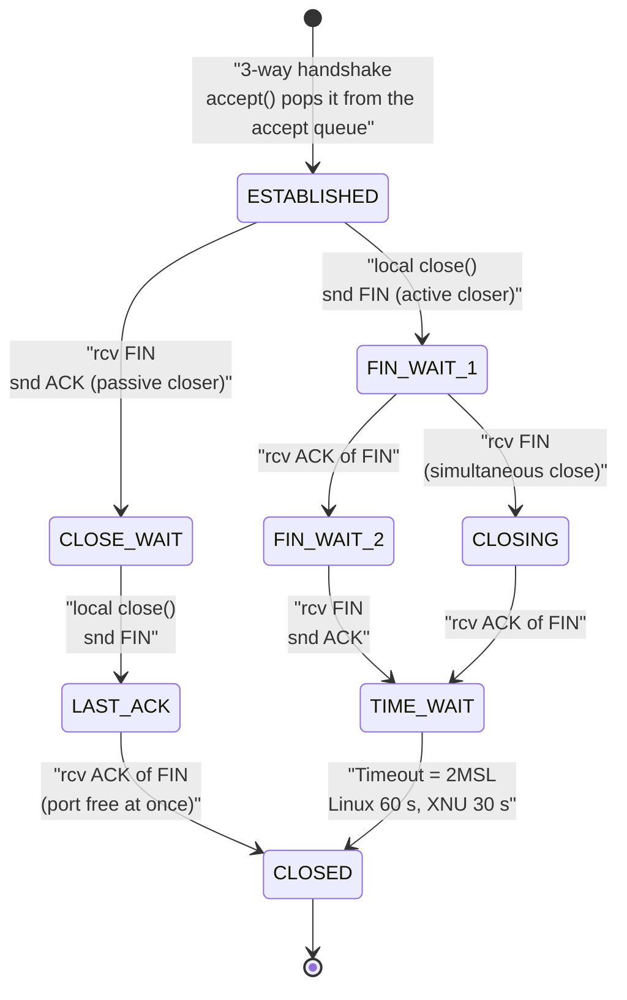

# TCP Socket Lifecycle for API Servers: Backlog Queues, Keep-Alive Probes, Nagle, and TIME_WAIT

> [!summary] Claim
> Whichever peer closes a TCP connection first pays for it with a `TIME-WAIT` entry that pins its 4-tuple for 2 x MSL (`60 s` on Linux, `30 s` on macOS), so an HTTP client that opens one connection per request runs out of ephemeral ports at roughly `ports / TIME-WAIT` new connections per second per destination, while a keep-alive pool with `TCP_NODELAY` avoids both the port burn and the Nagle plus delayed-ACK stall.

Part of [TLS Connections and Intermediaries](README.md) in [API Engineering](../README.md).

## TL;DR

Mechanism: the active closer walks `FIN-WAIT-1 -> FIN-WAIT-2 -> TIME-WAIT` and must linger `2xMSL` (`RFC 9293 Section 3.6.1`, `MUST-13`), while the passive closer goes `CLOSE-WAIT -> LAST-ACK -> CLOSED` and keeps nothing.
Contract rule: HTTP/1.1 connections persist by default and a server that honours `Connection: close` or an idle timeout initiates the close itself (`RFC 9112 Section 9.3`, `Section 9.5`, and `Section 9.6`), so the side that decides to close is the side that accumulates `TIME-WAIT`.
The trap: stdlib `asyncio` turns on `TCP_NODELAY` only for sockets whose `proto == IPPROTO_TCP`, and accepted sockets report `proto == 0` on macOS (no `SO_PROTOCOL`) and on any OS when the listener was created as `socket.socket()`, which is exactly what `uvicorn --workers N` and `--reload` hand to `loop.create_server` (measured in the lab).
Portability: the idle option is `TCP_KEEPIDLE` on Linux but `TCP_KEEPALIVE` on macOS, `listen(2048)` is silently clamped to `kern.ipc.somaxconn` (`128` here) on macOS and to `net.core.somaxconn` (`4096` since Linux 5.4) on Linux, and Linux needs `SO_REUSEADDR` on both the old and the new socket to bind over `TIME-WAIT` while macOS needs it only on the new one.
When not to use this: do not "fix" `TIME-WAIT` with kernel knobs (`tcp_tw_recycle` was removed in Linux 4.12 because it broke clients behind NAT); fix the connection pattern with pooling, HTTP/2 multiplexing (`RFC 9113 Section 9.1`), or QUIC, which has no TCP `TIME-WAIT` at all.

## Mental model



A connection leaves `ESTABLISHED` along one of two arms, chosen by who calls `close()` first.
The left arm belongs to the active closer: it sends `FIN`, waits for the peer's `ACK` and `FIN`, sends the last `ACK`, and then holds the connection's 4-tuple in `TIME-WAIT` for `2xMSL`, so that a retransmitted `FIN` can still be acknowledged and stray segments from this incarnation cannot be accepted by the next one (`RFC 9293 Section 3.3.2`).
The right arm belongs to the passive closer: it acknowledges the `FIN`, sits in `CLOSE-WAIT` until its application calls `close()`, and reaches `CLOSED` one round trip later with nothing left behind.
The middle path through `CLOSING` is the simultaneous close of `RFC 9293 Figure 13`, where both peers end in `TIME-WAIT`.
Every API-server design question in this note reduces to which arm each side takes and how often.

## How it works

### Bytes on the wire

The control bits live in octet 13 of the TCP header, laid out `CWR ECE URG ACK PSH RST SYN FIN` from the high bit, so `FIN` is `0x01`, `SYN` is `0x02`, `RST` is `0x04`, `PSH` is `0x08`, and `ACK` is `0x10` (`RFC 9293 Section 3.1`).
A normal close is therefore four segments: `FIN|ACK` (`0x11`) from the active closer, `ACK` (`0x10`) back, `FIN|ACK` (`0x11`) from the passive closer, and a final `ACK` (`0x10`) that the active closer may have to resend, which is why it cannot forget the connection immediately (`RFC 9293 Section 3.6`, `Figure 12`).
An abort replaces all of that with one or more `RST` (`0x04`) segments, and the connection state is discarded immediately, without `TIME-WAIT` (`RFC 9293 Section 3.6`).
A keep-alive probe is a segment with `SEG.SEQ = SND.NXT-1` and usually no payload, which forces the peer to answer with a duplicate `ACK` (`RFC 9293 Section 3.8.4`).

### TIME-WAIT and the 4-tuple

`RFC 9293 Section 3.6.1` makes the linger mandatory: "When a connection is closed actively, it MUST linger in the TIME-WAIT state for a time 2xMSL" (`MUST-13`), and `Section 3.4.2` takes MSL to be 2 minutes as an engineering choice.
Real stacks shorten it: Linux hard-codes `TCP_TIMEWAIT_LEN (60*HZ)` (`linux v6.12 include/net/tcp.h, TCP_TIMEWAIT_LEN`), and XNU defines `TCPTV_MSL` as `15*TCP_RETRANSHZ` and calls `add_to_time_wait(tp, 2 * tcp_msl)` (`xnu-12377.1.9 bsd/netinet/tcp_timer.h, TCPTV_MSL` and `bsd/netinet/tcp_input.c, tcp_input`), which is `30 s`.
Measured here: after a server-side active close on loopback, a plain `bind()` to the same port kept failing with `EADDRINUSE` (`errno 48`) for `30.30 s` (a script that closes the accepted socket first, then retries `bind(("127.0.0.1", port))` every `10 ms`; macOS 27.2 arm64, CPython 3.14.6), which matches `sysctl net.inet.tcp.msl` = `15000` ms times two.
`TIME-WAIT` pins a whole 4-tuple `(src ip, src port, dst ip, dst port)`, so the scarce resource is the ephemeral port of whichever side closed first.
A client opening fresh connections to one `(dst ip, dst port)` can therefore sustain at most `ports / TIME-WAIT` new connections per second: `28232 / 60 = 470.5` with the Linux default `ip_local_port_range` of `32768 60999` (`linux v6.12 Documentation/networking/ip-sysctl.rst, ip_local_port_range`), and `16384 / 30 = 546.1` with the IANA dynamic range `49152-65535` (`RFC 6335 Section 6`) that macOS uses (`sysctl net.inet.ip.portrange.first` and `.last` read here).
Above that rate `connect()` fails, on Linux with `EADDRNOTAVAIL`; `simulate_client_ports` in the lab reproduces the cliff deterministically, first failing after `16384` successful connects (`27306 ms` into a `600 req/s` run).
`RFC 9293 Section 3.6.1` allows a stack to accept a new `SYN` directly from `TIME-WAIT` if the new initial sequence number is larger (`MAY-2`), and says the `RFC 6191` timestamp refinement SHOULD be implemented (`SHLD-4`); that is the passive side.
On the active side, Linux `tcp_tw_reuse` lets `connect()` reuse a 4-tuple still in `TIME-WAIT` when TCP timestamps make it safe (`linux v6.12 net/ipv4/tcp_ipv4.c, tcp_twsk_unique`), and its default `2` enables that only for loopback traffic (`linux v6.12 Documentation/networking/ip-sysctl.rst, tcp_tw_reuse`; `/proc/sys/net/ipv4/tcp_tw_reuse` read `2` in the Linux 7.2.12 containers).

### `SO_REUSEADDR` and server restarts

A server that closes idle keep-alive connections is the active closer, so its listening port accumulates `TIME-WAIT` entries, and a restarted process that binds without `SO_REUSEADDR` gets `EADDRINUSE`.
`asyncio.loop.create_server` defaults `reuse_address` to `True` on POSIX (`CPython 3.14.6 Lib/asyncio/base_events.py, BaseEventLoop.create_server`), and uvicorn sets `SO_REUSEADDR` in `Config.bind_socket` (`uvicorn 0.54.0 uvicorn/config.py, Config.bind_socket`).
The lab found the two kernels differ: macOS lets a new `SO_REUSEADDR` socket bind over `TIME-WAIT` even if the old listener lacked the option, while Linux refuses (`errno 98`) unless the old socket had `SO_REUSEADDR` too (`test_linux_also_requires_so_reuseaddr_on_the_old_listener`, run on both).

### Listen backlog: two queues and two clamps

On Linux, `listen(backlog)` sizes the queue of fully established connections waiting for `accept()`, while half-open `SYN-RECEIVED` entries are bounded separately by `tcp_max_syn_backlog` (`listen(2)`, man7.org).
The kernel caps the argument without telling you: `if ((unsigned int)backlog > somaxconn) backlog = somaxconn;` (`linux v6.12 net/socket.c, __sys_listen_socket`), where the unsigned cast also turns a negative argument into `somaxconn` (CPython never passes one, because `sock_listen` raises a negative `backlog` to `0`), and `SOMAXCONN` is `4096` (`linux v6.12 include/linux/socket.h`), the default since Linux 5.4 per `listen(2)`.
The queue is full only when `sk_ack_backlog > sk_max_ack_backlog` (`linux v6.12 include/net/sock.h, sk_acceptq_is_full`), so Linux actually holds `backlog + 1` connections.
When it is full, Linux by default (`tcp_abort_on_overflow=0`) does not reset the client, so the connection can recover once the application catches up, while `tcp_abort_on_overflow=1` resets it (`linux v6.12 Documentation/networking/ip-sysctl.rst, tcp_abort_on_overflow`).
XNU clamps differently: `if (backlog <= 0 || backlog > somaxconn) { backlog = somaxconn; }` (`xnu-12377.1.9 bsd/kern/uipc_socket.c, solisten`), so on macOS `listen(0)` means `somaxconn`, and `kern.ipc.somaxconn` is `128` on this machine.
CPython's bare `socket.listen()` uses `Py_MIN(SOMAXCONN, 128)` (`CPython 3.14.6 Modules/socketmodule.c, sock_listen`), `asyncio` `create_server` defaults to `backlog=100`, and servers ship their own defaults (see `## Numbers and limits`).

### Keep-alive probes are not HTTP keep-alive

TCP keep-alive is optional, MUST default to off, MUST be configurable per connection, and MUST wait at least two hours of idleness by default (`RFC 9293 Section 3.8.4`, `MUST-24` to `MUST-28`, restating `RFC 1122 Section 4.2.3.6`).
Linux sends the first probe after `TCP_KEEPALIVE_TIME (120*60*HZ)`, repeats every `TCP_KEEPALIVE_INTVL (75*HZ)`, and gives up after `TCP_KEEPALIVE_PROBES 9` (`linux v6.12 include/net/tcp.h`), so a silently dead peer is reported after `7200 + 9 x 75 = 7875 s`.
XNU uses `TCPTV_KEEP_IDLE` 2 hours, `TCPTV_KEEPINTVL` 75 s, and `TCPTV_KEEPCNT 8` (`xnu-12377.1.9 bsd/netinet/tcp_timer.h`), so `7800 s`; `sysctl net.inet.tcp.keepidle keepintvl keepcnt` returned `7200000 75000 8` here.
HTTP keep-alive is a different mechanism entirely: it is connection persistence (`RFC 9112 Section 9.3`) enforced by an application idle timer, such as uvicorn's `timeout_keep_alive_handler`, which sends `h11.ConnectionClosed` and calls `transport.close()` after `timeout_keep_alive` seconds (`uvicorn 0.54.0 uvicorn/protocols/http/h11_impl.py, H11Protocol.timeout_keep_alive_handler`).
That idle close makes the server the active closer for every idle connection, so the `TIME-WAIT` lands on the server, not on the client.

### Nagle, delayed ACK, and who sets `TCP_NODELAY`

Nagle buffers new small writes while any sent data is unacknowledged (`RFC 9293 Section 3.7.4`), and receivers may delay an `ACK` by up to, but less than, `0.5 s` (`RFC 9293 Section 3.8.6.3`, `MUST-40`); Linux uses `TCP_DELACK_MIN (HZ/25)` = `40 ms` and `TCP_DELACK_MAX (HZ/5)` = `200 ms` (`linux v6.12 include/net/tcp.h`).
A request written as two small `send()` calls (headers, then body) to a peer that answers only after the whole request therefore stalls: the second write waits for the `ACK` of the first, and the peer delays that `ACK` because it has nothing to piggyback it on.
`write_write_read_ms` models it as `nodelay = RTT` versus `Nagle = 2 x RTT + delayed ACK`.
On macOS loopback the stall did not reproduce (a client sending two `100`-byte writes and reading a `2`-byte reply: median `0.069 ms` and `0.066 ms` with Nagle versus `0.045 ms` and `0.044 ms` with `TCP_NODELAY`, 20 iterations per run, two runs, macOS 27.2 arm64, CPython 3.14.6), so the `40 ms` figure stays a source-derived bound, not a measurement.
`RFC 9293 Section 3.7.4` requires a per-connection way to disable Nagle (`MUST-17`), which is `TCP_NODELAY`, and most of the Python stack sets it: `asyncio` in `_SelectorSocketTransport.__init__` via `base_events._set_nodelay` (`CPython 3.14.6 Lib/asyncio/selector_events.py`), httpcore's sync backend in `SyncBackend.connect_tcp` (`httpcore 1.0.9 httpcore/_backends/sync.py`), hypercorn on its listener in `Config._create_sockets` (`hypercorn 0.18.0 hypercorn/config.py`), and gunicorn in `TCPSocket.set_options` (`gunicorn 26.2.0 gunicorn/sock.py`).
The asyncio helper only acts when `sock.proto == socket.IPPROTO_TCP` (`CPython 3.14.6 Lib/asyncio/base_events.py, _set_nodelay`).
`socket.accept()` builds the new object with the listener's `proto` (`CPython 3.14.6 Lib/socket.py, socket.accept`), but `sock_initobj_impl` overwrites it with `0` when it wraps an existing file descriptor on a platform without `SO_PROTOCOL` (`CPython 3.14.6 Modules/socketmodule.c, sock_initobj_impl`, the `#else proto = 0;` branch), and macOS has none (`hasattr(socket, "SO_PROTOCOL")` is `False` here).
The lab measured the consequence: server-side asyncio connections had `TCP_NODELAY == 0` on macOS for every listener, and on Linux (CPython 3.12.16, 3.13.18, 3.14.10, 3.15.2) whenever the listener was a `proto=0` `socket.socket()`, which is what uvicorn's `Config.bind_socket` creates for `--workers` and `--reload` (`uvicorn 0.54.0 uvicorn/main.py, run`).
uvloop `0.23.0` sets `TCP_NODELAY` on accepted sockets regardless (lab, macOS and Linux), and a `TCP_NODELAY` set on the listener is inherited by accepted sockets on both macOS and Linux (lab), which is why hypercorn, gunicorn, and granian are unaffected.
Upstream tracks the macOS case as python/cpython issue `#148783` ("`asyncio` does not set `TCP_NODELAY` on macOS", opened 2026-04-19), whose fix PR `gh-148784` keeps an explicitly passed `proto` and was still open and unmerged (as of 2026-11); that fix would not cover the Linux `proto=0` listener case, and a search of python/cpython issues on 2026-11-09 found no report of it.

### The HTTP layer decides who closes

`RFC 9112 Section 9.6` tells a server that sends `Connection: close` to initiate closure, and describes the staged close servers typically use (half-close the write side, keep reading, then close) so a late client segment does not trigger an `RST` that erases the response; `Section 9.5` says a client or server that times out an idle connection SHOULD close it gracefully.
The rule of thumb that follows: the server pays `TIME-WAIT` for idle timeouts and `Connection: close`, and the client pays it when it closes after each response, which is what `httpx.Client(limits=httpx.Limits(max_keepalive_connections=0))` does (lab: each of 5 client ports was still `EADDRINUSE` after the run).

## Numbers and limits

| Quantity | Value | Source |
|---|---|---|
| MSL in the TCP specification | `2 min` (so `2xMSL` = `240 s`) | `RFC 9293 Section 3.4.2` |
| Linux `TIME-WAIT` | `60 s` (`TCP_TIMEWAIT_LEN (60*HZ)`) | `linux v6.12 include/net/tcp.h` |
| XNU `TIME-WAIT` | `30 s` (`2 x TCPTV_MSL`, `15 s`; `sysctl net.inet.tcp.msl` = `15000`); measured `30.30 s` until plain rebind succeeded | `xnu-12377.1.9 bsd/netinet/tcp_timer.h`; ad hoc rebind script, CPython 3.14.6, macOS 27.2 arm64 |
| Linux ephemeral range | `32768-60999` (`28232` ports) | `linux v6.12 net/ipv4/af_inet.c, inet_init_net`; `ip-sysctl.rst` |
| IANA dynamic range (macOS default) | `49152-65535` (`16384` ports) | `RFC 6335 Section 6`; `sysctl net.inet.ip.portrange.*` on macOS 27.2 |
| Max new connections/s, one source IP to one destination, client closes | Linux `470.5`, macOS `546.1` | `max_close_rate` in the lab, from the two rows above |
| Linux `SOMAXCONN` | `4096` (since Linux 5.4; `128` before) | `linux v6.12 include/linux/socket.h`; `listen(2)` |
| macOS `kern.ipc.somaxconn` | `128` | `sysctl` on macOS 27.2 (as of 2026-11) |
| Linux accept queue capacity | `backlog + 1` | `linux v6.12 include/net/sock.h, sk_acceptq_is_full` |
| Linux `tcp_max_syn_backlog` default | `max(128, ehash_entries / 128)`; read `1024` in the Linux 7.2.12 containers | `linux v6.12 net/ipv4/tcp_ipv4.c, tcp_set_hashinfo` |
| CPython `socket.listen()` default | `min(SOMAXCONN, 128)` | `CPython 3.14.6 Modules/socketmodule.c, sock_listen` |
| `asyncio` `create_server` default backlog | `100` | `CPython 3.14.6 Lib/asyncio/base_events.py` |
| Server backlog defaults | uvicorn `2048`, hypercorn `100`, gunicorn `2048`, granian `1024` (floored at `128`) | `uvicorn 0.54.0 uvicorn/config.py, Config.__init__`; `hypercorn 0.18.0 hypercorn/config.py, Config.backlog`; `gunicorn 26.2.0 gunicorn/config.py, Backlog`; `granian 2.8.7 granian/server/common.py, AbstractServer.__init__` |
| HTTP idle timeouts | uvicorn `timeout_keep_alive=5`, hypercorn `keep_alive_timeout=5 s`, gunicorn `keepalive=2`, httpx `keepalive_expiry=5.0` | same files; `httpx 0.28.1 httpx/_config.py, Limits` |
| Linux keep-alive defaults | `7200 s` idle, `75 s` interval, `9` probes -> dead after `7875 s` | `linux v6.12 include/net/tcp.h` |
| XNU keep-alive defaults | `7200 s`, `75 s`, `8` probes -> `7800 s` | `xnu-12377.1.9 bsd/netinet/tcp_timer.h`; `sysctl` on macOS 27.2 |
| Linux keep-alive maxima | `MAX_TCP_KEEPIDLE 32767`, `MAX_TCP_KEEPINTVL 32767`, `MAX_TCP_KEEPCNT 127` | `linux v6.12 include/net/tcp.h` |
| Delayed ACK bound | `< 500 ms` (spec); Linux `40-200 ms` | `RFC 9293 Section 3.8.6.3`; `linux v6.12 include/net/tcp.h` |
| Loopback write-write-read, Nagle on vs off | median `0.069 ms` / `0.066 ms` vs `0.045 ms` / `0.044 ms` (no stall) | ad hoc script (two `100`-byte writes, `2`-byte reply), CPython 3.14.6, macOS 27.2 arm64, 20 iterations x 2 runs |
| AWS NLB TCP idle timeout | `350 s` default, `60-6000 s` configurable (as of 2026-11) | AWS Network Load Balancer documentation |

## Portability

| Runtime, server, or protocol | Accepted-socket `TCP_NODELAY` under stdlib asyncio | Keep-alive idle option | Rebind over `TIME-WAIT` | Verification |
|---|---|---|---|---|
| CPython `3.12.13`, `3.13.18`, `3.14.6`, `3.14.10`, `3.15.2` on macOS 27.2 arm64 | Off for every listener (accepted `proto == 0`, no `SO_PROTOCOL`) | `TCP_KEEPALIVE` (`TCP_KEEPIDLE` absent on 3.14.6) | `SO_REUSEADDR` on the new socket suffices | Lab `35 passed` under each version (verifier rerun, 2026-11-09) |
| CPython `3.12.16`, `3.13.18`, `3.14.10`, `3.15.2` on Debian Trixie (glibc) and `3.12.16`, `3.14.10` on Alpine (musl), Linux 7.2.12 under OrbStack | On for a `getaddrinfo` listener (`proto 6`), off for a `socket.socket()` listener (`proto 0`) | `TCP_KEEPIDLE` | Needs `SO_REUSEADDR` on the old and the new socket | Lab `35 passed` in each `python:<version>-trixie` and `python:<version>-alpine` container (verifier rerun, 2026-11-09) |
| CPython `3.15.2t` free-threaded | not run | not run | not run | Leg not run: only `3.15.0b3t` is installed here and `psycopg-binary==3.3.8` has no wheel for it |
| uvicorn `0.54.0` | Single process: `loop.create_server(host=, port=)` -> `proto 6`; `--workers`/`--reload`: `Config.bind_socket()` -> `proto 0` (lab); with uvloop, on regardless (lab, macOS and Linux) | not set by uvicorn | sets `SO_REUSEADDR` | `uvicorn 0.54.0 uvicorn/server.py, Server.startup`; `uvicorn/config.py, Config.bind_socket` |
| hypercorn `0.18.0` | On: sets `TCP_NODELAY` on the listener, inherited by accepted sockets (inheritance proven in the lab) | not set | sets `SO_REUSEADDR` | `hypercorn 0.18.0 hypercorn/config.py, Config._create_sockets` |
| gunicorn `26.2.0` | On: `TCPSocket.set_options` sets it on the listener | not set | sets `SO_REUSEADDR` in `BaseSocket.set_options` | `gunicorn 26.2.0 gunicorn/sock.py` |
| granian `2.8.7` | On: `ListenerSpec.as_socket` sets `TCP_NODELAY` on the listener, inherited by accepted sockets (inheritance proven in the lab) | not set | sets `SO_REUSEADDR`, and `SO_REUSEPORT` outside Windows | `granian 2.8.7 src/net.rs, ListenerSpec.as_socket` (Rust source at tag `v2.8.7`) |
| HTTP/1.1 | One request at a time per connection, so concurrency costs connections and closes cost `TIME-WAIT` | n/a | n/a | `RFC 9112 Section 9.3`, `Section 9.6` |
| HTTP/2 | Multiplexes streams on one TCP connection; clients SHOULD NOT open more than one per host and port | n/a | n/a | `RFC 9113 Section 9.1` |
| HTTP/3 over QUIC | UDP, so no TCP `TIME-WAIT`; closing and draining states SHOULD last at least `3 x PTO`, and idle close is silent after `max_idle_timeout` | n/a | n/a | `RFC 9000 Section 10.1`, `Section 10.2` |

## Worked example

The [implementation](../labs/src/api_labs/f02_tls_connections_and_intermediaries/tcp_socket_lifecycle.py) holds pure, deterministic models: the `RFC 9293` teardown table, an ephemeral port simulator, keep-alive timing and per-OS option names, backlog clamping for Linux and XNU, the Nagle plus delayed-ACK latency formula, and the asyncio accepted-socket `TCP_NODELAY` predicate.
The [test](../labs/tests/f02_tls_connections_and_intermediaries/test_tcp_connection_lifecycle_keep_alive_and_time_wait.py) checks the models in-process (`@pytest.mark.unit`) and then checks the kernel on `127.0.0.1:0` (`@pytest.mark.socket`): `TIME-WAIT` rebinds, keep-alive options read back through `getsockopt`, asyncio and uvloop `TCP_NODELAY` on accepted sockets, uvicorn's `proto 0` listener, and httpx pooling versus connection-per-request.

Full source of the implementation:

```python
"""Deterministic models of the TCP socket lifecycle seen by HTTP API servers and clients.

Covers who enters TIME-WAIT (RFC 9293 Section 3.3.2 and Section 3.6), the ephemeral port
budget that TIME-WAIT consumes, keep-alive probe timing (RFC 9293 Section 3.8.4), listen
backlog clamping, and the Nagle plus delayed ACK stall (RFC 9293 Sections 3.7.4 and 3.8.6.3).
"""

from __future__ import annotations

import socket
from collections import deque
from dataclasses import dataclass
from enum import Enum


class TcpState(Enum):
    """Connection states named in RFC 9293 Section 3.3.2."""

    ESTABLISHED = "ESTABLISHED"
    FIN_WAIT_1 = "FIN-WAIT-1"
    FIN_WAIT_2 = "FIN-WAIT-2"
    CLOSE_WAIT = "CLOSE-WAIT"
    CLOSING = "CLOSING"
    LAST_ACK = "LAST-ACK"
    TIME_WAIT = "TIME-WAIT"
    CLOSED = "CLOSED"


class TcpEvent(Enum):
    """Teardown events from RFC 9293 Figure 5."""

    CLOSE = "user CLOSE"
    RCV_FIN = "rcv FIN"
    RCV_ACK_OF_FIN = "rcv ACK of FIN"
    TIMEOUT_2MSL = "Timeout=2MSL"


_TEARDOWN: dict[tuple[TcpState, TcpEvent], TcpState] = {
    (TcpState.ESTABLISHED, TcpEvent.CLOSE): TcpState.FIN_WAIT_1,
    (TcpState.ESTABLISHED, TcpEvent.RCV_FIN): TcpState.CLOSE_WAIT,
    (TcpState.FIN_WAIT_1, TcpEvent.RCV_ACK_OF_FIN): TcpState.FIN_WAIT_2,
    (TcpState.FIN_WAIT_1, TcpEvent.RCV_FIN): TcpState.CLOSING,
    (TcpState.FIN_WAIT_2, TcpEvent.RCV_FIN): TcpState.TIME_WAIT,
    (TcpState.CLOSING, TcpEvent.RCV_ACK_OF_FIN): TcpState.TIME_WAIT,
    (TcpState.CLOSE_WAIT, TcpEvent.CLOSE): TcpState.LAST_ACK,
    (TcpState.LAST_ACK, TcpEvent.RCV_ACK_OF_FIN): TcpState.CLOSED,
    (TcpState.TIME_WAIT, TcpEvent.TIMEOUT_2MSL): TcpState.CLOSED,
}


def transition(state: TcpState, event: TcpEvent) -> TcpState:
    """Apply one teardown event; raise on a transition Figure 5 does not draw."""
    try:
        return _TEARDOWN[(state, event)]
    except KeyError:
        raise ValueError(f"no teardown transition from {state.value} on {event.value}") from None


def _replay(events: tuple[TcpEvent, ...]) -> tuple[TcpState, ...]:
    path = [TcpState.ESTABLISHED]
    for event in events:
        path.append(transition(path[-1], event))
    return tuple(path)


def normal_close() -> tuple[tuple[TcpState, ...], tuple[TcpState, ...]]:
    """Return (active closer path, passive closer path) for RFC 9293 Figure 12."""
    active = _replay(
        (TcpEvent.CLOSE, TcpEvent.RCV_ACK_OF_FIN, TcpEvent.RCV_FIN, TcpEvent.TIMEOUT_2MSL)
    )
    passive = _replay((TcpEvent.RCV_FIN, TcpEvent.CLOSE, TcpEvent.RCV_ACK_OF_FIN))
    return active, passive


def simultaneous_close() -> tuple[TcpState, ...]:
    """Return the path both peers take in RFC 9293 Figure 13."""
    return _replay(
        (TcpEvent.CLOSE, TcpEvent.RCV_FIN, TcpEvent.RCV_ACK_OF_FIN, TcpEvent.TIMEOUT_2MSL)
    )


@dataclass(frozen=True, slots=True)
class PortRange:
    """An inclusive ephemeral port range."""

    first: int
    last: int

    def __post_init__(self) -> None:
        if not 1 <= self.first <= self.last <= 65535:
            raise ValueError(f"invalid port range {self.first}-{self.last}")

    @property
    def size(self) -> int:
        return self.last - self.first + 1


LINUX_DEFAULT_PORTS = PortRange(32768, 60999)  # ip-sysctl.rst ip_local_port_range
IANA_DYNAMIC_PORTS = PortRange(49152, 65535)  # RFC 6335 Section 6; macOS default
LINUX_TIME_WAIT_SECONDS = 60.0  # include/net/tcp.h TCP_TIMEWAIT_LEN (60*HZ)
XNU_TIME_WAIT_SECONDS = 30.0  # bsd/netinet/tcp_timer.h TCPTV_MSL 15 s, times 2


def max_close_rate(ports: PortRange, time_wait_seconds: float) -> float:
    """Sustained new connections per second one source IP can open to one destination.

    Valid when the client is the active closer: each port stays in TIME-WAIT for
    ``time_wait_seconds`` before the same 4-tuple can be reused.
    """
    if time_wait_seconds <= 0:
        raise ValueError("time_wait_seconds must be positive")
    return ports.size / time_wait_seconds


@dataclass(frozen=True, slots=True)
class PortUsage:
    """Outcome of a port budget simulation."""

    requests: int
    connects: int
    failed_connects: int
    peak_ports_held: int
    first_failure_ms: int | None


def simulate_client_ports(
    *,
    requests_per_second: int,
    duration_ms: int,
    time_wait_ms: int,
    ports: PortRange,
    pooled_connections: int | None,
) -> PortUsage:
    """Simulate one client talking to one ``(dst ip, dst port)``.

    ``pooled_connections=None`` models a client that opens and actively closes one
    connection per request, so every used port sits in TIME-WAIT for ``time_wait_ms``.
    An integer models a keep-alive pool that opens at most that many connections and
    keeps them for the whole run.  A connect fails (``EADDRNOTAVAIL`` on Linux) when no
    port in ``ports`` is free.
    """
    if requests_per_second <= 0 or duration_ms <= 0 or time_wait_ms <= 0:
        raise ValueError("rate, duration, and TIME-WAIT must be positive")
    total = duration_ms * requests_per_second // 1000
    held: deque[int] = deque()  # release time (ms) of each port in TIME-WAIT
    open_conns = 0
    connects = failed = peak = 0
    first_failure: int | None = None
    for i in range(total):
        now = i * 1000 // requests_per_second
        if pooled_connections is not None:
            if open_conns < pooled_connections:
                open_conns += 1
                connects += 1
            peak = max(peak, open_conns)
            continue
        while held and held[0] <= now:
            held.popleft()
        if len(held) >= ports.size:
            failed += 1
            if first_failure is None:
                first_failure = now
            continue
        connects += 1
        held.append(now + time_wait_ms)
        peak = max(peak, len(held))
    return PortUsage(total, connects, failed, peak, first_failure)


@dataclass(frozen=True, slots=True)
class KeepAlive:
    """TCP keep-alive tuning: idle time, probe interval, and probe count."""

    idle_seconds: int
    interval_seconds: int
    probes: int

    def probe_times(self) -> tuple[int, ...]:
        """Seconds after the last received segment at which each probe is sent."""
        return tuple(self.idle_seconds + k * self.interval_seconds for k in range(self.probes))

    def dead_peer_after(self) -> int:
        """Seconds of silence before the kernel reports ``ETIMEDOUT``."""
        return self.idle_seconds + self.interval_seconds * self.probes


LINUX_KEEPALIVE_DEFAULTS = KeepAlive(7200, 75, 9)  # include/net/tcp.h TCP_KEEPALIVE_*
XNU_KEEPALIVE_DEFAULTS = KeepAlive(7200, 75, 8)  # bsd/netinet/tcp_timer.h TCPTV_KEEP*


def keepalive_option_names(platform: str) -> tuple[str, str, str]:
    """``socket`` module names for (idle, interval, count) on ``sys.platform``."""
    if platform.startswith("linux"):
        return ("TCP_KEEPIDLE", "TCP_KEEPINTVL", "TCP_KEEPCNT")
    if platform == "darwin":
        return ("TCP_KEEPALIVE", "TCP_KEEPINTVL", "TCP_KEEPCNT")
    raise NotImplementedError(f"keep-alive option names not modelled for {platform}")


def keepalive_socket_options(platform: str, cfg: KeepAlive) -> list[tuple[int, int, int]]:
    """``setsockopt`` triples that enable keep-alive with ``cfg`` on ``platform``."""
    idle, interval, count = (getattr(socket, n) for n in keepalive_option_names(platform))
    return [
        (socket.SOL_SOCKET, socket.SO_KEEPALIVE, 1),
        (socket.IPPROTO_TCP, idle, cfg.idle_seconds),
        (socket.IPPROTO_TCP, interval, cfg.interval_seconds),
        (socket.IPPROTO_TCP, count, cfg.probes),
    ]


def effective_backlog(requested: int, somaxconn: int, *, platform: str) -> int:
    """The listen queue limit the kernel actually stores for ``listen(requested)``.

    Linux compares ``(unsigned int)backlog > somaxconn``, so a negative value is capped to
    ``somaxconn`` too (net/socket.c, __sys_listen_socket); XNU maps ``backlog <= 0`` to
    ``somaxconn`` (bsd/kern/uipc_socket.c, solisten).  CPython's ``socket.listen`` raises a
    negative argument to ``0`` before the system call (Modules/socketmodule.c, sock_listen).
    """
    if platform.startswith("linux"):
        return somaxconn if requested < 0 or requested > somaxconn else requested
    if platform == "darwin":
        return somaxconn if requested <= 0 or requested > somaxconn else requested
    raise NotImplementedError(f"backlog clamping not modelled for {platform}")


def linux_accept_queue_capacity(backlog: int) -> int:
    """Linux holds ``backlog + 1`` sockets: sk_acceptq_is_full tests ``>``, not ``>=``."""
    return backlog + 1


def write_write_read_ms(*, rtt_ms: float, delayed_ack_ms: float, nodelay: bool) -> float:
    """Latency of a request sent as two small writes when the peer answers only after both.

    With Nagle on, the second write waits until the first is ACKed (RFC 9293 Section 3.7.4);
    the receiver has nothing to piggyback on, so it delays that ACK (Section 3.8.6.3).
    """
    if nodelay:
        return rtt_ms
    first_acked = rtt_ms + delayed_ack_ms
    return first_acked + rtt_ms


def asyncio_accept_gets_nodelay(*, listener_proto: int, has_so_protocol: bool) -> bool:
    """Whether a stdlib asyncio transport for an accepted socket ends up with TCP_NODELAY.

    ``asyncio.base_events._set_nodelay`` requires ``sock.proto == IPPROTO_TCP``.
    ``socket.accept`` copies the listener's ``proto``, but CPython's ``sock_initobj_impl``
    overwrites it with ``0`` when the platform lacks ``SO_PROTOCOL`` (macOS).
    """
    accepted_proto = listener_proto if has_so_protocol else 0
    return accepted_proto == socket.IPPROTO_TCP
```

The kernel-facing half of the test, as a simplified excerpt (helpers and two tests copied from the test module, with imports, fixtures, and the other test functions omitted):

```python
def _closed_listener_port(*, server_closes_first: bool, listener_reuse: bool = True) -> int:
    with socket.socket(socket.AF_INET, socket.SOCK_STREAM) as listener:
        if listener_reuse:  # asyncio.create_server and uvicorn both set this on POSIX
            listener.setsockopt(socket.SOL_SOCKET, socket.SO_REUSEADDR, 1)
        listener.bind(("127.0.0.1", 0))
        listener.listen()
        port: int = listener.getsockname()[1]
        client = socket.create_connection(("127.0.0.1", port))
        accepted, _ = listener.accept()
        first, second = (accepted, client) if server_closes_first else (client, accepted)
        first.close()
        assert second.recv(1) == b""  # FIN arrived: second is now the passive closer
        second.close()
    return port


@pytest.mark.socket
def test_server_side_active_close_blocks_plain_rebind_until_so_reuseaddr() -> None:
    port = _closed_listener_port(server_closes_first=True)
    assert _bind_error_after_settle(port, reuse=False) == errno.EADDRINUSE
    assert _bind_error(port, reuse=True) is None


@pytest.mark.socket
def test_httpx_without_keepalive_burns_a_port_per_request_into_time_wait(
    http_origin: tuple[str, list[int]],
) -> None:
    url, ports = http_origin
    with httpx.Client(limits=httpx.Limits(max_keepalive_connections=0)) as client:
        for _ in range(5):
            assert client.get(url).status_code == 200
    assert len(set(ports)) == 5
    # The client closed first, so its side of every 4-tuple is in TIME-WAIT.  Settle on the
    # newest port; the older ones closed earlier and have had longer to leave LAST-ACK.
    assert _bind_error_after_settle(ports[-1], reuse=False) == errno.EADDRINUSE
    assert all(_bind_error(port, reuse=False) == errno.EADDRINUSE for port in ports[:-1])
```

Captured from `uv run --frozen pytest tests/f02_tls_connections_and_intermediaries/test_tcp_connection_lifecycle_keep_alive_and_time_wait.py -q` in `labs/` under CPython 3.14.6 on macOS 27.2 arm64:

```text
...................................                                      [100%]
35 passed in 0.79s
```

## Pitfalls

> [!warning] Connection-per-request clients exhaust ephemeral ports
> - **Trigger**: an HTTP client that creates a new client per call, sends `Connection: close`, or disables pooling (`httpx.Limits(max_keepalive_connections=0)`) while talking to one backend IP and port at hundreds of requests per second.
> - **Symptom**: the client is the active closer, so every used port sits in `TIME-WAIT`; past `ports / TIME-WAIT` (`470.5/s` on default Linux, `546.1/s` on macOS) `connect()` fails, on Linux with `EADDRNOTAVAIL`, and tail latency rises first because each request also pays a fresh handshake (lab: `simulate_client_ports` and the two httpx socket tests).
> - **Fix**: share one long-lived `httpx.Client` or `AsyncClient` per process so the pool reuses connections, size `max_keepalive_connections` to the steady concurrency, and prefer HTTP/2 to the backend; see [[Outbound-Connection-Pools-Limits-and-DNS-TTL-Staleness]].

> [!warning] `tcp_tw_recycle` silently broke clients behind NAT and was removed
> - **Trigger**: enabling Linux `net.ipv4.tcp_tw_recycle` to purge `TIME-WAIT` faster on a busy server.
> - **Symptom**: it relied on per-host monotonically increasing TCP timestamps, which is false for many machines behind one NAT address, and after timestamp offsets were randomized per connection it was "broken for all types of connections", so `SYN`s from such clients were dropped (the removed `tcp_conn_request` code did `goto drop_and_release` and counted `PAWSPassiveRejected`).
> - **Fix**: the knob was removed by commit `4396e46187ca` ("tcp: remove tcp_tw_recycle"), which first appears in Linux 4.12 (its sysctl documentation is present at tag `v4.11` and gone at `v4.12`); use pooling, or `tcp_tw_reuse` for outbound loopback, never a kernel shortcut.

> [!warning] Stdlib asyncio servers can leave Nagle on for every client connection
> - **Trigger**: running uvicorn with the asyncio loop (no uvloop, or `--loop asyncio`) under `--workers N` or `--reload`, or any asyncio server on macOS, or `asyncio.start_server(sock=socket.socket())`.
> - **Symptom**: `TCP_NODELAY` is `0` on accepted sockets because `_set_nodelay` requires `proto == IPPROTO_TCP` and the accepted socket reports `0`; responses written in more than one `send()` can then wait on the client's delayed `ACK` (up to `200 ms` on Linux), a stall that only shows up off loopback.
> - **Fix**: set `TCP_NODELAY` on the listening socket before handing it to `create_server` (accepted sockets inherit it, lab-proven on both OSes), or use uvloop, which sets it on accepted sockets itself (lab, macOS).

> [!warning] `listen(2048)` is not 2048
> - **Trigger**: trusting uvicorn's or gunicorn's `backlog=2048` on a host whose `somaxconn` is lower, such as macOS (`128`) or a pre-5.4 Linux kernel (`128`).
> - **Symptom**: a burst larger than about `128` pending connections overflows the accept queue, and because Linux by default does not reset the client (`tcp_abort_on_overflow=0`), the overflow surfaces as slow connects rather than as errors.
> - **Fix**: raise `net.core.somaxconn` (Linux) or `kern.ipc.somaxconn` (macOS) together with the server's `backlog`, and alert on listen-queue overflow counters rather than on errors.

> [!warning] Two-hour keep-alive versus a 350-second load balancer
> - **Trigger**: a long-lived idle connection (database pool, gRPC channel, upstream keep-alive) crossing an AWS Network Load Balancer with default kernel keep-alive settings.
> - **Symptom**: the NLB stops tracking the flow after `350 s` of silence, and if either side then sends data, the client receives a TCP `RST` (AWS documentation, as of 2026-11), while the kernel would not probe until `7200 s`.
> - **Fix**: enable `SO_KEEPALIVE` with an idle time below the shortest middlebox timeout, using `TCP_KEEPIDLE` on Linux and `TCP_KEEPALIVE` on macOS (`keepalive_socket_options` in the lab), or set the HTTP pool's idle expiry below it; see [[Keep-Alive-Timeout-Races-Between-Reverse-Proxies-and-Origins]].

## Security and robustness

Every phase of the lifecycle is a resource an attacker can hold, which `OWASP API4:2023 Unrestricted Resource Consumption` names directly: an API is vulnerable when limits such as execution timeouts and the maximum number of file descriptors are missing or set badly.
`SYN` floods target the half-open queue; `RFC 4987 Section 3.6` describes `SYN` cookies, which allocate no state in `SYN-RECEIVED` and encode it in the `SYN-ACK` sequence number, and Linux enables them through `tcp_syncookies` (`linux v6.12 Documentation/networking/ip-sysctl.rst`).
Slow clients target the established phase: `CVE-2007-6750` (Slowloris) is a denial of service against Apache HTTP Server through partial HTTP requests held open, so every server needs a header-read timeout and an idle keep-alive timeout, not only a request timeout.
A peer that vanishes without `FIN` or `RST` (a crashed host, a NAT that dropped state) leaves the server in `ESTABLISHED` forever unless TCP keep-alive or an application idle timer reaps it; `RFC 9293 Section 3.8.4` forbids treating one unanswered probe as death (`MUST-29`), which is why detection takes `idle + interval x count`.
`CLOSE-WAIT` that grows without bound is almost always an application bug: the peer closed, and the process never called `close()`, typically a leaked response object or an exception path that skips cleanup.
`TIME-WAIT` is protection, not a leak: it stops a delayed segment from an old incarnation from being accepted into a new connection with the same 4-tuple, so shortening it trades port capacity for data-integrity risk (`RFC 9293 Section 3.3.2`).
Defense in depth for an API edge: `SYN` cookies and a `somaxconn` sized to the burst at the kernel, a per-client connection cap and header timeout at the proxy, idle timeouts ordered so the origin outlives the proxy, and pooled `TCP_NODELAY` connections from the proxy to the origin.

## The principal's view

The decision is not "how do I tune `TIME-WAIT`" but "which tier closes connections, how often, and over which protocol".
Push connection churn to the edge, where a proxy terminates many short client connections, and keep the proxy-to-origin and service-to-service hops on a small number of long-lived pooled connections, ideally HTTP/2, so each hop pays the handshake, slow start, and `TIME-WAIT` once per connection instead of once per request.
Own the client library centrally: one shared, instrumented `httpx` client per process with explicit limits does more for port exhaustion and tail latency than any sysctl, and it is the only fix that survives a move to a different kernel.
Treat kernel parameters (`somaxconn`, `ip_local_port_range`, keep-alive times) as part of the service's deployment contract, versioned with it, because the same Python code gets a `128`-deep accept queue on a laptop and `4096` on a Linux host.
Choose a different transport when the workload fights TCP: QUIC (`RFC 9000`) for mobile clients that change networks and for avoiding head-of-line blocking, and a message bus when "connection per request" really means "fire and forget".
The organizational trade-off is that pooling concentrates failure: one poisoned or half-dead pooled connection hits many requests, so pools need idle expiry, health checking, and retry on the specific errors of a reused connection, under the conditions `RFC 9112 Section 9.3.1` defers to `RFC 9110 Section 9.2.2`.

## Interview questions

> [!question] L5: Which side of an HTTP/1.1 connection ends up in `TIME-WAIT`, and why does it matter for a busy API client?
>
> > [!success]- Answer
> > The side that closes first (the active closer) goes `FIN-WAIT-1 -> FIN-WAIT-2 -> TIME-WAIT` and must keep the 4-tuple for `2xMSL` (`RFC 9293 Section 3.6.1`).
> > The passive closer goes `CLOSE-WAIT -> LAST-ACK -> CLOSED` and keeps nothing.
> > A client that closes after every response therefore holds one ephemeral port per request for `60 s` on Linux, which caps it near `470` new connections per second to one destination.
> >
> > Follow-up: Why does the server, not the client, accumulate `TIME-WAIT` when uvicorn's `timeout_keep_alive` fires?

> [!question] L5: What is the difference between TCP keep-alive and HTTP keep-alive?
>
> > [!success]- Answer
> > HTTP keep-alive is connection persistence: HTTP/1.1 reuses the connection for further requests unless `Connection: close` is sent (`RFC 9112 Section 9.3`), bounded by an application idle timer such as uvicorn's `timeout_keep_alive=5`.
> > TCP keep-alive is a kernel probe sent on an idle connection to detect a dead peer, off by default and with a default idle of at least two hours (`RFC 9293 Section 3.8.4`).
> > One decides reuse; the other detects a vanished peer.
> >
> > Follow-up: Which one keeps a NAT or load balancer entry alive, and at what setting?

> [!question] L5: Why does `uvicorn --backlog 2048` give you only 128 queued connections on a Mac?
>
> > [!success]- Answer
> > The kernel silently clamps the `listen()` argument to its own limit.
> > XNU sets `backlog = somaxconn` when the argument exceeds it (`xnu bsd/kern/uipc_socket.c, solisten`), and `kern.ipc.somaxconn` is `128` by default here.
> > Linux does the same against `net.core.somaxconn`, which is `4096` since Linux 5.4 (`net/socket.c, __sys_listen_socket`).
> >
> > Follow-up: How many connections does a Linux accept queue hold for `backlog=2048`, and why is it not 2048?

> [!question] L6: Predict the output on macOS with CPython 3.14: `ls = socket.socket(); ls.bind(("127.0.0.1", 0)); ls.listen(); c = socket.create_connection(ls.getsockname()); a, _ = ls.accept(); print(ls.proto, a.proto, c.proto, a.getsockopt(socket.IPPROTO_TCP, socket.TCP_NODELAY))`.
>
> > [!success]- Answer
> > It prints `0 0 6 0`.
> > `socket.socket()` defaults to `proto=0`, `create_connection` takes `proto 6` from `getaddrinfo`, and the accepted socket reports `0` because `sock_initobj_impl` sets `proto = 0` when `SO_PROTOCOL` is not defined, which is the case on macOS (output verified on macOS 27.2 with CPython 3.14.6).
> > `TCP_NODELAY` is `0` because nothing enabled it, and if this socket were wrapped by an asyncio transport, `_set_nodelay` would skip it for the same `proto` reason.
> > On Linux the accepted socket keeps the listener's `proto`, so it prints `0 0 6 0` for this listener and `6 6 6 0` for a `proto=6` listener (verified in the Linux 7.2.12 containers, CPython 3.12.16 to 3.15.2), while macOS prints `6 0 6 0` for the `proto=6` listener.
> >
> > Follow-up: What is the smallest change that makes the accepted socket start with `TCP_NODELAY` on both OSes?

> [!question] L6: Debug this API: a FastAPI service calls a payments backend with `httpx.post(...)` inside each request handler; at 600 requests per second on Linux it starts returning `500` with `httpx.ConnectError: [Errno 99] Cannot assign requested address`, and restarting the pod fixes it for a minute, so what is happening?
>
> > [!success]- Answer
> > The module-level `httpx.post` builds a new client, and so a new connection, for every call and closes it afterward, so the service is the active closer and each call parks one ephemeral port in `TIME-WAIT` for `60 s`.
> > `errno 99` is `EADDRNOTAVAIL`: all `28232` ports of `32768-60999` toward that one backend IP and port are held, and `28232 / 60 = 470.5` new connections per second is below the `600` offered.
> > A restart helps only because a new pod gets a new network namespace and an empty port table.
> > The fix is one shared `httpx.AsyncClient` created in the lifespan handler, with limits sized to the concurrency, so requests reuse pooled keep-alive connections.
> >
> > Follow-up: Which metric would have shown this coming an hour before the first error?

> [!question] L6: Why does a server restart sometimes fail with `Address already in use` on Linux even though no process is listening, and why does `SO_REUSEADDR` sometimes not help?
>
> > [!success]- Answer
> > The old server was the active closer for idle keep-alive connections, so their 4-tuples, which all contain the listening port, are in `TIME-WAIT`, and a plain `bind()` conflicts with them.
> > `SO_REUSEADDR` lets a new socket bind over `TIME-WAIT` entries, but on Linux only if the old socket had `SO_REUSEADDR` too, which the lab showed returns `errno 98` otherwise; macOS needs it only on the new socket.
> > Frameworks that create the listener (asyncio `create_server`, uvicorn, gunicorn, hypercorn) set it, so the failure usually appears with hand-written socket code.
> >
> > Follow-up: How does `SO_REUSEPORT` differ, and what does it change about load distribution across workers?

> [!question] L7+: You own the platform for 300 Python services behind an L4 load balancer, and p99 latency for small JSON responses shows a cluster near 40 ms on some services only, so how do you find and fix the cause across the fleet?
>
> > [!success]- Answer
> > A floor near `40 ms` matches Linux `TCP_DELACK_MIN` and suggests Nagle holding a second small write until a delayed `ACK` (`RFC 9293 Sections 3.7.4 and 3.8.6.3`).
> > Check `TCP_NODELAY` on the server-side sockets of a live process (a `getsockopt(IPPROTO_TCP, TCP_NODELAY)` from a debug hook inside the process) and correlate it with the server and loop configuration.
> > The likely split is uvicorn under the asyncio loop with `--workers`, where the listener is a `proto 0` socket, so stdlib asyncio never sets `TCP_NODELAY` on accepted connections, while services on uvloop, hypercorn, or gunicorn are fine.
> > Fix it in the shared base image or server wrapper (set `TCP_NODELAY` on the listener or standardize on uvloop), add a startup self-check that asserts the option, and add a canary measurement off loopback, because loopback hides the stall.
> >
> > Follow-up: Why is coalescing headers and body into one `send()` an incomplete fix?

> [!question] L7+: A team proposes enabling `tcp_tw_reuse=1` and widening `ip_local_port_range` to `1024-65535` to fix connect failures from a batch job, so what do you approve and what do you require instead?
>
> > [!success]- Answer
> > Both knobs treat the symptom: the job opens a connection per request and closes it, so it burns ports at the request rate.
> > Widening the range to `1024-65535` collides with ports that local services bind, and `tcp_tw_reuse=1` lets `connect()` reuse a `TIME-WAIT` 4-tuple only when TCP timestamps can reject the old incarnation's segments (`linux v6.12 net/ipv4/tcp_ipv4.c, tcp_twsk_unique`), so it is protocol-safe but makes the host's behavior depend on a kernel setting nobody will remember.
> > Require connection reuse (one pooled client, or HTTP/2 to the backend), cap concurrency, and keep the kernel defaults, with a port-utilization alert on the job's hosts.
> > Reject anything resembling `tcp_tw_recycle`, which was removed in Linux 4.12 after breaking clients behind NAT.
> >
> > Follow-up: When is spreading load across several destination IPs or source IPs the right fix?

> [!question] L7+: When would you choose HTTP/3 over QUIC for an internal API specifically because of connection lifecycle costs, and what new lifecycle problems does it bring?
>
> > [!success]- Answer
> > QUIC runs over UDP, so there is no TCP `TIME-WAIT` or kernel accept queue, and a connection survives a client address change through connection migration.
> > It brings its own lifecycle: an idle connection is discarded silently after the minimum `max_idle_timeout` of both peers (`RFC 9000 Section 10.1`), and closing or draining state SHOULD persist for at least `3 x PTO` (`RFC 9000 Section 10.2`).
> > Operationally you move connection state into user space, lose kernel offloads and familiar tooling, and must make sure UDP middleboxes keep flow state long enough.
> > For internal east-west traffic on a stable network, pooled HTTP/2 over TCP usually wins on maturity; QUIC wins at the mobile and lossy edge.
> >
> > Follow-up: How do load balancers route QUIC packets for a connection whose client address just changed?

## Related

Prerequisites: [[Client-Cert-Header-and-TLS-Terminating-Proxies-RFC-9440]]

Next: [[Keep-Alive-Timeout-Races-Between-Reverse-Proxies-and-Origins]]

See also: [[Outbound-Connection-Pools-Limits-and-DNS-TTL-Staleness]], [[HTTP-1-1-Framing-Keep-Alive-and-Chunked-Encoding]], [[TCP-Head-of-Line-Blocking-Under-Packet-Loss]], [[QUIC-Transport-Streams-and-Connection-Migration-RFC-9000]], [[Hop-by-Hop-vs-End-to-End-Headers-and-Connection-Header-Abuse]], [[Low-Latency TCP for Order Entry]], [[High-Performance-TCP-and-Networking]]

- Lab: `labs/tests/f02_tls_connections_and_intermediaries/test_tcp_connection_lifecycle_keep_alive_and_time_wait.py`

## Further reading

- [RFC 9293: Transmission Control Protocol](https://www.rfc-editor.org/rfc/rfc9293.html) - The current TCP specification: Figure 5 state machine, Section 3.6 close sequences and `TIME-WAIT`, Section 3.7.4 Nagle, Section 3.8.4 keep-alives, Section 3.8.6.3 delayed ACK.
- [RFC 9112: HTTP/1.1](https://www.rfc-editor.org/rfc/rfc9112.html) - Section 9 defines persistence, `Connection: close`, and the staged tear-down that decides which side closes.
- [RFC 1122: Requirements for Internet Hosts](https://www.rfc-editor.org/rfc/rfc1122.html) - Section 4.2.3.6 is the origin of the two-hour keep-alive default.
- [RFC 6191: Reducing the TIME-WAIT State Using TCP Timestamps](https://www.rfc-editor.org/rfc/rfc6191.html) - The safe way to accept a new `SYN` from `TIME-WAIT`, which `RFC 9293` says SHOULD be implemented.
- [RFC 6335: IANA Procedures for Port Numbers](https://www.rfc-editor.org/rfc/rfc6335.html) - Section 6 defines the `49152-65535` dynamic range.
- [RFC 4987: TCP SYN Flooding Attacks and Common Mitigations](https://www.rfc-editor.org/rfc/rfc4987.html) - Section 3 compares backlog growth, SYN caches, and SYN cookies.
- [RFC 9113: HTTP/2](https://www.rfc-editor.org/rfc/rfc9113.html) - Section 9.1 is the one-connection-per-origin rule that removes most connection churn.
- [RFC 9000: QUIC](https://www.rfc-editor.org/rfc/rfc9000.html) - Section 10 defines idle timeout, closing, and draining, the QUIC replacement for TCP teardown.
- [Linux include/net/tcp.h at v6.12](https://raw.githubusercontent.com/torvalds/linux/v6.12/include/net/tcp.h) - `TCP_TIMEWAIT_LEN`, keep-alive and delayed-ACK constants as the kernel actually uses them.
- [Linux commit 4396e46187ca: tcp: remove tcp_tw_recycle](https://github.com/torvalds/linux/commit/4396e46187ca5070219b81773c4e65088dac50cc) - The maintainers' explanation of why a `TIME-WAIT` shortcut broke NAT and randomized-timestamp clients.
- [XNU bsd/kern/uipc_socket.c at xnu-12377.1.9](https://raw.githubusercontent.com/apple-oss-distributions/xnu/xnu-12377.1.9/bsd/kern/uipc_socket.c) - `solisten`, the macOS backlog clamp.
- [CPython Modules/socketmodule.c at v3.14.6](https://raw.githubusercontent.com/python/cpython/v3.14.6/Modules/socketmodule.c) - `sock_listen` default backlog and the `sock_initobj_impl` `proto` handling behind the asyncio `TCP_NODELAY` gap.
