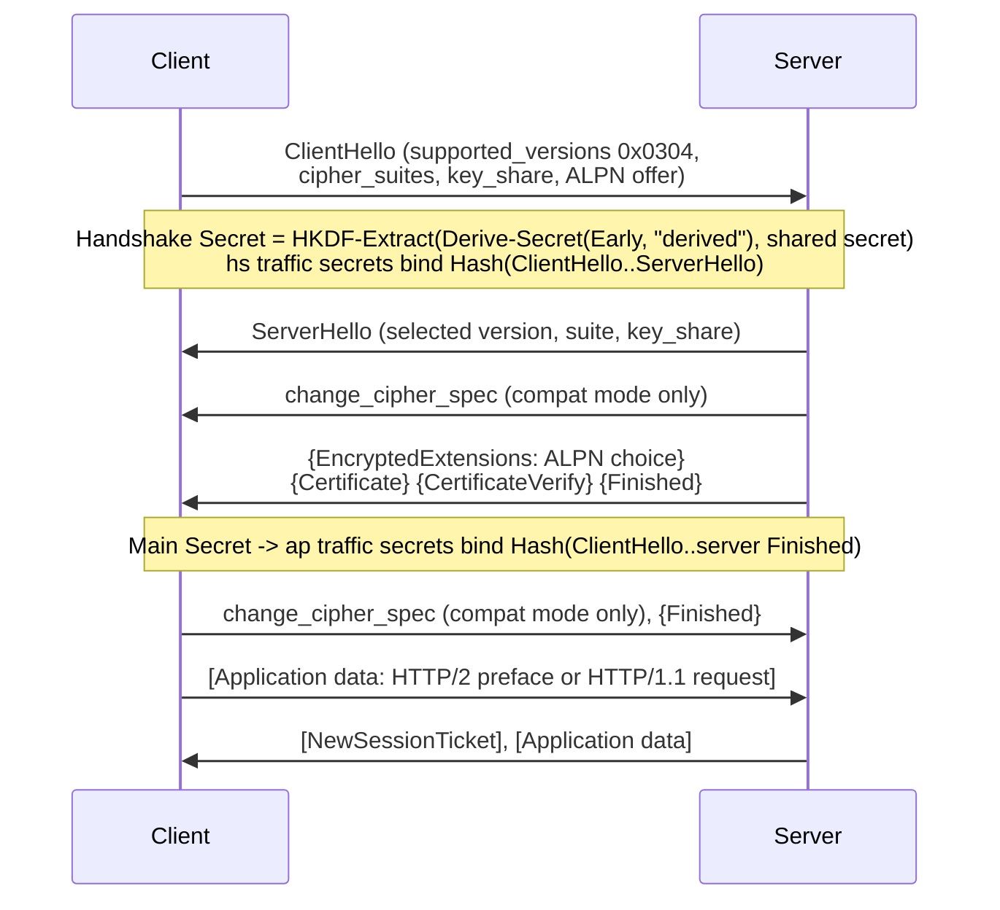

# TLS 1.3 Handshake Mechanics, Key Schedule, Cipher Suites, and ALPN Negotiation (RFC 9846)

> [!summary] Claim
> A TLS 1.3 handshake is one round trip in which everything after `ServerHello`, including the server's ALPN choice and certificate, is encrypted under keys that HKDF derives from the transcript hash, so an API's real security and protocol contract live in three negotiated values (version, cipher suite plus group, and ALPN id) that Python servers can silently get wrong: CPython completes the handshake with no ALPN instead of sending the `no_application_protocol` alert, `set_ciphers()` never touches the TLS 1.3 suites, and Hypercorn 0.18.0's `context.options =` assignment switches off middlebox compatibility mode.

Part of [TLS Connections and Intermediaries](README.md) in [API Engineering](../README.md).

## TL;DR

Mechanism: the client sends a `ClientHello` carrying a key share, the server answers with `ServerHello` and then `{EncryptedExtensions}`, `{Certificate}`, `{CertificateVerify}`, `{Finished}` under handshake keys, and the client can send application data after one round trip, where TLS 1.2 needs two `(RFC 9846 Section 2)` `(RFC 5246 Section 7.3)`; the lab measured 1 versus 2 client waits on OpenSSL 3.5.7, 3.5.9, and 4.1.0.
Contract rule: version is chosen only by `supported_versions` (`legacy_version` is frozen at `0x0303`), a TLS 1.3 suite names only an AEAD and the HKDF hash, and the server picks ALPN by its own preference and SHALL send a fatal `no_application_protocol` alert when nothing overlaps `(RFC 9846 Section 4.3.1)` `(RFC 9846 Appendix B.4)` `(RFC 7301 Section 3.2)`.
Trap: CPython's ALPN callback returns `SSL_TLSEXT_ERR_NOACK` on no overlap, so a server that configured `["http/1.1"]` completes a TLS 1.3 handshake with an `["h2"]` client and both sides see `selected_alpn_protocol() is None`; check it yourself after the handshake `(cpython v3.14.6 Modules/_ssl.c, do_protocol_selection)`.
Portability: all 37 lab tests pass on CPython 3.12.13, 3.13.18, 3.14.6, 3.14.10, 3.15.2, and 3.15.0b3 free-threaded, but only 3.15 has `SSLContext.set_ciphersuites()` and `set_groups()`, and OpenSSL 3.5 and later send an `X25519MLKEM768` key share by default, which makes the default `ClientHello` 1515 to 1545 bytes (as of 2026-11).
When not to use it: do not hand-roll a TLS stack or parse handshakes in production paths (use OpenSSL, BoringSSL, rustls, or the QUIC stack's TLS); use the key schedule code here only to test, debug, and reason, and prefer HTTP/3, where TLS 1.3 runs inside QUIC with mandatory ALPN and no TLS record layer, when TCP head-of-line blocking dominates ([[QUIC-Transport-Streams-and-Connection-Migration-RFC-9000]]).

## Mental model



The first arrow is the only plaintext message the client sends, and it already carries a key share for each group the client predicts the server will accept, which is why TLS 1.3 needs one round trip instead of TLS 1.2's two `(RFC 9846 Section 2)` `(RFC 5246 Section 7.3)`.
The server's reply splits at `ServerHello`: once both sides hold the shared secret, every later handshake message is protected under the `[sender]_handshake_traffic_secret` keys, so the ALPN choice in `EncryptedExtensions` and the certificate are invisible to a passive observer `(RFC 9846 Section 4.4.1)`.
The two notes are the two `HKDF-Extract` steps that matter on a full handshake: the handshake secret mixes in the asymmetric shared secret, and the application traffic secrets bind the transcript through the server's `Finished`, so any tampering with an earlier message changes every later key `(RFC 9846 Section 7.1)`.
The dummy `change_cipher_spec` records exist only to make the exchange resemble TLS 1.2 resumption for middleboxes and are ignored on receipt `(RFC 9846 Appendix E.4)`.
After the client's `Finished` the connection carries the protocol named by ALPN, and an HTTP/2 client must start with the connection preface `(RFC 9113 Section 3.2)` `(RFC 9113 Section 3.4)`.

## How it works

### Flights and round trips

A full handshake has three phases: key exchange (`ClientHello`, `ServerHello`), server parameters (`EncryptedExtensions`, optional `CertificateRequest`), and authentication (`Certificate`, `CertificateVerify`, `Finished`), and application data must not be sent before the sender's `Finished` except for 0-RTT `(RFC 9846 Section 2)`.
If no client key share is in a group the server accepts, the server sends a `HelloRetryRequest` naming the group and the client starts over, which costs a full extra round trip `(RFC 9846 Section 2.1)` `(RFC 9846 Section 4.2.4)`.
A `HelloRetryRequest` is a `ServerHello` whose `random` is `SHA-256("HelloRetryRequest")` = `CF 21 AD 74 ... 33 9C`, and the transcript then replaces `ClientHello1` with a synthetic `message_hash` (type `254`) message holding `Hash(ClientHello1)` so a server can do the retry statelessly `(RFC 9846 Section 4.2.3)` `(RFC 9846 Section 4.1)`.
The lab drives a real OpenSSL client and server through `ssl.MemoryBIO` pairs and counts how often the client must wait for server bytes before `do_handshake()` returns: TLS 1.3 waits once, TLS 1.2 twice, and a server limited to `secp384r1` (`set_ecdh_curve`, which calls `SSL_CTX_set1_groups` with one group on OpenSSL 3 `(cpython v3.14.6 Modules/_ssl.c, _ssl__SSLContext_set_ecdh_curve_impl)`) forces a `HelloRetryRequest` and two waits.

### ClientHello on the wire

The record and handshake headers are fixed-width and every variable field is a length-prefixed vector `(RFC 9846 Section 5.1)` `(RFC 9846 Section 4.2.2)`; this is the start of the RFC 8448 example `ClientHello` `(RFC 8448 Section 3)`:

```text
16 03 01 00 c4                  TLSPlaintext: handshake(22), legacy_record_version 0x0301, length 196
01 00 00 c0                     Handshake: client_hello(1), uint24 length 192
03 03                           legacy_version = 0x0303 (TLS 1.2), frozen
cb 34 ec b1 ... 4d ec e7        random (32 bytes)
00                              legacy_session_id length 0 (no compatibility mode)
00 06 13 01 13 03 13 02         cipher_suites: AES_128_GCM, CHACHA20_POLY1305, AES_256_GCM
01 00                           legacy_compression_methods: exactly one byte, 0
00 91 ...                       extensions (145 bytes): server_name, supported_groups, key_share, supported_versions, ...
```

A TLS 1.3 `ClientHello` is identified by `legacy_version` `0x0303` plus a `supported_versions` extension (type `43`) whose highest listed version is `0x0304`, and a server must abort with `protocol_version` on any other `legacy_version` `(RFC 9846 Section 4.2.2)`.
The record carrying the first `ClientHello` SHOULD use version `0x0301` and every later record `0x0303`, and the field must otherwise be ignored `(RFC 9846 Section 5.1)`.
OpenSSL's default `ClientHello` differs from the RFC 8448 one in ways the lab pins: `legacy_record_version` `0x0301`, a 32-byte `legacy_session_id` (compatibility mode, `(RFC 9846 Appendix E.4)`), 17 cipher suites starting `13 02 13 03 13 01`, two key shares, and, with httpcore's ALPN list, `extension_data` equal to `00 0c 08 "http/1.1" 02 "h2"`.
An `Extension` is `uint16 type || opaque data<0..2^16-1>`, trailing data inside a known extension is a `decode_error`, and a block must not contain two extensions of the same type `(RFC 9846 Section 4.3)`; servers must ignore extensions they do not recognize `(RFC 9846 Section 4.2.2)`.

### ServerHello and version negotiation

`ServerHello` keeps `legacy_version = 0x0303`, echoes `legacy_session_id`, names one `cipher_suite`, and for TLS 1.3 must carry `supported_versions` with `selected_version = 0x0304`; a client must ignore `legacy_version` when that extension is present `(RFC 9846 Section 4.2.3)` `(RFC 9846 Section 4.3.1)`.
The RFC 8448 `ServerHello` decodes as `02 00 00 56 | 03 03 | random(32) | 00 | 13 01 | 00 | 00 2e | 00 33 00 24 00 1d 00 20 <x25519 share> | 00 2b 00 02 03 04`: no session id, `TLS_AES_128_GCM_SHA256`, a `key_share` for `x25519` (`0x001d`), and `supported_versions` `0x0304`.
Only extensions needed to establish the cryptographic context go in `ServerHello`; everything else, ALPN included, goes in `EncryptedExtensions`, the first message protected by the server handshake keys `(RFC 9846 Section 4.2.3)` `(RFC 9846 Section 4.4.1)`.
The extension table in `(RFC 9846 Section 4.3)` lists `application_layer_protocol_negotiation` as allowed only in `CH, EE` for TLS 1.3, which supersedes the plaintext `ServerHello` placement that `(RFC 7301 Section 3.1)` and its rationale in `(RFC 7301 Section 4)` describe for TLS 1.2.
A TLS 1.3 server that negotiates TLS 1.2 must end `ServerHello.random` with `44 4F 57 4E 47 52 44 01` (`DOWNGRD\x01`), and a TLS 1.3 client must abort with `illegal_parameter` if it sees that sentinel on a TLS 1.2 `ServerHello` `(RFC 9846 Section 4.2.3)`.
The lab observes OpenSSL stamping the sentinel only when the server itself supports TLS 1.3 and the client capped itself at TLS 1.2; a server capped at TLS 1.2 has no 1.3 to protect and sends a plain random.

### The key schedule

Every secret comes from two HKDF primitives: `HKDF-Extract(salt, IKM) = HMAC-Hash(salt, IKM)` `(RFC 5869 Section 2.2)` and `HKDF-Expand-Label(Secret, Label, Context, Length) = HKDF-Expand(Secret, HkdfLabel, Length)` `(RFC 9846 Section 7.1)`, where:

```text
struct {
    uint16 length = Length;
    opaque label<7..255> = "tls13 " + Label;
    opaque context<0..255> = Context;
} HkdfLabel;

Derive-Secret(Secret, Label, Messages) =
    HKDF-Expand-Label(Secret, Label, Transcript-Hash(Messages), Hash.length)
```

For `c hs traffic` over SHA-256 the info string is `00 20 | 12 | "tls13 c hs traffic" | 20 | Hash(ClientHello..ServerHello)`, 54 octets, which the lab reproduces byte for byte from RFC 8448 `(RFC 8448 Section 3)`.
`Transcript-Hash` hashes the concatenated handshake messages including their 4-byte type and length headers but not record headers `(RFC 9846 Section 4.1)`.
The schedule is three extracts chained through `Derive-Secret(., "derived", "")`: `Early Secret = HKDF-Extract(0, PSK)`, `Handshake Secret = HKDF-Extract(derived, shared secret)`, `Main Secret = HKDF-Extract(derived, 0)`, where `0` is `Hash.length` zero bytes and a missing PSK is also zeros, so a certificate-only handshake still computes the early secret `(RFC 9846 Section 7.1)`.
RFC 9846 renames "master" secrets to "main" but keeps the wire labels `"exp master"` and `"res master"` for compatibility `(RFC 9846 Section 1.2)` `(RFC 9846 Section 7.1)`.
Traffic keys are leaves: `[sender]_write_key = HKDF-Expand-Label(Secret, "key", "", key_length)` and `[sender]_write_iv = HKDF-Expand-Label(Secret, "iv", "", iv_length)` `(RFC 9846 Section 7.3)`.
`Finished.verify_data = HMAC(finished_key, Transcript-Hash(Handshake Context, Certificate*, CertificateVerify*))` with `finished_key = HKDF-Expand-Label(BaseKey, "finished", "", Hash.length)`, and is `Hash.length` bytes, not TLS 1.2's 12 `(RFC 9846 Section 4.5.3)`.
The lab implements HKDF with `cryptography 50.0.2` (`HKDF.extract` and `HKDFExpand`, both bound from Rust in `cryptography/hazmat/primitives/kdf/hkdf.py`), and starting from only the RFC 8448 `ClientHello`, `ServerHello`, client `x25519` private key, and encrypted records it reproduces the early, handshake, and main secrets, both handshake and application traffic secrets, the server handshake key and IV, and the server `Finished`.

### Record protection

After `ServerHello` every record is a `TLSCiphertext` whose outer `opaque_type` is always `23` (`application_data`) and whose `legacy_record_version` is always `0x0303`; the real type is the last non-zero byte of the decrypted `TLSInnerPlaintext`, and any zero bytes after it are padding `(RFC 9846 Section 5.2)` `(RFC 9846 Section 5.4)`.
The AEAD's additional data is the 5-byte record header, so flipping the version bytes makes decryption fail with `bad_record_mac` `(RFC 9846 Section 5.2)`.
The nonce is the 64-bit record sequence number left-padded to `iv_length` (12) and XORed with the static IV; sequence numbers start at 0 for each key and increment per record `(RFC 9846 Section 5.3)`.
RFC 8448's server sends `NewSessionTicket` and then application data under the same application key, so the lab must open them with sequence numbers 0 and 1, and opening the data record with 0 fails authentication.

### Cipher suites and groups

TLS 1.3 defines five suites, `TLS_AES_128_GCM_SHA256` `{0x13,0x01}`, `TLS_AES_256_GCM_SHA384` `{0x13,0x02}`, `TLS_CHACHA20_POLY1305_SHA256` `{0x13,0x03}`, `TLS_AES_128_CCM_SHA256` `{0x13,0x04}`, and `TLS_AES_128_CCM_8_SHA256` `{0x13,0x05}`, each naming only an AEAD and the hash for HKDF and the transcript; they cannot be used with TLS 1.2 and TLS 1.2 suites cannot be used with TLS 1.3 `(RFC 9846 Appendix B.4)`.
`TLS_AES_128_GCM_SHA256` is mandatory to implement and the AES-256-GCM and ChaCha20 suites are SHOULD `(RFC 9846 Section 9.1)`.
Key exchange, signature algorithm, and suite are negotiated independently, and no overlap in `supported_groups` is a `handshake_failure` or `insufficient_security` abort `(RFC 9846 Section 4.2.1)`.
The suite's hash sets every secret's length: the lab's SHA-384 suite yields 48-byte traffic secrets and 32-byte keys, the SHA-256 suites 32-byte secrets.
CPython's `SSLContext.set_ciphers()` configures only TLS 1.2 and earlier; the TLS 1.3 list needs `SSLContext.set_ciphersuites()`, added in 3.15 `(cpython v3.15.2 Doc/library/ssl.rst, SSLContext.set_ciphers)` `(cpython v3.15.2 Doc/library/ssl.rst, SSLContext.set_ciphersuites)`.
OpenSSL 3.5's built-in group list selects `X25519MLKEM768` as a predicted key share and its manual warns that the larger `ClientHello` may no longer fit one TCP segment `(OpenSSL 3.5.7 doc/man3/SSL_CTX_set1_curves.pod, DEFAULT)`.
`X25519MLKEM768` is group `4588` (`0x11EC`), its client share is 1216 bytes (1184 ML-KEM encapsulation key + 32 X25519) and its server share 1120 bytes (1088 ciphertext + 32) `(RFC 10024 Section 4.1)` `(RFC 10024 Section 4.2)` `(RFC 10024 Section 7.1)`; the lab measures exactly these lengths on every interpreter here.

### ALPN

The extension body is a `ProtocolNameList` of `opaque ProtocolName<1..2^8-1>` inside a `<2..2^16-1>` vector in client preference order, and the server's response must contain exactly one name `(RFC 7301 Section 3.1)`.
The server SHOULD pick its most preferred protocol that the client also offered, and SHALL respond with a fatal `no_application_protocol` (`120`) alert when there is none `(RFC 7301 Section 3.2)`; RFC 9325 advises servers to enforce that strictly and says clients SHOULD abort if the server acknowledges ALPN without choosing from the client list, citing ALPACA cross-protocol attacks `(RFC 9325 Section 3.8)`.
CPython builds the wire list in `SSLContext.set_alpn_protocols`, rejecting names outside 1 to 255 bytes `(cpython v3.14.6 Lib/ssl.py, SSLContext.set_alpn_protocols)`.
On the server, `_selectALPN_cb` calls `do_protocol_selection`, which passes the server list first to `SSL_select_next_proto` (so server preference wins) and returns `SSL_TLSEXT_ERR_NOACK` when the result is not `OPENSSL_NPN_NEGOTIATED` `(cpython v3.14.6 Modules/_ssl.c, do_protocol_selection)`; `NOACK` means "omit the extension", so the handshake succeeds without ALPN instead of failing.
httpcore 1.0.9 offers `["http/1.1", "h2"]` when HTTP/2 is enabled, setting it on the caller's `ssl_context` at connect time, and switches to HTTP/2 only if `selected_alpn_protocol() == "h2"` `(httpcore 1.0.9 httpcore/_async/connection.py, AsyncHTTPConnection._connect)` `(httpcore 1.0.9 httpcore/_async/connection.py, AsyncHTTPConnection.handle_async_request)`.
Hypercorn 0.18.0 serves `alpn_protocols = ["h2", "http/1.1"]`, so the client's `http/1.1`-first order loses and the lab negotiates `h2` `(hypercorn 0.18.0 src/hypercorn/config.py, Config)`.

### Middlebox compatibility mode and the Hypercorn options overwrite

In compatibility mode the client sends a non-empty `legacy_session_id` and a dummy `change_cipher_spec` before its second flight, the server sends one right after its first handshake message, and if the client sent a non-empty session id the server MUST send that `change_cipher_spec` `(RFC 9846 Appendix E.4)`.
OpenSSL enables it by default through `SSL_OP_ENABLE_MIDDLEBOX_COMPAT` and turns it off only when the option is cleared `(OpenSSL 3.5.7 doc/man3/SSL_CTX_set_options.pod, SSL_OP_ENABLE_MIDDLEBOX_COMPAT)`.
CPython's `options` setter computes `clear = opts & ~new_opts` and calls `SSL_CTX_clear_options` for those bits, so assignment replaces the whole option set rather than adding to it `(cpython v3.14.6 Modules/_ssl.c, _ssl__SSLContext_options_set_impl)`.
Hypercorn 0.18.0 does `context = create_default_context(Purpose.CLIENT_AUTH)` and then `context.options = OP_NO_COMPRESSION` with the comment "RFC 7540 Section 9.2.1: MUST disable compression" `(hypercorn 0.18.0 src/hypercorn/config.py, Config.create_ssl_context)`; the lab shows this clears `OP_ENABLE_MIDDLEBOX_COMPAT` and `OP_CIPHER_SERVER_PREFERENCE`, and the server then echoes the client's 32-byte session id but sends no `change_cipher_spec`.
QUIC goes the other way: a QUIC client MUST NOT request compatibility mode and a server SHOULD treat a non-empty `legacy_session_id` as `PROTOCOL_VIOLATION` `(RFC 9001 Section 8.4)`.

## Numbers and limits

| Quantity | Value | Source |
|---|---|---|
| Max `TLSPlaintext.length` | `2^14` (16,384) bytes; larger is `record_overflow` | `(RFC 9846 Section 5.1)` |
| Max `TLSCiphertext.length` | `2^14 + 256` bytes; AEAD expansion <= 255 | `(RFC 9846 Section 5.2)` |
| Record sequence number | 64 bits, reset per key, never wraps | `(RFC 9846 Section 5.3)` |
| AES-GCM key usage limit | `2^24.5` full-size records (about 24 million), then `KeyUpdate` or close (MUST) | `(RFC 9846 Section 5.5)` |
| Per-record nonce | `iv_length` = max(8, N_MIN) = 12 bytes for the GCM and ChaCha20 suites | `(RFC 9846 Section 5.3)`; lab `traffic_keys` |
| Secret length | `Hash.length`: 32 (SHA-256 suites), 48 (`TLS_AES_256_GCM_SHA384`) | `(RFC 9846 Section 7.1)`; lab parametrized test |
| `Finished.verify_data` | `Hash.length` bytes (TLS 1.2: 12) | `(RFC 9846 Section 4.5.3)` |
| `HkdfLabel.label` / `context` | 7..255 / 0..255 bytes | `(RFC 9846 Section 7.1)` |
| ALPN name / list | 1..255 bytes / 2..65,535 bytes | `(RFC 7301 Section 3.1)` |
| `X25519MLKEM768` shares | client 1216 bytes, server 1120 bytes | `(RFC 10024 Section 4.1)`, `(RFC 10024 Section 4.2)`; measured in lab |
| Round trips before client may send data | TLS 1.3: 1; TLS 1.3 after `HelloRetryRequest`: 2; TLS 1.2: 2 | measured, lab tests, every interpreter below |
| Default `ClientHello` flight (no ALPN) | 1515 bytes (one record: 5-byte header + 1510-byte message) on OpenSSL 3.5.7 and 3.5.9; 1545 bytes (1540-byte message) on OpenSSL 4.1.0; 18 bytes more with httpcore's ALPN offer | measured with a one-off script calling the lab's `run_memory_handshake` and `parse_client_hello` on default `PROTOCOL_TLS_CLIENT` / `PROTOCOL_TLS_SERVER` contexts, run with each interpreter's venv `python -I`, macOS 27.2 arm64 (`uname -r` 27.2.0), CPython 3.12.13, 3.13.18, 3.14.6, 3.14.10, 3.15.2, 3.15.0b3t (as of 2026-11) |
| Default `ServerHello` message | 1210 bytes (carries the 1120-byte hybrid share) | measured, same run, OpenSSL 3.5.7, 3.5.9, 4.1.0 |
| RFC 8448 classical `ClientHello` | 196-byte handshake message in a 201-byte record (one `x25519` share) | `(RFC 8448 Section 3)` |

The OpenSSL 4.1.0 `ClientHello` is 30 bytes larger than 3.5.x because its `signature_algorithms` extension grew from 54 to 80 bytes and `supported_groups` from 18 to 24 bytes, measured by parsing the captured hellos; the key share extension is 1258 bytes on both.
Parsing both hellos with `python -I` on CPython 3.14.6 (OpenSSL 3.5.7) and 3.14.10 (OpenSSL 4.1.0) shows the added `supported_groups` codepoints are `0x11eb`, `0x11ee`, and `0x0029`, and the added `signature_algorithms` codepoints are `0x0911` to `0x091c` (12 values) and `0x0708`; 3 groups and 13 algorithms at 2 bytes each account for exactly the 6 and 26 bytes.
The group growth matches the OpenSSL 4.0 default group list change, which appends `SecP256r1MKEM768` and `curveSM2MLKEM768` after `X25519MLKEM768` and inserts `curveSM2`, and `sm2sig_sm3` support was added in the same release `(openssl 4.1.0 CHANGES.md, OpenSSL 4.0 section)`.
The provider's TLS signature-algorithm table in 4.1.0 holds three ML-DSA entries, twelve SLH-DSA entries, and `sm2sig_sm3`, which matches the 12 plus 1 added codepoints `(openssl 4.1.0 providers/common/capabilities.c, sigalg_constants_list)`; I did not look up each `TLSEXT_SIGALG_*` macro value, so the mapping of `0x0911` to `0x091c` onto the SLH-DSA entries is by count, not by value.
The key share offer stays at two shares (`X25519MLKEM768`, `x25519`) on both builds, so the larger group list adds no key share bytes.

## Portability

| Runtime, library, or protocol | Behavior | Evidence |
|---|---|---|
| CPython 3.12.13 + OpenSSL 3.5.7 | 37 passed | `uv run --frozen --python 3.12` in a job-local venv, macOS 27.2 arm64 |
| CPython 3.13.18 + OpenSSL 3.5.9 | 37 passed | `--python 3.13` |
| CPython 3.14.6 + OpenSSL 3.5.7 | 37 passed (workspace `.venv`) | `uv run --frozen pytest ...` |
| CPython 3.14.10 + OpenSSL 4.1.0 | 37 passed | `--python 3.14.10` |
| CPython 3.15.2 + OpenSSL 4.1.0 | 37 passed; the `set_ciphersuites` branch runs and restricts the offer to `0x1303` | `--python 3.15.2` |
| CPython 3.15t free-threaded | 37 passed on 3.15.0b3t (OpenSSL 3.5.7) with `sys._is_gil_enabled() == False`, in a minimal `uv venv` holding `cryptography` 50.0.2, `hypercorn` 0.18.0, `uvicorn` 0.54.0, `pytest` 9.2.0, `pytest-asyncio` 1.4.1.post1 (the `uv.lock` versions); 3.15.2t is not installed and `uv sync --frozen` fails on `psycopg-binary==3.3.8` (no wheel) | rerun by the fact-checker, `PYTHONPATH=src <venv>/bin/python -B -m pytest <test> -q` |
| CPython 3.12.16 (style matrix pin) | not run: not installed here; 3.12.13 stands in | - |
| Debian Trixie and Alpine musl containers | not run: the verification brief confines writes to the job directory, which a container image pull would break | - |
| `set_ciphersuites`, `set_groups`, `SSLSocket.group()` | absent on 3.12.13, 3.13.18, 3.14.6, 3.14.10; present on 3.15.2 and 3.15.0b3t; all three are `versionadded:: 3.15` | lab test (`set_ciphersuites`) plus a `hasattr` check of all three on each interpreter; `(cpython v3.15.2 Doc/library/ssl.rst, SSLContext.set_groups)`, `(cpython v3.15.2 Doc/library/ssl.rst, SSLSocket.group)` |
| OpenSSL 3.5.x and 4.1.0 defaults | key shares `X25519MLKEM768` + `x25519`, suite order `0x1302, 0x1303, 0x1301`, server picks `TLS_AES_256_GCM_SHA384`, compatibility mode on | lab tests and the one-off size measurement on all builds above |
| Hypercorn 0.18.0 | ALPN `["h2", "http/1.1"]`, TLS >= 1.2, `set_ciphers("ECDHE+AESGCM")` (TLS 1.2 only), `options =` clears middlebox compatibility and server cipher preference | lab test `test_hypercorn_options_assignment_drops_the_middlebox_ccs`; `(hypercorn 0.18.0 src/hypercorn/config.py, Config.create_ssl_context)` |
| Uvicorn 0.54.0 | `create_ssl_context` sets ALPN only if the HTTP protocol class has `alpn_protocols`; with `http="h11"` nothing is offered and the lab negotiates no ALPN; the `zttp` auto protocol declares `["h2", "http/1.1"]` (not exercised, `zttp` is not in the lock) | lab test `test_uvicorn_h11_ssl_context_negotiates_no_alpn`; `(uvicorn 0.54.0 uvicorn/config.py, create_ssl_context)`, `(uvicorn 0.54.0 uvicorn/protocols/http/auto_zttp_impl.py, alpn_protocols)` |
| Granian 2.8.7 | TLS is in native Rust (rustls); `--http auto` offers `["h2", "http/1.1"]`, `--http 1` only `http/1.1`, `--http 2` only `h2`; a client offer with no overlap gets the fatal `no_application_protocol` alert; a client with no ALPN extension negotiates none; `ssl_protocol_min` defaults to `tls1.3` | run here: a one-off ASGI app under `granian --interface asgi --http {auto,1,2} --ssl-certificate ... --ssl-keyfile ...` with a self-signed P-256 certificate on `127.0.0.1`, probed by a CPython 3.14.6 `ssl` client (OpenSSL 3.5.7, macOS 27.2 arm64): with `auto`, offers `[h2, http/1.1]`, `[h2]`, and `[http/1.1, h2]` selected `h2`, `[http/1.1]` selected `http/1.1`, `[bogus]` failed with `TLSV1_ALERT_NO_APPLICATION_PROTOCOL`, no offer selected nothing; with `1` only `http/1.1` was selectable and with `2` only `h2`; every connection was TLSv1.3; `(granian 2.8.7 src/workers.rs, WorkerConfig::tls_cfg)` sets `cfg.alpn_protocols` from the HTTP mode, `(granian 2.8.7 src/tls.rs, resolve_protocol_versions)` maps `tls1.3` to TLS 1.3 only, `(granian 2.8.7 granian/server/common.py, AbstractServer.__init__)` defaults `ssl_protocol_min` |
| httpx 0.28.1 / httpcore 1.0.9 client | offers `["http/1.1", "h2"]` with `http2=True`, else `["http/1.1"]` | `(httpcore 1.0.9 httpcore/_async/connection.py, AsyncHTTPConnection._connect)` |
| HTTP/1.1 over TLS | ALPN id `http/1.1`; httpcore treats no ALPN as HTTP/1.1 unless HTTP/1.1 is disabled | `(RFC 7301 Section 6)`; `(httpcore 1.0.9 httpcore/_async/connection.py, AsyncHTTPConnection.handle_async_request)` |
| HTTP/2 | TLS 1.2 or higher, SNI required, ALPN id `h2`, `h2c` must never be sent over TLS | `(RFC 9113 Section 3.2)`, `(RFC 9113 Section 9.2)` |
| HTTP/3 over QUIC | TLS 1.3 handshake carried in QUIC `CRYPTO` frames, ALPN mandatory with `no_application_protocol` (`0x0178`) on failure, compatibility mode forbidden | `(RFC 9001 Section 4)`, `(RFC 9001 Section 8.1)`, `(RFC 9001 Section 8.4)` |

## Worked example

The [implementation](../labs/src/api_labs/f02_tls_connections_and_intermediaries/tls13_handshake.py) is a typed TLS 1.3 key schedule, record opener, and hello parser over `cryptography 50.0.2`, plus a `MemoryBIO` driver that records every byte a real OpenSSL client and server exchange; the [test](../labs/tests/f02_tls_connections_and_intermediaries/test_tls_1_3_handshake_cipher_suites_and_alpn_rfc_9846.py) has 37 cases, 36 `unit` (no sockets) and one `socket` on `127.0.0.1:0`.

The key schedule, verbatim from the implementation:

```python
def hkdf_label(length: int, label: bytes, context: bytes) -> bytes:
    """Serialize HkdfLabel: uint16 length, opaque "tls13 "+label<7..255>, context<0..255>."""
    full = b"tls13 " + label
    if not 7 <= len(full) <= 255 or len(context) > 255:
        raise ValueError("HkdfLabel field out of range")
    return struct.pack(">H", length) + bytes([len(full)]) + full + bytes([len(context)]) + context


def hkdf_expand_label(
    suite: CipherSuite, secret: bytes, label: bytes, context: bytes, length: int
) -> bytes:
    info = hkdf_label(length, label, context)
    return HKDFExpand(suite.hash(), length, info).derive(secret)


def transcript_hash(suite: CipherSuite, *messages: bytes) -> bytes:
    """Hash of the concatenated handshake messages, headers included (RFC 9846 Section 4.1)."""
    digest = hashes.Hash(suite.hash())
    for message in messages:
        digest.update(message)
    return digest.finalize()


def derive_secret(suite: CipherSuite, secret: bytes, label: bytes, thash: bytes) -> bytes:
    return hkdf_expand_label(suite, secret, label, thash, suite.hash_length)


@dataclass(frozen=True, slots=True)
class HandshakeSecrets:
    early_secret: bytes
    handshake_secret: bytes
    client_handshake_traffic_secret: bytes
    server_handshake_traffic_secret: bytes
    main_secret: bytes


def derive_handshake_secrets(
    suite: CipherSuite, shared_secret: bytes, hello_hash: bytes, psk: bytes = b""
) -> HandshakeSecrets:
    """Walk Figure 5 down to the main secret; hello_hash covers ClientHello...ServerHello."""
    empty_hash = transcript_hash(suite)
    early = hkdf_extract(suite, b"", psk)
    hs = hkdf_extract(suite, derive_secret(suite, early, b"derived", empty_hash), shared_secret)
    main = hkdf_extract(suite, derive_secret(suite, hs, b"derived", empty_hash), b"")
    return HandshakeSecrets(
        early_secret=early,
        handshake_secret=hs,
        client_handshake_traffic_secret=derive_secret(suite, hs, b"c hs traffic", hello_hash),
        server_handshake_traffic_secret=derive_secret(suite, hs, b"s hs traffic", hello_hash),
        main_secret=main,
    )
```

Record nonce and record opening, verbatim:

```python
def record_nonce(iv: bytes, sequence: int) -> bytes:
    """Left-pad the 64-bit sequence number to iv_length and XOR it with the IV (Section 5.3)."""
    padded = sequence.to_bytes(len(iv), "big")
    return bytes(a ^ b for a, b in zip(iv, padded, strict=True))


def open_record(
    suite: CipherSuite, keys: TrafficKeys, sequence: int, record: bytes
) -> tuple[int, bytes]:
    """Decrypt one TLSCiphertext and return (inner content type, content), padding stripped."""
    opaque_type, _version, length = struct.unpack(">BHH", record[:5])
    if opaque_type != APPLICATION_DATA:
        raise ValueError("protected records always carry outer type application_data")
    if length > MAX_CIPHERTEXT or len(record) != 5 + length:
        raise ValueError("record_overflow or truncated record")
    inner = suite.aead(keys.key).decrypt(record_nonce(keys.iv, sequence), record[5:], record[:5])
    stripped = inner.rstrip(b"\x00")
    if not stripped:
        raise ValueError("unexpected_message: all-zero TLSInnerPlaintext")
    return stripped[-1], stripped[:-1]
```

The RFC 7301 reference selector the CPython behavior is compared against, verbatim:

```python
def select_alpn(server_preference: Sequence[bytes], client_offer: Sequence[bytes]) -> bytes | None:
    """Server-preference selection; None means the client sent no ALPN extension."""
    if not client_offer:
        return None
    for protocol in server_preference:
        if protocol in client_offer:
            return protocol
    raise NoApplicationProtocolError("no_application_protocol")
```

The in-memory handshake driver, verbatim:

```python
def run_memory_handshake(
    client_context: ssl.SSLContext, server_context: ssl.SSLContext, hostname: str
) -> HandshakeTrace:
    """Pump a real OpenSSL handshake through MemoryBIOs and record every flight's bytes.

    client_round_trips counts how often the client had to wait for the server before its
    do_handshake() returned, which is when it may send application data.
    """
    c_in, c_out, s_in, s_out = ssl.MemoryBIO(), ssl.MemoryBIO(), ssl.MemoryBIO(), ssl.MemoryBIO()
    client = client_context.wrap_bio(c_in, c_out, server_hostname=hostname)
    server = server_context.wrap_bio(s_in, s_out, server_side=True)
    flights: list[tuple[str, bytes]] = []
    client_done = server_done = False
    waits = 0
    for _ in range(8):
        if not client_done:
            try:
                client.do_handshake()
                client_done = True
            except ssl.SSLWantReadError:
                waits += 1
        if data := c_out.read():
            flights.append(("client", data))
            s_in.write(data)
        if not server_done:
            try:
                server.do_handshake()
                server_done = True
            except ssl.SSLWantReadError:
                pass
        if data := s_out.read():
            flights.append(("server", data))
            c_in.write(data)
        if client_done and server_done:
            break
    else:
        raise RuntimeError("handshake did not converge")
    cipher = client.cipher()
    return HandshakeTrace(
        flights=tuple(flights),
        client_round_trips=waits,
        version=client.version(),
        cipher=None if cipher is None else cipher[0],
        client_alpn=client.selected_alpn_protocol(),
        server_alpn=server.selected_alpn_protocol(),
    )
```

Tests that pin the key schedule to RFC 8448 and the record sequence numbers, verbatim from the test module:

```python
@pytest.mark.unit
def test_handshake_key_schedule_matches_rfc8448() -> None:
    hello_hash = transcript_hash(SUITE, CLIENT_HELLO, SERVER_HELLO)
    secrets = derive_handshake_secrets(SUITE, ECDHE_SHARED_SECRET, hello_hash)
    assert secrets.early_secret == EARLY_SECRET  # HKDF-Extract(0, 0) even without a PSK
    assert secrets.handshake_secret == HANDSHAKE_SECRET
    assert secrets.client_handshake_traffic_secret == C_HS_TRAFFIC
    assert secrets.server_handshake_traffic_secret == S_HS_TRAFFIC
    assert secrets.main_secret == MAIN_SECRET
    keys = traffic_keys(SUITE, secrets.server_handshake_traffic_secret)
    assert (keys.key, keys.iv) == (S_HS_KEY, S_HS_IV)


@pytest.mark.unit
def test_each_record_under_one_key_uses_the_next_sequence_number() -> None:
    keys = traffic_keys(SUITE, S_AP_TRAFFIC)
    ticket_type, ticket = open_record(SUITE, keys, 0, S_TICKET_RECORD)
    assert (ticket_type, ticket[0]) == (HANDSHAKE, 4)  # NewSessionTicket uses sequence 0
    assert open_record(SUITE, keys, 1, S_APP_RECORD) == (APPLICATION_DATA, bytes(range(50)))
    with pytest.raises(InvalidTag):
        open_record(SUITE, keys, 0, S_APP_RECORD)
```

Tests that pin live OpenSSL and server-library behavior, verbatim:

```python
@pytest.mark.unit
def test_tls13_client_finishes_after_one_round_trip_and_tls12_after_two(
    identity: tuple[Path, Path],
) -> None:
    tls13 = run_memory_handshake(client_ctx(identity[0]), server_ctx(identity), HOST)
    capped = client_ctx(identity[0])
    capped.maximum_version = ssl.TLSVersion.TLSv1_2
    tls12 = run_memory_handshake(capped, server_ctx(identity), HOST)
    assert (tls13.version, tls13.client_round_trips) == ("TLSv1.3", 1)
    assert (tls12.version, tls12.client_round_trips) == ("TLSv1.2", 2)


@pytest.mark.unit
def test_tls13_encrypts_alpn_and_certificate_that_tls12_sends_in_clear(
    identity: tuple[Path, Path],
) -> None:
    der = ssl.PEM_cert_to_DER_cert(identity[0].read_text())
    alpn = ["http/1.1"]
    tls13 = run_memory_handshake(client_ctx(identity[0], alpn), server_ctx(identity, alpn), HOST)
    after_hello = tls13.records(1)[1:]
    assert {r.content_type for r in after_hello} <= {CHANGE_CIPHER_SPEC, APPLICATION_DATA}
    protected = b"".join(r.fragment for r in after_hello)
    assert b"http/1.1" not in protected
    assert der not in protected
    capped = client_ctx(identity[0], alpn)
    capped.maximum_version = ssl.TLSVersion.TLSv1_2
    tls12 = run_memory_handshake(capped, server_ctx(identity, alpn), HOST)
    _, server_hello = hello_messages(tls12)
    assert parse_alpn(parse_server_hello(server_hello).extensions[16]) == (b"http/1.1",)
    assert der in tls12.flights[1][1]
    assert tls13.server_alpn == tls12.server_alpn == "http/1.1"


@pytest.mark.unit
def test_cpython_server_completes_handshake_without_alpn_on_mismatch(
    identity: tuple[Path, Path],
) -> None:
    trace = run_memory_handshake(
        client_ctx(identity[0], ["h2"]), server_ctx(identity, ["http/1.1"]), HOST
    )
    assert (trace.version, trace.client_alpn, trace.server_alpn) == ("TLSv1.3", None, None)
    with pytest.raises(NoApplicationProtocolError):
        select_alpn([b"http/1.1"], [b"h2"])
    assert select_alpn([b"http/1.1"], []) is None


@pytest.mark.unit
def test_hypercorn_options_assignment_drops_the_middlebox_ccs(
    identity: tuple[Path, Path],
) -> None:
    config = HypercornConfig()
    config.certfile, config.keyfile = str(identity[0]), str(identity[1])
    context = config.create_ssl_context()
    assert context is not None
    assert context.options & ssl.OP_ENABLE_MIDDLEBOX_COMPAT == 0
    assert context.options & ssl.OP_CIPHER_SERVER_PREFERENCE == 0
    trace = run_memory_handshake(client_ctx(identity[0], HTTPCORE_ALPN), context, HOST)
    raw_ch, raw_sh = hello_messages(trace)
    assert len(parse_client_hello(raw_ch).session_id) == 32
    assert parse_server_hello(raw_sh).session_id_echo == parse_client_hello(raw_ch).session_id
    assert CHANGE_CIPHER_SPEC not in {r.content_type for r in trace.records(1)}
    assert (trace.version, trace.client_alpn, trace.server_alpn) == ("TLSv1.3", "h2", "h2")
```

Captured run, from `labs/`, CPython 3.14.6 with OpenSSL 3.5.7, macOS 27.2 arm64:

```text
$ uv run --frozen pytest tests/f02_tls_connections_and_intermediaries/test_tls_1_3_handshake_cipher_suites_and_alpn_rfc_9846.py -q
.....................................                                    [100%]
37 passed in 0.23s
```

Captured matrix, same machine, one job-local venv per interpreter (`UV_PROJECT_ENVIRONMENT=<venv> uv run --frozen --python <v> pytest <test> -q`; the free-threaded line ran as `PYTHONPATH=src <venv>/bin/python -m pytest <test> -q` in the minimal venv described under Portability):

```text
3.12.13 OpenSSL 3.5.7 9 Jun 2026
37 passed in 0.34s
3.13.18 OpenSSL 3.5.9 29 Sep 2026
37 passed in 0.29s
3.14.10 OpenSSL 4.1.0 23 Oct 2026
37 passed in 0.26s
3.15.2 OpenSSL 4.1.0 23 Oct 2026
37 passed in 0.30s
3.15.0b3 OpenSSL 3.5.7 9 Jun 2026 gil False
37 passed in 0.29s
```

## Pitfalls

> [!warning] ALPN mismatch silently succeeds on CPython servers
> Trigger: a Python server sets `set_alpn_protocols(["http/1.1"])` and a client offers only `["h2"]`, or a client that requires `h2` talks to a server without it.
> Symptom: the handshake completes, `selected_alpn_protocol()` returns `None` on both sides, and each side falls back to its own default protocol, which is exactly the cross-protocol confusion ALPACA exploits `(RFC 9325 Section 3.8)`.
> Fix: after the handshake, if you configured ALPN and `selected_alpn_protocol()` is `None` or not in your list, close the connection; CPython will not send the `no_application_protocol` alert `(RFC 7301 Section 3.2)` for you because `do_protocol_selection` returns `SSL_TLSEXT_ERR_NOACK` `(cpython v3.14.6 Modules/_ssl.c, do_protocol_selection)`.

> [!warning] `SSL_select_next_proto` with an empty client list discloses memory (CVE-2024-5535)
> Trigger: code that calls OpenSSL's `SSL_select_next_proto` directly with a zero-length client protocol list.
> Symptom: a buffer overread that can crash or send up to 255 bytes of process memory to the peer; on no overlap the function returns the first client protocol, so callers that ignore its return value pick a protocol the server never offered `(NVD CVE-2024-5535)`.
> Fix: patched OpenSSL, and always check for `OPENSSL_NPN_NEGOTIATED` as CPython's `do_protocol_selection` does.

> [!warning] `context.options = X` clears every default option
> Trigger: Hypercorn 0.18.0 `Config.create_ssl_context`, or any code that assigns rather than ORs into `SSLContext.options`.
> Symptom: `OP_ENABLE_MIDDLEBOX_COMPAT` and `OP_CIPHER_SERVER_PREFERENCE` are cleared; the server echoes a 32-byte session id but sends no `change_cipher_spec`, breaking the `MUST` in `(RFC 9846 Appendix E.4)` and the interop margin that compatibility mode exists for, since field measurements found a significant number of middleboxes misbehave on TLS 1.3 that does not look like TLS 1.2.
> Fix: `context.options |= ssl.OP_NO_COMPRESSION`; re-executing Hypercorn 0.18.0's `create_ssl_context` source with that one line changed to `|=` keeps both option bits and restores the `change_cipher_spec` record after `ServerHello` (server record types `22, 20, 23, ...` instead of `22, 23, ...`, CPython 3.14.6, OpenSSL 3.5.7).

> [!warning] `set_ciphers()` does not restrict TLS 1.3
> Trigger: a compliance rule says "only AES-128-GCM" and the server calls `set_ciphers("ECDHE-ECDSA-AES128-GCM-SHA256")`.
> Symptom: the TLS 1.2 list shrinks to `0xC02B`, but all three TLS 1.3 suites are still offered and `TLS_AES_256_GCM_SHA384` is negotiated, as the lab shows on every interpreter.
> Fix: on CPython 3.15 use `set_ciphersuites()`; before 3.15 configure TLS 1.3 suites in the OpenSSL configuration or at the terminating proxy, and verify with a handshake capture rather than by reading config.

> [!warning] Post-quantum key shares make the `ClientHello` span TCP segments
> Trigger: a client on OpenSSL 3.5 or later (CPython 3.12 to 3.15 builds here) connects to a server or middlebox that assumes the `ClientHello` arrives in one `read()`.
> Symptom: connections from new clients fail or time out while old clients work; the default flight is 1515 to 1545 bytes here, and tldr.fail documents servers that reject the larger hybrid `ClientHello` instead of reading it fully or falling back.
> Fix: servers must buffer until the full handshake message length is read; as a client-side workaround OpenSSL documents prepending `?X25519MLKEM768:` to `DEFAULT` in the group list to drop the predicted hybrid share `(OpenSSL 3.5.7 doc/man3/SSL_CTX_set1_curves.pod, DEFAULT)`, at the cost of a `HelloRetryRequest` round trip against servers that prefer it.

> [!warning] Group mismatch quietly doubles handshake latency
> Trigger: a server restricted to a group the client did not send a share for, such as `secp384r1` only.
> Symptom: every new connection pays a `HelloRetryRequest`, measured in the lab as 2 client round trips instead of 1, which shows up only in connection-setup p99 latency.
> Fix: put a group the clients predict (today `X25519MLKEM768` or `x25519`) first in the server list and watch the negotiated group (`SSLSocket.group()` on 3.15).

> [!warning] httpcore writes ALPN into the context you pass it
> Trigger: one `ssl.SSLContext` shared between an `httpx` client with `http2=True` and another without it.
> Symptom: httpcore 1.0.9 calls `ssl_context.set_alpn_protocols(...)` on the shared object at each connect, so the offer depends on which client connected last `(httpcore 1.0.9 httpcore/_async/connection.py, AsyncHTTPConnection._connect)`.
> Fix: give each client its own context, or keep the HTTP/2 setting identical across clients sharing one.

## Security and robustness

Threat model: a network attacker who can read, drop, inject, and rewrite bytes between client and server, plus middleboxes that parse TLS and fail closed on anything they do not recognize.
Downgrade: version, suite, and group choices are protected because `Finished` is an HMAC over the full transcript under keys derived from it, and the `DOWNGRD` sentinel adds protection when TLS 1.2 is negotiated `(RFC 9846 Section 4.2.3)` `(RFC 9846 Section 4.5.3)`; RFC 9846 also forbids negotiating TLS 1.0 and 1.1 `(RFC 9846 Section 1.2)`.
Confidentiality of metadata: TLS 1.3 encrypts the certificate and the server's ALPN choice, but the client's `server_name` and ALPN offer are still plaintext in the `ClientHello`, so an ALPN id that leaks identifying data should not be used where it is visible in the clear `(RFC 7301 Section 5)`; hiding the `ClientHello` itself needs Encrypted Client Hello (extension `65037`, listed in `(RFC 9846 Section 4.3)`).
Cross-protocol attacks: enforce ALPN on both sides and treat `None` as a failure when you configured a list `(RFC 9325 Section 3.8)`; this is the input validation boundary of the connection.
Bounded parsing: records over `2^14 + 256` bytes are `record_overflow`, extension data must be fully consumed (`decode_error` otherwise), and duplicate extensions are illegal, which is how a parser stays linear and allocation-bounded `(RFC 9846 Section 5.2)` `(RFC 9846 Section 4.3)`; the lab parser enforces each and the mutation runs prove the tests catch their removal.
Key hygiene: KeyShare values must not be reused across connections, secrets should be erased once derived from, and AES-GCM keys must be updated before `2^24.5` records `(RFC 9846 Section 1.2)` `(RFC 9846 Section 7.1)` `(RFC 9846 Section 5.5)`.
0-RTT replay is a separate threat with its own controls; see [[TLS-Session-Resumption-0-RTT-Early-Data-and-425-Too-Early]].
OWASP API8:2023 Security Misconfiguration lists missing TLS and asks that every client, API, and upstream hop use TLS, internal or public; a TLS 1.3 context with silent ALPN fallback or cleared defaults is a misconfiguration of exactly that layer.
Defense in depth: one audited context factory per service, a handshake-capture test (like this lab) in CI that pins version, suite, group, ALPN, and the presence of compatibility mode, and alerts on the negotiated values exported as connection metrics.

## The principal's view

The architectural decision is where TLS terminates and who owns its policy: an edge proxy (Envoy, NGINX, a cloud load balancer) owns versions, suites, groups, certificates, and ALPN for the fleet, and Python servers either speak plaintext behind it or terminate TLS themselves for end-to-end or mTLS designs ([[Mutual-TLS-mTLS-Handshake-and-SPIFFE-Identity]]).
Centralizing termination buys one place to roll out post-quantum groups, rotate certificates, and enforce ALPN, at the cost of a trust boundary where client identity must be forwarded as headers ([[Client-Cert-Header-and-TLS-Terminating-Proxies-RFC-9440]]).
Terminating in Python is defensible only with a reviewed context factory, because the defaults that matter live in OpenSSL and change underneath you: in this lab the same Python code produces a 1515-byte or a 1545-byte `ClientHello` depending only on which OpenSSL the interpreter links.
Treat ALPN as part of the API contract: an `h2` service that silently accepts HTTP/1.1, or the reverse, is a protocol-confusion bug waiting for an attacker, and the server must own the choice.
Post-quantum migration is a fleet change, not a library bump: hybrid key shares are already the default in OpenSSL 3.5 and later, so the risks are middleboxes and servers that cannot handle a multi-segment `ClientHello` (tldr.fail), and the decision is whether to require, prefer, or merely accept `X25519MLKEM768` per tier.
Choose HTTP/3 over QUIC when connection setup and loss on long paths dominate: QUIC folds the transport and TLS 1.3 handshakes together, makes ALPN mandatory, and removes compatibility mode ([[QUIC-Transport-Streams-and-Connection-Migration-RFC-9000]]); stay on TLS over TCP when UDP is blocked or your observability and proxies are TCP-only.
For service-to-service traffic inside one trust domain, mTLS with workload identity usually beats bearer tokens over server-only TLS, and gRPC or HTTP/2 over the same TLS 1.3 stack inherits everything in this note.

## Interview questions

> [!question] L5: Why does TLS 1.3 need one round trip where TLS 1.2 needs two?
>
> > [!success]- Answer
> > The client sends a key share in its first message, guessing the group, so the server can compute the shared secret immediately and send its authentication messages encrypted in the same flight.
> > The client finishes after reading that flight and may send application data with its `Finished`.
> > TLS 1.2 needs a full round trip for `ServerHello`...`ServerHelloDone` before the client can send its key exchange, then another for the `ChangeCipherSpec` and `Finished` exchange.
> > The lab counts this directly: 1 client wait versus 2.
> >
> > Follow-up: What turns a TLS 1.3 handshake back into two round trips, and how do you see it on the wire?

> [!question] L5: Which handshake values are visible to a passive observer in TLS 1.3, and which are encrypted?
>
> > [!success]- Answer
> > Visible: the whole `ClientHello` (SNI, offered suites, groups, key shares, ALPN offer) and the `ServerHello` (selected version, suite, key share).
> > Encrypted: `EncryptedExtensions` (including the server's ALPN choice), the certificate chain, `CertificateVerify`, and `Finished`.
> > In TLS 1.2 the server's ALPN choice and certificate were plaintext; the lab finds the certificate DER and `http/1.1` in the TLS 1.2 server flight and in neither in TLS 1.3.
> >
> > Follow-up: What would you need to hide SNI and the ALPN offer too?

> [!question] L5: Predict the output of this simplified excerpt of the lab test `test_cpython_server_completes_handshake_without_alpn_on_mismatch`.
>
> ```python
> trace = run_memory_handshake(
>     client_ctx(cert, ["h2"]), server_ctx(identity, ["http/1.1"]), "api.test"
> )
> print(trace.version, trace.client_alpn, trace.server_alpn)
> ```
>
> > [!success]- Answer
> > It prints `TLSv1.3 None None`.
> > There is no overlap, and CPython's server callback returns `SSL_TLSEXT_ERR_NOACK`, so OpenSSL omits ALPN from `EncryptedExtensions` and the handshake succeeds.
> > RFC 7301 Section 3.2 says the server SHALL send a fatal `no_application_protocol` alert instead.
> >
> > Follow-up: Where in your server would you enforce the RFC behavior, and what would you log?

> [!question] L6: Walk through the TLS 1.3 key schedule from the shared secret to the client's application write key.
>
> > [!success]- Answer
> > `Early Secret = HKDF-Extract(0, PSK or zeros)`, then `Derive-Secret(Early, "derived", "")` is the salt for `Handshake Secret = HKDF-Extract(salt, shared secret)`.
> > `client_handshake_traffic_secret = Derive-Secret(Handshake Secret, "c hs traffic", ClientHello..ServerHello)`.
> > Another `"derived"` step and `HKDF-Extract(salt, 0)` give the main secret, and `client_application_traffic_secret_0 = Derive-Secret(Main, "c ap traffic", ClientHello..server Finished)`.
> > The write key and IV are `HKDF-Expand-Label(secret, "key"|"iv", "", length)`.
> > Every label is prefixed with `"tls13 "` in `HkdfLabel`, and the lab reproduces RFC 8448 at each step.
> >
> > Follow-up: Why does the application secret bind the transcript through the server `Finished` but not the client `Finished`?

> [!question] L6: Debug this API: why do clients behind an inspection proxy fail TLS 1.3 handshakes to your Hypercorn service while direct clients work?
>
> The failures started after a library upgrade.
> A capture shows the client sends a 32-byte session id and the server echoes it.
>
> > [!success]- Answer
> > Check whether the server sends the dummy `change_cipher_spec` right after `ServerHello`; RFC 9846 Appendix E.4 requires it when the client sent a non-empty session id.
> > Hypercorn 0.18.0 assigns `context.options = OP_NO_COMPRESSION`, and CPython's setter clears every other bit, including `OP_ENABLE_MIDDLEBOX_COMPAT`, so the record is missing and the exchange no longer resembles TLS 1.2 resumption.
> > Fix it with a custom context that uses `|=`, and add a handshake-capture test that asserts a record of type `20` follows `ServerHello`.
> >
> > Follow-up: Which other option bit did the same assignment clear, and does it matter for TLS 1.3?

> [!question] L6: What happens when you enforce a "TLS 1.3 with AES-128-GCM only" baseline by calling `set_ciphers("TLS_AES_128_GCM_SHA256")` on CPython 3.13?
>
> > [!success]- Answer
> > `set_ciphers()` takes the OpenSSL TLS 1.2 cipher-list syntax and affects only TLS 1.2 and below, so a TLS 1.3 suite name matches nothing and the call raises `SSLError: No cipher can be selected.`, as the lab asserts on every interpreter here.
> > The lab shows that a TLS 1.2-only string still leaves `0x1301`, `0x1302`, `0x1303` offered and `TLS_AES_256_GCM_SHA384` negotiated.
> > On 3.15 use `set_ciphersuites()`; before that, set `Ciphersuites` in the OpenSSL configuration or enforce it at the proxy.
> >
> > Follow-up: How would you prove in CI that the policy holds on every interpreter you ship?

> [!question] L7+: When you roll out post-quantum hybrid key exchange across a fleet of API clients and servers, what can break and how do you stage it?
>
> > [!success]- Answer
> > OpenSSL 3.5 and later already send an `X25519MLKEM768` share, so clients grow to about 1.5 KB `ClientHello`s and servers send 1120-byte shares.
> > Breakage comes from servers and middleboxes that assume one-segment `ClientHello`s, from servers that do not support the group and must `HelloRetryRequest`, and from CPU and bandwidth on high-connection-rate tiers.
> > Stage it: measure negotiated groups and handshake p99 per tier, enable on the edge first, keep `x25519` as a second predicted share, and keep an override that drops the hybrid share prediction while incompatible paths are fixed.
> >
> > Follow-up: Which tier would you exempt longest, and what metric ends the exemption?

> [!question] L7+: Should your Python API servers terminate TLS, or should the edge proxy own it?
>
> > [!success]- Answer
> > Edge termination centralizes version, suite, group, certificate, and ALPN policy, which this lab shows is fragile in Python because defaults come from whichever OpenSSL the interpreter links and server libraries can clear options.
> > The cost is a new trust boundary: identity must be forwarded (`Client-Cert`, `Forwarded`) and the proxy-to-origin hop needs its own TLS or mTLS.
> > Terminate in-process only when end-to-end encryption or workload mTLS is a requirement, and then through one reviewed context factory with handshake-capture tests.
> >
> > Follow-up: How does the answer change for HTTP/3?

> [!question] L7+: How do you answer a peer who argues ALPN is "just an optimization" because the server can sniff HTTP/2 by its preface?
>
> > [!success]- Answer
> > RFC 9113 Section 3.2 makes ALPN `h2` the way HTTP/2 starts over TLS, and RFC 9325 Section 3.8 asks servers to enforce ALPN strictly because protocol sniffing enables cross-protocol attacks such as ALPACA.
> > ALPN is authenticated by the handshake transcript; preface sniffing is not, and it gives an attacker who can redirect traffic a way to make one service parse another's bytes.
> > HTTP/3 removes the debate: QUIC requires ALPN and closes with `no_application_protocol` on failure (RFC 9001 Section 8.1).
> >
> > Follow-up: What would you change in a CPython-based server to meet RFC 9325 Section 3.8?

## Related

Prerequisites: [[Protocol-Design-Over-HTTP-BCP-56-RFC-9205]]

Next: [[TLS-Session-Resumption-0-RTT-Early-Data-and-425-Too-Early]]

See also: [[HTTP-Evolution-HTTP1-HTTP2-HTTP3]], [[02-Programming-Languages/Python/Python-Backend-Interview-Prep/07-Auth-and-Security]], [[X509-Certificates-Chain-Validation-SAN-and-OCSP-Stapling]], [[Mutual-TLS-mTLS-Handshake-and-SPIFFE-Identity]], [[Client-Cert-Header-and-TLS-Terminating-Proxies-RFC-9440]], [[HTTP-2-Connection-Coalescing-and-421-Misdirected-Request]], [[HTTP-2-Binary-Framing-and-Stream-State-Machine]], [[Alt-Svc-and-HTTP-Version-Negotiation]], [[QUIC-Transport-Streams-and-Connection-Migration-RFC-9000]], [[TCP-Connection-Lifecycle-Keep-Alive-and-TIME-WAIT]]

- Lab: `labs/tests/f02_tls_connections_and_intermediaries/test_tls_1_3_handshake_cipher_suites_and_alpn_rfc_9846.py`

## Further reading

- [RFC 9846](https://www.rfc-editor.org/rfc/rfc9846.html): TLS 1.3 as of July 2026, obsoleting RFC 8446; Section 1.2 lists what changed.
- [RFC 8448](https://www.rfc-editor.org/rfc/rfc8448.html): byte-level example handshakes with every intermediate secret, the fastest way to test a key schedule.
- [RFC 7301](https://www.rfc-editor.org/rfc/rfc7301.html): ALPN wire format and the server-selection and alert rules.
- [RFC 5869](https://www.rfc-editor.org/rfc/rfc5869.html): HKDF Extract and Expand, the only KDF in the TLS 1.3 schedule.
- [RFC 9325](https://www.rfc-editor.org/rfc/rfc9325.html): BCP 195 deployment recommendations, including strict ALPN enforcement.
- [RFC 10024](https://www.rfc-editor.org/rfc/rfc10024.html): the `X25519MLKEM768` hybrid group, its codepoint, and share sizes.
- [RFC 9001](https://www.rfc-editor.org/rfc/rfc9001.html): how QUIC carries the TLS 1.3 handshake without the record layer.
- [CPython `Modules/_ssl.c` at v3.14.6](https://github.com/python/cpython/blob/v3.14.6/Modules/_ssl.c): `do_protocol_selection`, the options setter, and `set_ecdh_curve`, the source of three behaviors measured here.
- [OpenSSL 3.5.7 `SSL_CTX_set1_curves.pod`](https://github.com/openssl/openssl/blob/openssl-3.5.7/doc/man3/SSL_CTX_set1_curves.pod): group list syntax, the default hybrid key share, and the server selection algorithm.
