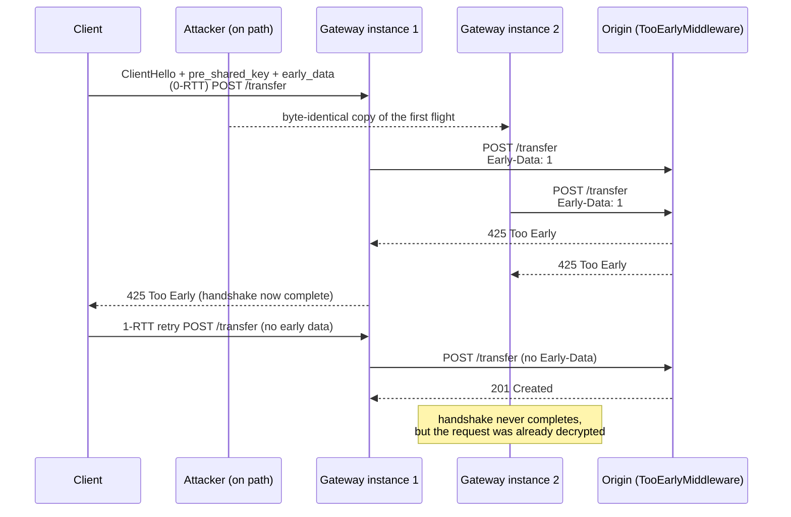

# TLS 1.3 Session Tickets, 0-RTT Early Data Replay Hazards, and HTTP 425 Too Early (RFC 8470)

> [!summary] Claim
> A TLS 1.3 session ticket lets a client send an HTTP request in its very first flight, but that 0-RTT request is decrypted and handed to the application before the handshake proves it is not a copy, so every server instance must either refuse early data, wait for the handshake, or answer `425 Too Early` for any request whose replay would hurt.

Part of [TLS Connections and Intermediaries](README.md) in [API Engineering](../README.md).

## TL;DR

- Mechanism: after a full handshake the server sends `NewSessionTicket` (handshake type 4) with an `early_data` extension (type 42); on the next connection the client offers the ticket as a PSK and sends application data under `client_early_traffic_secret` before any server message (RFC 9846 Sections 2.3, 4.3.10, 4.7.1).
- Contract: TLS gives no replay protection between connections for 0-RTT data (RFC 9846 Section 2.3); RFC 8470 moves the decision to the origin, which marks per-resource replay tolerance and answers `425` to `Early-Data`-marked requests it cannot safely process (RFC 8470 Sections 3 and 5.1).
- Trap: the replay is invisible inside the connection; the lab copies one 1200-byte first flight to three fresh aioquic server instances and each one hands the same `POST /transfer` to the application without ever completing a handshake.
- Portability: CPython's `ssl` module resumes TLS 1.3 sessions but has no early-data API at all (no `early_data` symbol in `Modules/_ssl.c` at `v3.14.6` or `main`), so Uvicorn and any stdlib-TLS server never see 0-RTT; it only reaches Python apps through a terminating proxy (`Early-Data: 1`) or a pure-Python QUIC stack such as aioquic.
- When not to use: do not enable 0-RTT where the origin cannot classify every route, where tickets cannot be single-use across the serving fleet, or where IP-based access control runs on the first flight (three 2024 CVEs).

## Mental model



The client's first flight carries both the ClientHello and the 0-RTT request, encrypted under keys derived only from the PSK, so any server instance that holds the ticket key can decrypt it.
The attacker cannot read or alter the flight, but can copy it to a second instance, which decrypts and forwards it even though the attacker can never send the client `Finished`.
Both gateways forward before the handshake completes, so both add `Early-Data: 1`, and the origin answers `425` to both because `POST /transfer` is not on its replay-safe list.
Only the genuine connection completes its handshake, and the client's retry travels as ordinary 1-RTT data, which the origin processes exactly once.

## How it works

### The ticket on the wire

The server may send `NewSessionTicket` any time after it receives the client `Finished`, and a server that does not request client certificates may send it right after its own `Finished` (RFC 9846 Section 4.7.1).
It is a handshake message, so it is framed as a one-byte `msg_type`, a `uint24` length, and the body (RFC 9846 Section 4):

```text
struct {
    uint32 ticket_lifetime;        /* seconds, MUST NOT exceed 604800 */
    uint32 ticket_age_add;         /* fresh random value per ticket */
    opaque ticket_nonce<0..255>;   /* unique per ticket on this connection */
    opaque ticket<1..2^16-1>;      /* the PSK identity: DB key or self-encrypted blob */
    Extension extensions<0..2^16-1>;
} NewSessionTicket;
```

The only defined extension is `early_data` (type `42`), whose body in this message is a `uint32 max_early_data_size`; its presence is what offers 0-RTT (RFC 9846 Sections 4.3.10 and 4.7.1).
The lab test `test_new_session_ticket_wire_layout_is_byte_exact` pins a 30-byte example: `04 00 00 1a` (type 4, length 26), `00 00 1c 20` (7200 s), `01 02 03 04`, `01 00` (one-byte nonce), `00 04 54 54 54 54` (four-byte ticket), `00 08 00 2a 00 04 00 00 40 00` (`early_data`, `max_early_data_size` 16384).
`test_codec_matches_aioquic_byte_for_byte` cross-checks the lab encoder against aioquic's own `push_new_session_ticket` and `pull_new_session_ticket` (aioquic 1.7.2 src/aioquic/tls.py, push_new_session_ticket).
The PSK is `HKDF-Expand-Label(resumption_secret, "resumption", ticket_nonce, Hash.length)`, so each ticket on a connection yields a different key (RFC 9846 Section 4.7.1).

### Resumption and the 0-RTT flight

To resume, the client sends `pre_shared_key` (type 41) as the last ClientHello extension with a list of `PskIdentity {identity, obfuscated_ticket_age}` and one HMAC binder per identity, plus `psk_key_exchange_modes` (RFC 9846 Sections 4.3.9 and 4.3.11).
To send 0-RTT it also sends an empty `early_data` extension and MUST encrypt the early data with the first offered PSK (RFC 9846 Section 4.3.10).
`obfuscated_ticket_age` is the client's ticket age in milliseconds plus `ticket_age_add`, modulo `2^32`; `ticket_lifetime` is in seconds, and because tickets live at most a week, 32 bits of milliseconds suffice (RFC 9846 Section 4.3.11.1).
The server either ignores the extension and trial-decrypts past the early records, sends HelloRetryRequest, or echoes `early_data` in EncryptedExtensions to accept; it cannot accept a subset of the early data (RFC 9846 Section 4.3.10).
To accept, the server must have selected the first PSK and must see the same TLS version, cipher suite, and ALPN protocol as the ticket's original connection (RFC 9846 Section 4.3.10).
After the server `Finished`, a client whose early data was accepted sends `EndOfEarlyData` (type 5) under the early keys and switches to handshake keys (RFC 9846 Section 4.6); QUIC clients MUST NOT send it, because QUIC packet types mark the key change (RFC 9001 Section 8.3).
For tickets, the server MUST also check that the client's ticket age, `obfuscated_ticket_age - ticket_age_add` modulo `2^32`, is within a small tolerance of the time since issue, and SHOULD reject 0-RTT if it is not (RFC 9846 Section 4.3.10).

### Why replay is possible and what TLS can do about it

0-RTT data does not depend on the ServerHello random, so "there are no guarantees of non-replay between connections" (RFC 9846 Section 2.3).
Within one connection the server never processes the same 0-RTT data twice, and an attacker cannot make 0-RTT data look like 1-RTT data because the keys differ (RFC 9846 Section 2.3).
Section 8 names two threats: a network attacker duplicating the 0-RTT flight, and an attacker exploiting client retry so the same message is processed as 0-RTT on connection 1 and as 1-RTT on connection 2 (RFC 9846 Section 8).
The first is bounded at the TLS layer: every server instance MUST accept 0-RTT for the same handshake at most once, which caps replays at the number of instances (RFC 9846 Section 8).
The mechanisms are single-use tickets, where the server deletes each ticket from a database on use (Section 8.1), and ClientHello recording, where the server stores the validated binder or `ClientHello.random` inside a time window and rejects repeats (Section 8.2).
Recording needs the freshness check: `expected_arrival_time = adjusted_creation_time + clients_ticket_age`, and 0-RTT is rejected if that differs from the server clock by more than a window that is "on the order of ten seconds" for Internet clients (RFC 9846 Section 8.3).
The second threat "cannot be prevented at the TLS layer" and is delegated to the application profile, which for HTTP is RFC 8470 (RFC 9846 Section 8).

### The HTTP profile: `Early-Data` and `425`

RFC 8470 gives a server three equally effective options: reject early data at the TLS layer, delay processing until the handshake completes, or answer `425 (Too Early)` to individual requests (RFC 8470 Section 3).
Only the origin knows a resource's replay tolerance; method safety "cannot be universally relied upon", so origins SHOULD let resources declare it explicitly (the RFC says RECOMMENDED), and absent that MUST reject early data or not process it before handshake completion (RFC 8470 Section 3).
Clients MAY send safe methods in early data and MUST NOT send unsafe methods or methods of unknown safety (RFC 8470 Section 4); safe methods are `GET`, `HEAD`, `OPTIONS`, and `TRACE` (RFC 9110 Section 9.2.1).
A gateway that forwards a request before its client handshake completes MUST add `Early-Data: 1`, MUST NOT remove the field if present, and MUST NOT list it in `Connection` (RFC 8470 Section 5.1).
The field has exactly one valid value, `1`, but "multiple or invalid instances ... MUST be treated as equivalent to a single instance with a value of 1" by a server, and it MUST NOT appear in responses or request trailers (RFC 8470 Section 5.1).
A request marked `Early-Data` cannot be made safe by waiting for the handshake, because it was early on a previous hop, so if it cannot be processed safely it MUST get `425` (RFC 8470 Section 5.1).
A user agent that gets `425` SHOULD retry automatically and the retry MUST NOT be sent in early data; an intermediary MUST forward `425` if the request it received carried `Early-Data`, and otherwise MAY retry itself after its client handshake completes (RFC 8470 Section 5.2).
A server SHOULD NOT emit `425` unless the request arrived in early data or carried `Early-Data: 1`, and `425` is not cacheable by default (RFC 8470 Section 5.2).

### Where Python sees it

CPython's `ssl` module exposes `SSLContext.num_tickets`, `SSLObject.session`, and `SSLObject.session_reused`, but no early-data call: `Modules/_ssl.c` at `v3.14.6` and on `main` (fetched 2026-11-08) contains no `early_data` symbol (cpython v3.14.6 Modules/_ssl.c, _ssl__SSLContext_num_tickets_get_impl).
Uvicorn builds its context with `ssl.SSLContext(ssl_version)` (uvicorn 0.54.0 uvicorn/config.py, create_ssl_context), so it can resume sessions but can never receive 0-RTT.
The ASGI TLS extension 0.3 has no early-data field (asgiref specs/tls.rst, fetched from `main` 2026-11-08), so an ASGI app learns about early data only from the `Early-Data` request header that a terminating proxy adds.
nginx exposes `$ssl_early_data`, which is `"1"` while early data is in use and the handshake is incomplete and `""` otherwise, and documents `proxy_set_header Early-Data $ssl_early_data;`; an empty value is not passed upstream (nginx `ngx_http_ssl_module`, `ngx_http_proxy_module` docs, as of 2026-11).
aioquic implements TLS 1.3 in Python for QUIC: its server accepts 0-RTT whenever the client offers it with exactly one PSK identity whose binder verifies, using a ticket that its `session_ticket_fetcher` returns, that is inside its validity period (`is_valid`), and whose cipher suite matches (aioquic 1.7.2 src/aioquic/tls.py, Context._server_handle_hello).
It does not compare the ALPN protocol or the client's ticket age, both of which RFC 9846 Section 4.3.10 requires, and it does no ClientHello recording; replay protection is exactly what the application's fetcher does, and the upstream example store uses `dict.pop`, which is single-use (aioquic 1.7.2 examples/http3_server.py, SessionTicketStore.pop).

## Numbers and limits

| Quantity | Value | Source |
|---|---|---|
| Maximum `ticket_lifetime` | `604800` s (7 days); clients MUST NOT use a ticket beyond 7 days | RFC 9846 Section 4.7.1 |
| `obfuscated_ticket_age` width | 32 bits of milliseconds, modulo `2^32` | RFC 9846 Section 4.3.11.1 |
| `ticket_nonce`, `ticket`, binder lengths | `<0..255>`, `<1..2^16-1>`, `<32..255>` bytes | RFC 9846 Sections 4.7.1, 4.3.11 |
| Freshness window for Internet clients | "on the order of ten seconds" | RFC 9846 Section 8.3 |
| Minimum replay bound | at most once per server instance | RFC 9846 Section 8 |
| QUIC `max_early_data_size` | must be `0xffffffff`; QUIC limits 0-RTT volume with `initial_max_data` instead | RFC 9001 Section 4.6.1 |
| Example tickets for parallel connections | a browser on HTTP/1.1 "might open six connections" | RFC 9846 Appendix C.4 |
| aioquic server ticket lifetime | `86400` s, hard-coded; one ticket per connection | aioquic 1.7.2 src/aioquic/tls.py (`ticket_lifetime=86400`); lab `test_quic_ticket_offers_0rtt_with_the_sentinel_size` |
| Lab first flight (ClientHello + 0-RTT `POST`) | one datagram of exactly 1200 bytes (Initial padding, RFC 9000 Section 14.1) | lab `test_genuine_0rtt_request_reaches_the_app_before_the_handshake_completes`, passing on CPython 3.12.13, 3.13.18, 3.14.6, 3.14.10, and 3.15.2, macOS 27.2 arm64 (as of 2026-11) |
| CPython server `num_tickets` default | `2` | lab `test_cpython_ssl_resumes_tls13_but_has_no_early_data_api`, OpenSSL 3.5.7, 3.5.9, and 4.1.0 |
| CPython client `SSLSession.timeout` after a TLS 1.3 handshake | `7200` s | one-off in-memory probe on 3.12.13, 3.13.18, 3.14.6, 3.14.10, 3.15.2 (OpenSSL 3.5.7, 3.5.9, 3.5.7, 4.1.0, 4.1.0), macOS 27.2 arm64, 2026-11-09; not asserted by the lab |
| nginx `ssl_early_data` default | `off` (directive since 1.15.3) | nginx docs (as of 2026-11) |
| nginx `ssl_session_timeout` default | `5m` | nginx docs (as of 2026-11) |
| HAProxy `allow-0rtt` | disabled by default | HAProxy 3.2 configuration manual (as of 2026-11) |
| Lab runtime | 35 tests in 0.14 s to 0.17 s over six warm runs; 0.61 s on the first, cold run | `uv run --frozen pytest ... -q`, Apple M3 Pro, macOS 27.2 (Darwin 27.2.0) arm64, CPython 3.14.6, OpenSSL 3.5.7, 2026-11-09 |

## Portability

| Dimension | Version | Behavior | Evidence |
|---|---|---|---|
| CPython | `3.12.13` (OpenSSL 3.5.7) | 35 passed; the pinned `3.12.16` is not installed on this machine | lab, `UV_PROJECT_ENVIRONMENT=<tmp> uv run --frozen --python 3.12 pytest ...` |
| CPython | `3.13.18` (OpenSSL 3.5.9) | 35 passed | lab, same command with `--python 3.13` |
| CPython | `3.14.6` workspace `.venv` (OpenSSL 3.5.7) | 35 passed | lab, `uv run --frozen pytest ...` |
| CPython | `3.14.10` (OpenSSL 4.1.0) | 35 passed | lab, `--python 3.14.10` |
| CPython | `3.15.2` (OpenSSL 4.1.0, GIL enabled) | 35 passed | lab, `UV_PROJECT_ENVIRONMENT=<tmp> uv run --frozen --python /opt/homebrew/bin/python3.15 pytest ...` (the frozen workspace installs and imports `hypothesis` 6.170.14 here) |
| CPython | `3.15.0b3` free-threaded | FAILS to run: the frozen workspace lacks a `psycopg-binary==3.3.8` wheel, and `aioquic==1.7.2` has no wheel and its `src/aioquic/_buffer.c` does not compile (`unknown type name 'PyObject_HEAD'`, undeclared `Py_IS_TYPE` and `Py_TYPE`); `3.15.2t` is not available to uv here | lab attempt, `uv run --frozen --python <3.15.0b3t> pytest ...` and `uv run --no-project --with aioquic==1.7.2` |
| Containers | Debian Trixie, Alpine musl | not run: this verification ran on macOS 27.2 arm64 only | none |
| CPython `ssl` | all of the above | TLS 1.3 resumption works (`session_reused` true on both sides); no early-data API; with OpenSSL defaults the server accepted the same ticket on two later connections | lab `test_cpython_ssl_resumes_tls13_but_has_no_early_data_api`, `test_openssl_server_accepts_the_same_ticket_twice` |
| aioquic | `1.7.2` | full TLS 1.3 0-RTT over QUIC; replay protection is only what `session_ticket_fetcher` does | lab replay tests; aioquic src/aioquic/tls.py |
| Starlette, httpx | `1.10.0`, `0.28.1` | `starlette.status.HTTP_425_TOO_EARLY` and `httpx.codes.TOO_EARLY` both equal `425`; neither reads `Early-Data` | starlette/status.py; httpx/_status_codes.py; lab middleware tests |
| Uvicorn | `0.54.0` | stdlib `ssl` only, so no 0-RTT; early requests reach it only through a proxy as `Early-Data: 1` | uvicorn/config.py `create_ssl_context`; CPython `_ssl.c` |
| Hypercorn | `0.18.0` | HTTP/3 builds `QuicConnection` without `session_ticket_fetcher` or `session_ticket_handler`, so aioquic never sends `NewSessionTicket` and neither resumption nor 0-RTT happens over Hypercorn's HTTP/3 | hypercorn/protocol/quic.py `QuicProtocol.handle`; aioquic 1.7.2 src/aioquic/tls.py, Context._server_handle_finished issues a ticket only when `new_session_ticket_cb` is set |
| Granian | `2.8.7` | TLS over TCP only, through rustls `0.23.46`; `tls_cfg` never sets `max_early_data_size`, whose rustls default `0` disables early data, so no 0-RTT; TLS 1.3 resumption uses the rustls defaults (`send_tls13_tickets` 2, a 256-entry in-memory session cache); no QUIC or HTTP/3 code in the source tree | granian 2.8.7 src/workers.rs, WorkerConfig::tls_cfg; Cargo.lock pins rustls 0.23.46; rustls 0.23.46 rustls/src/server/builder.rs, ConfigBuilder::with_cert_resolver |
| HTTP/1.1 over TLS 1.3 | RFC 8470 | requests may be wholly or partly in early data; the server decides per request when it acts | RFC 8470 Section 2 |
| HTTP/2 | RFC 9113 | TLS early data MAY carry requests if RFC 8470 is observed; the client assumes initial SETTINGS values | RFC 9113 Section 9.2.3 |
| HTTP/3 over QUIC | RFC 9114, RFC 9001 | RFC 8470 mitigations MUST be applied; 0-RTT rides QUIC 0-RTT packets, and early data can arrive after the handshake completes | RFC 9114 Section 10.9; RFC 9001 Section 4.6.1; RFC 8470 Section 6.4 |

## Worked example

The lab drives a real TLS 1.3 0-RTT exchange through aioquic entirely in memory, then puts an RFC 8470 origin behind it: [implementation](../labs/src/api_labs/f02_tls_connections_and_intermediaries/early_data.py) and [test](../labs/tests/f02_tls_connections_and_intermediaries/test_tls_session_resumption_0_rtt_early_data_and_425_too_early.py).
`obtain_ticket` runs a full handshake and keeps the one ticket aioquic issues, `zero_rtt_request` resumes with it and puts a `POST /transfer` in 0-RTT, and `replay_flight` feeds the captured datagrams to a brand new server instance, as an on-path attacker would.
Stream data that a server instance delivers before its `HandshakeCompleted` event is early data; the replay instance never gets that event because the attacker holds no keys.

The ticket store is the entire TLS-layer anti-replay defense in aioquic (simplified excerpt; verbatim lines from `early_data.py`):

```python
@dataclass
class TicketStore:
    """Server-side ticket database; `single_use=True` is RFC 9846 Section 8.1."""

    single_use: bool
    tickets: dict[bytes, SessionTicket] = field(default_factory=dict[bytes, "SessionTicket"])

    def add(self, ticket: SessionTicket) -> None:
        self.tickets[ticket.ticket] = ticket

    def fetch(self, label: bytes) -> SessionTicket | None:
        if self.single_use:
            return self.tickets.pop(label, None)
        return self.tickets.get(label)
```

The origin middleware (simplified excerpt; verbatim lines from `early_data.py`):

```python
def is_early_data(headers: Iterable[tuple[bytes, bytes]]) -> bool:
    """Section 5.1: any instance, with any value, is treated as `Early-Data: 1`."""
    return any(name.lower() == b"early-data" for name, _ in headers)


TOO_EARLY_BODY = b"Too Early: retry after the TLS handshake completes\n"


class TooEarlyMiddleware:
    """Answer 425 for early requests the policy does not mark replay-safe."""

    def __init__(self, app: ASGIApp, policy: ReplayPolicy = safe_method_policy) -> None:
        self.app = app
        self.policy = policy

    async def __call__(self, scope: Scope, receive: Receive, send: Send) -> None:
        if scope["type"] != "http":
            await self.app(scope, receive, send)
            return
        early = is_early_data(scope["headers"])
        if early and not self.policy(scope["method"], scope["path"]):
            await send(
                {
                    "type": "http.response.start",
                    "status": 425,
                    "headers": [
                        (b"content-type", b"text/plain; charset=utf-8"),
                        (b"content-length", str(len(TOO_EARLY_BODY)).encode()),
                    ],
                }
            )
            await send({"type": "http.response.body", "body": TOO_EARLY_BODY})
            return

        async def send_without_early_data(message: Message) -> None:
            if message["type"] == "http.response.start":
                # Section 5.1: Early-Data MUST NOT be included in responses.
                message["headers"] = [
                    (k, v) for k, v in message.get("headers", []) if k.lower() != b"early-data"
                ]
            await send(message)

        await self.app(scope, receive, send_without_early_data)
```

The two replay tests that carry the claim (simplified excerpt; verbatim from the test module, decorators elided):

```python
def test_replayed_flight_is_processed_again_when_tickets_are_reusable(
    identity: ServerIdentity,
) -> None:
    store = TicketStore(single_use=False)
    ticket = obtain_ticket(identity, store)
    run = zero_rtt_request(identity, store, ticket, TRANSFER)
    replays = [replay_flight(identity, store, run.flight) for _ in range(3)]
    for replay in replays:
        assert replay.early_stream_data == (TRANSFER,)  # the POST runs again
        assert replay.handshake is None  # and the attacker never finished a handshake


def test_replay_beats_single_use_tickets_when_instances_do_not_share_the_store(
    identity: ServerIdentity,
) -> None:
    issuing = TicketStore(single_use=True)
    ticket = obtain_ticket(identity, issuing)
    replica = TicketStore(single_use=True, tickets=dict(issuing.tickets))  # copied, not shared
    run = zero_rtt_request(identity, issuing, ticket, TRANSFER)
    assert replay_flight(identity, issuing, run.flight).early_stream_data == ()
    assert replay_flight(identity, replica, run.flight).early_stream_data == (TRANSFER,)
```

The second test is the distributed-systems version of the bug: single-use tickets are correct per store, but two instances with copied (not shared) stores each accept the flight once, the single-use-ticket analogue of the "once per zone" bound that RFC 9846 Section 8.2 gives for separate per-zone ClientHello stores.
`test_replayed_0rtt_post_is_rejected_by_the_origin_with_425` closes the loop: it replays the flight twice, forwards each decrypted `POST` through `gateway_forward_headers(..., handshake_complete=False)`, and the origin answers `425` both times with the ledger untouched.

Captured run, CPython 3.14.6 workspace venv, macOS 27.2 arm64 (Apple M3 Pro), from `labs/`, 2026-11-09:

```text
$ uv run --frozen pytest tests/f02_tls_connections_and_intermediaries/test_tls_session_resumption_0_rtt_early_data_and_425_too_early.py -q
...................................                                      [100%]
35 passed in 0.15s
```

## Pitfalls

> [!warning] Treating only `Early-Data: 1` as early
> Trigger: the origin checks `request.headers.get("early-data") == "1"`.
> Symptom: a request carrying `Early-Data: 0`, `Early-Data: yes`, or two instances is processed as if it were not early, although RFC 8470 Section 5.1 says multiple or invalid instances MUST be treated as `1`.
> Fix: test for presence of the field name, as `is_early_data` does; lab mutation M1 (compare the value to `1`) makes `test_any_early_data_instance_counts_as_early[zero]` fail.

> [!warning] Shared ticket keys without a shared replay store
> Trigger: a fleet shares the session ticket encryption key (so any node can resume any ticket) but each node keeps its own single-use or ClientHello cache.
> Symptom: one captured first flight is accepted once per node; the lab shows it with two copied stores in `test_replay_beats_single_use_tickets_when_instances_do_not_share_the_store`.
> Fix: make one storage zone authoritative for a ticket and refuse 0-RTT for it elsewhere (RFC 9846 Section 8.2), or keep 0-RTT off and rely on resumption alone.

> [!warning] IP allow-lists evaluated on 0-RTT
> Trigger: access control keyed on the source address runs on a request carried in QUIC 0-RTT or TCP Fast Open plus TLS early data.
> Symptom: requests from spoofed addresses pass the allow-list, because the address has not been validated when the early request is processed.
> Fix: patch, or defer address-based decisions until address validation or the handshake completes; this hit Traefik before 2.11.6, 3.0.4, and 3.1.0-rc3 (NVD CVE-2024-39321), h2o before commit `15ed15a` (NVD CVE-2024-45397), and HAProxy QUIC before 3.1-dev7, 3.0.5, and 2.9.11 (NVD CVE-2024-49214).

> [!warning] A gateway that strips or forgets `Early-Data`
> Trigger: a proxy rebuilds headers from an allowlist, or a second proxy hop removes "unknown" fields.
> Symptom: the origin sees an early request as ordinary and processes a replayable `POST`.
> Fix: add the field whenever forwarding before the client handshake completes and never remove it (RFC 8470 Section 5.1); lab mutations M6 and M7 break `gateway_forward_headers` and its test fails.

> [!warning] 425 sent to a client that cannot retry
> Trigger: an origin answers `425` to requests that were not early, for example as a generic "try later".
> Symptom: user agents that never sent early data do not know to retry, and a `425` storm also invites retry amplification (RFC 8470 Section 6.3).
> Fix: emit `425` only for requests received in early data or marked `Early-Data` (RFC 8470 Section 5.2); lab mutation M4 makes `test_post_after_handshake_is_processed_not_425` fail.

> [!warning] Assuming nginx's built-in OpenSSL anti-replay is on
> Trigger: enabling `ssl_early_data on;` and assuming OpenSSL will reject duplicate ClientHellos.
> Symptom: nginx documents that OpenSSL built-in replay protection is disabled because it interferes with session resumption, so replay defense is entirely the application's.
> Fix: forward `Early-Data $ssl_early_data` and make the origin classify routes, or turn `ssl_conf_command Options AntiReplay;` back on if the trade-off suits (nginx `ngx_http_ssl_module` docs, as of 2026-11).

## Security and robustness

- Threat model: a passive or on-path attacker who records a client's first flight can replay it to any server instance that can decrypt the ticket, any number of times inside the freshness window if that instance relies on freshness alone (RFC 9846 Section 8.3) and at most once per instance when the instance meets the RFC 9846 Section 8 minimum, and can also induce one extra copy through client retry after a rejected 0-RTT (RFC 9846 Section 8 and Appendix F.5).
- Beyond duplicated side effects, replays let an attacker reorder messages (move a delete after a create), probe caches by replaying to cold nodes, time cryptographic operations, and exhaust rate limiters (RFC 9846 Appendix F.5).
- 0-RTT has no forward secrecy unless the server deletes the PSK on use (RFC 9846 Sections 2.3 and 8.1); self-encrypted tickets plus a long-lived ticket key mean a key compromise exposes every recorded 0-RTT request.
- OWASP API Security 2023 API4 (Unrestricted Resource Consumption) applies: replayed expensive `GET`s are a cheap amplifier, and RFC 8470 Section 6.3 advises rejecting TLS early data as a whole under load rather than accepting it and filtering per request.
- Idempotency keys do not save you by default: an idempotency key in the replayed body is identical across copies, so the dedupe store must be consulted before any side effect and must be shared by every instance that may receive the copy.
- Authentication in early data is replayable too: a bearer token in a 0-RTT request authenticates every copy, and RFC 9846 Section 2.3 warns explicitly about data authenticated inside the application protocol.
- Defense in depth: keep 0-RTT off on endpoints that mutate state, allowlist replay-safe routes at the origin (not the gateway), make tickets single-use in an authoritative store, and log `Early-Data` presence so replays are visible in traces.
- Consistency rule: if any instance might act on early data before the handshake, every instance must make the same decision, or the attacker routes the copy to the most permissive one (RFC 8470 Section 6.2).

## The principal's view

The decision is not "turn on 0-RTT", it is "who owns replay tolerance": RFC 8470 puts it at the origin, so the platform must give service owners a per-route declaration (an allowlist of replay-safe routes) and enforce a default of `425` for everything else.
The saving is one round trip on resumed connections; RFC 8470 Section 6.1 calls it what "can at best be a modest performance benefit" when no origin supports `Early-Data`, so an edge with no supporting origins should disable early data entirely.
Organizationally the cost is permanent: every new endpoint needs a replay classification, every proxy hop must preserve `Early-Data`, and every instance must agree, which is a fleet-wide invariant that is easy to break with one misconfigured tier.
Resumption without 0-RTT keeps most of the handshake saving in CPU (no certificate signature) with none of the replay risk, and it is all that stdlib-TLS Python servers can do anyway.
Choose 0-RTT for read-heavy public APIs on high-latency mobile links, where `GET` dominates and the CDN can serve early `GET`s; avoid it for payment, trading, and admin APIs, where an idempotency layer and 1-RTT are cheaper than the audit burden.
For machine-to-machine traffic inside a data center, long-lived HTTP/2 or HTTP/3 connections make handshake latency irrelevant, so connection reuse beats 0-RTT.

## Interview questions

> [!question] L5: What is in a TLS 1.3 `NewSessionTicket`, and which field turns on 0-RTT?
>
> > [!success]- Answer
> > It carries `ticket_lifetime` (seconds, at most 604800), `ticket_age_add`, `ticket_nonce`, the opaque `ticket` used as the PSK identity, and extensions.
> > The `early_data` extension (type 42) with `max_early_data_size` is what permits 0-RTT with that ticket.
> > A ticket without it can still be used for 1-RTT resumption.
> >
> > Follow-up: Why does QUIC set `max_early_data_size` to `0xffffffff` instead of a real byte count?

> [!question] L5: Why does a client send `obfuscated_ticket_age` instead of the raw ticket age?
>
> > [!success]- Answer
> > The raw age would let a passive observer link connections that use tickets from the same session.
> > Adding the per-ticket random `ticket_age_add` modulo `2^32` hides it from observers, while the server, which knows `ticket_age_add`, recovers the age for its freshness check.
> > The lab's `obfuscate_ticket_age(1000, 0xFFFFFF00)` returns `744` because the sum wraps.
> >
> > Follow-up: What does the server compute from the recovered age, and what window does RFC 9846 suggest?

> [!question] L5: Predict the output: in the lab, the origin is `TooEarlyMiddleware(app, allowlist_policy([("GET", "/balance")]))` and the user agent calls `user_agent_request(client, "GET", "/report")` and then `user_agent_request(client, "POST", "/transfer")`. What are the attempt lists?
>
> > [!success]- Answer
> > `/report` returns `[Attempt(early=True, status=425), Attempt(early=False, status=200)]`: `GET` is safe so it goes early, the allowlist rejects it, and the retry is sent without early data.
> > `/transfer` returns `[Attempt(early=False, status=201)]`: an unsafe method is never sent in early data (RFC 8470 Section 4), so no `425` is possible.
> > `test_user_agent_retries_425_once_and_never_in_early_data` asserts exactly this.
> >
> > Follow-up: What happens if the retry were also sent in early data?

> [!question] L6: When an attacker copies a client's 0-RTT flight, why can a server instance process the request even though the attacker cannot complete the handshake?
>
> > [!success]- Answer
> > The early data is encrypted under keys derived only from the PSK and the ClientHello, so any instance that can open the ticket can derive `client_early_traffic_secret` and decrypt it as soon as the ClientHello arrives.
> > The handshake completion, which needs the client `Finished`, comes later and is what the attacker cannot produce.
> > The lab shows three fresh aioquic instances each delivering the `POST` with `handshake is None`.
> >
> > Follow-up: Which two TLS-layer mechanisms bound this, and what bound do they give across a fleet?

> [!question] L6: Debug this API: a payments service behind nginx (`ssl_early_data on;`, `proxy_set_header Early-Data $ssl_early_data;`) and a second internal proxy sees rare duplicate charges although a FastAPI dependency raises `HTTPException(425)` when `request.headers.get("early-data") == "1"`; what do you check?
>
> > [!success]- Answer
> > First, whether the second proxy forwards `Early-Data` at all; a header allowlist there silently drops it, which RFC 8470 Section 5.1 forbids.
> > Second, the equality check: RFC 8470 Section 5.1 requires any instance or invalid value to count as early, so a duplicated or rewritten field slips past `== "1"`.
> > Third, whether the dependency runs before the charge on every route, including `GET` routes with side effects, and whether nginx instances share one ticket key while OpenSSL anti-replay is off, which lets one flight be replayed to several nodes.
> > Fix by checking presence, allowlisting replay-safe routes in middleware ahead of routing, and preserving the field at every hop.
> >
> > Follow-up: How would you prove in staging that a replayed flight now gets `425`?

> [!question] L6: Why must a gateway forward a `425` it receives in some cases but may retry in others?
>
> > [!success]- Answer
> > If the inbound request already carried `Early-Data`, it was early on a previous hop, and only that earlier party can wait for its own handshake, so the gateway MUST forward the `425` (RFC 8470 Section 5.2).
> > If the gateway itself received the request in early data without the field, it knows its own handshake state and MAY retry once its client handshake completes.
> > Retrying earlier would just repeat the replayable request.
> >
> > Follow-up: What should a gateway do if it does not know whether the origin understands `Early-Data`?

> [!question] L7+: Your edge shares one ticket encryption key across 40 points of presence for high resumption rates and product wants 0-RTT on; what design do you approve?
>
> > [!success]- Answer
> > Shared keys mean any PoP can decrypt any flight, so per-PoP replay caches allow one replay per PoP, up to 40 copies.
> > RFC 9846 Section 8.2 says the best protection is one authoritative storage zone per ticket with 0-RTT refused elsewhere; encode the issuing zone in the ticket and accept early data only there, falling back to 1-RTT resumption in other zones.
> > At the HTTP layer, forward `Early-Data: 1` and require origins to allowlist replay-safe routes, with `425` as the default, so even the bounded replays have no side effects.
> > Measure the gain first: if most connections are long-lived HTTP/2 or HTTP/3, the saved round trip may not justify the invariant.
> >
> > Follow-up: How does a freshly restarted PoP avoid accepting replays from before its restart?

> [!question] L7+: Is Python's lack of an early-data API in `ssl` a gap to fix or a feature?
>
> > [!success]- Answer
> > For servers it is a safe default: RFC 9846 Appendix F.5 says TLS implementations MUST NOT enable 0-RTT unless the application asks and MUST give the application a way to know whether the handshake completed, which an ASGI app could not consume today because the ASGI TLS extension has no such field.
> > Adding it would need both an `ssl` API and an ASGI scope field, plus framework support to defer or `425` per route.
> > Until then, terminate 0-RTT at a proxy that sets `Early-Data`, or use aioquic where the application sees `HandshakeCompleted` explicitly.
> >
> > Follow-up: What would the ASGI extension need to carry so a middleware could defer processing instead of answering `425`?

> [!question] L6: Why is `GET` not automatically safe for early data?
>
> > [!success]- Answer
> > Method safety is about what the client requests, not what the server does; RFC 9110 Section 9.2.1 allows side effects such as charging an advertising account on a safe request.
> > RFC 8470 Section 3 therefore says method safety "cannot be universally relied upon" and recommends explicit per-resource configuration.
> > The lab's `GET /report` enqueues a job and is rejected by an allowlist policy that only admits `GET /balance`.
> >
> > Follow-up: Which kinds of `GET` endpoints in a typical API would you keep off the allowlist?

## Related

Prerequisites: [[TLS-1-3-Handshake-Cipher-Suites-and-ALPN-RFC-9846]]

Next: [[X509-Certificates-Chain-Validation-SAN-and-OCSP-Stapling]]

See also: [[HTTP-Evolution-HTTP1-HTTP2-HTTP3]], [[QUIC-Transport-Streams-and-Connection-Migration-RFC-9000]], [[HTTP-3-Framing-and-QPACK-Header-Compression-RFC-9114]], [[Hop-by-Hop-vs-End-to-End-Headers-and-Connection-Header-Abuse]], [[Forwarded-Header-RFC-7239-and-X-Forwarded-For-Spoofing]], [[Idempotency-and-Delivery]], [[Public-Key-Crypto-and-TLS]], [[openssl-s_client-and-TLS-Debugging]]

- Lab: `labs/tests/f02_tls_connections_and_intermediaries/test_tls_session_resumption_0_rtt_early_data_and_425_too_early.py`

## Further reading

- [RFC 8470: Using Early Data in HTTP](https://www.rfc-editor.org/rfc/rfc8470.html) - defines `Early-Data`, `425 (Too Early)`, and the server, client, and gateway rules this note implements.
- [RFC 9846: TLS 1.3](https://www.rfc-editor.org/rfc/rfc9846.html) - obsoletes RFC 8446; Sections 4.3.10, 4.3.11, 4.7.1, and 8 define tickets, 0-RTT, and anti-replay, and Appendix F.5 lists replay attacks.
- [RFC 8446](https://www.rfc-editor.org/rfc/rfc8446.html) - the first TLS 1.3 edition, which RFC 8470 cites as `[TLS13]`.
- [RFC 9001 Section 4.6](https://www.rfc-editor.org/rfc/rfc9001.html) - how QUIC reuses the TLS ticket for 0-RTT and the `0xffffffff` sentinel.
- [RFC 9114 Section 10.9](https://www.rfc-editor.org/rfc/rfc9114.html) - HTTP/3 MUST apply RFC 8470.
- [RFC 9113 Section 9.2.3](https://www.rfc-editor.org/rfc/rfc9113.html) - HTTP/2 over TLS 1.3 early data.
- [aioquic 1.7.2 `src/aioquic/tls.py`](https://github.com/aiortc/aioquic/blob/1.7.2/src/aioquic/tls.py) - a readable TLS 1.3 implementation; the PSK, binder, and 0-RTT key path are in one function.
- [NVD CVE-2024-45397](https://nvd.nist.gov/vuln/detail/CVE-2024-45397) - h2o address-based access control bypassed by early data over TCP Fast Open and QUIC 0-RTT.
- [NVD CVE-2024-39321](https://nvd.nist.gov/vuln/detail/CVE-2024-39321) - Traefik IP allow-list bypass through HTTP/3 early data.
- [NVD CVE-2024-49214](https://nvd.nist.gov/vuln/detail/CVE-2024-49214) - HAProxy QUIC 0-RTT with a spoofed source address.
