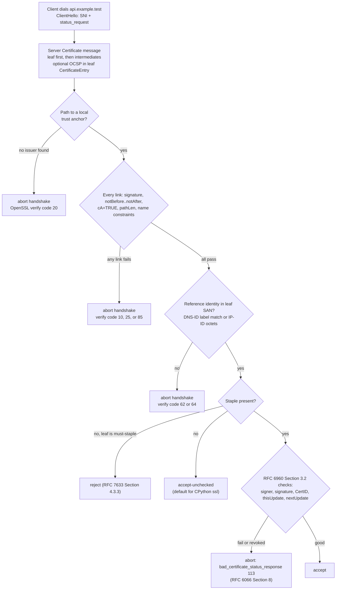

# X.509 Certificate Chains, SAN Matching, Expiration, Revocation, and OCSP Stapling for APIs

> [!summary] Claim
> An API client authenticates a TLS server only when it builds a path from the leaf to a locally trusted anchor that satisfies RFC 5280 Section 6.1 at the current time and finds the dialed name in the leaf's `subjectAltName` under RFC 9525 Section 6.3; revocation is a separate, optional, and in practice mostly absent check, so short certificate lifetimes, not OCSP, are what bound the damage of a stolen key.

Part of [TLS Connections and Intermediaries](README.md) in [API Engineering](../README.md).

## TL;DR

Mechanism: the server sends a leaf-first list of DER certificates in the TLS 1.3 `Certificate` message `(RFC 9846 Section 4.5.1)`, and the client builds a path to a trust anchor it already holds, checking signature, validity window, issuer name, `basicConstraints`, `pathLenConstraint`, and name constraints on every link `(RFC 5280 Section 6.1.3, Section 6.1.4)`.
Contract rule: the client matches the hostname it dialed against `dNSName` entries (or the IP literal against `iPAddress` entries, octet for octet) in `subjectAltName` only, with a wildcard allowed solely as the complete left-most label matching exactly one label `(RFC 9525 Section 6.3, Section 6.4)`.
Trap: CPython's `ssl` and therefore `httpx` 0.28.1 never check revocation, do not fetch a missing intermediate (verify code `20` in the lab), and change behavior with the linked OpenSSL: a `commonName`-only certificate passes on OpenSSL 3.5.7 and fails on OpenSSL 4.1.0 although `hostname_checks_common_name` is `True` on both, measured in the lab.
Portability: `ssl.create_default_context()` adds `VERIFY_X509_STRICT` and `VERIFY_X509_PARTIAL_CHAIN` from Python 3.13 (gh-112389), so a leaf without an Authority Key Identifier that 3.12.13 accepts fails on 3.13.18 and later with verify code `85`, measured in the lab.
When not to rely on it: do not treat OCSP stapling as a revocation guarantee for public certificates, because Let's Encrypt turned its OCSP service off on 2025-08-06 (Let's Encrypt, "OCSP Service Has Reached End of Life") and the Baseline Requirements make the OCSP pointer optional (BR 2.3.1 Section 7.1.2.7.7, as of 2026-11); prefer short-lived certificates and automated rotation.

## Mental model



Validation is a pipeline of independent gates, and a client is only as strict as the first gate it skips.
The server chooses what to send, but the client decides what to trust: the arrow from `B` to `C` succeeds only if some certificate in the client's own store issued the top of the presented list, which is why a server that omits its intermediate fails at `C` in Python even though its leaf is perfect.
The arrow from `D` to `E` is where expiry and CA-ness are judged per link, so an intermediate that expires before the leaf breaks every connection on that day regardless of the leaf's own `notAfter`.
Identity at `E` is a string-to-SAN comparison and nothing else; the subject `commonName` is not an identifier under RFC 9525.
Revocation at `F` and `H` is the only gate that consults information newer than the certificate itself, and CPython takes the `accept-unchecked` arrow unconditionally because it has no API to request or read a stapled response.

## How it works

### What the server puts on the wire

In TLS 1.3 the server's `Certificate` message is `opaque certificate_request_context<0..2^8-1>` followed by `CertificateEntry certificate_list<0..2^24-1>`, and each `CertificateEntry` carries `opaque cert_data<1..2^24-1>` (one DER certificate) plus `Extension extensions<0..2^16-1>` `(RFC 9846 Section 4.5.1)`.
The sender's certificate MUST come first, each following certificate SHOULD certify the one before it, and a trust anchor MAY be omitted because the client is expected to hold it already `(RFC 9846 Section 4.5.1)`.
All implementations SHOULD be prepared to handle extraneous certificates and arbitrary order except for the end-entity certificate, which MUST be first `(RFC 9846 Section 4.5.1)`.
A stapled OCSP response travels inside the leaf's `CertificateEntry` as the body of the `status_request` extension, formatted as the `CertificateStatus` structure of RFC 6066 and interpreted under RFC 6960 `(RFC 9846 Section 4.5.1.1)`.
In TLS 1.2 the same `CertificateStatus` structure, `struct { CertificateStatusType status_type; select (status_type) { case ocsp: OCSPResponse; } response; }` with `opaque OCSPResponse<1..2^24-1>`, is a separate handshake message sent immediately after `Certificate`, and only one OCSP response may be sent `(RFC 6066 Section 8)`.
A client that requested and received an unsatisfactory OCSP response MUST abort with the fatal `bad_certificate_status_response(113)` alert `(RFC 6066 Section 8)`.

### Path validation, link by link

For each certificate `i` in the candidate path, RFC 5280 requires that its signature verifies with the issuer's public key, that "The certificate validity period includes the current time", that it is not revoked at the current time, and that its issuer name equals the working issuer name `(RFC 5280 Section 6.1.3 (a)(1)-(4))`.
For every certificate that will issue the next one, the validator verifies that `basicConstraints` is present with `cA` set to `TRUE`, requires a non-self-issued certificate to find `max_path_length` greater than zero and then decrements it, lowers it to `pathLenConstraint` when that is smaller, and requires `keyCertSign` if `keyUsage` is present `(RFC 5280 Section 6.1.4 (k), (l), (m), (n))`.
A `pathLenConstraint` of zero means no further non-self-issued intermediate may follow, and the end-entity certificate is not counted `(RFC 5280 Section 4.2.1.9)`.
Name constraints in a CA certificate confine the subject names and `subjectAltName` entries of the name forms they restrict in every subsequent certificate (self-issued intermediates excepted), `excludedSubtrees` wins over `permittedSubtrees`, and a `dNSName` constraint `host.example.com` admits any name formed by adding zero or more labels on the left, so `www.host.example.com` satisfies it and `host1.example.com` does not `(RFC 5280 Section 4.2.1.10)`.
Note that RFC 5280 places the revocation check inside basic certificate processing, `(RFC 5280 Section 6.1.3 (a)(3))`, but leaves the mechanism to CRLs, "status information, or by out-of-band mechanisms"; real validators in the Python stack simply omit it.

`cryptography` 50.0.2 implements this as a Rust path builder.
`Policy::permits_ca` rejects a CA whose `basicConstraints` is missing ("missing required extension: CA certificate has no basicConstraints"), whose `cA` is false ("basicConstraints.cA must be asserted in a CA certificate"), or whose `path_length` is smaller than the current depth `(cryptography 50.0.2 src/rust/cryptography-x509-verification/src/policy/mod.rs, Policy::permits_ca)`.
`Policy::permits_basic` rejects a certificate when the validation time is before `notBefore` or after `notAfter`, which makes both bounds inclusive as RFC 5280 Section 4.1.2.5 requires ("from notBefore through notAfter, inclusive"), and it also rejects `GeneralizedTime` for years 1950 through 2049, which MUST be `UTCTime` `(cryptography 50.0.2 src/rust/cryptography-x509-verification/src/policy/mod.rs, Policy::permits_basic and permits_validity_date)`.
Path search is bounded: `DEFAULT_MAX_CHAIN_DEPTH` is 8 intermediates `(cryptography 50.0.2 src/rust/cryptography-x509-verification/src/policy/mod.rs, DEFAULT_MAX_CHAIN_DEPTH)`, and a `Budget` caps one verification at `1 << 7` signature checks and `1 << 20` name-constraint checks `(cryptography 50.0.2 src/rust/cryptography-x509-verification/src/lib.rs, Budget)`.
When no candidate issuer survives, the error text starts with `candidates exhausted` `(cryptography 50.0.2 src/rust/cryptography-x509-verification/src/lib.rs, Display for ValidationError)`, which is the message the lab asserts for a missing intermediate.
Neither `lib.rs` nor `policy/mod.rs` at 50.0.2 contains a CRL or OCSP step; the `x509.verification` API validates chains and names only, and the lab therefore implements stapled-OCSP acceptance itself.

### Service identity: SAN matching

RFC 9525, which obsoletes RFC 6125, reduces identity to four rules: check DNS names only in `dNSName`, allow `iPAddress`, `uniformResourceIdentifier`, and `SRVName` where appropriate, allow a wildcard only as the complete left-most label, and never check the subject `commonName` `(RFC 9525 Section 1.3)`.
"The Common Name RDN MUST NOT be used to identify a service because it is not strongly typed" `(RFC 9525 Section 2)`.
DNS-ID matching compares labels case-insensitively in ASCII after converting any U-label to an A-label; a presented wildcard is valid only if there is one `*` and it is the complete left-most label, it matches exactly one reference label, and an invalid presented identifier MUST be ignored `(RFC 9525 Section 6.3)`.
An IP-ID matches only by octet-for-octet comparison with an `iPAddress` entry, which RFC 5280 stores as 4 or 16 octets in network byte order `(RFC 9525 Section 6.4; RFC 5280 Section 4.2.1.6)`.
A textual IPv4 address that one component misclassifies as an FQDN is a named vulnerability pattern `(RFC 9525 Section 7.4)`.
An automated client that finds no match SHOULD terminate with a bad certificate error and MUST NOT disable the check by default `(RFC 9525 Section 6.6)`.

`cryptography` 50.0.2 encodes exactly this: `DNSPattern::new` treats a presented name as a wildcard only if it starts with `*.`, `DNSPattern::matches` compares the wildcard's base with the reference name's parent, so `*.svc.example.test` matches one label and a single-label name never matches, and `Subject::subject_alt_name_matches` pairs `DNSName` only with a DNS reference and `IPAddress` only with an IP reference `(cryptography 50.0.2 src/rust/cryptography-x509-verification/src/types.rs, DNSPattern::matches; src/rust/cryptography-x509-verification/src/policy/mod.rs, Subject::subject_alt_name_matches)`.
CPython delegates matching to OpenSSL during the handshake: `_ssl_configure_hostname` parses `server_hostname` with `a2i_IPADDRESS`, sends SNI only for non-IP names, and calls `X509_VERIFY_PARAM_set1_host` for names or `X509_VERIFY_PARAM_set1_ip` for IP literals; it also rejects an empty name or one starting with `.` with `ValueError` `(CPython 3.14.0 Modules/_ssl.c, _ssl_configure_hostname)`.
Every new context sets `X509_V_FLAG_TRUSTED_FIRST` and the host flag `X509_CHECK_FLAG_NO_PARTIAL_WILDCARDS`, so `api*.example.test` never matches `api1.example.test` `(CPython 3.14.0 Modules/_ssl.c, _ssl__SSLContext_impl)`.
`SSLContext.hostname_checks_common_name` defaults to true and its setter only clears or sets `HOSTFLAG_NEVER_CHECK_SUBJECT` `(CPython 3.14.10 Lib/ssl.py, SSLContext.hostname_checks_common_name)`.
OpenSSL 4.1.0 changed X.509 verification "to no longer consult the subject distinguished name (DN) by default", consulting it only when `X509_CHECK_FLAG_ALWAYS_CHECK_SUBJECT` is set (OpenSSL 4.1.0 CHANGES.md, "Changes between 4.0 and 4.1.0"), so on a CPython linked against 4.1.0 a `commonName`-only certificate fails even with the attribute left at `True`.

### What CPython and httpx enforce by default

`ssl.create_default_context(Purpose.SERVER_AUTH)` builds a `PROTOCOL_TLS_CLIENT` context with `verify_mode = CERT_REQUIRED` and `check_hostname = True`, then ORs in `VERIFY_X509_PARTIAL_CHAIN | VERIFY_X509_STRICT` `(CPython 3.14.10 Lib/ssl.py, create_default_context)`.
The strict and partial-chain flags were added to the defaults in Python 3.13, and the 3.13 release notes warn that `VERIFY_X509_STRICT` "may reject pre-RFC 5280 or malformed certificates" (What's New in Python 3.13, ssl, gh-112389).
`httpx` 0.28.1 calls `ssl.create_default_context(cafile=certifi.where())` when `verify=True`, honors `SSL_CERT_FILE` and `SSL_CERT_DIR` when `trust_env` is true, and with `verify=False` builds a `PROTOCOL_TLS_CLIENT` context with `check_hostname = False` and `verify_mode = CERT_NONE` `(httpx 0.28.1 httpx/_config.py, create_ssl_context)`.
CPython exposes the certificate's OCSP responder URI, `caIssuers` URI, and `crlDistributionPoints` as keys of the `getpeercert()` dictionary `(CPython 3.14.0 Modules/_ssl.c, _decode_certificate)`, but `Modules/_ssl.c` at v3.14.0 contains no `status_request` or OCSP-stapling API, so neither a CPython client nor a CPython-based server (Uvicorn, Hypercorn) can request, send, or check a staple.

### Revocation: CRLs, OCSP, and stapling

An OCSP response is `OCSPResponse ::= SEQUENCE { responseStatus OCSPResponseStatus, responseBytes [0] EXPLICIT ResponseBytes OPTIONAL }`, where `responseStatus` is `successful (0)`, `malformedRequest (1)`, `internalError (2)`, `tryLater (3)`, `sigRequired (5)`, or `unauthorized (6)`, and for the basic type the bytes are a DER `BasicOCSPResponse` of `tbsResponseData`, `signatureAlgorithm`, `signature`, and optional `certs` `(RFC 6960 Section 4.2.1)`.
Each single response carries a CertID, a status of `good`, `revoked`, or `unknown`, and a validity interval `thisUpdate` to `nextUpdate` `(RFC 6960 Section 2.2, Section 2.4)`.
`tbsResponseData` holds `responses SEQUENCE OF SingleResponse` `(RFC 6960 Section 4.2.1)`, so one staple may cover several certificates, and the lab reads the status and both times only from the single response whose CertID matches the leaf; a staple with no such entry is `cert-id-mismatch`.
`good` means, at a minimum, that no certificate with that serial currently within its validity interval is revoked; it "does not necessarily mean that the certificate was ever issued" `(RFC 6960 Section 2.2)`.
Before accepting a response the client SHALL confirm that the CertID matches, the signature is valid, the signer is the intended responder and is authorized, `thisUpdate` is sufficiently recent, and `nextUpdate`, when available, is later than now `(RFC 6960 Section 3.2)`.
An authorized signer is a locally configured trusted responder, the issuing CA itself, or a certificate issued directly by that CA with `id-kp-OCSPSigning` in its extended key usage, signed by the same key that signed the certificate being checked `(RFC 6960 Section 4.2.2.2)`.
Responses whose `nextUpdate` is earlier than local time, or whose `thisUpdate` is later than local time, SHOULD be considered unreliable `(RFC 6960 Section 4.2.2.1)`.
Stapling moves the fetch from the client to the server: the server obtains a signed response and includes it in the handshake, which removes the client-to-CA round trip and the privacy leak that Let's Encrypt cites, namely that a CA running OCSP can learn which IP address visits which site (Let's Encrypt, "Ending OCSP Support in 2025").
Must-staple is the TLS Feature extension `id-pe-tlsfeature OBJECT IDENTIFIER ::= { id-pe 24 }` holding `Features ::= SEQUENCE OF INTEGER` `(RFC 7633 Section 4, Appendix A)`, where the integer is TLS extension number 5, `status_request(5)` `(RFC 6066 Section 3)`.
A client MUST treat such a certificate as invalid if the features the server offers do not contain every feature present in both its own `ClientHello` and the TLS Feature extension, and MUST refuse the connection when TLS with a valid certificate is mandated `(RFC 7633 Section 4.3.3)`.

### The 2026 ecosystem (as of 2026-11)

Publicly trusted TLS certificates issued on or after 2026-03-15 MUST NOT exceed 200 days, falling to 100 days on 2027-03-15 and 47 days on 2029-03-15 (CA/Browser Forum Baseline Requirements 2.3.1 Section 6.3.2, ballot SC-081v3 passed 2025-04-11).
A Short-lived Subscriber Certificate issued on or after 2026-03-15 is one valid for at most 7 days, and revocation of those is optional: "The CA MAY support revocation of Short-lived Subscriber Certificates" (BR 2.3.1 Section 1.6.1 definition and Section 4.9.1.1).
The OCSP `accessMethod` in a subscriber certificate's Authority Information Access is `MAY` (BR 2.3.1 Section 7.1.2.7.7), while CRLs MUST be published and refreshed at least every 7 days if all certificates carry an OCSP pointer and every 4 days otherwise (BR 2.3.1 Section 4.9.7).
Let's Encrypt stopped accepting must-staple requests on 2025-01-30 (except for accounts that had already issued one), removed OCSP URLs from certificates and failed all must-staple requests on 2025-05-07, and turned off its OCSP responders on 2025-08-06 (Let's Encrypt, "Ending OCSP Support in 2025" for the plan; "OCSP Service Has Reached End of Life", 2025-08-06, for the shutdown).

## Numbers and limits

| Quantity | Value | Source |
|---|---|---|
| Max size of one `cert_data` and of `certificate_list` | `2^24-1` bytes each | `(RFC 9846 Section 4.5.1)` |
| OCSP responses per TLS 1.2 `CertificateStatus` | 1 | `(RFC 6066 Section 8)` |
| `UTCTime` mandatory for validity dates | through year 2049 | `(RFC 5280 Section 4.1.2.5)` |
| Max subscriber validity, issued before 2026-03-15 / from 2026-03-15 / from 2027-03-15 / from 2029-03-15 | 398 / 200 / 100 / 47 days | BR 2.3.1 Section 6.3.2 (as of 2026-11) |
| Short-lived certificate threshold, issued from 2026-03-15 | <= 7 days (604,800 s) | BR 2.3.1 Section 1.6.1 (as of 2026-11) |
| CA revocation deadline after reported key compromise or failed validation (reasons 1-5) / after misuse, a flawed key-generation method, and the other reasons 6-16 | 24 hours / 5 days | BR 2.3.1 Section 4.9.1.1 (as of 2026-11) |
| OCSP response validity interval for subscriber certificates | >= 8 hours and <= 10 days | BR 2.3.1 Section 4.9.9 (as of 2026-11) |
| CRL refresh for subscriber CAs | every 7 days with AIA OCSP, 4 days otherwise, 24 hours after a revocation | BR 2.3.1 Section 4.9.7 (as of 2026-11) |
| `cryptography` verifier defaults | 8 intermediates, 128 signature checks, `2^20` name-constraint checks | `cryptography` 50.0.2 `policy/mod.rs` and `lib.rs` |
| Lab DER sizes, P-256 ECDSA profile: leaf / intermediate / root / staple | 454-457 / 406-409 / 364-367 / 313-316 bytes (min-max over 200 freshly generated PKIs; ECDSA signature length varies) | measured 2026-11-09 with a scratch script (not committed) run from `labs/` as `uv run --frozen python bench.py`, Apple M3 Pro, macOS 27.2 (`uname -r` 27.2.0), CPython 3.14.6 and 3.14.10 |
| `verify_server_chain` (3-certificate path, cryptography 50.0.2) | median 122.4 us (3.14.6), 123.2 us (3.14.10); p99 126.5 us, 127.2 us | same script: `time.perf_counter_ns`, 200 samples after 10 warm-ups |
| `evaluate_staple` (parse, ECDSA verify, checks) | median 53.5 us (3.14.6), p99 60.4 us, after the per-SingleResponse CertID lookup; 3.14.10 measured 57.0 us median and 58.4 us p99 before that change and was not re-run | measured as above |
| In-memory TLS 1.3 handshake with chain validation (`handshake_in_memory`, prebuilt contexts) | median 496.2 us (3.14.6, OpenSSL 3.5.7), 539.1 us (3.14.10, OpenSSL 4.1.0); p99 593.6 us, 559.8 us | measured as above |
| Let's Encrypt 2020 CAA bug: affected / revoked by deadline | 3,048,289 / 1,711,396 (56%) | Let's Encrypt community post "Revoking certain certificates on March 4"; Mozilla Bugzilla 1619179 comment 7 |

The lab measurements are single-process microbenchmarks with no network; a second run on each interpreter agreed within 2 percent on every median, while the handshake p99 moved by up to 16 percent, so read them as orders of magnitude.
They show that validation CPU is negligible next to one network round trip, not what a production handshake costs.

## Portability

Every CPython cell below was run in this lab: `test_x509_certificates_chain_validation_san_and_ocsp_stapling.py`, 51 tests, all passed on each interpreter, re-run by an independent verifier on 2026-11-09 with `UV_PROJECT_ENVIRONMENT=<env> uv run --frozen --python <version> pytest <module> -q`; the tests branch on `sys.version_info` and `ssl.OPENSSL_VERSION_INFO`, so a pass on each interpreter proves its cells.
Those 51-test runs, and the container legs below, predate six later OCSP tests (several SingleResponses in one staple and unknown CertID or signature algorithm identifiers); the 57-test module was re-run only in the CPython 3.14.6 workspace venv, in the captured run under Worked example.
The `cryptography` verifier and OCSP code are Rust inside the `cryptography` 50.0.2 wheel (which bundles OpenSSL 4.0.3 on this machine) and behaved identically on every interpreter; the rows that differ are those decided by the OpenSSL that CPython's `ssl` links.

| Behavior | 3.12.13 (OpenSSL 3.5.7) | 3.13.18 (3.5.9) | 3.14.6 (3.5.7) | 3.14.10 (4.1.0) | 3.15.2 (4.1.0) | 3.15.0b3t free-threaded (3.5.7) |
|---|---|---|---|---|---|---|
| `create_default_context` adds `VERIFY_X509_STRICT` and `VERIFY_X509_PARTIAL_CHAIN` | no | yes | yes | yes | yes | yes |
| Leaf without AKI under default context | accepted | code `85` | code `85` | code `85` | code `85` | code `85` |
| `commonName`-only leaf, `hostname_checks_common_name=True` | accepted | accepted | accepted | code `62` | code `62` | accepted |
| `commonName`-only leaf, `hostname_checks_common_name=False` | code `62` | code `62` | code `62` | code `62` | code `62` | code `62` |
| Leaf sent without its intermediate | code `20` | code `20` | code `20` | code `20` | code `20` | code `20` |
| `*.svc.example.test` vs `a.b.svc.example.test`; IP literal vs `dNSName` SAN; `pathLenConstraint=0` exceeded | `62`; `64`; `25` | same | same | same | same | same |
| `cryptography` 50.0.2 verifier and OCSP checks (CN-only rejected, inclusive validity, name constraints) | identical | identical | identical | identical | identical | identical |

The 3.15.0b3t run used `uv run --no-project` with only the module's dependencies because the full lock does not install on free-threaded CPython here.
The STYLE matrix legs 3.12.16 and 3.15.2t were not obtainable through uv here, so 3.12.13 and 3.15.0b3t stand in for them above; 3.12.16 was then run in a container (next table), and 3.15.2t remains the one leg not run anywhere.

Container legs, run 2026-11-09 on OrbStack (Linux 7.2.12, aarch64) with `docker run --rm` of the official images, a fresh venv with `cryptography==50.0.2`, `httpx==0.28.1`, `pytest==9.2.0`, `pytest-asyncio==1.4.1.post1`, and the unmodified lab module and test mounted read-only (the lab's `pyproject.toml` was not used, so its marker registration was replaced by `-W ignore`); all 51 tests passed on each:

| Image | CPython | libc | OpenSSL linked by `ssl` | Result |
|---|---|---|---|---|
| `python:3.12-trixie` | 3.12.16 | glibc 2.41 (Debian 13) | 3.5.7 | 51 passed |
| `python:3.14-trixie` | 3.14.10 | glibc 2.41 (Debian 13) | 3.5.7 | 51 passed |
| `python:3.15-trixie` | 3.15.2 | glibc 2.41 (Debian 13) | 3.5.7 | 51 passed |
| `python:3.14-alpine` | 3.14.10 | musl | 3.5.9 | 51 passed |

The `commonName`-only cell follows the linked OpenSSL on every one of these (accepted on 3.5.x), which is why the Debian 3.14.10 container passes the case that the macOS 3.14.10 build with OpenSSL 4.1.0 rejects.
Not run: 3.15.2t free-threaded (the official images ship no free-threaded build), and any x86-64 Linux leg (the host is arm64).

| Layer | Certificate validation | OCSP stapling | Source |
|---|---|---|---|
| HTTP/1.1 and HTTP/2 over TLS, client `httpx` 0.28.1 | CPython `ssl`, as above | not requested, not checked | `(httpx 0.28.1 httpx/_config.py, create_ssl_context)`; `(CPython 3.14.0 Modules/_ssl.c)` has no stapling API |
| HTTP/3 over QUIC, client `aioquic` 1.7.2 | own date check on the leaf, `service_identity` for the name, pyOpenSSL `X509StoreContext` for the chain, certifi roots by default | not checked (only the `STATUS_REQUEST = 5` constant exists) | `(aioquic 1.7.2 aioquic/tls.py, verify_certificate)` |
| Uvicorn 0.54.0 server | `ssl.SSLContext(ssl_version)` plus `load_cert_chain` | cannot staple | `(uvicorn 0.54.0 uvicorn/config.py, create_ssl_context)` |
| Hypercorn 0.18.0 server | `create_default_context(Purpose.CLIENT_AUTH)` | cannot staple | `(hypercorn 0.18.0 hypercorn/config.py, Config.create_ssl_context)` |
| Granian 2.8.7 server | rustls `ServerConfig` built with `with_single_cert(certs, key)` | does not staple: no OCSP response is passed to rustls | `(granian 2.8.7 src/workers.rs, tls_cfg)` |

## Worked example

The lab generates a root, a `pathLenConstraint=0` issuing CA, and leaves with chosen SANs and validity windows, then validates them three ways: with the `cryptography` 50.0.2 verifier at a fixed time, with a pure-Python RFC 9525 matcher cross-checked against that verifier, and with CPython `ssl` over `MemoryBIO` pairs so OpenSSL performs a real TLS 1.3 handshake with no socket.
It also builds signed OCSP responses and runs RFC 6960 Section 3.2 acceptance on them.

[implementation](../labs/src/api_labs/f02_tls_connections_and_intermediaries/x509_validation.py) and [test](../labs/tests/f02_tls_connections_and_intermediaries/test_x509_certificates_chain_validation_san_and_ocsp_stapling.py).

The SAN matcher (real code):

```python
def dns_id_matches(presented: str, reference: str) -> bool:
    """RFC 9525 Section 6.3 DNS-ID matching for ASCII (A-label) names.

    Labels compare case-insensitively and one by one.
    A presented `*` label is honored only as the complete left-most label, matching exactly one
    reference label; any other `*` can never equal a hostname label, so it never matches.
    The reference is the hostname the client dialed and never contains a wildcard.
    An IP-literal reference is an IP-ID and is never compared with DNS-IDs (Section 6.4).
    """
    if "*" in reference or not (presented.isascii() and reference.isascii()):
        return False
    if isinstance(reference_identity(reference), x509.IPAddress):
        return False
    p_labels = presented.lower().split(".")
    r_labels = reference.lower().split(".")
    if "" in p_labels or "" in r_labels:
        return False
    if p_labels[0] == "*":
        return len(p_labels) > 1 and p_labels[1:] == r_labels[1:]
    return p_labels == r_labels
```

The stapled-response CertID lookup and acceptance checks (real code):

```python
def _single_response_for(
    response: ocsp.OCSPResponse, leaf: x509.Certificate, issuer: x509.Certificate
) -> ocsp.OCSPSingleResponse:
    """Pick the SingleResponse for the leaf's CertID (RFC 6960 Section 4.2.1: SEQUENCE OF)."""
    for single in response.responses:
        try:
            algorithm = single.hash_algorithm
            expected = ocsp.OCSPRequestBuilder().add_certificate(leaf, issuer, algorithm).build()
        except (UnsupportedAlgorithm, ValueError):
            raise StapleRejected("unsupported-algorithm") from None
        if (
            single.serial_number == expected.serial_number
            and single.issuer_name_hash == expected.issuer_name_hash
            and single.issuer_key_hash == expected.issuer_key_hash
        ):
            return single
    raise StapleRejected("cert-id-mismatch")


def evaluate_staple(
    der: bytes,
    leaf: x509.Certificate,
    issuer: x509.Certificate,
    *,
    at: dt.datetime,
    max_age: dt.timedelta,
) -> CertStatus:
    """Apply the RFC 6960 Section 3.2 acceptance checks, then report the certificate status.

    The staple is attacker-controlled bytes, so a parse failure is `malformed`, not a crash.
    This lab supports ECDSA signers only; any other key type is `unsupported-algorithm`.
    """
    try:
        response = ocsp.load_der_ocsp_response(der)
    except ValueError:
        raise StapleRejected("malformed") from None
    if response.response_status is not ocsp.OCSPResponseStatus.SUCCESSFUL:
        raise StapleRejected("not-successful")
    signer = _authorized_signer(response, issuer, at)
    try:
        public_key = signer.public_key()
        hash_algorithm = response.signature_hash_algorithm
    except UnsupportedAlgorithm:
        raise StapleRejected("unsupported-algorithm") from None
    if not isinstance(public_key, ec.EllipticCurvePublicKey) or hash_algorithm is None:
        raise StapleRejected("unsupported-algorithm")
    try:
        public_key.verify(response.signature, response.tbs_response_bytes, ec.ECDSA(hash_algorithm))
    except InvalidSignature:
        raise StapleRejected("bad-signature") from None
    single = _single_response_for(response, leaf, issuer)
    if single.this_update_utc > at:
        raise StapleRejected("not-yet-valid")
    if at - single.this_update_utc > max_age:
        raise StapleRejected("stale")
    next_update = single.next_update_utc
    if next_update is not None and next_update <= at:
        raise StapleRejected("expired")
    status = single.certificate_status
    if status is ocsp.OCSPCertStatus.GOOD:
        return "good"
    if status is ocsp.OCSPCertStatus.REVOKED:
        return "revoked"
    return "unknown"
```

The test that pins the OpenSSL-dependent `commonName` behavior (real code):

```python
@pytest.mark.unit
def test_common_name_fallback_depends_on_the_linked_openssl(tmp_path: Path, live_pki: Pki) -> None:
    now = dt.datetime.now(dt.UTC).replace(microsecond=0)
    cn_only = make_leaf(
        live_pki.intermediate, sans=[], common_name=HOST, not_before=now - DAY, not_after=now + DAY
    )
    chain = [live_pki.intermediate.cert]
    default = client_context([live_pki.root.cert])
    assert default.hostname_checks_common_name is True
    if ssl.OPENSSL_VERSION_INFO >= (4, 1, 0):
        assert verify_code(tmp_path, live_pki, cn_only, chain) == X509_V_ERR_HOSTNAME_MISMATCH
    else:
        assert tls(tmp_path, live_pki, cn_only, chain)
    san_only = client_context([live_pki.root.cert])
    san_only.hostname_checks_common_name = False
    assert verify_code(tmp_path, live_pki, cn_only, chain, client=san_only) == (
        X509_V_ERR_HOSTNAME_MISMATCH
    )
```

Captured run, from `labs/`, CPython 3.14.6 with OpenSSL 3.5.7, macOS 27.2 on Apple M3 Pro:

```text
$ uv run --frozen pytest tests/f02_tls_connections_and_intermediaries/test_x509_certificates_chain_validation_san_and_ocsp_stapling.py -q
.........................................................                [100%]
57 passed in 0.13s
```

## Pitfalls

> [!warning] The server sends only its leaf
> Trigger: a deployment loads `cert.pem` without the issuing CA, or a certificate manager writes the leaf and chain to separate files and only one is configured.
> Symptom: `httpx` raises `ssl.SSLCertVerificationError` with `verify_code` `20` and `unable to get local issuer certificate`, and the lab reproduces code `20` on every CPython in the matrix.
> The failure is not Python-specific: on 2026-11-09, macOS 27.2 (`uname -r` 27.2.0), an `openssl s_server` serving only the leaf made both `openssl s_client` 4.1.0 (`-CAfile root.pem -verify_return_error`) and `curl` 8.22.0 (libcurl with OpenSSL 3.5.8, `--cacert root.pem`) fail with code `20`, and serving leaf plus intermediate made both pass (`Verify return code: 0 (ok)`, `ssl_verify_result=0`).
> A client can avoid the failure only by obtaining the issuer by another route, for example from its own store or from the `caIssuers` URI, which exists "to aid certificate users in the selection of a certification path" (RFC 5280 Section 4.2.2.1); the three clients run here do not.
> Fix: serve the full leaf-first chain (RFC 9846 Section 4.5.1 expects the server to send it) and gate deploys on a client that has no intermediates cached, such as `ssl.create_default_context()` with only the root.

> [!warning] An intermediate or cross-sign expires before the leaf
> Trigger: the DST Root CA X3 cross-sign that chained Let's Encrypt certificates expired on 2021-09-30.
> Symptom: per Let's Encrypt, clients that did not trust ISRG Root X1 got certificate errors, and on OpenSSL 1.0.x "even clients that trust ISRG Root X1 will fail" with the default chain; API providers were told all clients "must trust ISRG Root X1 (not just DST Root CA X3)" (Let's Encrypt, DST Root CA X3 Expiration).
> Fix: monitor `min(notAfter)` over the served chain, not the leaf's `notAfter`; the lab's `chain_not_after` and `test_expired_intermediate_breaks_a_valid_leaf` show a valid leaf failing once its intermediate expires.

> [!warning] Upgrading Python or OpenSSL changes what passes
> Trigger: a base-image bump from CPython 3.12 to 3.13, or to a build linked against OpenSSL 4.1.0.
> Symptom: private-CA certificates without an Authority Key Identifier start failing with code `85` `Missing Authority Key Identifier` on 3.13 and later, and `commonName`-only certificates start failing with code `62` on OpenSSL 4.1.0, both measured in the lab.
> Fix: issue every private certificate with SAN, SKI, and AKI per RFC 5280, and run the lab-style handshake test in CI against the exact runtime image; clearing `VERIFY_X509_STRICT` is a stopgap, not a fix.

> [!warning] Mass revocation is not an operational lever
> Trigger: on 2020-02-29 Let's Encrypt found a CAA rechecking bug affecting 3,048,289 valid certificates and announced revocation with a deadline of 2020-03-05 03:00 UTC (9pm US Eastern on 2020-03-04).
> Symptom: it revoked 1,711,396 (56%) by the deadline and did not revoke the rest by then, judging that revoking the full set by the deadline "would have resulted in a large cumulative impact to the web"; the remainder were revoked later or expired, all by 2020-05-29 (Mozilla Bugzilla 1619179 comments 7 and 19; Let's Encrypt community post "Revoking certain certificates on March 4").
> Fix: design for rotation rather than revocation: automate issuance, keep lifetimes short, and make a fleet-wide re-key a routine job you have rehearsed.

> [!warning] Must-staple outlives its responder
> Trigger: a certificate carries the RFC 7633 `status_request` TLS Feature while its CA stops running OCSP, as Let's Encrypt did on 2025-08-06.
> Symptom: the server has nothing to staple, and every client that sent `status_request` and honors RFC 7633 Section 4.3.3 must treat the certificate as invalid; the lab's `revocation_decision` returns `reject` for a must-staple leaf with no staple.
> Fix: stop requesting must-staple from CAs that have announced OCSP shutdown, and check the TLS Feature extension in certificate inventory before a CA migration.

> [!warning] `verify=False` turns every gate off
> Trigger: a developer silences a self-signed-certificate error in a service-to-service client.
> Symptom: `httpx.create_ssl_context(verify=False)` returns a context with `check_hostname = False` and `verify_mode = CERT_NONE`, asserted in the lab, so any on-path attacker can present any certificate.
> Fix: pass `verify=ssl.create_default_context(cafile=<private root>)` for private PKI, as `httpx` 0.28.1 itself recommends in its deprecation message for `verify=<str>`.

## Security and robustness

Threat model: an on-path attacker who can complete a TLS handshake with any certificate it controls; the client defeats it only by insisting on a path to its own anchors and a SAN match, so disabling either check (OWASP API8:2023 Security Misconfiguration lists "Transport Layer Security (TLS) is missing") or failing to apply it to upstream calls (OWASP API10:2023 Unsafe Consumption of APIs: "Ensure all API interactions happen over a secure communication channel (TLS)") is the whole attack.
Misissuance and key theft: revocation is the only in-band remedy, it is soft-fail in every Python client measured here, and BR 2.3.1 Section 4.9.1.1 allows up to 24 hours for revocation after a reported key compromise (5 days for a flawed key-generation method), so the effective exposure is the remaining certificate lifetime; shorter lifetimes are the real control.
Wildcards: a wildcard certificate vouches for every single-label host under its parent, so one compromised host can impersonate its siblings, and RFC 9525 Section 7.1 notes that protocols may forbid wildcards entirely; RFC 9525 Section 7.5 adds that every name in a multi-SAN certificate is only as strong as the weakest server holding that key.
Identifier confusion: classify the reference identifier once, as `reference_identity` does, because RFC 9525 Section 7.4 warns that components disagreeing on whether `192.0.2.10` is an IP or an FQDN produce exploitable gaps; the lab shows an IP literal never matching a `dNSName` SAN in either validator.
Internationalized names: compare A-labels only; the lab's Kelvin-sign case shows that `"\u212aey".lower() == "key"` in Python, so lowercasing before IDNA conversion can map a different name onto an ASCII SAN.
Name constraints: a constrained intermediate is how you delegate issuance to a tenant without handing it the namespace, and the lab proves an out-of-tree SAN is rejected; parsing this extension has itself been a memory-safety bug, CVE-2022-3602 (OpenSSL 3.0.0-3.0.6 buffer overrun in name constraint checking via a crafted email address, fixed in 3.0.7, per NVD).
Validator DoS: path building is search over attacker-supplied certificates, so validators must bound it, as `cryptography`'s `Budget` does; CVE-2023-0464 (exponential resource use in OpenSSL policy-constraint processing) and CVE-2013-2099 (CPU exhaustion in `ssl.match_hostname` from multiple wildcards in the common name, Python 3.2.x, 3.3.x, and earlier, per NVD) are both of this class.
Strict mode bugs: CVE-2021-3450 shows a strictness flag can weaken checks; in OpenSSL 1.1.1h-1.1.1j, the explicit-curve check added under `X509_V_FLAG_X509_STRICT` overwrote the result of the CA check, so with no purpose configured a non-CA certificate could issue others (NVD); the lab's `test_end_entity_certificate_cannot_issue_certificates` pins the property.
OCSP robustness: accept a staple only after verifying the signer's authorization (issuer or a directly issued `id-kp-OCSPSigning` certificate signed by the same key), the signature, the CertID, and both time bounds; the lab's mutation runs show each of these checks is load-bearing, and skipping the issuer-signature check on a delegated responder lets a certificate from another CA with the same issuer name sign "good" responses.

## The principal's view

The decision is not "enable OCSP" but "what bounds the lifetime of a stolen key in our system", and for both public and internal PKI in 2026 the answer that scales is short certificate lifetimes plus automated rotation, with revocation as a best-effort supplement.
For public endpoints the CA/Browser Forum schedule forces 200-day and then 47-day maximums, so the organizational work is making ACME renewal and chain deployment boring: inventory every endpoint, alert on `min(notAfter)` of the served chain, and treat a manual certificate install as an incident.
For internal service-to-service APIs, run a private CA with name-constrained intermediates per environment or tenant, issue certificates measured in hours or days, and pin trust to that root in clients instead of the public bundle; the trade-off is that the CA and its issuance path become tier-0 infrastructure whose outage stops deploys and, after the lifetime elapses, stops traffic.
Choose mTLS with workload identities (see [[Mutual-TLS-mTLS-Handshake-and-SPIFFE-Identity]]) when callers also need authenticating, and keep public-trust certificates for the edge only.
Accept soft-fail revocation explicitly in the threat model instead of pretending a Python client checks OCSP; if a hard revocation signal is required, build it at the application layer, for example a deny list of certificate serials or SPKI hashes pushed to clients, because the transport stack will not do it.
Choose a different mechanism when the client cannot hold a CA store or clock reliably, for example constrained devices: raw public keys `(RFC 9846 Section 4.5.1)` or pre-shared keys avoid X.509 entirely at the cost of out-of-band key distribution.

## Interview questions

> [!question] L5: Predict the output: a certificate has the single SAN `*.svc.example.test`; which of `orders.svc.example.test`, `svc.example.test`, and `a.b.svc.example.test` does a Python client accept?
>
> > [!success]- Answer
> > Only `orders.svc.example.test`.
> > RFC 9525 Section 6.3 lets a wildcard stand for exactly one complete left-most label, so the bare parent and the two-label name both fail.
> > The lab shows CPython returning verify code `62` for `a.b.svc.example.test` and `cryptography` 50.0.2 rejecting both non-matches.
> >
> > Follow-up: What happens to `api*.example.test`, and which CPython setting decides it?

> [!question] L5: Debug this API: a partner's endpoint works in a browser, but `httpx.get("https://partner.example/v1")` raises `CERTIFICATE_VERIFY_FAILED: unable to get local issuer certificate`; what do you check first?
>
> > [!success]- Answer
> > Code `20` means OpenSSL could not find the issuer of the top certificate it received among the trusted roots.
> > The usual cause is a server sending only its leaf; CPython does not fetch missing intermediates, so a client that obtains the intermediate by another route, such as its own store or the `caIssuers` URI (RFC 5280 Section 4.2.2.1), can succeed where Python fails.
> > Confirm by inspecting the served chain, then fix the server config to send leaf plus intermediates; do not work around it with `verify=False`.
> >
> > Follow-up: How would you distinguish this from a private root that is simply missing from `certifi`?

> [!question] L5: Why does a modern client ignore the subject `commonName` when checking the hostname?
>
> > [!success]- Answer
> > RFC 9525 Section 2 says the Common Name RDN MUST NOT identify a service because it is free-form text, not a typed identifier.
> > The SAN extension carries typed `dNSName` and `iPAddress` entries whose matching rules are precise.
> > OpenSSL 4.1.0 stopped consulting the subject DN by default, so the behavior is now enforced even where Python's `hostname_checks_common_name` still reads `True`.
> >
> > Follow-up: Which Baseline Requirements rule constrains the `commonName` value if a CA includes one?

> [!question] L6: Predict the output: the same `commonName`-only certificate is presented to `ssl.create_default_context()` on CPython 3.14.6 linked with OpenSSL 3.5.7 and on CPython 3.14.10 linked with OpenSSL 4.1.0.
>
> > [!success]- Answer
> > On 3.14.6 the handshake succeeds; on 3.14.10 it fails with verify code `62`, hostname mismatch.
> > CPython's attribute only toggles `HOSTFLAG_NEVER_CHECK_SUBJECT`, and OpenSSL 4.1.0 now consults the subject only with `X509_CHECK_FLAG_ALWAYS_CHECK_SUBJECT`.
> > Same Python minor version, different outcome, which is why the linked OpenSSL belongs in your runtime inventory.
> >
> > Follow-up: What other default changed between CPython 3.12 and 3.13 that can break private-CA certificates?

> [!question] L6: A stapled OCSP response arrives in the handshake; list what the client must verify before trusting `good`.
>
> > [!success]- Answer
> > `responseStatus` is `successful`, and the CertID (hash algorithm, issuer name hash, issuer key hash, serial) matches the leaf and its issuer.
> > The signer is the issuing CA or a certificate issued directly by it with `id-kp-OCSPSigning`, signed by the same key, and the response signature verifies.
> > `thisUpdate` is not in the future and is recent enough, and `nextUpdate`, when present, is later than now (RFC 6960 Section 3.2 and Section 4.2.2.1).
> > Even then, `good` only says the serial is not revoked; it does not prove issuance.
> >
> > Follow-up: Why does RFC 6960 require the delegated responder certificate to be signed by the same key as the checked certificate rather than just the same issuer name?

> [!question] L6: An intermediate has `pathLenConstraint=0`; what can and cannot appear below it?
>
> > [!success]- Answer
> > It may issue end-entity certificates directly, and it may not be followed by any non-self-issued intermediate CA certificate (RFC 5280 Section 4.2.1.9).
> > The leaf is not counted toward the limit.
> > The lab shows a sub-CA below it failing in `cryptography` and with OpenSSL code `25`, while the same structure under an unconstrained intermediate validates.
> >
> > Follow-up: How do name constraints complement path length when delegating issuance to a tenant?

> [!question] L6: Why did Let's Encrypt end OCSP, and what do clients that care about revocation use instead?
>
> > [!success]- Answer
> > Let's Encrypt cites privacy, because the CA running a responder can learn which IP visits which site, and the cost of running OCSP once CRLs are supported.
> > It removed OCSP URLs from certificates on 2025-05-07 and turned responders off on 2025-08-06.
> > CRLs, which the Baseline Requirements require CAs to publish (BR 2.3.1 Section 4.9.7), and short lifetimes take over; Python clients check neither.
> >
> > Follow-up: What happens to a must-staple certificate from that CA after 2025-08-06?

> [!question] L7+: Design certificate lifecycle for 3,000 internal services calling each other over HTTPS; how do you bound the impact of a leaked key without relying on revocation?
>
> > [!success]- Answer
> > Run a private CA with offline root and name-constrained online intermediates per environment, and issue workload certificates valid for hours to a few days via an automated agent.
> > Clients pin the private root, validate SANs strictly, and are tested in CI against the exact runtime image so Python and OpenSSL upgrades cannot silently change acceptance.
> > The leaked-key exposure is bounded by the certificate lifetime; for faster response, push a serial or SPKI deny list at the application layer and rotate the intermediate if it is the issuing key that leaked.
> > The cost is that the CA becomes tier-0: its outage blocks new certificates and, after one lifetime, all traffic, so it needs its own SLO, multi-region issuance, and break-glass procedures.
> >
> > Follow-up: How short can the lifetime be before clock skew between hosts becomes the dominant failure mode?

> [!question] L7+: A security team asks you to require OCSP must-staple on all public API endpoints; argue for or against.
>
> > [!success]- Answer
> > Must-staple converts revocation from soft-fail to hard-fail, but only for clients that implement RFC 7633, and CPython-based clients and servers cannot request or send a staple at all.
> > It couples availability to the CA's OCSP service: a responder outage or shutdown turns into rejected connections, and Let's Encrypt has already removed must-staple and OCSP.
> > The better spend is shorter lifetimes, automated renewal, CT monitoring for misissuance, and CAA records; reconsider only for a closed client population you control end to end.
> >
> > Follow-up: What would you monitor to detect misissuance for your domains if revocation is soft-fail?

## Related

Prerequisites: [[TLS-Session-Resumption-0-RTT-Early-Data-and-425-Too-Early]]

Next: [[Mutual-TLS-mTLS-Handshake-and-SPIFFE-Identity]]

See also: [[API-Authentication-and-Authorization]], [[TLS-1-3-Handshake-Cipher-Suites-and-ALPN-RFC-9846]], [[HTTP-2-Connection-Coalescing-and-421-Misdirected-Request]], [[Outbound-Connection-Pools-Limits-and-DNS-TTL-Staleness]], [[Client-Cert-Header-and-TLS-Terminating-Proxies-RFC-9440]]

- Lab: `labs/tests/f02_tls_connections_and_intermediaries/test_x509_certificates_chain_validation_san_and_ocsp_stapling.py`

## Further reading

- [RFC 5280](https://www.rfc-editor.org/rfc/rfc5280.html): the X.509 profile and the Section 6.1 path validation algorithm every validator approximates.
- [RFC 9525](https://www.rfc-editor.org/rfc/rfc9525.html): service identity in TLS, replacing RFC 6125 and removing `commonName` matching.
- [RFC 6960](https://www.rfc-editor.org/rfc/rfc6960.html): OCSP, including the Section 3.2 acceptance checks and Section 4.2.2.2 delegated responders.
- [RFC 6066](https://www.rfc-editor.org/rfc/rfc6066.html): Section 8 defines the `status_request` extension and the `CertificateStatus` structure used for stapling.
- [RFC 9846](https://www.rfc-editor.org/rfc/rfc9846.html): TLS 1.3, Section 4.5.1 for the `Certificate` message and where the staple travels.
- [RFC 7633](https://www.rfc-editor.org/rfc/rfc7633.html): the TLS Feature extension behind must-staple and its hard-fail client rule.
- [CA/Browser Forum Baseline Requirements](https://github.com/cabforum/servercert/blob/main/docs/BR.md): lifetimes, revocation deadlines, CRL and OCSP obligations for public TLS certificates.
- [Let's Encrypt: Ending OCSP Support in 2025](https://letsencrypt.org/2024/12/05/ending-ocsp/): the primary statement of why and when the largest CA stopped OCSP.
- [OpenSSL 4.1.0 CHANGES.md](https://github.com/openssl/openssl/blob/openssl-4.1.0/CHANGES.md): the subject DN no longer consulted for host name checks by default.
- [cryptography X.509 verification](https://cryptography.io/en/latest/x509/verification/): the Python API used by the lab, added in 42.0.0.
