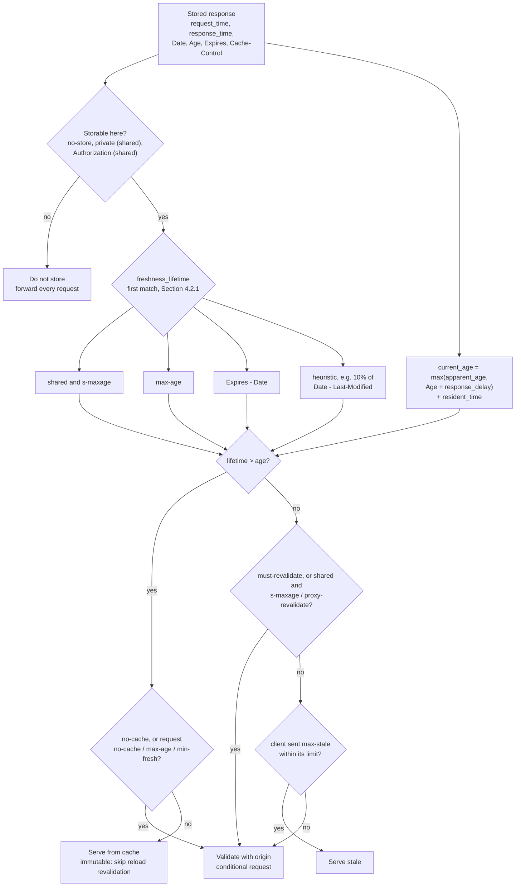

# Cache-Control Directives: max-age, s-maxage, no-cache, no-store, private, public, and immutable (RFC 9111)

> [!summary] Claim
> A cache decides "fresh" by one inequality, `freshness_lifetime > current_age` (RFC 9111 Section 4.2), where the lifetime is the first match of `s-maxage` (shared caches only), `max-age`, `Expires - Date`, or a heuristic, and the age is computed from the `Age` header, the request round trip, and the `Date` header; every other directive in this note either changes who may store the response (`no-store`, `private`, `public`) or whether a fresh or stale copy may be reused without asking the origin (`no-cache`, `must-revalidate`, `immutable`).

Part of [HTTP Caching and Conditional Requests](README.md) in [API Engineering](../README.md).

## TL;DR

- Mechanism: `freshness_lifetime` is the first match of `s-maxage` for a shared cache, then `max-age`, then `Expires` minus `Date`, then a heuristic such as 10% of `Date - Last-Modified` (RFC 9111 Sections 4.2.1, 4.2.2); `current_age = max(apparent_age, Age + response_delay) + resident_time` (RFC 9111 Section 4.2.3).
- Contract rule: `no-cache` means "store, but validate before every reuse", `no-store` means "never store", `private` means "no shared cache may store it", and `public` only widens storability; none of them is a privacy mechanism (RFC 9111 Sections 5.2.2.4, 5.2.2.5, 5.2.2.7, 5.2.2.9).
- The trap: reading `no-cache` as "do not cache", forgetting that `Set-Cookie` does not inhibit caching (RFC 9111 Section 7.3), parsing `Expires` or `Date` with Python's `email.utils.parsedate_to_datetime` (naive datetimes, non-GMT zones applied, a fixed 68 pivot for two-digit years), or a framework helper that turns `public=False` into `public`.
- Portability fact: the lab's 72 tests pass on CPython `3.12.13`, `3.13.18`, `3.14.6`, `3.14.10`, `3.15.2`, and `3.15.0b3` free-threaded on macOS, and on `3.14.10` in Debian Trixie and Alpine containers, and the stdlib date-parsing quirks they pin are identical on all of them; Starlette 1.10.0 `FileResponse` emits no `Cache-Control` at all, so its freshness is whatever heuristic each cache picks.
- When not to use it: do not use long `max-age` or `immutable` on a URL whose bytes can change, do not use `Cache-Control` to protect secrets in transit or at rest (`no-store` "is not a reliable or sufficient mechanism for ensuring privacy", RFC 9111 Section 5.2.2.5), and do not rely on request directives, which caches MAY ignore (RFC 9111 Section 5.2.1).

## Mental model



A response first passes the storage gate, which is where `no-store`, `private`, and the `Authorization` rule act; nothing downstream matters if it fails.
For a stored response, two independent numbers are computed: the lifetime, taken from the first directive or header that applies, and the age, built from the cache's own clocks plus the origin's `Date` and any upstream `Age`.
The single comparison `lifetime > age` splits the world into fresh and stale.
A fresh response is still sent for validation when the response carries an unqualified `no-cache` or the client asked for validation, and `immutable` only matters on the fresh, unvalidated path.
A stale response may be served only when no directive forbids it and the cache is disconnected or the client, the origin, or an out-of-band contract permits it (RFC 9111 Section 4.2.4), which is the boundary that [[Stale-While-Revalidate-and-Stale-If-Error-RFC-5861]] extends.

## How it works

### Wire syntax

`Cache-Control = #cache-directive` and `cache-directive = token [ "=" ( token / quoted-string ) ]` (RFC 9111 Section 5.2).
Directive names are tokens "to be compared case-insensitively", and for directives that take arguments "recipients ought to accept both forms" even though `max-age`, `s-maxage`, `max-stale`, and `min-fresh` senders MUST NOT generate the quoted form (RFC 9111 Sections 5.2, 5.2.1.1, 5.2.1.2, 5.2.1.3, 5.2.2.1, 5.2.2.10).
`no-cache` and `private` take a `#field-name` argument, and senders SHOULD use the quoted form even for one name, so `no-cache="Set-Cookie, X-Session"` is one directive whose argument contains a comma (RFC 9111 Sections 5.2.2.4, 5.2.2.7).
A parser that splits the field value on `,` before honoring quotes turns that into a `no-cache` with a broken argument plus a bogus token `X-Session"`; the lab pins this.
`Cache-Control` is a list-based field, so it may arrive as several field lines that a recipient combines with a comma (RFC 9110 Section 5.3), and `Cache-Control: max-age=60` plus `Cache-Control: no-cache` means both.
Unrecognized directives MUST be ignored (RFC 9111 Section 5.2.3), which is how `stale-while-revalidate` (RFC 5861) and `immutable` (RFC 8246) were deployed without breaking older caches.
A proxy MUST pass directives through whether or not it implements a cache, and "It is not possible to target a directive to a specific cache" (RFC 9111 Section 5.2).

`delta-seconds = 1*DIGIT`, and a cache that receives a value larger than it can represent, or whose later arithmetic overflows, MUST use `2147483648` (2^31) or its largest convenient integer, never a negative wrap (RFC 9111 Section 1.2.2).
In Python the overflow is not the risk; `int()` on a string longer than `sys.get_int_max_str_digits()` (4300 by default) raises `ValueError`, a limit the Python docs say "offers a practical way to avoid CVE 2020-10735" (quadratic-time decimal conversion, CVSS 3.1 base 7.5 on NVD), so a hostile `max-age` of 5000 digits crashes a naive parser; the lab clamps on length before calling `int()`.
`str.isdigit()` is also true for non-ASCII digits such as the Arabic-Indic digits U+0661 and U+0662, so the lab checks `isascii()` first and its regexes use `[0-9]`, not `\d`.

### Freshness lifetime: first match wins

RFC 9111 Section 4.2.1 evaluates these rules in order and uses the first match:

| Rule | Applies to | Lifetime |
|---|---|---|
| `s-maxage` present | shared caches only | its value |
| `max-age` present | all caches | its value |
| `Expires` present | all caches | `Expires - Date`, using the receive time if `Date` is absent |
| none of the above | caches allowed to use a heuristic | heuristic, Section 4.2.2 |

Because the lifetime uses `Expires - Date`, both from the origin's clock, a skewed origin clock does not change it; the note in Section 4.2.1 says the calculation "is intended to reduce clock skew by using the clock information provided by the origin server whenever possible."
`max-age` makes `Expires` irrelevant: "a recipient MUST ignore the Expires header field", and with `s-maxage` a shared cache MUST ignore it too (RFC 9111 Section 5.3).
An invalid `Expires` date, "especially the value" `"0"`, MUST be read as "already expired" (RFC 9111 Section 5.3).
For duplicates, "either the first occurrence should be used or the response should be considered stale"; for conflicts such as `max-age` with `no-cache`, "the most restrictive directive should be honored"; and a non-integer `max-age` should make the response stale (RFC 9111 Section 4.2.1).
The lab exposes the duplicate rule as a `duplicates="first" | "stale"` policy and treats malformed and valueless `max-age` and `s-maxage` as lifetime 0.

A heuristic is allowed only when there is no explicit expiration time and the status code is heuristically cacheable or the response is explicitly cacheable, for example via `public` (RFC 9111 Section 4.2.2).
The heuristically cacheable codes in RFC 9110 are `200`, `203`, `204`, `206`, `300`, `301`, `308`, `404`, `405`, `410`, `414`, and `501` (RFC 9110 Section 15.1).
`private` also lets a private cache store a response "even if the response would not otherwise be heuristically cacheable by a private cache" (RFC 9111 Section 5.2.2.7).
RFC 9111 gives no algorithm, only the encouragement to use "no more than some fraction of the interval since" `Last-Modified`, with "A typical setting of this fraction might be 10%" (RFC 9111 Section 4.2.2); the lab uses 10% with integer floor division.

### Age: the four clocks

RFC 9111 Section 4.2.3 defines `age_value` (the `Age` header, or 0), `date_value` (the `Date` header), `now`, `request_time`, and `response_time`.
The six formulas, quoted from that section with the prose between them removed (simplified excerpt of RFC 9111, not lab code):

```text
apparent_age = max(0, response_time - date_value);
response_delay = response_time - request_time;
corrected_age_value = age_value + response_delay;
corrected_initial_age = max(apparent_age, corrected_age_value);
resident_time = now - response_time;
current_age = corrected_initial_age + resident_time;
```

`corrected_age_value` "MAY be used as the corrected_initial_age", and the `max` with `apparent_age` is the conservative form for paths with old caches that do not insert `Age` (RFC 9111 Section 4.2.3).
The conservative form re-imports the origin clock into the age: an origin one hour slow makes `apparent_age` 3600, so a `max-age=600` response is stale on arrival, while the non-conservative form gives an age of one second (the lab's `test_clock_skew_conservative_age_makes_a_fresh_response_stale_on_arrival`).
`Age` is a singleton, but a cache SHOULD use the first member of a list-valued `Age` and SHOULD ignore an invalid one (RFC 9111 Section 5.1).
When a cache serves a stored response without validation it MUST generate `Age` equal to `current_age` (RFC 9111 Section 4), which is how the next cache down the path learns the response is not new.
A response without `Date` gets one from a recipient with a clock, set to the receive time (RFC 9110 Section 6.6.1); the lab does the same and uses `response_time` for a missing or invalid `Date`.

### HTTP-date is three formats, GMT only

A recipient MUST accept IMF-fixdate (`Sun, 06 Nov 1994 08:49:37 GMT`), the obsolete RFC 850 form (`Sunday, 06-Nov-94 08:49:37 GMT`), and asctime (`Sun Nov  6 08:49:37 1994`) (RFC 9110 Section 5.6.7).
A cache recipient SHOULD match case-insensitively, MUST NOT let local time zones influence the calculation, and SHOULD treat any zone abbreviation other than `GMT` as invalid (RFC 9111 Section 4.2).
A two-digit RFC 850 year that "appears to be more than 50 years in the future" is the most recent past year with those digits (RFC 9110 Section 5.6.7), so on 2026-11-09 `69` means 2069.
CPython's `email.utils.parsedate_to_datetime` is an RFC 5322 parser and disagrees in four ways that the lab asserts on every version in the matrix: it maps two-digit years 69-99 to 1969-1999 and 00-68 to 2000-2068 (CPython `Lib/email/_parseaddr.py`, `_parsedate_tz`, the `yy > 68` branch), returns a naive `datetime` for asctime and unknown zones, applies `PST` as `-0800` instead of rejecting it, and raises `ValueError` for `Expires: 0` instead of returning "already expired".
Starlette 1.10.0 uses `email.utils.parsedate` to compare `If-Modified-Since` with `Last-Modified` (starlette 1.10.0 starlette/staticfiles.py, StaticFiles.is_not_modified), which is adequate there because Starlette generated `Last-Modified` itself with `formatdate(..., usegmt=True)` (starlette 1.10.0 starlette/responses.py, FileResponse.set_stat_headers).

### What each response directive does

| Directive | Storage | Reuse | Section |
|---|---|---|---|
| `max-age=N` | makes the response explicitly cacheable | stale once age > N | RFC 9111 5.2.2.1 |
| `s-maxage=N` | cacheable by shared caches; also permits shared reuse of a response to an `Authorization` request | overrides `max-age` and `Expires` in shared caches, and implies `proxy-revalidate` there | RFC 9111 5.2.2.10, 3.5 |
| `no-cache` | may be stored | MUST NOT be reused without successful validation, "even by caches that have been configured to send stale responses" | RFC 9111 5.2.2.4 |
| `no-cache="F"` | may be stored | may be reused if field `F` is removed; "often handled by caches as if an unqualified no-cache directive was received" | RFC 9111 5.2.2.4 |
| `no-store` | MUST NOT store any part of request or response, both private and shared caches | not applicable | RFC 9111 5.2.2.5 |
| `private` | shared caches MUST NOT store; private caches MAY | normal freshness in the private cache | RFC 9111 5.2.2.7 |
| `private="F"` | shared caches may store everything except `F`; often treated as unqualified | normal | RFC 9111 5.2.2.7 |
| `public` | MAY store "even if it would otherwise be prohibited", subject to Section 3; permits shared reuse with `Authorization` | heuristic freshness if no explicit lifetime | RFC 9111 5.2.2.9 |
| `must-revalidate` | permits shared reuse with `Authorization` | once stale, never reused without validation; a disconnected cache MUST return an error, SHOULD be `504` | RFC 9111 5.2.2.2 |
| `proxy-revalidate` | does not by itself make a response cacheable | like `must-revalidate`, shared caches only | RFC 9111 5.2.2.8 |
| `must-understand` | store only if the cache implements the status code's caching rules; such a cache SHOULD then ignore the accompanying `no-store` | normal | RFC 9111 5.2.2.3 |
| `immutable` | no effect | clients SHOULD NOT send a conditional request during the freshness lifetime, for example on reload; ignore it over non-authenticated transport and on force reload | RFC 8246 Sections 2, 3 |

Section 3.5 of RFC 9111 names exactly three directives that let a shared cache reuse a response to a request with `Authorization`: `must-revalidate`, `public`, and `s-maxage`; tenant-safe use of that permission is the subject of [[Caching-Authenticated-and-Multi-Tenant-API-Responses]].
The June 2022 revision clarified that `public` and `private` "do not make responses reusable under any condition" and introduced `must-understand` (RFC 9111 Appendix B).
`immutable` takes no arguments; arguments MUST be ignored and repeats equal one instance, and RFC 8246 Section 2.1 asks proxies to skip conditional revalidation of fresh immutable responses unless the client signals otherwise, for example with request `no-cache`.

Request directives are advisory, "caches MAY implement them" (RFC 9111 Section 5.2.1): `max-age=N` prefers a response no older than N, `min-fresh=N` wants at least N seconds of freshness left, `max-stale[=N]` accepts a stale response, `no-cache` asks for validation, `no-store` forbids storing this exchange, and `only-if-cached` asks for a stored response or `504`.
A cache with several matching stored responses can disambiguate by forwarding with `Cache-Control: max-age=0` or `no-cache` (RFC 9111 Section 4).

### What the pinned Python stack emits

None of the pinned servers or frameworks inspected here computes freshness; they only emit headers (as of 2026-11).
Starlette 1.10.0 `FileResponse` sets `content-length`, `last-modified`, and `etag` and nothing about freshness (starlette 1.10.0 starlette/responses.py, FileResponse.set_stat_headers), so the in-process lab sees no `Cache-Control`, no `Expires`, and, without a server, no `Date`, and a shared cache that uses the 10% heuristic gives a file modified ten days ago one day of freshness.
Starlette's `NotModifiedResponse` copies `cache-control`, `content-location`, `date`, `etag`, `expires`, and `vary` into its `304` (starlette 1.10.0 starlette/staticfiles.py, NotModifiedResponse.NOT_MODIFIED_HEADERS); header merging on `304` is covered in [[Conditional-GET-Revalidation-and-304-Not-Modified]].
`MutableHeaders.__setitem__` replaces every existing line of that name while `MutableHeaders.append` preserves duplicates (starlette 1.10.0 starlette/datastructures.py, MutableHeaders.__setitem__ and MutableHeaders.append), so middleware that assigns `response.headers["Cache-Control"]` silently overwrites what the endpoint set.
Uvicorn 0.54.0 adds `Date` from `formatdate(current_time, usegmt=True)`, refreshed "once per second", unless `date_header=False` (uvicorn 0.54.0 uvicorn/server.py, Server.on_tick), and Hypercorn 0.18.0 adds it with `wsgiref.handlers.format_date_time` when `include_date_header` is true (hypercorn 0.18.0 hypercorn/config.py, Config.response_headers), so in production the `Date` the cache sees has one-second resolution and comes from the server process's clock.
FastAPI 0.162.0 sets `Cache-Control: no-cache` on Server-Sent Events responses (fastapi 0.162.0 fastapi/routing.py, get_request_handler), and Litestar 2.25.0 does the same with `setdefault` (litestar 2.25.0 litestar/response/sse.py, ServerSentEvent.__init__).
Litestar 2.25.0 `CacheControlHeader` is a typed builder, not an RFC 9111 parser: its `_get_header_value` emits the directive name for any `bool` value, so `public=False` serializes as `public`, and its `from_header` raises `ImproperlyConfiguredException` on `Max-Age=60`, `max-age="60"`, `no-cache="Set-Cookie"`, and any unknown extension such as `stale-if-error` (litestar 2.25.0 litestar/datastructures/headers.py, CacheControlHeader); the lab asserts all of these.

## Numbers and limits

| Quantity | Value | Source |
|---|---|---|
| `delta-seconds` overflow value | `2147483648` (2^31), "represents infinity (over 68 years)" | RFC 9111 Section 1.2.2 |
| Minimum arithmetic range for `delta-seconds` | at least 31 bits of non-negative integer | RFC 9111 Section 1.2.2 |
| Typical heuristic fraction | 10% of the time since `Last-Modified` | RFC 9111 Section 4.2.2 |
| Heuristically cacheable status codes in RFC 9110 | 12 (`200`, `203`, `204`, `206`, `300`, `301`, `308`, `404`, `405`, `410`, `414`, `501`) | RFC 9110 Section 15.1 |
| Historical `Expires` limit | "no more than a year in the future"; longer is no longer prohibited, but large values have caused 32-bit overflows | RFC 9111 Section 5.3 |
| `immutable` example lifetime | `max-age=31536000` (365 days) | RFC 8246 Section 2.2 |
| RFC 850 two-digit year window | interpret more than 50 years ahead as the past | RFC 9110 Section 5.6.7 |
| CPython integer string conversion limit | 4300 digits by default (`sys.get_int_max_str_digits()`) | Python docs, "Integer string conversion length limitation"; measured on CPython 3.14.6 in the lab |
| `Date` resolution from Uvicorn | 1 second | uvicorn 0.54.0 uvicorn/server.py, Server.on_tick |
| `parse_cache_control` on `public, max-age=60, s-maxage=300, stale-while-revalidate=30` | 2.07 to 2.31 us per call (min to max over 3 runs of `timeit.repeat(number=20000, repeat=7)`) | measured 2026-11-09 with `uv run --frozen python bench.py` from `labs/`, CPython 3.14.6, Apple M3 Pro, macOS 27.2 arm64 |
| `assess` for that response with its `Date`, in a shared cache at age 10 | 8.06 to 8.50 us per call | same command and machine |

The two timings are a one-off verification measurement with a throwaway `timeit` script, not a lab test.
`assess` costs about four parses: instrumenting it shows three `parse_cache_control` calls (the response twice, because `StoredResponse.cache_control` re-parses on every access, plus the empty request directives) and one `parse_http_date` call for `Date`; a production cache parses once at store time and keeps the result with the entry.

## Portability

| Dimension | Version | Behavior | Evidence |
|---|---|---|---|
| CPython | `3.12.13` | 72 passed; `3.12.16` from the contract matrix is not installed on this machine | lab, `UV_PROJECT_ENVIRONMENT=<tmp> uv run --frozen --python 3.12.13 pytest ...` |
| CPython | `3.13.18` | 72 passed | lab, same command with `--python 3.13` |
| CPython | `3.14.6` (workspace `.venv`) | 72 passed | lab, `uv run --frozen pytest ...` |
| CPython | `3.14.10` | 72 passed | lab, `--python 3.14.10` |
| CPython | `3.15.2` | 72 passed from the frozen workspace | lab, `--python /opt/homebrew/bin/python3.15` |
| CPython | `3.15.0b3` free-threaded (`Py_GIL_DISABLED=1`, `sys._is_gil_enabled()` False) | 72 passed | lab via `uv run --no-project --python 3.15t` with pinned `httpx`, `httpcore`, `h11`, `anyio`, `starlette`, `litestar`, `msgspec`, `pytest`, `pytest-asyncio`; the frozen lock fails because `psycopg-binary==3.3.8` has no wheel for it; `3.15.2t` was not available to uv here |
| Container | Debian Trixie (`ghcr.io/astral-sh/uv:python3.14-trixie-slim`, glibc 2.41) and Alpine (`ghcr.io/astral-sh/uv:python3.14-alpine`, musl), CPython `3.14.10`, arm64 | 72 passed each from the frozen lock | lab, `docker run` with `labs/` mounted read-only and `UV_PROJECT_ENVIRONMENT=/tmp/venv uv run --frozen pytest ...` |
| CPython stdlib | all six above | `parsedate_to_datetime`: two-digit year pivot at 68, naive results for asctime and unknown zones, `PST` applied, `ValueError` on `0`; `int()` raises past 4300 digits | lab, `test_stdlib_parsedate_to_datetime_is_not_an_http_date_parser`, `test_rfc850_two_digit_year_uses_the_fifty_year_rule_unlike_the_stdlib`, `test_delta_seconds_overflow_clamps_to_two_to_the_31` |
| Starlette | `1.10.0` | `FileResponse` emits no `Cache-Control`, `Expires`, or `Date`; `headers.append` keeps two `Cache-Control` lines | lab, `test_starlette_file_response_has_no_cache_control_so_freshness_is_heuristic`, `test_two_cache_control_lines_from_starlette_reach_the_cache_as_one_list` |
| httpx | `0.28.1` | `Headers[name]` joins duplicate lines with `", "`, which matches RFC 9110 Section 5.3 for `Cache-Control` but would corrupt `Expires` | lab, same test, for `Cache-Control` only |
| Litestar | `2.25.0` | `CacheControlHeader` serializes `False` as present and rejects valid headers | lab, `test_litestar_serializes_a_false_boolean_directive_as_present`, `test_litestar_from_header_rejects_values_that_rfc_9111_requires_caches_to_accept` |
| FastAPI | `0.162.0` | SSE responses get `Cache-Control: no-cache` | source read only (fastapi/routing.py, get_request_handler); not exercised by the lab |
| Uvicorn | `0.54.0` | adds `Date` unless `date_header=False`; no `Cache-Control` handling found by grep | source read (uvicorn/server.py, Server.on_tick); not exercised by the lab |
| Hypercorn | `0.18.0` | adds `Date` when `include_date_header` is true; no `Cache-Control` handling found by grep | source read (hypercorn/config.py, Config.response_headers); not exercised by the lab |
| Granian | `2.8.7` | its built-in static file serving sets `cache-control: max-age=<N>` from `--static-path-expires` (default `86400`, `0` disables) and no other freshness header; no other `cache-control` handling in its Rust source; this row makes no claim about `Date` | source read at tag `v2.8.7` (granian 2.8.7 src/files.rs, serve_static_file; granian 2.8.7 granian/cli.py, `--static-path-expires`); not exercised by the lab |
| HTTP/1.1, HTTP/2, HTTP/3 | RFC 9112, RFC 9113, RFC 9114 | the freshness model is version-independent; `Cache-Control` is an ordinary field in all three | RFC 9113 and RFC 9114 each define a mapping of the HTTP semantics of RFC 9110 onto frames, and RFC 9111 defines caching in terms of those semantics; RFC 9113 Section 8.4 and RFC 9114 Section 4.6 refer to RFC 9111 for caching pushed responses; not exercised by the lab |

## Worked example

The lab is a dependency-free calculator for one stored response, one cache (`shared=True` or `False`), and one request: [implementation](../labs/src/api_labs/f03_http_caching_and_conditional_requests/cache_control_freshness.py) and [test](../labs/tests/f03_http_caching_and_conditional_requests/test_cache_control_directives_and_freshness_lifetime_calculation.py).
All times are integer seconds on the cache clock, passed in explicitly, so every test is deterministic and nothing reads the wall clock.

The lifetime is a literal transcription of RFC 9111 Section 4.2.1 (verbatim excerpt from `cache_control_freshness.py`):

```python
def freshness_lifetime(
    response: StoredResponse,
    *,
    shared: bool,
    duplicates: DuplicatePolicy = "first",
    heuristic_percent: int = 10,
) -> Lifetime:
    """First match of RFC 9111 Section 4.2.1; invalid or (by policy) repeated values -> 0."""
    cc = response.cache_control
    for name, source, applies in (
        ("s-maxage", Source.S_MAXAGE, shared),
        ("max-age", Source.MAX_AGE, True),
    ):
        if applies and cc.has(name):
            seconds = delta_seconds(cc.directives.get(name))
            if seconds is None or (duplicates == "stale" and name in cc.repeated):
                return Lifetime(0, source)
            return Lifetime(seconds, source)
    date = response.date_value()
    expires = response.lines("expires")
    if expires:
        stamp = parse_http_date(expires[0], now=response.response_time)
        if stamp is None or (duplicates == "stale" and len(expires) > 1):
            return Lifetime(0, Source.EXPIRES)  # Section 5.3: invalid, including "0", is past
        return Lifetime(max(0, stamp - date), Source.EXPIRES)
    heuristic_ok = (
        response.status in HEURISTIC_STATUSES
        or cc.has("public")
        or (not shared and cc.has("private"))
    )
    modified = response.lines("last-modified")
    if heuristic_ok and modified:
        stamp = parse_http_date(modified[0], now=response.response_time)
        if stamp is not None and stamp <= date:
            return Lifetime((date - stamp) * heuristic_percent // 100, Source.HEURISTIC)
    return Lifetime(0, Source.NONE)
```

The age follows RFC 9111 Section 4.2.3 line for line, with the conservative `max` as a switch (verbatim excerpt):

```python
def current_age(response: StoredResponse, *, now: int, conservative: bool = True) -> int:
    """RFC 9111 Section 4.2.3, line for line."""
    apparent_age = max(0, response.response_time - response.date_value())
    response_delay = response.response_time - response.request_time
    corrected_age_value = age_value(response) + response_delay
    if conservative:
        corrected_initial_age = max(apparent_age, corrected_age_value)
    else:
        corrected_initial_age = corrected_age_value
    resident_time = now - response.response_time
    return min(corrected_initial_age + resident_time, DELTA_SECONDS_INFINITY)
```

`delta-seconds` is clamped by length before `int()` ever sees it (verbatim excerpt):

```python
def delta_seconds(value: str | None) -> int | None:
    """RFC 9111 Section 1.2.2 `1*DIGIT`, clamped to 2^31; None when absent or invalid."""
    if value is None or not value or not value.isascii() or not value.isdigit():
        return None
    if len(value.lstrip("0")) > _MAX_DELTA_DIGITS:
        return DELTA_SECONDS_INFINITY
    return min(int(value), DELTA_SECONDS_INFINITY)
```

The decision after storage: validation first, then fresh, then the stale-serving prohibitions of RFC 9111 Section 4.2.4 (verbatim excerpt, the tail of `assess`):

```python
    fresh = lifetime.seconds > age  # Section 4.2: response_is_fresh
    must_validate = (cc.has("no-cache") and not cc.field_names("no-cache")) or request.has(
        "no-cache"
    )
    req_max_age = delta_seconds(request.directives.get("max-age"))
    req_min_fresh = delta_seconds(request.directives.get("min-fresh"))
    if req_max_age is not None and age > req_max_age and not request.has("max-stale"):
        must_validate = True
    if req_min_fresh is not None and lifetime.seconds - age < req_min_fresh:
        must_validate = True
    if must_validate:
        return Assessment(Reuse.VALIDATE, lifetime, age, strip, False)
    if fresh:
        skip = cc.has("immutable") and secure
        return Assessment(Reuse.FRESH, lifetime, age, strip, skip)
    # Section 4.2.4: stale reuse is forbidden by these directives, whatever the client says.
    forbidden = cc.has("must-revalidate") or (
        shared and (cc.has("s-maxage") or cc.has("proxy-revalidate"))
    )
    if request.has("max-stale") and not forbidden:
        limit = delta_seconds(request.directives.get("max-stale"))
        if limit is None or age - lifetime.seconds <= limit:
            return Assessment(Reuse.STALE_OK, lifetime, age, strip, False)
    return Assessment(Reuse.VALIDATE, lifetime, age, strip, False)
```

The in-process ASGI tests run real Starlette endpoints through `httpx.ASGITransport` and feed the received field lines to the calculator (verbatim excerpt from the test module):

```python
async def _fetch(app: Starlette, path: str, *, at: int) -> StoredResponse:
    transport = httpx.ASGITransport(app=app)
    async with httpx.AsyncClient(transport=transport, base_url="http://test") as client:
        response = await client.get(path)
    return StoredResponse(response.status_code, response.headers.multi_items(), at, at)


@pytest.mark.unit
@pytest.mark.asyncio
async def test_starlette_file_response_has_no_cache_control_so_freshness_is_heuristic(
    tmp_path: Path,
) -> None:
    asset = tmp_path / "app.css"
    asset.write_bytes(b"body{}")
    os.utime(asset, (T0 - 10 * 86400, T0 - 10 * 86400))
    r = await _fetch(_app(asset), "/asset", at=T0)
    names = {name.lower() for name, _ in r.headers}
    assert "cache-control" not in names
    assert "expires" not in names
    assert "date" not in names  # no server in the loop, so the cache uses response_time
    assert "last-modified" in names
    lifetime = freshness_lifetime(r, shared=True)
    assert (lifetime.seconds, lifetime.source) == (86400, Source.HEURISTIC)


@pytest.mark.unit
@pytest.mark.asyncio
async def test_starlette_private_max_age_is_fresh_in_a_browser_and_not_storable_in_a_cdn(
    tmp_path: Path,
) -> None:
    r = await _fetch(_app(tmp_path), "/profile", at=T0)
    assert assess(r, shared=True, now=T0).reuse is Reuse.NOT_STORABLE
    assert assess(r, shared=False, now=T0 + 59).reuse is Reuse.FRESH
    # Section 4.2: fresh means freshness_lifetime > current_age, so age 60 is already stale.
    assert assess(r, shared=False, now=T0 + 60).reuse is Reuse.VALIDATE
```

The other tests cover `s-maxage` versus `max-age` per cache type, `max-age` beating a later `Expires`, `Expires - Date` under a skewed origin clock, an `Expires` earlier than `Date`, missing and invalid `Date`, invalid `Expires` including `0`, invalid and malformed `max-age`, the duplicate policy, the heuristic, its status-code gate, and its refusal of a `Last-Modified` later than `Date`, `Age` parsing and the four-clock arithmetic, clock skew under the conservative formula, the 2^31 clamp and the 4300-digit `int()` trap, case-insensitive names, quoted arguments, and backslash escapes inside them, commas inside a qualified `no-cache`, unknown extensions, multi-line `Cache-Control`, `no-cache`, `no-store` (request and response), `must-understand`, `private` (qualified and not), the `Authorization` rule, a `302` that is storable only with explicit freshness, request `max-age`, `min-fresh`, and `max-stale`, and `max-stale` relaxing request `max-age`, the stale prohibitions, `immutable`, the three HTTP-date formats, non-GMT and Unicode-digit rejection, the 50-year rule, leap seconds, the stdlib parser, and Litestar's `CacheControlHeader`.

Captured run, command `uv run --frozen pytest tests/f03_http_caching_and_conditional_requests/test_cache_control_directives_and_freshness_lifetime_calculation.py -q` from `labs/`, CPython 3.14.6, `macOS-27.2-arm64-arm-64bit-Mach-O`:

```text
........................................................................ [100%]
72 passed in 0.22s
```

An independent verification ran 21 single-mutation checks on `cache_control_freshness.py` (2026-11-09); four survived the original 68 tests (a `Last-Modified` later than `Date` producing a negative heuristic, a negative `Expires - Date`, request `max-age` ignoring `max-stale`, and backslash escapes in quoted strings), four tests were added, and 20 of 21 now fail at least one test.
The survivor is an equivalent mutant: removing the `max(0, ...)` on `apparent_age` cannot change `current_age` whenever `response_time >= request_time`, because `corrected_age_value >= 0` then always wins the conservative `max`.

## Pitfalls

> [!warning] Reading `no-cache` as "do not cache"
> Trigger: a team adds `Cache-Control: no-cache` to a response with account data, believing it keeps the data out of caches.
> Symptom: browsers and proxies store the response, which `no-cache` allows; it only forces validation before reuse (RFC 9111 Section 5.2.2.4), so the bytes sit in every cache on the path.
> Fix: use `no-store` for data that must not be stored, `private` for data that must not be stored by shared caches, and `no-cache` only to force revalidation; the lab's `test_unqualified_no_cache_forces_validation_even_when_fresh` and `test_no_store_is_not_storable_in_private_or_shared_caches` pin the difference.

> [!warning] Cacheable responses that carry `Set-Cookie`
> Trigger: a response that is cacheable by a shared cache also sets a session cookie.
> Symptom: CVE-2024-26144 (published 2024-02-27): Rails Active Storage from 5.2.0 sends a `Set-Cookie` header with the user's session cookie when serving blobs and "also sets Cache-Control to public", and "Certain proxies may cache the Set-Cookie, leading to an information leak"; fixed in 7.0.8.1 and 6.1.7.7.
> CVE-2025-48947 (published 2025-06-04): in the Auth0 Next.js SDK 4.0.1 through 4.6.0, `__session` cookies "may be cached by CDNs due to missing Cache-Control headers"; fixed in 4.6.1.
> Fix: RFC 9111 Section 7.3 states that `Set-Cookie` "does not inhibit caching"; send `private` or `no-store` on every response that sets a session, and use the qualified `no-cache="Set-Cookie"` only as defense in depth, since caches often treat it as unqualified.

> [!warning] A later `Cache-Control` assignment silently widens a protected response
> Trigger: a library sets `private` early, and the application later assigns its own `Cache-Control` with replace semantics.
> Symptom: CVE-2026-89186 (published 2026-09-16): in ZenHive `mpp` before 0.16.2, `MPP.Plug.verify_credential` set `cache-control: private`, the application's `put_resp_header` replaced it with, for example, `public, max-age=3600`, and "a CDN or reverse proxy can then store the paid 200 together with its Payment-Receipt and serve both to unpaid clients".
> Fix: enforce the most restrictive policy at the last hop before the response leaves (a final middleware or `before_send` hook), and in Starlette remember that `response.headers["Cache-Control"] = ...` replaces every existing line (starlette 1.10.0 starlette/datastructures.py, MutableHeaders.__setitem__).

> [!warning] `s-maxage` on a route that must not be shared
> Trigger: a framework emits `s-maxage` for a response it believes is static.
> Symptom: CVE-2024-46982 (published 2024-09-17): a crafted request could coerce Next.js 13.5.1 to 14.2.9 (pages router, non-dynamic SSR routes) to cache a route meant not to be cached and send `Cache-Control: s-maxage=1, stale-while-revalidate`, "which some upstream CDNs may cache as well"; fixed in 13.5.7 and 14.2.10.
> Fix: `s-maxage` alone makes a response storable by every shared cache and even permits reuse for `Authorization` requests (RFC 9111 Section 3.5); emit it only from an explicit allowlist of public routes, and test the emitted header per route.

> [!warning] Directives without a value, or with hostile values
> Trigger: `Cache-Control: max-age` (no `=`), `max-age=abc`, or a `max-age` with thousands of digits.
> Symptom: CVE-2007-1863 (published 2007-06-27): Apache httpd `mod_cache` with a threaded MPM crashed a child process on requests with `s-maxage`, `max-age`, `min-fresh`, or `max-stale` "without a value"; in CPython, `int()` on more than 4300 digits raises `ValueError` (Python docs, integer string conversion length limitation).
> Fix: treat a missing or invalid argument as "stale" (RFC 9111 Section 4.2.1), clamp by length before converting, and clamp the result to 2^31 (RFC 9111 Section 1.2.2); removing either clamp from the lab makes `test_delta_seconds_overflow_clamps_to_two_to_the_31` fail.

> [!warning] Using `email.utils` as an HTTP-date parser
> Trigger: `parsedate_to_datetime(response.headers["expires"])`.
> Symptom: `Expires: 0` raises instead of meaning "already expired", asctime and unknown zones return naive datetimes that later compare against aware ones or get local time applied, `PST` is accepted although RFC 9111 Section 4.2 says non-GMT zones SHOULD be invalid, and `06-Nov-69` becomes 1969 rather than 2069.
> Fix: use a strict HTTP-date parser that returns "invalid" for anything else and map invalid `Expires` to lifetime 0; never combine `Expires` lines with a comma, because IMF-fixdate itself contains one.

> [!warning] A typed header builder that inverts a boolean
> Trigger: `CacheControlHeader(public=is_public, max_age=60)` in Litestar 2.25.0 with `is_public=False`.
> Symptom: the header is `max-age=60, public`, because the serializer emits any `bool` field name regardless of its value; the lab asserts it.
> Fix: pass `None` for "absent", or build the header from an explicit allowlist and assert the emitted string in a contract test.

## Security and robustness

Threat model: a shared cache sits between many users and an origin, so any response it stores is potentially served to every user whose request maps to the same cache key; the directives are the origin's only in-band instructions to that cache.
`no-store` and `private` are storage instructions, not access control: RFC 9111 Section 5.2.2.5 says `no-store` "is not a reliable or sufficient mechanism for ensuring privacy" because "malicious or compromised caches might not recognize or obey this directive", and the note on `private` says it "cannot ensure the privacy of the message content" (RFC 9111 Section 5.2.2.7).
Cache contents persist after the exchange, so "cache contents need to be protected as sensitive information", and private caches can reconstruct a user's activity (RFC 9111 Section 7).

OWASP API Security Top 10 2023 mapping:
- API8:2023 Security Misconfiguration lists "Security or cache control directives are not sent to clients" as a vulnerability indicator, and its Scenario #2 is a private-conversation API whose responses lack `Cache-Control`, so "private conversations end-up cached by the web browser" and can be read from browser cache files.
- API1:2023 Broken Object Level Authorization and API3:2023 Broken Object Property Level Authorization become cache bugs when a shared cache stores a per-user response under a URL-only key; `private` or `no-store` is the origin-side control, and the key-side controls are in [[Vary-Header-Mechanics-and-Cache-Hit-Collapse]] and [[Caching-Authenticated-and-Multi-Tenant-API-Responses]].
- API4:2023 Unrestricted Resource Consumption: a hostile `max-age`, `Age`, or `max-stale` value must not crash or slow the parser (CVE-2007-1863, CVE-2020-10735), and `no-cache` on a hot endpoint turns every hit into an origin round trip.

Defense in depth for an API platform:
- Default every API response to `Cache-Control: no-store` at the edge of the application and opt specific routes into caching with an explicit policy object, so a forgotten header fails closed.
- Emit the policy last, after all handlers and middleware, and assert the final header in tests; replace semantics in middleware can widen a response (CVE-2026-89186).
- On authenticated responses, never emit `public` or `s-maxage` unless the response is identical for every caller; both override the RFC 9111 Section 3.5 protection for `Authorization`.
- Treat `immutable` as soft pinning: RFC 8246 Section 3 warns it amplifies cache corruption and poisoning, and says clients SHOULD ignore it outside an authenticated context such as HTTPS and on responses whose size is not reliably delimited.
- Parse strictly: case-insensitive names, quoted-string aware splitting, ASCII digits only, length-clamped integers, and malformed freshness treated as stale.

Edge cases the lab covers: `Max-Age="60"`, `max-age = 60`, `max-age=`, `max-age=1.5`, Arabic-Indic digits, 5000-digit values, duplicate `max-age` and `Expires`, `Expires: 0`, `Expires` in `PST`, `+0000`, or without a zone, `Age: 10, 20`, `Age: -5`, an origin clock one hour slow or 15 minutes fast, `no-cache="Set-Cookie, X-Session"`, two `Cache-Control` lines, and unknown extensions with arguments.
Poisoning and deception through unkeyed inputs are covered in [[Web-Cache-Poisoning-and-Cache-Deception-Attacks]].

## The principal's view

The architectural decision is who owns freshness policy: individual handlers that each set strings, or a platform policy layer that maps a small set of named classes (for example `private-no-store`, `public-short`, `public-versioned-immutable`) to exact headers and is enforced as the last step before the response leaves the service.
The policy layer wins on correctness and auditability: the CVEs above are all a correct-looking header that was missing, widened, or emitted on the wrong route, and a fail-closed default of `no-store` turns those into cache misses instead of leaks.
The cost is a cache hit rate that starts low and has to be earned route by route, plus a review step for every route that opts in.
Split lifetimes by audience: `max-age` controls browsers and every cache, `s-maxage` controls only shared caches and implies `proxy-revalidate` there, so `public, max-age=0, s-maxage=60` lets a CDN absorb load while browsers always revalidate.
Pair any lifetime with a validator (see [[Strong-vs-Weak-Validators-ETag-and-Last-Modified]]) so expiry costs a `304` instead of a full body, and treat `immutable` with a one-year `max-age` as appropriate only for content-addressed URLs, where a change is a new URL rather than new bytes.
Keep clock discipline in the design review: lifetimes are skew-proof only when derived from `Expires - Date` or `max-age`, but the conservative age formula re-imports origin clock error, so origins need NTP-disciplined clocks (RFC 9110 Section 5.6.7 says a clock "ought to use NTP") and dashboards should watch `Age` and [[Cache-Status-Header-for-Observability-RFC-9211]] rather than inferring hit rates.
Choose something other than HTTP caching when data is per-user and changes per request (application-level caches keyed on identity are safer), when invalidation must be immediate rather than time-bounded (see [[Cache-Invalidation-Upon-Unsafe-Methods-and-Purge-Patterns]]), or when the transport is not HTTP at all, such as gRPC streams, where freshness has to be modeled in the payload.

## Interview questions

> [!question] L5: What is the difference between `no-cache`, `no-store`, and `private`?
>
> > [!success]- Answer
> > `no-cache` allows storing but forbids reuse without successful validation with the origin (RFC 9111 Section 5.2.2.4).
> > `no-store` forbids every cache, private and shared, from storing any part of the request or response (RFC 9111 Section 5.2.2.5).
> > `private` forbids shared caches from storing the response but lets the user's own cache store it (RFC 9111 Section 5.2.2.7).
> > None of them is an access-control or encryption mechanism.
> >
> > Follow-up: Which one would you put on a login response that sets a session cookie, and why is `no-cache` the wrong choice?

> [!question] L5: Predict the output: in the lab, a response with `Cache-Control: max-age=60, s-maxage=300` and `Date` equal to the receive time is assessed at `now = T0 + 120` by a browser cache and by a CDN.
>
> > [!success]- Answer
> > The browser cache returns `Reuse.VALIDATE`, because its lifetime is `max-age` = 60 and the age is 120.
> > The CDN returns `Reuse.FRESH`, because a shared cache takes `s-maxage` = 300 first (RFC 9111 Section 4.2.1).
> > At `T0 + 400` with request `max-stale`, the browser may serve stale (`Reuse.STALE_OK`) but the CDN must validate, because `s-maxage` implies `proxy-revalidate` for shared caches (RFC 9111 Section 5.2.2.10).
> >
> > Follow-up: What changes if the CDN ignores request directives entirely, which RFC 9111 Section 5.2.1 allows?

> [!question] L5: Why does `Expires: 0` not raise a parse error in a conforming cache, and what lifetime does it produce?
>
> > [!success]- Answer
> > RFC 9111 Section 5.3 says a cache recipient MUST interpret invalid date formats, "especially the value `0`", as a time in the past.
> > The response is already expired, so its lifetime is 0 and it must be validated before reuse.
> > CPython's `email.utils.parsedate_to_datetime("0")` raises `ValueError`, so code built on it has to catch and map that to expired explicitly.
> >
> > Follow-up: If the same response also has `Cache-Control: max-age=300`, what is the lifetime?

> [!question] L6: Walk through `current_age` for a response with `Age: 100` and `Date` 100 seconds before receipt, sent 2 seconds before receipt, and checked 30 seconds after receipt.
>
> > [!success]- Answer
> > `apparent_age = max(0, 100) = 100`.
> > `response_delay = 2`, so `corrected_age_value = 100 + 2 = 102`.
> > `corrected_initial_age = max(100, 102) = 102`, and `resident_time = 30`.
> > `current_age = 132` (RFC 9111 Section 4.2.3), which is what the lab's `test_current_age_adds_age_header_response_delay_and_resident_time` asserts.
> >
> > Follow-up: Why does the RFC add the whole round trip to `Age` rather than half of it?

> [!question] L6: Debug this API: why does the CDN never serve a hit for a FastAPI route that returns `Cache-Control: public, max-age=60` from an origin whose clock is one hour slow, while other routes on healthy origins are fine?
>
> > [!success]- Answer
> > The lifetime is 60 seconds from `max-age`, but the age uses `apparent_age = response_time - date_value`, which is about 3600 because of the slow clock.
> > A cache using the conservative `corrected_initial_age = max(apparent_age, corrected_age_value)` sees age 3600 > 60 and treats every response as stale on arrival (RFC 9111 Section 4.2.3); the lab reproduces this in `test_clock_skew_conservative_age_makes_a_fresh_response_stale_on_arrival`.
> > Fix the origin clock with NTP, and confirm with the `Age` the CDN emits and its `Cache-Status`.
> >
> > Follow-up: Would sending `Expires` instead of `max-age` avoid the problem, and which part of the calculation would still be affected?

> [!question] L6: Why must a `Cache-Control` parser understand quoted strings, and what goes wrong with `value.split(",")`?
>
> > [!success]- Answer
> > `no-cache` and `private` take a quoted `#field-name` list, so `no-cache="Set-Cookie, X-Session", max-age=60` has a comma inside one directive (RFC 9111 Sections 5.2.2.4, 5.2.2.7).
> > Splitting on commas first yields `no-cache="Set-Cookie` and `X-Session"`, so the field list is wrong and a bogus directive appears.
> > `Cache-Control` can also arrive as several field lines, which must be combined before parsing (RFC 9110 Section 5.3).
> >
> > Follow-up: RFC 9111 notes caches often treat qualified `no-cache` as unqualified; what does that mean for hit rate if you rely on it?

> [!question] L6: A shared cache receives a response to a request with `Authorization`; which directives allow it to reuse the response for later requests, and what extra obligation comes with each?
>
> > [!success]- Answer
> > RFC 9111 Section 3.5 names `must-revalidate`, `public`, and `s-maxage`.
> > `must-revalidate` requires validation once stale and an error, SHOULD be `504`, if disconnected (RFC 9111 Section 5.2.2.2).
> > `s-maxage` sets the shared lifetime and implies `proxy-revalidate` (RFC 9111 Section 5.2.2.10).
> > `public` only marks it cacheable, so freshness comes from `max-age`, `Expires`, or a heuristic.
> > In all three cases the response is shared across callers, so it must not vary by identity.
> >
> > Follow-up: How would you detect in CI that an authenticated route started emitting `s-maxage`?

> [!question] L7+: As the owner of the HTTP platform for 300 services, how do you set caching policy so that the CVE classes in this note (missing headers, widened headers, cookies in cacheable responses) cannot recur?
>
> > [!success]- Answer
> > Make `no-store` the platform default and require routes to opt into a named policy class that maps to exact headers.
> > Apply the policy in the last middleware before the response leaves, so later handler code cannot widen it, and refuse any cacheable class on a response that sets a cookie (RFC 9111 Section 7.3).
> > Add contract tests that assert the emitted `Cache-Control` per route, and monitor shared-cache behavior through `Age` and `Cache-Status`.
> > The trade-off is lower initial hit rates and a review step, which is cheaper than a cross-user leak.
> >
> > Follow-up: Which teams pay the cost of this default, and how do you give them a fast, safe path to `public`?

> [!question] L7+: When is `Cache-Control: max-age=31536000, immutable` the right answer, and what are its failure modes?
>
> > [!success]- Answer
> > It is right for content-addressed or versioned URLs, where any change ships under a new URL, which is the use case RFC 8246 Section 1 describes.
> > Clients SHOULD NOT revalidate during the freshness lifetime, even on reload (RFC 8246 Section 2), so a bad deploy under the same URL is pinned in caches for up to a year.
> > RFC 8246 Section 3 calls it soft pinning that amplifies cache corruption and poisoning, and says clients SHOULD ignore it outside authenticated contexts and on force reload.
> > The recovery path is a new URL, not a purge, because private caches cannot be purged.
> >
> > Follow-up: How do you design the build and deploy pipeline so that a URL can never be reused for different bytes?

> [!question] L7+: Should an API platform rely on heuristic freshness at all?
>
> > [!success]- Answer
> > Heuristic freshness applies only without an explicit lifetime and only to heuristically cacheable status codes or explicitly cacheable responses (RFC 9111 Section 4.2.2, RFC 9110 Section 15.1).
> > RFC 9111 gives no algorithm, only a typical 10% of time since `Last-Modified`, so different caches may assign different lifetimes to the same response.
> > Starlette 1.10.0 `FileResponse` emits no `Cache-Control`, so a file modified ten days ago gets one day of freshness from a 10% cache and something else from another.
> > A platform should always send explicit directives so behavior is the same in every cache, and treat a missing `Cache-Control` as a lint failure.
> >
> > Follow-up: Which status codes in RFC 9110 are heuristically cacheable, and why does a cacheable `404` matter for an API?

## Related

Prerequisites: [[HTTP-Caching-Architecture-Private-Shared-and-Gateway-Caches]]

Next: [[Strong-vs-Weak-Validators-ETag-and-Last-Modified]]

See also: [[REST-APIs]], [[02-Programming-Languages/Python/Python-Backend-Interview-Prep/05-REST-API-Design]], [[Conditional-GET-Revalidation-and-304-Not-Modified]], [[Stale-While-Revalidate-and-Stale-If-Error-RFC-5861]], [[Caching-Authenticated-and-Multi-Tenant-API-Responses]], [[Vary-Header-Mechanics-and-Cache-Hit-Collapse]], [[Cache-Status-Header-for-Observability-RFC-9211]], [[Cache-Invalidation-Upon-Unsafe-Methods-and-Purge-Patterns]], [[Web-Cache-Poisoning-and-Cache-Deception-Attacks]], [[Client-Side-HTTP-Caching-in-Python-Clients]], [[HTTP-Message-Abstraction-RFC-9110]], [[Structured-Field-Values-for-HTTP-RFC-9651]], [[Caching-and-Invalidation]], [[DNS-and-CDN]], [[Time-Clocks-and-Ordering]]

- Lab: `labs/tests/f03_http_caching_and_conditional_requests/test_cache_control_directives_and_freshness_lifetime_calculation.py`

## Further reading

- [RFC 9111: HTTP Caching](https://www.rfc-editor.org/rfc/rfc9111.html) - the normative freshness, age, and directive definitions; Sections 4.2 and 5.2 are the core of this note, and Appendix B lists what changed from RFC 7234.
- [RFC 9110: HTTP Semantics](https://www.rfc-editor.org/rfc/rfc9110.html) - HTTP-date formats and the 50-year rule (Section 5.6.7), `Date` (Section 6.6.1), field line combination (Section 5.3), and heuristically cacheable status codes (Section 15.1).
- [RFC 8246: HTTP Immutable Responses](https://www.rfc-editor.org/rfc/rfc8246.html) - the `immutable` extension and its soft-pinning security considerations.
- [RFC 5861: HTTP Cache-Control Extensions for Stale Content](https://www.rfc-editor.org/rfc/rfc5861.html) - `stale-while-revalidate` and `stale-if-error`, the extensions RFC 9111 Section 4.2.4 points to for permitted stale serving.
- [RFC 9211: The Cache-Status HTTP Response Header Field](https://www.rfc-editor.org/rfc/rfc9211.html) - how caches report what they did, which is how you verify the directives above in production.
- [Python docs: integer string conversion length limitation](https://docs.python.org/3/library/stdtypes.html#int-max-str-digits) - the 4300-digit default that makes naive `int()` parsing of `delta-seconds` raise.
- [OWASP API8:2023 Security Misconfiguration](https://owasp.org/API-Security/editions/2023/en/0xa8-security-misconfiguration/) - missing cache directives as an API vulnerability, with a browser-cache leak example.
- [NVD CVE-2024-26144](https://nvd.nist.gov/vuln/detail/CVE-2024-26144) - Rails Active Storage sending `Set-Cookie` with `Cache-Control: public`.
- [NVD CVE-2026-89186](https://nvd.nist.gov/vuln/detail/CVE-2026-89186) - an application header overwrite turning `private` into `public`.
- [NVD CVE-2024-46982](https://nvd.nist.gov/vuln/detail/CVE-2024-46982) - Next.js emitting `s-maxage` on a route meant not to be cached.
- [NVD CVE-2007-1863](https://nvd.nist.gov/vuln/detail/CVE-2007-1863) - Apache `mod_cache` crashing on valueless freshness directives.
