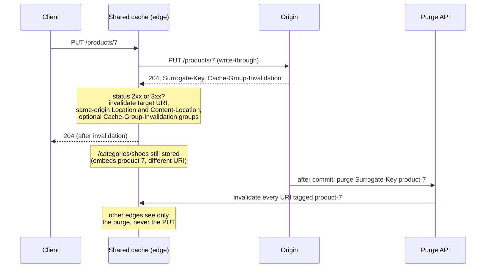

# Automatic Cache Invalidation on POST/PUT/PATCH/DELETE and Surrogate-Key Tag Purging (RFC 9111)

> [!summary] Claim
> A shared cache must invalidate the target URI after any `2xx` or `3xx` response to an unsafe method, may also invalidate same-origin `Location` and `Content-Location`, and can reach nothing else on its own; dependent views, sibling caches, and refills that are already running need tag purges (`Surrogate-Key`, `Cache-Tag`, `Cache-Groups`) sent after commit and a generation guard.

Part of [HTTP Caching and Conditional Requests](README.md) in [API Engineering](../README.md).

## TL;DR

- Mechanism: a cache forwards every unsafe request to the origin and, on a non-error status, removes or marks invalid every stored response for the target URI, and may do the same for `Location` and `Content-Location` if they are on the same origin.
- Contract rule: target-URI invalidation is a `MUST` for any method not known to be safe, including unknown methods; invalidating other URIs is a `MAY`; invalidating a URI on a different origin is a `MUST NOT` (RFC 9111 Section 4.4).
- Trap: the rule is local to each cache the write passes through and is keyed only by URI, so a listing that embeds the changed item, every other CDN POP, and a refill that read the old row before the write all stay stale, and a purge sent before commit is undone by the next miss.
- Portability: Squid 7.8 implements the rule (with a scheme-blind host check), Varnish 8.0.0's built-in VCL only passes writes through, nginx documents no invalidation and sells purging in its commercial build, and Fastly and Cloudflare document only explicit purges; the lab's 43 tests passed on CPython 3.14.6 in this pass.
- When not to use it: if consistency must hold across POPs within milliseconds, or one write fans out to thousands of URIs, do not race purges; use short `s-maxage` with revalidation, versioned URLs, or keep the resource out of the shared cache.

## Mental model



The client's `PUT` must go to the origin, because a cache may not answer an unsafe request itself (RFC 9111 Section 4).
When the origin returns `204`, the edge invalidates `/products/7` before it forwards the response, so that this client's next `GET` cannot get the old copy from this edge.
The category page embeds product 7 but lives at another URI, so the HTTP rule does not reach it; the origin, which knows that dependency, tags both responses with `product-7` and sends one purge for that key once the write has committed.
Only the purge reaches edges that never saw the `PUT`.
The edge that saw the `PUT` drops its copy in line with the request; every other edge drops its copy only when the purge arrives, which is the window every cross-POP read-after-write bug lives in.

## How it works

### The RFC 9111 rule, clause by clause

- Write-through: "A cache MUST write through requests with methods that are unsafe ... to the origin server; i.e., a cache is not allowed to generate a reply to such a request before having forwarded the request and having received a corresponding response" (RFC 9111 Section 4).
- Trigger: "A cache MUST invalidate the target URI ... when it receives a non-error status code in response to an unsafe request method (including methods whose safety is unknown)" (RFC 9111 Section 4.4).
- Non-error means `2xx` or `3xx`: "A 'non-error response' is one with a 2xx (Successful) or 3xx (Redirection) status code" (RFC 9111 Section 4.4).
  A `4xx` or `5xx` therefore triggers nothing; the RFC gives no reason, and the rule is right when the write did not happen and wrong when it partly did (see Pitfalls).
- Optional targets: "the URI(s) in the Location and Content-Location response header fields (if present) are candidates for invalidation; other URIs might be discovered through mechanisms not specified in this document" (RFC 9111 Section 4.4).
- Origin guard: "a cache MUST NOT trigger an invalidation under these conditions if the origin ... of the URI to be invalidated differs from that of the target URI ... This helps prevent denial-of-service attacks" (RFC 9111 Section 4.4).
- Meaning of invalidate: "either remove all stored responses whose target URI matches the given URI or mark them as 'invalid' and in need of a mandatory validation before they can be sent in response to a subsequent request" (RFC 9111 Section 4.4).
  "All stored responses" matters when `Vary` has stored several variants under one URI, because one invalidation must drop every variant; see [[Vary-Header-Mechanics-and-Cache-Hit-Collapse]].
- Scope: "this does not guarantee that all appropriate responses are invalidated globally; a state-changing request would only invalidate responses in the caches it travels through" (RFC 9111 Section 4.4).

Safety is a property of the method's definition, not of what the handler does.
RFC 9110 Section 9.2.1 lists `GET`, `HEAD`, `OPTIONS`, and `TRACE` as safe; method tokens are case-sensitive (RFC 9110 Section 9.1), so `get` is an unknown method and must be treated as unsafe.
`PROPFIND` is safe by its own definition (RFC 4918 Section 9.1), so it is exempt only in a cache that knows WebDAV; the lab exempts just the four RFC 9110 methods.
`PATCH` is unsafe and adds its own sentence: "If the request passes through a cache and the Request-URI identifies one or more currently cached entities, those entries SHOULD be treated as stale" (RFC 5789 Section 2).

A `POST` response can itself be stored, which is the one case where an unsafe method's response enters the cache.
"Responses to POST requests are only cacheable when they include explicit freshness information ... and a Content-Location header field that has the same value as the POST's target URI", and the stored response can then answer a later `GET` or `HEAD`, never a later `POST` (RFC 9110 Section 9.3.3).
The same response must still invalidate the earlier responses for that URI, so a cache that implements both rules replaces the entry instead of only invalidating it.

Origin comparison uses the RFC 9110 triple: scheme and host lowercased, port stripped of leading zeros, and the scheme's default port used when the port is elided (RFC 9110 Section 4.3.1).
`http://test/x` and `https://test/x` are different origins, and so are `test:80` and `test:8080`.
`http://TEST:80/x` has the same origin as `http://test/x`.
A relative `Location` is resolved against the target URI first (RFC 3986 Section 5.2); a path reference such as `/orders/9` then always has the target's origin, but a network-path reference such as `//other.example/x` is also relative and names its own host, so it still needs the origin check.

### Why the HTTP rule cannot be enough

The rule has three structural limits, and every purge system exists to cover one of them.
- Dependency: HTTP caching "operates at the granularity of a single resource; the freshness of one stored response does not affect that of others" (RFC 9875 Section 1), so a listing, a search result, or an aggregate that embeds the written entity is a different resource.
- Topology: the write traverses one path through one POP and its parents; caches on every other path never see it (RFC 9111 Section 4.4).
- Time: invalidation happens when the response passes, but a concurrent miss may already be carrying the old value toward the cache (the stale-set race below).

### Tag purging: Surrogate-Key, Cache-Tag, xkey, and Cache-Groups

All tag systems add a secondary index next to the cache key: a map from tag to the set of stored objects that carry it.
Cloudflare explains why the index is unavoidable: "Cache-tags are response headers, and the decision of where to store a file is based on request attributes only", so without an index a purge by tag would mean scanning "every file in every cache disk on every machine in every data center" (Cloudflare blog, "Instant Purge", 2024-09-24).

- Fastly `Surrogate-Key` is "proprietary to Fastly" and tells Fastly "to index that response against the specified key (or keys), as well as the cache key"; the keys "cannot be used to find and serve the content in a request, but can be used to target the content for purging" (Fastly HTTP reference, `Surrogate-Key`, as of 2026-11).
  Keys are space-separated and case-sensitive, and Fastly strips the field from client responses unless the request carries `Fastly-Debug` (Fastly guide "Working with surrogate keys", as of 2026-11).
  The purge API is `POST /service/{service_id}/purge/{surrogate_key}` for one key, `POST /service/{service_id}/purge` for a batch, and `POST /service/{service_id}/purge_all` for everything (Fastly purging API reference, as of 2026-11).
- Cloudflare `Cache-Tag` is comma-separated, case-insensitive, may appear as several field lines, must be printable ASCII with no spaces, and is removed before the response reaches the visitor or a Worker (Cloudflare "Purge cache by cache-tags", as of 2026-11).
  A purge by tag forces `MISS` on the next request, but with Tiered Cache the lower tier may report `EXPIRED` because it revalidates with the upper tier (same page).
- Varnish has no tag index in core; the `xkey` VMOD adds "secondary hashes to objects", read from the `xkey` response field with keys separated by spaces or commas, and exposes `xkey.purge()` and `xkey.softpurge()` (varnish-modules 0.19.0 src/vmod_xkey.vcc).
  Its current development branch warns that the VMOD "is currently in maintenance mode and has known performance issues, particularly regarding scalability" (varnish-modules master src/vmod_xkey.vcc, commit `1dbd55da903c`, 2024-08-22).
- RFC 9875 (October 2025) standardizes the idea for any HTTP cache:
  - `Cache-Groups` is a structured-field List of Strings naming the groups a response belongs to, and the Strings are opaque to the cache (RFC 9875 Section 2).
  - Two stored responses share a group only when the String matches character by character, case-sensitively, and the two responses have the same URI origin (RFC 9875 Section 2.1).
  - When a cache invalidates a response, it MAY invalidate the responses that share a group with it, and "this mechanism does not cascade" (RFC 9875 Section 2.2.1); a cache extension can turn the MAY into a requirement (same section).
  - `Cache-Group-Invalidation` on a response to an unsafe request names groups to invalidate, and it "MUST be ignored on responses to requests that have a safe method" (RFC 9875 Section 3).
  - Implementations must support at least 32 groups of at least 32 characters each (RFC 9875 Sections 2 and 3).
  - The mechanisms "operate within a single cache" and "do not address the issues of synchronising state between multiple caches" (RFC 9875 Section 1), so `Cache-Groups` fixes the dependency limit but not the topology limit.
  - If the value fails to parse as a List, the recipient either ignores the entire field value or treats the whole message as malformed (RFC 9651 Section 4.2); the lab ignores the field.

### How purges propagate at CDN scale

A purge that must reach every POP is a broadcast, and vendors have built it two ways.
- Lazy (timestamp) purge: Cloudflare's first flexible-purge design compared "the timestamp of any recent purge requests from the file owner to the insertion timestamp of the file we have on disk", and treated an older file as a miss; this required keeping purge history "further than a data center's maximum cache eviction age" (Cloudflare blog, "Instant Purge", 2024-09-24).
  Distribution went through Quicksilver hub and spoke, under a second to propagate, with hot-path lookups "in the low hundreds of microseconds" (same post).
- Indexed active purge: the replacement, CacheDB, is "a service written in Rust and built on RocksDB" beside each cache proxy; it indexes tags on store, queues incoming purges, deletes matches in the background, and checks pending purges on every hit so a purged object is not served even before it is deleted (same post).
- Generation number: Fastly's purge-all composes the cache key from hostname, URL, and a generation value and "takes that generation key and increments, so your data isn't actually gone - it's just no longer being served from the cache" (Fastly blog, "HashiCorp on recovering from failures", 2017-06-14).
  imgix's "critical cache token", which defined its "global cache space", is the same idea, and its 2015 outage shows what an accidental increment does (see Pitfalls).

Cloudflare's timestamp comparison and Fastly's purge-all generation are one mechanism at two scales: make old entries unreachable in O(1) and reclaim the bytes later.
The lab's per-URI generation counter applies the same compare-a-counter idea to in-flight refills rather than to stored entries, which its hard invalidation deletes directly.

### Inter-cache invalidation before CDNs: HTCP CLR

HTCP, an experimental protocol from January 2000, defines `CLR` (opcode 4) to "Tell a cache to completely forget about an entity", with a reason code where `1` means "the origin server told me that this entity does not exist" (RFC 2756 Section 6.5).
Its security section warns that without the optional `AUTH` element third parties can "view and modify a cache" (RFC 2756 Section 7).
Squid still supports it behind `htcp_clr_access`, whose default is "Deny, unless rules exist in squid.conf" (squid SQUID_7_8 src/cf.data.pre, htcp_clr_access).

### Real caches, read at their release tags

- Squid 7.8 implements RFC 9111 Section 4.4 in `Client::maybePurgeOthers`, which `Client::haveParsedReplyHeaders` calls, so the purge happens when the final reply headers are parsed, before the body is relayed (squid SQUID_7_8 src/clients/Client.cc, Client::maybePurgeOthers).
  It returns early unless `request->method.purgesOthers()`, skips responses with status `>= 400`, then purges the effective request URI, `Location`, and `Content-Location`.
  `HttpRequestMethod::purgesOthers` returns true when `shouldInvalidate` does, and otherwise for every method except a fixed list (`GET`, `HEAD`, the internal `METHOD_NONE`, `CONNECT`, `TRACE`, `OPTIONS`, `PROPFIND`, `COPY`, `LOCK`, `UNLOCK`, `SEARCH`), so unknown methods invalidate (squid SQUID_7_8 src/http/RequestMethod.cc, HttpRequestMethod::purgesOthers).
  That list is not all safe: `COPY`, `LOCK`, and `UNLOCK` are defined as not safe (RFC 4918 Sections 9.8, 9.10, and 9.11), so Squid skips a target-URI invalidation that RFC 9111 Section 4.4 requires for them.
  `purgeEntriesByHeader` resolves a relative `Location` against the request URI and checks an absolute one with `sameUrlHosts`, and its comment still cites "RFC 2616 13.10" (squid SQUID_7_8 src/clients/Client.cc, purgeEntriesByHeader).
  `sameUrlHosts` skips to the first `:`, skips the slashes, and compares bytes up to the next `/`, so it compares host and port text but never the scheme, and it is case-sensitive and port-literal (squid SQUID_7_8 src/clients/Client.cc, sameUrlHosts).
  The net effect is looser than RFC 9110 Section 4.3.1 on scheme (`http` vs `https` counts as same) and stricter on spelling (`Host` vs `host`, or `host` vs `host:80`, counts as different, which only skips an optional invalidation).
- Varnish 8.0.0's built-in VCL answers any method outside `GET`, `HEAD`, `PUT`, `POST`, `TRACE`, `OPTIONS`, `DELETE`, and `PATCH` with `synth(501)`, sends the listed methods other than `GET` and `HEAD` to `return (pass)` in `vcl_req_method` under the comment "We only deal with GET and HEAD by default", and contains no invalidation step for them (varnish-cache varnish-8.0.0 bin/varnishd/builtin.vcl, vcl_req_method).
  On a default Varnish, a `PUT` therefore leaves the stored `GET` in place until it expires or until custom VCL purges or bans it.
- nginx caches only the methods in `proxy_cache_methods`, default `GET HEAD`, and its proxy module documentation describes no invalidation triggered by other methods (nginx `ngx_http_proxy_module` documentation, as of 2026-11).
  Purging is the `proxy_cache_purge` directive, available since 1.5.7, answering `204` on success and accepting a trailing `*` wildcard, and it is "available as part of our commercial subscription" (same page).
- Fastly and Cloudflare: none of the pages read for this note (Fastly purging API, `Surrogate-Key` reference, surrogate-key guide, soft purge guide; Cloudflare purge, purge-by-tags, and invalidate pages) describes invalidation triggered by an unsafe method passing through, so plan on explicit purges; documentation silence is not proof of behavior.

### The refill race (stale set)

A cache miss that read the database before a write commits can store the old value after the invalidation has already run.
Facebook's memcache paper calls this a "stale set": "a web server sets a value in memcache that does not reflect the latest value that should be cached. This can occur when concurrent updates to memcache get reordered" (Nishtala et al., NSDI 2013, "Leases").
Their fix is a lease: "a 64-bit token bound to the specific key the client originally requested", which a later delete makes invalid, "in a manner similar to how load-link/store-conditional operates" (same section).
Meta's TAO post gives the same race with values: the fill reply "x=42" is still in flight when the database moves to 43 and the invalidation runs, leaving "x=43" in the database and "x=42" in the cache indefinitely (Engineering at Meta, "Cache made consistent", 2022-06-08).
It also names the hole in the version-number fix: if the newer entry "gets evicted from cache before 'x=42' arrives", the cache has lost the knowledge needed to reject the older fill (same post).
The lab uses a per-URI generation counter: `invalidate` increments it, and `put` stores only if the generation still equals the value read when the miss began; the counter survives eviction because it lives outside the entry.

### Purge versus invalidate (soft purge)

RFC 9111 allows two meanings of invalidate: remove, or mark invalid and require validation before reuse (RFC 9111 Section 4.4).
Vendors offer both, under different names and with a looser meaning for the second.
- Fastly soft purge (`Fastly-Soft-Purge: 1`) "marks the affected object as stale rather than making it inaccessible", which lets stale-serving and conditional revalidation reduce backend load; `purge_all` "cannot be done in soft mode", and Fastly suggests a constant surrogate key such as `"all"` on every object instead (Fastly purging API reference, as of 2026-11).
- Cloudflare's `invalidate_cache` "marks cached content as stale", and the next request revalidates with `ETag` or `Last-Modified`; with `stale-while-revalidate` it can serve stale during revalidation, and on an origin `5xx` it can serve stale "for as long as the content stays in cache" unless `stale-if-error` limits it (Cloudflare "Invalidate cached content", as of 2026-11).
- `xkey.softpurge` "resets an object's TTL but keeps it available for grace mode and conditional requests" (varnish-modules 0.19.0 src/vmod_xkey.vcc, softpurge).
All three can serve the marked object again, which RFC 9111's "invalid" does not allow; the lab's soft purge follows the RFC and forces the next `GET` forward.
Stale serving after a purge is covered in [[Stale-While-Revalidate-and-Stale-If-Error-RFC-5861]].

## Numbers and limits

| Quantity | Value | Source |
|---|---|---|
| Statuses that trigger invalidation | `200`-`399` | (RFC 9111 Section 4.4) |
| `Cache-Groups` minimum support | At least 32 groups, each at least 32 characters | (RFC 9875 Sections 2 and 3) |
| `Surrogate-Key` single-key limit | 1024 bytes; the key that crosses the limit and every key after it are ignored | Fastly HTTP reference `Surrogate-Key` (as of 2026-11) |
| `Surrogate-Key` field limit | 16,384 bytes, with the same truncation rule | Fastly HTTP reference `Surrogate-Key` (as of 2026-11) |
| Keys per Fastly batch purge request | Up to 256 | Fastly purging API reference (as of 2026-11) |
| Fastly surrogate-key and URL purge rate | Average of 100,000 purges per hour per customer, outside API rate limits; each key counts as one purge "regardless of how many objects are tagged with that key" | Fastly "Getting started with purging" (as of 2026-11) |
| Cloudflare `Cache-Tag` field | 16 KB aggregate after the field name, "approximately 1,000 unique tags"; no limit per tag in the field | Cloudflare "Purge cache by cache-tags" (as of 2026-11) |
| Cloudflare tag length in a purge API call | 1,024 characters | Cloudflare "Purge cache by cache-tags" (as of 2026-11) |
| Cloudflare tags per dashboard purge | 100 | Cloudflare "Purge cache by cache-tags" (as of 2026-11) |
| Cloudflare tag, hostname, prefix, and purge-everything rate | Free 5 per minute (bucket 25), Pro 5 per second (25), Business 10 per second (50), Enterprise 50 per second (500), token bucket per account | Cloudflare "Purge cache", availability and limits (as of 2026-11) |
| Cloudflare single-file purge rate | 800 URLs per second (Free) to 3000 (Enterprise); 100 operations per request, 500 on Enterprise | Cloudflare "Purge cache", availability and limits (as of 2026-11) |
| Cloudflare global purge latency, tags, hostnames, prefixes | P50 below 150 ms; per-region P50 115 ms to 303 ms (global 149 ms) in August 2024, against 1,000 ms to 1,420 ms per region (global 1,570 ms) in May 2022; single-file P50 234 ms | Cloudflare blog "Instant Purge", 2024-09-24 |
| Meta TAO cache consistency | From 99.9999 percent to 99.99999999 percent of cache writes consistent within five minutes | Engineering at Meta, "Cache made consistent", 2022-06-08 |
| memcache lease token rate | One token per key every 10 seconds by default | Nishtala et al., NSDI 2013, "Leases" |
| Peak DB query rate on herd-prone keys | 17K/s without leases, 1.3K/s with leases (Facebook's measurement) | Nishtala et al., NSDI 2013, "Leases" |
| Deletes that actually removed a cached item | 4% | Nishtala et al., NSDI 2013, "Regional Invalidations" |
| imgix full-cache purge to every request missing | Within 30 seconds; the incident began at 19:13 UTC, and after the cache token was rolled back error rates were normal by 21:12 UTC | imgix postmortem, 2015-12-28 |
| Lab: 9-byte keys accepted from one 2000-key field | 1638 (key n ends at byte `10n - 1`; 16379 <= 16384 < 16389); last kept key `key-01637` | `parse_surrogate_key` run in this pass, CPython 3.14.6; asserted by `test_surrogate_key_parsing_applies_fastly_limits` |
| Lab suite wall time | `43 passed in 2.17s` | `uv run --frozen pytest ... -q`, CPython 3.14.6, uv 0.11.26, macOS 27.3 arm64 (Darwin 27.3.0), 2026-11-21 |

The lab timing is one run of an in-memory suite and says nothing about purge cost; it is shown only so the captured output can be checked.

## Portability

| Runtime, cache, or protocol | Target-URI invalidation on `2xx`/`3xx` | `Location` and `Content-Location` | Evidence |
|---|---|---|---|
| CPython `3.14.6` (workspace `.python-version` is `3.14`) | Lab behavior as specified | Lab behavior as specified | `43 passed`, run in this pass, macOS 27.3 arm64 |
| CPython `3.12.13`, `3.13.18`, `3.14.10`, `3.15.2`, free-threaded `3.15.0b3t` | Lab behavior as specified | Lab behavior as specified | Recorded by the earlier job on 2026-11-10 as passing (scratch `UV_PROJECT_ENVIRONMENT`; the free-threaded leg used a scratch venv because `psycopg-binary 3.3.8` has no `3.15t` wheel); its records give 36 or 37 passed for an earlier, smaller version of the test file and no count for the current 43-test file; not re-run in this pass, because lab checks are paused (2026-11-11) |
| CPython `3.12.16`, `3.15.2t` | Not run | Not run | Not installed on the build machine |
| Debian Trixie and Alpine (musl) containers | Not run | Not run | No container leg executed; the lab is pure Python with no C extension of its own |
| `starlette 1.10.0`, `httpx 0.28.1` | Used only as the origin app and the test client | Not applicable | Lab pins |
| Uvicorn, Hypercorn, Granian | Not run | Not run | No server leg is executed or gated; an earlier one-off driver script is not in the lab and its result is not claimed here. The middleware is an ASGI callable and sees only ASGI messages, so the lab proves the rule at that layer only |
| Squid `SQUID_7_8` | Yes, status `< 400`, for every method outside a fixed list that also exempts the unsafe `COPY`, `LOCK`, and `UNLOCK` | Yes; relative URIs resolved, absolute ones checked by a scheme-blind, byte-literal host compare | (squid SQUID_7_8 src/clients/Client.cc, Client::maybePurgeOthers) |
| Varnish `8.0.0` built-in VCL | No; `PUT`, `POST`, `PATCH`, and `DELETE` `pass`, and unlisted methods get `501` | No | (varnish-cache varnish-8.0.0 bin/varnishd/builtin.vcl, vcl_req_method) |
| nginx open source | Not documented; caches `GET HEAD` by default | Not documented | nginx proxy module documentation (as of 2026-11); `proxy_cache_purge` is commercial-only |
| Fastly, Cloudflare | Not documented; purge explicitly | Not documented | Pages listed in How it works (read 2026-11-21) |
| HTTP/1.1, HTTP/2, HTTP/3 | Same rule; RFC 9111 is defined over the version-independent message abstraction | Same | (RFC 9110 Section 6); the target URI's authority comes from `Host` or `:authority` (RFC 9110 Section 7.2); only HTTP/1.1 was exercised, so the HTTP/2 and HTTP/3 cells rest on the RFC text |

## Worked example

The [implementation](../labs/src/api_labs/f03_http_caching_and_conditional_requests/invalidation.py) is an ASGI middleware, `InvalidatingCache`, wrapped around an origin app; its [test](../labs/tests/f03_http_caching_and_conditional_requests/test_cache_invalidation_upon_unsafe_methods_and_purge_patterns.py) drives it with `httpx.ASGITransport`.
It stores `GET` responses that are `200` with `max-age` or `s-maxage` and without `no-store` or `private`.
It writes through every other method, applies RFC 9111 Section 4.4, indexes stored responses by `Surrogate-Key` and by `(origin, group)` for RFC 9875, and adds a `Cache-Status` field (RFC 9211) so that tests can see `hit`, `fwd=uri-miss`, `fwd=stale`, and `fwd=method`.
Freshness lifetime, `Vary`, and `HEAD` reuse are out of scope; every stored entry is fresh until invalidated.

The rule itself, verbatim from the module:

```python
def invalidation_targets(
    method: str, target_uri: str, status: int, headers: Mapping[str, str]
) -> tuple[str, ...]:
    """URIs a cache invalidates after forwarding `method target_uri` and receiving `status`.

    `headers` maps lowercase response field names to values.
    """
    if method in SAFE_METHODS or not 200 <= status < 400:
        return ()
    target = normalize_uri(target_uri)
    target_origin = origin_of(target)
    targets = [target]
    for name in ("location", "content-location"):
        value = headers.get(name)
        if value is None:
            continue
        candidate = urljoin(target, value.strip())
        try:
            same_origin = origin_of(candidate) == target_origin
        except ValueError:
            continue
        # RFC 9111 Section 4.4: MUST NOT invalidate a URI whose origin differs from the target's.
        if same_origin and (key := normalize_uri(candidate)) not in targets:
            targets.append(key)
    return tuple(targets)
```

The write-through branch of `InvalidatingCache.__call__`, verbatim: invalidation runs before the first byte of the response is sent, which is the same point Squid chooses (`haveParsedReplyHeaders`).

```python
        status, headers, body = await _forward(self.app, scope, receive)
        if method not in SAFE_METHODS:
            self._invalidate_after_unsafe(method, target, status, headers)
        await self._reply(send, status, headers, body, "fwd=method")
```

The refill guard is two lines of `SharedCache.put`: a miss records `generation(uri)` before it forwards, and the store is refused if an invalidation moved the counter meanwhile.

The core test, verbatim: a cached product, a `PUT`, and the refetch.

```python
@pytest.mark.unit
@pytest.mark.asyncio
async def test_put_2xx_invalidates_target_uri_so_next_get_refetches() -> None:
    app = InvalidatingCache(catalogue_app())
    async with client(app) as c:
        assert (await c.get("/products/7")).json()["name"] == "boot"
        assert (await c.get("/products/7")).headers["cache-status"] == "lab; hit"
        assert (await c.put("/products/7", json={"name": "clog"})).status_code == 204
        refetched = await c.get("/products/7")
    assert refetched.json()["name"] == "clog"
    assert refetched.headers["cache-status"] == "lab; fwd=uri-miss; stored"
```

The suite also shows that:
- the category listing stays a `hit` with the old name after the `PUT`, until `purge_surrogate_key("product-7")` (`test_target_invalidation_misses_dependent_listing_until_surrogate_key_purge`);
- a `303` whose `Location` points to `https://test/victim` does not touch `http://test/victim` (`test_cross_origin_location_is_never_invalidated`);
- two edges with separate stores diverge after a `PUT` through one of them (`test_invalidation_is_local_to_the_cache_the_write_traverses`);
- a slow refill that started before the `PUT` is thrown away when the generation guard is on, and is served as `v1` when the guard is off (`test_refill_that_started_before_a_write_is_discarded`);
- `Cache-Group-Invalidation` on a `GET`, `HEAD`, or `OPTIONS` response is ignored, and group fan-out does not cascade (`test_cache_group_invalidation_is_ignored_on_safe_method_responses`, `test_group_fanout_from_uri_invalidation_does_not_cascade`);
- a soft purge forces the next `GET` to go forward (`fwd=stale`) instead of serving the marked entry (`test_soft_purge_serves_nothing_stale_and_refills_on_next_get`).

Captured run, from `labs/`, CPython 3.14.6, macOS 27.3 on arm64 (Darwin 27.3.0), `uv 0.11.26`, 2026-11-21:

```text
$ uv run --frozen pytest tests/f03_http_caching_and_conditional_requests/test_cache_invalidation_upon_unsafe_methods_and_purge_patterns.py -q
...........................................                              [100%]
43 passed in 2.17s
```

## Pitfalls

> [!warning] Dependent resources stay stale
> Trigger: `PUT /products/7` succeeds, and `/categories/shoes`, `/search?q=boot`, and the home page all embed product 7.
> Symptom: the product page is fresh, and every listing shows the old name until its TTL runs out.
> Fix: tag every response with the entities it renders (`Surrogate-Key: category-shoes product-7`, `Cache-Tag`, or `Cache-Groups`), and purge the entity key after the write commits; Fastly documents exactly this use, a product page indexed under each product it shows so "changes to a product ... automatically purge all the pages on which that product appears" (Fastly HTTP reference, `Surrogate-Key`).
> Lab: `test_target_invalidation_misses_dependent_listing_until_surrogate_key_purge`.

> [!warning] Purge before commit, or a refill races the purge
> Trigger: the API purges, then commits; or a cache miss reads the row, the write commits and purges, and then the miss stores what it read.
> Symptom: the old value comes back into the cache and stays there for a full TTL, and nothing reports an error.
> Incident: Meta's write-up on TAO and Memcache consistency uses this race as its opening example, the fill reply "x=42" landing after the invalidation for 43 and staying "in the cache indefinitely", and reports a production variant of it in the next pitfall (Engineering at Meta, "Cache made consistent", 2022-06-08); Cloudflare's cache documentation gives the ordering rule: "Update or remove the content at your origin before you purge it. Otherwise, the next request can cache the old version again" (Cloudflare "Invalidate cached content", as of 2026-11).
> Fix: purge after commit, from a transactional outbox or the commit log (Facebook's `mcsqueal` daemons read committed SQL and broadcast deletes, Nishtala et al., NSDI 2013, "Regional Invalidations"); guard refills with a lease or generation check kept outside the entry; bound the damage with a short `max-age`, which limits how long a stale set lives but does not prevent one.
> Lab: `test_refill_that_started_before_a_write_is_discarded`.

> [!warning] The invalidation error path is the one nobody tests
> Trigger: an invalidation fails transiently, and the fallback is a conditional delete such as "drop if version is older".
> Symptom: Meta found "metadata=0 @version 4" in cache against "metadata=1 @version 4" in the database: a fill had interleaved with a two-table transaction, the invalidation hit a transient error, and the handler `drop_cache(key, version)` "did nothing, leaving stale metadata in cache indefinitely" because the stale item already carried the latest version (Engineering at Meta, "Cache made consistent", 2022-06-08).
> Fix: on any invalidation failure, delete unconditionally and retry; measure consistency from outside (Meta's Polaris compares invalidation events against cache replicas) rather than trusting the absence of errors.

> [!warning] A mass purge is an origin load test you did not schedule
> Trigger: a purge-all, a broad tag, or a change to the generation or token that is part of every cache key.
> Symptom: imgix's 2015-12-28 outage: "An engineer working on a deployment inadvertently incremented a critical cache token, creating a new global cache space for all image content"; "Within 30 seconds of the change, every image request was traversing a full path", queueing turned into `502` and `503`, and recovery came from rolling the token back, after which the old cache space "proved to be nearly entirely intact" (imgix postmortem, 2015-12-28).
> Fix: treat the cache generation as protected configuration (imgix's remediation was that cache tokens "should not be programmatically accessible"); prefer narrow tags over purge-all; use soft purge or invalidate where stale is acceptable, noting that Fastly's `purge_all` cannot be soft; keep the previous generation recoverable, as Fastly support did for HashiCorp (Fastly blog, 2017-06-14).

> [!warning] An error response is a silent no-op
> Trigger: a `DELETE` returns `409`, or a `PUT` returns `500` after it partly committed.
> Symptom: every cache on the path keeps the old representation, because only `2xx` and `3xx` trigger invalidation (RFC 9111 Section 4.4), even though the origin may have changed state.
> Fix: make handlers atomic so a `5xx` means nothing changed; on any path that can partly commit, send an explicit purge from the commit hook rather than relying on the status code.
> Lab: `test_only_non_error_status_invalidates`.

> [!warning] Default Varnish and nginx do not invalidate on writes
> Trigger: an API sits behind Varnish 8.0.0 with the built-in VCL, or behind open-source nginx `proxy_cache`, and relies on RFC 9111 Section 4.4.
> Symptom: `PUT` returns `204`, and the next `GET` through the same proxy is still a hit on the old body.
> Fix: on Varnish, add VCL that bans or purges on successful unsafe methods, or tag with `xkey` and purge from the origin (varnish-cache varnish-8.0.0 bin/varnishd/builtin.vcl, vcl_req_method); on nginx, keep TTLs short or use the commercial `proxy_cache_purge` (nginx proxy module documentation).

> [!warning] Squid's origin guard ignores scheme and skips WebDAV writes
> Trigger: a response to an unsafe request on `https://host/...` carries `Location: http://host/other`, or a client sends `LOCK`, `UNLOCK`, or `COPY`.
> Symptom: Squid 7.8 purges the `http` entry, which is a different origin under RFC 9110 Section 4.3.1, and does not invalidate the target of the three WebDAV methods.
> Fix: do not assume a proxy compares full origins or classifies every method; the lab's `test_cross_origin_location_is_never_invalidated` encodes the strict reading (squid SQUID_7_8 src/clients/Client.cc, sameUrlHosts; src/http/RequestMethod.cc, HttpRequestMethod::purgesOthers).

> [!warning] Soft purge and invalidate can serve the old body
> Trigger: a team switches from hard purge to Fastly soft purge or Cloudflare `invalidate_cache` to protect the origin.
> Symptom: the marked object is served again while it revalidates, or indefinitely on origin `5xx` at Cloudflare unless `stale-if-error` limits it; and if the origin returns changed content under the same `ETag`, Cloudflare "and visitors' browsers can keep serving the old content" (Cloudflare "Invalidate cached content", as of 2026-11).
> Fix: hard purge for corrections that must not be seen again (prices, permissions, legal takedowns); soft purge only where stale is acceptable, with validators that change on every change (see [[Strong-vs-Weak-Validators-ETag-and-Last-Modified]]).
> Lab: `test_soft_purge_serves_nothing_stale_and_refills_on_next_get` (the lab follows the RFC meaning).

## Security and robustness

- Purge as denial of service: the cross-origin `MUST NOT` exists because one origin could otherwise force misses for another origin's content (RFC 9111 Section 4.4).
  Shared hosting is the same risk inside one origin: origins that represent multiple parties "might allow one party to group its resources with those of others or to send signals that have side effects upon them", and the RFC's mitigation is to "control access to the header fields" (RFC 9875 Section 5); strip `Cache-Groups` and `Cache-Group-Invalidation` from tenant responses at the edge.
- Unauthenticated purge endpoints are a recurring CVE class (CWE-862, missing authorization).
  CVE-2025-13864: the Breeze WordPress cache plugin through 2.2.21 registered `/wp-json/breeze/v1/clear-all-cache` with `permission_callback => '__return_true'`, letting unauthenticated attackers "clear all site caches (page cache, Varnish, and Cloudflare) via a simple POST request" when the API feature was enabled (NVD, CVSS 3.1 5.3).
  CVE-2023-1929: WP Fastest Cache through 1.1.2 let subscriber-level users "purge the varnish cache" through `wpfc_purgecache_varnish_callback` (NVD, CVSS 3.1 4.3).
  CVE-2024-32532: SiteGround Speed Optimizer through 7.4.6, missing authorization (NVD, CWE-862).
  Each turns a high hit ratio into full origin load on demand (OWASP API4:2023 Unrestricted Resource Consumption); authenticate purge APIs, scope tokens to purge only, and rate-limit per caller.
- In-band purge methods: the xkey example gates `PURGE` with an `acl purgers` and returns `403` otherwise, and notes it is "probably a good idea to protect this with an ACL so random people from the Internet cannot purge your cache" (varnish-modules 0.19.0 src/vmod_xkey.vcc); Squid's HTCP `CLR` is denied unless `htcp_clr_access` allows a peer (squid SQUID_7_8 src/cf.data.pre).
- Leaking tags: `Surrogate-Key` and `Cache-Tag` values often contain tenant or entity IDs; Fastly and Cloudflare strip them, and the lab does too (`test_surrogate_key_is_stripped_and_cache_status_added_for_clients`).
- Group signal on safe methods: honoring `Cache-Group-Invalidation` on a `GET` response would let anything that can make the origin reflect a header trigger invalidations; the RFC forbids it (RFC 9875 Section 3), and the lab tests it.
- Parse strictly: a `Cache-Groups` value that fails structured-field parsing is ignored as a whole, never half-applied (RFC 9651 Section 4.2 allows that or rejecting the message); `Surrogate-Key` truncation follows Fastly's rule that "the key currently being parsed and all keys following it within the same header will be ignored", so put the most important keys first.
- Case-sensitive methods: a cache that uppercases `get` before its safety check treats an unknown method as safe and skips a required invalidation (`test_method_tokens_are_case_sensitive_so_lowercase_get_is_unsafe`).
- Write-through is non-negotiable: a cache that answers a `PATCH` from storage breaks RFC 9111 Section 4 and silently drops the write (`test_unsafe_request_is_written_through_even_when_a_response_is_stored`).
- Cache poisoning and deception are covered in [[Web-Cache-Poisoning-and-Cache-Deception-Attacks]], and per-tenant keys in [[Caching-Authenticated-and-Multi-Tenant-API-Responses]].

## The principal's view

The decision is not whether to purge, but who owns the map from entity to URI.
The RFC 9111 rule is free, and correct only for the resource that was written, in the caches the write crossed.
Every API with list, search, or aggregate views needs an explicit dependency map, and the only component that knows that map is the code that renders the response.
Make tags a rendering concern: the serializer that embeds product 7 emits the `product-7` tag, so the map cannot drift from the payload.

Send the purge from the commit path, not from the request handler.
A purge sent before commit, or lost when the process crashes after commit, is a correctness bug that no test notices; an outbox or change-data-capture consumer makes the purge happen at least once after commit (see [[Transactional-Outbox-Pattern-Solving-Dual-Writes-Between-DB-and-Events]]).
Purges are idempotent, so delivering one twice is safe, and the consumer can retry blindly.
Measure the result from outside, the way Meta's Polaris does: sample invalidation events and check that reads agree within a stated window, because a dropped purge produces no error anywhere.

Budget the purge pipeline like any other dependency.
Vendor rate limits (100,000 purges per hour on Fastly; on Cloudflare, from 5 tag, hostname, or prefix purge requests per minute on Free to 50 per second on Enterprise, as of 2026-11) and tag field limits (16 KB) bound how many entities one response may embed and how many writes per second can be purged individually; above that, batch purges or switch the view to revalidation.

Know when purging is the wrong tool:
- Global read-after-write across POPs needs revalidation (`no-cache` with an `ETag`, see [[Conditional-GET-Revalidation-and-304-Not-Modified]]) or a session-pinned bypass, not a race against purge propagation, for which Cloudflare's post publishes P50 figures but no tail bound.
- Very high write rates on hot keys bring back the thundering herd that leases were built to stop (see [[Cache-Stampede-Singleflight-Coalescing-and-Probabilistic-Early-Expiration]]); a short `s-maxage` with `stale-while-revalidate` may cost the origin less than a purge on every write.
- Immutable, content-addressed URLs (`/assets/app.3f9c.js`) never need a purge.

Prefer RFC 9875 `Cache-Groups` where the caches support it, because it is vendor-neutral and scoped to one origin, but remember it only fixes dependency inside one cache, not distribution across a CDN.
Keep a vendor tag API (`Surrogate-Key`, `Cache-Tag`, `xkey`) behind one internal `purge(tags)` interface, so that changing CDN does not mean rewriting every handler.

## Interview questions

> [!question] L5: Which responses must a shared cache invalidate after `DELETE /orders/42`?
>
> > [!success]- Answer
> > If the response status is `2xx` or `3xx`, it must invalidate every stored response for the target URI `/orders/42` (RFC 9111 Section 4.4).
> > It may also invalidate the URIs in `Location` and `Content-Location` if they have the same origin.
> > A `4xx` or `5xx` response triggers nothing.
> >
> > Follow-up: Why does a `404` on the `DELETE` not trigger invalidation, even though the cached `200` is now wrong?

> [!question] L5: Is `PATCH` covered by the invalidation rule, and what about a custom method like `PURGE` or `FROB`?
>
> > [!success]- Answer
> > `PATCH` is unsafe, so it is covered, and RFC 5789 Section 2 adds that cached entries for the Request-URI should be treated as stale.
> > Unknown methods are covered too, because the rule includes "methods whose safety is unknown".
> > RFC 9110 defines `GET`, `HEAD`, `OPTIONS`, and `TRACE` as safe (RFC 9110 Section 9.2.1); a method another specification defines as safe, such as `PROPFIND` (RFC 4918 Section 9.1), is exempt only for a cache that knows that definition.
> >
> > Follow-up: Method tokens are case-sensitive; what does a strict cache do with `get /r`?

> [!question] L5 predict-the-output: What does `invalidation_targets("POST", "https://api.example.com/a", 201, {"location": "//api.example.com:443/b", "content-location": "http://api.example.com/c"})` return?
>
> > [!success]- Answer
> > `('https://api.example.com/a', 'https://api.example.com/b')`.
> > The network-path reference resolves against the `https` base, and the explicit default port `443` normalizes away.
> > `http://api.example.com/c` has a different scheme, so it is a different origin and is dropped.
> > This output was captured from the lab module on CPython 3.14.6; with status `404` the same call returns `()`.
> >
> > Follow-up: What would Squid 7.8 do with the same `Content-Location`?

> [!question] L6: A `PUT /products/7` succeeds, but `/categories/shoes` keeps showing the old name for an hour. Why, and what is the fix?
>
> > [!success]- Answer
> > RFC 9111 invalidation is keyed by URI, and the listing is a different URI that only embeds the product.
> > The cache has no way to know about that dependency.
> > Tag both responses (`Surrogate-Key: product-7`, `Cache-Tag: product-7`, or `Cache-Groups: "product-7"`) and purge the tag after commit.
> >
> > Follow-up: The listing embeds 2,000 products; what does that do to the 16 KB tag field limit and to purge fan-out?

> [!question] L6 debug-this-API: Writes go through a CDN with three POPs. A client in Frankfurt does `PUT`, then a client in Sydney reads the old value for 10 minutes, but the Frankfurt client sees the new value at once. What happened?
>
> > [!success]- Answer
> > The `PUT` went only through the Frankfurt POP, so only Frankfurt invalidated; RFC 9111 Section 4.4 says invalidation happens only in the caches the request travels through.
> > Sydney kept its copy until the TTL ran out.
> > Fix it with an explicit tag or URL purge after commit, which the CDN fans out to every POP, or with revalidation for that resource.
> >
> > Follow-up: The purge is in place, but Sydney still sometimes serves the old value after it; name the race and the fix.

> [!question] L6: Explain the stale-set race and two ways to close it.
>
> > [!success]- Answer
> > A miss reads version 1, a write commits version 2 and invalidates, and then the miss stores version 1 after the invalidation has already happened.
> > One fix is a lease or generation token taken at miss time; the store is rejected if an invalidation happened in between (Nishtala et al., NSDI 2013, "Leases").
> > The other is a short `max-age` or `s-maxage`, which bounds how long the stale copy lives but does not stop it from being stored.
> > A version stored only inside the entry is not enough, because Meta notes the newer entry can be evicted before the older fill arrives.
> >
> > Follow-up: Why are deletes preferred over updates in look-aside caches?

> [!question] L6: Squid and default Varnish both sit in front of your API; which honors RFC 9111 Section 4.4?
>
> > [!success]- Answer
> > Squid 7.8 purges the request URI, `Location`, and `Content-Location` after a final reply below `400` to a method that `purgesOthers` returns true for, at header-parse time.
> > Varnish 8.0.0's built-in VCL passes `PUT`, `POST`, `PATCH`, and `DELETE` through and does not invalidate; you must add VCL, `xkey`, or explicit purges.
> >
> > Follow-up: Squid's `sameUrlHosts` ignores scheme; is that a security problem?

> [!question] L7+: Design invalidation for a multi-tenant SaaS API behind a CDN, where tenants can define custom views over shared entities.
>
> > [!success]- Answer
> > Emit tags from the serializer, prefixed by tenant (`t42:product-7`), and strip them at the edge.
> > Send purges from an outbox consumer after commit, batched up to the vendor limit (256 keys per Fastly batch request, as of 2026-11), and rate-limit purges per tenant.
> > Never trust tenant-controlled `Cache-Group-Invalidation` (RFC 9875 Section 5), and authenticate the purge API with purge-only credentials.
> > Route resources that need cross-POP read-after-write to revalidation instead of purges.
> >
> > Follow-up: How do you notice a purge that was dropped, and what metric shows it?

> [!question] L7+: How would you build tag purge across thousands of cache machines, and what does each design cost?
>
> > [!success]- Answer
> > A lazy design stores purge records and, on each hit, compares the latest matching purge time with the object's insertion time; it is O(1) per purge but must keep purge history longer than the maximum eviction age, which Cloudflare found consumed cache disk and hit replication write limits.
> > An indexed design keeps a local tag-to-object index beside each cache (Cloudflare's CacheDB on RocksDB), deletes matches in the background, and checks pending purges on hits; it costs index writes on every store.
> > A generation number in the cache key purges everything in O(1) but cannot target a subset, and an accidental increment is a full cold start, as imgix found in 2015.
> >
> > Follow-up: Which design makes a purge recoverable, and why would you want that?

> [!question] L7+: When would you choose not to invalidate at all?
>
> > [!success]- Answer
> > For content-addressed or versioned URLs, which never change.
> > For hot keys with high write rates, where purges cause herds and a short `s-maxage` with `stale-while-revalidate` costs the origin less.
> > For strict consistency, where `no-cache` with validators gives a correctness guarantee that purge propagation cannot.
> >
> > Follow-up: How does RFC 9875's no-cascade rule bound the blast radius of a group invalidation?

## Related

Prerequisites: [[Stale-While-Revalidate-and-Stale-If-Error-RFC-5861]], [[HTTP-Method-Semantics-Safety-and-Idempotency-Invariants]], [[HTTP-Caching-Architecture-Private-Shared-and-Gateway-Caches]]

Next: [[Cache-Status-Header-for-Observability-RFC-9211]]

See also: [[02-Programming-Languages/Python/Python-Backend-Interview-Prep/06-SQL-and-SQLAlchemy]], [[Vary-Header-Mechanics-and-Cache-Hit-Collapse]], [[Cache-Stampede-Singleflight-Coalescing-and-Probabilistic-Early-Expiration]], [[Conditional-GET-Revalidation-and-304-Not-Modified]], [[Strong-vs-Weak-Validators-ETag-and-Last-Modified]], [[Cache-Control-Directives-and-Freshness-Lifetime-Calculation]], [[Caching-Authenticated-and-Multi-Tenant-API-Responses]], [[Web-Cache-Poisoning-and-Cache-Deception-Attacks]], [[Transactional-Outbox-Pattern-Solving-Dual-Writes-Between-DB-and-Events]], [[Edge-Caching-and-CDN-Shielding-for-Dynamic-and-Public-APIs]]

- Lab: `labs/tests/f03_http_caching_and_conditional_requests/test_cache_invalidation_upon_unsafe_methods_and_purge_patterns.py`

## Further reading

- [RFC 9111 Section 4.4](https://www.rfc-editor.org/rfc/rfc9111.html#name-invalidating-stored-respons): the normative invalidation rule, the cross-origin ban, and the local-scope caveat.
- [RFC 9111 Section 4](https://www.rfc-editor.org/rfc/rfc9111.html#name-constructing-responses-from): the write-through requirement for unsafe methods.
- [RFC 9110 Section 9.2.1](https://www.rfc-editor.org/rfc/rfc9110.html#name-safe-methods): which methods are safe, and why safety is a property of the method's definition.
- [RFC 9110 Section 4.3.1](https://www.rfc-editor.org/rfc/rfc9110.html#name-uri-origin): the origin triple used by the cross-origin check.
- [RFC 9110 Section 9.3.3](https://www.rfc-editor.org/rfc/rfc9110.html#name-post): when a `POST` response may be stored and reused for `GET`.
- [RFC 9875](https://www.rfc-editor.org/rfc/rfc9875.html): `Cache-Groups` and `Cache-Group-Invalidation`, the standard form of tag purging, and its single-cache scope.
- [RFC 9651 Section 4.2](https://www.rfc-editor.org/rfc/rfc9651.html#name-parsing-structured-fields): why a malformed group list is ignored as a whole.
- [RFC 5789 Section 2](https://www.rfc-editor.org/rfc/rfc5789.html#section-2): the `PATCH` cache sentence.
- [RFC 2756](https://www.rfc-editor.org/rfc/rfc2756.html): HTCP and its `CLR` opcode, the first inter-cache invalidation protocol.
- [Fastly `Surrogate-Key` reference](https://www.fastly.com/documentation/reference/http/http-headers/Surrogate-Key/): the field's semantics, size limits, and stripping behavior.
- [Fastly purging API](https://www.fastly.com/documentation/reference/api/purging.md): key, batch, and purge-all endpoints and soft purge semantics.
- [Cloudflare, "Invalidate cached content"](https://developers.cloudflare.com/cache/guides/invalidate-cache/index.md): purge versus invalidate, and the ordering rule for origin updates.
- [Cloudflare, "Instant Purge" (2024)](https://blog.cloudflare.com/instant-purge/): lazy purge, its limits, and the indexed CacheDB design, with measured P50 latencies.
- [imgix postmortem (2015-12-28)](https://status.imgix.com/incidents/xx0fyc7y3fj4): a full-cache purge by token increment and its recovery by rollback.
- [Cache made consistent (Engineering at Meta, 2022)](https://engineering.fb.com/2022/06/08/core-infra/cache-made-consistent/): the stale-fill race and an error-path invalidation bug from production, and consistency measurement with Polaris.
- [Scaling Memcache at Facebook (NSDI 2013)](https://www.usenix.org/system/files/conference/nsdi13/nsdi13-final170_update.pdf): leases against stale sets, and commit-log-driven invalidation (`mcsqueal`).
- [Squid `src/clients/Client.cc` at SQUID_7_8](https://raw.githubusercontent.com/squid-cache/squid/SQUID_7_8/src/clients/Client.cc): a production implementation of `Location` and `Content-Location` invalidation.
- [Varnish `builtin.vcl` at varnish-8.0.0](https://raw.githubusercontent.com/varnishcache/varnish-cache/varnish-8.0.0/bin/varnishd/builtin.vcl): the default `pass` with no invalidation.
- [varnish-modules `vmod_xkey.vcc` at 0.19.0](https://raw.githubusercontent.com/varnish/varnish-modules/varnish-modules-0.19.0/src/vmod_xkey.vcc): surrogate keys for Varnish, with purge and soft purge.
